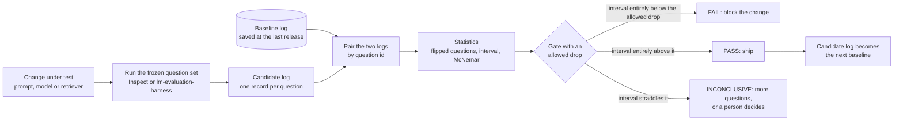

# Module 01: Evaluation in Practice: Harnesses, Inspect and Regression Gates

> **Prerequisites:** [Module 00: Anatomy of an Evaluation Harness](../00-anatomy-of-an-eval-harness/README.md) and [Module 06: Regression Testing Prompts](../../15-evaluation-observability-and-safety/06-regression-testing-prompts/README.md).  
> **Estimated Reading Time:** 80 minutes  
> **Target Audience:** AI Backend Engineers, ML Platform Engineers, Model Evaluation Leads

> [!TIP]
> **The Golden Rule of Regression Gates:** Never ship on a difference you have not put an interval around. Compare the candidate with the baseline on the same questions, report the difference with its uncertainty, and let the gate answer "I cannot tell" when that is the truth.

---

## Why This Matters

Every change to an LLM feature, whether a new prompt, a cheaper model or a different retriever, raises the same question: is the new version worse than the one in production? The usual answer is a threshold on a number: block the release if the pass rate falls below 0.80, or if the new score is lower than the old one. Two printed scores hide two things. They do not say which questions changed, and they do not say how sure anyone can be about a difference of a point or two on a few hundred questions.

In November 2024 Anthropic's alignment team summarised the fix in *A statistical approach to model evaluations*, which builds on Evan Miller's paper *Adding Error Bars to Evals* (arXiv 2411.00640). Evaluation questions are a sample from a larger universe of questions, so a score is an estimate with a standard error. When two models answer the same questions, compare them question by question, because their scores on a question are correlated: the post puts the correlation between frontier models on popular evals at about 0.3 to 0.7, and the higher it is, the smaller the standard error of the difference. And plan the number of questions with a power analysis before the run, not after it.

This module turns those recommendations into a gate that can run in CI. It starts where Module 00 stopped, with a harness that writes a log, and shows how per-question results come out of two real harnesses (Inspect and `lm-evaluation-harness`) and are paired by question id. It then builds a gate with an allowed drop and three outcomes, runs it on two real models, and uses a simulation to measure how often a threshold on two printed scores is wrong. Track 15, Module 06 already builds the paired McNemar slice gate for prompt changes; this module covers what sits around it: the data path, the interval, the margin and the number of questions.

After this module you will be able to:

- write an Inspect task (a dataset, a solver and a scorer), run it, and read its log from Python;
- keep per-question logs from `lm-evaluation-harness` and pair two runs by question id;
- compare two runs with a paired interval, a bootstrap interval and an exact McNemar p-value, and say why pairing makes the interval tighter;
- build a gate with an allowed drop and three outcomes (FAIL, PASS and INCONCLUSIVE), in four languages;
- estimate how many questions a decision needs.

---

## 1. Architectural Mental Model & Core Mechanics

A regression gate is a small pipeline around the harness of Module 00:



The change is evaluated on a frozen question set by a harness, which writes one record per question. The baseline's records, saved when it was released, are paired with the candidate's by question id. A few statistics on the pairs give a difference and its uncertainty, and the gate compares that interval with the drop the team is willing to accept. Only when the candidate ships do its records become the next baseline.

### Two Tools for Two Jobs

Module 00 used `lm-evaluation-harness`, which runs a named benchmark task on a model. Inspect, built by the UK AI Security Institute and Meridian Labs ("a framework for frontier AI evaluations", in the words of its documentation), is organised around your own task instead. They write different logs, and both can feed the same gate:

| | `lm-evaluation-harness` | Inspect |
| :--- | :--- | :--- |
| **Unit of work** | A task (a YAML file) run on a model | A `Task`: a dataset, a solver and a scorer |
| **Choosing the model** | `--model hf --model_args pretrained=...` | `--model provider/model` (for example `openai/...`), or the `INSPECT_EVAL_MODEL` environment variable |
| **What it writes** | A results JSON and, with `--log_samples`, a JSONL file of per-sample records | One log per run, by default in `./logs` as an `.eval` file |
| **Reading it back** | Plain JSON and JSONL | `read_eval_log` in `inspect_ai.log`, or `inspect view` for a browser view |
| **Key for pairing** | `doc_id`, checked with `doc_hash` | The sample `id` |
| **Reach for it when** | The benchmark exists as a task and the model can be scored by likelihood or generation | The questions are yours, and the solver or the scorer is part of what you are testing: tools, agents, graders |

### An Inspect Task: Dataset, Solver, Scorer

An Inspect task is, in the documentation's words, "minimally a dataset, a solver, and a scorer". Each maps onto a part of the harness anatomy of Module 00:

| Part | In this module's task | In Module 00's terms |
| :--- | :--- | :--- |
| **Dataset** | A `MemoryDataset` of `Sample(input, choices, target, id)` | The documents |
| **Solver** | `multiple_choice()`: builds the lettered prompt and calls the model | The prompt template and the request |
| **Scorer** | `choice()`: reads the model's `ANSWER: B` and compares it with the target | The scoring rule |
| **Log** | One `.eval` file per run, read with `read_eval_log` | The results JSON and the per-sample JSONL |

A task also has options the later modules lean on: `epochs` (answer each question several times), limits on messages, tokens and time, a `sandbox` for running untrusted code, and an `approval` policy for tool calls. Inspect's scorers include `match()`, `includes()`, `exact()`, `choice()` and the model-graded `model_graded_qa()`, and most report an `accuracy` and a `stderr`.

### Pairing: Equal Scores, Different Questions

Two runs on the same questions can be summarised as four counts: both right, only the baseline right (a **regression**), only the candidate right (an **improvement**), and neither. The accuracy of each run is a sum of two of those cells, so two runs with the same accuracy can differ in which questions they get right. Workflow 3 builds exactly that case in Inspect: two scripted models that both score 0.6667 on six questions, one losing question 4 and gaining question 6. A gate that compares two printed scores sees no change. A gate that pairs by question id sees one regression and one fix, and can show you which questions to read.

Pair by question id, never by position in a file. A harness may run questions concurrently and write them in a different order, and a pairing by position quietly compares different questions. Check before pairing that both logs hold the same ids and that each id is the same question (`lm-evaluation-harness` writes a `doc_hash` for it).

### Why Pairing Makes the Interval Tighter

The difference between two accuracies is the average of the per-question differences. If the two runs' per-question scores have the same variance and correlation ρ, the variance of that difference is proportional to 2σ²(1 - ρ). Treating the runs as unrelated samples drops the ρ and gets 2σ². So the standard error of a paired difference is smaller than the unpaired one by a factor of sqrt(1 - ρ). Models that find the same questions hard and the same questions easy have a high ρ. In practice only the questions that flipped carry information about the difference, and the paired interval is built from them.

### The Gate: Three Outcomes

A gate needs two inputs besides the data: the **allowed drop**, the loss in accuracy the team accepts without calling it a regression (two points in this module), and the interval for the change, candidate minus baseline. Comparing the whole interval with the allowed drop gives three outcomes, not two:

| The 95% interval for the change, allowed drop 0.02 | Verdict | What it means | What to do |
| :--- | :--- | :--- | :--- |
| Entirely below -0.02 | **FAIL** | Confident the candidate lost more than the team allows | Block the change |
| Entirely above -0.02 | **PASS** | Confident any loss is smaller than the team allows | Ship |
| Straddles -0.02 | **INCONCLUSIVE** | The data cannot tell | Collect more questions, or let a person decide knowing the risk |

This is the shape of a non-inferiority test. Its third outcome is the point. A threshold on two printed scores has no way to say "I do not know", so it says PASS or FAIL on noise.

### How Many Questions

The half-width of a 95% interval is about 1.96 times the standard error, and the standard error is the square root of the per-question variance of the difference divided by n. So the number of questions needed for a half-width h is about 1.96² × variance / h². The gate can only say PASS when the interval fits inside the allowed drop, which takes a half-width of about the allowed drop or less. That makes the margin and the sample size one decision. If you can afford 300 questions and your variance says you need 2,500 for a two-point margin, either the margin is wider than you thought, or INCONCLUSIVE will be the usual outcome.

### Where the Per-Question Results Come From

- **`lm-evaluation-harness`:** run with `--log_samples`. Each line of the samples file has a `doc_id`, a `doc_hash` and `prompt_hash` (hashes of the question and of the prompt), and one number per metric (`acc`, `acc_norm`). Pair on `doc_id`, and refuse to pair if the `doc_hash` of an id differs between the two files. If the `prompt_hash` differs, the two runs saw different prompts, which is a different benchmark in the sense of Module 00.
- **Inspect:** `read_eval_log(path)` returns the log; each entry of `log.samples` has an `id` and a `scores` dictionary keyed by scorer name, whose entries have a `value` that compares with the constant `CORRECT`.

---

## 2. Systematic Comparison Matrix: Five Ways to Gate a Release

The simulation in the program of Section 4 gives each design the same 300 evaluations per row, drawn from a toy model in which half the questions are hard and half easy for both models (so their results are related, with a correlation near 0.5) and the candidate is better or worse by a fixed amount. It is a model, not data: it shows how the designs behave, not how often your model fails. The allowed drop is 0.02.

| Design | What it compares | How it behaves in the simulation | Use it when |
| :--- | :--- | :--- | :--- |
| **Threshold on two printed scores** | The candidate's accuracy against the baseline's minus the allowed drop | Never says "cannot tell". With identical models it fails 25.0% of evaluations at 200 questions and 9.7% at 1,000. With a real loss of 5 points it passes 27.7% at 200 questions | Almost never. In this simulation it becomes reliable only at about 5,000 questions (0.3% false alarms, no misses), a size at which the interval designs are decisive too |
| **Unpaired interval** | Two accuracies, each with its error bar | Never passed a real loss. Least decisive: at 1,000 questions and a real 5-point loss it says FAIL in 20.3% of evaluations and INCONCLUSIVE in 79.7% | You only have the aggregates, not per-question results |
| **Paired interval (normal approximation)** | The per-question differences | Never passed a real loss, and failed identical models in at most 0.7% of evaluations. At 1,000 questions and a real 5-point loss it says FAIL in 47.3%; at 5,000 questions, in 99.0% | The default, for a metric that is a mean of per-question scores |
| **Paired bootstrap interval** | The same differences, resampled with each question's pair kept together | The same answer as the paired interval on the real data of Section 3. It makes no normal assumption | The metric is not a plain mean (an F1, a ratio), or the sample is small |
| **McNemar exact test** | Only the questions that flipped: is a flip equally likely in either direction? | A p-value for the direction of the change, with no size and no margin | You need to know whether there is a change at all; Track 15, Module 06 builds a slice gate on it |

Two things in the numbers deserve a second look. First, a gate that is rarely wrong says "I cannot tell" often: at 200 questions and no change, the paired interval answers INCONCLUSIVE in 90.3% of evaluations. That is the honest answer for 200 questions and a two-point margin. Second, the threshold's apparent sensitivity is paid for in false alarms: it catches 72.3% of real 5-point losses at 200 questions, and fails 25.0% of releases in which nothing changed.

---

## 3. Evidence Case Study: Two Real Models, One Real Decision

This section is built from two real runs of `lm-evaluation-harness`, whose output is in Workflows 1 and 2, and from the recommendations in *A statistical approach to model evaluations* (Anthropic, 19 November 2024) and *Adding Error Bars to Evals* (Miller, arXiv 2411.00640). It keeps to what they report and to what the runs printed.

### What the Literature Recommends

The Anthropic post makes five recommendations. The gate of this module implements three of them, the ones that need only the per-question results:

| Recommendation | In this module |
| :--- | :--- |
| Report the standard error of the mean, from the central limit theorem, beside each score. A 95% interval is the mean plus or minus 1.96 standard errors | Every interval in the program |
| Cluster the standard errors when questions share a source, such as several questions about one passage. On popular evals the post says clustered standard errors can be "over three times" the naive ones | Not implemented. If your questions are grouped, resample whole groups in the bootstrap |
| Reduce the variance within a question: resample the answers (Inspect's `epochs` option does this) or use next-token probabilities | Mentioned in the challenge; Inspect's `epochs` is the tool |
| Analyse **paired differences** between models, and report the mean difference, its standard error, its interval and the correlation | The paired interval, the bootstrap and the correlation line of the output |
| Do a **power analysis**: how many questions a difference of a given size needs | The `questions needed` line of the output |

### The Setup

The scenario is the cost-cutting swap every team meets: the current model is replaced by a smaller one, and the question is whether anything important was lost. The **baseline** is `EleutherAI/pythia-160m` and the **candidate** is `EleutherAI/pythia-70m`, two members of the Pythia suite (Biderman et al., 2023: 16 models from 70 million to 12 billion parameters, all trained on the same public data in the same order). Both were run with the harness of Module 00 on the first 1,000 questions of the HellaSwag validation set (Zellers et al., 2019, a commonsense benchmark in which humans scored above 95% and the best models at the time of the paper below 48%), with the same prompt and zero shots, scoring `acc_norm`. The harness's `--limit 1000` takes the first 1,000 documents in dataset order, so both runs saw the same questions. It is not a random draw, so the numbers below describe these 1,000 questions and are not a benchmark result for the two models.

### What the Two Runs Say

The harness printed `acc_norm` of **0.378 ± 0.0153** for the baseline and **0.349 ± 0.0151** for the candidate (Workflow 2). Here is what each way of looking at the same two runs says, from the output of the gate program in Workflow 1:

| What you look at | What it says |
| :--- | :--- |
| **Two printed scores** | 0.378 and 0.349, each with a standard error of about 0.015: the error bars overlap |
| **Unpaired interval for the difference** | -0.029 [-0.071, +0.013]: it includes zero, so "no detectable difference" |
| **Paired interval** | -0.029 [-0.052, -0.006]: it excludes zero, so "the candidate is worse" |
| **Bootstrap interval** | -0.029 [-0.052, -0.007]: the same answer as the paired interval |
| **McNemar exact test** | 135 questions flipped, 82 against the candidate and 53 for it: p = 0.0156 |
| **Correlation of the per-question results** | +0.710 |
| **Gate, allowed drop 0.02** | INCONCLUSIVE |
| **Threshold on the two printed scores** | FAIL |

The two printed scores look alike, and the unpaired interval agrees with them. The paired interval does not, and the reason is the correlation: the two models answer most questions the same way (296 right in both, 569 wrong in both), so only the 135 questions that flipped carry information about the difference. That is the paired-differences recommendation, on real numbers: the same data, an interval 0.54 times as wide (half-widths of 0.023 and 0.042), which is the factor sqrt(1 - 0.710) predicted in Section 1.

The verdict is subtler than either "no difference" or "worse". The interval excludes zero, so the candidate is worse. But it runs from 5.2 points to 0.6 points, so the data cannot say whether the loss exceeds the two points the team allowed: INCONCLUSIVE. The threshold on the printed scores says FAIL, because -0.029 is below -0.02. Here that points the same way as the data, but it would say the same for a true loss of 0.6 points, which the interval does not exclude, and it has no way to say how sure it is.

### How Many Questions Would Settle It

The `questions needed` line says 1,290 for a half-width of 0.02, and the sweep in Workflow 1 shows the interval narrowing as questions accumulate. To get a FAIL, the upper end of the interval has to fall below -0.02. If the difference stays where it is, -0.029, that needs a half-width under about 0.009, which at the variance of these 1,000 questions takes about 6,400 questions. HellaSwag's validation set has 10,042, so the benchmark is big enough for this gate to return a verdict even though its first 1,000 questions are not. That is a projection from the variance of these 1,000 questions, not a measurement.

### What This Does and Does Not Show

It shows the mechanics on real per-question logs: how many questions flip, how correlated two real models are, how wide the intervals are, and how a verdict changes as questions accumulate. It does not show anything about production models, and a swap between two models of 70 and 160 million parameters on a benchmark that is near chance for both is not a recommendation. The point is the procedure, and it is the same with larger models.

---

## 4. Multi-Language Production Implementation: A Paired Regression Gate

Below is a program in **Go**, **TypeScript**, **Python** and **C#** that holds the per-question results of the two real runs of Section 3 (1,000 questions each, packed four to a hex digit) and does four things:

1. **Pairs** the two runs: the four counts, the correlation between them and the exact McNemar p-value.
2. **Computes the interval** for the change three ways: paired (normal approximation), paired bootstrap (2,000 resamples of questions, with a seeded generator so every language draws the same numbers) and unpaired.
3. **Gates**: a verdict with an allowed drop of 0.02, next to what a threshold on the two printed scores would have said, the number of questions that a two-point half-width needs, and the verdict as the evaluation grows.
4. **Simulates**, as a second command because it takes longer: 300 evaluations for each combination of sample size and true change, to measure how often each design is wrong.

Run them with `go run gate.go`, `node gate.ts` (Node 24 or newer), `python gate.py` and `dotnet run Gate.cs` (.NET 10 SDK), and add `simulate` for the simulation (`dotnet run Gate.cs -- simulate`). All four print the same output, shown in Workflow 1.

````carousel

```go
// A regression gate for an evaluation: is the candidate worse than the baseline by more than we allow?
//
// Both models answered the same questions, so the gate compares them question by question (a paired comparison)
// and reports a confidence interval for the difference, not just two accuracies. Run it with: go run gate.go
package main

import (
	"fmt"
	"math"
	"os"
	"sort"
	"strconv"
	"strings"
)

// ---- the evidence: per-question results (1 = correct) of two real runs, packed four questions to a hex digit ----
const baselineHex = "8087033c8fec5881544f648b503865a04d75b62aa593b44c0493c4430c061047" +
	"6b6020a02a018850c0fa1122882848753b291c8cea0e933aa0fc8689d0e61919" +
	"09c71434014d87dd0a5abb729517590c9b0a98a00081649483197413716d4605" +
	"4d8691814c0441d78613e029e006c0e4804f00041280803c4006118608"
const candidateHex = "a08313bd8daa4881045f041b402825a049719622b512341c0489c4431c061147" +
	"eb6020213e098840c0ba812089604c753b091c8e0a0dd33a20f8848dd0828819" +
	"0383141c0149855d09de89f0151578081b021aa008a11494831e6412716e4405" +
	"45868189e80941978633b029e0020064840f0186128800344804118608"
const questions = 1000

const (
	allowedDrop        = 0.02 // the candidate may lose up to two points of accuracy without it counting as a regression
	bootstrapResamples = 2000
	seed               = 20241119
	simTrials          = 300
)

var (
	z         = 1.96                                          // 95% interval, normal approximation (a variable, so Go does not fold z*z at higher precision than the other languages)
	sweep     = []int{100, 250, 500, 1000, 2500, 5000, 10000} // the verdict on the first n questions
	simSizes  = []int{200, 1000, 5000}                        // simulation: questions per evaluation
	simDeltas = []float64{0.0, -0.05}                         // simulation: the true change in accuracy
)

// unpack expands a packed result string into n zeros and ones.
func unpack(hexDigits string, n int) []int {
	bits := []int{}
	for _, ch := range hexDigits {
		value, _ := strconv.ParseUint(string(ch), 16, 8)
		bits = append(bits, int(value>>3)&1, int(value>>2)&1, int(value>>1)&1, int(value)&1)
	}
	return bits[:n]
}

// rng is mulberry32: a small 32-bit generator, written so Go, TypeScript, Python and C# draw the same numbers.
type rng struct{ state uint32 }

func (r *rng) next() float64 {
	r.state += 0x6D2B79F5
	t := r.state
	t = (t ^ (t >> 15)) * (t | 1)
	t ^= t + (t^(t>>7))*(t|61)
	return float64(t^(t>>14)) / 4294967296.0
}

func total(values []int) int {
	sum := 0
	for _, v := range values {
		sum += v
	}
	return sum
}

func accuracy(scores []int) float64 {
	return float64(total(scores)) / float64(len(scores))
}

// pairCounts returns: both right, only the baseline right, only the candidate right, neither.
func pairCounts(base, cand []int) (int, int, int, int) {
	both, onlyBase, onlyCand := 0, 0, 0
	for i := range base {
		switch {
		case base[i] == 1 && cand[i] == 1:
			both++
		case base[i] == 1:
			onlyBase++
		case cand[i] == 1:
			onlyCand++
		}
	}
	return both, onlyBase, onlyCand, len(base) - both - onlyBase - onlyCand
}

// mcnemarExact is the exact two-sided p-value that the questions that flipped are equally likely to flip either way.
func mcnemarExact(onlyBase, onlyCand int) float64 {
	n := onlyBase + onlyCand
	if n == 0 {
		return 1.0
	}
	term := 1.0
	for i := 0; i < n; i++ {
		term *= 0.5 // 0.5 ** n, by repeated halving so every language gets the same bits
	}
	k := min(onlyBase, onlyCand)
	sum := term
	for i := 1; i <= k; i++ {
		term = term * float64(n-i+1) / float64(i)
		sum += term
	}
	return math.Min(1.0, 2.0*sum)
}

// interval is a difference with the low and high ends of its 95% interval.
type interval struct{ diff, low, high float64 }

// differenceStats is the mean and variance of the per-question difference (candidate minus baseline).
func differenceStats(base, cand []int) (float64, float64) {
	n := len(base)
	diffs := make([]int, n)
	for i := range base {
		diffs[i] = cand[i] - base[i]
	}
	mean := float64(total(diffs)) / float64(n)
	squares := 0.0
	for _, d := range diffs { // a plain loop: the same additions, in the same order, in every language
		x := float64(d) - mean
		squares += x * x
	}
	return mean, squares / float64(n-1)
}

// pairedInterval is the difference in accuracy (candidate minus baseline) with its 95% interval, from the per-question differences.
func pairedInterval(base, cand []int) interval {
	mean, variance := differenceStats(base, cand)
	se := math.Sqrt(variance / float64(len(base)))
	return interval{mean, mean - z*se, mean + z*se}
}

// questionsNeeded is how many questions it takes for the 95% interval of a difference to be no wider than plus or minus halfWidth.
func questionsNeeded(variance, halfWidth float64) int {
	return int(math.Ceil(z * z * variance / (halfWidth * halfWidth)))
}

// correlation is the correlation (phi) between the two runs' per-question results: 0 if they were unrelated, 1 if they always agreed.
func correlation(both, onlyBase, onlyCand, neither int) float64 {
	denominator := math.Sqrt(float64((both + onlyBase) * (onlyCand + neither) * (both + onlyCand) * (onlyBase + neither)))
	if denominator == 0 {
		return 0.0
	}
	return float64(both*neither-onlyBase*onlyCand) / denominator
}

// unpairedInterval is the same difference, treating the two runs as unrelated samples (what comparing two printed scores does).
func unpairedInterval(base, cand []int) interval {
	n := len(base)
	pa, pb := accuracy(base), accuracy(cand)
	se := math.Sqrt(pa*(1-pa)/float64(n-1) + pb*(1-pb)/float64(n-1))
	mean := pb - pa
	return interval{mean, mean - z*se, mean + z*se}
}

// bootstrapInterval resamples the questions with replacement, keeping each question's pair together.
func bootstrapInterval(base, cand []int, resamples int, seed uint32) interval {
	r := &rng{state: seed}
	n := len(base)
	means := make([]float64, 0, resamples)
	for k := 0; k < resamples; k++ {
		sum := 0
		for j := 0; j < n; j++ {
			i := int(r.next() * float64(n))
			sum += cand[i] - base[i]
		}
		means = append(means, float64(sum)/float64(n))
	}
	sort.Float64s(means)
	low := means[resamples*25/1000]
	high := means[(resamples*975+999)/1000-1]
	return interval{float64(total(cand))/float64(n) - float64(total(base))/float64(n), low, high}
}

// gate: FAIL when the whole interval is a drop bigger than allowed; PASS when the whole interval is a smaller drop (or a gain); otherwise the data cannot say.
func gate(low, high, allowed float64) string {
	if high < -allowed {
		return "FAIL"
	}
	if low > -allowed {
		return "PASS"
	}
	return "INCONCLUSIVE"
}

// naiveGate is what a threshold on two printed scores does.
func naiveGate(difference, allowed float64) string {
	if difference < -allowed {
		return "FAIL"
	}
	return "PASS"
}

// simulatePair is a toy evaluation: half the questions are hard (a model gets 20% of them) and half easy (90%), the same for both
// models, so their results are related; the candidate is better or worse by delta on every question.
func simulatePair(n int, delta float64, r *rng) ([]int, []int) {
	base, cand := make([]int, 0, n), make([]int, 0, n)
	for i := 0; i < n; i++ {
		p := 0.9
		if r.next() < 0.5 {
			p = 0.2
		}
		if r.next() < p {
			base = append(base, 1)
		} else {
			base = append(base, 0)
		}
		if r.next() < p+delta {
			cand = append(cand, 1)
		} else {
			cand = append(cand, 0)
		}
	}
	return base, cand
}

func intervalText(t interval) string {
	return fmt.Sprintf("%+.4f [%+.4f, %+.4f]", t.diff, t.low, t.high)
}

// simulation shows how often each design is wrong, on a toy model whose truth is known. Slower than the rest: go run gate.go simulate
func simulation() {
	fmt.Printf("Simulation: %d evaluations per row, allowed drop %v, toy model (not data)\n", simTrials, allowedDrop)
	fmt.Println("questions  true change  design         FAIL   PASS   INCONCLUSIVE")
	r := &rng{state: seed}
	order := map[string]int{"FAIL": 0, "PASS": 1, "INCONCLUSIVE": 2}
	designs := []string{"naive", "unpaired", "paired"}
	for _, n := range simSizes {
		for _, delta := range simDeltas {
			tally := [3][3]int{}
			for t := 0; t < simTrials; t++ {
				b, c := simulatePair(n, delta, r)
				un := unpairedInterval(b, c)
				pa := pairedInterval(b, c)
				tally[0][order[naiveGate(pa.diff, allowedDrop)]]++
				tally[1][order[gate(un.low, un.high, allowedDrop)]]++
				tally[2][order[gate(pa.low, pa.high, allowedDrop)]]++
			}
			for d, design := range designs {
				cells := make([]string, 3)
				for k, v := range tally[d] {
					cells[k] = fmt.Sprintf("%5.1f%%", 100*float64(v)/simTrials)
				}
				fmt.Printf("%-10d %+.2f        %-13s %s\n", n, delta, design, strings.Join(cells, "  "))
			}
		}
	}
}

func main() {
	if len(os.Args) == 2 && os.Args[1] == "simulate" {
		simulation()
		return
	}
	baselineData, candidateData, count := baselineHex, candidateHex, questions
	if len(os.Args) == 4 { // go run gate.go baseline.hex candidate.hex 10042: your own packed results instead of the ones above
		a, _ := os.ReadFile(os.Args[1])
		b, _ := os.ReadFile(os.Args[2])
		baselineData, candidateData = strings.TrimSpace(string(a)), strings.TrimSpace(string(b))
		count, _ = strconv.Atoi(os.Args[3])
	}
	base := unpack(baselineData, count)
	cand := unpack(candidateData, count)
	both, onlyBase, onlyCand, neither := pairCounts(base, cand)
	fmt.Printf("Real runs: %d questions, baseline %.3f, candidate %.3f\n", count, accuracy(base), accuracy(cand))
	fmt.Printf("pairs: both right %d, only baseline %d, only candidate %d, neither %d\n", both, onlyBase, onlyCand, neither)
	fmt.Printf("correlation of the two runs' per-question results (phi): %+.3f\n", correlation(both, onlyBase, onlyCand, neither))
	fmt.Printf("McNemar exact p = %.4f on %d questions that flipped\n", mcnemarExact(onlyBase, onlyCand), onlyBase+onlyCand)
	paired := pairedInterval(base, cand)
	unpaired := unpairedInterval(base, cand)
	boot := bootstrapInterval(base, cand, bootstrapResamples, seed)
	fmt.Printf("difference with 95%% interval, paired    %s\n", intervalText(paired))
	fmt.Printf("difference with 95%% interval, bootstrap %s\n", intervalText(boot))
	fmt.Printf("difference with 95%% interval, unpaired  %s\n", intervalText(unpaired))
	fmt.Printf("gate (allowed drop %v): %s; naive threshold: %s\n", allowedDrop, gate(paired.low, paired.high, allowedDrop), naiveGate(paired.diff, allowedDrop))
	_, variance := differenceStats(base, cand)
	fmt.Printf("questions needed for an interval of plus or minus %v at this variance: %d\n", allowedDrop, questionsNeeded(variance, allowedDrop))

	fmt.Println()
	fmt.Println("The verdict as the evaluation grows (first n questions)")
	for _, n := range sweep {
		if n > count {
			continue
		}
		t := pairedInterval(base[:n], cand[:n])
		fmt.Printf("n=%-5d %s gate %-12s naive %s\n", n, intervalText(t), gate(t.low, t.high, allowedDrop), naiveGate(t.diff, allowedDrop))
	}

}
```

<!-- slide -->

```typescript
// A regression gate for an evaluation: is the candidate worse than the baseline by more than we allow?
//
// Both models answered the same questions, so the gate compares them question by question (a paired comparison)
// and reports a confidence interval for the difference, not just two accuracies. Run it with: node gate.ts (Node 24 or newer).

import { readFileSync } from "node:fs";

// ---- the evidence: per-question results (1 = correct) of two real runs, packed four questions to a hex digit ----
const BASELINE_HEX: string = 
  "8087033c8fec5881544f648b503865a04d75b62aa593b44c0493c4430c061047" +
  "6b6020a02a018850c0fa1122882848753b291c8cea0e933aa0fc8689d0e61919" +
  "09c71434014d87dd0a5abb729517590c9b0a98a00081649483197413716d4605" +
  "4d8691814c0441d78613e029e006c0e4804f00041280803c4006118608";
const CANDIDATE_HEX: string = 
  "a08313bd8daa4881045f041b402825a049719622b512341c0489c4431c061147" +
  "eb6020213e098840c0ba812089604c753b091c8e0a0dd33a20f8848dd0828819" +
  "0383141c0149855d09de89f0151578081b021aa008a11494831e6412716e4405" +
  "45868189e80941978633b029e0020064840f0186128800344804118608";
const QUESTIONS = 1000;

const ALLOWED_DROP = 0.02; // the candidate may lose up to two points of accuracy without it counting as a regression
const Z = 1.96; // 95% interval, normal approximation
const BOOTSTRAP_RESAMPLES = 2000;
const SEED = 20241119;
const SWEEP = [100, 250, 500, 1000, 2500, 5000, 10000]; // the verdict on the first n questions
const SIM_SIZES = [200, 1000, 5000]; // simulation: questions per evaluation
const SIM_DELTAS = [0.0, -0.05]; // simulation: the true change in accuracy
const SIM_TRIALS = 300;

type Verdict = "FAIL" | "PASS" | "INCONCLUSIVE";
type Interval = [number, number, number]; // difference, low, high

/** Expand a packed result string into n zeros and ones. */
function unpack(hexDigits: string, n: number): number[] {
  const bits: number[] = [];
  for (const digit of hexDigits) {
    const value = parseInt(digit, 16);
    bits.push((value >> 3) & 1, (value >> 2) & 1, (value >> 1) & 1, value & 1);
  }
  return bits.slice(0, n);
}

/** mulberry32: a small 32-bit generator, written so Go, TypeScript, Python and C# draw the same numbers. */
class Rng {
  state: number;

  constructor(seed: number) {
    this.state = seed >>> 0;
  }

  next(): number {
    this.state = (this.state + 0x6d2b79f5) >>> 0;
    let t = this.state;
    t = Math.imul(t ^ (t >>> 15), t | 1);
    t = t ^ (t + Math.imul(t ^ (t >>> 7), t | 61));
    return ((t ^ (t >>> 14)) >>> 0) / 4294967296;
  }
}

function total(values: number[]): number {
  let sum = 0;
  for (const v of values) sum += v;
  return sum;
}

function accuracy(scores: number[]): number {
  return total(scores) / scores.length;
}

/** [both right, only the baseline right, only the candidate right, neither] */
function pairCounts(base: number[], cand: number[]): [number, number, number, number] {
  let both = 0;
  let onlyBase = 0;
  let onlyCand = 0;
  for (let i = 0; i < base.length; i++) {
    if (base[i] === 1 && cand[i] === 1) both++;
    else if (base[i] === 1) onlyBase++;
    else if (cand[i] === 1) onlyCand++;
  }
  return [both, onlyBase, onlyCand, base.length - both - onlyBase - onlyCand];
}

/** Exact two-sided p-value that the questions that flipped are equally likely to flip either way. */
function mcnemarExact(onlyBase: number, onlyCand: number): number {
  const n = onlyBase + onlyCand;
  if (n === 0) return 1.0;
  let term = 1.0;
  for (let i = 0; i < n; i++) term *= 0.5; // 0.5 ** n, by repeated halving so every language gets the same bits
  const k = Math.min(onlyBase, onlyCand);
  let sum = term;
  for (let i = 1; i <= k; i++) {
    term = (term * (n - i + 1)) / i;
    sum += term;
  }
  return Math.min(1.0, 2.0 * sum);
}

/** Mean and variance of the per-question difference (candidate minus baseline). */
function differenceStats(base: number[], cand: number[]): [number, number] {
  const n = base.length;
  const diffs = base.map((x, i) => cand[i] - x);
  const mean = total(diffs) / n;
  let squares = 0.0;
  for (const d of diffs) squares += (d - mean) * (d - mean); // a plain loop: the same additions, in the same order, in every language
  return [mean, squares / (n - 1)];
}

/** Difference in accuracy (candidate minus baseline) with its 95% interval, from the per-question differences. */
function pairedInterval(base: number[], cand: number[]): Interval {
  const [mean, variance] = differenceStats(base, cand);
  const se = Math.sqrt(variance / base.length);
  return [mean, mean - Z * se, mean + Z * se];
}

/** How many questions it takes for the 95% interval of a difference to be no wider than plus or minus halfWidth. */
function questionsNeeded(variance: number, halfWidth: number): number {
  return Math.ceil((Z * Z * variance) / (halfWidth * halfWidth));
}

/** The correlation (phi) between the two runs' per-question results: 0 if they were unrelated, 1 if they always agreed. */
function correlation(both: number, onlyBase: number, onlyCand: number, neither: number): number {
  const denominator = Math.sqrt((both + onlyBase) * (onlyCand + neither) * (both + onlyCand) * (onlyBase + neither));
  return denominator === 0 ? 0.0 : (both * neither - onlyBase * onlyCand) / denominator;
}

/** The same difference, treating the two runs as unrelated samples (what comparing two printed scores does). */
function unpairedInterval(base: number[], cand: number[]): Interval {
  const n = base.length;
  const pa = accuracy(base);
  const pb = accuracy(cand);
  const se = Math.sqrt((pa * (1 - pa)) / (n - 1) + (pb * (1 - pb)) / (n - 1));
  const mean = pb - pa;
  return [mean, mean - Z * se, mean + Z * se];
}

/** Resample the questions with replacement, keeping each question's pair together. */
function bootstrapInterval(base: number[], cand: number[], resamples: number, seed: number): Interval {
  const rng = new Rng(seed);
  const n = base.length;
  const means: number[] = [];
  for (let r = 0; r < resamples; r++) {
    let sum = 0;
    for (let j = 0; j < n; j++) {
      const i = Math.floor(rng.next() * n);
      sum += cand[i] - base[i];
    }
    means.push(sum / n);
  }
  means.sort((a, b) => a - b);
  const low = means[Math.floor((resamples * 25) / 1000)];
  const high = means[Math.floor((resamples * 975 + 999) / 1000) - 1];
  return [total(cand) / n - total(base) / n, low, high];
}

/** FAIL: the whole interval is a drop bigger than allowed. PASS: the whole interval is a smaller drop (or a gain). Otherwise the data cannot say. */
function gate(low: number, high: number, allowedDrop: number): Verdict {
  if (high < -allowedDrop) return "FAIL";
  if (low > -allowedDrop) return "PASS";
  return "INCONCLUSIVE";
}

/** What a threshold on two printed scores does. */
function naiveGate(difference: number, allowedDrop: number): Verdict {
  return difference < -allowedDrop ? "FAIL" : "PASS";
}

/**
 * A toy evaluation: half the questions are hard (a model gets 20% of them) and half easy (90%), the same for both
 * models, so their results are related; the candidate is better or worse by delta on every question.
 */
function simulatePair(n: number, delta: number, rng: Rng): [number[], number[]] {
  const base: number[] = [];
  const cand: number[] = [];
  for (let i = 0; i < n; i++) {
    const p = rng.next() < 0.5 ? 0.2 : 0.9;
    base.push(rng.next() < p ? 1 : 0);
    cand.push(rng.next() < p + delta ? 1 : 0);
  }
  return [base, cand];
}

function signed(value: number, digits: number): string {
  return (value < 0 ? "-" : "+") + Math.abs(value).toFixed(digits);
}

function intervalText(t: Interval): string {
  return `${signed(t[0], 4)} [${signed(t[1], 4)}, ${signed(t[2], 4)}]`;
}

/** How often each design is wrong, on a toy model whose truth is known. Slower than the rest: node gate.ts simulate */
function simulation(): void {
  console.log(`Simulation: ${SIM_TRIALS} evaluations per row, allowed drop ${ALLOWED_DROP}, toy model (not data)`);
  console.log("questions  true change  design         FAIL   PASS   INCONCLUSIVE");
  const rng = new Rng(SEED);
  const order: Record<Verdict, number> = { FAIL: 0, PASS: 1, INCONCLUSIVE: 2 };
  for (const n of SIM_SIZES) {
    for (const delta of SIM_DELTAS) {
      const tally: Array<[string, number[]]> = [["naive", [0, 0, 0]], ["unpaired", [0, 0, 0]], ["paired", [0, 0, 0]]];
      for (let t = 0; t < SIM_TRIALS; t++) {
        const [b, c] = simulatePair(n, delta, rng);
        const un = unpairedInterval(b, c);
        const pa = pairedInterval(b, c);
        tally[0][1][order[naiveGate(pa[0], ALLOWED_DROP)]]++;
        tally[1][1][order[gate(un[1], un[2], ALLOWED_DROP)]]++;
        tally[2][1][order[gate(pa[1], pa[2], ALLOWED_DROP)]]++;
      }
      for (const [design, row] of tally) {
        console.log(`${String(n).padEnd(10)} ${signed(delta, 2)}        ${design.padEnd(13)} ` + row.map((v) => ((100 * v) / SIM_TRIALS).toFixed(1).padStart(5) + "%").join("  "));
      }
    }
  }
}

function main(): void {
  if (process.argv.slice(2).join(" ") === "simulate") {
    simulation();
    return;
  }
  let baselineHex = BASELINE_HEX;
  let candidateHex = CANDIDATE_HEX;
  let questions = QUESTIONS;
  const given = process.argv.slice(2);
  if (given.length === 3) {
    // node gate.ts baseline.hex candidate.hex 10042: your own packed results instead of the ones above
    baselineHex = readFileSync(given[0], "utf8").trim();
    candidateHex = readFileSync(given[1], "utf8").trim();
    questions = Number(given[2]);
  }
  const base = unpack(baselineHex, questions);
  const cand = unpack(candidateHex, questions);
  const [both, onlyBase, onlyCand, neither] = pairCounts(base, cand);
  console.log(`Real runs: ${questions} questions, baseline ${accuracy(base).toFixed(3)}, candidate ${accuracy(cand).toFixed(3)}`);
  console.log(`pairs: both right ${both}, only baseline ${onlyBase}, only candidate ${onlyCand}, neither ${neither}`);
  console.log(`correlation of the two runs' per-question results (phi): ${signed(correlation(both, onlyBase, onlyCand, neither), 3)}`);
  console.log(`McNemar exact p = ${mcnemarExact(onlyBase, onlyCand).toFixed(4)} on ${onlyBase + onlyCand} questions that flipped`);
  const paired = pairedInterval(base, cand);
  const unpaired = unpairedInterval(base, cand);
  const boot = bootstrapInterval(base, cand, BOOTSTRAP_RESAMPLES, SEED);
  console.log(`difference with 95% interval, paired    ${intervalText(paired)}`);
  console.log(`difference with 95% interval, bootstrap ${intervalText(boot)}`);
  console.log(`difference with 95% interval, unpaired  ${intervalText(unpaired)}`);
  console.log(`gate (allowed drop ${ALLOWED_DROP}): ${gate(paired[1], paired[2], ALLOWED_DROP)}; naive threshold: ${naiveGate(paired[0], ALLOWED_DROP)}`);
  const needed = questionsNeeded(differenceStats(base, cand)[1], ALLOWED_DROP);
  console.log(`questions needed for an interval of plus or minus ${ALLOWED_DROP} at this variance: ${needed}`);

  console.log();
  console.log("The verdict as the evaluation grows (first n questions)");
  for (const n of SWEEP) {
    if (n > questions) continue;
    const interval = pairedInterval(base.slice(0, n), cand.slice(0, n));
    console.log(`n=${String(n).padEnd(5)} ${intervalText(interval)} gate ${gate(interval[1], interval[2], ALLOWED_DROP).padEnd(12)} naive ${naiveGate(interval[0], ALLOWED_DROP)}`);
  }

}

main();
```

<!-- slide -->

```python
"""A regression gate for an evaluation: is the candidate worse than the baseline by more than we allow?

Both models answered the same questions, so the gate compares them question by question (a paired comparison)
and reports a confidence interval for the difference, not just two accuracies. Plain Python 3, no packages.
"""
import math
import sys

# ---- the evidence: per-question results (1 = correct) of two real runs, packed four questions to a hex digit ----
BASELINE_HEX = (
    "8087033c8fec5881544f648b503865a04d75b62aa593b44c0493c4430c061047"
    "6b6020a02a018850c0fa1122882848753b291c8cea0e933aa0fc8689d0e61919"
    "09c71434014d87dd0a5abb729517590c9b0a98a00081649483197413716d4605"
    "4d8691814c0441d78613e029e006c0e4804f00041280803c4006118608"
)
CANDIDATE_HEX = (
    "a08313bd8daa4881045f041b402825a049719622b512341c0489c4431c061147"
    "eb6020213e098840c0ba812089604c753b091c8e0a0dd33a20f8848dd0828819"
    "0383141c0149855d09de89f0151578081b021aa008a11494831e6412716e4405"
    "45868189e80941978633b029e0020064840f0186128800344804118608"
)
QUESTIONS = 1000

ALLOWED_DROP = 0.02  # the candidate may lose up to two points of accuracy without it counting as a regression
Z = 1.96  # 95% interval, normal approximation
BOOTSTRAP_RESAMPLES = 2000
SEED = 20241119
SWEEP = [100, 250, 500, 1000, 2500, 5000, 10000]  # the verdict on the first n questions
SIM_SIZES = [200, 1000, 5000]  # simulation: questions per evaluation
SIM_DELTAS = [0.0, -0.05]  # simulation: the true change in accuracy
SIM_TRIALS = 300


def unpack(hex_digits, n):
    """Expand a packed result string into n zeros and ones."""
    bits = []
    for digit in hex_digits:
        value = int(digit, 16)
        bits.extend([(value >> 3) & 1, (value >> 2) & 1, (value >> 1) & 1, value & 1])
    return bits[:n]


class Rng:
    """mulberry32: a small 32-bit generator, written so Go, TypeScript, Python and C# draw the same numbers."""

    def __init__(self, seed):
        self.state = seed & 0xFFFFFFFF

    def next(self):
        self.state = (self.state + 0x6D2B79F5) & 0xFFFFFFFF
        t = self.state
        t = ((t ^ (t >> 15)) * (t | 1)) & 0xFFFFFFFF
        t = t ^ ((t + (((t ^ (t >> 7)) * (t | 61)) & 0xFFFFFFFF)) & 0xFFFFFFFF)
        return ((t ^ (t >> 14)) & 0xFFFFFFFF) / 4294967296.0


def accuracy(scores):
    return sum(scores) / len(scores)


def pair_counts(base, cand):
    """(both right, only the baseline right, only the candidate right, neither)"""
    both = sum(1 for x, y in zip(base, cand) if x == 1 and y == 1)
    only_base = sum(1 for x, y in zip(base, cand) if x == 1 and y == 0)
    only_cand = sum(1 for x, y in zip(base, cand) if x == 0 and y == 1)
    return both, only_base, only_cand, len(base) - both - only_base - only_cand


def mcnemar_exact(only_base, only_cand):
    """Exact two-sided p-value that the questions that flipped are equally likely to flip either way."""
    n = only_base + only_cand
    if n == 0:
        return 1.0
    term = 1.0
    for _ in range(n):
        term *= 0.5  # 0.5 ** n, by repeated halving so every language gets the same bits
    k = min(only_base, only_cand)
    total = term
    for i in range(1, k + 1):
        term = term * (n - i + 1) / i
        total += term
    return min(1.0, 2.0 * total)


def difference_stats(base, cand):
    """Mean and variance of the per-question difference (candidate minus baseline)."""
    n = len(base)
    diffs = [y - x for x, y in zip(base, cand)]
    mean = sum(diffs) / n
    squares = 0.0
    for d in diffs:  # a plain loop: the same additions, in the same order, in every language
        squares += (d - mean) * (d - mean)
    return mean, squares / (n - 1)


def paired_interval(base, cand):
    """Difference in accuracy (candidate minus baseline) with its 95% interval, from the per-question differences."""
    mean, variance = difference_stats(base, cand)
    se = math.sqrt(variance / len(base))
    return mean, mean - Z * se, mean + Z * se


def questions_needed(variance, half_width):
    """How many questions it takes for the 95% interval of a difference to be no wider than plus or minus half_width."""
    return math.ceil(Z * Z * variance / (half_width * half_width))


def correlation(both, only_base, only_cand, neither):
    """The correlation (phi) between the two runs' per-question results: 0 if they were unrelated, 1 if they always agreed."""
    denominator = math.sqrt((both + only_base) * (only_cand + neither) * (both + only_cand) * (only_base + neither))
    return 0.0 if denominator == 0 else (both * neither - only_base * only_cand) / denominator


def unpaired_interval(base, cand):
    """The same difference, treating the two runs as unrelated samples (what comparing two printed scores does)."""
    n = len(base)
    pa, pb = accuracy(base), accuracy(cand)
    se = math.sqrt(pa * (1 - pa) / (n - 1) + pb * (1 - pb) / (n - 1))
    mean = pb - pa
    return mean, mean - Z * se, mean + Z * se


def bootstrap_interval(base, cand, resamples, seed):
    """Resample the questions with replacement, keeping each question's pair together."""
    rng = Rng(seed)
    n = len(base)
    means = []
    for _ in range(resamples):
        total = 0
        for _ in range(n):
            i = int(rng.next() * n)
            total += cand[i] - base[i]
        means.append(total / n)
    means.sort()
    low = means[resamples * 25 // 1000]
    high = means[(resamples * 975 + 999) // 1000 - 1]
    return sum(cand) / n - sum(base) / n, low, high


def gate(low, high, allowed_drop):
    """FAIL: the whole interval is a drop bigger than allowed. PASS: the whole interval is a smaller drop (or a gain). Otherwise the data cannot say."""
    if high < -allowed_drop:
        return "FAIL"
    if low > -allowed_drop:
        return "PASS"
    return "INCONCLUSIVE"


def naive_gate(difference, allowed_drop):
    """What a threshold on two printed scores does."""
    return "FAIL" if difference < -allowed_drop else "PASS"


def simulate_pair(n, delta, rng):
    """A toy evaluation: half the questions are hard (a model gets 20% of them) and half easy (90%), the same for both
    models, so their results are related; the candidate is better or worse by delta on every question."""
    base, cand = [], []
    for _ in range(n):
        p = 0.2 if rng.next() < 0.5 else 0.9
        base.append(1 if rng.next() < p else 0)
        cand.append(1 if rng.next() < p + delta else 0)
    return base, cand


def fmt(value):
    return f"{value:+.4f}"


def interval_text(triple):
    return f"{fmt(triple[0])} [{fmt(triple[1])}, {fmt(triple[2])}]"


def simulation():
    """How often each design is wrong, on a toy model whose truth is known. Slower than the rest: python gate.py simulate"""
    print(f"Simulation: {SIM_TRIALS} evaluations per row, allowed drop {ALLOWED_DROP}, toy model (not data)")
    print("questions  true change  design         FAIL   PASS   INCONCLUSIVE")
    rng = Rng(SEED)
    for n in SIM_SIZES:
        for delta in SIM_DELTAS:
            tally = {"naive": [0, 0, 0], "unpaired": [0, 0, 0], "paired": [0, 0, 0]}
            order = {"FAIL": 0, "PASS": 1, "INCONCLUSIVE": 2}
            for _ in range(SIM_TRIALS):
                b, c = simulate_pair(n, delta, rng)
                un = unpaired_interval(b, c)
                pa = paired_interval(b, c)
                tally["naive"][order[naive_gate(pa[0], ALLOWED_DROP)]] += 1
                tally["unpaired"][order[gate(un[1], un[2], ALLOWED_DROP)]] += 1
                tally["paired"][order[gate(pa[1], pa[2], ALLOWED_DROP)]] += 1
            for design, row in tally.items():
                print(f"{n:<10} {delta:+.2f}        {design:<13} " + "  ".join(f"{100 * v / SIM_TRIALS:5.1f}%" for v in row))


def main():
    if sys.argv[1:] == ["simulate"]:
        simulation()
        return
    baseline_hex, candidate_hex, questions = BASELINE_HEX, CANDIDATE_HEX, QUESTIONS
    if len(sys.argv) == 4:  # python gate.py baseline.hex candidate.hex 10042: your own packed results instead of the ones above
        baseline_hex = open(sys.argv[1], encoding="utf-8").read().strip()
        candidate_hex = open(sys.argv[2], encoding="utf-8").read().strip()
        questions = int(sys.argv[3])
    base = unpack(baseline_hex, questions)
    cand = unpack(candidate_hex, questions)
    both, only_base, only_cand, neither = pair_counts(base, cand)
    print(f"Real runs: {questions} questions, baseline {accuracy(base):.3f}, candidate {accuracy(cand):.3f}")
    print(f"pairs: both right {both}, only baseline {only_base}, only candidate {only_cand}, neither {neither}")
    print(f"correlation of the two runs' per-question results (phi): {correlation(both, only_base, only_cand, neither):+.3f}")
    print(f"McNemar exact p = {mcnemar_exact(only_base, only_cand):.4f} on {only_base + only_cand} questions that flipped")
    paired = paired_interval(base, cand)
    unpaired = unpaired_interval(base, cand)
    boot = bootstrap_interval(base, cand, BOOTSTRAP_RESAMPLES, SEED)
    print(f"difference with 95% interval, paired    {interval_text(paired)}")
    print(f"difference with 95% interval, bootstrap {interval_text(boot)}")
    print(f"difference with 95% interval, unpaired  {interval_text(unpaired)}")
    print(f"gate (allowed drop {ALLOWED_DROP}): {gate(paired[1], paired[2], ALLOWED_DROP)}; naive threshold: {naive_gate(paired[0], ALLOWED_DROP)}")
    needed = questions_needed(difference_stats(base, cand)[1], ALLOWED_DROP)
    print(f"questions needed for an interval of plus or minus {ALLOWED_DROP} at this variance: {needed}")

    print()
    print("The verdict as the evaluation grows (first n questions)")
    for n in SWEEP:
        if n > questions:
            continue
        b, c = base[:n], cand[:n]
        interval = paired_interval(b, c)
        print(f"n={n:<5} {interval_text(interval)} gate {gate(interval[1], interval[2], ALLOWED_DROP):<12} naive {naive_gate(interval[0], ALLOWED_DROP)}")


main()
```

<!-- slide -->

```csharp
// A regression gate for an evaluation: is the candidate worse than the baseline by more than we allow?
//
// Both models answered the same questions, so the gate compares them question by question (a paired comparison)
// and reports a confidence interval for the difference, not just two accuracies. Run it with: dotnet run Gate.cs (.NET 10 SDK).
using System;
using System.Collections.Generic;
using System.Globalization;
using System.IO;
using System.Linq;

// ---- the evidence: per-question results (1 = correct) of two real runs, packed four questions to a hex digit ----
const string BaselineHex = 
    "8087033c8fec5881544f648b503865a04d75b62aa593b44c0493c4430c061047" +
    "6b6020a02a018850c0fa1122882848753b291c8cea0e933aa0fc8689d0e61919" +
    "09c71434014d87dd0a5abb729517590c9b0a98a00081649483197413716d4605" +
    "4d8691814c0441d78613e029e006c0e4804f00041280803c4006118608";
const string CandidateHex = 
    "a08313bd8daa4881045f041b402825a049719622b512341c0489c4431c061147" +
    "eb6020213e098840c0ba812089604c753b091c8e0a0dd33a20f8848dd0828819" +
    "0383141c0149855d09de89f0151578081b021aa008a11494831e6412716e4405" +
    "45868189e80941978633b029e0020064840f0186128800344804118608";
const int Questions = 1000;

const double AllowedDrop = 0.02; // the candidate may lose up to two points of accuracy without it counting as a regression
const double Z = 1.96; // 95% interval, normal approximation
const int BootstrapResamples = 2000;
const uint Seed = 20241119;
const int SimTrials = 300;
int[] sweep = { 100, 250, 500, 1000, 2500, 5000, 10000 }; // the verdict on the first n questions
int[] simSizes = { 200, 1000, 5000 }; // simulation: questions per evaluation
double[] simDeltas = { 0.0, -0.05 }; // simulation: the true change in accuracy
var inv = CultureInfo.InvariantCulture;

// Expand a packed result string into n zeros and ones.
int[] Unpack(string hexDigits, int n)
{
    var bits = new List<int>();
    foreach (char digit in hexDigits)
    {
        int value = Convert.ToInt32(digit.ToString(), 16);
        bits.AddRange(new[] { (value >> 3) & 1, (value >> 2) & 1, (value >> 1) & 1, value & 1 });
    }
    return bits.Take(n).ToArray();
}

double Accuracy(int[] scores) => (double)scores.Sum() / scores.Length;

// (both right, only the baseline right, only the candidate right, neither)
(int Both, int OnlyBase, int OnlyCand, int Neither) PairCounts(int[] b, int[] c)
{
    int both = 0, onlyBase = 0, onlyCand = 0;
    for (int i = 0; i < b.Length; i++)
    {
        if (b[i] == 1 && c[i] == 1) both++;
        else if (b[i] == 1) onlyBase++;
        else if (c[i] == 1) onlyCand++;
    }
    return (both, onlyBase, onlyCand, b.Length - both - onlyBase - onlyCand);
}

// Exact two-sided p-value that the questions that flipped are equally likely to flip either way.
double McNemarExact(int onlyBase, int onlyCand)
{
    int n = onlyBase + onlyCand;
    if (n == 0) return 1.0;
    double term = 1.0;
    for (int i = 0; i < n; i++) term *= 0.5; // 0.5 ** n, by repeated halving so every language gets the same bits
    int k = Math.Min(onlyBase, onlyCand);
    double sum = term;
    for (int i = 1; i <= k; i++)
    {
        term = term * (n - i + 1) / i;
        sum += term;
    }
    return Math.Min(1.0, 2.0 * sum);
}

// Mean and variance of the per-question difference (candidate minus baseline).
(double Mean, double Variance) DifferenceStats(int[] b, int[] c)
{
    int n = b.Length;
    var diffs = new int[n];
    for (int i = 0; i < n; i++) diffs[i] = c[i] - b[i];
    double mean = (double)diffs.Sum() / n;
    double squares = 0.0;
    foreach (int d in diffs) // a plain loop: the same additions, in the same order, in every language
    {
        double x = d - mean;
        squares += x * x;
    }
    return (mean, squares / (n - 1));
}

// Difference in accuracy (candidate minus baseline) with its 95% interval, from the per-question differences.
(double Diff, double Low, double High) PairedInterval(int[] b, int[] c)
{
    var (mean, variance) = DifferenceStats(b, c);
    double se = Math.Sqrt(variance / b.Length);
    return (mean, mean - Z * se, mean + Z * se);
}

// How many questions it takes for the 95% interval of a difference to be no wider than plus or minus halfWidth.
int QuestionsNeeded(double variance, double halfWidth) => (int)Math.Ceiling(Z * Z * variance / (halfWidth * halfWidth));

// The correlation (phi) between the two runs' per-question results: 0 if they were unrelated, 1 if they always agreed.
double Correlation(int both, int onlyBase, int onlyCand, int neither)
{
    double denominator = Math.Sqrt((double)((long)(both + onlyBase) * (onlyCand + neither) * (both + onlyCand) * (onlyBase + neither)));
    return denominator == 0 ? 0.0 : (both * neither - onlyBase * onlyCand) / denominator;
}

// The same difference, treating the two runs as unrelated samples (what comparing two printed scores does).
(double Diff, double Low, double High) UnpairedInterval(int[] b, int[] c)
{
    int n = b.Length;
    double pa = Accuracy(b), pb = Accuracy(c);
    double se = Math.Sqrt(pa * (1 - pa) / (n - 1) + pb * (1 - pb) / (n - 1));
    double mean = pb - pa;
    return (mean, mean - Z * se, mean + Z * se);
}

// Resample the questions with replacement, keeping each question's pair together.
(double Diff, double Low, double High) BootstrapInterval(int[] b, int[] c, int resamples, uint seed)
{
    var rng = new Rng(seed);
    int n = b.Length;
    var means = new double[resamples];
    for (int r = 0; r < resamples; r++)
    {
        int sum = 0;
        for (int j = 0; j < n; j++)
        {
            int i = (int)(rng.Next() * n);
            sum += c[i] - b[i];
        }
        means[r] = (double)sum / n;
    }
    Array.Sort(means);
    double low = means[resamples * 25 / 1000];
    double high = means[(resamples * 975 + 999) / 1000 - 1];
    return ((double)c.Sum() / n - (double)b.Sum() / n, low, high);
}

// FAIL: the whole interval is a drop bigger than allowed. PASS: the whole interval is a smaller drop (or a gain). Otherwise the data cannot say.
string Gate(double low, double high, double allowed)
{
    if (high < -allowed) return "FAIL";
    if (low > -allowed) return "PASS";
    return "INCONCLUSIVE";
}

// What a threshold on two printed scores does.
string NaiveGate(double difference, double allowed) => difference < -allowed ? "FAIL" : "PASS";

// A toy evaluation: half the questions are hard (a model gets 20% of them) and half easy (90%), the same for both
// models, so their results are related; the candidate is better or worse by delta on every question.
(int[] Base, int[] Cand) SimulatePair(int n, double delta, Rng rng)
{
    var b = new int[n];
    var c = new int[n];
    for (int i = 0; i < n; i++)
    {
        double p = rng.Next() < 0.5 ? 0.2 : 0.9;
        b[i] = rng.Next() < p ? 1 : 0;
        c[i] = rng.Next() < p + delta ? 1 : 0;
    }
    return (b, c);
}

string Signed(double value, int digits) => (value < 0 ? "-" : "+") + Math.Abs(value).ToString("F" + digits, inv);

string IntervalText((double Diff, double Low, double High) t) => $"{Signed(t.Diff, 4)} [{Signed(t.Low, 4)}, {Signed(t.High, 4)}]";

// How often each design is wrong, on a toy model whose truth is known. Slower than the rest: dotnet run Gate.cs -- simulate
void Simulation()
{
    Console.WriteLine($"Simulation: {SimTrials} evaluations per row, allowed drop {AllowedDrop.ToString(inv)}, toy model (not data)");
    Console.WriteLine("questions  true change  design         FAIL   PASS   INCONCLUSIVE");
    var simRng = new Rng(Seed);
    var order = new Dictionary<string, int> { ["FAIL"] = 0, ["PASS"] = 1, ["INCONCLUSIVE"] = 2 };
    string[] designs = { "naive", "unpaired", "paired" };
    foreach (int n in simSizes)
    {
        foreach (double delta in simDeltas)
        {
            var tally = new int[3, 3];
            for (int trial = 0; trial < SimTrials; trial++)
            {
                var (b, c) = SimulatePair(n, delta, simRng);
                var un = UnpairedInterval(b, c);
                var pa = PairedInterval(b, c);
                tally[0, order[NaiveGate(pa.Diff, AllowedDrop)]]++;
                tally[1, order[Gate(un.Low, un.High, AllowedDrop)]]++;
                tally[2, order[Gate(pa.Low, pa.High, AllowedDrop)]]++;
            }
            for (int d = 0; d < 3; d++)
            {
                var cells = Enumerable.Range(0, 3).Select(k => (100.0 * tally[d, k] / SimTrials).ToString("F1", inv).PadLeft(5) + "%");
                Console.WriteLine($"{n.ToString().PadRight(10)} {Signed(delta, 2)}        {designs[d].PadRight(13)} {string.Join("  ", cells)}");
            }
        }
    }
}

if (args.Length == 1 && args[0] == "simulate")
{
    Simulation();
    return;
}

string baselineHex = BaselineHex, candidateHex = CandidateHex;
int questions = Questions;
if (args.Length == 3) // dotnet run Gate.cs -- baseline.hex candidate.hex 10042: your own packed results instead of the ones above
{
    baselineHex = File.ReadAllText(args[0]).Trim();
    candidateHex = File.ReadAllText(args[1]).Trim();
    questions = int.Parse(args[2]);
}
var baseline = Unpack(baselineHex, questions);
var candidate = Unpack(candidateHex, questions);
var counts = PairCounts(baseline, candidate);
Console.WriteLine($"Real runs: {questions} questions, baseline {Accuracy(baseline).ToString("F3", inv)}, candidate {Accuracy(candidate).ToString("F3", inv)}");
Console.WriteLine($"pairs: both right {counts.Both}, only baseline {counts.OnlyBase}, only candidate {counts.OnlyCand}, neither {counts.Neither}");
Console.WriteLine($"correlation of the two runs' per-question results (phi): {Signed(Correlation(counts.Both, counts.OnlyBase, counts.OnlyCand, counts.Neither), 3)}");
Console.WriteLine($"McNemar exact p = {McNemarExact(counts.OnlyBase, counts.OnlyCand).ToString("F4", inv)} on {counts.OnlyBase + counts.OnlyCand} questions that flipped");
var paired = PairedInterval(baseline, candidate);
var unpaired = UnpairedInterval(baseline, candidate);
var boot = BootstrapInterval(baseline, candidate, BootstrapResamples, Seed);
Console.WriteLine($"difference with 95% interval, paired    {IntervalText(paired)}");
Console.WriteLine($"difference with 95% interval, bootstrap {IntervalText(boot)}");
Console.WriteLine($"difference with 95% interval, unpaired  {IntervalText(unpaired)}");
Console.WriteLine($"gate (allowed drop {AllowedDrop.ToString(inv)}): {Gate(paired.Low, paired.High, AllowedDrop)}; naive threshold: {NaiveGate(paired.Diff, AllowedDrop)}");
Console.WriteLine($"questions needed for an interval of plus or minus {AllowedDrop.ToString(inv)} at this variance: {QuestionsNeeded(DifferenceStats(baseline, candidate).Variance, AllowedDrop)}");

Console.WriteLine();
Console.WriteLine("The verdict as the evaluation grows (first n questions)");
foreach (int n in sweep)
{
    if (n > questions) continue;
    var t = PairedInterval(baseline.Take(n).ToArray(), candidate.Take(n).ToArray());
    Console.WriteLine($"n={n.ToString().PadRight(5)} {IntervalText(t)} gate {Gate(t.Low, t.High, AllowedDrop).PadRight(12)} naive {NaiveGate(t.Diff, AllowedDrop)}");
}


// mulberry32: a small 32-bit generator, written so Go, TypeScript, Python and C# draw the same numbers.
class Rng
{
    private uint state;

    public Rng(uint seed) => state = seed;

    public double Next()
    {
        unchecked
        {
            state += 0x6D2B79F5u;
            uint t = state;
            t = (t ^ (t >> 15)) * (t | 1u);
            t ^= t + (t ^ (t >> 7)) * (t | 61u);
            return (t ^ (t >> 14)) / 4294967296.0;
        }
    }
}
```

````

### What Each Part Is For

| Code | Stage | What it shows |
| :--- | :--- | :--- |
| `BASELINE_HEX`, `CANDIDATE_HEX`, `unpack` | The evidence | Per-question results, the unit a gate needs; Workflow 2 makes them from real logs |
| `pair_counts`, `correlation`, `mcnemar_exact` | Pairing | The four cells, how related the runs are, and a p-value on the flips |
| `paired_interval`, `bootstrap_interval`, `unpaired_interval` | The interval | Three ways to put an uncertainty on one difference |
| `gate` and `naive_gate` | The verdict | Three outcomes against two |
| `questions_needed` | Power | The sample size a half-width needs |
| `simulate_pair` and the `simulate` command | Error rates | How each design behaves when the truth is known |
| `Rng` | Reproducibility | One small generator, so four languages print the same numbers |

---

## 5. Practical Hands-On Verification CLI Workflows

### Workflow 1: The Gate on Two Real Runs (offline)

Save the Python tab as `gate.py` and run it. Plain Python 3, no packages, no network:

```bash
python gate.py
```

```text
Real runs: 1000 questions, baseline 0.378, candidate 0.349
pairs: both right 296, only baseline 82, only candidate 53, neither 569
correlation of the two runs' per-question results (phi): +0.710
McNemar exact p = 0.0156 on 135 questions that flipped
difference with 95% interval, paired    -0.0290 [-0.0517, -0.0063]
difference with 95% interval, bootstrap -0.0290 [-0.0520, -0.0070]
difference with 95% interval, unpaired  -0.0290 [-0.0712, +0.0132]
gate (allowed drop 0.02): INCONCLUSIVE; naive threshold: FAIL
questions needed for an interval of plus or minus 0.02 at this variance: 1290

The verdict as the evaluation grows (first n questions)
n=100   -0.0400 [-0.1232, +0.0432] gate INCONCLUSIVE naive FAIL
n=250   -0.0440 [-0.0902, +0.0022] gate INCONCLUSIVE naive FAIL
n=500   -0.0300 [-0.0620, +0.0020] gate INCONCLUSIVE naive FAIL
n=1000  -0.0290 [-0.0517, -0.0063] gate INCONCLUSIVE naive FAIL
```

Read it from the top.

**The pairs.** Of the 1,000 questions, 296 were answered right by both models and 569 wrong by both. 82 were right only for the baseline (regressions) and 53 right only for the candidate (improvements). Only those 135 flipped, and the difference of -0.029 is (53 - 82) / 1,000. The correlation line is the phi coefficient of the two runs' per-question results: +0.710 means that a question one model gets right is very likely one the other gets right too.

**The McNemar p-value.** 0.0156, from the exact binomial for 135 flips. If a flip were equally likely in either direction, a split at least as lopsided as 82 to 53 would turn up in about 1.6% of evaluations. It says the direction is probably real; it says nothing about how big the loss is.

**The three intervals.** The same difference of -0.029 with a paired interval of [-0.052, -0.006], a bootstrap interval of [-0.052, -0.007] and an unpaired interval of [-0.071, +0.013]. The first two agree to the third decimal, which is what a mean over 1,000 questions should give. The unpaired one is about twice as wide and includes zero. Comparing two printed scores would have called this a tie.

**The gate.** INCONCLUSIVE for an allowed drop of 0.02, because the paired interval stretches from -0.052, a loss bigger than allowed, to -0.006, a loss smaller than allowed. The threshold on the printed scores says FAIL.

**Questions needed.** 1,290 questions would give an interval of plus or minus 0.02 at this variance, which is the width a two-point margin needs before a PASS is even possible. The run has 1,000.

**The sweep.** The verdict on the first 100, 250, 500 and 1,000 questions. The point estimate settles near -0.03 from 500 questions on, and the interval narrows with the square root of the number of questions. Zero leaves the interval only at 1,000 questions, and the allowed drop is still inside it. At 100 and 250 questions the interval is too wide to say anything, and the threshold says FAIL anyway.

Now the simulation behind Section 2. It takes a few seconds, so it is a command of its own, and it does not depend on the real data:

```bash
python gate.py simulate
```

```text
Simulation: 300 evaluations per row, allowed drop 0.02, toy model (not data)
questions  true change  design         FAIL   PASS   INCONCLUSIVE
200        +0.00        naive          25.0%   75.0%    0.0%
200        +0.00        unpaired        0.0%    1.7%   98.3%
200        +0.00        paired          0.7%    9.0%   90.3%
200        -0.05        naive          72.3%   27.7%    0.0%
200        -0.05        unpaired        2.0%    0.0%   98.0%
200        -0.05        paired         15.7%    0.0%   84.3%
1000       +0.00        naive           9.7%   90.3%    0.0%
1000       +0.00        unpaired        0.0%    5.0%   95.0%
1000       +0.00        paired          0.0%   21.7%   78.3%
1000       -0.05        naive          96.7%    3.3%    0.0%
1000       -0.05        unpaired       20.3%    0.0%   79.7%
1000       -0.05        paired         47.3%    0.0%   52.7%
5000       +0.00        naive           0.3%   99.7%    0.0%
5000       +0.00        unpaired        0.0%   49.3%   50.7%
5000       +0.00        paired          0.0%   81.0%   19.0%
5000       -0.05        naive         100.0%    0.0%    0.0%
5000       -0.05        unpaired       93.3%    0.0%    6.7%
5000       -0.05        paired         99.0%    0.0%    1.0%
```

Each row is 300 simulated evaluations of a toy model in which the true change is known. At 200 questions, with identical models, the threshold fails 25.0% of evaluations and the paired interval 0.7%; with a real 5-point loss the threshold passes 27.7% and the paired interval passes none. At 5,000 questions the threshold and the paired interval block almost the same releases (0.3% and 0.0% of those with no change, 100% and 99.0% of those with a 5-point loss), which is the size at which you no longer need the interval to tell.

### Workflow 2: Reproduce the Two Real Runs (needs a network)

This one is not offline. It installs a CPU build of PyTorch and `lm-evaluation-harness`, downloads two small models and the HellaSwag dataset, and evaluates 1,000 questions with each. On the machine used for this module the 70M run took 466 seconds on CPU, and the 160M run takes longer. Use a virtual environment or a throwaway container; it needs about 1 GB of packages.

```bash
pip install torch --index-url https://download.pytorch.org/whl/cpu
pip install "lm_eval[hf]"
lm_eval --model hf --model_args pretrained=EleutherAI/pythia-160m --tasks hellaswag --limit 1000 --device cpu --batch_size 16 --log_samples --output_path results/pythia-160m
lm_eval --model hf --model_args pretrained=EleutherAI/pythia-70m  --tasks hellaswag --limit 1000 --device cpu --batch_size 16 --log_samples --output_path results/pythia-70m
```

The results tables the two commands printed (the runs also printed progress bars and warnings, left out here):

```text
hf ({'pretrained': 'EleutherAI/pythia-160m'}), gen_kwargs: ({}), limit: 1000.0, num_fewshot: None, batch_size: 16
|  Tasks  |Version|Filter|n-shot| Metric |   |Value|   |Stderr|
|---------|------:|------|-----:|--------|---|----:|---|-----:|
|hellaswag|      1|none  |     0|acc     |↑  |0.315|±  |0.0147|
|         |       |none  |     0|acc_norm|↑  |0.378|±  |0.0153|
```

```text
hf ({'pretrained': 'EleutherAI/pythia-70m'}), gen_kwargs: ({}), limit: 1000.0, num_fewshot: None, batch_size: 16
|  Tasks  |Version|Filter|n-shot| Metric |   |Value|   |Stderr|
|---------|------:|------|-----:|--------|---|----:|---|-----:|
|hellaswag|      1|none  |     0|acc     |↑  |0.310|±  |0.0146|
|         |       |none  |     0|acc_norm|↑  |0.349|±  |0.0151|
```

Read both tables. `acc_norm` is **0.378 ± 0.0153** for the 160M model and **0.349 ± 0.0151** for the 70M model, on 1,000 questions each. The plain `acc` is 0.315 and 0.310, almost the same: the difference between the two models shows up only in the length-normalised metric, which is a reminder that the metric is part of the comparison. The `Stderr` is the standard error of each score alone. It says nothing about the pair, which is why the gate needs the per-question logs and not these tables.

Each run also wrote a `samples_hellaswag_<time>.jsonl` with 1,000 lines. In both files the `doc_id` runs from 0 to 999, and for every id the `doc_hash` and the `prompt_hash` are the same in the two files. That is the check that the runs answered the same questions with the same prompt, and the script below makes it a refusal rather than a hope.

Now pack the per-question results. Save this as `pack_results.py`. It pairs the two files by `doc_id`, refuses to continue if the two runs did not answer the same questions, and writes the hex strings the gate program holds:

```python
"""Pack the per-question results of two lm-evaluation-harness runs into the hex strings the gate program holds.

usage: python pack_results.py <baseline samples.jsonl> <candidate samples.jsonl> [metric]   (metric defaults to acc_norm)
Writes baseline.hex and candidate.hex next to where you run it and prints how many questions they hold.
"""
import json
import sys


def load(path, metric):
    """{doc_id: (doc_hash, 1 or 0)} from a --log_samples file."""
    rows = {}
    with open(path, encoding="utf-8") as handle:
        for line in handle:
            row = json.loads(line)
            rows[row["doc_id"]] = (row["doc_hash"], int(row[metric]))
    return rows


def pack(bits):
    """Four questions to a hex digit, the first question in the highest bit."""
    bits = list(bits) + [0] * (-len(bits) % 4)
    return "".join("%x" % (bits[i] * 8 + bits[i + 1] * 4 + bits[i + 2] * 2 + bits[i + 3]) for i in range(0, len(bits), 4))


if len(sys.argv) < 3:
    sys.exit("usage: python pack_results.py <baseline samples.jsonl> <candidate samples.jsonl> [metric]")
metric = sys.argv[3] if len(sys.argv) > 3 else "acc_norm"
baseline, candidate = load(sys.argv[1], metric), load(sys.argv[2], metric)
if baseline.keys() != candidate.keys():
    sys.exit("the two runs answered different questions")
ids = sorted(baseline)  # pair by question id, never by position in the file
for i in ids:
    if baseline[i][0] != candidate[i][0]:
        sys.exit(f"question {i} is not the same question in both runs (document hashes differ)")
for name, rows in (("baseline", baseline), ("candidate", candidate)):
    with open(f"{name}.hex", "w", encoding="utf-8", newline="\n") as handle:
        handle.write(pack([rows[i][1] for i in ids]) + "\n")
print(f"{len(ids)} questions, metric {metric}: wrote baseline.hex and candidate.hex")
```

```bash
python pack_results.py results/pythia-160m/*/samples_hellaswag_*.jsonl results/pythia-70m/*/samples_hellaswag_*.jsonl
```

```text
1000 questions, metric acc_norm: wrote baseline.hex and candidate.hex
```

Paste the two strings over the constants of the gate program and run it again: the output is the output of Workflow 1.

### Workflow 3: An Inspect Task, Its Log and Its Pairs (needs `pip install inspect-ai`)

This one runs an Inspect task against Inspect's built-in mock model, `mockllm/model`, so it needs no API key and prints the same thing every time. The task is the six questions of Module 00. Two scripted "models" answer them differently: the candidate breaks question 4, which the baseline had right, and fixes question 6, which the baseline had wrong. The mock model takes a function that reads the question and returns the scripted answer, so the same question gets the same answer however Inspect schedules the samples. Save this as `inspect_demo.py`:

```python
"""A small Inspect evaluation, run against Inspect's built-in mock model so it needs no API key and prints the same thing every time.

The task is the six questions of Module 00. Two scripted "models" answer them differently. Inspect runs each one, writes a log,
and the log is read back as data: the aggregate score and the per-question result, which is what a regression gate needs.
"""
import shutil
from pathlib import Path

from inspect_ai import Task, eval, task
from inspect_ai.dataset import MemoryDataset, Sample
from inspect_ai.log import read_eval_log
from inspect_ai.model import ModelOutput, get_model
from inspect_ai.scorer import CORRECT, choice
from inspect_ai.solver import multiple_choice

QUESTIONS = [  # (question, choices, correct letter)
    ("Which planet is closest to the Sun?", ["Mercury", "Venus", "Earth", "Mars"], "A"),
    ("What is the chemical symbol for sodium?", ["So", "Na", "Sd", "S"], "B"),
    ("Which gas do plants absorb for photosynthesis?", ["Oxygen", "Nitrogen", "Carbon dioxide", "Helium"], "C"),
    ("Who wrote Pride and Prejudice?", ["Charles Dickens", "Jane Austen", "Mark Twain", "Leo Tolstoy"], "B"),
    ("What is the largest ocean on Earth?", ["Atlantic Ocean", "Indian Ocean", "Arctic Ocean", "Pacific Ocean"], "D"),
    ("How many sides does a hexagon have?", ["Five", "Six", "Seven", "Eight"], "B"),
]
# What each scripted model answers, by question number. The candidate breaks one answer the baseline had right (question 4)
# and fixes one the baseline had wrong (question 6).
BASELINE = {1: "A", 2: "B", 3: "C", 4: "B", 5: "A", 6: "C"}
CANDIDATE = {1: "A", 2: "B", 3: "C", 4: "A", 5: "A", 6: "B"}


@task
def trivia_six():
    return Task(
        dataset=MemoryDataset([Sample(input=q, choices=c, target=t, id=i + 1) for i, (q, c, t) in enumerate(QUESTIONS)]),
        solver=multiple_choice(),
        scorer=choice(),
    )


def scripted(answers):
    """A model that answers by reading the question, so the same question gets the same answer however samples are scheduled."""

    def generate(messages, tools, tool_choice, config):
        prompt = messages[-1].text
        for number, (question, _, _) in enumerate(QUESTIONS, start=1):
            if question in prompt:
                return ModelOutput.from_content(model="scripted", content=f"ANSWER: {answers[number]}")
        return ModelOutput.from_content(model="scripted", content="ANSWER: A")

    return get_model("mockllm/model", custom_outputs=generate)


def run(name, answers):
    log_dir = f"logs/{name}"
    shutil.rmtree(log_dir, ignore_errors=True)
    eval(trivia_six(), model=scripted(answers), log_dir=log_dir, display="none")
    path = next(Path(log_dir).glob("*.eval"))
    log = read_eval_log(str(path))
    metrics = {m: round(v.value, 4) for m, v in log.results.scores[0].metrics.items()}
    by_id = {s.id: 1 if s.scores["choice"].value == CORRECT else 0 for s in log.samples}  # pair runs by sample id, never by position
    per_question = [by_id[i] for i in sorted(by_id)]
    print(f"{name}: status {log.status}, task {log.eval.task}, {log.results.total_samples} samples, scorer {log.results.scores[0].name}, metrics {metrics}")
    print(f"{name}: per question {per_question}, log file {path.suffix}, first answer {log.samples[0].output.completion!r}")
    return per_question, log


if __name__ == "__main__":
    baseline, log = run("baseline", BASELINE)
    candidate, _ = run("candidate", CANDIDATE)
    both = sum(1 for a, b in zip(baseline, candidate) if a and b)
    only_baseline = sum(1 for a, b in zip(baseline, candidate) if a and not b)
    only_candidate = sum(1 for a, b in zip(baseline, candidate) if b and not a)
    print(f"pairs: both right {both}, only baseline {only_baseline}, only candidate {only_candidate}, neither {len(baseline) - both - only_baseline - only_candidate}")
    print("the prompt the solver sent for question 1:")
    print(log.samples[0].messages[0].text)
```

```bash
python inspect_demo.py
```

```text
baseline: status success, task trivia_six, 6 samples, scorer choice, metrics {'accuracy': 0.6667, 'stderr': 0.2108}
baseline: per question [1, 1, 1, 1, 0, 0], log file .eval, first answer 'ANSWER: A'
candidate: status success, task trivia_six, 6 samples, scorer choice, metrics {'accuracy': 0.6667, 'stderr': 0.2108}
candidate: per question [1, 1, 1, 0, 0, 1], log file .eval, first answer 'ANSWER: A'
pairs: both right 3, only baseline 1, only candidate 1, neither 1
the prompt the solver sent for question 1:
Answer the following multiple choice question. The entire content of your response should be of the following format: 'ANSWER: $LETTER' (without quotes) where LETTER is one of A,B,C,D.

Which planet is closest to the Sun?

A) Mercury
B) Venus
C) Earth
D) Mars
```

Read it from the top. Both scripted models score **0.6667** with a standard error of **0.2108**: the scorer's `accuracy` and `stderr`, which for these six questions is the square root of p(1 - p) divided by n - 1, the same formula Module 00 reproduced for the harness. By the aggregate nothing changed. The pairs show a regression and an improvement, which the aggregate hides, and which is where a person should look. The last lines show the prompt that the `multiple_choice()` solver built: the question, four lettered choices and an instruction to answer in the form `ANSWER: $LETTER`, which is what the `choice()` scorer parses.

The same task runs from the command line, and `--model` takes any provider's model (the documentation's examples are `openai/...` and `anthropic/...`). With the mock model's default reply, which is not a letter, the strict scorer marks every answer wrong:

```bash
inspect eval inspect_demo.py@trivia_six --model mockllm/model --display plain
```

```text
trivia_six (6 samples): mockllm/model
mockllm/model              626 tokens [I: 428, O: 198]
choice
accuracy  0.000
stderr    0.000
Log: logs/cli/<time>_trivia-six_<id>.eval
```

`inspect view` opens the logs in a browser, and `inspect log list` and `inspect log dump` read them from the shell. Swapping the mock for a real model changes the `--model` argument and nothing else, and the per-question results are read from the log the same way.

### Hands-On Exercises

1. **Move the margin.** In the gate program set `ALLOWED_DROP` to 0.05, then to 0.01. For each, say which verdict the real data gets and what the `questions needed` line becomes. Which of the two would a team with 1,000 questions be able to certify, and what would it have to give up?
2. **Add the McNemar rule as a design.** In the simulation add a fourth design: FAIL when the exact p-value is below 0.05 and the flips favour the baseline, otherwise PASS. Compare its error rates with the paired interval at 200, 1,000 and 5,000 questions. Where does a test with no margin fail more often, and for which kind of change?
3. **Break the pairing.** Shuffle one run's per-question list before pairing, so the runs are paired by the wrong position. Watch the four counts and the correlation. Then explain why the unpaired interval was unaffected and what that says about pairing by id.
4. **Run another pair.** Repeat Workflow 2 with `gpt2` and `distilgpt2`, keeping the questions at 1,000. Compare the interval width and the verdict with the Pythia pair, and say which factor changed the verdict: the size of the difference or the width of the interval.

### Independent Challenge

Your team changes the system prompt of a support assistant. You have 300 labelled conversations and an LLM judge that scores each answer pass or fail, and the release rule is "ship if the pass rate does not drop by more than two points". Design the gate: what you pair, how many times you run each conversation, what you report, how many questions the rule really needs, and what happens when the gate says INCONCLUSIVE.

<details><summary>Architectural Discussion</summary>

1. **Pair by conversation id:** run the baseline and the candidate on the same 300 conversations and compare each conversation's judge verdict, so the difficulty of a conversation cancels out of the difference.
2. **Check the judge first:** a judge that is noisy adds variance to every question. Calibrate it against human labels (Track 15, Module 03) before using it as the gate's measuring instrument, and record its model and prompt.
3. **Reduce the noise within a conversation:** if the assistant samples at a non-zero temperature, run each conversation several times (Inspect's `epochs` option) and use the average per conversation as its score, as the Anthropic post recommends.
4. **Cluster if the questions are not independent:** if several of the 300 items come from one customer or one ticket thread, resample whole groups in the bootstrap, or the interval will be too narrow.
5. **Work out the sample size:** even for the strongly correlated pair of Section 3 a two-point half-width takes 1,290 questions, and it takes more when the runs are less correlated, so 300 conversations will not do. State that the rule as written can only return PASS if the true change is a gain, and either widen the margin with a stated reason (for example five points, if a three-point loss would not change a customer decision) or plan to grow the set.
6. **Treat INCONCLUSIVE as a decision, not a failure of the test:** options are to collect more conversations, to ship behind a canary with a monitored metric, or to accept the risk in writing. Never rerun the same questions with new random seeds until the gate passes.
7. **Record next to the verdict:** the question set's version, both logs, the interval, the allowed drop and who chose it, chosen before the run.
8. **Keep slices separate:** an aggregate interval can hide a regression on a small, high-stakes slice. Track 15, Module 06 builds the per-slice McNemar gate for that.

</details>

---

## 6. Common Mistakes & Troubleshooting

- **Pairing by position instead of by id.** A harness can write samples in a different order from a run to the run. Pair on the id, and check the question hash.
- **Comparing two printed scores.** In Section 3 the error bars of 0.378 and 0.349 overlap and the unpaired interval includes zero, yet the paired interval excludes it. Printed scores can hide a real difference as easily as they can exaggerate a noisy one. Compare per-question results.
- **Choosing the margin after seeing the result.** An allowed drop picked to make a gate pass is not a gate. Choose it before the run, write it down, and attach a reason.
- **Reading INCONCLUSIVE as PASS, or as FAIL.** It means the data cannot tell. The cost of a wrong release against the cost of waiting decides what to do next.
- **Re-running until it passes.** Adding questions to an inconclusive result is sound. Re-running the same questions with new seeds and keeping the run that passed is a way of manufacturing a PASS.
- **Treating grouped questions as independent.** Several questions about one passage, or turns of one conversation, are not independent samples. Cluster them.
- **Tuning on the gate's own questions.** A frozen set that every prompt change is tuned against stops being a test of anything. Keep a second set that no one tunes on.
- **Comparing different metrics or prompts.** `acc` against `acc_norm`, or two runs with different `prompt_hash` values, are not paired comparisons.
- **Trusting a mock model's numbers.** The scripted run of Workflow 3 shows the mechanics of a log and a pairing. It says nothing about any model.

---

## 7. Operational Validation Checkpoints & Checkpoint Quiz

### Operational Validation Checkpoints

<details><summary><strong>Checkpoint 1: The same score, two runs</strong></summary>

Your CI reports 0.6667 for the baseline and 0.6667 for the candidate, and the threshold gate passes. What do you check?

**Validation:** Pair the two logs by question id. The Inspect demo of Workflow 3 has the same aggregate and one regression and one fix: question 4 was right and is now wrong, question 6 the other way round. List the questions that flipped to the baseline's disadvantage and read the candidate's answers to them. The aggregate cannot show that a different set of questions is now failing, and on a small slice that matters it can be the whole story.

</details>

<details><summary><strong>Checkpoint 2: INCONCLUSIVE at 1,000 questions</strong></summary>

The gate says INCONCLUSIVE with 1,000 questions and a two-point allowed drop. A colleague proposes shipping because the point estimate is only a little negative. What do you answer?

**Validation:** The interval contains both a harmless drop and a drop bigger than the team allows, so the data cannot tell them apart. Read the `questions needed` line to see how many questions a two-point half-width takes at this variance. Then choose on purpose: collect that many, or widen the margin with a written reason, or ship behind a monitored canary and accept the risk in writing. A point estimate that is "only a little negative" is what a threshold looks at. In the simulation of Section 2, at 1,000 questions, a threshold on the point estimate fails about a tenth of the releases in which nothing changed, and passes about 3% of those with a real 5-point loss.

</details>

<details><summary><strong>Checkpoint 3: Why is the paired interval narrower?</strong></summary>

The paired and the unpaired intervals of Workflow 1 are centred on the same difference of -0.029. Why is the paired one narrower, and when would it not be?

**Validation:** The two runs' per-question results are positively correlated (+0.710 in Workflow 1), because both models find the same questions hard. The variance of a difference falls with the covariance, so the standard error falls by a factor of about sqrt(1 - ρ): 0.54 here, which is the ratio of the two intervals' widths. If the runs were unrelated (ρ near 0), pairing would gain nothing, and if they were negatively correlated it would widen the interval. For real models on the same questions that is rare, which is why the Anthropic post recommends paired differences.

</details>

### Checkpoint Quiz

1. Name the three parts of an Inspect task and what each corresponds to in the harness of Module 00.
2. Why pair two runs by question id rather than by position?
3. What are the three outcomes of the gate, and when is each returned?
4. Why can a threshold on two printed scores fail a release in which nothing changed?
5. What decides how many questions a gate needs?

<details><summary>Answers</summary>

1. The dataset (the documents), the solver (the prompt template and the call to the model) and the scorer (the scoring rule). The log is what the run leaves behind.
2. A harness can run questions concurrently and write them in a different order. Pairing by position can compare different questions without any error. The id, checked with a hash of the question, cannot.
3. FAIL when the whole interval for the change is below minus the allowed drop; PASS when the whole interval is above it; INCONCLUSIVE when the interval straddles it.
4. Because the score of each run has sampling noise, and the noise of a difference of two scores is large at a few hundred questions. In the simulation, with identical models, the threshold failed 25.0% of evaluations at 200 questions and 9.7% at 1,000.
5. The variance of the per-question difference between the runs and the half-width the decision needs: about 1.96² × variance / half-width². The half-width has to fit inside the allowed drop for a PASS to be possible.

</details>

---

## Further Reading & Sources

- [A statistical approach to model evaluations (Anthropic, 19 November 2024)](https://www.anthropic.com/research/statistical-approach-to-model-evals) — the five recommendations summarised in Section 3.
- [Adding Error Bars to Evals: A Statistical Approach to Language Model Evaluations (Miller, 2024)](https://arxiv.org/abs/2411.00640) — the paper behind the post, with the formulas for standard errors, clustering, paired differences and power.
- [Inspect documentation (UK AI Security Institute and Meridian Labs)](https://inspect.aisi.org.uk/) — tasks, solvers, scorers, models and logs.
- [Inspect: Tasks](https://inspect.aisi.org.uk/tasks.html) and [Inspect: Scorers](https://inspect.aisi.org.uk/scorers.html) — the `Task` options and the built-in scorers.
- [Inspect: Eval Logs](https://inspect.aisi.org.uk/eval-logs.html) — the `.eval` format, `read_eval_log`, `inspect view` and `inspect log`.
- [EleutherAI/lm-evaluation-harness](https://github.com/EleutherAI/lm-evaluation-harness) — the harness used in Workflow 2.
- [Pythia: A Suite for Analyzing Large Language Models Across Training and Scaling (Biderman et al., 2023)](https://arxiv.org/abs/2304.01373) — the two models of the case study.
- [HellaSwag: Can a Machine Really Finish Your Sentence? (Zellers et al., 2019)](https://arxiv.org/abs/1905.07830) — the benchmark of the case study.
- [Module 06: Regression Testing Prompts](../../15-evaluation-observability-and-safety/06-regression-testing-prompts/README.md) — the paired McNemar slice gate for prompt changes.
- [Module 00: Anatomy of an Evaluation Harness](../00-anatomy-of-an-eval-harness/README.md) — the harness pipeline and why a score belongs to its harness.

## Next

[Module 02: Evaluating Agents: Environments, Graders and Reliability](../02-evaluating-agents-environments-graders-and-reliability/README.md)
