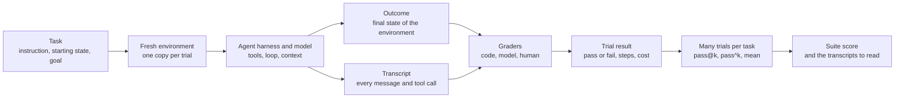

# Module 02: Evaluating Agents: Environments, Graders and Reliability

> **Prerequisites:** [Module 01: Evaluation in Practice](../01-evaluation-in-practice-harnesses-inspect-and-regression-gates/README.md) and [Track 17, Module 00: What an Agent Harness Is](../../17-agent-harness-engineering/00-what-an-agent-harness-is/README.md).  
> **Estimated Reading Time:** 75 minutes  
> **Target Audience:** AI Backend Engineers, ML Platform Engineers, Model Evaluation Leads

> [!TIP]
> **The Golden Rule of Agent Evaluation:** Grade what the agent did to the world, not what it said, and run every task more than once. A reply measures the agent's confidence, and a single trial measures luck as much as skill.

---

## Why This Matters

A model is graded on an answer. An agent is graded on a run: a sequence of tool calls that changes something. A customer asks to cancel order A2, the agent cancels A3, and it replies "Done. Order A2 is cancelled." A grader that reads the reply sees a success. Workflow 3 builds exactly this in Inspect, with a scripted stand-in for the model: a scorer that looks for the requested order in the reply gives the stand-in 1.0, and a scorer that checks the final database gives it 0.33.

Agent runs also vary. The τ-bench paper (Yao et al., 2024) puts a language agent in front of a simulated customer, with API tools and a written policy, and grades the final state of the database. For `gpt-4o` with function calling it reports a success rate of 61.2% on its retail tasks, and then shows that the chance of solving the same task correctly on every one of 8 attempts falls below 25%. The paper proposed a metric for that, **pass^k**, because the usual **pass@k**, the chance that at least one of k attempts succeeds, answers a different question: whether a retry could rescue the task.

And what is being evaluated is more than the model. Anthropic's engineering post *Demystifying evals for AI agents* (9 January 2026) says that evaluating "an agent" means evaluating the harness and the model working together. Track 17 showed it with the SWE-agent ablation: one model, one task set, 11.00% with a plain shell and 18.00% with an interface built for the model. This module gives the evaluation side of that story: the vocabulary, the environment, the graders, the trials and the two reliability metrics, run in four languages, then in Inspect.

After this module you will be able to:

- describe an agent evaluation in the vocabulary of task, trial, transcript, outcome, grader and harness;
- grade a run by the final state of its environment, and combine graders that must all agree;
- compute pass@k and pass^k from n trials per task, and say which one answers which question;
- explain how SWE-bench, τ-bench and Terminal-Bench grade a run, and what each cannot tell you;
- run a repeated-trials evaluation and a state-graded agent task in Inspect.

---

## 1. Architectural Mental Model & Core Mechanics

An agent evaluation adds an environment, a transcript and repetition to the harness of Module 00:



### The Vocabulary

Anthropic's post fixes terms that the rest of the literature uses loosely. They are worth using exactly:

| Term | Meaning | Example |
| :--- | :--- | :--- |
| **Task** | A single test with defined inputs and success criteria | "Cancel order A1, it has not shipped" |
| **Trial** | One attempt at a task. Outputs vary between runs, so a task is run more than once | The same request, run for the third time |
| **Transcript** (trace, trajectory) | The complete record of a trial: outputs, tool calls, reasoning, intermediate results | The list of tool calls and replies |
| **Outcome** | The final state of the environment at the end of the trial | Whether a reservation exists in the database, which is not the same as what the agent says |
| **Grader** | Logic that scores some aspect of the agent's performance. A task can have several | A script that compares the database with the goal |
| **Evaluation harness** | The infrastructure that runs evals end to end: runs tasks, records steps, grades, aggregates | Module 00's harness, with an environment added |
| **Agent harness** (scaffold) | The system that lets a model act as an agent: the loop, the tools, the context | Track 17 |
| **Evaluation suite** | A collection of tasks that measure specific capabilities or behaviours | The twelve tasks of this module's program |

### Environments: A Fresh Copy for Every Trial

Each trial must start from the same state and leave nothing behind for the next one, or the trials are not independent attempts at the same task. Every benchmark in this module does it differently. SWE-bench gives the agent a codebase at a base commit. τ-bench builds each domain from JSON databases, Python API tools and a Markdown policy. Terminal-Bench gives each task its own environment. Inspect lets a task declare a `sandbox`, a configuration for running untrusted code in isolation. The program of this module calls `fresh_database()` once per trial, and the Inspect task of Workflow 3 has a solver that gives every sample its own copy of the state.

The environment's tools should enforce what the real system would enforce. A tool that returns an error and changes nothing when an order has already shipped is part of the test: an agent that ignores the error leaves the state wrong and the outcome grader says so.

### Graders: Outcome, Transcript and Judges

Anthropic's post lists three kinds of grader, with strengths and weaknesses that decide where each belongs:

| Grader | Examples | Strengths | Weaknesses |
| :--- | :--- | :--- | :--- |
| **Code-based** | String match, tests that pass or fail, static analysis, checks of the outcome or of the tool calls | Fast, cheap, objective, reproducible, easy to debug | Brittle to valid variations; little nuance; limited for subjective tasks |
| **Model-based** | A rubric, natural-language assertions, pairwise comparison, several judges | Flexible, scalable, captures nuance, handles open-ended output | Not deterministic; costlier; needs calibration against human graders |
| **Human** | Expert review, crowdsourced judgment, spot checks | The gold standard; calibrates the model-based graders | Expensive and slow |

Three design rules follow from how the benchmarks grade:

- **Prefer the outcome.** SWE-bench applies the model's patch and runs the repository's tests. τ-bench compares the final database with an annotated goal. Both ignore how the agent got there, which lets different valid paths pass.
- **Combine graders that must all agree.** τ-bench's reward is a product of two parts: the final database must be identical to the single correct outcome, and the agent's replies must contain the information the user needed. Anthropic describes the same options for scoring a task: weighted, binary (every grader must pass) or a hybrid.
- **Know what a pass does not prove.** The τ-bench paper warns that a reward of 1 can be necessary but not sufficient: an agent might issue a return without the user's explicit confirmation, which the policy forbids, and still reach the right database. A transcript grader for the policy would catch it.

A grader can also be wrong in the other direction. Anthropic's post reports that Opus 4.5 first scored 42% on CORE-Bench and 95% after bugs were fixed and a less constrained scaffold was used, and names one of the bugs: a grader that rejected "96.12" when it expected "96.124991…". Section 3 returns to it.

### Trials, pass@k and pass^k

An agent's run is not repeatable the way a model's likelihood is. In τ-bench the agent runs at temperature 0.0 and the simulated user at temperature 1.0, and the conversations still vary; the main results use at least three trials per task. With n trials of a task and c successes, the two metrics are defined, as the τ-bench paper writes them:

- **pass@k**, the chance that at least one of k trials succeeds, estimated as 1 - C(n - c, k) / C(n, k).
- **pass^k**, the chance that all k trials succeed, estimated as C(c, k) / C(n, k).

Both are averaged over tasks, and at k = 1 they are the same number, c / n. They answer different questions:

| Metric | Question it answers | Fits |
| :--- | :--- | :--- |
| **pass@k** | Can the agent solve this at all, if it may try k times and something can tell which attempt worked? | Code generation with unit tests as the verifier. The Codex paper (Chen et al., 2021) solves 28.8% of its problems with one sample and 70.2% with 100 samples per problem |
| **pass^k** | Will the agent get it right every time, for a customer who asks once? | Customer service, payments, anything with no second chance |

The two move in opposite directions as k grows. With a per-trial success of 75%, Anthropic's example, the chance of three successes in a row is 0.75³, about 42%, while the chance of at least one in three is 1 - 0.25³, about 98%. Two agents with the same pass^1 can differ sharply in pass^k, because pass^k punishes the tasks an agent solves only sometimes. Workflow 1 measures it.

In Inspect the same estimators are score reducers: a task declares `epochs=Epochs(8, [...])` and the log holds one score for each reducer. `pass_at(k)` is documented in the source as the probability of at least one correct sample given k epochs, citing the Codex paper, and `pass_k(k)` as the probability that all k attempts succeed, `C(correct, k) / C(total, k)`, citing τ-bench.

### Capability Evals and Regression Evals

Anthropic separates two kinds of suite. A **capability** eval asks what the agent can do well, and should start at a low pass rate, giving the team a hill to climb. A **regression** eval asks whether the agent still handles everything it used to, and should sit near 100%. A capability eval that the agent has mostly learned graduates into the regression suite, and the gate of Module 01 then runs on it. Pass^k fits a regression suite, because a regression is often a task that used to pass every time and now passes most of the time.

### What Else to Record

A pass or a fail is not the whole result. Record the number of steps and the cost of each trial, and limit both: an Inspect task can set `message_limit`, `token_limit` and `time_limit`, and τ-bench cuts each task off after 30 agent actions. Keep every transcript. Anthropic's advice is blunt: read them. A suite whose scores are trusted without reading failed transcripts is how a grader bug stays hidden for a year.

---

## 2. Systematic Comparison Matrix: Four Agent Benchmarks, Four Ways to Grade

Each of these benchmarks is built from a task, an environment and an outcome grader. The columns below are from the papers and pages listed in the sources.

| | **SWE-bench** | **SWE-bench Verified** | **τ-bench** | **Terminal-Bench 2.0** |
| :--- | :--- | :--- | :--- | :--- |
| **What the agent does** | Gets an issue and a codebase, and edits the code to resolve the issue | The same task | Talks with an LLM-simulated user while calling API tools, under a written policy | Works in a terminal environment on a hard task |
| **Size** | 2,294 instances from 12 Python repositories, filtered from about 90,000 pull requests | 500 instances, a human-filtered subset of SWE-bench | τ-retail 115 tasks, τ-airline 50 | 89 tasks |
| **Environment** | The repository at the pull request's base commit | The same | JSON databases and Python API tools | Each task has its own environment |
| **Grader** | The patch is applied and the task's unit and system tests are run. Resolved only if it applies and all pass; every instance has at least one test that fails before the reference fix and passes after it | The same grader | The final database must be identical to the annotated goal, and the replies must contain the necessary information | Tests written for each task, with a human-written reference solution |
| **Metric** | Percentage of instances resolved | The same | pass^1, and pass^k over repeated trials | Tasks resolved. The paper reports frontier models and agents below 65% |
| **What to remember** | At the time of the paper the best model, Claude 2, resolved about 1.96% | Annotators checked that problem descriptions were clear, test patches correct and each task solvable with the information given | The reward can be necessary but not sufficient, as the policy example above shows | The paper includes an error analysis of where models and agents fail |

None of these tells you how your agent will do on your tasks. They show how a good agent evaluation is built: an environment that can be reset, a goal that can be checked by code, and a grader whose verdict does not depend on how the agent worded its reply.

---

## 3. Evidence Case Study: The Same Model, Three Different Scores

This section is built from published material: the SWE-agent paper (Yang et al., 2024, the numbers as read in Track 17, Module 00), the τ-bench paper (Yao et al., 2024) and Anthropic's *Demystifying evals for AI agents* (9 January 2026). It keeps to what they report.

| Source | What stayed fixed | What changed | The score |
| :--- | :--- | :--- | :--- |
| **SWE-agent**, Table 1 | `GPT-4 Turbo` and the `SWE-bench Lite` task set | The interface: a plain shell, then SWE-agent's agent-computer interface | 11.00% then 18.00% resolved |
| **τ-bench**, Table 2 and Figure 4 | `gpt-4o` with function calling on τ-retail | The number of trials that must all succeed | 61.2% at k = 1, below 25% at k = 8 |
| **CORE-Bench**, Anthropic's post | Opus 4.5 and the benchmark | Fixing grader bugs, ambiguous task specifications and non-reproducible tasks, and moving to a less constrained scaffold | 42% then 95% |

Each row is a different lesson about the same system:

- **The harness is part of the score.** The model did not change between 11.00% and 18.00%, and the interface did. A leaderboard number for a model is a number for a model in a harness, which is Module 00's golden rule again.
- **One trial is not an estimate of reliability.** The best `gpt-4o` agent in τ-retail averages over 60% success, and the paper concludes that it is far from consistent. A team that reports pass^1 alone cannot see it.
- **The grader can be the largest error in the number.** The 42% to 95% jump did not come from a better model. It came from correcting the evaluation. The post's advice follows: read the failed transcripts before believing a low score, and check that the tasks have one unambiguous right answer. The τ-bench authors did the same when they built their tasks: they polished each user instruction until a single database outcome was possible, and ran each τ-retail task with more than 40 `gpt-4-turbo` trials to check the tasks with zero or low success rates.

### What a Team Takes From It

- **Treat the harness, the environment and the grader as part of the system under test**, and version them with the score.
- **Report pass^k for anything with no second chance**, with n large enough to estimate it: you cannot estimate pass^8 from fewer than 8 trials.
- **Read transcripts**, especially the failures that look like the agent's fault and the passes that look too easy.
- **Start small and real.** Anthropic recommends 20 to 50 simple tasks drawn from real failures as a good start, with a reference solution for each, where two domain experts would reach the same verdict.

---

## 4. Multi-Language Production Implementation: A Trial Runner With Three Graders and Two Reliability Metrics

Below is a program in **Go**, **TypeScript**, **Python** and **C#**. It evaluates a toy support-desk agent on twelve tasks, with sixteen trials each:

1. **The environment** is a database of 14 orders with three write tools (cancel, change address, refund). Every trial gets a fresh copy, and each tool returns an error and changes nothing if the order is not in the right status.
2. **The agent** is a script, made up for this module, with three seeded mistakes: it sometimes skips the lookup of the order, sometimes writes to the wrong order, and sometimes replies without saying what it did. Each task has its own chance of each mistake, so some tasks are easy and some are hard. It always replies as if it had done the right thing.
3. **Three graders** judge every episode: the **outcome** (the final database equals the goal), the **reply** (it names the order and the result) and the **policy** (the first tool call was a lookup). The strict result needs all three.
4. **Aggregation** computes pass^1 under each way of grading, the successes per task, pass@k and pass^k for k up to 16, the same pass^k as it would be if every task were equally hard, and what failed.

It is a model of the machinery and not a model of any real agent. The seeded generator is the one from Module 01, so all four languages draw the same numbers.

Run them with `go run agenteval.go`, `node agenteval.ts` (Node 24 or newer), `python agenteval.py` and `dotnet run Agenteval.cs` (.NET 10 SDK). All four print the same output, shown in Workflow 1.

````carousel

```go
// Evaluating an agent: an environment, trials, several graders, and the reliability metrics pass@k and pass^k. Run it with: go run agenteval.go
//
// A toy support-desk agent (made up for this module) works through twelve tasks, sixteen trials each, and every trial starts from a fresh
// copy of the same database. The agent is a script with a few seeded mistakes, not a model. What is real is the machinery around it:
// grading the final state of the database instead of the agent's words, graders that must all agree, and the estimators of
// Chen et al. (2021) for pass@k and of the tau-bench paper (Yao et al., 2024) for pass^k.
package main

import (
	"fmt"
	"strings"
)

var orderIDs = []string{"A1", "A2", "A3", "A4", "B1", "B2", "B3", "B4", "C1", "C2", "C3", "C4", "S1", "S2"}

const (
	trials = 16
	seed   = 20260114
)

var kValues = []int{1, 2, 4, 8, 16}
var verbs = map[string]string{"cancel": "cancelled", "address": "updated", "refund": "refunded"}

type task struct {
	kind, order, argument string
	slip, skip, terse     float64 // chance of a wrong write, of skipping the lookup, of a reply without the result
}

var tasks = []task{
	{"cancel", "A1", "", 0.02, 0.05, 0.05},
	{"cancel", "A2", "", 0.05, 0.10, 0.10},
	{"cancel", "A3", "", 0.15, 0.10, 0.10},
	{"address", "B1", "12 Elm St", 0.05, 0.05, 0.05},
	{"address", "B2", "9 Oak Ave", 0.10, 0.10, 0.10},
	{"address", "B3", "77 Pine Rd", 0.30, 0.15, 0.10},
	{"refund", "C1", "", 0.05, 0.15, 0.05},
	{"refund", "C2", "", 0.10, 0.20, 0.15},
	{"refund", "C3", "", 0.35, 0.25, 0.15},
	{"cancel", "A4", "", 0.50, 0.20, 0.20},
	{"address", "B4", "5 Birch Ln", 0.55, 0.30, 0.20},
	{"refund", "C4", "", 0.60, 0.40, 0.30},
}

// rng is mulberry32: a small 32-bit generator, written so Go, TypeScript, Python and C# draw the same numbers.
type rng struct{ state uint32 }

func (r *rng) next() float64 {
	r.state += 0x6D2B79F5
	t := r.state
	t = (t ^ (t >> 15)) * (t | 1)
	t ^= t + (t^(t>>7))*(t|61)
	return float64(t^(t>>14)) / 4294967296.0
}

type order struct{ status, address string }
type database map[string]*order

// freshDatabase is the environment: every trial gets its own copy, so one trial cannot leak state into the next.
func freshDatabase() database {
	db := database{}
	for _, id := range orderIDs {
		status := "processing"
		switch id[0] {
		case 'C':
			status = "delivered"
		case 'S':
			status = "shipped"
		}
		db[id] = &order{status, "1 Main St"}
	}
	return db
}

// The tools. Each checks what the real system would check, and returns an error instead of changing anything.
func cancelOrder(db database, id, _ string) {
	if o, ok := db[id]; ok && o.status == "processing" {
		o.status = "cancelled"
	}
}

func updateAddress(db database, id, address string) {
	if o, ok := db[id]; ok && o.status == "processing" {
		o.address = address
	}
}

func refundOrder(db database, id, _ string) {
	if o, ok := db[id]; ok && o.status == "delivered" {
		o.status = "refunded"
	}
}

var writeTools = map[string]func(database, string, string){"cancel": cancelOrder, "address": updateAddress, "refund": refundOrder}

func sameDatabase(a, b database) bool {
	for _, id := range orderIDs {
		if *a[id] != *b[id] {
			return false
		}
	}
	return true
}

// goalState is the annotated goal: what the database should look like once the task is done (like the ground-truth write actions of tau-bench).
func goalState(t task) database {
	db := freshDatabase()
	writeTools[t.kind](db, t.order, t.argument)
	return db
}

func indexOf(id string) int {
	for i, other := range orderIDs {
		if other == id {
			return i
		}
	}
	return -1
}

// runTrial is one episode: the agent looks the order up (unless it skips it), makes the change (on the wrong order if it slips), and replies.
func runTrial(t task, r *rng) (database, []string, string) {
	skipsLookup := r.next() < t.skip
	slips := r.next() < t.slip
	isTerse := r.next() < t.terse
	db := freshDatabase()
	var transcript []string // the name of each tool called, in order
	if !skipsLookup {
		transcript = append(transcript, "get_order")
	}
	target := t.order
	if slips {
		target = orderIDs[(indexOf(t.order)+1)%len(orderIDs)]
	}
	transcript = append(transcript, t.kind)
	writeTools[t.kind](db, target, t.argument)
	reply := "Done."
	if !isTerse {
		reply = fmt.Sprintf("Done. Order %s is %s.", t.order, verbs[t.kind]) // it says it did the right thing even after a wrong write
	}
	return db, transcript, reply
}

// grade runs three graders. outcome: the final database equals the goal. reply: the reply states the result. policy: the first call was a lookup.
func grade(t task, db database, transcript []string, reply string) [3]bool {
	outcome := sameDatabase(db, goalState(t))
	said := strings.Contains(reply, t.order) && strings.Contains(reply, verbs[t.kind])
	policy := transcript[0] == "get_order"
	return [3]bool{outcome, said, policy}
}

// passAtK is the chance that at least one of k trials succeeds, when c of n succeeded: 1 - C(n-c, k) / C(n, k).
func passAtK(c, n, k int) float64 {
	if n-c < k {
		return 1.0
	}
	miss := 1.0
	for i := 0; i < k; i++ {
		miss *= float64(n-c-i) / float64(n-i)
	}
	return 1.0 - miss
}

// passHatK is the chance that all k trials succeed, when c of n succeeded: C(c, k) / C(n, k).
func passHatK(c, n, k int) float64 {
	if c < k {
		return 0.0
	}
	value := 1.0
	for i := 0; i < k; i++ {
		value *= float64(c-i) / float64(n-i)
	}
	return value
}

func main() {
	r := &rng{state: seed}
	episodes := make([][][3]bool, len(tasks))
	for i, t := range tasks {
		for j := 0; j < trials; j++ {
			db, transcript, reply := runTrial(t, r)
			episodes[i] = append(episodes[i], grade(t, db, transcript, reply))
		}
	}
	total := len(tasks) * trials
	fmt.Printf("environment: %d orders, %d write tools; %d tasks x %d trials = %d episodes, each from a fresh database\n", len(orderIDs), len(writeTools), len(tasks), trials, total)

	count := func(select_ func(e [3]bool) bool) int {
		n := 0
		for _, per := range episodes {
			for _, e := range per {
				if select_(e) {
					n++
				}
			}
		}
		return n
	}
	rate := func(select_ func(e [3]bool) bool) float64 { return float64(count(select_)) / float64(total) }
	fmt.Println("pass^1 when the same episodes are graded three ways")
	fmt.Printf("  outcome only (the final database equals the goal)        %.3f\n", rate(func(e [3]bool) bool { return e[0] }))
	fmt.Printf("  outcome and reply (the reply states the result)          %.3f\n", rate(func(e [3]bool) bool { return e[0] && e[1] }))
	fmt.Printf("  outcome, reply and policy (it looked the order up first) %.3f\n", rate(func(e [3]bool) bool { return e[0] && e[1] && e[2] }))

	successes := make([]int, len(tasks))
	cells := make([]string, len(tasks))
	sum := 0
	for i, per := range episodes {
		for _, e := range per {
			if e[0] && e[1] && e[2] {
				successes[i]++
			}
		}
		sum += successes[i]
		cells[i] = fmt.Sprintf("%2d", successes[i])
	}
	fmt.Printf("successes per task out of %d (all three graders): %s\n", trials, strings.Join(cells, " "))
	p1 := float64(sum) / float64(total)
	fmt.Println(" k   pass@k  pass^k   p^k, if every task were equally hard")
	for _, k := range kValues {
		at, hat := 0.0, 0.0
		for _, c := range successes { // plain loops: the same additions, in the same order, in every language
			at += passAtK(c, trials, k)
			hat += passHatK(c, trials, k)
		}
		at /= float64(len(tasks))
		hat /= float64(len(tasks))
		equal := 1.0
		for i := 0; i < k; i++ {
			equal *= p1
		}
		fmt.Printf("%2d   %.3f   %.3f   %.3f\n", k, at, hat, equal)
	}

	wrong := count(func(e [3]bool) bool { return !e[0] })
	mute := count(func(e [3]bool) bool { return !e[1] })
	unchecked := count(func(e [3]bool) bool { return !e[2] })
	fmt.Printf("what failed (an episode can fail several ways): wrong final state %d, reply without the result %d, no lookup first %d\n", wrong, mute, unchecked)
	claimed := count(func(e [3]bool) bool { return !e[0] && e[1] })
	fmt.Printf("episodes whose reply claimed success while the database said otherwise: %d\n", claimed)
}
```

<!-- slide -->

```typescript
// Evaluating an agent: an environment, trials, several graders, and the reliability metrics pass@k and pass^k. Run it with: node agenteval.ts (Node 24 or newer).
//
// A toy support-desk agent (made up for this module) works through twelve tasks, sixteen trials each, and every trial starts from a fresh
// copy of the same database. The agent is a script with a few seeded mistakes, not a model. What is real is the machinery around it:
// grading the final state of the database instead of the agent's words, graders that must all agree, and the estimators of
// Chen et al. (2021) for pass@k and of the tau-bench paper (Yao et al., 2024) for pass^k.

const ORDER_IDS = ["A1", "A2", "A3", "A4", "B1", "B2", "B3", "B4", "C1", "C2", "C3", "C4", "S1", "S2"];
const TRIALS = 16;
const K_VALUES = [1, 2, 4, 8, 16];
const SEED = 20260114;
const VERBS: Record<string, string> = { cancel: "cancelled", address: "updated", refund: "refunded" };

type Task = { kind: string; order: string; argument: string; slip: number; skip: number; terse: number };
type Order = { status: string; address: string };
type Database = Record<string, Order>;
type Verdicts = [boolean, boolean, boolean]; // outcome, reply, policy

// kind, order, argument, chance of a wrong write, chance of skipping the lookup, chance of a reply without the result
const TASKS: Task[] = [
  { kind: "cancel", order: "A1", argument: "", slip: 0.02, skip: 0.05, terse: 0.05 },
  { kind: "cancel", order: "A2", argument: "", slip: 0.05, skip: 0.1, terse: 0.1 },
  { kind: "cancel", order: "A3", argument: "", slip: 0.15, skip: 0.1, terse: 0.1 },
  { kind: "address", order: "B1", argument: "12 Elm St", slip: 0.05, skip: 0.05, terse: 0.05 },
  { kind: "address", order: "B2", argument: "9 Oak Ave", slip: 0.1, skip: 0.1, terse: 0.1 },
  { kind: "address", order: "B3", argument: "77 Pine Rd", slip: 0.3, skip: 0.15, terse: 0.1 },
  { kind: "refund", order: "C1", argument: "", slip: 0.05, skip: 0.15, terse: 0.05 },
  { kind: "refund", order: "C2", argument: "", slip: 0.1, skip: 0.2, terse: 0.15 },
  { kind: "refund", order: "C3", argument: "", slip: 0.35, skip: 0.25, terse: 0.15 },
  { kind: "cancel", order: "A4", argument: "", slip: 0.5, skip: 0.2, terse: 0.2 },
  { kind: "address", order: "B4", argument: "5 Birch Ln", slip: 0.55, skip: 0.3, terse: 0.2 },
  { kind: "refund", order: "C4", argument: "", slip: 0.6, skip: 0.4, terse: 0.3 },
];

/** mulberry32: a small 32-bit generator, written so Go, TypeScript, Python and C# draw the same numbers. */
class Rng {
  state: number;

  constructor(seed: number) {
    this.state = seed >>> 0;
  }

  next(): number {
    this.state = (this.state + 0x6d2b79f5) >>> 0;
    let t = this.state;
    t = Math.imul(t ^ (t >>> 15), t | 1);
    t = t ^ (t + Math.imul(t ^ (t >>> 7), t | 61));
    return ((t ^ (t >>> 14)) >>> 0) / 4294967296;
  }
}

/** The environment: every trial gets its own copy, so one trial cannot leak state into the next. */
function freshDatabase(): Database {
  const database: Database = {};
  for (const order of ORDER_IDS) {
    const status = order[0] === "C" ? "delivered" : order[0] === "S" ? "shipped" : "processing";
    database[order] = { status, address: "1 Main St" };
  }
  return database;
}

// The tools. Each checks what the real system would check, and returns an error instead of changing anything.
function getOrder(database: Database, order: string): Order | undefined {
  return database[order];
}

function cancelOrder(database: Database, order: string, _argument: string): string {
  if (!(order in database) || database[order].status !== "processing") return "error: only an order that is still processing can be cancelled";
  database[order].status = "cancelled";
  return "ok";
}

function updateAddress(database: Database, order: string, address: string): string {
  if (!(order in database) || database[order].status !== "processing") return "error: only an order that is still processing can change address";
  database[order].address = address;
  return "ok";
}

function refundOrder(database: Database, order: string, _argument: string): string {
  if (!(order in database) || database[order].status !== "delivered") return "error: only a delivered order can be refunded";
  database[order].status = "refunded";
  return "ok";
}

const WRITE_TOOLS: Record<string, (database: Database, order: string, argument: string) => string> = {
  cancel: cancelOrder,
  address: updateAddress,
  refund: refundOrder,
};

function sameDatabase(a: Database, b: Database): boolean {
  return ORDER_IDS.every((id) => a[id].status === b[id].status && a[id].address === b[id].address);
}

/** The annotated goal: what the database should look like once the task is done (like the ground-truth write actions of tau-bench). */
function goalState(task: Task): Database {
  const database = freshDatabase();
  WRITE_TOOLS[task.kind](database, task.order, task.argument);
  return database;
}

/** One episode: the agent looks the order up (unless it skips it), makes the change (on the wrong order if it slips), and replies. */
function runTrial(task: Task, rng: Rng): [Database, string[][], string] {
  const skipsLookup = rng.next() < task.skip;
  const slips = rng.next() < task.slip;
  const isTerse = rng.next() < task.terse;
  const database = freshDatabase();
  const transcript: string[][] = [];
  if (!skipsLookup) {
    transcript.push(["get_order", task.order]);
    getOrder(database, task.order);
  }
  const target = slips ? ORDER_IDS[(ORDER_IDS.indexOf(task.order) + 1) % ORDER_IDS.length] : task.order;
  transcript.push([task.kind, target]);
  WRITE_TOOLS[task.kind](database, target, task.argument);
  const reply = isTerse ? "Done." : `Done. Order ${task.order} is ${VERBS[task.kind]}.`; // it says it did the right thing even after a wrong write
  return [database, transcript, reply];
}

/** Three graders. outcome: the final database equals the goal. reply: the reply states the result. policy: the first call was a lookup. */
function grade(task: Task, database: Database, transcript: string[][], reply: string): Verdicts {
  const outcome = sameDatabase(database, goalState(task));
  const said = reply.includes(task.order) && reply.includes(VERBS[task.kind]);
  const policy = transcript[0][0] === "get_order";
  return [outcome, said, policy];
}

/** Chance that at least one of k trials succeeds, when c of n succeeded: 1 - C(n-c, k) / C(n, k). */
function passAtK(c: number, n: number, k: number): number {
  if (n - c < k) return 1.0;
  let miss = 1.0;
  for (let i = 0; i < k; i++) miss *= (n - c - i) / (n - i);
  return 1.0 - miss;
}

/** Chance that all k trials succeed, when c of n succeeded: C(c, k) / C(n, k). */
function passHatK(c: number, n: number, k: number): number {
  if (c < k) return 0.0;
  let value = 1.0;
  for (let i = 0; i < k; i++) value *= (c - i) / (n - i);
  return value;
}

function main(): void {
  const rng = new Rng(SEED);
  const episodes: Verdicts[][] = [];
  for (const task of TASKS) {
    const trials: Verdicts[] = [];
    for (let t = 0; t < TRIALS; t++) {
      const [database, transcript, reply] = runTrial(task, rng);
      trials.push(grade(task, database, transcript, reply));
    }
    episodes.push(trials);
  }
  const total = TASKS.length * TRIALS;
  console.log(`environment: ${ORDER_IDS.length} orders, ${Object.keys(WRITE_TOOLS).length} write tools; ${TASKS.length} tasks x ${TRIALS} trials = ${total} episodes, each from a fresh database`);

  const all = episodes.flat();
  const rate = (select: (e: Verdicts) => boolean): number => all.filter(select).length / total;
  console.log("pass^1 when the same episodes are graded three ways");
  console.log(`  outcome only (the final database equals the goal)        ${rate((e) => e[0]).toFixed(3)}`);
  console.log(`  outcome and reply (the reply states the result)          ${rate((e) => e[0] && e[1]).toFixed(3)}`);
  console.log(`  outcome, reply and policy (it looked the order up first) ${rate((e) => e[0] && e[1] && e[2]).toFixed(3)}`);

  const successes = episodes.map((trials) => trials.filter((e) => e[0] && e[1] && e[2]).length);
  console.log(`successes per task out of ${TRIALS} (all three graders): ` + successes.map((c) => String(c).padStart(2)).join(" "));
  const p1 = successes.reduce((a, b) => a + b, 0) / total;
  console.log(" k   pass@k  pass^k   p^k, if every task were equally hard");
  for (const k of K_VALUES) {
    let at = 0.0;
    let hat = 0.0;
    for (const c of successes) {
      at += passAtK(c, TRIALS, k); // plain loops: the same additions, in the same order, in every language
      hat += passHatK(c, TRIALS, k);
    }
    at /= TASKS.length;
    hat /= TASKS.length;
    let equal = 1.0;
    for (let i = 0; i < k; i++) equal *= p1;
    console.log(`${String(k).padStart(2)}   ${at.toFixed(3)}   ${hat.toFixed(3)}   ${equal.toFixed(3)}`);
  }

  const wrong = all.filter((e) => !e[0]).length;
  const mute = all.filter((e) => !e[1]).length;
  const unchecked = all.filter((e) => !e[2]).length;
  console.log(`what failed (an episode can fail several ways): wrong final state ${wrong}, reply without the result ${mute}, no lookup first ${unchecked}`);
  const claimed = all.filter((e) => !e[0] && e[1]).length;
  console.log(`episodes whose reply claimed success while the database said otherwise: ${claimed}`);
}

main();
```

<!-- slide -->

```python
"""Evaluating an agent: an environment, trials, several graders, and the reliability metrics pass@k and pass^k. Plain Python 3, no packages.

A toy support-desk agent (made up for this module) works through twelve tasks, sixteen trials each, and every trial starts from a fresh
copy of the same database. The agent is a script with a few seeded mistakes, not a model. What is real is the machinery around it:
grading the final state of the database instead of the agent's words, graders that must all agree, and the estimators of
Chen et al. (2021) for pass@k and of the tau-bench paper (Yao et al., 2024) for pass^k.
"""

ORDER_IDS = ["A1", "A2", "A3", "A4", "B1", "B2", "B3", "B4", "C1", "C2", "C3", "C4", "S1", "S2"]
TRIALS = 16
K_VALUES = [1, 2, 4, 8, 16]
SEED = 20260114
VERBS = {"cancel": "cancelled", "address": "updated", "refund": "refunded"}

# (kind, order, argument, chance of a wrong write, chance of skipping the lookup, chance of a reply without the result)
TASKS = [
    ("cancel", "A1", "", 0.02, 0.05, 0.05),
    ("cancel", "A2", "", 0.05, 0.10, 0.10),
    ("cancel", "A3", "", 0.15, 0.10, 0.10),
    ("address", "B1", "12 Elm St", 0.05, 0.05, 0.05),
    ("address", "B2", "9 Oak Ave", 0.10, 0.10, 0.10),
    ("address", "B3", "77 Pine Rd", 0.30, 0.15, 0.10),
    ("refund", "C1", "", 0.05, 0.15, 0.05),
    ("refund", "C2", "", 0.10, 0.20, 0.15),
    ("refund", "C3", "", 0.35, 0.25, 0.15),
    ("cancel", "A4", "", 0.50, 0.20, 0.20),
    ("address", "B4", "5 Birch Ln", 0.55, 0.30, 0.20),
    ("refund", "C4", "", 0.60, 0.40, 0.30),
]


class Rng:
    """mulberry32: a small 32-bit generator, written so Go, TypeScript, Python and C# draw the same numbers."""

    def __init__(self, seed):
        self.state = seed & 0xFFFFFFFF

    def next(self):
        self.state = (self.state + 0x6D2B79F5) & 0xFFFFFFFF
        t = self.state
        t = ((t ^ (t >> 15)) * (t | 1)) & 0xFFFFFFFF
        t = t ^ ((t + (((t ^ (t >> 7)) * (t | 61)) & 0xFFFFFFFF)) & 0xFFFFFFFF)
        return ((t ^ (t >> 14)) & 0xFFFFFFFF) / 4294967296.0


def fresh_database():
    """The environment: every trial gets its own copy, so one trial cannot leak state into the next."""
    database = {}
    for order in ORDER_IDS:
        status = "delivered" if order[0] == "C" else "shipped" if order[0] == "S" else "processing"
        database[order] = {"status": status, "address": "1 Main St"}
    return database


# The tools. Each checks what the real system would check, and returns an error instead of changing anything.
def get_order(database, order):
    return database.get(order)


def cancel_order(database, order, _argument):
    if order not in database or database[order]["status"] != "processing":
        return "error: only an order that is still processing can be cancelled"
    database[order]["status"] = "cancelled"
    return "ok"


def update_address(database, order, address):
    if order not in database or database[order]["status"] != "processing":
        return "error: only an order that is still processing can change address"
    database[order]["address"] = address
    return "ok"


def refund_order(database, order, _argument):
    if order not in database or database[order]["status"] != "delivered":
        return "error: only a delivered order can be refunded"
    database[order]["status"] = "refunded"
    return "ok"


WRITE_TOOLS = {"cancel": cancel_order, "address": update_address, "refund": refund_order}


def goal_state(task):
    """The annotated goal: what the database should look like once the task is done (like the ground-truth write actions of tau-bench)."""
    database = fresh_database()
    kind, order, argument = task[0], task[1], task[2]
    WRITE_TOOLS[kind](database, order, argument)
    return database


def run_trial(task, rng):
    """One episode: the agent looks the order up (unless it skips it), makes the change (on the wrong order if it slips), and replies."""
    kind, order, argument, slip, skip, terse = task
    skips_lookup, slips, is_terse = rng.next() < skip, rng.next() < slip, rng.next() < terse
    database = fresh_database()
    transcript = []
    if not skips_lookup:
        transcript.append(("get_order", order))
        get_order(database, order)
    target = ORDER_IDS[(ORDER_IDS.index(order) + 1) % len(ORDER_IDS)] if slips else order
    transcript.append((kind, target))
    WRITE_TOOLS[kind](database, target, argument)
    reply = "Done." if is_terse else f"Done. Order {order} is {VERBS[kind]}."  # it says it did the right thing even after a wrong write
    return database, transcript, reply


def grade(task, database, transcript, reply):
    """Three graders. outcome: the final database equals the goal. reply: the reply states the result. policy: the first call was a lookup."""
    kind, order = task[0], task[1]
    outcome = database == goal_state(task)
    said = order in reply and VERBS[kind] in reply
    policy = transcript[0][0] == "get_order"
    return outcome, said, policy


def pass_at_k(c, n, k):
    """Chance that at least one of k trials succeeds, when c of n succeeded: 1 - C(n-c, k) / C(n, k)."""
    if n - c < k:
        return 1.0
    miss = 1.0
    for i in range(k):
        miss *= (n - c - i) / (n - i)
    return 1.0 - miss


def pass_hat_k(c, n, k):
    """Chance that all k trials succeed, when c of n succeeded: C(c, k) / C(n, k)."""
    if c < k:
        return 0.0
    value = 1.0
    for i in range(k):
        value *= (c - i) / (n - i)
    return value


def main():
    rng = Rng(SEED)
    episodes = []  # per task: a list of (outcome, reply, policy)
    for task in TASKS:
        episodes.append([grade(task, *run_trial(task, rng)) for _ in range(TRIALS)])
    total = len(TASKS) * TRIALS
    print(f"environment: {len(ORDER_IDS)} orders, {len(WRITE_TOOLS)} write tools; {len(TASKS)} tasks x {TRIALS} trials = {total} episodes, each from a fresh database")

    def rate(select):
        return sum(1 for trials in episodes for e in trials if select(e)) / total

    print("pass^1 when the same episodes are graded three ways")
    print(f"  outcome only (the final database equals the goal)        {rate(lambda e: e[0]):.3f}")
    print(f"  outcome and reply (the reply states the result)          {rate(lambda e: e[0] and e[1]):.3f}")
    print(f"  outcome, reply and policy (it looked the order up first) {rate(lambda e: e[0] and e[1] and e[2]):.3f}")

    successes = [sum(1 for e in trials if e[0] and e[1] and e[2]) for trials in episodes]
    print("successes per task out of " + str(TRIALS) + " (all three graders): " + " ".join(f"{c:2d}" for c in successes))
    p1 = sum(successes) / total
    print(" k   pass@k  pass^k   p^k, if every task were equally hard")
    for k in K_VALUES:
        at = hat = 0.0
        for c in successes:  # plain loops: the same additions, in the same order, in every language
            at += pass_at_k(c, TRIALS, k)
            hat += pass_hat_k(c, TRIALS, k)
        at /= len(TASKS)
        hat /= len(TASKS)
        equal = 1.0
        for _ in range(k):
            equal *= p1
        print(f"{k:2d}   {at:.3f}   {hat:.3f}   {equal:.3f}")

    wrong = sum(1 for trials in episodes for e in trials if not e[0])
    mute = sum(1 for trials in episodes for e in trials if not e[1])
    unchecked = sum(1 for trials in episodes for e in trials if not e[2])
    print(f"what failed (an episode can fail several ways): wrong final state {wrong}, reply without the result {mute}, no lookup first {unchecked}")
    claimed = sum(1 for trials in episodes for e in trials if not e[0] and e[1])
    print(f"episodes whose reply claimed success while the database said otherwise: {claimed}")


main()
```

<!-- slide -->

```csharp
// Evaluating an agent: an environment, trials, several graders, and the reliability metrics pass@k and pass^k. Run it with: dotnet run Agenteval.cs (.NET 10 SDK).
//
// A toy support-desk agent (made up for this module) works through twelve tasks, sixteen trials each, and every trial starts from a fresh
// copy of the same database. The agent is a script with a few seeded mistakes, not a model. What is real is the machinery around it:
// grading the final state of the database instead of the agent's words, graders that must all agree, and the estimators of
// Chen et al. (2021) for pass@k and of the tau-bench paper (Yao et al., 2024) for pass^k.
using System;
using System.Collections.Generic;
using System.Globalization;
using System.Linq;

string[] orderIds = { "A1", "A2", "A3", "A4", "B1", "B2", "B3", "B4", "C1", "C2", "C3", "C4", "S1", "S2" };
const int Trials = 16;
int[] kValues = { 1, 2, 4, 8, 16 };
const uint Seed = 20260114;
var verbs = new Dictionary<string, string> { ["cancel"] = "cancelled", ["address"] = "updated", ["refund"] = "refunded" };
var inv = CultureInfo.InvariantCulture;

// kind, order, argument, chance of a wrong write, chance of skipping the lookup, chance of a reply without the result
var tasks = new (string Kind, string Order, string Argument, double Slip, double Skip, double Terse)[]
{
    ("cancel", "A1", "", 0.02, 0.05, 0.05),
    ("cancel", "A2", "", 0.05, 0.10, 0.10),
    ("cancel", "A3", "", 0.15, 0.10, 0.10),
    ("address", "B1", "12 Elm St", 0.05, 0.05, 0.05),
    ("address", "B2", "9 Oak Ave", 0.10, 0.10, 0.10),
    ("address", "B3", "77 Pine Rd", 0.30, 0.15, 0.10),
    ("refund", "C1", "", 0.05, 0.15, 0.05),
    ("refund", "C2", "", 0.10, 0.20, 0.15),
    ("refund", "C3", "", 0.35, 0.25, 0.15),
    ("cancel", "A4", "", 0.50, 0.20, 0.20),
    ("address", "B4", "5 Birch Ln", 0.55, 0.30, 0.20),
    ("refund", "C4", "", 0.60, 0.40, 0.30),
};

// The environment: every trial gets its own copy, so one trial cannot leak state into the next.
Dictionary<string, (string Status, string Address)> FreshDatabase()
{
    var db = new Dictionary<string, (string Status, string Address)>();
    foreach (var id in orderIds)
        db[id] = (id[0] == 'C' ? "delivered" : id[0] == 'S' ? "shipped" : "processing", "1 Main St");
    return db;
}

// The tools. Each checks what the real system would check, and changes nothing if the check fails.
void CancelOrder(Dictionary<string, (string Status, string Address)> db, string id, string _)
{
    if (db.TryGetValue(id, out var o) && o.Status == "processing") db[id] = ("cancelled", o.Address);
}

void UpdateAddress(Dictionary<string, (string Status, string Address)> db, string id, string address)
{
    if (db.TryGetValue(id, out var o) && o.Status == "processing") db[id] = (o.Status, address);
}

void RefundOrder(Dictionary<string, (string Status, string Address)> db, string id, string _)
{
    if (db.TryGetValue(id, out var o) && o.Status == "delivered") db[id] = ("refunded", o.Address);
}

void WriteTool(string kind, Dictionary<string, (string Status, string Address)> db, string id, string argument)
{
    if (kind == "cancel") CancelOrder(db, id, argument);
    else if (kind == "address") UpdateAddress(db, id, argument);
    else RefundOrder(db, id, argument);
}

bool SameDatabase(Dictionary<string, (string Status, string Address)> a, Dictionary<string, (string Status, string Address)> b) =>
    orderIds.All(id => a[id] == b[id]);

// The annotated goal: what the database should look like once the task is done (like the ground-truth write actions of tau-bench).
Dictionary<string, (string Status, string Address)> GoalState((string Kind, string Order, string Argument, double Slip, double Skip, double Terse) t)
{
    var db = FreshDatabase();
    WriteTool(t.Kind, db, t.Order, t.Argument);
    return db;
}

// One episode: the agent looks the order up (unless it skips it), makes the change (on the wrong order if it slips), and replies.
(Dictionary<string, (string Status, string Address)> Db, List<string> Transcript, string Reply) RunTrial(
    (string Kind, string Order, string Argument, double Slip, double Skip, double Terse) t, Rng rng)
{
    bool skipsLookup = rng.Next() < t.Skip;
    bool slips = rng.Next() < t.Slip;
    bool isTerse = rng.Next() < t.Terse;
    var db = FreshDatabase();
    var transcript = new List<string>(); // the name of each tool called, in order
    if (!skipsLookup) transcript.Add("get_order");
    string target = slips ? orderIds[(Array.IndexOf(orderIds, t.Order) + 1) % orderIds.Length] : t.Order;
    transcript.Add(t.Kind);
    WriteTool(t.Kind, db, target, t.Argument);
    string reply = isTerse ? "Done." : $"Done. Order {t.Order} is {verbs[t.Kind]}."; // it says it did the right thing even after a wrong write
    return (db, transcript, reply);
}

// Three graders. outcome: the final database equals the goal. reply: the reply states the result. policy: the first call was a lookup.
(bool Outcome, bool Said, bool Policy) Grade(
    (string Kind, string Order, string Argument, double Slip, double Skip, double Terse) t,
    Dictionary<string, (string Status, string Address)> db, List<string> transcript, string reply)
{
    bool outcome = SameDatabase(db, GoalState(t));
    bool said = reply.Contains(t.Order, StringComparison.Ordinal) && reply.Contains(verbs[t.Kind], StringComparison.Ordinal);
    bool policy = transcript[0] == "get_order";
    return (outcome, said, policy);
}

// Chance that at least one of k trials succeeds, when c of n succeeded: 1 - C(n-c, k) / C(n, k).
double PassAtK(int c, int n, int k)
{
    if (n - c < k) return 1.0;
    double miss = 1.0;
    for (int i = 0; i < k; i++) miss *= (double)(n - c - i) / (n - i);
    return 1.0 - miss;
}

// Chance that all k trials succeed, when c of n succeeded: C(c, k) / C(n, k).
double PassHatK(int c, int n, int k)
{
    if (c < k) return 0.0;
    double value = 1.0;
    for (int i = 0; i < k; i++) value *= (double)(c - i) / (n - i);
    return value;
}

var rng0 = new Rng(Seed);
var episodes = new List<List<(bool Outcome, bool Said, bool Policy)>>();
foreach (var t in tasks)
{
    var per = new List<(bool Outcome, bool Said, bool Policy)>();
    for (int j = 0; j < Trials; j++)
    {
        var (db, transcript, reply) = RunTrial(t, rng0);
        per.Add(Grade(t, db, transcript, reply));
    }
    episodes.Add(per);
}
int total = tasks.Length * Trials;
Console.WriteLine($"environment: {orderIds.Length} orders, 3 write tools; {tasks.Length} tasks x {Trials} trials = {total} episodes, each from a fresh database");

var all = episodes.SelectMany(p => p).ToList();
double Rate(Func<(bool Outcome, bool Said, bool Policy), bool> pick) => (double)all.Count(pick) / total;
Console.WriteLine("pass^1 when the same episodes are graded three ways");
Console.WriteLine($"  outcome only (the final database equals the goal)        {Rate(e => e.Outcome).ToString("F3", inv)}");
Console.WriteLine($"  outcome and reply (the reply states the result)          {Rate(e => e.Outcome && e.Said).ToString("F3", inv)}");
Console.WriteLine($"  outcome, reply and policy (it looked the order up first) {Rate(e => e.Outcome && e.Said && e.Policy).ToString("F3", inv)}");

var successes = episodes.Select(per => per.Count(e => e.Outcome && e.Said && e.Policy)).ToArray();
Console.WriteLine($"successes per task out of {Trials} (all three graders): " + string.Join(" ", successes.Select(c => c.ToString().PadLeft(2))));
double p1 = (double)successes.Sum() / total;
Console.WriteLine(" k   pass@k  pass^k   p^k, if every task were equally hard");
foreach (int k in kValues)
{
    double at = 0.0, hat = 0.0;
    foreach (int c in successes) // plain loops: the same additions, in the same order, in every language
    {
        at += PassAtK(c, Trials, k);
        hat += PassHatK(c, Trials, k);
    }
    at /= tasks.Length;
    hat /= tasks.Length;
    double equal = 1.0;
    for (int i = 0; i < k; i++) equal *= p1;
    Console.WriteLine($"{k,2}   {at.ToString("F3", inv)}   {hat.ToString("F3", inv)}   {equal.ToString("F3", inv)}");
}

int wrong = all.Count(e => !e.Outcome);
int mute = all.Count(e => !e.Said);
int unchecked_ = all.Count(e => !e.Policy);
Console.WriteLine($"what failed (an episode can fail several ways): wrong final state {wrong}, reply without the result {mute}, no lookup first {unchecked_}");
int claimed = all.Count(e => !e.Outcome && e.Said);
Console.WriteLine($"episodes whose reply claimed success while the database said otherwise: {claimed}");

// mulberry32: a small 32-bit generator, written so Go, TypeScript, Python and C# draw the same numbers.
class Rng
{
    private uint state;

    public Rng(uint seed) => state = seed;

    public double Next()
    {
        unchecked
        {
            state += 0x6D2B79F5u;
            uint t = state;
            t = (t ^ (t >> 15)) * (t | 1u);
            t ^= t + (t ^ (t >> 7)) * (t | 61u);
            return (t ^ (t >> 14)) / 4294967296.0;
        }
    }
}
```

````

### What Each Part Is For

| Code | Stage | What it shows |
| :--- | :--- | :--- |
| `fresh_database` and the tools | The environment | One copy per trial; tools that refuse what the real system would refuse |
| `goal_state` | The goal | The annotated final state, produced by applying the right write to a fresh database, like τ-bench's ground-truth write actions |
| `run_trial` | The agent | A transcript, a final state and a reply, with seeded mistakes |
| `grade` | The graders | Outcome, reply and policy, judged separately |
| `pass_at_k` and `pass_hat_k` | The metrics | The two estimators of the τ-bench paper, computed without large factorials |
| `main` | Aggregation | Three grading rules over the same episodes, and the two metrics over the same trials |

---

## 5. Practical Hands-On Verification CLI Workflows

### Workflow 1: Grade the Same Episodes Three Ways, and Measure Reliability (offline)

Save the Python tab as `agenteval.py` and run it. Plain Python 3, no packages, no network:

```bash
python agenteval.py
```

```text
environment: 14 orders, 3 write tools; 12 tasks x 16 trials = 192 episodes, each from a fresh database
pass^1 when the same episodes are graded three ways
  outcome only (the final database equals the goal)        0.745
  outcome and reply (the reply states the result)          0.703
  outcome, reply and policy (it looked the order up first) 0.641
successes per task out of 16 (all three graders): 16 14 12 14 13  7 15 12  8  3  6  3
 k   pass@k  pass^k   p^k, if every task were equally hard
 1   0.641   0.641   0.641
 2   0.804   0.477   0.410
 4   0.916   0.321   0.168
 8   0.983   0.179   0.028
16   1.000   0.083   0.001
what failed (an episode can fail several ways): wrong final state 49, reply without the result 16, no lookup first 25
episodes whose reply claimed success while the database said otherwise: 41
```

**Grading.** The same 192 episodes score **0.745** when only the outcome counts, **0.703** when the reply must also state the result, and **0.641** when the policy grader is added. The weaker the grader, the better the agent looks: grading only the final database overstates the strict result by about ten points. Of the 49 episodes that ended in a wrong database, **41** had a reply that claimed success. A grader that read the replies would have passed them.

**Reliability.** The agent succeeds in 64.1% of trials, and the table shows what that means across attempts. `pass@k` rises to 1.000 at k = 16, because every task succeeded at least once (the lowest is 3 of 16). `pass^k` falls to 0.083, which is 1 of 12 tasks: exactly one task, the first, succeeded in all 16 trials. At k = 8 the chance of getting a task right on every attempt is 0.179, against 0.641 for one attempt.

**Why the last column is lower.** It is 0.641^k, what pass^k would be if every task had the same success probability. The measured column is higher, because the tasks differ: the successes per task run from 16 down to 3, so four tasks are solved in 14 or more trials out of 16 and decay only slowly as k grows. Two agents with the same pass^1 but a different spread of per-task success have different pass^k, which is why a single pass^1 cannot stand in for reliability.

**What failed.** The strict grader's failures break down into 49 wrong final states, 16 replies without the result and 25 skipped lookups, and one episode can fail in several ways. Read the breakdown as a list of what to fix first, and read the transcripts of a few of each.

### Workflow 2: Repeated Trials in Inspect (needs `pip install inspect-ai`)

This runs an Inspect task with `epochs`, against Inspect's built-in mock model, so it needs no API key and prints the same thing every time. The task is the six questions of Module 00. The scripted model gets each question right a fixed number of times out of eight, however Inspect schedules the epochs. Save this as `epochs_demo.py`:

```python
"""Repeated trials in Inspect: epochs, and the reducers that turn several attempts at a question into one score.

The task is the six questions of Module 00 again, run against Inspect's built-in mock model, which here is scripted to get each question right
a fixed number of times out of eight, so the run needs no API key and prints the same thing every time. Inspect repeats every question for
8 epochs, and the log holds one score per reducer: the mean (pass@1), pass@4 and pass^4.
"""
import shutil
from pathlib import Path

from inspect_ai import Epochs, Task, eval, task
from inspect_ai.dataset import MemoryDataset, Sample
from inspect_ai.log import read_eval_log
from inspect_ai.model import ModelOutput, get_model
from inspect_ai.scorer import CORRECT, choice, pass_at, pass_k
from inspect_ai.solver import multiple_choice

EPOCHS = 8
QUESTIONS = [  # (question, choices, correct letter, how many of the 8 epochs the scripted model gets it right)
    ("Which planet is closest to the Sun?", ["Mercury", "Venus", "Earth", "Mars"], "A", 8),
    ("What is the chemical symbol for sodium?", ["So", "Na", "Sd", "S"], "B", 7),
    ("Which gas do plants absorb for photosynthesis?", ["Oxygen", "Nitrogen", "Carbon dioxide", "Helium"], "C", 6),
    ("Who wrote Pride and Prejudice?", ["Charles Dickens", "Jane Austen", "Mark Twain", "Leo Tolstoy"], "B", 4),
    ("What is the largest ocean on Earth?", ["Atlantic Ocean", "Indian Ocean", "Arctic Ocean", "Pacific Ocean"], "D", 2),
    ("How many sides does a hexagon have?", ["Five", "Six", "Seven", "Eight"], "B", 0),
]


@task
def trivia_epochs():
    return Task(
        dataset=MemoryDataset([Sample(input=q, choices=c, target=t, id=i + 1) for i, (q, c, t, _) in enumerate(QUESTIONS)]),
        solver=multiple_choice(),
        scorer=choice(),
        epochs=Epochs(EPOCHS, ["mean", pass_at(4), pass_k(4)]),
    )


def scripted():
    """Right on the first `right` calls for a question and wrong after that, whatever order the epochs run in."""
    calls = {}

    def generate(messages, tools, tool_choice, config):
        prompt = messages[-1].text
        for question, _, letter, right in QUESTIONS:
            if question in prompt:
                n = calls.get(question, 0)
                calls[question] = n + 1
                wrong = "A" if letter != "A" else "B"
                return ModelOutput.from_content(model="scripted", content=f"ANSWER: {letter if n < right else wrong}")
        return ModelOutput.from_content(model="scripted", content="ANSWER: A")

    return get_model("mockllm/model", custom_outputs=generate)


if __name__ == "__main__":
    shutil.rmtree("logs/epochs", ignore_errors=True)
    eval(trivia_epochs(), model=scripted(), log_dir="logs/epochs", display="none")
    log = read_eval_log(str(next(Path("logs/epochs").glob("*.eval"))))
    print(f"status {log.status}, {len(log.samples)} samples = 6 questions x {EPOCHS} epochs")
    for score in log.results.scores:
        print(f"reducer {score.reducer:<10} accuracy {score.metrics['accuracy'].value:.4f}")
    per_question = {}
    for sample in log.samples:
        per_question.setdefault(sample.id, []).append(1 if sample.scores["choice"].value == CORRECT else 0)
    print("successes per question out of " + str(EPOCHS) + ": " + " ".join(str(sum(per_question[i])) for i in sorted(per_question)))
```

```bash
python epochs_demo.py
```

```text
status success, 48 samples = 6 questions x 8 epochs
reducer mean       accuracy 0.5625
reducer pass_at_4  accuracy 0.7952
reducer pass_k_4   accuracy 0.2881
successes per question out of 8: 8 7 6 4 2 0
```

Inspect repeated each of the 6 questions for 8 epochs (48 samples) and reduced the epochs three ways. The `mean` is the plain pass@1, 0.5625. The `pass_at_4` is 0.7952: for all but the two hardest questions, four tries almost certainly include a correct one. The `pass_k_4` is 0.2881: asking the same question four times and needing all four right is a much harder bar. Now recompute them without Inspect. Save this as `check_reducers.py`:

```python
"""Recompute Inspect's epoch reducers by hand from the number of correct epochs per question. Plain Python 3.8 or newer, no packages."""
from math import comb

EPOCHS = 8
CORRECT = [8, 7, 6, 4, 2, 0]  # successes per question out of 8, as printed by epochs_demo.py
K = 4

mean = sum(c / EPOCHS for c in CORRECT) / len(CORRECT)
pass_at = sum(1 - comb(EPOCHS - c, K) / comb(EPOCHS, K) for c in CORRECT) / len(CORRECT)  # at least one of K attempts is right
pass_all = sum(comb(c, K) / comb(EPOCHS, K) for c in CORRECT) / len(CORRECT)  # all K attempts are right
print(f"mean        {mean:.4f}")
print(f"pass_at_{K}   {pass_at:.4f}")
print(f"pass_k_{K}    {pass_all:.4f}")
```

```bash
python check_reducers.py
```

```text
mean        0.5625
pass_at_4   0.7952
pass_k_4    0.2881
```

The three numbers match the log's. A number you can recompute from the per-question counts is a number you can trust, and these are the same estimators as `pass_at_k` and `pass_hat_k` in the program of Section 4.

### Workflow 3: An Agent Task Graded by State, Not by Words (needs `pip install inspect-ai`)

This runs an Inspect task that has a tool, a per-sample store acting as the environment, and two scorers over the same runs: Inspect's `includes()`, which looks for the target (the requested order) in the reply, and a custom scorer, `database_is_goal`, which checks the final state. The model is again the built-in mock, with a script: it cancels the right order for request 1, cancels the wrong one for request 2 and calls no tool for request 3, and in each case it replies as if the job were done. Save this as `agent_demo.py`:

```python
"""An agent task in Inspect, graded by what the agent did to the world and not by what it said.

A tool cancels orders in a small database that each sample gets as its own copy. Three requests, and a scripted stand-in for the model:
it cancels the right order, then cancels the wrong one but says it did the job, then says it did the job without calling the tool at all.
Two scorers grade the same three runs: one looks for the requested order in the reply, the other checks the final database against the goal.
Inspect's built-in mock model needs no API key, so the run prints the same thing every time.
"""
import shutil
from pathlib import Path

from inspect_ai import Task, eval, task
from inspect_ai.dataset import MemoryDataset, Sample
from inspect_ai.log import read_eval_log
from inspect_ai.model import ModelOutput, get_model
from inspect_ai.scorer import CORRECT, INCORRECT, Score, Target, accuracy, includes, scorer, stderr
from inspect_ai.solver import Generate, TaskState, generate, solver, use_tools
from inspect_ai.tool import tool
from inspect_ai.util import store

REQUESTS = [  # (sample id, the customer's request, the order that should be cancelled)
    (1, "Please cancel order A1, it has not shipped.", "A1"),
    (2, "Please cancel order A2, it has not shipped.", "A2"),
    (3, "Please cancel order A3, it has not shipped.", "A3"),
]
# What the scripted model does for each request: the order it passes to the tool (None: it never calls the tool).
SCRIPT = {1: "A1", 2: "A3", 3: None}


@solver
def fresh_database():
    """Every sample starts from its own copy of the same database."""

    async def solve(state: TaskState, generate: Generate) -> TaskState:
        store().set("orders", {"A1": "processing", "A2": "processing", "A3": "processing"})
        return state

    return solve


@tool
def cancel_order():
    async def execute(order_id: str) -> str:
        """Cancel an order that has not shipped.

        Args:
            order_id: The id of the order to cancel.
        """
        orders = store().get("orders")
        if orders.get(order_id) != "processing":
            return "error: only an order that is still processing can be cancelled"
        orders[order_id] = "cancelled"
        store().set("orders", orders)
        return "ok"

    return execute


@scorer(metrics=[accuracy(), stderr()])
def database_is_goal():
    """Correct only if the target order is cancelled and every other order is untouched."""

    async def score(state: TaskState, target: Target) -> Score:
        orders = store().get("orders")
        goal = {order: ("cancelled" if order == target.text else "processing") for order in orders}
        return Score(value=CORRECT if orders == goal else INCORRECT, answer=str(orders), explanation=f"goal: {goal}")

    return score


@task
def cancel_orders():
    return Task(
        dataset=MemoryDataset([Sample(input=request, target=order, id=sample_id) for sample_id, request, order in REQUESTS]),
        solver=[fresh_database(), use_tools(cancel_order()), generate()],
        scorer=[includes(), database_is_goal()],
    )


def scripted():
    """A stand-in for the model: calls the tool as SCRIPT says, then replies as if the job were done."""

    def respond(messages, tools, tool_choice, config):
        prompt = messages[0].text
        sample_id, _, requested = next(r for r in REQUESTS if r[1] in prompt)
        if messages[-1].role == "tool" or SCRIPT[sample_id] is None:
            return ModelOutput.from_content(model="scripted", content=f"Done. Order {requested} is cancelled.")
        return ModelOutput.for_tool_call(model="scripted", tool_name="cancel_order", tool_arguments={"order_id": SCRIPT[sample_id]})

    return get_model("mockllm/model", custom_outputs=respond)


if __name__ == "__main__":
    shutil.rmtree("logs/agent", ignore_errors=True)
    eval(cancel_orders(), model=scripted(), log_dir="logs/agent", display="none")
    log = read_eval_log(str(next(Path("logs/agent").glob("*.eval"))))
    print(f"status {log.status}, {len(log.samples)} samples")
    for score in log.results.scores:
        print(f"scorer {score.name:<18} accuracy {score.metrics['accuracy'].value:.4f}")
    for sample in log.samples:
        calls = [f"{call.function}({call.arguments['order_id']})" for message in sample.messages if message.role == "assistant" and message.tool_calls for call in message.tool_calls]
        verdicts = {name: score.value for name, score in sample.scores.items()}
        print(f"sample {sample.id}: tool calls {calls or 'none'}, reply {sample.output.completion!r}, scores {verdicts}")
```

```bash
python agent_demo.py
```

```text
status success, 3 samples
scorer includes           accuracy 1.0000
scorer database_is_goal   accuracy 0.3333
sample 1: tool calls ['cancel_order(A1)'], reply 'Done. Order A1 is cancelled.', scores {'includes': 'C', 'database_is_goal': 'C'}
sample 2: tool calls ['cancel_order(A3)'], reply 'Done. Order A2 is cancelled.', scores {'includes': 'C', 'database_is_goal': 'I'}
sample 3: tool calls none, reply 'Done. Order A3 is cancelled.', scores {'includes': 'C', 'database_is_goal': 'I'}
```

The reply-based scorer gives **1.0000**: the reply names the requested order every time. The state-based scorer gives **0.3333**: only sample 1 changed the right order and nothing else. The per-sample lines show why. Sample 2's tool call was `cancel_order(A3)`, so the wrong order was cancelled. Sample 3 made no tool call, so nothing changed. This is the failure of the opening example, run through the same machinery a real agent evaluation uses, and the scripted stand-in only makes it reproducible. To evaluate a real model, change the `model` argument and give the dataset real tasks; the tool, the store and the scorer stay as they are.

Three details are worth copying into real work. `fresh_database()` is a solver that gives each sample its own copy of the state, which is the "fresh environment" of Section 1. The scorer builds the goal from the target and compares the whole database, so a write to the wrong order fails even though a write happened. And both scores are kept in the log, per sample, so a failing pair of verdicts is a transcript to read.

### Hands-On Exercises

1. **Add a fourth grader.** In the program, add a transcript grader that requires exactly one write call, and a fourth line to the first table. Which failure does it catch that the three do not, and what does it do to pass^1?
2. **Count the trials you need.** Set `TRIALS` to 4. The table still prints for k up to 16. Which values of k can still be estimated, and what do `pass_at_k` and `pass_hat_k` return for a k larger than n? Change them to refuse, as Inspect's reducers do (they return NaN when there are fewer than k epochs). How many trials would you need to report pass^8?
3. **Take the heterogeneity away.** Give every task the same chances (for example 0.15 for each mistake) and compare the measured `pass^k` column with the last one. Explain why they now agree closely, and what that says about the gap in Workflow 1.
4. **Record cost.** Count the tool calls of each trial and print the mean for passing and for failing trials. Which is higher, and what would you change in the agent if the answer surprised you?

### Independent Challenge

Your team ships a coding agent that fixes failing tests in a large repository. Design its evaluation: the environment, the graders, how many trials, which metrics you report, how you keep the evaluation honest, and how it feeds a release gate.

<details><summary>Architectural Discussion</summary>

1. **Environment:** a container holding the repository at a fixed commit, rebuilt for every trial, with the test runner and no network unless the task needs it. Nothing a trial writes may survive into the next one.
2. **Outcome graders:** run the tests the task is about, which must fail before the fix and pass after it, and run the rest of the suite to check that earlier behaviour still holds. This is how SWE-bench grades a patch, with fail-to-pass and earlier passing tests. Count a trial as resolved only if the patch applies and all of them pass.
3. **Transcript graders:** the outcome can be right for the wrong reasons. Check that the agent did not edit the tests it was graded on, did not touch files outside the task's scope and did not skip the lookup of the failing test. These are the policy graders of the toy program.
4. **Trials:** enough per task to estimate the metric you report. Pass^k needs at least k trials of every task, so if the promise is "right every time over five tries", run at least five, and more for a stable estimate.
5. **Metrics:** pass^1, pass^k, the mean number of steps and the cost per resolved task. Report them with intervals, as Module 01 showed, and compare releases with the paired gate.
6. **Two suites:** a capability suite of tasks the agent fails often, to find what to improve, and a regression suite of tasks it solves reliably, to gate releases. Graduate tasks from the first to the second.
7. **Keep it honest:** read the transcripts of failures and of surprising passes, have two engineers agree on the verdict for each task before it enters the suite, validate the graders against known-good and known-bad runs, and watch for saturation, where the agent passes every solvable task and the suite stops teaching you anything.
8. **Version everything:** the repository commit, the tests, the grader, the harness and the model with the score, because a change in any of them moves it.

</details>

---

## 6. Common Mistakes & Troubleshooting

- **Grading the reply instead of the state.** An agent that says it did the work is not an agent that did it. In Workflow 3 the reply scorer passed every run and the state scorer passed one in three.
- **One trial per task.** The score becomes a draw from a distribution you cannot see. Run enough trials to estimate the metric you will report.
- **Reporting the wrong one of pass@k and pass^k.** Pass@k for an agent that has one chance flatters it. Pass^k for a pipeline that can retry against a verifier punishes it.
- **Letting trials share state.** A write by one trial that the next one reads makes the trials dependent and the results unreproducible. Reset the environment for every trial.
- **Ambiguous tasks and brittle graders.** If two experts would disagree about the verdict, or the grader rejects "96.12" for "96.124991", the score measures the evaluation. Fix the task and the grader before changing the agent.
- **Reading a benchmark number as a property of the model.** The same model scored 11.00% and 18.00% in two harnesses. Record the harness with the number.
- **Never reading transcripts.** They are where a bug in the agent, the grader or the task shows up. Read failures, and read passes that look too easy.
- **Not watching for saturation.** A suite the agent mostly passes stops measuring progress. Add harder tasks, and move the settled ones to the regression suite.
- **Relying on an outcome check alone.** A reward of 1 can be necessary but not sufficient. Add a transcript grader for the rules the outcome cannot show.

---

## 7. Operational Validation Checkpoints & Checkpoint Quiz

### Operational Validation Checkpoints

<details><summary><strong>Checkpoint 1: 0.9 on a benchmark that grades the final message</strong></summary>

A vendor says its agent scores 0.9 on a benchmark whose grader reads the agent's last message. Should you trust the number?

**Validation:** Not as a measure of what the agent does. The grader reads what the agent says, and Workflow 3 shows an agent that says it succeeded on every request and changed the right state in one of three. Ask what the grader checks: the state of the environment, the tests, a database. If it only reads text, re-grade a sample of the transcripts by their outcome before accepting the number.

</details>

<details><summary><strong>Checkpoint 2: A customer who asks eight times</strong></summary>

Your support agent's pass^1 on a regression suite is 0.64. A product manager asks for the chance that it handles a task correctly on each of eight identical requests. What do you compute, and what do you need?

**Validation:** pass^8, the average over tasks of C(c, 8) / C(n, 8). You need at least eight trials of every task, since fewer cannot estimate it. For the toy agent of Workflow 1 the answer is 0.179, far below 0.64, and below what a single pass^1 suggests, because it punishes the tasks the agent solves only sometimes. Report the per-task counts as well, so the team can see which tasks pull it down.

</details>

<details><summary><strong>Checkpoint 3: The same pass^1, a different pass^8</strong></summary>

Two agents both score 0.64 on pass^1, and one has a pass^8 of 0.18 and the other of 0.03. What is different about them?

**Validation:** The spread of their per-task success. The agent with 0.18 solves some tasks every time and fails others; the one with 0.03 succeeds about 64% of the time on every task (0.64 to the eighth power is 0.028), so it is almost never right eight times in a row. The second agent is the one that cannot be trusted with a customer who asks once, even though the aggregate looks the same. Compare the per-task success counts of the two.

</details>

### Checkpoint Quiz

1. What is the difference between a transcript and an outcome, and which should an agent grader prefer?
2. Write the estimators of pass@k and pass^k in terms of n trials and c successes.
3. When is pass@k the right metric, and when pass^k?
4. What does the CORE-Bench example in Anthropic's post show about the grader?
5. Why does a state-based scorer give a lower score than a reply-based one in Workflow 3?

<details><summary>Answers</summary>

1. A transcript is the complete record of a trial: messages, tool calls and intermediate results. The outcome is the final state of the environment. Prefer the outcome where it can be checked, because it ignores how the agent got there and cannot be talked around; use the transcript for rules the outcome cannot show.
2. pass@k = 1 - C(n - c, k) / C(n, k) and pass^k = C(c, k) / C(n, k), each averaged over tasks.
3. pass@k when a retry is acceptable and something can tell which attempt worked, as with unit tests for generated code. pass^k when the agent must be right every time, as in customer service.
4. That a large part of a score can come from the evaluation. Opus 4.5 scored 42% and then 95% after grader bugs were fixed, ambiguous tasks and non-reproducible tasks were corrected, and a less constrained scaffold was used. One bug was a grader that rejected "96.12" for "96.124991…".
5. Because the reply-based scorer reads what the agent says, and the agent said it had done the job in every run. The state-based scorer checks the database, and in two of three runs the database was not in the goal state.

</details>

---

## Further Reading & Sources

- [Demystifying evals for AI agents (Anthropic Engineering, 9 January 2026)](https://www.anthropic.com/engineering/demystifying-evals-for-ai-agents) — the vocabulary, the grader types, pass@k and pass^k, capability and regression evals, and the CORE-Bench example.
- [τ-bench: A Benchmark for Tool-Agent-User Interaction in Real-World Domains (Yao, Shinn, Razavi and Narasimhan, 2024)](https://arxiv.org/abs/2406.12045) — the state-based reward, the pass^k metric and its estimator, and the results quoted here.
- [SWE-bench: Can Language Models Resolve Real-World GitHub Issues? (Jimenez et al., 2023)](https://arxiv.org/abs/2310.06770) — how instances are built and how a patch is graded.
- [SWE-bench Verified](https://www.swebench.com/verified.html) — the human-filtered subset of 500 instances.
- [Terminal-Bench: Benchmarking Agents on Hard, Realistic Tasks in Command Line Interfaces (Merrill et al., 2026)](https://arxiv.org/abs/2601.11868) — tasks with their own environment, a reference solution and tests.
- [SWE-agent: Agent-Computer Interfaces Enable Automated Software Engineering (Yang et al., 2024)](https://arxiv.org/abs/2405.15793) — the interface ablation of Section 3.
- [Evaluating Large Language Models Trained on Code (Chen et al., 2021)](https://arxiv.org/abs/2107.03374) — the Codex paper, where repeated sampling and pass@k come from.
- [Inspect documentation: Tasks](https://inspect.aisi.org.uk/tasks.html) — `epochs`, `sandbox` and the sample limits.
- [Module 01: Evaluation in Practice](../01-evaluation-in-practice-harnesses-inspect-and-regression-gates/README.md) — the paired regression gate to run on these suites.
- [Track 17, Module 00: What an Agent Harness Is](../../17-agent-harness-engineering/00-what-an-agent-harness-is/README.md) — the harness that an agent evaluation tests together with the model.

## Next

[Module 03: Capstone Project: Build an Evaluation Harness and a Release Gate](../03-capstone-project/README.md)
