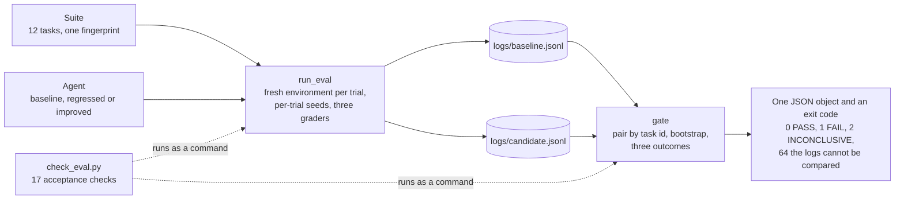

# Module 03: Capstone Project: Build an Evaluation Harness and a Release Gate

> **Prerequisites:** [Module 00](../00-anatomy-of-an-eval-harness/README.md) to [Module 02](../02-evaluating-agents-environments-graders-and-reliability/README.md) of this track.  
> **Estimated Reading Time:** 30 minutes (specification) / 6-8 hours (implementation and testing)  
> **Target Audience:** AI Backend Engineers, ML Platform Engineers, Model Evaluation Leads

> [!TIP]
> **The Golden Rule of the Evaluation Capstone:** An evaluation is finished when every decision in it has a check that fails when the decision is made wrongly. The agent is a script, so the whole evaluation can be tested without a model, and a release gate that has not been shown a known regression, a known tie and a known improvement has not been tested.

---

## 1. Problem Statement & Architecture

You will build the evaluation of a support-desk agent. It has two programs. A **trial runner** runs an agent on a suite of tasks, several trials each, every trial in a fresh environment and graded three ways, and writes one log line per trial. A **release gate** reads the logs of two versions of the agent and answers, with an interval, whether the new version is worse than the old one by more than the team allows. The agent is the scripted one from Module 02, a script with seeded mistakes, so the whole evaluation can be tested offline, deterministically and in CI. Module 02's Inspect workflow shows how a real agent goes behind the same seam.

The parts come straight from the track: the seeded, order-independent runs of Module 00, the paired comparison with an interval and an allowed drop of Module 01, and the environment, graders and reliability metrics of Module 02.



### The Sample Project

Everything the agent and the world are is in one provided file, `desk.py`: a database of 14 orders with three write tools, twelve tasks, three scripted agents, and the three graders of Module 02. Save it as it is. You will not change it, and the checker imports it to recompute your results.

```python
"""The support desk: the environment, the twelve tasks, three scripted agents and the graders. Provided, do not edit.

An agent here is a script with seeded mistakes, not a model. Everything you build in the capstone (the trial runner, the metrics and the
gate) sees it only through run_trial() and grade(), so a real agent can replace it later.
"""
import hashlib
import json

ORDER_IDS = ["A1", "A2", "A3", "A4", "B1", "B2", "B3", "B4", "C1", "C2", "C3", "C4", "S1", "S2"]
VERBS = {"cancel": "cancelled", "address": "updated", "refund": "refunded"}

# id, kind, order, argument, and the baseline agent's chance of: a wrong write, skipping the lookup, a reply without the result
TASKS = [
    {"id": "t01", "kind": "cancel", "order": "A1", "argument": "", "chances": [0.02, 0.05, 0.05]},
    {"id": "t02", "kind": "cancel", "order": "A2", "argument": "", "chances": [0.05, 0.10, 0.10]},
    {"id": "t03", "kind": "cancel", "order": "A3", "argument": "", "chances": [0.15, 0.10, 0.10]},
    {"id": "t04", "kind": "address", "order": "B1", "argument": "12 Elm St", "chances": [0.05, 0.05, 0.05]},
    {"id": "t05", "kind": "address", "order": "B2", "argument": "9 Oak Ave", "chances": [0.10, 0.10, 0.10]},
    {"id": "t06", "kind": "address", "order": "B3", "argument": "77 Pine Rd", "chances": [0.30, 0.15, 0.10]},
    {"id": "t07", "kind": "refund", "order": "C1", "argument": "", "chances": [0.05, 0.15, 0.05]},
    {"id": "t08", "kind": "refund", "order": "C2", "argument": "", "chances": [0.10, 0.20, 0.15]},
    {"id": "t09", "kind": "refund", "order": "C3", "argument": "", "chances": [0.35, 0.25, 0.15]},
    {"id": "t10", "kind": "cancel", "order": "A4", "argument": "", "chances": [0.50, 0.20, 0.20]},
    {"id": "t11", "kind": "address", "order": "B4", "argument": "5 Birch Ln", "chances": [0.55, 0.30, 0.20]},
    {"id": "t12", "kind": "refund", "order": "C4", "argument": "", "chances": [0.60, 0.40, 0.30]},
]
AGENTS = ["baseline", "regressed", "improved"]


class Rng:
    """mulberry32, a small 32-bit generator that gives the same numbers in every language."""

    def __init__(self, seed):
        self.state = seed & 0xFFFFFFFF

    def next(self):
        self.state = (self.state + 0x6D2B79F5) & 0xFFFFFFFF
        t = self.state
        t = ((t ^ (t >> 15)) * (t | 1)) & 0xFFFFFFFF
        t = t ^ ((t + (((t ^ (t >> 7)) * (t | 61)) & 0xFFFFFFFF)) & 0xFFFFFFFF)
        return ((t ^ (t >> 14)) & 0xFFFFFFFF) / 4294967296.0


def suite_hash():
    """A fingerprint of the tasks. Two logs can only be compared if they were made from the same suite."""
    return hashlib.sha256(json.dumps(TASKS, sort_keys=True).encode()).hexdigest()[:16]


def chances(agent, task):
    """The agent's chance of (a wrong write, skipping the lookup, a reply without the result) on a task.
    regressed: a new release that got much worse on the first eight tasks (four times the wrong writes, three times the skipped
    lookups, two and a half times the replies without the result). improved: half as many mistakes everywhere."""
    slip, skip, terse = task["chances"]
    if agent == "regressed" and int(task["id"][1:]) <= 8:
        return [min(0.9, slip * 4), min(0.9, skip * 3), min(0.9, terse * 2.5)]
    if agent == "improved":
        return [slip / 2, skip / 2, terse / 2]
    if agent in AGENTS:
        return [slip, skip, terse]
    raise ValueError(f"unknown agent: {agent}")


def fresh_database():
    """The environment. Every trial must get its own copy."""
    database = {}
    for order in ORDER_IDS:
        status = "delivered" if order[0] == "C" else "shipped" if order[0] == "S" else "processing"
        database[order] = {"status": status, "address": "1 Main St"}
    return database


def _cancel(database, order, _argument):
    if order in database and database[order]["status"] == "processing":
        database[order]["status"] = "cancelled"


def _address(database, order, address):
    if order in database and database[order]["status"] == "processing":
        database[order]["address"] = address


def _refund(database, order, _argument):
    if order in database and database[order]["status"] == "delivered":
        database[order]["status"] = "refunded"


WRITE_TOOLS = {"cancel": _cancel, "address": _address, "refund": _refund}


def goal_state(task):
    """What the database should look like once the task is done."""
    database = fresh_database()
    WRITE_TOOLS[task["kind"]](database, task["order"], task["argument"])
    return database


def run_trial(task, chance, rng):
    """One episode on a fresh database. Returns (final database, the names of the tools called, the agent's reply)."""
    skip_lookup, slips, terse = rng.next() < chance[1], rng.next() < chance[0], rng.next() < chance[2]
    database = fresh_database()
    calls = [] if skip_lookup else ["get_order"]
    target = ORDER_IDS[(ORDER_IDS.index(task["order"]) + 1) % len(ORDER_IDS)] if slips else task["order"]
    calls.append(task["kind"])
    WRITE_TOOLS[task["kind"]](database, target, task["argument"])
    reply = "Done." if terse else f"Done. Order {task['order']} is {VERBS[task['kind']]}."
    return database, calls, reply


def grade(task, database, calls, reply):
    """Three graders, each True or False. outcome: the final database equals the goal. reply: it names the order and the result.
    policy: the first tool call was the lookup."""
    outcome = database == goal_state(task)
    said = task["order"] in reply and VERBS[task["kind"]] in reply
    return outcome, said, calls[0] == "get_order"
```

The three agents are the points of comparison. `baseline` is the agent of Module 02. `regressed` is a new release that got much worse on the first eight tasks: four times the wrong writes, three times the skipped lookups and two and a half times the replies without the result. `improved` makes half as many mistakes everywhere. A good gate fails the first, passes the third, and says it cannot tell when the baseline is compared with another run of itself.

### The Contract

Both programs are commands, and the checker uses only their files and their output, so you can write them in any language.

**The log.** `run_eval` writes one JSON object per line, one line per trial:

| Field | Meaning |
| :--- | :--- |
| `suite_hash` | `desk.suite_hash()`, the fingerprint of the tasks |
| `agent`, `task_id`, `trial` | Which agent, which task, which trial (from 0) |
| `seed` | The seed that trial was run with, so anyone can run it again |
| `outcome`, `reply`, `policy` | The three graders' verdicts, true or false |
| `passed` | True only if all three are true |

**The trial runner.** `python run_eval.py --agent baseline --trials 16 --seed 1 --out logs/baseline.jsonl [--order forward|reversed]` writes the log and prints a one-line summary.

**The gate.** `python gate.py baseline.jsonl candidate.jsonl --allowed-drop 0.05 [--resamples 2000] [--seed 7]` prints one JSON object on one line and exits with a code that a CI job can act on:

| Exit code | Meaning |
| :--- | :--- |
| 0 | **PASS**: the whole interval for the change is above minus the allowed drop |
| 1 | **FAIL**: the whole interval is below minus the allowed drop |
| 2 | **INCONCLUSIVE**: the interval straddles it |
| 64 | The logs cannot be compared (different suites, different tasks, a mixed or empty log). The object has a `refused` field and no `verdict` |

The object has `verdict`, `difference` (the candidate's mean pass rate per task minus the baseline's), `low` and `high` (the 95% interval), `allowed_drop`, `tasks`, and a summary of each log: `agent`, `trials`, `pass_1`, and `pass_at` and `pass_hat` for the values of k in 1, 2, 4 and 8 that the number of trials can estimate.

---

## 2. Requirements Specification & Design Matrices

### Functional Requirements (FR)

| ID | Requirement | Comes from |
| :--- | :--- | :--- |
| **FR1** | Every trial runs on a fresh copy of the environment | Module 02, Environments |
| **FR2** | Every trial is graded by three graders, and it passes only if all three agree | Module 02, Graders |
| **FR3** | One log line per task and trial, with every field of the contract | Module 00, What Gets Logged |
| **FR4** | A trial's seed is made from the run's seed, the task id and the trial number: the same run gives the same log, and the order the tasks run in changes nothing | Module 00 |
| **FR5** | The gate pairs the two logs by task id, never by position in the file | Module 01, Pairing |
| **FR6** | The gate refuses logs it cannot compare: different suites, different tasks, a log that mixes suites or agents, or an uneven number of trials | Module 01 |
| **FR7** | The verdict has three outcomes, decided by comparing the whole interval with an allowed drop that is an argument | Module 01, The Gate |
| **FR8** | The interval is a paired bootstrap over tasks (resampling tasks with replacement, with the seeded generator) of the per-task difference in pass rate | Modules 01 and 02 |
| **FR9** | The gate reports pass@k and pass^k for the k that the trials can estimate, and leaves out the rest | Module 02, Trials |
| **FR10** | The gate prints one JSON object and exits with the code of the contract | Module 01, CI |

### Non-Functional Requirements (NFR)

| ID | Requirement | How it is measured |
| :--- | :--- | :--- |
| **NFR1** | No network and no model: both programs run offline | The checker runs them with nothing else |
| **NFR2** | Deterministic: a seed fixes every number | The `deterministic` check |
| **NFR3** | Fast: 192 trials and a gate in seconds | The whole checker runs in a few seconds on the reference solution |
| **NFR4** | No magic numbers in the code: the allowed drop, the number of resamples, the seed and the number of trials are arguments, and the list of k values is one named constant | Read your code, and the `margin-is-an-input` check |
| **NFR5** | The gate prints only the JSON object on standard output | The checker parses it |
| **NFR6** | Errors name the problem: a refusal says which log and why | Read what your gate prints on a refused pair |

### Technology & Implementation Choices Matrix

| Choice | Options | What this capstone requires |
| :--- | :--- | :--- |
| **Language** | Python, Go, TypeScript or C# | Any. The checker starts your programs as commands. The starters are Python for the trial runner and all four languages for the gate |
| **Unit of pairing** | By trial, or by task | **By task**: each task's pass rate in each log, then the difference. Trials of one task are not independent samples |
| **Interval** | Normal approximation, or a bootstrap | A **bootstrap over tasks**: with twelve tasks a normal approximation is not trustworthy, and the bootstrap does not assume a shape |
| **Seeds** | One running generator, or one seed per trial | **One seed per trial**, derived from the run's seed, the task and the trial number, so the order cannot matter |
| **Where the margin lives** | A constant in the code, or an argument | An **argument** (`--allowed-drop`), chosen before the run and printed in the result |
| **Environment for another language** | Port it, or call Python | **Port it** from Module 02's program, which has the same environment in all four languages. The checker recomputes your verdicts from your logged seeds with the Python `desk`, so a port that differs is caught |

### Deliverable & Empirical Evidence Matrix

| Deliverable | Evidence it works | How it is checked |
| :--- | :--- | :--- |
| `run_eval` | A log of the right shape, the same on every run, whatever the order | Checks 1 to 5 |
| `gate` on real logs | FAIL for the regression, not FAIL for a tie or an improvement, the margin an input, pairing by task | Checks 6 to 10 |
| `gate` refusals | Exit code 64 and no verdict for logs that cannot be compared | Checks 11 and 12 |
| `gate` logic and numbers | The three outcomes on known inputs, an interval close to a reference bootstrap, correct pass@k and pass^k | Checks 13 to 17 |
| Failure drills | For each drill, the check that catches it, with its output | Section 3 |
| Decision memo | The verdicts, intervals and a recommendation, with what was not tested | Section 6 |

---

## 3. Failure Drills (Mandatory Verification)

A check that has never failed has not been shown to work. For each drill below, make the change in a **copy** of your working solution, run `python check_eval.py`, confirm that the named check fails, and keep the output as evidence. Then undo the change. These eight breakages are the ones the checker was built to catch; the checker was run against each one before this module was published, and each is caught by the check named.

| # | Break this | The check that must fail |
| :--- | :--- | :--- |
| D1 | Grade the reply instead of the state: set the `outcome` field from the reply grader | `verdicts-recomputed` |
| D2 | Make a trial's seed depend on how many trials ran before it (a running counter) | `order-independent` |
| D3 | Run one trial of each task and copy it into every trial | `seeds-distinct` |
| D4 | Pair the two logs by position in the file instead of by task id | `pairs-by-task-not-position` |
| D5 | Remove the comparison of the two logs' suite hashes | `refuses-different-suites` |
| D6 | Replace the allowed drop with a constant in the code | `margin-is-an-input` |
| D7 | Decide the verdict from the point estimate: FAIL if the difference is below minus the allowed drop | `one-bad-task-is-inconclusive` |
| D8 | Compute pass^k for every k, including a k larger than the number of trials | `reliability-metrics` |

This is what the checker printed for two of them on the reference solution. D4 leaves the mean difference unchanged and moves only the interval, which is why the check prints the difference and both ends of the interval:

```text
PASS  log-shape: one line per task and trial, every field, and passed = outcome and reply and policy
PASS  deterministic: the same seed gives the same log, byte for byte
PASS  order-independent: running the tasks in reverse changes no trial
PASS  verdicts-recomputed: every graded trial matches a fresh run from its logged seed
PASS  seeds-distinct: no two trials share a seed
PASS  gate-flags-a-regression: the baseline against a much worse release is FAIL, exit code 1
PASS  gate-no-false-alarm: the baseline against itself with another seed is not FAIL
PASS  gate-lets-an-improvement-through: a better release is not FAIL, and the difference is positive
PASS  margin-is-an-input: the same regression with an allowed drop of 0.5 is not FAIL
FAIL  pairs-by-task-not-position: shuffling the lines of a log changes nothing
        (difference, low, high) was (-0.3021, -0.4583, -0.1458), and (-0.3021, -0.4583, -0.1406) once the lines of one log were shuffled
PASS  refuses-different-suites: logs from different suites are not compared (exit code 64, no verdict)
PASS  refuses-different-tasks: logs that cover different tasks are not compared (exit code 64, no verdict)
PASS  identical-logs-pass: no difference is PASS, with an interval of exactly zero
PASS  one-bad-task-is-inconclusive: one task lost in twelve cannot be told from noise (exit code 2)
PASS  uniform-drop-fails: every task halved is FAIL, with a difference of -0.5
PASS  interval-matches-reference: within 0.03 of a bootstrap over tasks, and it contains the difference
PASS  reliability-metrics: pass@k and pass^k match the estimators, and a k that the trials cannot estimate is left out

16 of 17 checks passed
```

D7 is the mistake of Module 01. A single bad task in twelve moves the point estimate below the allowed drop, and the interval says that twelve tasks cannot tell:

```text
PASS  log-shape: one line per task and trial, every field, and passed = outcome and reply and policy
PASS  deterministic: the same seed gives the same log, byte for byte
PASS  order-independent: running the tasks in reverse changes no trial
PASS  verdicts-recomputed: every graded trial matches a fresh run from its logged seed
PASS  seeds-distinct: no two trials share a seed
PASS  gate-flags-a-regression: the baseline against a much worse release is FAIL, exit code 1
PASS  gate-no-false-alarm: the baseline against itself with another seed is not FAIL
PASS  gate-lets-an-improvement-through: a better release is not FAIL, and the difference is positive
PASS  margin-is-an-input: the same regression with an allowed drop of 0.5 is not FAIL
PASS  pairs-by-task-not-position: shuffling the lines of a log changes nothing
PASS  refuses-different-suites: logs from different suites are not compared (exit code 64, no verdict)
PASS  refuses-different-tasks: logs that cover different tasks are not compared (exit code 64, no verdict)
PASS  identical-logs-pass: no difference is PASS, with an interval of exactly zero
FAIL  one-bad-task-is-inconclusive: one task lost in twelve cannot be told from noise (exit code 2)
        exit code 1, verdict FAIL
PASS  uniform-drop-fails: every task halved is FAIL, with a difference of -0.5
PASS  interval-matches-reference: within 0.03 of a bootstrap over tasks, and it contains the difference
PASS  reliability-metrics: pass@k and pass^k match the estimators, and a k that the trials cannot estimate is left out

16 of 17 checks passed
```

---

## 4. Multi-Language Starter (TODO Scaffolds, Not a Full Solution)

Make a folder with `desk.py` from Section 1, and write the two programs in it. The trial runner uses the Python `desk`, so its starter is Python. If you want to write it in another language, port the environment from Module 02's program (the same environment is in all four languages) and log the seeds you use, and the checker will recompute your verdicts to confirm the port.

### The Trial Runner (`run_eval.py`)

The argument parsing is given. Three things are yours:

```python
"""Run an agent on every task of the suite, several trials each, and write one JSON line per trial.

usage: python run_eval.py --agent baseline --trials 16 --seed 1 --out logs/baseline.jsonl [--order forward|reversed]
"""
import argparse
import hashlib
import json
import pathlib

import desk


def trial_seed(seed, task_id, trial):
    """TODO 1. A seed for one trial, made from the run's seed, the task id and the trial number, so that the order the tasks run in
    cannot change any trial. Hint: hash the three together with hashlib and keep 32 bits (the generator takes a 32-bit seed)."""
    raise NotImplementedError("TODO 1: trial_seed")


def run_one(agent, task, trial, seed):
    """TODO 2. One trial on a fresh database, graded three ways, as a dictionary ready to be written as a line.
    Call desk.run_trial(task, desk.chances(agent, task), desk.Rng(this trial's seed)), then desk.grade(...).
    The line needs the fields suite_hash, agent, task_id, trial, seed, outcome, reply, policy and passed,
    and passed is true only when all three graders agree."""
    raise NotImplementedError("TODO 2: run_one")


def main():
    parser = argparse.ArgumentParser()
    parser.add_argument("--agent", required=True, choices=desk.AGENTS)
    parser.add_argument("--trials", type=int, required=True)
    parser.add_argument("--seed", type=int, required=True)
    parser.add_argument("--out", required=True)
    parser.add_argument("--order", choices=["forward", "reversed"], default="forward")
    args = parser.parse_args()

    tasks = desk.TASKS if args.order == "forward" else list(reversed(desk.TASKS))
    # TODO 3. Run args.trials trials of every task, write one JSON line per trial to args.out (make the folder if it is not there),
    # and print a one-line summary: the agent, the number of trials and pass^1.
    raise NotImplementedError("TODO 3: main")


main()
```

### The Gate, in Four Languages

The reading of the arguments and of the log file, the generator and the refusal are given. The statistics and the pairing are yours (TODO 4 to 9). The Python tab is `gate.py`.

````carousel

```go
// The release gate (starter): compare two trial logs task by task and say whether the candidate is worse than the baseline by more than we allow.
//
// usage: go run gate.go baseline.jsonl candidate.jsonl --allowed-drop 0.05 [--resamples 2000] [--seed 7]
// Prints one JSON object. Exit code: 0 PASS, 1 FAIL, 2 INCONCLUSIVE, 64 the two logs cannot be compared.
package main

import (
	"bufio"
	"encoding/json"
	"fmt"
	"os"
	"strconv"
	"strings"
)

var kValues = []int{1, 2, 4, 8}

// row is the part of a log line the gate needs.
type row struct {
	SuiteHash string `json:"suite_hash"`
	Agent     string `json:"agent"`
	TaskID    string `json:"task_id"`
	Passed    bool   `json:"passed"`
}

type options struct {
	baseline, candidate string
	allowedDrop         float64
	resamples           int
	seed                uint32
}

// rng is mulberry32, a small 32-bit generator that gives the same numbers in every language.
type rng struct{ state uint32 }

func (r *rng) next() float64 {
	r.state += 0x6D2B79F5
	t := r.state
	t = (t ^ (t >> 15)) * (t | 1)
	t ^= t + (t^(t>>7))*(t|61)
	return float64(t^(t>>14)) / 4294967296.0
}

// refuse says why the logs cannot be compared and exits with code 64.
func refuse(reason string) {
	out, _ := json.Marshal(map[string]string{"refused": reason})
	fmt.Println(string(out))
	os.Exit(64)
}

// readLog reads the lines of a log file.
func readLog(path string) []row {
	file, err := os.Open(path)
	if err != nil {
		refuse("cannot read " + path)
	}
	defer file.Close()
	var rows []row
	scanner := bufio.NewScanner(file)
	scanner.Buffer(make([]byte, 1<<20), 1<<20)
	for scanner.Scan() {
		if strings.TrimSpace(scanner.Text()) == "" {
			continue
		}
		var r row
		if json.Unmarshal(scanner.Bytes(), &r) != nil {
			refuse(path + " has a line that is not JSON")
		}
		rows = append(rows, r)
	}
	return rows
}

// parseArgs reads the two log paths and the options.
func parseArgs() options {
	o := options{allowedDrop: -1, resamples: 2000, seed: 7}
	var paths []string
	args := os.Args[1:]
	for i := 0; i < len(args); i++ {
		switch args[i] {
		case "--allowed-drop":
			i++
			o.allowedDrop, _ = strconv.ParseFloat(args[i], 64)
		case "--resamples":
			i++
			o.resamples, _ = strconv.Atoi(args[i])
		case "--seed":
			i++
			seed, _ := strconv.ParseUint(args[i], 10, 32)
			o.seed = uint32(seed)
		default:
			paths = append(paths, args[i])
		}
	}
	if len(paths) != 2 || o.allowedDrop < 0 {
		fmt.Fprintln(os.Stderr, "usage: gate baseline.jsonl candidate.jsonl --allowed-drop 0.05 [--resamples 2000] [--seed 7]")
		os.Exit(2)
	}
	o.baseline, o.candidate = paths[0], paths[1]
	return o
}

// TODO 4. load groups the passed flags by task id, {task id: [passed, passed, ...]}, and returns the suite hash and the agent name.
// Refuse a log that is empty, mixes suites or agents, or has a different number of trials for different tasks.
func load(rows []row) (suite, agent string, byTask map[string][]bool) {
	panic("TODO 4: load")
}

// TODO 5a. passAtK is the chance that at least one of k trials succeeds, when c of n did: 1 - C(n-c, k) / C(n, k).
// Compute it as a product of k ratios, not with factorials.
func passAtK(c, n, k int) float64 {
	panic("TODO 5a: passAtK")
}

// TODO 5b. passHatK is the chance that all k trials succeed, when c of n did: C(c, k) / C(n, k).
func passHatK(c, n, k int) float64 {
	panic("TODO 5b: passHatK")
}

// TODO 6. summary is {"agent", "trials", "pass_1", "pass_at": {k: value}, "pass_hat": {k: value}} with each metric averaged over tasks,
// rounded to 4 decimals, for the k in kValues that the number of trials can estimate (leave the others out). The keys are strings.
func summary(agent string, byTask map[string][]bool) map[string]any {
	panic("TODO 6: summary")
}

// TODO 7. bootstrap is a 95% interval for the mean of the per-task differences: resample the tasks with replacement, resamples times,
// with the generator seeded by seed, sort the means, and take the 2.5th and 97.5th percentiles (integer index arithmetic).
func bootstrap(diffs []float64, resamples int, seed uint32) (low, high float64) {
	panic("TODO 7: bootstrap")
}

// TODO 8. verdict is FAIL when the whole interval is a drop bigger than allowed, PASS when the whole interval is a smaller drop or a gain,
// INCONCLUSIVE otherwise.
func verdict(low, high, allowedDrop float64) string {
	panic("TODO 8: verdict")
}

func main() {
	o := parseArgs()
	baseRows, candRows := readLog(o.baseline), readLog(o.candidate)
	_, _ = baseRows, candRows
	// TODO 9. Load both logs; refuse logs from different suites or covering different tasks; pair the tasks by id (never by position in
	// the file); take each task's pass rate in the candidate minus in the baseline; get the interval and the verdict; print one JSON
	// object with verdict, difference, low, high, allowed_drop, tasks, baseline and candidate (the two summaries); exit with the
	// verdict's code. Round difference, low and high to 4 decimals.
	panic("TODO 9: main")
}
```

<!-- slide -->

```typescript
// The release gate (starter): compare two trial logs task by task and say whether the candidate is worse than the baseline by more than we allow.
//
// usage: node gate.ts baseline.jsonl candidate.jsonl --allowed-drop 0.05 [--resamples 2000] [--seed 7]   (Node 24 or newer)
// Prints one JSON object. Exit code: 0 PASS, 1 FAIL, 2 INCONCLUSIVE, 64 the two logs cannot be compared.
import { readFileSync } from "node:fs";

const K_VALUES = [1, 2, 4, 8];

/** The part of a log line the gate needs. */
type Row = { suite_hash: string; agent: string; task_id: string; passed: boolean };
type Options = { baseline: string; candidate: string; allowedDrop: number; resamples: number; seed: number };

/** mulberry32, a small 32-bit generator that gives the same numbers in every language. */
class Rng {
  state: number;

  constructor(seed: number) {
    this.state = seed >>> 0;
  }

  next(): number {
    this.state = (this.state + 0x6d2b79f5) >>> 0;
    let t = this.state;
    t = Math.imul(t ^ (t >>> 15), t | 1);
    t = t ^ (t + Math.imul(t ^ (t >>> 7), t | 61));
    return ((t ^ (t >>> 14)) >>> 0) / 4294967296;
  }
}

/** Says why the logs cannot be compared and exits with code 64. */
function refuse(reason: string): never {
  console.log(JSON.stringify({ refused: reason }));
  process.exit(64);
}

function readLog(path: string): Row[] {
  let text: string;
  try {
    text = readFileSync(path, "utf8");
  } catch {
    return refuse(`cannot read ${path}`);
  }
  return text.split("\n").filter((line) => line.trim() !== "").map((line) => JSON.parse(line) as Row);
}

function parseArgs(): Options {
  const options: Options = { baseline: "", candidate: "", allowedDrop: -1, resamples: 2000, seed: 7 };
  const paths: string[] = [];
  const args = process.argv.slice(2);
  for (let i = 0; i < args.length; i++) {
    if (args[i] === "--allowed-drop") options.allowedDrop = Number(args[++i]);
    else if (args[i] === "--resamples") options.resamples = Number(args[++i]);
    else if (args[i] === "--seed") options.seed = Number(args[++i]);
    else paths.push(args[i]);
  }
  if (paths.length !== 2 || options.allowedDrop < 0) {
    console.error("usage: node gate.ts baseline.jsonl candidate.jsonl --allowed-drop 0.05 [--resamples 2000] [--seed 7]");
    process.exit(2);
  }
  [options.baseline, options.candidate] = paths;
  return options;
}

/**
 * TODO 4. Group the passed flags by task id, {task id: [passed, passed, ...]}, and return the suite hash and the agent name.
 * Refuse a log that is empty, mixes suites or agents, or has a different number of trials for different tasks.
 */
function load(rows: Row[]): { suite: string; agent: string; byTask: Map<string, boolean[]> } {
  throw new Error("TODO 4: load");
}

/** TODO 5a. The chance that at least one of k trials succeeds, when c of n did: 1 - C(n - c, k) / C(n, k). Compute it as a product of k ratios. */
function passAtK(c: number, n: number, k: number): number {
  throw new Error("TODO 5a: passAtK");
}

/** TODO 5b. The chance that all k trials succeed, when c of n did: C(c, k) / C(n, k). */
function passHatK(c: number, n: number, k: number): number {
  throw new Error("TODO 5b: passHatK");
}

/**
 * TODO 6. {agent, trials, pass_1, pass_at: {k: value}, pass_hat: {k: value}} with each metric averaged over tasks, rounded to 4 decimals,
 * for the k in K_VALUES that the number of trials can estimate (leave the others out). The keys are strings.
 */
function summary(agent: string, byTask: Map<string, boolean[]>): Record<string, unknown> {
  throw new Error("TODO 6: summary");
}

/**
 * TODO 7. A 95% interval for the mean of the per-task differences: resample the tasks with replacement, `resamples` times, with a generator
 * seeded by `seed`, sort the means, and take the 2.5th and 97.5th percentiles (integer index arithmetic).
 */
function bootstrap(diffs: number[], resamples: number, seed: number): [number, number] {
  throw new Error("TODO 7: bootstrap");
}

/** TODO 8. FAIL when the whole interval is a drop bigger than allowed, PASS when the whole interval is a smaller drop or a gain, INCONCLUSIVE otherwise. */
function verdict(low: number, high: number, allowedDrop: number): "PASS" | "FAIL" | "INCONCLUSIVE" {
  throw new Error("TODO 8: verdict");
}

function main(): void {
  const options = parseArgs();
  const baseRows = readLog(options.baseline);
  const candRows = readLog(options.candidate);
  void [baseRows, candRows, new Rng(options.seed), K_VALUES];
  // TODO 9. Load both logs; refuse logs from different suites or covering different tasks; pair the tasks by id (never by position in the
  // file); take each task's pass rate in the candidate minus in the baseline; get the interval and the verdict; print one JSON object with
  // verdict, difference, low, high, allowed_drop, tasks, baseline and candidate (the two summaries); exit with the verdict's code.
  // Round difference, low and high to 4 decimals.
  throw new Error("TODO 9: main");
}

main();
```

<!-- slide -->

```python
"""The release gate: compare two trial logs task by task and say whether the candidate is worse than the baseline by more than we allow.

usage: python gate.py baseline.jsonl candidate.jsonl --allowed-drop 0.05 [--resamples 2000] [--seed 7]
Prints one JSON object. Exit code: 0 PASS, 1 FAIL, 2 INCONCLUSIVE, 64 the two logs cannot be compared.
"""
import argparse
import json
import sys

import desk

EXIT_CODES = {"PASS": 0, "FAIL": 1, "INCONCLUSIVE": 2}
REFUSED = 64
K_VALUES = [1, 2, 4, 8]


def refuse(reason):
    print(json.dumps({"refused": reason}))
    sys.exit(REFUSED)


def load(path):
    """TODO 4. The trials of one log grouped by task, {task_id: [passed, passed, ...]}, with the suite hash and the agent name.
    Refuse (refuse(...)) a log that is empty, mixes suites or agents, or has a different number of trials for different tasks."""
    rows = [json.loads(line) for line in open(path, encoding="utf-8") if line.strip()]
    raise NotImplementedError("TODO 4: load")


def pass_at_k(c, n, k):
    """TODO 5a. The chance that at least one of k trials succeeds, when c of n did: 1 - C(n - c, k) / C(n, k).
    Compute it as a product of k ratios, not with factorials."""
    raise NotImplementedError("TODO 5a: pass_at_k")


def pass_hat_k(c, n, k):
    """TODO 5b. The chance that all k trials succeed, when c of n did: C(c, k) / C(n, k)."""
    raise NotImplementedError("TODO 5b: pass_hat_k")


def summary(agent, by_task):
    """TODO 6. {"agent", "trials", "pass_1", "pass_at": {k: value}, "pass_hat": {k: value}} with each metric averaged over tasks,
    rounded to 4 decimals, for the k in K_VALUES that the number of trials can estimate (leave the others out). The keys of the
    two dictionaries are strings."""
    raise NotImplementedError("TODO 6: summary")


def bootstrap(diffs, resamples, seed):
    """TODO 7. A 95% interval for the mean of the per-task differences: resample the tasks with replacement, `resamples` times, with
    desk.Rng(seed), sort the means, and take the 2.5th and 97.5th percentiles (integer index arithmetic)."""
    raise NotImplementedError("TODO 7: bootstrap")


def verdict(low, high, allowed_drop):
    """TODO 8. FAIL when the whole interval is a drop bigger than allowed, PASS when the whole interval is a smaller drop or a gain,
    INCONCLUSIVE otherwise."""
    raise NotImplementedError("TODO 8: verdict")


def main():
    parser = argparse.ArgumentParser()
    parser.add_argument("baseline")
    parser.add_argument("candidate")
    parser.add_argument("--allowed-drop", type=float, required=True)
    parser.add_argument("--resamples", type=int, default=2000)
    parser.add_argument("--seed", type=int, default=7)
    args = parser.parse_args()
    # TODO 9. Load both logs; refuse logs from different suites or covering different tasks; pair the tasks by id (never by position
    # in the file); take each task's pass rate in the candidate minus in the baseline; get the interval and the verdict; print one JSON
    # object with verdict, difference, low, high, allowed_drop, tasks, baseline and candidate (the two summaries); exit with the
    # verdict's code. Round difference, low and high to 4 decimals.
    raise NotImplementedError("TODO 9: main")


main()
```

<!-- slide -->

```csharp
// The release gate (starter): compare two trial logs task by task and say whether the candidate is worse than the baseline by more than we allow.
//
// usage: dotnet run Gate.cs -- baseline.jsonl candidate.jsonl --allowed-drop 0.05 [--resamples 2000] [--seed 7]   (.NET 10 SDK)
// Prints one JSON object. Exit code: 0 PASS, 1 FAIL, 2 INCONCLUSIVE, 64 the two logs cannot be compared.
using System;
using System.Collections.Generic;
using System.Globalization;
using System.IO;
using System.Linq;
using System.Text.Json;

int[] kValues = { 1, 2, 4, 8 };
var inv = CultureInfo.InvariantCulture;

// Says why the logs cannot be compared and exits with code 64.
void Refuse(string reason)
{
    Console.WriteLine($"{{\"refused\": \"{JsonEncodedText.Encode(reason)}\"}}");
    Environment.Exit(64);
}

// One line of a log: the part the gate needs. (A file-based app has reflection-based JSON turned off, so read it with JsonDocument.)
Row ParseRow(string line)
{
    using var document = JsonDocument.Parse(line);
    var root = document.RootElement;
    return new Row(root.GetProperty("suite_hash").GetString()!, root.GetProperty("agent").GetString()!, root.GetProperty("task_id").GetString()!, root.GetProperty("passed").GetBoolean());
}

List<Row> ReadLog(string path)
{
    if (!File.Exists(path)) Refuse("cannot read " + path);
    return File.ReadLines(path).Where(line => line.Trim() != "").Select(ParseRow).ToList();
}

// TODO 4. Group the passed flags by task id, {task id: [passed, passed, ...]}, and return the suite hash and the agent name.
// Refuse a log that is empty, mixes suites or agents, or has a different number of trials for different tasks.
(string Suite, string Agent, Dictionary<string, List<bool>> ByTask) Load(List<Row> rows) => throw new NotImplementedException("TODO 4: Load");

// TODO 5a. The chance that at least one of k trials succeeds, when c of n did: 1 - C(n - c, k) / C(n, k). Compute it as a product of k ratios.
double PassAtK(int c, int n, int k) => throw new NotImplementedException("TODO 5a: PassAtK");

// TODO 5b. The chance that all k trials succeed, when c of n did: C(c, k) / C(n, k).
double PassHatK(int c, int n, int k) => throw new NotImplementedException("TODO 5b: PassHatK");

// TODO 6. {agent, trials, pass_1, pass_at: {k: value}, pass_hat: {k: value}} with each metric averaged over tasks, rounded to 4 decimals,
// for the k in kValues that the number of trials can estimate (leave the others out). The keys are strings.
Dictionary<string, object> Summary(string agent, Dictionary<string, List<bool>> byTask) => throw new NotImplementedException("TODO 6: Summary");

// TODO 7. A 95% interval for the mean of the per-task differences: resample the tasks with replacement, `resamples` times, with a generator
// seeded by `seed`, sort the means, and take the 2.5th and 97.5th percentiles (integer index arithmetic).
(double Low, double High) Bootstrap(double[] diffs, int resamples, uint seed) => throw new NotImplementedException("TODO 7: Bootstrap");

// TODO 8. FAIL when the whole interval is a drop bigger than allowed, PASS when the whole interval is a smaller drop or a gain, INCONCLUSIVE otherwise.
string Verdict(double low, double high, double allowedDrop) => throw new NotImplementedException("TODO 8: Verdict");

// Reads the two log paths and the options.
var paths = new List<string>();
double allowedDrop = -1;
int resamples = 2000;
uint seed = 7;
for (int i = 0; i < args.Length; i++)
{
    if (args[i] == "--allowed-drop") allowedDrop = double.Parse(args[++i], inv);
    else if (args[i] == "--resamples") resamples = int.Parse(args[++i], inv);
    else if (args[i] == "--seed") seed = uint.Parse(args[++i], inv);
    else paths.Add(args[i]);
}
if (paths.Count != 2 || allowedDrop < 0)
{
    Console.Error.WriteLine("usage: dotnet run Gate.cs -- baseline.jsonl candidate.jsonl --allowed-drop 0.05 [--resamples 2000] [--seed 7]");
    return 2;
}
var baseRows = ReadLog(paths[0]);
var candRows = ReadLog(paths[1]);
_ = (baseRows, candRows, new Rng(seed), kValues);
// TODO 9. Load both logs; refuse logs from different suites or covering different tasks; pair the tasks by id (never by position in the
// file); take each task's pass rate in the candidate minus in the baseline; get the interval and the verdict; print one JSON object with
// verdict, difference, low, high, allowed_drop, tasks, baseline and candidate (the two summaries); exit with the verdict's code.
// Round difference, low and high to 4 decimals. (Write the JSON by hand or with Utf8JsonWriter; JsonSerializer does not work here.)
throw new NotImplementedException("TODO 9: main");

// The part of a log line the gate needs.
record Row(string SuiteHash, string Agent, string TaskId, bool Passed);

// mulberry32, a small 32-bit generator that gives the same numbers in every language.
class Rng
{
    private uint state;

    public Rng(uint seed) => state = seed;

    public double Next()
    {
        unchecked
        {
            state += 0x6D2B79F5u;
            uint t = state;
            t = (t ^ (t >> 15)) * (t | 1u);
            t ^= t + (t ^ (t >> 7)) * (t | 61u);
            return (t ^ (t >> 14)) / 4294967296.0;
        }
    }
}
```

````

Each starter runs as far as its first TODO and stops there with the message of that TODO. Run the gate with `go run gate.go`, `node gate.ts` (Node 24 or newer), `python gate.py` or `dotnet run Gate.cs --` (.NET 10 SDK), and tell the checker which with `GATE_CMD`.

---

## 5. Automated Acceptance Verification CLI Checks

Save this as `check_eval.py` in the same folder. It starts your programs as commands (set `RUN_EVAL_CMD` and `GATE_CMD` if they are not the Python defaults), builds its own logs, also writes logs without running any agent to give the gate known inputs, and compares the results with its own copy of the statistics.

```python
"""Acceptance checks for the capstone: a trial runner and a release gate, run as commands. usage: python check_eval.py

Run it in the folder that holds desk.py and your two programs. It starts them as commands, so they can be written in any language:
    RUN_EVAL_CMD="go run run_eval.go"  GATE_CMD="go run gate.go"  python check_eval.py
(the defaults are "python run_eval.py" and "python gate.py"). It needs nothing from your code but the log files and what the gate prints.
"""
import json
import os
import pathlib
import random
import shlex
import subprocess
import sys
import tempfile

import desk

HERE = pathlib.Path(__file__).resolve().parent
RUN_EVAL = shlex.split(os.environ.get("RUN_EVAL_CMD", "python run_eval.py"))
GATE = shlex.split(os.environ.get("GATE_CMD", "python gate.py"))
WORK = pathlib.Path(tempfile.mkdtemp(prefix="capstone-"))
FIELDS = {"suite_hash", "agent", "task_id", "trial", "seed", "outcome", "reply", "policy", "passed"}
TASKS = {task["id"]: task for task in desk.TASKS}
FULL = [16] * len(desk.TASKS)
results = []


def check(name, ok, detail=""):
    results.append(bool(ok))
    print(("PASS  " if ok else "FAIL  ") + name + ("" if ok else f"\n        {detail}"))


def run(command, *args):
    return subprocess.run(command + [str(a) for a in args], capture_output=True, text=True, cwd=HERE)


def make_log(name, agent, seed, trials=16, *extra):
    path = WORK / name
    return path, run(RUN_EVAL, "--agent", agent, "--trials", trials, "--seed", seed, "--out", path, *extra)


def read_log(path):
    return [json.loads(line) for line in path.read_text(encoding="utf-8").splitlines() if line.strip()] if path.exists() else []


def synthetic(name, agent, passes, trials=16):
    """A log in which task i passed passes[i] of its trials, written without running any agent."""
    path = WORK / name
    rows = [{"suite_hash": desk.suite_hash(), "agent": agent, "task_id": task["id"], "trial": t, "seed": 0,
             "outcome": t < c, "reply": t < c, "policy": t < c, "passed": t < c} for task, c in zip(desk.TASKS, passes) for t in range(trials)]
    path.write_text("".join(json.dumps(r) + "\n" for r in rows), encoding="utf-8")
    return path


def gate(baseline, candidate, allowed_drop=0.05):
    """(exit code, the JSON the gate printed, or {})"""
    result = run(GATE, baseline, candidate, "--allowed-drop", allowed_drop)
    try:
        return result.returncode, json.loads(result.stdout)
    except ValueError:
        return result.returncode, {}


# The statistics again, so that the gate's numbers can be compared with them.
def reference_interval(diffs, resamples=2000, seed=7):
    rng, n = desk.Rng(seed), len(diffs)
    means = sorted(sum(diffs[int(rng.next() * n)] for _ in range(n)) / n for _ in range(resamples))
    return means[resamples * 25 // 1000], means[(resamples * 975 + 999) // 1000 - 1]


def reference_pass(counts, n, k):
    """(pass@k, pass^k) averaged over tasks, for tasks that succeeded counts[i] times in n trials."""
    at = hat = 0.0
    for c in counts:
        miss = right = 1.0
        for i in range(k):
            miss *= max(n - c - i, 0) / (n - i)
            right *= max(c - i, 0) / (n - i)
        at, hat = at + 1 - miss, hat + right
    return at / len(counts), hat / len(counts)


def recomputed(row):
    """What a fresh run of this trial from its logged seed gives: (outcome, reply, policy)."""
    task = TASKS[row["task_id"]]
    return desk.grade(task, *desk.run_trial(task, desk.chances(row["agent"], task), desk.Rng(row["seed"])))


# ---- the trial runner ----
path, r = make_log("small.jsonl", "baseline", 1, 8)
rows = read_log(path)
check("log-shape: one line per task and trial, every field, and passed = outcome and reply and policy",
      r.returncode == 0 and len(rows) == len(desk.TASKS) * 8 and all(FIELDS <= set(x) for x in rows)
      and all(x["passed"] == (x["outcome"] and x["reply"] and x["policy"]) for x in rows) and {x["suite_hash"] for x in rows} == {desk.suite_hash()},
      f"exit code {r.returncode}, {len(rows)} lines. {r.stderr.strip()[-200:]}")
again, _ = make_log("small-again.jsonl", "baseline", 1, 8)
check("deterministic: the same seed gives the same log, byte for byte", path.exists() and again.exists() and path.read_bytes() == again.read_bytes(), "two runs with one seed differ")
backwards, _ = make_log("small-reversed.jsonl", "baseline", 1, 8, "--order", "reversed")
by_trial = lambda x: (x["task_id"], x["trial"])
check("order-independent: running the tasks in reverse changes no trial", rows and sorted(rows, key=by_trial) == sorted(read_log(backwards), key=by_trial), "a trial depends on the order the tasks ran in")
wrong = [x for x in rows if recomputed(x) != (x["outcome"], x["reply"], x["policy"])]
check("verdicts-recomputed: every graded trial matches a fresh run from its logged seed", rows and not wrong,
      f"{len(wrong)} of {len(rows)} trials differ: a database shared between trials, or graders that are not the three graders")
check("seeds-distinct: no two trials share a seed", rows and len({x["seed"] for x in rows}) == len(rows), "some seeds repeat")

# ---- the gate on real logs ----
base1, _ = make_log("base1.jsonl", "baseline", 1)
base2, _ = make_log("base2.jsonl", "baseline", 2)
regressed, _ = make_log("regressed.jsonl", "regressed", 3)
improved, _ = make_log("improved.jsonl", "improved", 4)
code, out = gate(base1, regressed)
check("gate-flags-a-regression: the baseline against a much worse release is FAIL, exit code 1", code == 1 and out.get("verdict") == "FAIL", f"exit code {code}, verdict {out.get('verdict')}")
code, out = gate(base1, base2)
check("gate-no-false-alarm: the baseline against itself with another seed is not FAIL", code in (0, 2) and out.get("verdict") in ("PASS", "INCONCLUSIVE"), f"exit code {code}, verdict {out.get('verdict')}")
code, out = gate(base1, improved)
check("gate-lets-an-improvement-through: a better release is not FAIL, and the difference is positive", code in (0, 2) and out.get("difference", -1) > 0, f"exit code {code}, verdict {out.get('verdict')}")
code, out = gate(base1, regressed, 0.5)
check("margin-is-an-input: the same regression with an allowed drop of 0.5 is not FAIL", code in (0, 2) and out.get("allowed_drop") == 0.5, f"exit code {code}, verdict {out.get('verdict')}")
lines = regressed.read_text(encoding="utf-8").splitlines()
random.Random(5).shuffle(lines)
shuffled = WORK / "regressed-shuffled.jsonl"
shuffled.write_text("\n".join(lines) + "\n", encoding="utf-8")
plain, mixed = gate(base1, regressed), gate(base1, shuffled)
check("pairs-by-task-not-position: shuffling the lines of a log changes nothing", plain == mixed and plain[1] != {},
      f"(difference, low, high) was {tuple(plain[1].get(x) for x in ('difference', 'low', 'high'))}, and {tuple(mixed[1].get(x) for x in ('difference', 'low', 'high'))} "
      "once the lines of one log were shuffled")
other = WORK / "other-suite.jsonl"
other.write_text(regressed.read_text(encoding="utf-8").replace(desk.suite_hash(), "0" * 16), encoding="utf-8")
code, out = gate(base1, other)
check("refuses-different-suites: logs from different suites are not compared (exit code 64, no verdict)", code == 64 and "verdict" not in out, f"exit code {code}, verdict {out.get('verdict')}")
short = WORK / "fewer-tasks.jsonl"
short.write_text("".join(x + "\n" for x in regressed.read_text(encoding="utf-8").splitlines() if '"t12"' not in x), encoding="utf-8")
code, out = gate(base1, short)
check("refuses-different-tasks: logs that cover different tasks are not compared (exit code 64, no verdict)", code == 64 and "verdict" not in out, f"exit code {code}, verdict {out.get('verdict')}")

# ---- the gate's logic and numbers, on logs made without an agent ----
code, out = gate(synthetic("a.jsonl", "a", FULL), synthetic("b.jsonl", "b", FULL))
check("identical-logs-pass: no difference is PASS, with an interval of exactly zero", code == 0 and out.get("verdict") == "PASS" and out.get("difference") == 0 and out.get("low") == 0 == out.get("high"), f"exit code {code}, {out}")
code, out = gate(synthetic("a.jsonl", "a", FULL), synthetic("b.jsonl", "b", [0] + [16] * 11))
check("one-bad-task-is-inconclusive: one task lost in twelve cannot be told from noise (exit code 2)", code == 2 and out.get("verdict") == "INCONCLUSIVE", f"exit code {code}, verdict {out.get('verdict')}")
code, out = gate(synthetic("a.jsonl", "a", FULL), synthetic("b.jsonl", "b", [8] * len(desk.TASKS)))
check("uniform-drop-fails: every task halved is FAIL, with a difference of -0.5", code == 1 and out.get("verdict") == "FAIL" and abs(out.get("difference", 0) + 0.5) < 1e-3, f"exit code {code}, {out.get('verdict')}, {out.get('difference')}")
rate = lambda path: {i: sum(x["passed"] for x in read_log(path) if x["task_id"] == i) / 16 for i in TASKS}
before, after = rate(base1), rate(regressed)
low, high = reference_interval([after[i] - before[i] for i in sorted(TASKS)])
code, out = gate(base1, regressed)
check("interval-matches-reference: within 0.03 of a bootstrap over tasks, and it contains the difference",
      abs(out.get("low", 9) - low) < 0.03 and abs(out.get("high", 9) - high) < 0.03 and out.get("low", 9) <= out.get("difference", 0) <= out.get("high", -9),
      f"yours [{out.get('low')}, {out.get('high')}], reference [{low:.4f}, {high:.4f}]")
counts = [16, 14, 12, 14, 13, 7, 15, 12, 8, 3, 6, 3]  # the successes per task behind Module 02's table
code, out = gate(synthetic("a.jsonl", "a", FULL), synthetic("b.jsonl", "b", counts))
mine = out.get("candidate", {})
matches = all(abs(mine.get("pass_at", {}).get(str(k), 9) - reference_pass(counts, 16, k)[0]) < 1e-3
              and abs(mine.get("pass_hat", {}).get(str(k), 9) - reference_pass(counts, 16, k)[1]) < 1e-3 for k in (1, 2, 4, 8))
code, out = gate(synthetic("a4.jsonl", "a", FULL, 4), synthetic("b4.jsonl", "b", [4] * len(desk.TASKS), 4))
few = out.get("candidate", {}).get("pass_hat", {})
check("reliability-metrics: pass@k and pass^k match the estimators, and a k that the trials cannot estimate is left out",
      matches and "4" in few and "8" not in few, f"yours {mine.get('pass_hat')}; with 4 trials per task: {few}")

print(f"\n{sum(results)} of {len(results)} checks passed")
sys.exit(0 if all(results) else 1)
```

```bash
python check_eval.py
```

A finished solution prints this. It is the output of the reference solution:

```text
PASS  log-shape: one line per task and trial, every field, and passed = outcome and reply and policy
PASS  deterministic: the same seed gives the same log, byte for byte
PASS  order-independent: running the tasks in reverse changes no trial
PASS  verdicts-recomputed: every graded trial matches a fresh run from its logged seed
PASS  seeds-distinct: no two trials share a seed
PASS  gate-flags-a-regression: the baseline against a much worse release is FAIL, exit code 1
PASS  gate-no-false-alarm: the baseline against itself with another seed is not FAIL
PASS  gate-lets-an-improvement-through: a better release is not FAIL, and the difference is positive
PASS  margin-is-an-input: the same regression with an allowed drop of 0.5 is not FAIL
PASS  pairs-by-task-not-position: shuffling the lines of a log changes nothing
PASS  refuses-different-suites: logs from different suites are not compared (exit code 64, no verdict)
PASS  refuses-different-tasks: logs that cover different tasks are not compared (exit code 64, no verdict)
PASS  identical-logs-pass: no difference is PASS, with an interval of exactly zero
PASS  one-bad-task-is-inconclusive: one task lost in twelve cannot be told from noise (exit code 2)
PASS  uniform-drop-fails: every task halved is FAIL, with a difference of -0.5
PASS  interval-matches-reference: within 0.03 of a bootstrap over tasks, and it contains the difference
PASS  reliability-metrics: pass@k and pass^k match the estimators, and a k that the trials cannot estimate is left out

17 of 17 checks passed
```

### What Each Check Protects

| Checks | What they protect | Where to look when one fails |
| :--- | :--- | :--- |
| `log-shape`, `deterministic`, `order-independent`, `seeds-distinct` | The log is complete, repeatable and independent of the order of the tasks | `trial_seed`, and what `run_one` writes |
| `verdicts-recomputed` | Each trial was run on a fresh environment and graded by all three graders, because a fresh run from the logged seed gives the same verdicts | The environment (a copy per trial), the graders, and what you log |
| `gate-flags-a-regression`, `gate-no-false-alarm`, `gate-lets-an-improvement-through` | The gate separates a real regression from a tie and from an improvement | The sign of the difference, and the verdict |
| `margin-is-an-input` | The allowed drop is a decision made by the caller | Where the verdict gets its margin |
| `pairs-by-task-not-position` | Tasks are paired by id | How the two logs are lined up |
| `refuses-different-suites`, `refuses-different-tasks` | Logs that cannot be compared are not compared | `load` and the checks in `main` |
| `identical-logs-pass`, `one-bad-task-is-inconclusive`, `uniform-drop-fails` | The three outcomes, on inputs whose answer is known | `verdict`, and the interval |
| `interval-matches-reference` | The bootstrap is a bootstrap over tasks, to within 0.03 of the reference | `bootstrap`: resampling tasks, the percentile indices |
| `reliability-metrics` | pass@k and pass^k are right, and a k the trials cannot estimate is left out | `pass_at_k`, `pass_hat_k` and `summary` |

---

## 6. Milestone Checklist, Evaluation Rubric & Design Hints

### Milestone Execution Checklist

1. **The trial runner (60 to 90 minutes).** Fill TODO 1 to 3. When `log-shape`, `deterministic`, `order-independent`, `verdicts-recomputed` and `seeds-distinct` pass, you have a log you can trust.
2. **The metrics (45 minutes).** Fill TODO 5a, 5b and 6. Check the estimators by hand on one case: 3 successes in 8 trials gives pass@2 = 1 - C(5,2) / C(8,2) = 0.6429.
3. **The gate (60 minutes).** Fill TODO 4, 7, 8 and 9. The checks of the gate on real logs and on known inputs should pass, including the refusals.
4. **The failure drills (60 minutes).** Do D1 to D8 and keep the output of each. If a drill is *not* caught, the checker has a hole: say so, and write the check that closes it.
5. **The decision memo (60 minutes).** With 16 trials per task and seeds 1 to 4, run the gate on `baseline` against `regressed`, against `improved` and against a second run of `baseline`, with an allowed drop of 0.02, 0.05 and 0.10. Write ten lines: the verdicts, the intervals, what changed when the margin moved, how many tasks it would take to certify the tie, and what you would ship. The reference solution gives, at an allowed drop of 0.05: the regression FAIL with a difference of -0.3021 and an interval of [-0.4583, -0.1458]; the tie INCONCLUSIVE, -0.0312 [-0.1146, +0.0365]; the improvement PASS, +0.1719 [+0.0573, +0.2865].
6. **Stretch (optional).** Write the trial runner in a second language. Add a transcript grader that requires exactly one write call. Or put a real model behind `desk.run_trial` with Inspect, as in Module 02's Workflow 3, and gate it against a second configuration.

### Grading & Self-Evaluation Rubric (100 Points)

| Area | Points | Full marks when |
| :--- | ---: | :--- |
| Acceptance checks | 40 | All 17 checks pass (about 2.35 points each) |
| Failure drills | 15 | All eight drills done, each with the output that shows the named check failing |
| Statistical correctness | 15 | Pairing by task, a bootstrap over tasks with the stated percentile indices, three outcomes, and one number recomputed by hand and shown to match |
| Code quality | 15 | No magic numbers, JSON only on standard output, errors that name the problem, and the agent kept out of the gate |
| Decision memo | 15 | The verdicts and intervals are right, INCONCLUSIVE is explained, the recommendation follows from them, and what was not tested is stated |

### Design Hints

- **Seeds:** hash the run's seed, the task id and the trial number together and keep 32 bits. A running counter makes the order of the tasks matter.
- **pass^k and pass@k:** compute them as a product of k ratios, as in Module 02's program. Factorials overflow for large n, and the product is also what the reducers of Inspect compute.
- **Pairing:** key the pass rates by task id in a dictionary or map, sort the ids, and compute the differences in that order.
- **Bootstrap:** resample the *tasks*, not the trials. Use the seeded generator, `desk.Rng` in Python (mulberry32, the generator of Module 01 in every language), and the integer percentile indices `resamples * 25 // 1000` and `(resamples * 975 + 999) // 1000 - 1`.
- **Checking a port of the generator:** `desk.Rng(1)` gives 0.6270739405881613, 0.002735721180215478 and 0.5274470399599522 for its first three numbers. A port that gives anything else will disagree with the checker's reference interval.
- **JSON:** round the difference and the interval to four decimals, and take care that a rounding does not print `-0.0`.
- **Exit codes:** print the JSON first, then exit.

---

## 7. Operational Validation Checkpoints

<details><summary><strong>Checkpoint 1: INCONCLUSIVE for a tie</strong></summary>

You run the gate on the baseline and a second run of the baseline, and it says INCONCLUSIVE. A teammate says the gate is broken because nothing changed. What do you say?

**Validation:** The gate is right. Nothing changed, but twelve tasks and sixteen trials cannot show that to within five points: the interval for the difference runs from -0.11 to +0.04, which contains zero and also a drop bigger than the allowed five points. INCONCLUSIVE means the data cannot tell. More trials per task narrow the interval, and so do more tasks. On the reference solution the same comparison gives INCONCLUSIVE at 16 trials (-0.115 to +0.037), PASS at 64 (-0.048 to +0.035) and INCONCLUSIVE again at 200 (-0.052 to +0.008): the interval keeps narrowing, but a point estimate that happens to land a little below zero can hold its lower end under the margin. The other lever is the margin itself, with a reason written down.

</details>

<details><summary><strong>Checkpoint 2: A FAIL for an improvement</strong></summary>

Your gate says FAIL when you compare the baseline with `improved`. Where do you look first?

**Validation:** The sign of the difference (candidate minus baseline, not the other way round), then the order of the two arguments, then the pairing. A pairing by position, or a mix of tasks between the logs, gives a difference that is not the per-task one. Run the `pairs-by-task-not-position` and `gate-lets-an-improvement-through` checks, and print the two lists of per-task pass rates side by side.

</details>

<details><summary><strong>Checkpoint 3: A real agent behind the seam</strong></summary>

You replace the scripted agent with a model. What stops being true, and what must you add?

**Validation:** A trial is no longer reproducible from its seed, because the model's sampling is not under your control, so the `deterministic` and `verdicts-recomputed` checks no longer hold for the agent and must move to the graders and the environment. Record the model, its settings and the harness with each log (Module 01's list), store the transcripts, run enough trials per task for the metric you report, and keep the suite hash changing whenever a task or a grader changes. The gate does not change: it reads logs, and a log is a log.

</details>

---

## Further Reading & Sources

- [Demystifying evals for AI agents (Anthropic Engineering, 9 January 2026)](https://www.anthropic.com/engineering/demystifying-evals-for-ai-agents) — the roadmap this capstone follows: start with real tasks, a stable environment, graders for the outcome, and read the transcripts.
- [τ-bench: A Benchmark for Tool-Agent-User Interaction in Real-World Domains (Yao et al., 2024)](https://arxiv.org/abs/2406.12045) — the state-based reward and the pass^k estimator behind the environment and the metrics.
- [A statistical approach to model evaluations (Anthropic, 19 November 2024)](https://www.anthropic.com/research/statistical-approach-to-model-evals) — paired differences, intervals and power, behind the gate.
- [Module 00: Anatomy of an Evaluation Harness](../00-anatomy-of-an-eval-harness/README.md), [Module 01: Evaluation in Practice](../01-evaluation-in-practice-harnesses-inspect-and-regression-gates/README.md) and [Module 02: Evaluating Agents](../02-evaluating-agents-environments-graders-and-reliability/README.md) — the three modules this project assembles.
- [Track 15, Module 06: Regression Testing Prompts](../../15-evaluation-observability-and-safety/06-regression-testing-prompts/README.md) — the per-slice gate to add when the suite has slices that matter on their own.

## Next

[Track 18 overview](../README.md)
