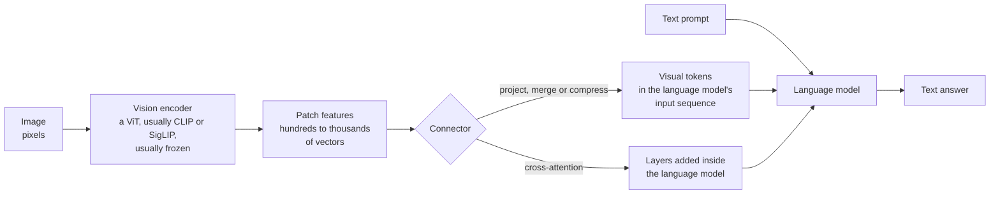

# Module 00: From Vision Encoder to Language Model: Connectors and Training Recipes

> **Prerequisites:** [Track 16, Module 12: Vision: How LLMs See Images](../../16-speech-and-multimodal-models/12-vision-how-llms-see-images/README.md), for how an image becomes tokens and what they cost.  
> **Estimated Reading Time:** 75 minutes  
> **Target Audience:** AI Backend Engineers, ML Platform Engineers, Applied ML Engineers

> [!TIP]
> **The Golden Rule of Vision-Language Models:** A VLM is a vision encoder, a language model and the small piece that joins them. The connector decides how many tokens an image costs, which weights have to be trained and what the model can see, so count its tokens and its parameters before you compare anything else.

---

## Why This Matters

"An LLM that takes images" hides the decision that shapes everything about a vision-language model. The language model is trained on text, the vision encoder on pictures, and something has to turn one's output into the other's input. How that is done sets what an image costs, what has to be trained to adapt the model, and how much detail survives. The same 7-billion-parameter-class language model can be joined to its eyes in ways that differ by an order of magnitude in cost, and the default setting of a model can silently multiply it again.

Three real models make the point, and this module measures all three. LLaVA-1.5-7B turns any image into exactly 576 tokens and leaves 288 MiB of cache behind it, because its language model has 32 key-value heads. Qwen2-VL-7B turns a 448 x 448 image into 256 tokens and a 1920 x 1080 image into 2,691, with a cache of 14 to 147 MiB, because it has 4. SmolVLM-256M turns a 256 x 256 image into 64 tokens if image splitting is off and into 1,088 if it is left at its default, which cuts a tiny image into 17 tiles. None of these numbers is in a benchmark table. They come from the models' configs and from running their processors.

The same choice decides how a model is trained. LLaVA first trained only a projection matrix with the encoder and the language model frozen, on 595K image-text pairs, in about four hours on eight A100s, and only then updated the language model. BLIP-2 kept both big models frozen throughout and trained a 188-million-parameter Querying Transformer; its authors report that it beat Flamingo80B by 8.7% on zero-shot VQAv2 with 54 times fewer trainable parameters. This module reads those recipes from the papers, rebuilds their sizes from the models' configs, and measures the token counts.

After this module you will be able to:

- name the three ways a vision encoder is joined to a language model, and what each trains and costs;
- describe the two-stage recipe of LLaVA and what each stage updates, with the data sizes and times from the papers;
- compute a connector's parameter count from its dimensions, and check it against a built model;
- predict how many tokens an image becomes in LLaVA-1.5, Qwen2-VL and SmolVLM, and how much cache they leave behind;
- say why a default setting, such as image splitting, can change cost by an order of magnitude.

---

## 1. Architectural Mental Model & Core Mechanics

Every model in this track has the same three parts:



The encoder turns an image into a grid of feature vectors, one for each patch. The language model works on a sequence of vectors of its own width. The connector is everything in between, and there are three ways to build it.

### Three Ways to Join Them

| Design | How the image reaches the language model | Examples | What it costs |
| :--- | :--- | :--- | :--- |
| **Project and prepend** | A linear layer or a small MLP maps each patch feature to the language model's width, and the results are placed in the input sequence like word embeddings | LLaVA (a linear projection), LLaVA-1.5 (a two-layer MLP) | One token per patch kept, so cost grows with resolution. Very few parameters |
| **Merge or compress, then project** | Neighbouring patches are merged, or a fixed set of learned queries reads the features, so that fewer tokens enter the sequence | SmolVLM and Qwen2-VL (merge neighbouring patches), BLIP-2 (32 queries), Flamingo (64) | Fewer tokens, so less cache and prefill. A bigger connector when it is a Transformer |
| **Cross-attention inside the language model** | New layers are inserted between the language model's own layers, and the text attends to the visual features there | Flamingo | The image is not in the input sequence at all. The language model itself is changed |

Four facts from the papers pin the three designs down:

- **LLaVA** applies "a trainable projection matrix W" to the CLIP ViT-L/14 features "to convert Zv into language embedding tokens Hv, which have the same dimensionality as the word embedding space in the language model". LLaVA-1.5 replaces the linear layer with a two-layer MLP and keeps CLIP ViT-L at 336 px.
- **BLIP-2** puts a Querying Transformer between a frozen image encoder and a frozen language model. The Q-Former has 188 million parameters and 32 learned queries of dimension 768, so its output is 32 x 768, "much smaller than the size of frozen image features (e.g. 257 x 1024 for ViT-L/14)". A fully connected layer then projects the queries to the language model's width, and they are prepended to the text embeddings as "soft visual prompts".
- **Flamingo** uses a Perceiver Resampler that "produces a fixed number of visual outputs (64)", and inserts gated cross-attention layers "between existing pretrained and frozen LM layers". Each layer's output is multiplied by tanh(α), with α a learnable scalar initialised to 0, so the model starts out as exactly the original language model.
- **Qwen2-VL** processes images "of varying resolutions into different numbers of visual tokens" (Naive Dynamic Resolution), and releases the family at 2B, 8B and 72B.

### The Two-Stage Recipe

Joining two pretrained models is cheap, because most of each stays as it is. LLaVA's training has two stages, and the second changes more than the first:

| Stage | What is trained | What stays frozen | Data and time, from the papers |
| :--- | :--- | :--- | :--- |
| **1. Alignment** | The projection only: "a compatible visual tokenizer for the frozen LLM" | The vision encoder and the language model | LLaVA: 595K image-text pairs (filtered CC3M), within 4 hours on 8 A100s. LLaVA-1.5: 558K pairs |
| **2. Instruction tuning** | The projection and the language model | The vision encoder | LLaVA: 158K GPT-4-generated samples, within 10 hours. LLaVA-1.5: 665K, about 20 hours (and about 6 hours for stage 1) on 8 A100s |

The 158K samples of LLaVA are 58K conversations, 23K detailed descriptions and 77K complex-reasoning examples. LLaVA-1.5's 665K mixture adds academic VQA, OCR and region-level datasets with fixed response formats, and the whole recipe uses 1.2 million public examples and finishes in about a day on one node of eight A100s. Its hyperparameters are a batch of 256 and a learning rate of 1e-3 for stage 1, a batch of 128 and 2e-5 for stage 2, one epoch of each, AdamW, DeepSpeed ZeRO stage 2 and then 3.

### What a Resolution Policy Does to the Token Count

The patch grid grows with the image, so a connector that keeps one token per patch costs more as the picture gets bigger. Three policies are in use, and all three are measured in Workflow 3:

- **Fixed:** resize to the encoder's size and keep a fixed number of tokens. LLaVA-1.5 does this at 336 px: 24 x 24 patches of 14 pixels, 576 tokens, for any image.
- **Dynamic:** let the number of tokens follow the image. Qwen2-VL rounds each side to the nearest multiple of 28 pixels, and every 28 x 28 block (14-pixel patches, merged 2 x 2) is one token, up to a cap.
- **Tiled:** cut a large image into tiles that the encoder handles one at a time, with a fixed number of tokens each. SmolVLM encodes 512 x 512 tiles at 64 tokens each. With splitting on, the counts measured in Workflow 3 fit a rule of this kind: resize the image so that its longest edge is four tiles, cut it into tiles, and add one more.

---

## 2. Systematic Comparison Matrix: Four Connectors

| | **LLaVA, LLaVA-1.5** | **BLIP-2** | **Flamingo** | **Qwen2-VL, SmolVLM** |
| :--- | :--- | :--- | :--- | :--- |
| **Connector** | Linear projection, then a two-layer MLP in 1.5 | A Querying Transformer with 32 learned queries, then a linear layer | A Perceiver Resampler and gated cross-attention layers | A merge of neighbouring patches and a projection |
| **Visual tokens** | One per patch: 576 at 336 px | 32, whatever the image | 64 per image, outside the input sequence | Qwen2-VL: follows the image. SmolVLM: 64 per 512 x 512 tile |
| **Trainable parts** | Stage 1: the projection. Stage 2: the projection and the language model | The Q-Former (188M), in two stages. The encoder and the language model stay frozen | The resampler and the cross-attention layers. The encoder and the language model stay frozen | Not covered here: this module did not read their training recipes, so check each release |
| **Strength** | The simplest connector, and it trains in hours; every patch reaches the language model | The fewest tokens; both big models stay frozen | Interleaved images and text, and few-shot prompting | The number of tokens follows the content (Qwen2-VL) or the tiles (SmolVLM), not a fixed grid |
| **Cost to watch** | Tokens grow with the patch count, and the language model is trained in stage 2 | A fixed 32 tokens can lose detail | The language model's architecture is changed | Tokens, and so cache and prefill, grow with the image |

None of these designs is the right one. The sizes in the next section show what each choice costs when it is built.

---

## 3. Evidence Case Study: Three Real Models, Four Published Recipes

This section is built from the four papers above (Liu et al. 2023 and 2023b, Li et al. 2023, Alayrac et al. 2022), the model cards and configs of three models, and the measurements of Workflows 2 and 3, made for this module. It keeps to what they report and to what the runs printed.

### What the Real Models Show

| | SmolVLM-256M | LLaVA-1.5-7B | Qwen2-VL-7B |
| :--- | ---: | ---: | ---: |
| Total parameters | 256,484,928 | 7,063,427,072 | 8,291,375,616 |
| Vision encoder | 86,433,024 | 303,507,456 | 631,183,360 |
| Connector | 7,077,888 (2.76%) | 20,979,712 (0.30%) | 44,575,744 (0.54%) |
| Language model, with output head | 162,974,016 | 6,738,939,904 | 7,615,616,512 |
| Cache per token, fp16 | 23,040 bytes | 524,288 bytes | 57,344 bytes |
| Tokens for a 448 x 448 image | 1,088 (64 if splitting is off) | 576 | 256 |
| Tokens for a 1920 x 1080 image | 832 (64 if splitting is off) | 576 | 2,691 |

Four things stand out:

- **The connector is a rounding error in the parameter count.** It is 0.30% of LLaVA-1.5-7B, which is why stage 1 of the recipe can train in hours: it updates about 21 million parameters while 7 billion stay frozen.
- **"7B" names the language model.** Qwen2-VL-7B has 8.29 billion parameters once its vision encoder, its connector and its output head are counted.
- **Cache per token differs by a factor of 9 between two 7B-class models.** LLaVA-1.5's language model, Vicuna-7B, has 32 layers and 32 key-value heads, so each token leaves 2 x 32 x 32 x 128 x 2 = 524,288 bytes. Qwen2-VL's has 28 layers and 4 key-value heads: 57,344 bytes. For the same number of image tokens, one leaves nine times the cache of the other.
- **A default can multiply the cost.** SmolVLM's processor, left alone, gives a 256 x 256 image 17 tiles and 1,088 image tokens, 17 times the 64 of a single tile, and every square size from 256 to 4,096 pixels gets the same 17.

### What a Team Takes From It

- **Count tokens with the real processor before you budget.** A model card's resolution and the processor's behaviour are different facts.
- **Compare the cache, not only the tokens.** Grouped-query attention changes the cache per token by a factor that dwarfs most other choices.
- **Decide which stage you need.** Aligning a new encoder to a frozen language model is the cheap stage, a few hours on a node; changing what the model does is the second.
- **Choose the resolution policy for the content.** A fixed 336 px squeezes a 1920 x 1080 screenshot into 576 tokens, and small text does not survive that.

---

## 4. Multi-Language Production Implementation: Connector and Cache Accounting

Below is a program in **Go**, **TypeScript**, **Python** and **C#** that does the accounting of Section 3 from dimensions. It has three parts:

1. **Connector parameters** computed from the dimensions: a linear layer, the two-layer MLP of LLaVA-1.5, and the layer norm and MLP of Qwen2-VL. Each result is compared with the count in the built model (the constants in the program are the counts of Workflow 2).
2. **What trains in each stage** of the LLaVA recipe, as a count and a share of the whole model.
3. **Tokens and cache** for the three resolution policies: LLaVA-1.5's fixed 576, Qwen2-VL's nearest multiple of 28, and SmolVLM's tiles with splitting on, with each model's own cache per token. The two rules for SmolVLM and Qwen2-VL are fitted to the sizes measured in Workflow 3, and reproduce every one the program lists.

Run them with `go run connector.go`, `node connector.ts` (Node 24 or newer), `python connector.py` and `dotnet run Connector.cs` (.NET 10 SDK). All four print the same output, shown in Workflow 1.

````carousel

```go
// The connector between a vision encoder and a language model: what it costs in parameters, what each training stage updates, and how many
// tokens and how much cache an image leaves behind. No packages, no network. Run it with: go run connector.go
//
// The sizes are those of three real models, taken from the configs the models publish and counted by building each model on the "meta" device
// (count_params.py in Workflow 2). The program computes the connector sizes from their dimensions and compares them with the built models.
package main

import (
	"fmt"
	"math"
	"strconv"
	"strings"
)

const mib = 1024 * 1024

type model struct {
	name                                          string
	vision, connectorBuilt, language, head, cache int64 // vision encoder, connector (as built), language model, output head, cache per token in fp16
}

var models = []model{
	{"SmolVLM-256M", 86_433_024, 7_077_888, 134_588_736, 28_385_280, 23_040},
	{"LLaVA-1.5-7B", 303_507_456, 20_979_712, 6_607_605_760, 131_334_144, 524_288},
	// Qwen2-VL's 675,759,104-parameter vision module includes its connector; the 631,183,360 here is the encoder without it.
	{"Qwen2-VL-7B", 631_183_360, 44_575_744, 7_070_619_136, 544_997_376, 57_344},
}

const (
	smolvlmTile          = 512 // SmolVLM encodes 512 x 512 tiles
	smolvlmTokensPerTile = 64
	smolvlmLongestEdge   = 4 * smolvlmTile         // with splitting on, an image is resized so that its longest edge is 4 tiles
	qwenMergedPatch      = 28                      // a Qwen2-VL token covers 28 x 28 pixels (14-pixel patches, merged 2 x 2); each side is rounded to the nearest multiple of 28
	llavaTokens          = (336 / 14) * (336 / 14) // a 336-pixel image in 14-pixel patches, 24 x 24 (the config drops the class token)
)

var images = [][2]int{{448, 448}, {1024, 768}, {1920, 1080}}

func linear(nIn, nOut int64, bias bool) int64 {
	if bias {
		return nIn*nOut + nOut
	}
	return nIn * nOut
}

func layerNorm(n int64) int64 { return 2 * n }

// connectorComputed is the connector's parameters from its dimensions.
func connectorComputed(name string) int64 {
	switch name {
	case "SmolVLM-256M": // pixel shuffle: 4 x 4 neighbouring patch vectors of 768 numbers become one of 12,288, then one linear layer, no bias
		return linear(768*16, 576, false)
	case "LLaVA-1.5-7B": // two linear layers with a GELU between them: 1024 -> 4096 -> 4096
		return linear(1024, 4096, true) + linear(4096, 4096, true)
	case "Qwen2-VL-7B": // a layer norm, then merge 2 x 2 patch vectors of 1280 into 5120, an MLP 5120 -> 5120 -> 3584
		return layerNorm(1280) + linear(5120, 5120, true) + linear(5120, 3584, true)
	}
	panic(name)
}

// smolvlmTiles is the number of tiles an image becomes. Off: one. On: a rule that fits every size measured in Workflow 3: resize the image so its
// longest edge is 2048 pixels, cut it into 512-pixel tiles, and add one.
func smolvlmTiles(width, height int, splitting bool) int {
	if !splitting {
		return 1
	}
	scale := float64(smolvlmLongestEdge) / float64(max(width, height))
	return int(math.Ceil(float64(width)*scale/smolvlmTile))*int(math.Ceil(float64(height)*scale/smolvlmTile)) + 1
}

func tokens(name string, width, height int) int {
	switch name {
	case "LLaVA-1.5-7B":
		return llavaTokens
	case "Qwen2-VL-7B":
		return int(math.Round(float64(width)/qwenMergedPatch)) * int(math.Round(float64(height)/qwenMergedPatch))
	}
	return smolvlmTiles(width, height, true) * smolvlmTokensPerTile
}

// withCommas writes an integer with thousands separators.
func withCommas(n int64) string {
	s := strconv.FormatInt(n, 10)
	var out []string
	for len(s) > 3 {
		out = append([]string{s[len(s)-3:]}, out...)
		s = s[:len(s)-3]
	}
	return strings.Join(append([]string{s}, out...), ",")
}

// fixed writes a number with one decimal and thousands separators.
func fixed(x float64) string {
	parts := strings.SplitN(fmt.Sprintf("%.1f", x), ".", 2)
	whole, _ := strconv.ParseInt(parts[0], 10, 64)
	return withCommas(whole) + "." + parts[1]
}

func main() {
	fmt.Println("connector parameters, from the dimensions and as counted in the built model")
	for _, m := range models {
		computed := connectorComputed(m.name)
		total := m.vision + m.connectorBuilt + m.language + m.head
		verdict := "DIFFERENT"
		if computed == m.connectorBuilt {
			verdict = "match"
		}
		fmt.Printf("  %-14s computed %11s  built %11s  %s  (%.2f%% of %s)\n", m.name, withCommas(computed), withCommas(m.connectorBuilt), verdict, 100*float64(computed)/float64(total), withCommas(total))
	}

	fmt.Println()
	fmt.Println("what trains in each stage of the LLaVA recipe (stage 1: the connector; stage 2: the connector and the language model; the vision encoder stays frozen)")
	for _, m := range models {
		total := m.vision + m.connectorBuilt + m.language + m.head
		stage2 := m.connectorBuilt + m.language + m.head
		fmt.Printf("  %-14s stage 1 trains %13s (%5.2f%%)   stage 2 trains %13s (%5.2f%%)\n", m.name, withCommas(m.connectorBuilt), 100*float64(m.connectorBuilt)/float64(total), withCommas(stage2), 100*float64(stage2)/float64(total))
	}

	fmt.Println()
	fmt.Println("image tokens and the cache they leave behind (fp16)")
	fmt.Printf("  %-14s %-11s %7s %16s\n", "model", "image", "tokens", "cache per image")
	for _, m := range models {
		for _, image := range images {
			n := tokens(m.name, image[0], image[1])
			fmt.Printf("  %-14s %-11s %7s %12s MiB\n", m.name, fmt.Sprintf("%dx%d", image[0], image[1]), withCommas(int64(n)), fixed(float64(n)*float64(m.cache)/mib))
		}
	}
	fmt.Println("SmolVLM-256M with image splitting off is always one tile:")
	n := smolvlmTokensPerTile
	fmt.Printf("  %-14s %-11s %7s %12s MiB\n", "SmolVLM-256M", "any size", withCommas(int64(n)), fixed(float64(n)*float64(models[0].cache)/mib))
}
```

<!-- slide -->

```typescript
// The connector between a vision encoder and a language model: what it costs in parameters, what each training stage updates, and how many
// tokens and how much cache an image leaves behind. No packages, no network. Run it with: node connector.ts (Node 24 or newer).
//
// The sizes are those of three real models, taken from the configs the models publish and counted by building each model on the "meta" device
// (count_params.py in Workflow 2). The program computes the connector sizes from their dimensions and compares them with the built models.

const MIB = 1024 * 1024;

type Model = { name: string; vision: number; connectorBuilt: number; language: number; head: number; cachePerToken: number };

// name, vision encoder, connector (as built), language model, output head, cache per token in fp16
const MODELS: Model[] = [
  { name: "SmolVLM-256M", vision: 86_433_024, connectorBuilt: 7_077_888, language: 134_588_736, head: 28_385_280, cachePerToken: 23_040 },
  { name: "LLaVA-1.5-7B", vision: 303_507_456, connectorBuilt: 20_979_712, language: 6_607_605_760, head: 131_334_144, cachePerToken: 524_288 },
  { name: "Qwen2-VL-7B", vision: 631_183_360, connectorBuilt: 44_575_744, language: 7_070_619_136, head: 544_997_376, cachePerToken: 57_344 },
];
// Qwen2-VL's 675,759,104-parameter vision module includes its connector; the 631,183,360 here is the encoder without it.

const SMOLVLM_TILE = 512; // SmolVLM encodes 512 x 512 tiles
const SMOLVLM_TOKENS_PER_TILE = 64;
const SMOLVLM_LONGEST_EDGE = 4 * SMOLVLM_TILE; // with splitting on, an image is resized so that its longest edge is 4 tiles
const QWEN_MERGED_PATCH = 28; // a Qwen2-VL token covers 28 x 28 pixels (14-pixel patches, merged 2 x 2); each side is rounded to the nearest multiple of 28
const LLAVA_TOKENS = (336 / 14) ** 2; // a 336-pixel image in 14-pixel patches, 24 x 24 (the config drops the class token)
const IMAGES: Array<[number, number]> = [[448, 448], [1024, 768], [1920, 1080]];

const linear = (nIn: number, nOut: number, bias = true): number => nIn * nOut + (bias ? nOut : 0);
const layerNorm = (n: number): number => 2 * n;

/** The connector's parameters from its dimensions. */
function connectorComputed(name: string): number {
  if (name === "SmolVLM-256M") return linear(768 * 16, 576, false); // pixel shuffle: 4 x 4 neighbouring patch vectors of 768 numbers become one of 12,288, then one linear layer, no bias
  if (name === "LLaVA-1.5-7B") return linear(1024, 4096) + linear(4096, 4096); // two linear layers with a GELU between them: 1024 -> 4096 -> 4096
  if (name === "Qwen2-VL-7B") return layerNorm(1280) + linear(5120, 5120) + linear(5120, 3584); // a layer norm, then merge 2 x 2 patch vectors of 1280 into 5120, an MLP 5120 -> 5120 -> 3584
  throw new Error(name);
}

/** Tiles an image becomes. Off: one. On: a rule that fits every size measured in Workflow 3: resize the image so its longest edge is 2048 pixels, cut it into 512-pixel tiles, and add one. */
function smolvlmTiles(width: number, height: number, splitting: boolean): number {
  if (!splitting) return 1;
  const scale = SMOLVLM_LONGEST_EDGE / Math.max(width, height);
  return Math.ceil((width * scale) / SMOLVLM_TILE) * Math.ceil((height * scale) / SMOLVLM_TILE) + 1;
}

function tokens(name: string, width: number, height: number): number {
  if (name === "LLaVA-1.5-7B") return LLAVA_TOKENS;
  if (name === "Qwen2-VL-7B") return Math.round(width / QWEN_MERGED_PATCH) * Math.round(height / QWEN_MERGED_PATCH);
  return smolvlmTiles(width, height, true) * SMOLVLM_TOKENS_PER_TILE;
}

const commas = (n: number): string => n.toLocaleString("en-US");
const fixed = (x: number, digits: number): string => x.toLocaleString("en-US", { minimumFractionDigits: digits, maximumFractionDigits: digits });

function main(): void {
  console.log("connector parameters, from the dimensions and as counted in the built model");
  for (const m of MODELS) {
    const computed = connectorComputed(m.name);
    const total = m.vision + m.connectorBuilt + m.language + m.head;
    console.log(`  ${m.name.padEnd(14)} computed ${commas(computed).padStart(11)}  built ${commas(m.connectorBuilt).padStart(11)}  ${computed === m.connectorBuilt ? "match" : "DIFFERENT"}  (${((100 * computed) / total).toFixed(2)}% of ${commas(total)})`);
  }

  console.log();
  console.log("what trains in each stage of the LLaVA recipe (stage 1: the connector; stage 2: the connector and the language model; the vision encoder stays frozen)");
  for (const m of MODELS) {
    const total = m.vision + m.connectorBuilt + m.language + m.head;
    const stage2 = m.connectorBuilt + m.language + m.head;
    console.log(`  ${m.name.padEnd(14)} stage 1 trains ${commas(m.connectorBuilt).padStart(13)} (${((100 * m.connectorBuilt) / total).toFixed(2).padStart(5)}%)   stage 2 trains ${commas(stage2).padStart(13)} (${((100 * stage2) / total).toFixed(2).padStart(5)}%)`);
  }

  console.log();
  console.log("image tokens and the cache they leave behind (fp16)");
  console.log(`  ${"model".padEnd(14)} ${"image".padEnd(11)} ${"tokens".padStart(7)} ${"cache per image".padStart(16)}`);
  for (const m of MODELS) {
    for (const [width, height] of IMAGES) {
      const n = tokens(m.name, width, height);
      console.log(`  ${m.name.padEnd(14)} ${(width + "x" + height).padEnd(11)} ${commas(n).padStart(7)} ${fixed((n * m.cachePerToken) / MIB, 1).padStart(12)} MiB`);
    }
  }
  console.log("SmolVLM-256M with image splitting off is always one tile:");
  const n = SMOLVLM_TOKENS_PER_TILE;
  console.log(`  ${"SmolVLM-256M".padEnd(14)} ${"any size".padEnd(11)} ${commas(n).padStart(7)} ${fixed((n * MODELS[0].cachePerToken) / MIB, 1).padStart(12)} MiB`);
}

main();
```

<!-- slide -->

```python
"""The connector between a vision encoder and a language model: what it costs in parameters, what each training stage updates, and how many
tokens and how much cache an image leaves behind. Plain Python 3, no packages, no network.

The sizes are those of three real models, taken from the configs the models publish and counted by building each model on the "meta" device
(count_params.py in Workflow 2). The program computes the connector sizes from their dimensions and compares them with the built models.
"""
import math

MIB = 1024 * 1024

# name, vision encoder, connector (as built), language model, output head, cache per token in fp16, and the connector's description
MODELS = [
    {"name": "SmolVLM-256M", "vision": 86_433_024, "connector_built": 7_077_888, "language": 134_588_736, "head": 28_385_280, "cache_per_token": 23_040},
    {"name": "LLaVA-1.5-7B", "vision": 303_507_456, "connector_built": 20_979_712, "language": 6_607_605_760, "head": 131_334_144, "cache_per_token": 524_288},
    {"name": "Qwen2-VL-7B", "vision": 631_183_360, "connector_built": 44_575_744, "language": 7_070_619_136, "head": 544_997_376, "cache_per_token": 57_344},
]
# Qwen2-VL's 675,759,104-parameter vision module includes its connector; the 631,183,360 here is the encoder without it.

SMOLVLM_TILE = 512  # SmolVLM encodes 512 x 512 tiles
SMOLVLM_TOKENS_PER_TILE = 64
SMOLVLM_LONGEST_EDGE = 4 * SMOLVLM_TILE  # with splitting on, an image is resized so that its longest edge is 4 tiles
QWEN_MERGED_PATCH = 28  # a Qwen2-VL token covers 28 x 28 pixels (14-pixel patches, merged 2 x 2); each side is rounded to the nearest multiple of 28
LLAVA_TOKENS = (336 // 14) ** 2  # a 336-pixel image in 14-pixel patches, 24 x 24 (the config drops the class token)
IMAGES = [(448, 448), (1024, 768), (1920, 1080)]


def linear(n_in, n_out, bias=True):
    return n_in * n_out + (n_out if bias else 0)


def layer_norm(n):
    return 2 * n


def connector_computed(name):
    """The connector's parameters from its dimensions."""
    if name == "SmolVLM-256M":  # pixel shuffle: 4 x 4 neighbouring patch vectors of 768 numbers become one of 12,288, then one linear layer, no bias
        return linear(768 * 16, 576, bias=False)
    if name == "LLaVA-1.5-7B":  # two linear layers with a GELU between them: 1024 -> 4096 -> 4096
        return linear(1024, 4096) + linear(4096, 4096)
    if name == "Qwen2-VL-7B":  # a layer norm, then merge 2 x 2 patch vectors of 1280 into 5120, an MLP 5120 -> 5120 -> 3584
        return layer_norm(1280) + linear(5120, 5120) + linear(5120, 3584)
    raise ValueError(name)


def smolvlm_tiles(width, height, splitting):
    """Tiles an image becomes. Off: one. On: a rule that fits every size measured in Workflow 3: resize the image so its longest edge is 2048 pixels, cut it into 512-pixel tiles, and add one."""
    if not splitting:
        return 1
    scale = SMOLVLM_LONGEST_EDGE / max(width, height)
    return math.ceil(width * scale / SMOLVLM_TILE) * math.ceil(height * scale / SMOLVLM_TILE) + 1


def tokens(name, width, height):
    if name == "LLaVA-1.5-7B":
        return LLAVA_TOKENS
    if name == "Qwen2-VL-7B":
        return round(width / QWEN_MERGED_PATCH) * round(height / QWEN_MERGED_PATCH)
    return smolvlm_tiles(width, height, True) * SMOLVLM_TOKENS_PER_TILE


def main():
    print("connector parameters, from the dimensions and as counted in the built model")
    for m in MODELS:
        computed = connector_computed(m["name"])
        total = m["vision"] + m["connector_built"] + m["language"] + m["head"]
        print(f"  {m['name']:<14} computed {computed:>11,}  built {m['connector_built']:>11,}  {'match' if computed == m['connector_built'] else 'DIFFERENT'}  ({100 * computed / total:.2f}% of {total:,})")

    print()
    print("what trains in each stage of the LLaVA recipe (stage 1: the connector; stage 2: the connector and the language model; the vision encoder stays frozen)")
    for m in MODELS:
        total = m["vision"] + m["connector_built"] + m["language"] + m["head"]
        stage2 = m["connector_built"] + m["language"] + m["head"]
        print(f"  {m['name']:<14} stage 1 trains {m['connector_built']:>13,} ({100 * m['connector_built'] / total:5.2f}%)   stage 2 trains {stage2:>13,} ({100 * stage2 / total:5.2f}%)")

    print()
    print("image tokens and the cache they leave behind (fp16)")
    print(f"  {'model':<14} {'image':<11} {'tokens':>7} {'cache per image':>16}")
    for m in MODELS:
        per_token = m["cache_per_token"]
        for width, height in IMAGES:
            n = tokens(m["name"], width, height)
            print(f"  {m['name']:<14} {str(width) + 'x' + str(height):<11} {n:>7,} {n * per_token / MIB:>12,.1f} MiB")
    print("SmolVLM-256M with image splitting off is always one tile:")
    n = SMOLVLM_TOKENS_PER_TILE
    print(f"  {'SmolVLM-256M':<14} {'any size':<11} {n:>7,} {n * MODELS[0]['cache_per_token'] / MIB:>12,.1f} MiB")


main()
```

<!-- slide -->

```csharp
// The connector between a vision encoder and a language model: what it costs in parameters, what each training stage updates, and how many
// tokens and how much cache an image leaves behind. No packages, no network. Run it with: dotnet run Connector.cs (.NET 10 SDK).
//
// The sizes are those of three real models, taken from the configs the models publish and counted by building each model on the "meta" device
// (count_params.py in Workflow 2). The program computes the connector sizes from their dimensions and compares them with the built models.
using System;
using System.Globalization;

const long Mib = 1024 * 1024;
var inv = CultureInfo.InvariantCulture;

// name, vision encoder, connector (as built), language model, output head, cache per token in fp16
var models = new (string Name, long Vision, long ConnectorBuilt, long Language, long Head, long CachePerToken)[]
{
    ("SmolVLM-256M", 86_433_024, 7_077_888, 134_588_736, 28_385_280, 23_040),
    ("LLaVA-1.5-7B", 303_507_456, 20_979_712, 6_607_605_760, 131_334_144, 524_288),
    // Qwen2-VL's 675,759,104-parameter vision module includes its connector; the 631,183,360 here is the encoder without it.
    ("Qwen2-VL-7B", 631_183_360, 44_575_744, 7_070_619_136, 544_997_376, 57_344),
};

const int SmolvlmTile = 512; // SmolVLM encodes 512 x 512 tiles
const int SmolvlmTokensPerTile = 64;
const int SmolvlmLongestEdge = 4 * SmolvlmTile; // with splitting on, an image is resized so that its longest edge is 4 tiles
const int QwenMergedPatch = 28; // a Qwen2-VL token covers 28 x 28 pixels (14-pixel patches, merged 2 x 2); each side is rounded to the nearest multiple of 28
const int LlavaTokens = (336 / 14) * (336 / 14); // a 336-pixel image in 14-pixel patches, 24 x 24 (the config drops the class token)
var images = new[] { (448, 448), (1024, 768), (1920, 1080) };

long Linear(long nIn, long nOut, bool bias = true) => nIn * nOut + (bias ? nOut : 0);
long LayerNorm(long n) => 2 * n;

// The connector's parameters from its dimensions.
long ConnectorComputed(string name) => name switch
{
    // pixel shuffle: 4 x 4 neighbouring patch vectors of 768 numbers become one of 12,288, then one linear layer, no bias
    "SmolVLM-256M" => Linear(768 * 16, 576, false),
    // two linear layers with a GELU between them: 1024 -> 4096 -> 4096
    "LLaVA-1.5-7B" => Linear(1024, 4096) + Linear(4096, 4096),
    // a layer norm, then merge 2 x 2 patch vectors of 1280 into 5120, an MLP 5120 -> 5120 -> 3584
    "Qwen2-VL-7B" => LayerNorm(1280) + Linear(5120, 5120) + Linear(5120, 3584),
    _ => throw new ArgumentException(name),
};

// Tiles an image becomes. Off: one. On: a rule that fits every size measured in Workflow 3: resize the image so its longest edge is 2048 pixels, cut it into 512-pixel tiles, and add one.
int SmolvlmTiles(int width, int height, bool splitting)
{
    if (!splitting) return 1;
    double scale = (double)SmolvlmLongestEdge / Math.Max(width, height);
    return (int)Math.Ceiling(width * scale / SmolvlmTile) * (int)Math.Ceiling(height * scale / SmolvlmTile) + 1;
}

int Tokens(string name, int width, int height) => name switch
{
    "LLaVA-1.5-7B" => LlavaTokens,
    "Qwen2-VL-7B" => (int)Math.Round((double)width / QwenMergedPatch) * (int)Math.Round((double)height / QwenMergedPatch),
    _ => SmolvlmTiles(width, height, true) * SmolvlmTokensPerTile,
};

string Commas(long n) => n.ToString("N0", inv);
string Fixed(double x) => x.ToString("N1", inv);

Console.WriteLine("connector parameters, from the dimensions and as counted in the built model");
foreach (var m in models)
{
    long computed = ConnectorComputed(m.Name);
    long total = m.Vision + m.ConnectorBuilt + m.Language + m.Head;
    string verdict = computed == m.ConnectorBuilt ? "match" : "DIFFERENT";
    Console.WriteLine($"  {m.Name,-14} computed {Commas(computed),11}  built {Commas(m.ConnectorBuilt),11}  {verdict}  ({(100.0 * computed / total).ToString("F2", inv)}% of {Commas(total)})");
}

Console.WriteLine();
Console.WriteLine("what trains in each stage of the LLaVA recipe (stage 1: the connector; stage 2: the connector and the language model; the vision encoder stays frozen)");
foreach (var m in models)
{
    long total = m.Vision + m.ConnectorBuilt + m.Language + m.Head;
    long stage2 = m.ConnectorBuilt + m.Language + m.Head;
    Console.WriteLine($"  {m.Name,-14} stage 1 trains {Commas(m.ConnectorBuilt),13} ({(100.0 * m.ConnectorBuilt / total).ToString("F2", inv),5}%)   stage 2 trains {Commas(stage2),13} ({(100.0 * stage2 / total).ToString("F2", inv),5}%)");
}

Console.WriteLine();
Console.WriteLine("image tokens and the cache they leave behind (fp16)");
Console.WriteLine($"  {"model",-14} {"image",-11} {"tokens",7} {"cache per image",16}");
foreach (var m in models)
{
    foreach (var (width, height) in images)
    {
        int n = Tokens(m.Name, width, height);
        Console.WriteLine($"  {m.Name,-14} {width + "x" + height,-11} {Commas(n),7} {Fixed((double)n * m.CachePerToken / Mib),12} MiB");
    }
}
Console.WriteLine("SmolVLM-256M with image splitting off is always one tile:");
int one = SmolvlmTokensPerTile;
Console.WriteLine($"  {"SmolVLM-256M",-14} {"any size",-11} {Commas(one),7} {Fixed((double)one * models[0].CachePerToken / Mib),12} MiB");
```

````

### What Each Part Is For

| Code | Stage | What it shows |
| :--- | :--- | :--- |
| `linear`, `layer_norm`, `connector_computed` | Parameters | A connector is a handful of matrices, and its size follows from the dimensions |
| The comparison with `connector_built` | Verification | The arithmetic agrees with the real model, to the last parameter |
| The stage table | Training | The connector is under 3% of any of these models; stage 2 trains most of the rest |
| `smolvlm_tiles`, `tokens` | Resolution policy | One policy that ignores the image, one that follows it, one that tiles it |
| `cache_per_token` | Cost | The cache an image leaves behind depends on the language model's key-value heads |

---

## 5. Practical Hands-On Verification CLI Workflows

### Workflow 1: Connector, Stage and Cache Accounting (offline)

Save the Python tab as `connector.py` and run it. Plain Python 3, no packages, no network:

```bash
python connector.py
```

```text
connector parameters, from the dimensions and as counted in the built model
  SmolVLM-256M   computed   7,077,888  built   7,077,888  match  (2.76% of 256,484,928)
  LLaVA-1.5-7B   computed  20,979,712  built  20,979,712  match  (0.30% of 7,063,427,072)
  Qwen2-VL-7B    computed  44,575,744  built  44,575,744  match  (0.54% of 8,291,375,616)

what trains in each stage of the LLaVA recipe (stage 1: the connector; stage 2: the connector and the language model; the vision encoder stays frozen)
  SmolVLM-256M   stage 1 trains     7,077,888 ( 2.76%)   stage 2 trains   170,051,904 (66.30%)
  LLaVA-1.5-7B   stage 1 trains    20,979,712 ( 0.30%)   stage 2 trains 6,759,919,616 (95.70%)
  Qwen2-VL-7B    stage 1 trains    44,575,744 ( 0.54%)   stage 2 trains 7,660,192,256 (92.39%)

image tokens and the cache they leave behind (fp16)
  model          image        tokens  cache per image
  SmolVLM-256M   448x448       1,088         23.9 MiB
  SmolVLM-256M   1024x768        832         18.3 MiB
  SmolVLM-256M   1920x1080       832         18.3 MiB
  LLaVA-1.5-7B   448x448         576        288.0 MiB
  LLaVA-1.5-7B   1024x768        576        288.0 MiB
  LLaVA-1.5-7B   1920x1080       576        288.0 MiB
  Qwen2-VL-7B    448x448         256         14.0 MiB
  Qwen2-VL-7B    1024x768        999         54.6 MiB
  Qwen2-VL-7B    1920x1080     2,691        147.2 MiB
SmolVLM-256M with image splitting off is always one tile:
  SmolVLM-256M   any size         64          1.4 MiB
```

**Connectors.** All three computed sizes equal the built models': 7,077,888 for SmolVLM (a 12,288-number block, 16 patch vectors of 768, projected to 576), 20,979,712 for LLaVA-1.5 (1024 to 4096, then 4096 to 4096, each with a bias) and 44,575,744 for Qwen2-VL (a layer norm over 1280, then 5120 to 5120 and 5120 to 3584). The connector is 0.30% of LLaVA-1.5-7B.

**Stages.** In LLaVA's recipe stage 1 trains the connector alone, 0.30% of LLaVA-1.5-7B, and stage 2 trains 95.70% of it. The vision encoder is the 4.30% that never changes. The shares are what the recipe would update if it were applied to each model's sizes; they say nothing about how SmolVLM or Qwen2-VL were actually trained.

**Tokens and cache.** LLaVA-1.5 is flat: 576 tokens and 288.0 MiB for every size. Qwen2-VL goes from 256 tokens and 14.0 MiB at 448 x 448 to 999 tokens and 54.6 MiB at 1024 x 768 and 2,691 tokens and 147.2 MiB at 1920 x 1080, so even the largest image leaves half the cache of LLaVA-1.5's one. SmolVLM with splitting on gives 1,088 tokens (23.9 MiB) to a 448 x 448 image and 832 (18.3 MiB) to a 1920 x 1080 one, and with splitting off 64 tokens (1.4 MiB) to anything.

### Workflow 2: Count the Real Parameters (needs a network)

This one is not offline. It reads three published configs, builds each real architecture on the "meta" device (no weights are downloaded and no memory is used) and counts parameters by part. It needs a few packages, a CPU build of PyTorch is enough:

```bash
pip install torch transformers accelerate --index-url https://download.pytorch.org/whl/cpu
```

Save this as `count_params.py` and run it:

```python
"""How many parameters does each part of a vision-language model have, and how big is its language model's cache per token?

Builds the real architecture from each model's published config on the "meta" device, so no weights are downloaded and no memory is used,
and counts parameters by part. Needs a network for the configs and: pip install transformers accelerate torch
usage: python count_params.py
"""
import torch
from accelerate import init_empty_weights
from transformers import AutoConfig, AutoModelForImageTextToText

# model, where its vision encoder, its connector and its language model sit inside model.model
MODELS = [
    ("HuggingFaceTB/SmolVLM-256M-Instruct", "vision_model", "connector", "text_model"),
    ("llava-hf/llava-1.5-7b-hf", "vision_tower", "multi_modal_projector", "language_model"),
    ("Qwen/Qwen2-VL-7B-Instruct", "visual", "visual.merger", "language_model"),
]


def count(module):
    return sum(p.numel() for p in module.parameters())


def find(root, path):
    for step in path.split("."):
        root = getattr(root, step)
    return root


for name, vision, connector, language in MODELS:
    config = AutoConfig.from_pretrained(name)
    with init_empty_weights():
        model = AutoModelForImageTextToText.from_config(config, dtype=torch.float16)
    text = config.get_text_config()
    head_dim = getattr(text, "head_dim", None) or text.hidden_size // text.num_attention_heads
    kv_bytes = 2 * text.num_hidden_layers * text.num_key_value_heads * head_dim * 2  # keys and values, every layer, 2 bytes each (fp16)
    print(name)
    print(f"  parameters: total {count(model):,}")
    print(f"    vision encoder   {count(find(model.model, vision)):>15,}")
    print(f"    connector        {count(find(model.model, connector)):>15,}")
    print(f"    language model   {count(find(model.model, language)):>15,}")
    print(f"    output head      {count(model.lm_head):>15,}")
    print(f"  language model: {text.num_hidden_layers} layers, hidden {text.hidden_size}, MLP width {text.intermediate_size}, {text.num_attention_heads} heads, {text.num_key_value_heads} key-value heads, head size {head_dim}")
    print(f"  cache per token in fp16: {kv_bytes:,} bytes")
```

```bash
python count_params.py
```

```text
HuggingFaceTB/SmolVLM-256M-Instruct
  parameters: total 256,484,928
    vision encoder        86,433,024
    connector              7,077,888
    language model       134,588,736
    output head           28,385,280
  language model: 30 layers, hidden 576, MLP width 1536, 9 heads, 3 key-value heads, head size 64
  cache per token in fp16: 23,040 bytes
llava-hf/llava-1.5-7b-hf
  parameters: total 7,063,427,072
    vision encoder       303,507,456
    connector             20,979,712
    language model     6,607,605,760
    output head          131,334,144
  language model: 32 layers, hidden 4096, MLP width 11008, 32 heads, 32 key-value heads, head size 128
  cache per token in fp16: 524,288 bytes
Qwen/Qwen2-VL-7B-Instruct
  parameters: total 8,291,375,616
    vision encoder       675,759,104
    connector             44,575,744
    language model     7,070,619,136
    output head          544,997,376
  language model: 28 layers, hidden 3584, MLP width 18944, 28 heads, 4 key-value heads, head size 128
  cache per token in fp16: 57,344 bytes
```

Every count the program of Workflow 1 holds is in this output. The connectors are the ones it computed. The language-model dimensions give the cache per token: LLaVA-1.5-7B has 32 layers and 32 key-value heads, so 2 x 32 x 32 x 128 x 2 bytes = 524,288; Qwen2-VL-7B has 4 key-value heads and 28 layers, so 57,344. The Qwen2-VL "vision encoder" in the program is the 675,759,104 of its `visual` module minus the 44,575,744 of the merger that sits inside it.

### Workflow 3: Count the Real Image Tokens (needs a network)

This one runs only the models' processors, not the models, so it takes a minute. It needs `pip install pillow num2words torchvision` besides the packages above. It builds a blank image of each size, runs it through each processor with the same question, and counts the image tokens in the model's input:

```python
"""How many image tokens does an image of each size become in three real vision-language models?

Runs only each model's processor (no model weights), so it is quick. Needs: pip install transformers pillow num2words torchvision
usage: python count_tokens.py
"""
from PIL import Image
from transformers import AutoProcessor

SIZES = [(256, 256), (448, 448), (512, 512), (768, 512), (1024, 768), (1024, 1024), (1920, 1080), (2048, 2048), (4096, 4096)]
QUESTION = "Is there a red circle in the image? Answer yes or no."


def image_tokens(processor, token, image, **kwargs):
    messages = [{"role": "user", "content": [{"type": "image"}, {"type": "text", "text": QUESTION}]}]
    prompt = processor.apply_chat_template(messages, add_generation_prompt=True)
    inputs = processor(text=prompt, images=[image], return_tensors="pt", **kwargs)
    ids = inputs["input_ids"][0]
    return int((ids == processor.tokenizer.convert_tokens_to_ids(token)).sum()), len(ids)


def show(name, token, rows):
    print(name)
    print(f"  {'image':>11}  {'image tokens':>12}  {'all input tokens':>16}")
    for (width, height), (n, total) in rows:
        print(f"  {width:>5}x{height:<5}  {n:>12}  {total:>16}")


smol = AutoProcessor.from_pretrained("HuggingFaceTB/SmolVLM-256M-Instruct")
for split in (False, True):
    show(f"SmolVLM-256M, image splitting {'on' if split else 'off'}", "<image>",
         [((w, h), image_tokens(smol, "<image>", Image.new("RGB", (w, h), "white"), do_image_splitting=split)) for w, h in SIZES])

llava = AutoProcessor.from_pretrained("llava-hf/llava-1.5-7b-hf")
show("LLaVA-1.5-7B", "<image>", [((w, h), image_tokens(llava, "<image>", Image.new("RGB", (w, h), "white"))) for w, h in SIZES])

qwen = AutoProcessor.from_pretrained("Qwen/Qwen2-VL-7B-Instruct")
show("Qwen2-VL-7B", "<|image_pad|>", [((w, h), image_tokens(qwen, "<|image_pad|>", Image.new("RGB", (w, h), "white"))) for w, h in SIZES])
```

```bash
python count_tokens.py
```

```text
SmolVLM-256M, image splitting off
        image  image tokens  all input tokens
    256x256              64                89
    448x448              64                89
    512x512              64                89
    768x512              64                89
   1024x768              64                89
   1024x1024             64                89
   1920x1080             64                89
   2048x2048             64                89
   4096x4096             64                89
SmolVLM-256M, image splitting on
        image  image tokens  all input tokens
    256x256            1088              1149
    448x448            1088              1149
    512x512            1088              1149
    768x512             832               884
   1024x768             832               884
   1024x1024           1088              1149
   1920x1080            832               884
   2048x2048           1088              1149
   4096x4096           1088              1149
LLaVA-1.5-7B
        image  image tokens  all input tokens
    256x256             576               602
    448x448             576               602
    512x512             576               602
    768x512             576               602
   1024x768             576               602
   1024x1024            576               602
   1920x1080            576               602
   2048x2048            576               602
   4096x4096            576               602
Qwen2-VL-7B
        image  image tokens  all input tokens
    256x256              81               116
    448x448             256               291
    512x512             324               359
    768x512             486               521
   1024x768             999              1034
   1024x1024           1369              1404
   1920x1080           2691              2726
   2048x2048           5329              5364
   4096x4096          16384             16419
```

Read it model by model. **LLaVA-1.5** gives 576 image tokens to every image, from 256 x 256 to 4096 x 4096. **SmolVLM** with splitting off gives 64 to every image; with splitting on it gives 1,088 to every square image and 832 to 768 x 512, 1024 x 768 and 1920 x 1080. That is 17 tiles and 13 tiles of 64 tokens, and the rule that reproduces them is: resize the image so that its longest edge is 2,048 pixels, cut it into 512-pixel tiles, and add one more, which makes 4 x 4 + 1 = 17 or 4 x 3 + 1 = 13. It is a rule fitted to these measurements, not read from the processor's code. **Qwen2-VL** follows the image: 81 tokens at 256 x 256 (9 x 9), 256 at 448 x 448 (16 x 16), 999 at 1024 x 768 (37 x 27), 2,691 at 1920 x 1080 (69 x 39). Each side is the nearest multiple of 28, not the next one up: 1024 / 28 is 36.6, which becomes 37, and 768 / 28 is 27.4, which becomes 27. At 4096 x 4096 it stops at 16,384, a cap that only shows at sizes this large.

### Hands-On Exercises

1. **Predict, then measure.** Predict the number of Qwen2-VL tokens for a 1280 x 720 image with the rule above, then add that size to `count_tokens.py` and check. What is its cache, in MiB?
2. **How many images fit.** Take a cache budget of 8 GiB. For each of the three models and each of the three image sizes of the program, say how many images fit, and which of the two things, tokens or cache per token, explains most of the difference between LLaVA-1.5 and Qwen2-VL.
3. **Splitting off.** Recompute SmolVLM's cache table with splitting off. What does it change for a 1920 x 1080 screenshot, and what would you give up?
4. **Optimizer memory by stage.** Adam keeps two extra numbers per trained parameter. For LLaVA-1.5-7B, how many parameters does each stage train, and what is the optimizer state of each at 8 bytes per parameter? The paper's hyperparameter table uses DeepSpeed stage 2 for stage 1 and stage 3 for stage 2. What does your arithmetic suggest about why?

### Independent Challenge

Your product answers questions about 1920 x 1080 dashboard screenshots with a 7B-class VLM on one 24 GB GPU. You are choosing between an LLaVA-1.5-style model and a Qwen2-VL-style one. Compare them on tokens, cache per image, detail, and what it would take to adapt each to your screenshots, and say which you would pilot.

<details><summary>Architectural Discussion</summary>

1. **Tokens:** the LLaVA-1.5 style gives 576 tokens whatever the screenshot; the Qwen2-VL style gives 2,691. The first is cheaper to prefill, and the second shows the language model about 4.7 times as many pieces of the picture.
2. **Cache per image:** 288.0 MiB against 147.2 MiB. The larger token count still leaves the smaller cache, because Qwen2-VL's language model has 4 key-value heads and LLaVA-1.5's has 32. At a fixed cache budget the Qwen2-VL style holds about twice as many screenshots.
3. **Detail:** a 1920 x 1080 screenshot squeezed into 336 x 336 loses small text, and a dashboard is mostly small text. This is the deciding factor, and it is something to test, not to assume: build a set of questions whose answers are in the small text and measure.
4. **Adaptation:** stage 1 alone (the connector, about 21 million parameters) can align a new encoder to the language model; changing what the model does with dashboards is stage-2 work, or a LoRA on the language model, which Module 02 covers.
5. **Pilot:** the Qwen2-VL style, with a cap on the number of pixels per image so that the worst case is bounded, and a measurement of both quality on your own questions (Module 01) and cost on real screenshots.
6. **What to record:** the processor's settings, the number of image tokens per request, the cache per request and the tail of the prefill time, because the average hides the large screenshots.

</details>

---

## 6. Common Mistakes & Troubleshooting

- **Assuming a fixed number of tokens per image.** LLaVA-1.5 is fixed, Qwen2-VL follows the image, SmolVLM follows the settings. Count with the real processor.
- **Leaving a default alone.** SmolVLM's default gives a tiny image 17 tiles. Check what a default does before it reaches production.
- **Reading "7B" as the whole model.** The name counts the language model. The vision encoder, the connector and the output head are on top, so memory is larger than the name says.
- **Comparing models by tokens alone.** The cache per token differs by a factor of 9 between two 7B-class models. Compare the cache an image leaves behind.
- **Training more than you need.** Aligning a new encoder to a frozen language model is a stage-1 job, with a few tens of millions of trainable parameters. Do not fine-tune the whole language model to fix a connector problem.
- **Forgetting that stage 2 changes the language model.** After it, the model is no longer the text model you started with, and its text-only behaviour can change.
- **Trusting a rule you inferred.** The tile rule and the rounding rule of this module reproduce every size that was measured, and no more. For a size you care about, run the processor.

---

## 7. Operational Validation Checkpoints & Checkpoint Quiz

### Operational Validation Checkpoints

<details><summary><strong>Checkpoint 1: A cost surprise</strong></summary>

A team moves a screenshot-reading feature from one VLM to another and the bill rises by a factor of ten, with no change in traffic. Where do you look first?

**Validation:** The number of image tokens per request, measured with the new model's real processor on real screenshots. Compare it with the old model's. A default that tiles or enlarges images (SmolVLM's splitting turned a 256 x 256 image into 17 tiles) or a dynamic resolution that follows the screenshot (Qwen2-VL gave 2,691 tokens to a 1920 x 1080 image against LLaVA-1.5's 576) can multiply the tokens, and then the cache per token multiplies the memory.

</details>

<details><summary><strong>Checkpoint 2: Which stage?</strong></summary>

You want a language model you already use to read images from a new kind of sensor, using an encoder that was pretrained on that sensor. Which stage of the recipe is it, and what does it train?

**Validation:** Stage 1. The encoder and the language model stay frozen, and a connector is trained on pairs of sensor images and captions, so the encoder's features land where the language model can read them. In LLaVA that was a linear projection trained on 595K pairs in about four hours on eight A100s. Stage 2 is needed only if the model must also change how it answers.

</details>

<details><summary><strong>Checkpoint 3: Why is the cache nine times smaller?</strong></summary>

Qwen2-VL-7B leaves a nine times smaller cache per token than LLaVA-1.5-7B. Is it a smaller language model?

**Validation:** No. Its language model is larger (7.07 billion parameters against 6.61 billion). The difference is the number of key-value heads: 4 against 32, with 28 layers against 32. The cache per token is 2 x layers x key-value heads x head size x bytes, and grouped-query attention cuts the key-value heads.

</details>

### Checkpoint Quiz

1. Name the three ways to join a vision encoder to a language model, with one model for each.
2. In LLaVA's two-stage recipe, what is trained in each stage and what stays frozen?
3. How many parameters does LLaVA-1.5's connector have, and what is that as a share of the model?
4. How many image tokens does LLaVA-1.5 give a 1920 x 1080 image, and Qwen2-VL?
5. Why can SmolVLM's default give a 256 x 256 image 1,088 tokens?

<details><summary>Answers</summary>

1. Project and prepend (LLaVA), merge or compress and then project (BLIP-2's queries, SmolVLM and Qwen2-VL's merging), and cross-attention inside the language model (Flamingo).
2. Stage 1 trains the projection only; the vision encoder and the language model are frozen. Stage 2 trains the projection and the language model; the vision encoder stays frozen.
3. 20,979,712, which is 0.30% of the 7,063,427,072 parameters of LLaVA-1.5-7B.
4. 576 for LLaVA-1.5, whatever the size, and 2,691 for Qwen2-VL (69 x 39 blocks of 28 pixels).
5. With image splitting on, the processor resizes the image so that its longest edge is four 512-pixel tiles, cuts it into 4 x 4 tiles and adds one tile of the whole image: 17 tiles at 64 tokens each. With splitting off it is one tile and 64 tokens.

</details>

---

## Further Reading & Sources

- [Visual Instruction Tuning (Liu, Li, Wu and Lee, 2023)](https://arxiv.org/abs/2304.08485) — LLaVA: the projection, the two stages, the 595K and 158K datasets and the training times.
- [Improved Baselines with Visual Instruction Tuning (Liu, Li, Li and Lee, 2023)](https://arxiv.org/abs/2310.03744) — LLaVA-1.5: the MLP connector, 336 px, the 558K and 665K data and the hyperparameters.
- [BLIP-2: Bootstrapping Language-Image Pre-training with Frozen Image Encoders and Large Language Models (Li et al., 2023)](https://arxiv.org/abs/2301.12597) — the Querying Transformer, 32 queries, and the comparison with Flamingo80B.
- [Flamingo: a Visual Language Model for Few-Shot Learning (Alayrac et al., 2022)](https://arxiv.org/abs/2204.14198) — the Perceiver Resampler and the gated cross-attention layers.
- [Qwen2-VL: Enhancing Vision-Language Model's Perception of the World at Any Resolution (Wang et al., 2024)](https://arxiv.org/abs/2409.12191) — Naive Dynamic Resolution and M-RoPE.
- [SmolVLM-256M-Instruct (model card)](https://huggingface.co/HuggingFaceTB/SmolVLM-256M-Instruct) — 512 x 512 tiles of 64 tokens, the image-splitting setting and the license.
- [Qwen2-VL-7B-Instruct config](https://huggingface.co/Qwen/Qwen2-VL-7B-Instruct/raw/main/config.json), [llava-1.5-7b-hf config](https://huggingface.co/llava-hf/llava-1.5-7b-hf/raw/main/config.json) and [vicuna-7b-v1.5 config](https://huggingface.co/lmsys/vicuna-7b-v1.5/raw/main/config.json) — the dimensions behind Workflow 2.
- [Track 16, Module 12: Vision: How LLMs See Images](../../16-speech-and-multimodal-models/12-vision-how-llms-see-images/README.md) — the token and cost formulas of hosted APIs.

## Next

[Module 01: Evaluating Vision-Language Models: Benchmarks, Hallucination and Polling](../01-evaluating-vlms-benchmarks-hallucination-and-polling/README.md)
