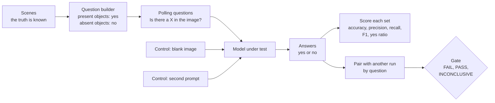

# Module 01: Evaluating Vision-Language Models: Benchmarks, Hallucination and Polling

> **Prerequisites:** [Module 00: From Vision Encoder to Language Model](../00-connectors-and-training-recipes/README.md), and [Track 18, Module 01: Evaluation in Practice](../../18-evaluation-harnesses-and-benchmarks/01-evaluation-in-practice-harnesses-inspect-and-regression-gates/README.md), for the paired comparison and the regression gate that this module applies to images.  
> **Estimated Reading Time:** 80 minutes  
> **Target Audience:** AI Backend Engineers, ML Platform Engineers, Model Evaluation Leads

> [!TIP]
> **The Golden Rule of Evaluating Vision-Language Models:** Before you trust a score, prove that the image mattered. Ask the same questions with the picture blanked out, balance the answers so that a lazy model scores 50%, print how often the model says yes next to its accuracy, and compare two runs on the same questions with an interval.

---

## Why This Matters

A vision-language model can be right for the wrong reason. A question in a vision benchmark can be answerable from the text alone: the authors of MMStar list a ScienceQA question that asks for the capital of Nebraska, which all 22 language models they tried answered correctly with no image. And a model can be wrong for a reason that has nothing to do with the picture: the authors of POPE report that objects "that frequently appear in the visual instructions or co-occur with the image objects" are the ones models are prone to claim they see. A benchmark score cannot tell you which answers used the image unless the benchmark was built to check.

Three papers show how large the problem is. The authors of MMStar found that GeminiPro scores 42.9% on the MMMU benchmark without being shown any image, and that across six benchmarks it beats random choice by more than 24 points on average with no visual input at all. They also found that Sphinx-X-MoE gets 43.6% on MMMU without images, where its own language-model backbone gets 17.9%, which they read as a sign of memorized training data. The authors of POPE found that LLaVA, MultiModal-GPT and mPLUG-Owl answered "yes" to 95% to 100% of questions about whether an object was in the picture, so on a balanced test they scored 50% to 54%, close to a coin flip. The authors of MMBench found that models prefer a certain answer letter: OpenFlamingo v2 fell from 36.7% to 2.6% when each question was asked again with the choices shifted.

None of these failures shows up in a single accuracy number. They show up in controls: the same test with the image removed, a test with as many "no" answers as "yes", the share of "yes" answers, the same question in another wording. This module builds those controls on a small test where the truth is known exactly, runs a real model through it, and measures what each control says. The model is SmolVLM-256M-Instruct, 40 drawn images and 375 questions, and the numbers in Section 3 are what it printed.

After this module you will be able to:

- explain how POPE turns object hallucination into yes/no questions, with as many "no" as "yes" and three ways of choosing the objects that are not there;
- compute accuracy, precision, recall, F1 and the yes ratio from a confusion matrix, and say what each one hides;
- run a no-image control and compute what the image adds;
- compare two prompts or two checkpoints on the same questions, set by set, with an interval, an exact test and a gate;
- say how many questions it takes to settle a two-point margin, and why a few hundred never does.

---

## 1. Architectural Mental Model & Core Mechanics

A probe is a fixed list of questions with known answers. The model under test answers them under several conditions, and every number in the report is a comparison between two conditions:



### Four Ways a VLM Score Misleads

| Problem | What happens | The control that exposes it |
| :--- | :--- | :--- |
| **The answer does not need the image** | The question and the options, or world knowledge, are enough | Ask the same questions without the image and compare |
| **The model says yes (or no) to everything** | A bias in the model, not a judgement about the picture | Balance the test and report the share of yes answers |
| **The wording matters** | A different prompt gives a different behaviour | Run a second wording; a stable result survives it |
| **The order of the options matters** | The model prefers answer letter B | Ask each multiple-choice question again with the options shifted |

### POPE: Polling Instead of Describing

The older way to measure object hallucination was to ask a model to describe an image, then count the objects in the description that are not in the picture (the CHAIR metric). POPE (Polling-based Object Probing Evaluation, Li et al., 2023) replaced the description with a list of simple questions. Its template is `Is there a/an <object> in the image?`, and the answer is "Yes" or "No". For each image the authors ask about objects that are there and objects that are not, "the ratio between ground-truth and nonexistent objects as 1:1 for label balance". On MSCOCO they used 500 images with more than three ground-truth objects and six questions for each (three that are there, three that are not), so each setting has 3,000 questions.

Two properties make it useful. The answer is a single word, so there is no caption to parse. And the objects that are not there can be chosen to be hard:

| Set | The paper's rule for choosing the absent objects | The rule in this module's probe |
| :--- | :--- | :--- |
| **Random** | Sample at random from the objects that are not in the image | Three absent objects, chosen at random |
| **Popular** | The most frequent objects in the whole dataset that are not in this image | The three absent objects that appear in the most scenes |
| **Adversarial** | Rank all objects by how often they co-occur with the ground-truth objects, take the most frequent ones that are not in the image | The three absent objects that share a colour or a shape with the most objects that are there. The scenes are drawn, so they have no co-occurrence statistics; similarity stands in for them |

The three sets share their questions about objects that are there. Only the questions about absent objects differ, so the sets are three views of one probe, not three independent experiments.

### What Each Metric Hides

Treat a "yes" answer as a positive. On a balanced set, with as many positives as negatives:

| Metric | Meaning | What it hides |
| :--- | :--- | :--- |
| **Accuracy** | The share of questions answered correctly | A model that says yes to everything and one that says no to everything both score 0.5 |
| **Precision** | Of the questions the model answered yes, the share where the object was there | How many present objects it missed |
| **Recall** | Of the questions about present objects, the share it answered yes | How many absent objects it claimed |
| **F1** | The harmonic mean of precision and recall | A model that says yes to everything has F1 = 0.667 (precision 0.5, recall 1.0). The real model of Section 3 scores 0.713 on its random set, 4.6 points above a model that has stopped looking |
| **Yes ratio** | The share of all questions the model answered yes | Nothing: on a balanced test the right answer is 50%, and it is the quickest way to see a biased model |

The POPE paper reports all of them. Its authors select F1 "as the major metric" and also report the share of "Yes" answers "as a reference to analyze the model behaviors". That last column is the one a leaderboard tends to drop.

### Controls: What the Image Adds

MMStar defines the **multi-modal gain** of a model on a benchmark as MG = Sv - Swv: the score with the visual input minus the score of the same model without it. A benchmark whose gain is small does not test vision. This module's version of the control puts a blank white image in place of the picture and asks the same questions. It is a close cousin of MMStar's (the paper removes the visual input, this replaces it), and it takes one extra run.

### Pairing and the Gate

The comparison between two runs is the one of Track 18, Module 01, applied set by set. Both runs answer the same questions, so each question is either right in both, right in only one, or right in neither. The questions that flipped carry all the information about the difference: the paired interval is built from them, and McNemar's exact test asks whether they flipped equally often in both directions. The gate then compares the interval with an allowed drop: **FAIL** if the whole interval is a drop bigger than allowed, **PASS** if the whole interval is a smaller drop or a gain, and **INCONCLUSIVE** if the data cannot say. The column `n to settle` of the report is the number of questions at which the interval's half-width would shrink to the allowed drop: 1.96 squared times the variance of the per-question differences, divided by the drop squared.

---

## 2. Systematic Comparison Matrix: Four Ways to Evaluate a VLM

| | **Polling (POPE)** | **Caption metrics (CHAIR)** | **Multiple-choice benchmarks (MMBench, MMMU)** | **Curated vision-indispensable (MMStar)** |
| :--- | :--- | :--- | :--- | :--- |
| **What it asks** | "Is there a X in the image?" | Describe the image | A question with lettered options | Multiple-choice questions chosen so that the image is needed |
| **What it measures** | Object hallucination, and the model's bias towards yes | Objects in the caption that are not in the image | Perception and reasoning across many subjects (MMMU: 11.5K questions, 30 subjects, 183 subfields) | Perception and reasoning that need the picture, plus how much a model leaked or gained |
| **Scoring** | Accuracy, precision, recall, F1, yes ratio | Parse the caption for objects, compare with annotations | Match the chosen option. MMBench asks each question again with the options shifted and counts it only if every pass is right, and uses a language model to map free-form answers to options | The same, plus MG and ML (multi-modal gain and leakage) |
| **Known weakness** | It tests object presence only, and the answer can come from a bias | Sensitive to the prompt and to caption length; needs hand-made rules | The answer may not need the image; the model may prefer a letter | 1,500 samples: one accuracy has an interval of about 2.5 points either way at 50% |
| **Cost per question** | One forward pass, one token out | A full generation, then parsing | One forward pass, or several for CircularEval | One forward pass |

The POPE authors compared the first two directly: across four wordings of the prompt, the F1 of POPE for LLaVA varied with a standard deviation of 0.78 (67.43 on average), while the CHAIR score varied with a standard deviation of 3.22 (13.88 on average). That is the paper's evidence that polling is more stable than captions. Read the same table with the yes ratio in mind: LLaVA's yes ratio with the first prompt is 95.37%, and a model that says yes to everything scores F1 = 66.67, so an F1 between 66.67 and 68.65 is what a model that says yes to nearly everything would score. The paper does not report the yes ratio for the other three prompts. The stability is real, and a yes ratio beside it would show how much of it is a model that answers the same whatever it sees.

---

## 3. Evidence Case Study: Three Papers and One Small Real Model

This section is built from the four papers in the reading list (POPE, MMStar, MMBench, MMMU) and from three real runs of SmolVLM-256M-Instruct on a probe made for this module, whose output is in Workflows 1 and 2. It keeps to what the papers report and to what the runs printed.

### What the Papers Report

| Paper | What it found |
| :--- | :--- |
| **POPE** (Li et al., 2023) | On 500 MSCOCO images, LLaVA, MultiModal-GPT and mPLUG-Owl answered yes to 95% to 100% of the questions, and their accuracy in the random setting was 50.0% to 54.4%. InstructBLIP (88.73% accuracy, 55.20% yes) and MiniGPT-4 (77.83%, 54.83%) were closer to balanced. The authors report that performance "consistently decreases" from the random setting to the popular and the adversarial ones |
| **MMStar** (Chen et al., 2024) | Visual content is unnecessary for many samples, and training data leaks: GeminiPro 42.9% on MMMU with no image, Sphinx-X-MoE 43.6% against 17.9% for its language backbone. The authors built a 1,500-sample benchmark of questions that need the image, and two metrics: multi-modal gain (score with the image minus score without) and multi-modal leakage (the score without the image beyond what the language model alone gets). Across 16 models on seven benchmarks, the average gain from the image ranged from 5.8 points (MMMU) to 50.1 (MMBench) |
| **MMBench** (Liu et al., 2023) | CircularEval: a question counts only if the model answers it correctly in every one of N passes with the options circularly shifted. LLaVA-v1.5-13B beat the 7B model by 2.1 points under a single pass and by 4.7 points under CircularEval. OpenFlamingo v2 dropped from 36.7% to 2.6% |
| **MMMU** (Yue et al., 2023) | 11.5K college-level questions across six disciplines, 30 subjects, 183 subfields and 30 image types. GPT-4V reached 56% and Gemini Ultra 59% |

### The Probe

The images are drawn, so the truth is known exactly and nobody has to trust a label. Each of 40 scenes is a 256 x 256 white canvas with three coloured shapes in a 2 x 2 grid: four colours (red, green, blue, yellow) and three shapes (circle, square, triangle) make 12 possible objects. They are drawn with uneven odds on purpose, so that "popular" means something: the red circle is in 25 of the 40 scenes and the green square in 2. The probe has 375 distinct questions, 120 about an object that is there and 255 about one that is not. Each of the three sets holds all 120 of the first kind and its own 120 of the second, which makes 240 questions and a 1:1 balance, so a model that guesses blindly scores 0.5. Of the 255 absent-object questions, 91 are in more than one set.

The model is SmolVLM-256M-Instruct (Module 00: 256,484,928 parameters, 64 image tokens per image when image splitting is off, which is how it is run here). Its answer is the first token it would generate, taken greedily from one forward pass: "yes" or "no". Three configurations were run, one after another, on a laptop CPU, about eight minutes each:

| Run | The image | The question |
| :--- | :--- | :--- |
| `image_p1` | The drawn scene | "Is there a {object} in the image? Answer yes or no." |
| `blank_p1` | A blank white image | The same question |
| `image_p2` | The drawn scene | "Look carefully at the image. Is there a {object} in the image? Answer yes only if you are sure, otherwise answer no." |

### What the Runs Say

| What you look at | What it says |
| :--- | :--- |
| **The blank-image control** | Accuracy 0.500 on every set, yes ratio 0.0%: with nothing to see, the model answers "no" to all 375 questions. A model that only guesses scores exactly what a balanced test says it should |
| **What the image adds** | With the image, accuracy is 0.758 on the random and popular sets and 0.704 on the adversarial set. The paired comparison with the blank run is +0.258, +0.258 and +0.204, and every interval is far above zero. The image matters |
| **The kind of error** | With prompt 1 the model is biased towards no, the opposite of the models in the POPE paper: recall is 0.600, so it misses 48 of the 120 objects that are there, and precision is 0.878 on the random set. The adversarial set adds false alarms (23 false positives against 10), so precision falls to 0.758 while recall does not move, because the questions about present objects are the same in every set |
| **A longer prompt** | The yes ratio jumps from 34.2%, 34.2% and 39.6% to 70.4%, 65.4% and 83.8%, and recall goes to 1.000 on every set: the model now finds every object that is there, and claims many that are not (49, 37 and 81 false positives). Precision falls to 0.710, 0.764 and 0.597 |
| **What accuracy said about the longer prompt** | It moved by +0.038, +0.088 and -0.042 on the three sets: a small, mixed change for a model whose behaviour was turned inside out. The yes ratio showed it at once |
| **The instruction did the opposite of its words** | "Answer yes only if you are sure" was meant to make the model more cautious. It said yes more often. A 256-million-parameter model does not follow the logic of the instruction, but it reacts to it. Whether a prompt does what its words say is something to measure |
| **The gate, allowed drop 0.02** | Prompt 2 against prompt 1: INCONCLUSIVE on the random set (+0.0375, interval [-0.0387, +0.1137]), PASS on the popular set (+0.0875, [+0.0175, +0.1575], McNemar p = 0.0203) and INCONCLUSIVE on the adversarial set (-0.0417, [-0.1258, +0.0424]). Judged on the random set alone, prompt 2 looks like a free improvement; the adversarial set, the one that tests the failure that matters, cannot rule out a loss of up to 12.6 points |
| **How many questions would settle it** | The `n to settle` column says 3,483, 2,940 and 4,243 for the three prompt comparisons. The 95% intervals of a 240-question probe reach seven to eight points to each side of the difference, so it resolves differences of that size, not of two points |

### What This Does and Does Not Show

It shows the mechanics: a blank-image control that costs one run, a yes ratio that exposes a behaviour change an accuracy figure hides, a set-by-set comparison that gives different verdicts for different sets, and the number of questions that a small margin needs. It does not show anything general about SmolVLM or about prompts. The scenes are drawn shapes, not photographs. There is one small model, one seed, 40 images, and an answer read from a single forward pass. The six questions about an image are not independent, and the program treats them as if they were, which makes the intervals narrower than they should be (Track 18, Module 01 explains clustered errors). Random and popular give the same counts for prompt 1 (10 false positives each) by coincidence: they share only 4 of those false positives. The numbers belong to this probe. The procedure is what carries over, and the next section is the program that does it.

---

## 4. Multi-Language Production Implementation: A Polling Report with a Paired Gate

Below is a program in **Go**, **TypeScript**, **Python** and **C#** that works from the packed answers of the three real runs (plus three more, named `lora_...`, that Module 02 explains). It has five parts:

1. **Unpacking.** The truth, the set memberships and each run's answers are stored as strings of hex digits, four questions to a digit, so that the whole experiment fits in the program.
2. **The confusion matrix of each set** and the five metrics: accuracy, precision, recall, F1 and the yes ratio.
3. **Pairing.** For two runs, the questions are counted as right in both, right in only the first, right in only the second, or right in neither, set by set.
4. **The interval, the exact test and the gate.** The paired interval for the difference in accuracy, McNemar's exact p-value, the three-outcome gate, and the number of questions that would settle the allowed drop.
5. **A command line.** With no arguments it prints the report of this lesson. With two run names it prints the rows of those two runs and the paired comparison, second minus first.

Run them with `go run polling.go`, `node polling.ts` (Node 24 or newer), `python polling.py` and `dotnet run Polling.cs` (.NET 10 SDK). All four print the same output, shown in Workflow 1.

````carousel

```go
// POPE-style polling metrics for a vision-language model, and a paired comparison of runs. No packages, no network. Run it with: go run polling.go
//
// A probe asks "Is there a <object> in the image?" about objects that are in the picture and about as many that are not, and picks the absent
// ones in three ways (random, popular, adversarial). The runs are real: SmolVLM-256M-Instruct on 40 drawn images, with the image, with a blank
// image instead, and with a longer prompt (Workflow 2). The program works from the packed answers.
//
// Usage:
//
//	go run polling.go                            the report of this lesson (the first three runs)
//	go run polling.go <first_run> <second_run>   the rows of those two runs and the paired comparison, second minus first
package main

import (
	"fmt"
	"math"
	"os"
	"slices"
	"strconv"
	"strings"
)

const questions = 375

// One hex digit per question: 8 = the object is in the image, 4 = in the random set, 2 = in the popular set, 1 = in the adversarial set.
const meta = "24142f21f5f1ff4632f516f5ff2124fff4334341f2542f34f5ff2f34342154ff" +
	"3f2442211fff164435f2ff16524fff213421f6f7f1452fff25241f3f14f24742" +
	"5f2f125f5ff44232f17f427f1f52f436ff142f41f3f346252ff5f11f642ff161" +
	"1ff42f71245252f3ff4ff511f62241ff6f7341ff226f554f167ff211ff42f352" +
	"4f527f3f412f16f65ff71f264f15ff2f35624f3f7f5f341f2f52442f5f3f124f" +
	"651f243f1f242ff165f31ff7641f212f74f4124f27ff51f12f7f244"

// One bit per question, four to a hex digit, the first question in the highest bit: 1 = the model answered yes.
// The three runs that start with lora are the same model after the LoRA fine-tune of Module 02, in the same three conditions.
// They are here so that module can use this same code.
const (
	imageP1 = "041e0b808080b00a007048041b040500786011c8c0a071086002590145000940" +
		"4c023c08049b014117e43401019650"
	blankP1 = "0000000000000000000000000000000000000000000000000000000000000000" +
		"000000000000000000000000000000"
	imageP2 = "05ff3fd381c6fe0f41f86c1c1fdf07287b60f3cce7a07f98e703ff87671fb9ce" +
		"4fd2fc7dc7ff61f9dfe63f31a1ff70"
	loraImageP1 = "04be2bd38186f60b41f0681c1b9605205960f1ccc5a06f18e703db87671d19ca" +
		"4552f46d85fb61f157c63e31217f70"
	loraBlankP1 = "0000000000000000000000000000000000000000000000000000000000000000" +
		"000000000000000000000000000000"
	loraImageP2 = "05bf3bd381c6f60b41f86c1d1bd707285b60f3ccc7a06f18e703df87671d99ce" +
		"4752fc7dc7ff61f9d7e63f31a1ff70"
)

const (
	allowedDrop = 0.02 // a change may cost up to two points of accuracy without it counting as worse
	usageExit   = 64
)

var z = 1.96 // 95% interval, normal approximation

type setting struct {
	name string
	bit  int
}

var settings = []setting{{"random", 4}, {"popular", 2}, {"adversarial", 1}}
var runNames = []string{"image_p1", "blank_p1", "image_p2", "lora_image_p1", "lora_blank_p1", "lora_image_p2"}
var lessonRuns = []string{"image_p1", "blank_p1", "image_p2"}
var runs = map[string]string{
	"image_p1": imageP1, "blank_p1": blankP1, "image_p2": imageP2,
	"lora_image_p1": loraImageP1, "lora_blank_p1": loraBlankP1, "lora_image_p2": loraImageP2,
}

func bits(hexDigits string, n int) []int {
	out := []int{}
	for _, ch := range hexDigits {
		value, _ := strconv.ParseUint(string(ch), 16, 8)
		out = append(out, int(value>>3)&1, int(value>>2)&1, int(value>>1)&1, int(value)&1)
	}
	return out[:n]
}

// metaOf returns, for each question, 1 if the object is in the image, and which sets the question belongs to.
func metaOf() ([]int, []int) {
	truth, masks := make([]int, questions), make([]int, questions)
	for i := 0; i < questions; i++ {
		value, _ := strconv.ParseUint(string(meta[i]), 16, 8)
		truth[i], masks[i] = int(value>>3)&1, int(value)&7
	}
	return truth, masks
}

func confusion(truth, said, members []int) (tp, fp, fn, tn int) {
	for _, i := range members {
		switch {
		case truth[i] == 1 && said[i] == 1:
			tp++
		case truth[i] == 0 && said[i] == 1:
			fp++
		case truth[i] == 1 && said[i] == 0:
			fn++
		default:
			tn++
		}
	}
	return
}

// metrics returns accuracy, precision, recall, F1 and the share of questions answered yes.
func metrics(tp, fp, fn, tn int) (float64, float64, float64, float64, float64) {
	n := float64(tp + fp + fn + tn)
	precision, recall := 0.0, 0.0
	if tp+fp > 0 {
		precision = float64(tp) / float64(tp+fp)
	}
	if tp+fn > 0 {
		recall = float64(tp) / float64(tp+fn)
	}
	f1 := 0.0
	if precision+recall > 0 {
		f1 = 2 * precision * recall / (precision + recall)
	}
	return float64(tp+tn) / n, precision, recall, f1, float64(tp+fp) / n
}

func correct(truth, said []int) []int {
	out := make([]int, len(truth))
	for i := range truth {
		if truth[i] == said[i] {
			out[i] = 1
		}
	}
	return out
}

func pairCounts(first, second []int) (both, onlyFirst, onlySecond, neither int) {
	for i := range first {
		switch {
		case first[i] == 1 && second[i] == 1:
			both++
		case first[i] == 1:
			onlyFirst++
		case second[i] == 1:
			onlySecond++
		}
	}
	return both, onlyFirst, onlySecond, len(first) - both - onlyFirst - onlySecond
}

// mcnemarExact is the exact two-sided p-value that the questions that flipped are equally likely to flip either way.
func mcnemarExact(onlyFirst, onlySecond int) float64 {
	n := onlyFirst + onlySecond
	if n == 0 {
		return 1.0
	}
	term := 1.0
	for i := 0; i < n; i++ {
		term *= 0.5
	}
	sum := term
	for i := 1; i <= min(onlyFirst, onlySecond); i++ {
		term = term * float64(n-i+1) / float64(i)
		sum += term
	}
	return math.Min(1.0, 2.0*sum)
}

// pairedInterval is the difference in accuracy (second minus first) with its 95% interval and the variance of the per-question differences.
func pairedInterval(first, second []int) (float64, float64, float64, float64) {
	n := len(first)
	diffs := make([]int, n)
	sum := 0
	for i := range first {
		diffs[i] = second[i] - first[i]
		sum += diffs[i]
	}
	mean := float64(sum) / float64(n)
	squares := 0.0
	for _, d := range diffs {
		x := float64(d) - mean
		squares += x * x
	}
	variance := squares / float64(n-1)
	se := math.Sqrt(variance / float64(n))
	return mean, mean - z*se, mean + z*se, variance
}

// questionsToSettle is about how many questions it takes for the interval's half-width to shrink to the allowed drop: 1.96 squared times the variance over the drop squared.
func questionsToSettle(variance float64) int {
	return int(math.Ceil(z * z * variance / (allowedDrop * allowedDrop)))
}

// gate: FAIL when the whole interval is a drop bigger than allowed; PASS when it is a smaller drop or a gain; otherwise the data cannot say.
func gate(low, high float64) string {
	if high < -allowedDrop {
		return "FAIL"
	}
	if low > -allowedDrop {
		return "PASS"
	}
	return "INCONCLUSIVE"
}

// compare prints one row per set: the same questions answered by first and by second, paired by question. Each set is balanced, so a blind guess scores 0.5.
func compare(label string, right map[string][]int, masks []int, first, second string) {
	fmt.Println(label)
	fmt.Println("set          questions  both  only 1st  only 2nd  neither  2nd - 1st  95% interval          McNemar p  n to settle  gate")
	for _, s := range settings {
		var a, b []int
		for i := 0; i < questions; i++ {
			if masks[i]&s.bit != 0 {
				a, b = append(a, right[first][i]), append(b, right[second][i])
			}
		}
		both, onlyFirst, onlySecond, neither := pairCounts(a, b)
		mean, low, high, variance := pairedInterval(a, b)
		interval := fmt.Sprintf("[%+.4f, %+.4f]", low, high)
		fmt.Printf("%-12s %9d  %4d  %8d  %8d  %7d  %+9.4f  %-20s  %9.4f  %11d  %s\n", s.name, len(a), both, onlyFirst, onlySecond, neither, mean, interval, mcnemarExact(onlyFirst, onlySecond), questionsToSettle(variance), gate(low, high))
	}
}

func main() {
	args := os.Args[1:]
	if len(args) > 0 && (len(args) != 2 || !slices.Contains(runNames, args[0]) || !slices.Contains(runNames, args[1])) {
		fmt.Println("usage: go run polling.go [first_run second_run]")
		fmt.Println("runs: " + strings.Join(runNames, ", "))
		os.Exit(usageExit)
	}
	truth, masks := metaOf()
	said := map[string][]int{}
	for name, hex := range runs {
		said[name] = bits(hex, questions)
	}
	yes := 0
	for _, t := range truth {
		yes += t
	}
	fmt.Printf("%d questions, %d about an object that is in the image and %d about one that is not\n", questions, yes, questions-yes)
	fmt.Println()
	fmt.Println("POPE metrics by run and by how the absent objects were picked (each set holds every present object and its own absent ones)")
	fmt.Println("run           set          questions  accuracy  precision  recall   F1     yes")
	shown := lessonRuns
	if len(args) > 0 {
		shown = args
	}
	for _, name := range shown {
		for _, s := range settings {
			var members []int
			for i := 0; i < questions; i++ {
				if masks[i]&s.bit != 0 {
					members = append(members, i)
				}
			}
			tp, fp, fn, tn := confusion(truth, said[name], members)
			acc, precision, recall, f1, saidYes := metrics(tp, fp, fn, tn)
			fmt.Printf("%-13s %-12s %9d  %8.3f  %9.3f  %6.3f  %5.3f  %5.1f%%\n", name, s.name, len(members), acc, precision, recall, f1, 100*saidYes)
		}
	}

	right := map[string][]int{}
	for _, name := range runNames {
		right[name] = correct(truth, said[name])
	}
	fmt.Println()
	if len(args) > 0 {
		compare(fmt.Sprintf("%s against %s (1st = %s, 2nd = %s, allowed drop %v)", args[1], args[0], args[0], args[1], allowedDrop), right, masks, args[0], args[1])
		return
	}
	compare(fmt.Sprintf("the image against a blank image (1st = blank_p1, 2nd = image_p1, allowed drop %v)", allowedDrop), right, masks, "blank_p1", "image_p1")
	fmt.Println()
	compare(fmt.Sprintf("prompt 2 against prompt 1, with the image (1st = image_p1, 2nd = image_p2, allowed drop %v)", allowedDrop), right, masks, "image_p1", "image_p2")
}
```

<!-- slide -->

```typescript
// POPE-style polling metrics for a vision-language model, and a paired comparison of runs. No packages, no network. Run it with: node polling.ts (Node 24 or newer).
//
// A probe asks "Is there a <object> in the image?" about objects that are in the picture and about as many that are not, and picks the absent
// ones in three ways (random, popular, adversarial). The runs are real: SmolVLM-256M-Instruct on 40 drawn images, with the image, with a blank
// image instead, and with a longer prompt (Workflow 2). The program works from the packed answers.
//
// usage: node polling.ts                            the report of this lesson (the first three runs)
//        node polling.ts <first_run> <second_run>   the rows of those two runs and the paired comparison, second minus first

const QUESTIONS = 375;
// One hex digit per question: 8 = the object is in the image, 4 = in the random set, 2 = in the popular set, 1 = in the adversarial set.
const META: string = 
  "24142f21f5f1ff4632f516f5ff2124fff4334341f2542f34f5ff2f34342154ff" +
  "3f2442211fff164435f2ff16524fff213421f6f7f1452fff25241f3f14f24742" +
  "5f2f125f5ff44232f17f427f1f52f436ff142f41f3f346252ff5f11f642ff161" +
  "1ff42f71245252f3ff4ff511f62241ff6f7341ff226f554f167ff211ff42f352" +
  "4f527f3f412f16f65ff71f264f15ff2f35624f3f7f5f341f2f52442f5f3f124f" +
  "651f243f1f242ff165f31ff7641f212f74f4124f27ff51f12f7f244";
// One bit per question, four to a hex digit, the first question in the highest bit: 1 = the model answered yes.
// The three runs that start with lora_ are the same model after the LoRA fine-tune of Module 02, in the same three conditions.
// They are here so that module can use this same code.
const RUNS: Record<string, string> = {
  image_p1: 
  "041e0b808080b00a007048041b040500786011c8c0a071086002590145000940" +
  "4c023c08049b014117e43401019650",
  blank_p1: 
  "0000000000000000000000000000000000000000000000000000000000000000" +
  "000000000000000000000000000000",
  image_p2: 
  "05ff3fd381c6fe0f41f86c1c1fdf07287b60f3cce7a07f98e703ff87671fb9ce" +
  "4fd2fc7dc7ff61f9dfe63f31a1ff70",
  lora_image_p1: 
  "04be2bd38186f60b41f0681c1b9605205960f1ccc5a06f18e703db87671d19ca" +
  "4552f46d85fb61f157c63e31217f70",
  lora_blank_p1: 
  "0000000000000000000000000000000000000000000000000000000000000000" +
  "000000000000000000000000000000",
  lora_image_p2: 
  "05bf3bd381c6f60b41f86c1d1bd707285b60f3ccc7a06f18e703df87671d99ce" +
  "4752fc7dc7ff61f9d7e63f31a1ff70",
};
const LESSON_RUNS = ["image_p1", "blank_p1", "image_p2"];
const SETTINGS: Array<[string, number]> = [["random", 4], ["popular", 2], ["adversarial", 1]];
const USAGE_EXIT = 64;
const ALLOWED_DROP = 0.02; // a change may cost up to two points of accuracy without it counting as worse
const Z = 1.96; // 95% interval, normal approximation

function bits(hexDigits: string, n: number): number[] {
  const out: number[] = [];
  for (const digit of hexDigits) {
    const value = parseInt(digit, 16);
    out.push((value >> 3) & 1, (value >> 2) & 1, (value >> 1) & 1, value & 1);
  }
  return out.slice(0, n);
}

/** [truth, masks]: 1 if the object is in the image, and which sets the question belongs to. */
function meta(): [number[], number[]] {
  const values = [...META.slice(0, QUESTIONS)].map((d) => parseInt(d, 16));
  return [values.map((v) => (v >> 3) & 1), values.map((v) => v & 7)];
}

function confusion(truth: number[], said: number[], members: number[]): [number, number, number, number] {
  let tp = 0;
  let fp = 0;
  let fn = 0;
  let tn = 0;
  for (const i of members) {
    if (truth[i] === 1 && said[i] === 1) tp++;
    else if (truth[i] === 0 && said[i] === 1) fp++;
    else if (truth[i] === 1 && said[i] === 0) fn++;
    else tn++;
  }
  return [tp, fp, fn, tn];
}

/** accuracy, precision, recall, F1 and the share of questions answered yes. */
function metrics(tp: number, fp: number, fn: number, tn: number): [number, number, number, number, number] {
  const n = tp + fp + fn + tn;
  const precision = tp + fp ? tp / (tp + fp) : 0.0;
  const recall = tp + fn ? tp / (tp + fn) : 0.0;
  const f1 = precision + recall ? (2 * precision * recall) / (precision + recall) : 0.0;
  return [(tp + tn) / n, precision, recall, f1, (tp + fp) / n];
}

const correct = (truth: number[], said: number[]): number[] => truth.map((t, i) => (t === said[i] ? 1 : 0));

function pairCounts(first: number[], second: number[]): [number, number, number, number] {
  let both = 0;
  let onlyFirst = 0;
  let onlySecond = 0;
  for (let i = 0; i < first.length; i++) {
    if (first[i] === 1 && second[i] === 1) both++;
    else if (first[i] === 1) onlyFirst++;
    else if (second[i] === 1) onlySecond++;
  }
  return [both, onlyFirst, onlySecond, first.length - both - onlyFirst - onlySecond];
}

/** Exact two-sided p-value that the questions that flipped are equally likely to flip either way. */
function mcnemarExact(onlyFirst: number, onlySecond: number): number {
  const n = onlyFirst + onlySecond;
  if (n === 0) return 1.0;
  let term = 1.0;
  for (let i = 0; i < n; i++) term *= 0.5;
  let sum = term;
  for (let i = 1; i <= Math.min(onlyFirst, onlySecond); i++) {
    term = (term * (n - i + 1)) / i;
    sum += term;
  }
  return Math.min(1.0, 2.0 * sum);
}

/** Difference in accuracy (second minus first) with its 95% interval and the variance of the per-question differences. */
function pairedInterval(first: number[], second: number[]): [number, number, number, number] {
  const n = first.length;
  const diffs = first.map((x, i) => second[i] - x);
  let sum = 0;
  for (const d of diffs) sum += d;
  const mean = sum / n;
  let squares = 0.0;
  for (const d of diffs) squares += (d - mean) * (d - mean);
  const variance = squares / (n - 1);
  const se = Math.sqrt(variance / n);
  return [mean, mean - Z * se, mean + Z * se, variance];
}

/** About how many questions it takes for the interval's half-width to shrink to the allowed drop: 1.96 squared times the variance over the drop squared. */
function questionsToSettle(variance: number): number {
  return Math.ceil((Z * Z * variance) / (ALLOWED_DROP * ALLOWED_DROP));
}

/** FAIL: the whole interval is a drop bigger than allowed. PASS: the whole interval is a smaller drop, or a gain. Otherwise the data cannot say. */
function gate(low: number, high: number): string {
  if (high < -ALLOWED_DROP) return "FAIL";
  if (low > -ALLOWED_DROP) return "PASS";
  return "INCONCLUSIVE";
}

const signed = (value: number, digits: number): string => (value < 0 ? "-" : "+") + Math.abs(value).toFixed(digits);

/** One row per set: the same questions answered by `first` and by `second`, paired by question. Each set is balanced, so a blind guess scores 0.5. */
function compare(label: string, right: Record<string, number[]>, masks: number[], first: string, second: string): void {
  console.log(label);
  console.log("set          questions  both  only 1st  only 2nd  neither  2nd - 1st  95% interval          McNemar p  n to settle  gate");
  for (const [setting, bit] of SETTINGS) {
    const members: number[] = [];
    for (let i = 0; i < QUESTIONS; i++) if (masks[i] & bit) members.push(i);
    const a = members.map((i) => right[first][i]);
    const b = members.map((i) => right[second][i]);
    const [both, onlyFirst, onlySecond, neither] = pairCounts(a, b);
    const [mean, low, high, variance] = pairedInterval(a, b);
    const interval = `[${signed(low, 4)}, ${signed(high, 4)}]`;
    console.log(`${setting.padEnd(12)} ${String(members.length).padStart(9)}  ${String(both).padStart(4)}  ${String(onlyFirst).padStart(8)}  ${String(onlySecond).padStart(8)}  ${String(neither).padStart(7)}  ${signed(mean, 4).padStart(9)}  ${interval.padEnd(20)}  ${mcnemarExact(onlyFirst, onlySecond).toFixed(4).padStart(9)}  ${String(questionsToSettle(variance)).padStart(11)}  ${gate(low, high)}`);
  }
}

function main(args: string[]): number {
  if (args.length > 0 && (args.length !== 2 || args.some((a) => !Object.keys(RUNS).includes(a)))) {
    console.log("usage: node polling.ts [first_run second_run]");
    console.log("runs: " + Object.keys(RUNS).join(", "));
    return USAGE_EXIT;
  }
  const [truth, masks] = meta();
  const said: Record<string, number[]> = {};
  for (const [name, hex] of Object.entries(RUNS)) said[name] = bits(hex, QUESTIONS);
  const yes = truth.reduce((a, b) => a + b, 0);
  console.log(`${QUESTIONS} questions, ${yes} about an object that is in the image and ${QUESTIONS - yes} about one that is not`);
  console.log();
  console.log("POPE metrics by run and by how the absent objects were picked (each set holds every present object and its own absent ones)");
  console.log("run           set          questions  accuracy  precision  recall   F1     yes");
  for (const name of args.length > 0 ? args : LESSON_RUNS) {
    for (const [setting, bit] of SETTINGS) {
      const members: number[] = [];
      for (let i = 0; i < QUESTIONS; i++) if (masks[i] & bit) members.push(i);
      const [acc, precision, recall, f1, saidYes] = metrics(...confusion(truth, said[name], members));
      console.log(`${name.padEnd(13)} ${setting.padEnd(12)} ${String(members.length).padStart(9)}  ${acc.toFixed(3).padStart(8)}  ${precision.toFixed(3).padStart(9)}  ${recall.toFixed(3).padStart(6)}  ${f1.toFixed(3).padStart(5)}  ${(100 * saidYes).toFixed(1).padStart(5)}%`);
    }
  }

  const right: Record<string, number[]> = {};
  for (const name of Object.keys(RUNS)) right[name] = correct(truth, said[name]);
  console.log();
  if (args.length > 0) {
    compare(`${args[1]} against ${args[0]} (1st = ${args[0]}, 2nd = ${args[1]}, allowed drop ${ALLOWED_DROP})`, right, masks, args[0], args[1]);
    return 0;
  }
  compare(`the image against a blank image (1st = blank_p1, 2nd = image_p1, allowed drop ${ALLOWED_DROP})`, right, masks, "blank_p1", "image_p1");
  console.log();
  compare(`prompt 2 against prompt 1, with the image (1st = image_p1, 2nd = image_p2, allowed drop ${ALLOWED_DROP})`, right, masks, "image_p1", "image_p2");
  return 0;
}

process.exitCode = main(process.argv.slice(2));
```

<!-- slide -->

```python
"""POPE-style polling metrics for a vision-language model, and a paired comparison of runs. Plain Python 3, no packages, no network.

A probe asks "Is there a <object> in the image?" about objects that are in the picture and about as many that are not, and picks the absent
ones in three ways (random, popular, adversarial). The runs are real: SmolVLM-256M-Instruct on 40 drawn images, with the image, with a blank
image instead, and with a longer prompt (Workflow 2). The program works from the packed answers.

usage: python polling.py                          the report of this lesson (the first three runs)
       python polling.py <first_run> <second_run>  the rows of those two runs and the paired comparison, second minus first
"""
import math
import sys

QUESTIONS = 375
# One hex digit per question: 8 = the object is in the image, 4 = in the random set, 2 = in the popular set, 1 = in the adversarial set.
META = (
    "24142f21f5f1ff4632f516f5ff2124fff4334341f2542f34f5ff2f34342154ff"
    "3f2442211fff164435f2ff16524fff213421f6f7f1452fff25241f3f14f24742"
    "5f2f125f5ff44232f17f427f1f52f436ff142f41f3f346252ff5f11f642ff161"
    "1ff42f71245252f3ff4ff511f62241ff6f7341ff226f554f167ff211ff42f352"
    "4f527f3f412f16f65ff71f264f15ff2f35624f3f7f5f341f2f52442f5f3f124f"
    "651f243f1f242ff165f31ff7641f212f74f4124f27ff51f12f7f244"
)
# One bit per question, four to a hex digit, the first question in the highest bit: 1 = the model answered yes.
# The three runs that start with lora_ are the same model after the LoRA fine-tune of Module 02, in the same three conditions.
# They are here so that module can use this same code.
RUNS = {
    "image_p1": (
    "041e0b808080b00a007048041b040500786011c8c0a071086002590145000940"
    "4c023c08049b014117e43401019650"
),
    "blank_p1": (
    "0000000000000000000000000000000000000000000000000000000000000000"
    "000000000000000000000000000000"
),
    "image_p2": (
    "05ff3fd381c6fe0f41f86c1c1fdf07287b60f3cce7a07f98e703ff87671fb9ce"
    "4fd2fc7dc7ff61f9dfe63f31a1ff70"
),
    "lora_image_p1": (
    "04be2bd38186f60b41f0681c1b9605205960f1ccc5a06f18e703db87671d19ca"
    "4552f46d85fb61f157c63e31217f70"
),
    "lora_blank_p1": (
    "0000000000000000000000000000000000000000000000000000000000000000"
    "000000000000000000000000000000"
),
    "lora_image_p2": (
    "05bf3bd381c6f60b41f86c1d1bd707285b60f3ccc7a06f18e703df87671d99ce"
    "4752fc7dc7ff61f9d7e63f31a1ff70"
),
}
LESSON_RUNS = ["image_p1", "blank_p1", "image_p2"]
SETTINGS = [("random", 4), ("popular", 2), ("adversarial", 1)]
USAGE_EXIT = 64
ALLOWED_DROP = 0.02  # a change may cost up to two points of accuracy without it counting as worse
Z = 1.96  # 95% interval, normal approximation


def bits(hex_digits, n):
    out = []
    for digit in hex_digits:
        value = int(digit, 16)
        out.extend([(value >> 3) & 1, (value >> 2) & 1, (value >> 1) & 1, value & 1])
    return out[:n]


def meta():
    """(truth, masks): 1 if the object is in the image, and which sets the question belongs to."""
    values = [int(d, 16) for d in META[:QUESTIONS]]
    return [(v >> 3) & 1 for v in values], [v & 7 for v in values]


def confusion(truth, said, members):
    tp = sum(1 for i in members if truth[i] == 1 and said[i] == 1)
    fp = sum(1 for i in members if truth[i] == 0 and said[i] == 1)
    fn = sum(1 for i in members if truth[i] == 1 and said[i] == 0)
    tn = sum(1 for i in members if truth[i] == 0 and said[i] == 0)
    return tp, fp, fn, tn


def metrics(tp, fp, fn, tn):
    """accuracy, precision, recall, F1 and the share of questions answered yes."""
    n = tp + fp + fn + tn
    precision = tp / (tp + fp) if tp + fp else 0.0
    recall = tp / (tp + fn) if tp + fn else 0.0
    f1 = 2 * precision * recall / (precision + recall) if precision + recall else 0.0
    return (tp + tn) / n, precision, recall, f1, (tp + fp) / n


def correct(truth, said):
    return [1 if t == s else 0 for t, s in zip(truth, said)]


def pair_counts(first, second):
    both = sum(1 for x, y in zip(first, second) if x == 1 and y == 1)
    only_first = sum(1 for x, y in zip(first, second) if x == 1 and y == 0)
    only_second = sum(1 for x, y in zip(first, second) if x == 0 and y == 1)
    return both, only_first, only_second, len(first) - both - only_first - only_second


def mcnemar_exact(only_first, only_second):
    """Exact two-sided p-value that the questions that flipped are equally likely to flip either way."""
    n = only_first + only_second
    if n == 0:
        return 1.0
    term = 1.0
    for _ in range(n):
        term *= 0.5
    total = term
    for i in range(1, min(only_first, only_second) + 1):
        term = term * (n - i + 1) / i
        total += term
    return min(1.0, 2.0 * total)


def paired_interval(first, second):
    """Difference in accuracy (second minus first) with its 95% interval and the variance of the per-question differences."""
    n = len(first)
    diffs = [y - x for x, y in zip(first, second)]
    mean = sum(diffs) / n
    squares = 0.0
    for d in diffs:
        squares += (d - mean) * (d - mean)
    variance = squares / (n - 1)
    se = math.sqrt(variance / n)
    return mean, mean - Z * se, mean + Z * se, variance


def questions_to_settle(variance):
    """About how many questions it takes for the interval's half-width to shrink to the allowed drop: 1.96 squared times the variance over the drop squared."""
    return math.ceil(Z * Z * variance / (ALLOWED_DROP * ALLOWED_DROP))


def gate(low, high):
    """FAIL: the whole interval is a drop bigger than allowed. PASS: the whole interval is a smaller drop, or a gain. Otherwise the data cannot say."""
    if high < -ALLOWED_DROP:
        return "FAIL"
    if low > -ALLOWED_DROP:
        return "PASS"
    return "INCONCLUSIVE"


def signed(value):
    return f"{value:+.4f}"


def compare(label, right, masks, first, second):
    """One row per set: the same questions answered by `first` and by `second`, paired by question. Each set is balanced, so a blind guess scores 0.5."""
    print(label)
    print("set          questions  both  only 1st  only 2nd  neither  2nd - 1st  95% interval          McNemar p  n to settle  gate")
    for setting, bit in SETTINGS:
        members = [i for i in range(QUESTIONS) if masks[i] & bit]
        a, b = [right[first][i] for i in members], [right[second][i] for i in members]
        both, only_first, only_second, neither = pair_counts(a, b)
        mean, low, high, variance = paired_interval(a, b)
        interval = f"[{signed(low)}, {signed(high)}]"
        print(f"{setting:<12} {len(members):>9}  {both:>4}  {only_first:>8}  {only_second:>8}  {neither:>7}  {signed(mean):>9}  {interval:<20}  {mcnemar_exact(only_first, only_second):>9.4f}  {questions_to_settle(variance):>11}  {gate(low, high)}")


def main(args):
    if args and (len(args) != 2 or any(a not in RUNS for a in args)):
        print("usage: python polling.py [first_run second_run]")
        print("runs: " + ", ".join(RUNS))
        return USAGE_EXIT
    truth, masks = meta()
    said = {name: bits(h, QUESTIONS) for name, h in RUNS.items()}
    yes = sum(truth)
    print(f"{QUESTIONS} questions, {yes} about an object that is in the image and {QUESTIONS - yes} about one that is not")
    print()
    print("POPE metrics by run and by how the absent objects were picked (each set holds every present object and its own absent ones)")
    print("run           set          questions  accuracy  precision  recall   F1     yes")
    for name in args or LESSON_RUNS:
        for setting, bit in SETTINGS:
            members = [i for i in range(QUESTIONS) if masks[i] & bit]
            acc, precision, recall, f1, said_yes = metrics(*confusion(truth, said[name], members))
            print(f"{name:<13} {setting:<12} {len(members):>9}  {acc:>8.3f}  {precision:>9.3f}  {recall:>6.3f}  {f1:>5.3f}  {100 * said_yes:>5.1f}%")

    right = {name: correct(truth, said[name]) for name in RUNS}
    print()
    if args:
        compare(f"{args[1]} against {args[0]} (1st = {args[0]}, 2nd = {args[1]}, allowed drop {ALLOWED_DROP})", right, masks, args[0], args[1])
        return 0
    compare(f"the image against a blank image (1st = blank_p1, 2nd = image_p1, allowed drop {ALLOWED_DROP})", right, masks, "blank_p1", "image_p1")
    print()
    compare(f"prompt 2 against prompt 1, with the image (1st = image_p1, 2nd = image_p2, allowed drop {ALLOWED_DROP})", right, masks, "image_p1", "image_p2")
    return 0


code = main(sys.argv[1:])
if code:
    sys.exit(code)
```

<!-- slide -->

```csharp
// POPE-style polling metrics for a vision-language model, and a paired comparison of runs. No packages, no network. Run it with: dotnet run Polling.cs (.NET 10 SDK).
//
// A probe asks "Is there a <object> in the image?" about objects that are in the picture and about as many that are not, and picks the absent
// ones in three ways (random, popular, adversarial). The runs are real: SmolVLM-256M-Instruct on 40 drawn images, with the image, with a blank
// image instead, and with a longer prompt (Workflow 2). The program works from the packed answers.
//
// usage: dotnet run Polling.cs                            the report of this lesson (the first three runs)
//        dotnet run Polling.cs <first_run> <second_run>   the rows of those two runs and the paired comparison, second minus first
using System;
using System.Collections.Generic;
using System.Globalization;
using System.Linq;

const int Questions = 375;
// One hex digit per question: 8 = the object is in the image, 4 = in the random set, 2 = in the popular set, 1 = in the adversarial set.
const string Meta = 
    "24142f21f5f1ff4632f516f5ff2124fff4334341f2542f34f5ff2f34342154ff" +
    "3f2442211fff164435f2ff16524fff213421f6f7f1452fff25241f3f14f24742" +
    "5f2f125f5ff44232f17f427f1f52f436ff142f41f3f346252ff5f11f642ff161" +
    "1ff42f71245252f3ff4ff511f62241ff6f7341ff226f554f167ff211ff42f352" +
    "4f527f3f412f16f65ff71f264f15ff2f35624f3f7f5f341f2f52442f5f3f124f" +
    "651f243f1f242ff165f31ff7641f212f74f4124f27ff51f12f7f244";
// One bit per question, four to a hex digit, the first question in the highest bit: 1 = the model answered yes.
// The three runs that start with lora_ are the same model after the LoRA fine-tune of Module 02, in the same three conditions.
// They are here so that module can use this same code.
var runs = new Dictionary<string, string>
{
    ["image_p1"] = 
    "041e0b808080b00a007048041b040500786011c8c0a071086002590145000940" +
    "4c023c08049b014117e43401019650",
    ["blank_p1"] = 
    "0000000000000000000000000000000000000000000000000000000000000000" +
    "000000000000000000000000000000",
    ["image_p2"] = 
    "05ff3fd381c6fe0f41f86c1c1fdf07287b60f3cce7a07f98e703ff87671fb9ce" +
    "4fd2fc7dc7ff61f9dfe63f31a1ff70",
    ["lora_image_p1"] = 
    "04be2bd38186f60b41f0681c1b9605205960f1ccc5a06f18e703db87671d19ca" +
    "4552f46d85fb61f157c63e31217f70",
    ["lora_blank_p1"] = 
    "0000000000000000000000000000000000000000000000000000000000000000" +
    "000000000000000000000000000000",
    ["lora_image_p2"] = 
    "05bf3bd381c6f60b41f86c1d1bd707285b60f3ccc7a06f18e703df87671d99ce" +
    "4752fc7dc7ff61f9d7e63f31a1ff70",
};
var lessonRuns = new[] { "image_p1", "blank_p1", "image_p2" };
var settings = new (string Name, int Bit)[] { ("random", 4), ("popular", 2), ("adversarial", 1) };
const int UsageExit = 64;
const double AllowedDrop = 0.02; // a change may cost up to two points of accuracy without it counting as worse
const double Z = 1.96; // 95% interval, normal approximation
var inv = CultureInfo.InvariantCulture;

int[] Bits(string hexDigits, int n)
{
    var bits = new List<int>();
    foreach (char digit in hexDigits)
    {
        int value = Convert.ToInt32(digit.ToString(), 16);
        bits.AddRange(new[] { (value >> 3) & 1, (value >> 2) & 1, (value >> 1) & 1, value & 1 });
    }
    return bits.Take(n).ToArray();
}

(int Tp, int Fp, int Fn, int Tn) Confusion(int[] truth, int[] said, List<int> members)
{
    int tp = 0, fp = 0, fn = 0, tn = 0;
    foreach (int i in members)
    {
        if (truth[i] == 1 && said[i] == 1) tp++;
        else if (truth[i] == 0 && said[i] == 1) fp++;
        else if (truth[i] == 1 && said[i] == 0) fn++;
        else tn++;
    }
    return (tp, fp, fn, tn);
}

// accuracy, precision, recall, F1 and the share of questions answered yes.
(double Accuracy, double Precision, double Recall, double F1, double Yes) Metrics(int tp, int fp, int fn, int tn)
{
    double n = tp + fp + fn + tn;
    double precision = tp + fp > 0 ? (double)tp / (tp + fp) : 0.0;
    double recall = tp + fn > 0 ? (double)tp / (tp + fn) : 0.0;
    double f1 = precision + recall > 0 ? 2 * precision * recall / (precision + recall) : 0.0;
    return ((tp + tn) / n, precision, recall, f1, (tp + fp) / n);
}

int[] Correct(int[] truth, int[] said) => truth.Select((t, i) => t == said[i] ? 1 : 0).ToArray();

(int Both, int OnlyFirst, int OnlySecond, int Neither) PairCounts(int[] first, int[] second)
{
    int both = 0, onlyFirst = 0, onlySecond = 0;
    for (int i = 0; i < first.Length; i++)
    {
        if (first[i] == 1 && second[i] == 1) both++;
        else if (first[i] == 1) onlyFirst++;
        else if (second[i] == 1) onlySecond++;
    }
    return (both, onlyFirst, onlySecond, first.Length - both - onlyFirst - onlySecond);
}

// Exact two-sided p-value that the questions that flipped are equally likely to flip either way.
double McNemarExact(int onlyFirst, int onlySecond)
{
    int n = onlyFirst + onlySecond;
    if (n == 0) return 1.0;
    double term = 1.0;
    for (int i = 0; i < n; i++) term *= 0.5;
    double sum = term;
    for (int i = 1; i <= Math.Min(onlyFirst, onlySecond); i++)
    {
        term = term * (n - i + 1) / i;
        sum += term;
    }
    return Math.Min(1.0, 2.0 * sum);
}

// Difference in accuracy (second minus first) with its 95% interval and the variance of the per-question differences.
(double Mean, double Low, double High, double Variance) PairedInterval(int[] first, int[] second)
{
    int n = first.Length;
    var diffs = new int[n];
    for (int i = 0; i < n; i++) diffs[i] = second[i] - first[i];
    double mean = (double)diffs.Sum() / n;
    double squares = 0.0;
    foreach (int d in diffs)
    {
        double x = d - mean;
        squares += x * x;
    }
    double variance = squares / (n - 1);
    double se = Math.Sqrt(variance / n);
    return (mean, mean - Z * se, mean + Z * se, variance);
}

// About how many questions it takes for the interval's half-width to shrink to the allowed drop: 1.96 squared times the variance over the drop squared.
int QuestionsToSettle(double variance) => (int)Math.Ceiling(Z * Z * variance / (AllowedDrop * AllowedDrop));

// FAIL: the whole interval is a drop bigger than allowed. PASS: the whole interval is a smaller drop, or a gain. Otherwise the data cannot say.
string Gate(double low, double high)
{
    if (high < -AllowedDrop) return "FAIL";
    if (low > -AllowedDrop) return "PASS";
    return "INCONCLUSIVE";
}

string Signed(double value, int digits) => (value < 0 ? "-" : "+") + Math.Abs(value).ToString("F" + digits, inv);

// One row per set: the same questions answered by `first` and by `second`, paired by question. Each set is balanced, so a blind guess scores 0.5.
void Compare(string label, Dictionary<string, int[]> right, int[] masks, string first, string second)
{
    Console.WriteLine(label);
    Console.WriteLine("set          questions  both  only 1st  only 2nd  neither  2nd - 1st  95% interval          McNemar p  n to settle  gate");
    foreach (var (setting, bit) in settings)
    {
        var members = Enumerable.Range(0, Questions).Where(i => (masks[i] & bit) != 0).ToList();
        var a = members.Select(i => right[first][i]).ToArray();
        var b = members.Select(i => right[second][i]).ToArray();
        var (both, onlyFirst, onlySecond, neither) = PairCounts(a, b);
        var (mean, low, high, variance) = PairedInterval(a, b);
        string interval = $"[{Signed(low, 4)}, {Signed(high, 4)}]";
        Console.WriteLine($"{setting,-12} {members.Count,9}  {both,4}  {onlyFirst,8}  {onlySecond,8}  {neither,7}  {Signed(mean, 4),9}  {interval,-20}  {McNemarExact(onlyFirst, onlySecond).ToString("F4", inv),9}  {QuestionsToSettle(variance),11}  {Gate(low, high)}");
    }
}

if (args.Length > 0 && (args.Length != 2 || args.Any(a => !runs.ContainsKey(a))))
{
    Console.WriteLine("usage: dotnet run Polling.cs [first_run second_run]");
    Console.WriteLine("runs: " + string.Join(", ", runs.Keys));
    return UsageExit;
}

var digitValues = Meta.Take(Questions).Select(d => Convert.ToInt32(d.ToString(), 16)).ToArray();
var truthBits = digitValues.Select(v => (v >> 3) & 1).ToArray();
var maskBits = digitValues.Select(v => v & 7).ToArray();
var answers = runs.ToDictionary(kv => kv.Key, kv => Bits(kv.Value, Questions));
int yesCount = truthBits.Sum();
Console.WriteLine($"{Questions} questions, {yesCount} about an object that is in the image and {Questions - yesCount} about one that is not");
Console.WriteLine();
Console.WriteLine("POPE metrics by run and by how the absent objects were picked (each set holds every present object and its own absent ones)");
Console.WriteLine("run           set          questions  accuracy  precision  recall   F1     yes");
foreach (var name in args.Length > 0 ? args : lessonRuns)
{
    foreach (var (setting, bit) in settings)
    {
        var members = Enumerable.Range(0, Questions).Where(i => (maskBits[i] & bit) != 0).ToList();
        var (tp, fp, fn, tn) = Confusion(truthBits, answers[name], members);
        var (acc, precision, recall, f1, saidYes) = Metrics(tp, fp, fn, tn);
        Console.WriteLine($"{name,-13} {setting,-12} {members.Count,9}  {acc.ToString("F3", inv),8}  {precision.ToString("F3", inv),9}  {recall.ToString("F3", inv),6}  {f1.ToString("F3", inv),5}  {(100 * saidYes).ToString("F1", inv),5}%");
    }
}

var rightBy = runs.Keys.ToDictionary(name => name, name => Correct(truthBits, answers[name]));
Console.WriteLine();
if (args.Length > 0)
{
    Compare($"{args[1]} against {args[0]} (1st = {args[0]}, 2nd = {args[1]}, allowed drop {AllowedDrop.ToString(inv)})", rightBy, maskBits, args[0], args[1]);
    return 0;
}
Compare($"the image against a blank image (1st = blank_p1, 2nd = image_p1, allowed drop {AllowedDrop.ToString(inv)})", rightBy, maskBits, "blank_p1", "image_p1");
Console.WriteLine();
Compare($"prompt 2 against prompt 1, with the image (1st = image_p1, 2nd = image_p2, allowed drop {AllowedDrop.ToString(inv)})", rightBy, maskBits, "image_p1", "image_p2");
return 0;
```

````

### What Each Part Is For

| Code | Stage | What it shows |
| :--- | :--- | :--- |
| `bits`, `meta` | Unpacking | The whole experiment is 375 questions and four runs: a few kilobytes |
| `confusion`, `metrics` | Scoring | Five numbers from four counts, and the yes ratio that sits beside them |
| `pair_counts` | Pairing | Only the questions that flipped carry information about a difference |
| `paired_interval`, `mcnemar_exact` | Statistics | The same two tools as Track 18, on a set of 240 questions |
| `gate`, `questions_to_settle` | Decision | A verdict that can say "I cannot tell", and the cost of making it say more |
| `compare` | Report | One row per set, because the sets can disagree |

---

## 5. Practical Hands-On Verification CLI Workflows

### Workflow 1: The Polling Report on Three Real Runs (offline)

Save the Python tab as `polling.py` and run it. Plain Python 3, no packages, no network. It takes well under a second:

```bash
python polling.py
```

```text
375 questions, 120 about an object that is in the image and 255 about one that is not

POPE metrics by run and by how the absent objects were picked (each set holds every present object and its own absent ones)
run           set          questions  accuracy  precision  recall   F1     yes
image_p1      random             240     0.758      0.878   0.600  0.713   34.2%
image_p1      popular            240     0.758      0.878   0.600  0.713   34.2%
image_p1      adversarial        240     0.704      0.758   0.600  0.670   39.6%
blank_p1      random             240     0.500      0.000   0.000  0.000    0.0%
blank_p1      popular            240     0.500      0.000   0.000  0.000    0.0%
blank_p1      adversarial        240     0.500      0.000   0.000  0.000    0.0%
image_p2      random             240     0.796      0.710   1.000  0.830   70.4%
image_p2      popular            240     0.846      0.764   1.000  0.866   65.4%
image_p2      adversarial        240     0.662      0.597   1.000  0.748   83.8%

the image against a blank image (1st = blank_p1, 2nd = image_p1, allowed drop 0.02)
set          questions  both  only 1st  only 2nd  neither  2nd - 1st  95% interval          McNemar p  n to settle  gate
random             240   110        10        72       48    +0.2583  [+0.1919, +0.3248]       0.0000         2652  PASS
popular            240   110        10        72       48    +0.2583  [+0.1919, +0.3248]       0.0000         2652  PASS
adversarial        240    97        23        72       48    +0.2042  [+0.1287, +0.2796]       0.0000         3416  PASS

prompt 2 against prompt 1, with the image (1st = image_p1, 2nd = image_p2, allowed drop 0.02)
set          questions  both  only 1st  only 2nd  neither  2nd - 1st  95% interval          McNemar p  n to settle  gate
random             240   143        39        48       10    +0.0375  [-0.0387, +0.1137]       0.3912         3483  INCONCLUSIVE
popular            240   155        27        48       10    +0.0875  [+0.0175, +0.1575]       0.0203         2940  PASS
adversarial        240   111        58        48       23    -0.0417  [-0.1258, +0.0424]       0.3821         4243  INCONCLUSIVE
```

**The metrics table.** Read it by run. `image_p1` is a model biased towards "no": recall 0.600 and a yes ratio of 34.2% on a test that is 50% yes. `blank_p1` shows what a model does with nothing to see: it says no to everything, so accuracy is 0.500, precision, recall and F1 are 0, and the yes ratio is 0.0%. `image_p2` is biased the other way: recall 1.000, yes ratios of 65% to 84%. Accuracy, in the third column, is the only number that makes the two prompts look alike.

**The blank control.** The first comparison puts the blank run first and the image run second, so a positive difference means the image helped: +0.2583 on the random and popular sets and +0.2042 on the adversarial set. The intervals sit far from zero, and McNemar's p-value prints as 0.0000 (below 0.00005). The gate says PASS, which here means only that the image run is not worse than the blank run.

**The two prompts.** The second comparison has prompt 1 first. On the popular set prompt 2 is better and the interval clears the allowed drop: PASS. On the other two the interval is wide and straddles it: INCONCLUSIVE. The `n to settle` column says why. With the variance of these 240 questions, the interval would be as narrow as the allowed drop at 2,940 to 4,243 questions.

You can compare any two of the four runs:

```bash
python polling.py blank_p1 image_p2
```

```text
375 questions, 120 about an object that is in the image and 255 about one that is not

POPE metrics by run and by how the absent objects were picked (each set holds every present object and its own absent ones)
run           set          questions  accuracy  precision  recall   F1     yes
blank_p1      random             240     0.500      0.000   0.000  0.000    0.0%
blank_p1      popular            240     0.500      0.000   0.000  0.000    0.0%
blank_p1      adversarial        240     0.500      0.000   0.000  0.000    0.0%
image_p2      random             240     0.796      0.710   1.000  0.830   70.4%
image_p2      popular            240     0.846      0.764   1.000  0.866   65.4%
image_p2      adversarial        240     0.662      0.597   1.000  0.748   83.8%

image_p2 against blank_p1 (1st = blank_p1, 2nd = image_p2, allowed drop 0.02)
set          questions  both  only 1st  only 2nd  neither  2nd - 1st  95% interval          McNemar p  n to settle  gate
random             240    71        49       120        0    +0.2958  [+0.1963, +0.3954]       0.0000         5948  PASS
popular            240    83        37       120        0    +0.3458  [+0.2531, +0.4385]       0.0000         5156  PASS
adversarial        240    39        81       120        0    +0.1625  [+0.0483, +0.2767]       0.0072         7823  PASS
```

Anything else prints the usage and exits with status 64:

```bash
python polling.py nonsense
```

```text
usage: python polling.py [first_run second_run]
runs: image_p1, blank_p1, image_p2, lora_image_p1, lora_blank_p1, lora_image_p2
```

### Workflow 2: Reproduce the Runs with the Real Model (needs a network)

This is how the packed strings in the program were made. It downloads SmolVLM-256M-Instruct (about 0.5 GB) and runs it on a CPU. It needs a few packages; a CPU build of PyTorch is enough. The runs for this module used `torch` 2.15.0 and `transformers` 5.23.0, with `pillow` for the drawing and `num2words`, which the SmolVLM processor imports:

```bash
pip install torch transformers pillow num2words torchvision --index-url https://download.pytorch.org/whl/cpu
```

**Step 1: make the probe.** This script uses only the standard library. It draws no pictures yet; it chooses the scenes (which objects, in which cell, with how much jitter) and the questions. The same seed gives the same file:

```python
"""Make a POPE-style probe set on synthetic images: scenes of coloured shapes, and yes/no questions about them. Plain Python 3, no packages.

POPE (Li et al., 2023) asks "Is there a/an <object> in the image?", with as many objects that are there as objects that are not, and
picks the absent ones three ways. Here the images are drawn, so the truth is known exactly, and the three settings are:
  random       three absent objects, chosen at random
  popular      the three absent objects that appear most often across the whole set of scenes
  adversarial  the three absent objects that share a colour or a shape with the most objects that ARE in the scene
usage: python make_probe_set.py <out.json> [images] [seed]
"""
import json
import random
import sys

COLORS = ["red", "green", "blue", "yellow"]
SHAPES = ["circle", "square", "triangle"]
OBJECTS = [f"{c} {s}" for c in COLORS for s in SHAPES]
# How often each object is drawn, on purpose uneven, so that "popular" means something.
WEIGHTS = {"red circle": 9, "blue square": 8, "green triangle": 6, "yellow circle": 5, "red square": 4, "green circle": 4,
           "blue triangle": 3, "yellow square": 2, "red triangle": 2, "green square": 1, "blue circle": 1, "yellow triangle": 1}
SEED = 20241117
PER_IMAGE = 3  # objects in a scene, and questions of each kind per image (POPE's l = 6: three that are there, three that are not)
CELLS = [(0, 0), (1, 0), (0, 1), (1, 1)]  # a 2 x 2 grid, so objects never overlap


def parts(obj):
    return obj.split(" ")


def make(images, seed=SEED):
    rng = random.Random(seed)
    scenes = []
    for image_id in range(images):
        pool, present = list(OBJECTS), []
        for _ in range(PER_IMAGE):
            pick = rng.choices(pool, weights=[WEIGHTS[o] for o in pool])[0]
            present.append(pick)
            pool.remove(pick)
        cells = rng.sample(CELLS, PER_IMAGE)
        scenes.append({"id": image_id, "objects": [{"name": o, "cell": list(c), "jitter": [rng.randint(-12, 12), rng.randint(-12, 12)]} for o, c in zip(present, cells)]})
    seen = {o: sum(1 for s in scenes for x in s["objects"] if x["name"] == o) for o in OBJECTS}

    questions = {}

    def ask(image_id, obj, answer, setting):
        key = f"{image_id}:{obj}"
        q = questions.setdefault(key, {"qid": key, "image": image_id, "object": obj, "answer": answer, "settings": []})
        if setting not in q["settings"]:
            q["settings"].append(setting)

    for scene in scenes:
        present = [x["name"] for x in scene["objects"]]
        absent = [o for o in OBJECTS if o not in present]
        for setting in ("random", "popular", "adversarial"):
            for o in present:
                ask(scene["id"], o, "yes", setting)
        for o in rng.sample(absent, PER_IMAGE):
            ask(scene["id"], o, "no", "random")
        for o in sorted(absent, key=lambda o: (-seen[o], -WEIGHTS[o], o))[:PER_IMAGE]:
            ask(scene["id"], o, "no", "popular")
        overlap = lambda o: sum(1 for p in present if parts(p)[0] == parts(o)[0] or parts(p)[1] == parts(o)[1])
        for o in sorted(absent, key=lambda o: (-overlap(o), -seen[o], o))[:PER_IMAGE]:
            ask(scene["id"], o, "no", "adversarial")
    return {"seed": seed, "objects": OBJECTS, "seen": seen, "scenes": scenes, "questions": sorted(questions.values(), key=lambda q: (q["image"], q["object"]))}


if __name__ == "__main__":
    data = make(int(sys.argv[2]) if len(sys.argv) > 2 else 40, int(sys.argv[3]) if len(sys.argv) > 3 else SEED)
    with open(sys.argv[1], "w", encoding="utf-8", newline="\n") as out:
        json.dump(data, out, indent=1)
    qs = data["questions"]
    print(f"{len(data['scenes'])} scenes, {len(qs)} distinct questions ({sum(1 for q in qs if q['answer'] == 'yes')} yes, {sum(1 for q in qs if q['answer'] == 'no')} no)")
    for setting in ("random", "popular", "adversarial"):
        mine = [q for q in qs if setting in q["settings"]]
        print(f"  {setting:<12} {len(mine)} questions, {sum(1 for q in mine if q['answer'] == 'yes')} yes and {sum(1 for q in mine if q['answer'] == 'no')} no")
    print("object counts across scenes:", ", ".join(f"{o} {n}" for o, n in sorted(data["seen"].items(), key=lambda kv: -kv[1])))
```

```bash
python make_probe_set.py probe_set.json
```

```text
40 scenes, 375 distinct questions (120 yes, 255 no)
  random       240 questions, 120 yes and 120 no
  popular      240 questions, 120 yes and 120 no
  adversarial  240 questions, 120 yes and 120 no
object counts across scenes: red circle 25, blue square 20, yellow circle 13, red square 12, green triangle 11, blue triangle 11, green circle 9, red triangle 5, yellow square 5, blue circle 4, yellow triangle 3, green square 2
```

Each set has 240 questions, 120 and 120. The object counts show the uneven odds: the red circle is in 25 scenes, the green square in 2. The questions are in the file in order of image and object, and the packed strings in the program follow that order.

**Step 2: run the model.** `probe.py` draws each scene, asks each question and writes one line per question with the answer. It takes the configuration as its first argument. Each run took 461 to 519 seconds with 8 threads on the laptop that made this module, and the numbers of a different machine may differ in a few questions, because floating-point sums are not bit-identical everywhere:

```python
"""Run a POPE-style probe set through a real small vision-language model (SmolVLM-256M-Instruct) on CPU, one configuration at a time.

usage: python probe.py <config> <probe_set.json> <out.jsonl> [threads] [limit]
configs: image_p1  the drawn image, asked "Is there a <object> in the image? Answer yes or no."
         blank_p1  a blank white image instead (a control: the answer can only come from the model's priors), the same question
         image_p2  the drawn image, with a longer question that asks for "yes" only if the model is sure
The answer is the model's first generated token, taken greedily from one forward pass.
"""
import json
import sys
import time

from PIL import Image, ImageDraw

NAME = "HuggingFaceTB/SmolVLM-256M-Instruct"
SIZE, HALF = 256, 35  # the canvas, and half the side of an object
PROMPTS = {
    "p1": "Is there a {obj} in the image? Answer yes or no.",
    "p2": "Look carefully at the image. Is there a {obj} in the image? Answer yes only if you are sure, otherwise answer no.",
}
RGB = {"red": (220, 40, 40), "green": (40, 160, 60), "blue": (50, 90, 220), "yellow": (240, 200, 30)}


def render(scene):
    image = Image.new("RGB", (SIZE, SIZE), "white")
    draw = ImageDraw.Draw(image)
    for item in scene["objects"]:
        color, shape = item["name"].split(" ")
        cx = SIZE // 4 + (SIZE // 2) * item["cell"][0] + item["jitter"][0]
        cy = SIZE // 4 + (SIZE // 2) * item["cell"][1] + item["jitter"][1]
        box = [cx - HALF, cy - HALF, cx + HALF, cy + HALF]
        if shape == "circle":
            draw.ellipse(box, fill=RGB[color])
        elif shape == "square":
            draw.rectangle(box, fill=RGB[color])
        else:
            draw.polygon([(cx, cy - HALF), (cx - HALF, cy + HALF), (cx + HALF, cy + HALF)], fill=RGB[color])
    return image


def main():
    import torch  # imported here so that other scripts can use render() without PyTorch
    from transformers import AutoModelForImageTextToText, AutoProcessor

    config, probe_path, out_path = sys.argv[1:4]
    threads = int(sys.argv[4]) if len(sys.argv) > 4 else 8
    limit = int(sys.argv[5]) if len(sys.argv) > 5 else None
    torch.set_num_threads(threads)
    blank, prompt_key = config.split("_")
    probe = json.load(open(probe_path, encoding="utf-8"))
    scenes = {s["id"]: s for s in probe["scenes"]}
    questions = probe["questions"][:limit]
    processor = AutoProcessor.from_pretrained(NAME)
    model = AutoModelForImageTextToText.from_pretrained(NAME, dtype=torch.float32, attn_implementation="sdpa").eval()
    tokenizer = processor.tokenizer
    yes_id, no_id = tokenizer.encode(" Yes", add_special_tokens=False)[-1], tokenizer.encode(" No", add_special_tokens=False)[-1]
    white = Image.new("RGB", (SIZE, SIZE), "white")
    start = time.time()
    with open(out_path, "w", encoding="utf-8", newline="\n") as out:
        for n, q in enumerate(questions, start=1):
            image = white if blank == "blank" else render(scenes[q["image"]])
            messages = [{"role": "user", "content": [{"type": "image"}, {"type": "text", "text": PROMPTS[prompt_key].format(obj=q["object"])}]}]
            prompt = processor.apply_chat_template(messages, add_generation_prompt=True)
            inputs = processor(text=prompt, images=[image], return_tensors="pt", do_image_splitting=False)
            with torch.no_grad():
                logits = model(**inputs).logits[0, -1]
            token = tokenizer.decode(logits.argmax()).strip().lower()
            answer = "yes" if token.startswith("yes") else "no" if token.startswith("no") else "other"
            out.write(json.dumps({"qid": q["qid"], "config": config, "token": token, "answer": answer, "margin": round(float(logits[yes_id] - logits[no_id]), 4)}) + "\n")
            out.flush()
            if n % 25 == 0:
                print(f"{config}: {n}/{len(questions)} in {time.time() - start:.0f} s", flush=True)
    print(f"{config}: done, {len(questions)} questions in {time.time() - start:.0f} s")


if __name__ == "__main__":
    main()
```

```bash
python probe.py image_p1 probe_set.json image_p1.jsonl 8
python probe.py blank_p1 probe_set.json blank_p1.jsonl 8
python probe.py image_p2 probe_set.json image_p2.jsonl 8
```

```text
image_p1: done, 375 questions in 461 s
blank_p1: done, 375 questions in 498 s
image_p2: done, 375 questions in 519 s
```

Add a number after the thread count to stop early (`python probe.py image_p1 probe_set.json check.jsonl 8 25` runs the first 25 questions), which is a good way to check the setup in under a minute.

**Step 3: pack the answers.** The script checks that every question has an answer and writes one hex string for the truth and the sets and one for each run:

```python
"""Pack a probe set and the answers of three runs into the short strings the polling program holds.

usage: python pack_probe.py <probe_set.json> <answers.jsonl> [<answers.jsonl> ...] <outdir>
Writes meta.hex (one hex digit per question: 8 = the object is in the image, 4 = in the random set, 2 = in the popular set, 1 = in the
adversarial set) and <run>.hex (one bit per question, four to a hex digit, the first question in the highest bit: 1 = the model said yes).
"""
import json
import pathlib
import sys


def pack(bits):
    bits = list(bits) + [0] * (-len(bits) % 4)
    return "".join("%x" % (bits[i] * 8 + bits[i + 1] * 4 + bits[i + 2] * 2 + bits[i + 3]) for i in range(0, len(bits), 4))


probe = json.load(open(sys.argv[1], encoding="utf-8"))
questions = probe["questions"]
outdir = pathlib.Path(sys.argv[-1])
outdir.mkdir(parents=True, exist_ok=True)

mask = {"random": 4, "popular": 2, "adversarial": 1}
meta = "".join("%x" % ((8 if q["answer"] == "yes" else 0) + sum(mask[s] for s in q["settings"])) for q in questions)
(outdir / "meta.hex").write_text(meta + "\n", encoding="utf-8")
print(f"{len(questions)} questions, meta.hex has {len(meta)} digits")

for path in sys.argv[2:-1]:
    name = pathlib.Path(path).stem
    answers = {r["qid"]: r for r in (json.loads(line) for line in open(path, encoding="utf-8") if line.strip())}
    missing = [q["qid"] for q in questions if q["qid"] not in answers]
    if missing:
        sys.exit(f"{name}: {len(missing)} questions have no answer")
    other = sum(1 for q in questions if answers[q["qid"]]["answer"] == "other")
    bits = [1 if answers[q["qid"]]["answer"] == "yes" else 0 for q in questions]
    (outdir / f"{name}.hex").write_text(pack(bits) + "\n", encoding="utf-8")
    print(f"{name}: {sum(bits)} yes of {len(bits)}, {other} answers that were neither yes nor no (counted as not yes)")
```

```bash
python pack_probe.py probe_set.json image_p1.jsonl blank_p1.jsonl image_p2.jsonl packed
```

```text
375 questions, meta.hex has 375 digits
image_p1: 100 yes of 375, 0 answers that were neither yes nor no (counted as not yes)
blank_p1: 0 yes of 375, 0 answers that were neither yes nor no (counted as not yes)
image_p2: 223 yes of 375, 0 answers that were neither yes nor no (counted as not yes)
```

The files `packed/meta.hex`, `packed/image_p1.hex`, `packed/blank_p1.hex` and `packed/image_p2.hex` hold the strings that the program carries in `META` and `RUNS`. Paste them over the ones in `polling.py` and run it. The report you get is the report of Workflow 1.

### Workflow 3: Run a Public Benchmark with a Harness (not run for this module)

The probe of this module is yours to extend. The public benchmarks have harnesses of their own, and two of them are in wide use. These commands are from the projects' own documentation, and they were **not run** for this module: both need a GPU for any model of a useful size, and they download the datasets.

**lmms-eval** (EvolvingLMMs-Lab) describes itself as "the unified evaluation toolkit for frontier models". Its README gives this quickstart:

```bash
git clone https://github.com/EvolvingLMMs-Lab/lmms-eval.git
cd lmms-eval && uv pip install -e ".[all]"
python -m lmms_eval \
  --model qwen2_5_vl \
  --model_args pretrained=Qwen/Qwen2.5-VL-3B-Instruct \
  --tasks mme \
  --batch_size 1 \
  --limit 8
```

Its documentation says of `--log_samples` that "the model's outputs, and the text fed into the model, will be saved at per-document granularity", and that it "must be used with `--output_path`". **Pass both.** The per-question file is what lets you pair two runs; without it you have two scores and no way to build an interval.

**VLMEvalKit** (open-compass) is the other. Its quickstart:

```bash
git clone https://github.com/open-compass/VLMEvalKit.git
cd VLMEvalKit
pip install -e .
python run.py --data MMBench_DEV_EN MME SEEDBench_IMG --model idefics_80b_instruct --verbose
```

It writes the generations of each model and dataset to a spreadsheet, `{model}_{dataset}.xlsx`, in the directory given by `--work-dir`. MMBench's evaluation code is part of it. In either tool, check three things before you believe a number: that you are running the version of the benchmark you think you are (MMBench has a v1.1 with better data quality than the original), that the prompt template is the one the model was trained with, and that the per-question outputs were saved.

### Hands-On Exercises

1. **A blind model.** On a balanced set, work out the accuracy, precision, recall, F1 and yes ratio of a model that answers yes to everything, and of one that answers no to everything. Check the second against the `blank_p1` rows.
2. **A wider margin.** Change `ALLOWED_DROP` to 0.05 and run the report. Which verdicts of the prompt comparison change, and what happens to the `n to settle` column? Say why a wider margin is easier to settle.
3. **The unbalanced union.** The three sets together hold 375 questions, 255 of them about absent objects. What accuracy does a model that answers no to everything get on all 375? What does that say about reporting one number for the union?
4. **A yes-ratio alarm.** Add a line to the report that prints `WARNING` for any run and set whose yes ratio is outside 35% to 65%, with the limits as named constants. Which rows of the report does it flag?
5. **Count by image.** Questions about the same image share the image, so they are not independent. Group the questions of a set by image (six per image in each set) and bootstrap the images instead of the questions. Does the interval for prompt 2 against prompt 1 on the adversarial set get wider?

### Independent Challenge

Your product answers yes/no questions about photos uploaded with insurance claims: "Is the windshield cracked?", "Is the front bumper dented?". The team has fine-tuned the model on 20,000 labelled photos and wants to ship. A false "cracked" costs a manual review, and a missed one costs a claim. Design the release check: what the probe contains, what controls you run, what you report, what allowed drop you set, and how many questions you need.

<details><summary>Architectural Discussion</summary>

1. **Build the probe from photos the model never trained on.** If the 20,000 photos or their near copies are in the probe, the score measures memory (MMStar's leakage). Keep the probe out of the training data and say how.
2. **Balance it.** As many photos with the damage as without, so that a model that says yes to everything scores 0.5. Choose the "no" photos to be hard, the way POPE's adversarial set is: a reflection on glass, a scratch next to a crack, a dent on the other bumper.
3. **Add the control.** The same questions with a neutral image (a grey frame, or a photo of an unrelated car). A good model answers "no" to both questions; a model whose yes ratio rises is guessing.
4. **Report what each side of the error costs.** Precision tells you about false alarms and recall about missed damage. Print both, and the yes ratio, for the old model and the new one. A change that holds accuracy and moves the yes ratio from 40% to 60% is a different product.
5. **Vary the wording.** Ask each question in two phrasings. If the verdict depends on the phrasing, you do not yet know what the model does.
6. **Pair the runs by question and gate set by set.** Use the same questions for the old and the new model, an allowed drop you can defend (one point? two?), and the per-set verdicts. With a variance near 0.3 to 0.4 and a two-point margin you need roughly 3,000 to 4,000 questions per set, and a few hundred can only say INCONCLUSIVE.
7. **What to record.** The processor's settings, the prompts, the yes ratios, the interval and the number of questions, so that the next comparison is made on the same footing.

</details>

---

## 6. Common Mistakes & Troubleshooting

- **Reporting accuracy without the yes ratio.** Two models with the same accuracy can behave in opposite ways. The yes ratio is one more column and the quickest bias detector there is.
- **An unbalanced probe.** If negatives outnumber positives, "no" wins. In this probe a model that says no to everything scores 0.680 on the union of the three sets, and 0.500 on each set.
- **No control without the image.** Without the blank-image run you cannot tell whether a score is vision or a prior. MMStar's finding that GeminiPro scores 42.9% on MMMU with no image is what happens when nobody checks.
- **One prompt.** A model's behaviour can swing with its wording: here the yes ratio went from 34% to 70% with a longer sentence. Run a second wording and report both.
- **Comparing runs without pairing them.** Two accuracies with error bars hide the questions that flipped. Pair by question id, not by position in the file.
- **Taking one set for all.** The sets can disagree, as they did for the second prompt. Gate each set, and let the hardest one decide.
- **Treating a small probe as proof.** Two hundred and forty questions cannot settle a two-point margin. Say INCONCLUSIVE, and compute how many questions would settle it.
- **Scoring free text with `"yes" in answer`.** A model that writes "No, but there is a yes-or-no sign" is scored as yes. Read a fixed position, such as the first token, or constrain the output, and count anything else as invalid and report it.
- **Reading a public benchmark as your product.** MMMU tests college-level subject knowledge. If your product reads receipts, an MMMU gain says little about it. Build the probe from your own images.

---

## 7. Operational Validation Checkpoints & Checkpoint Quiz

### Operational Validation Checkpoints

<details><summary><strong>Checkpoint 1: A fine-tune that went up three points</strong></summary>

A team fine-tunes a VLM and reports that accuracy on its yes/no probe rose from 0.78 to 0.81. What do you check before you believe it?

**Validation:** The yes ratio of both runs, because a shift towards yes or towards no can move accuracy on an unbalanced probe, and on a balanced one can trade precision for recall (prompt 2 above raised accuracy on two sets while the yes ratio doubled). The blank-image run of the new model, to see that the gain comes from the image. Whether the probe was held out of the fine-tuning data. And the paired interval for the difference on the same questions: on a probe of a few hundred questions the interval reaches several points to each side (seven to eight in this module's comparisons), so three points will usually be INCONCLUSIVE.

</details>

<details><summary><strong>Checkpoint 2: Accuracy 0.50</strong></summary>

A POPE-style probe returns accuracy 0.50 for a model that the vendor says is state of the art. Where do you look?

**Validation:** The yes ratio first. A value near 0% or 100% means the model answers the same way whatever it sees, which is the 0.50 of this module's `blank_p1` run and of the LLaVA rows of the POPE paper. Then the pipeline: the prompt template, whether the image reaches the model (the blank-image run should differ from the image run), and whether the answer parser reads the right token.

</details>

<details><summary><strong>Checkpoint 3: Two sets, two verdicts</strong></summary>

A new prompt passes the gate on the popular set and is INCONCLUSIVE on the adversarial set. Do you ship it?

**Validation:** Not on this evidence. The adversarial set is the one that tests the failure that matters, and an interval that runs from -12.6 to +4.2 points does not exclude a loss of more than the allowed drop. Compute `n to settle` (4,243 questions for the adversarial set here), collect more questions or accept the risk knowingly, and look at the yes ratio, which for this prompt rose to 83.8% on that set.

</details>

### Checkpoint Quiz

1. How does POPE turn object hallucination into a classification task, and how does it choose the objects that are not there?
2. A model answers yes to every question of a balanced probe. What are its accuracy, precision, recall, F1 and yes ratio?
3. What is the multi-modal gain of MMStar, and how does the blank-image control of this module approximate it?
4. Why was the yes ratio of the model in this module 34% with one prompt and 70% with another, and what did accuracy show?
5. Why can a 240-question probe not settle a two-point margin?

<details><summary>Answers</summary>

1. It asks "Is there a X in the image?" with as many objects that are there as objects that are not (1:1). The absent objects are chosen at random, as the most frequent objects in the dataset that are not in the image (popular), or as the objects that most often co-occur with the ones that are there (adversarial).
2. Accuracy 0.5, precision 0.5, recall 1.0, F1 0.667 and a yes ratio of 100%.
3. MG = Sv - Swv, the score with the visual input minus the score without it. The control replaces the image with a blank one and asks the same questions; the difference between the two runs is the gain (+0.258 on the random set here).
4. The longer prompt, with "Answer yes only if you are sure", made the small model say yes more often, not less, and its recall rose to 1.000 while its precision fell. Accuracy moved by only +0.038, +0.088 and -0.042 across the three sets, which hid the change.
5. With the variance of the per-question differences seen here, the 95% interval of a 240-question probe reaches seven to eight points to each side. Shrinking it to the 2 points allowed takes 1.96 squared times the variance over 0.02 squared, which is 2,940 to 4,243 questions for the prompt comparisons.

</details>

---

## Further Reading & Sources

- [Evaluating Object Hallucination in Large Vision-Language Models (Li, Du, Zhou, Wang, Zhao and Wen, EMNLP 2023)](https://arxiv.org/abs/2305.10355) — POPE: the polling questions, the three sampling settings, the 1:1 balance, the metrics and the yes ratio.
- [Are We on the Right Way for Evaluating Large Vision-Language Models? (Chen et al., 2024)](https://arxiv.org/abs/2403.20330) — MMStar: visual content unnecessary for many samples, data leakage, multi-modal gain and leakage.
- [MMBench: Is Your Multi-modal Model an All-around Player? (Liu et al., 2023)](https://arxiv.org/abs/2307.06281) — CircularEval and the preference of models for a certain option.
- [MMMU: A Massive Multi-discipline Multimodal Understanding and Reasoning Benchmark for Expert AGI (Yue et al., 2023)](https://arxiv.org/abs/2311.16502) — 11.5K questions, 30 subjects, 183 subfields.
- [lmms-eval (EvolvingLMMs-Lab)](https://github.com/EvolvingLMMs-Lab/lmms-eval) — the quickstart and the `--log_samples` and `--output_path` flags of Workflow 3.
- [VLMEvalKit (open-compass)](https://github.com/open-compass/VLMEvalKit) — the other widely used harness, and its quickstart.
- [SmolVLM-256M-Instruct (model card)](https://huggingface.co/HuggingFaceTB/SmolVLM-256M-Instruct) — the model of the probe runs.
- [Track 18, Module 01: Evaluation in Practice](../../18-evaluation-harnesses-and-benchmarks/01-evaluation-in-practice-harnesses-inspect-and-regression-gates/README.md) — pairing, McNemar, the gate and clustered errors.

## Next

[Module 02: Adapting and Serving Vision-Language Models](../02-adapting-and-serving-vlms/README.md)
