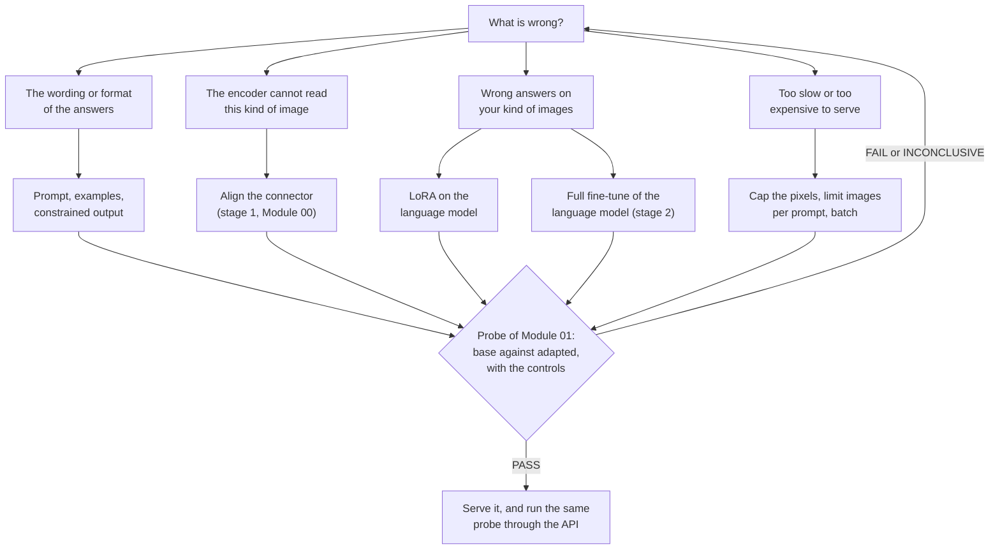

# Module 02: Adapting and Serving Vision-Language Models

> **Prerequisites:** [Module 00: From Vision Encoder to Language Model](../00-connectors-and-training-recipes/README.md), for the connector, the token counts and the cache per token, and [Module 01: Evaluating Vision-Language Models](../01-evaluating-vlms-benchmarks-hallucination-and-polling/README.md), for the probe, the controls and the gate that this module applies to a fine-tuned model.  
> **Estimated Reading Time:** 85 minutes  
> **Target Audience:** AI Backend Engineers, ML Platform Engineers, Applied ML Engineers

> [!TIP]
> **The Golden Rule of Adapting Vision-Language Models:** Adapt the smallest part that fixes the problem, then let the controls of Module 01 say whether it did. A LoRA trains under 1% of a model and fits in a fraction of the memory, and it can still change how often the model says yes. Serve it only after it passes the same questions the base model was given, asked through the interface you serve.

---

## Why This Matters

Adapting a vision-language model costs what the arithmetic says. Every weight takes 2 bytes, and every parameter you train adds a gradient and two optimizer numbers. For LLaVA-1.5-7B, training the connector and the language model needs 76.1 GiB for weights, gradients and optimizer states alone, before any activations. A LoRA on the attention projections trains 8,388,608 parameters, 0.119% of the model, and the same accounting gives 13.2 GiB, which is almost entirely the frozen weights. For Qwen2-VL-7B the two figures are 86.8 GiB and 15.5 GiB. That difference decides whether a fine-tune fits on the hardware you have.

Serving is the other half of the bill, and the image is most of it. On a 24 GiB card with 2 GiB held back, the planner of this module fits 26 requests that carry a 1920 x 1080 screenshot into LLaVA-1.5-7B, 43 into Qwen2-VL-7B, and 92 when Qwen2-VL's pixels are capped at 1,280 visual tokens, because the cache of one request is its tokens times the cache per token. The cap is one setting, and the real processor turns that screenshot into 1,222 tokens under it instead of 2,691.

Neither number says whether the adapted model is any good. This module measures one real fine-tune to show what the check looks like: a LoRA of rank 8 on SmolVLM-256M-Instruct, which trains 921,600 of 257 million parameters (0.358%) on 240 yes/no questions about 40 drawn scenes, in about seven minutes on a laptop CPU. On the probe of Module 01, the adapted model found 118 of the 120 objects that are there instead of 72, its accuracy rose by 12.9 and 16.7 points on the random and popular sets, and with a blank image it still said no to every question. It also said yes to more objects that are not there: 58 false yeses on the adversarial set instead of 23, where the gate cannot rule out a loss. One accuracy figure would have hidden that trade.

After this module you will be able to:

- compute the number of trainable parameters of a LoRA adapter from a model's layer dimensions, and check it against a built model;
- estimate training memory and serving capacity from sizes, and say what each estimate leaves out;
- choose between a prompt, connector alignment, a LoRA and a full fine-tune for a given problem;
- run the controls of Module 01 on a fine-tuned model and read the before-and-after with an interval;
- serve a vision-language model through an OpenAI-compatible API, cap what an image costs, and evaluate the model through that API.

---

## 1. Architectural Mental Model & Core Mechanics

Start from what is wrong, because it decides how much of the model you have to touch:



### What LoRA Does

LoRA (Hu et al., 2021) freezes a pretrained weight matrix W of size d_out x d_in and learns the update beside it: W + BA, where B is d_out x r, A is r x d_in and the rank r is much smaller than either. The layer computes Wx + (alpha / r) BAx. The authors initialise A with random Gaussian values and B with zeros, so the update is zero at the start of training and the adapted model begins as exactly the base model. Only A and B receive gradients.

That makes the cost of an adapter a formula. A matrix of d_in x d_out gets r (d_in + d_out) new parameters. SmolVLM-256M's language model has 30 layers with a hidden size of 576, 9 query heads and 3 key-value heads of size 64, so a rank-8 adapter on the four attention projections adds, per layer:

| Projection | Shape (in to out) | Adapter parameters, r = 8 |
| :--- | :--- | ---: |
| `q_proj` | 576 to 576 | 8 x (576 + 576) = 9,216 |
| `k_proj` | 576 to 192 | 8 x (576 + 192) = 6,144 |
| `v_proj` | 576 to 192 | 6,144 |
| `o_proj` | 576 to 576 | 9,216 |
| **One layer** | | **30,720** |

Thirty layers give 921,600 trainable parameters. Workflow 2 wraps the real model and the library reports the same number.

Two properties of LoRA matter in practice. For a large Transformer trained with Adam, the authors report a VRAM saving "by up to 2/3", because "we do not need to store the optimizer states for the frozen parameters". And when the model is deployed, "we can explicitly compute and store W = W0 + BA and perform inference as usual", so the adapter adds no inference latency. The same merge has a cost: the authors note that it is not straightforward to batch inputs that need different adapters in one forward pass if the adapters are absorbed into the weights.

### Which Parts of a Vision-Language Model Get an Adapter

| Part | In this module | Why |
| :--- | :--- | :--- |
| **Vision encoder** | Frozen | LLaVA freezes it in both stages (Module 00), and it is the part that already reads pixels |
| **Connector** | Frozen | Stage 1 of the recipe trains it; changing it changes every image token |
| **Language model attention** | LoRA on `q_proj`, `k_proj`, `v_proj`, `o_proj` | The smallest adapter that changes how the model reads visual tokens and writes answers |
| **Language model MLP** | Not adapted here; the planner counts it | The LoRA paper adapted attention only and left MLP layers to future work. Adding them takes the count to 2.4 times (LLaVA-1.5-7B) or 4 times (Qwen2-VL-7B) that of attention alone |

### What Training Costs in Memory

For every parameter: 2 bytes for the weight. For every parameter that is *trained*: 2 more for its gradient and 8 for the two optimizer numbers Adam keeps. The planner adds these up. It leaves out the activations, which grow with the batch and with the sequence length (and the sequence includes every image token), any fp32 master copy of the weights, and the framework's own overhead, so treat its figures as a floor.

QLoRA (Dettmers et al., 2023) goes after the weights themselves: it backpropagates through a frozen, 4-bit quantized model into LoRA adapters. The authors report that regular 16-bit fine-tuning of a 65-billion-parameter LLaMA "requires more than 780 GB of GPU memory", and that QLoRA reduces memory enough to fine-tune it on a single 48 GB GPU while preserving 16-bit fine-tuning task performance.

### What Serving Costs

A request has two costs. **Prefill compute** is about 2 operations per parameter per token, so it grows with the image tokens, and the vision encoder adds its own for the patches it reads. **The cache** holds the keys and values of every token of every request being served: its size is the tokens of the request times the cache per token of Module 00. Capacity is what is left of the card:

requests that fit = (card memory - reserve - weights) / (tokens per request x cache per token)

The image dominates: at 1920 x 1080 Qwen2-VL spends 2,691 of its 2,791 tokens on the picture. The levers are those of the tokens:

| Lever | What it changes | Where |
| :--- | :--- | :--- |
| **Cap the pixels** | The maximum visual tokens per image. Qwen2-VL's model card sets `min_pixels` and `max_pixels` on the processor, with 4 to 16,384 visual tokens by default, and gives a range of 256 to 1,280 "to balance speed and memory usage" | Workflow 2 measures it |
| **Limit the images per prompt** | The worst case for one request | vLLM: `--limit-mm-per-prompt.image 2` |
| **Cap the context** | The longest sequence the server accepts, which can decide whether the model fits a small card at all | vLLM: `--max-model-len 4096` (its documentation's example comment: "Otherwise, it may not fit in smaller GPUs") |

### Evaluate Through the Interface You Serve

The adapted model that you serve is not the model you trained. It may have its adapter merged into the weights, its weights quantized, its images resized by a server setting, its prompt wrapped in a chat template. Each can change answers. So the last gate runs the probe of Module 01 through the same API your users call (Workflow 4), and compares those answers with the trained model's, question by question.

---

## 2. Systematic Comparison Matrix: Five Ways to Change What a VLM Does

Sizes are for LLaVA-1.5-7B, from the planner of Section 4. The memory is weights, gradients and optimizer states, without activations.

| | **Prompt, examples** | **Align the connector** (stage 1) | **LoRA on attention** | **LoRA on attention and MLP** | **Full fine-tune** (stage 2) |
| :--- | :--- | :--- | :--- | :--- | :--- |
| **What it changes** | Nothing in the model | How image features land in the language model | How the language model reads visual tokens and writes answers | The same, with more capacity | The connector and the whole language model |
| **Trainable parameters** | 0 | 20,979,712 (0.30%) | 8,388,608 (0.119%) | 19,988,480 (0.283%) | 6,759,919,616 (95.7%) |
| **Training memory** | The 13.2 GiB of weights | 13.4 GiB | 13.2 GiB | 13.3 GiB | 76.1 GiB |
| **Data it needs** | A handful of examples | Image and caption pairs: 595K for LLaVA, 558K for LLaVA-1.5 | As many as the task needs: Section 3 gets a measurable change from 240 questions | The same, or more | Instruction data: 158K examples for LLaVA, 665K for LLaVA-1.5 |
| **Risk** | Brittle wording (Module 01: one sentence flipped the yes ratio) | A poor alignment hurts every image | Can shift behaviour, such as the yes ratio | The same, with more capacity to shift | Changes the text-only behaviour of the model too (Module 00) |
| **Reach for it when** | Always first | A new encoder or sensor | The model reads your images but answers wrongly | LoRA on attention is not enough | You have the data, the memory and a reason |

Two things in the numbers deserve a second look. The connector has more trainable parameters than a rank-8 LoRA on attention (20,979,712 against 8,388,608), so aligning it is not the "smaller" intervention it sounds like. And the memory of all three light options is within 0.2 GiB of the weights alone, which is the point: once most parameters are frozen, the weights are the bill.

---

## 3. Evidence Case Study: Two Papers and One Small Real Fine-Tune

This section is built from the LoRA and QLoRA papers, from the model card and the vLLM documentation named in the reading list, and from a real fine-tune of SmolVLM-256M-Instruct whose output is in Workflow 3. It keeps to what they report and to what the runs printed.

### What the Papers Report

| Paper | What it found |
| :--- | :--- |
| **LoRA** (Hu et al., 2021) | Compared with GPT-3 175B fine-tuned with Adam, LoRA reduces the trainable parameters by 10,000 times and the GPU memory requirement by 3 times. Training VRAM on GPT-3 175B falls from 1.2 TB to 350 GB. With r = 4 and only the query and value projections adapted, the checkpoint shrinks from 350 GB to 35 MB, and the quality is on par with or better than fine-tuning on the models they tested (RoBERTa, DeBERTa, GPT-2, GPT-3). It also saw a 25% training speed-up on GPT-3 175B |
| **QLoRA** (Dettmers et al., 2023) | Fine-tunes a 65B-parameter model on a single 48 GB GPU while preserving 16-bit fine-tuning task performance, with three ideas: a 4-bit NormalFloat data type, double quantization of the quantization constants, and paged optimizers |

Both papers are about language models. Neither fine-tunes a vision-language model, and nothing here transfers to one without a measurement. That is what the next part is for.

### The Experiment

**What was trained.** SmolVLM-256M-Instruct with LoRA adapters of rank 8 (alpha 16) on the four attention projections of its 30 language-model layers: 921,600 trainable parameters, 0.358% of the 257,406,528 that the wrapped model holds. The vision encoder, the connector and every base weight stay frozen. The training questions come from 40 new scenes drawn by Module 01's generator with another seed: the 240 questions of their random set, 120 about objects that are there and 120 about objects that are not, each asked with prompt 1 about the drawn image. The loss is the cross-entropy of the first answer token, " Yes" or " No". AdamW at a learning rate of 2e-4, gradients summed over 8 questions, two epochs (480 examples), float32 on a laptop CPU: 420 seconds. The run is deterministic on that machine: an earlier attempt that was stopped partway printed the same eight loss averages, to four decimals, as the run in Workflow 3.

**What was measured.** The probe of Module 01, unchanged: the same 375 questions about the same 40 scenes, in the same three conditions, through the same polling program and gate (allowed drop 0.02). The image with prompt 1 is the condition the adapter was trained in, the blank image is the control, and prompt 2 is a wording it never saw. Each row compares the base model (first) with the adapted model (second), question by question.

| Condition | Set | Accuracy, base to LoRA | Yes ratio | Objects found (of 120) | False yeses (of 120) | Change, 95% interval | Gate |
| :--- | :--- | :--- | :--- | :--- | :--- | :--- | :--- |
| Image, prompt 1 (trained) | random | 0.758 to 0.887 | 34.2% to 59.6% | 72 to 118 | 10 to 25 | +0.1292 [+0.0653, +0.1931] | PASS |
| | popular | 0.758 to 0.925 | 34.2% to 55.8% | 72 to 118 | 10 to 16 | +0.1667 [+0.1069, +0.2264] | PASS |
| | adversarial | 0.704 to 0.750 | 39.6% to 73.3% | 72 to 118 | 23 to 58 | +0.0458 [-0.0303, +0.1219] | INCONCLUSIVE |
| Blank image, prompt 1 | each set | 0.500 to 0.500 | 0.0% to 0.0% | 0 to 0 | 0 to 0 | +0.0000 | PASS |
| Image, prompt 2 (never trained) | random | 0.796 to 0.842 | 70.4% to 65.8% | 120 to 120 | 49 to 38 | +0.0458 [+0.0193, +0.0723] | PASS |
| | popular | 0.846 to 0.883 | 65.4% to 61.7% | 120 to 120 | 37 to 28 | +0.0375 [+0.0134, +0.0616] | PASS |
| | adversarial | 0.662 to 0.679 | 83.8% to 82.1% | 120 to 120 | 81 to 77 | +0.0167 [-0.0033, +0.0366] | PASS |

**Where the accuracy came from.** With the image and the wording it was trained on, the adapted model finds 118 of the 120 objects that are there, against 72 for the base model. It also says yes to more of the objects that are not there, and most of all on the adversarial set, whose absent objects share a colour or a shape with what is drawn: 58 false yeses of 120 against 23. The base model was biased towards no and the adapted one is biased towards yes, and on the adversarial set its precision fell from 0.758 to 0.670. Accuracy still rose there, by 4.6 points, but the interval runs from -3.03 to +12.19 points, so a loss bigger than the allowed 2 points is not ruled out, and the gate says INCONCLUSIVE. The program's n-to-settle column puts the number of questions that would decide it at about 3,476.

**The controls held.** With a blank image the adapted model says no to all 375 questions, as the base model does, so it did not learn to say yes without looking. Its gain from the image grew: the comparison of `lora_blank_p1` with `lora_image_p1` gives +0.3875, +0.4250 and +0.2500 on the three sets, against +0.2583, +0.2583 and +0.2042 for the base model in Module 01. The adapted model leans on the image more, not less.

**Part of it carries over to another wording.** Prompt 2 already made the base model find every object that is there (recall 1.000), so the only room left was on absent objects. There the adapter turned 11, 9 and 5 false yeses into correct answers and made one new false yes, on the adversarial set. The random and popular gains are small but clear (McNemar p = 0.0010 and 0.0039). On the adversarial set the interval includes zero, and the gate says PASS only because its lower end, -0.0033, is above the allowed drop of -0.02.

**The merge is faithful.** Folding the adapter into the weights with `merge_and_unload()` gives a model with the base model's 256,484,928 parameters and no adapter left, and it answers all 375 questions of the trained condition exactly as the unmerged model did. The largest difference in the margin (the logit of " Yes" minus that of " No") is 0.0001, the rounding of the stored margins. So the merged model can be served in place of base plus adapter, at float32. A model served in 16 bits, or quantized, is a different set of weights again and needs the same check (exercise 5).

### What This Does and Does Not Show

- **It is one fine-tune of one small model.** It shows what the check looks like and what it caught. It does not show that a LoRA improves vision-language models in general, or that it would improve this one on photographs.
- **The training scenes are like the probe's.** Both come from the same generator: the same 12 objects, the same canvas and the same way of drawing. 19 of the 40 training scenes hold the same three objects as some probe scene, in other places, and one (training scene 36) holds the same three objects in the same cells as probe scene 8, a few pixels apart. The probe measures the world the adapter was trained in. A held-out world, with other shapes or real photographs, was not tested.
- **Nothing outside the probe was measured.** Captions, other kinds of question and the model's general behaviour were not tested, and a narrow fine-tune can change them.
- **One run, one seed, one setting.** Rank 8, alpha 16, a learning rate of 2e-4 and two epochs, trained once. The intervals are over questions, not over training runs: another seed or another learning rate could land elsewhere.
- **The intervals are too narrow.** Questions about the same scene share the scene, so they are not independent (Module 01, exercise 5): with about nine questions per scene, the real uncertainty is larger than printed. The three sets also share their 120 questions about present objects, so their verdicts are not independent of each other.
- **Float32 on a CPU.** The merge was checked at the precision of training. Serving usually runs in 16 bits or less, which is a different model to check.

---

## 4. Multi-Language Production Implementation: A Capacity Planner

Below is a program in **Go**, **TypeScript**, **Python** and **C#** that does the arithmetic of Sections 1 and 2 for three real models, using the sizes measured in Module 00. It has three parts:

1. **LoRA parameters** computed from the dimensions of the language model's layers, for the attention projections alone and with the MLP, at a configurable rank.
2. **Training memory** for four ways to train: the connector only, a LoRA on attention, a LoRA on attention and MLP, and the connector with the whole language model.
3. **Serving capacity** for a 1920 x 1080 screenshot on a 24 GiB card: the weights, the tokens, the cache of one request, how many requests fit, and the prefill compute. Qwen2-VL appears twice, once as it comes and once with its pixels capped at 1,280 tokens (1,222 for this screenshot, as the real processor counts in Workflow 2).

Run them with `go run planner.go`, `node planner.ts` (Node 24 or newer), `python planner.py` and `dotnet run Planner.cs` (.NET 10 SDK). All four print the same output, shown in Workflow 1.

````carousel

```go
// Adapting and serving a vision-language model: what LoRA trains, what training needs in memory, and what a request costs to serve.
// No packages, no network. Run it with: go run planner.go. The model sizes are those of three real models (Module 00, Workflow 2).
//
// Everything here is arithmetic on sizes. It is a plan to check against a real run, not a measurement: it ignores activations, framework
// overhead and everything that is not a parameter or a cache entry, and it estimates compute as 2 operations per parameter per token.
package main

import (
	"fmt"
	"strconv"
	"strings"
)

const (
	gib         = 1024 * 1024 * 1024
	mib         = 1024 * 1024
	rank        = 8 // LoRA rank; the number of trainable parameters is proportional to it
	bytesWeight = 2 // bf16 weights and gradients; Adam keeps two fp32 numbers per trained parameter
	bytesGrad   = 2
	bytesAdam   = 8
	gpuGiB      = 24 // a 24 GiB card, minus a fixed reserve for the framework
	reserveGiB  = 2
	textTokens  = 100 // the question and the answer around the image
	width       = 1920
	height      = 1080

	capTokens              = 1280 // Qwen2-VL's max_pixels = 1280 * 28 * 28, the example on its model card
	cappedScreenshotTokens = 1222 // what the real processor gives a 1920 x 1080 screenshot under that cap (Workflow 2)
)

type model struct {
	name                                                 string
	vision, connector, language, head                    int64
	layers, hidden, mlp, heads, kvHeads, headSize, cache int64
}

// name, vision encoder, connector, language model, output head, layers, hidden, MLP width, heads, key-value heads, head size, cache per token (fp16)
var models = []model{
	{"SmolVLM-256M", 86_433_024, 7_077_888, 134_588_736, 28_385_280, 30, 576, 1536, 9, 3, 64, 23_040},
	{"LLaVA-1.5-7B", 303_507_456, 20_979_712, 6_607_605_760, 131_334_144, 32, 4096, 11008, 32, 32, 128, 524_288},
	{"Qwen2-VL-7B", 631_183_360, 44_575_744, 7_070_619_136, 544_997_376, 28, 3584, 18944, 28, 4, 128, 57_344},
}

func total(m model) int64 { return m.vision + m.connector + m.language + m.head }

// lora is what an adapter on a weight of nOut x nIn adds: two matrices, rank x nIn and nOut x rank.
func lora(nIn, nOut int64) int64 { return rank * (nIn + nOut) }

func loraAttention(m model) int64 {
	q, kv := m.heads*m.headSize, m.kvHeads*m.headSize
	return m.layers * (lora(m.hidden, q) + lora(m.hidden, kv) + lora(m.hidden, kv) + lora(q, m.hidden))
}

func loraMlp(m model) int64 {
	return m.layers * (lora(m.hidden, m.mlp) + lora(m.hidden, m.mlp) + lora(m.mlp, m.hidden))
}

// stateBytes is the weights of the whole model, plus gradients and Adam states for the parameters that are trained.
func stateBytes(m model, trained int64) int64 {
	return total(m)*bytesWeight + trained*(bytesGrad+bytesAdam)
}

// tokensFor is the image tokens for a 1920 x 1080 screenshot, as measured in Module 00, and the patches the vision encoder reads for them.
func tokensFor(m model) (int64, int64) {
	switch m.name {
	case "SmolVLM-256M":
		return 13 * 64, 13 * 1024 // 13 tiles of 512 x 512, each 1,024 patches in and 64 tokens out
	case "LLaVA-1.5-7B":
		return 576, 576
	}
	return 69 * 39, 4 * 69 * 39 // Qwen2-VL: 28 x 28 blocks, each from 4 patches of 14 x 14
}

// plan is one row of the serving table: a label, a model, the image tokens of the screenshot and the patches the vision encoder reads for them.
type plan struct {
	label                string
	m                    model
	imageTokens, patches int64
}

// servingPlans lists each model as it comes, and Qwen2-VL again with its pixels capped.
func servingPlans() []plan {
	var plans []plan
	for _, m := range models {
		imageTokens, patches := tokensFor(m)
		plans = append(plans, plan{m.name, m, imageTokens, patches})
		if m.name == "Qwen2-VL-7B" {
			plans = append(plans, plan{fmt.Sprintf("%s, cap %d", m.name, capTokens), m, cappedScreenshotTokens, 4 * cappedScreenshotTokens})
		}
	}
	return plans
}

// withCommas writes an integer with thousands separators.
func withCommas(n int64) string {
	s := strconv.FormatInt(n, 10)
	var out []string
	for len(s) > 3 {
		out = append([]string{s[len(s)-3:]}, out...)
		s = s[:len(s)-3]
	}
	return strings.Join(append([]string{s}, out...), ",")
}

func main() {
	fmt.Printf("LoRA trainable parameters at rank %d, from the dimensions of the language model's layers\n", rank)
	for _, m := range models {
		attention := loraAttention(m)
		everything := loraAttention(m) + loraMlp(m)
		fmt.Printf("  %-14s attention only %11s (%.3f%% of the model)   attention and MLP %11s (%.3f%%)\n", m.name, withCommas(attention), 100*float64(attention)/float64(total(m)), withCommas(everything), 100*float64(everything)/float64(total(m)))
	}

	fmt.Println()
	fmt.Printf("memory for weights, gradients and optimizer states in GiB (%d bytes per weight, %d per gradient, %d for Adam), without activations\n", bytesWeight, bytesGrad, bytesAdam)
	fmt.Printf("  %-14s %15s %15s %21s %27s\n", "model", "connector only", "LoRA attention", "LoRA attention + MLP", "connector + language model")
	for _, m := range models {
		connector := float64(stateBytes(m, m.connector)) / gib
		attention := float64(stateBytes(m, loraAttention(m))) / gib
		both := float64(stateBytes(m, loraAttention(m)+loraMlp(m))) / gib
		full := float64(stateBytes(m, m.connector+m.language+m.head)) / gib
		fmt.Printf("  %-14s %15.1f %15.1f %21.1f %27.1f\n", m.name, connector, attention, both, full)
	}

	fmt.Println()
	fmt.Printf("serving one %d x %d screenshot with %d text tokens on a %d GiB card (%d GiB kept in reserve)\n", width, height, textTokens, gpuGiB, reserveGiB)
	fmt.Printf("  %-22s %8s %7s %14s %9s %16s\n", "model", "weights", "tokens", "cache/request", "requests", "prefill compute")
	for _, p := range servingPlans() {
		m := p.m
		allTokens := p.imageTokens + textTokens
		weights := total(m) * bytesWeight
		cache := allTokens * m.cache
		room := (gpuGiB-reserveGiB)*int64(gib) - weights
		requests := int64(0)
		if room >= 0 {
			requests = room / cache
		}
		tflops := float64(2*(m.language+m.head)*allTokens+2*m.vision*p.patches) / 1e12
		fmt.Printf("  %-22s %5.1f GiB %7s %10.1f MiB %9s %11.2f TFLOP\n", p.label, float64(weights)/gib, withCommas(allTokens), float64(cache)/mib, withCommas(requests), tflops)
	}
}
```

<!-- slide -->

```typescript
// Adapting and serving a vision-language model: what LoRA trains, what training needs in memory, and what a request costs to serve.
// No packages, no network. Run it with: node planner.ts (Node 24 or newer). The model sizes are those of three real models (Module 00, Workflow 2).
//
// Everything here is arithmetic on sizes. It is a plan to check against a real run, not a measurement: it ignores activations, framework
// overhead and everything that is not a parameter or a cache entry, and it estimates compute as 2 operations per parameter per token.

const GIB = 1024 ** 3;
const MIB = 1024 ** 2;
const RANK = 8; // LoRA rank; the number of trainable parameters is proportional to it
const BYTES_WEIGHT = 2; // bf16 weights and gradients; Adam keeps two fp32 numbers per trained parameter
const BYTES_GRAD = 2;
const BYTES_ADAM = 8;
const GPU_GIB = 24; // a 24 GiB card, minus a fixed reserve for the framework
const RESERVE_GIB = 2;
const TEXT_TOKENS = 100; // the question and the answer around the image
const SCREENSHOT = [1920, 1080];
const CAP_TOKENS = 1280; // Qwen2-VL's max_pixels = 1280 * 28 * 28, the example on its model card
const CAPPED_SCREENSHOT_TOKENS = 1222; // what the real processor gives a 1920 x 1080 screenshot under that cap (Workflow 2)

type Model = {
  name: string; vision: number; connector: number; language: number; head: number;
  layers: number; hidden: number; mlp: number; heads: number; kvHeads: number; headSize: number; cache: number;
};

// name, vision encoder, connector, language model, output head, layers, hidden, MLP width, heads, key-value heads, head size, cache per token (fp16)
const MODELS: Model[] = [
  { name: "SmolVLM-256M", vision: 86_433_024, connector: 7_077_888, language: 134_588_736, head: 28_385_280, layers: 30, hidden: 576, mlp: 1536, heads: 9, kvHeads: 3, headSize: 64, cache: 23_040 },
  { name: "LLaVA-1.5-7B", vision: 303_507_456, connector: 20_979_712, language: 6_607_605_760, head: 131_334_144, layers: 32, hidden: 4096, mlp: 11008, heads: 32, kvHeads: 32, headSize: 128, cache: 524_288 },
  { name: "Qwen2-VL-7B", vision: 631_183_360, connector: 44_575_744, language: 7_070_619_136, head: 544_997_376, layers: 28, hidden: 3584, mlp: 18944, heads: 28, kvHeads: 4, headSize: 128, cache: 57_344 },
];

const total = (m: Model): number => m.vision + m.connector + m.language + m.head;

/** A LoRA adapter on a weight of nOut x nIn adds two matrices, RANK x nIn and nOut x RANK. */
const lora = (nIn: number, nOut: number): number => RANK * (nIn + nOut);

function loraAttention(m: Model): number {
  const q = m.heads * m.headSize;
  const kv = m.kvHeads * m.headSize;
  return m.layers * (lora(m.hidden, q) + lora(m.hidden, kv) + lora(m.hidden, kv) + lora(q, m.hidden));
}

const loraMlp = (m: Model): number => m.layers * (lora(m.hidden, m.mlp) + lora(m.hidden, m.mlp) + lora(m.mlp, m.hidden));

/** Weights of the whole model, plus gradients and Adam states for the parameters that are trained. */
const stateBytes = (m: Model, trained: number): number => total(m) * BYTES_WEIGHT + trained * (BYTES_GRAD + BYTES_ADAM);

/** Image tokens for a 1920 x 1080 screenshot, as measured in Module 00, and the patches the vision encoder reads for them. */
function tokensFor(m: Model): [number, number] {
  if (m.name === "SmolVLM-256M") return [13 * 64, 13 * 1024]; // 13 tiles of 512 x 512, each 1,024 patches in and 64 tokens out
  if (m.name === "LLaVA-1.5-7B") return [576, 576];
  return [69 * 39, 4 * 69 * 39]; // Qwen2-VL: 28 x 28 blocks, each from 4 patches of 14 x 14
}

/** [label, model, image tokens, patches]: each model as it comes, and Qwen2-VL again with its pixels capped. */
function servingPlans(): Array<[string, Model, number, number]> {
  const plans: Array<[string, Model, number, number]> = [];
  for (const m of MODELS) {
    const [imageTokens, patches] = tokensFor(m);
    plans.push([m.name, m, imageTokens, patches]);
    if (m.name === "Qwen2-VL-7B") plans.push([`${m.name}, cap ${CAP_TOKENS}`, m, CAPPED_SCREENSHOT_TOKENS, 4 * CAPPED_SCREENSHOT_TOKENS]);
  }
  return plans;
}

const commas = (n: number): string => n.toLocaleString("en-US");

function main(): void {
  console.log(`LoRA trainable parameters at rank ${RANK}, from the dimensions of the language model's layers`);
  for (const m of MODELS) {
    const attention = loraAttention(m);
    const everything = loraAttention(m) + loraMlp(m);
    console.log(`  ${m.name.padEnd(14)} attention only ${commas(attention).padStart(11)} (${((100 * attention) / total(m)).toFixed(3)}% of the model)   attention and MLP ${commas(everything).padStart(11)} (${((100 * everything) / total(m)).toFixed(3)}%)`);
  }

  console.log();
  console.log(`memory for weights, gradients and optimizer states in GiB (${BYTES_WEIGHT} bytes per weight, ${BYTES_GRAD} per gradient, ${BYTES_ADAM} for Adam), without activations`);
  console.log(`  ${"model".padEnd(14)} ${"connector only".padStart(15)} ${"LoRA attention".padStart(15)} ${"LoRA attention + MLP".padStart(21)} ${"connector + language model".padStart(27)}`);
  for (const m of MODELS) {
    const connector = stateBytes(m, m.connector) / GIB;
    const attention = stateBytes(m, loraAttention(m)) / GIB;
    const both = stateBytes(m, loraAttention(m) + loraMlp(m)) / GIB;
    const full = stateBytes(m, m.connector + m.language + m.head) / GIB;
    console.log(`  ${m.name.padEnd(14)} ${connector.toFixed(1).padStart(15)} ${attention.toFixed(1).padStart(15)} ${both.toFixed(1).padStart(21)} ${full.toFixed(1).padStart(27)}`);
  }

  console.log();
  const [width, height] = SCREENSHOT;
  console.log(`serving one ${width} x ${height} screenshot with ${TEXT_TOKENS} text tokens on a ${GPU_GIB} GiB card (${RESERVE_GIB} GiB kept in reserve)`);
  console.log(`  ${"model".padEnd(22)} ${"weights".padStart(8)} ${"tokens".padStart(7)} ${"cache/request".padStart(14)} ${"requests".padStart(9)} ${"prefill compute".padStart(16)}`);
  for (const [label, m, imageTokens, patches] of servingPlans()) {
    const allTokens = imageTokens + TEXT_TOKENS;
    const weights = total(m) * BYTES_WEIGHT;
    const cache = allTokens * m.cache;
    const room = (GPU_GIB - RESERVE_GIB) * GIB - weights;
    const requests = room < 0 ? 0 : Math.floor(room / cache);
    const tflops = (2 * (m.language + m.head) * allTokens + 2 * m.vision * patches) / 1e12;
    console.log(`  ${label.padEnd(22)} ${(weights / GIB).toFixed(1).padStart(5)} GiB ${commas(allTokens).padStart(7)} ${(cache / MIB).toFixed(1).padStart(10)} MiB ${commas(requests).padStart(9)} ${tflops.toFixed(2).padStart(11)} TFLOP`);
  }
}

main();
```

<!-- slide -->

```python
"""Adapting and serving a vision-language model: what LoRA trains, what training needs in memory, and what a request costs to serve.
Plain Python 3, no packages, no network. The model sizes are those of three real models (Module 00, Workflow 2).

Everything here is arithmetic on sizes. It is a plan to check against a real run, not a measurement: it ignores activations, framework
overhead and everything that is not a parameter or a cache entry, and it estimates compute as 2 operations per parameter per token.
"""
GIB = 1024 ** 3
MIB = 1024 ** 2
RANK = 8  # LoRA rank; the number of trainable parameters is proportional to it
BYTES_WEIGHT, BYTES_GRAD, BYTES_ADAM = 2, 2, 8  # bf16 weights and gradients; Adam keeps two fp32 numbers per trained parameter
GPU_GIB, RESERVE_GIB = 24, 2  # a 24 GiB card, minus a fixed reserve for the framework
TEXT_TOKENS = 100  # the question and the answer around the image
SCREENSHOT = (1920, 1080)
CAP_TOKENS = 1280  # Qwen2-VL's max_pixels = 1280 * 28 * 28, the example on its model card
CAPPED_SCREENSHOT_TOKENS = 1222  # what the real processor gives a 1920 x 1080 screenshot under that cap (Workflow 2)

MODELS = [
    # name, vision encoder, connector, language model, output head, layers, hidden, MLP width, heads, key-value heads, head size, cache per token (fp16)
    {"name": "SmolVLM-256M", "vision": 86_433_024, "connector": 7_077_888, "language": 134_588_736, "head": 28_385_280,
     "layers": 30, "hidden": 576, "mlp": 1536, "heads": 9, "kv_heads": 3, "head_size": 64, "cache": 23_040},
    {"name": "LLaVA-1.5-7B", "vision": 303_507_456, "connector": 20_979_712, "language": 6_607_605_760, "head": 131_334_144,
     "layers": 32, "hidden": 4096, "mlp": 11008, "heads": 32, "kv_heads": 32, "head_size": 128, "cache": 524_288},
    {"name": "Qwen2-VL-7B", "vision": 631_183_360, "connector": 44_575_744, "language": 7_070_619_136, "head": 544_997_376,
     "layers": 28, "hidden": 3584, "mlp": 18944, "heads": 28, "kv_heads": 4, "head_size": 128, "cache": 57_344},
]


def total(m):
    return m["vision"] + m["connector"] + m["language"] + m["head"]


def lora(n_in, n_out):
    """A LoRA adapter on a weight of n_out x n_in adds two matrices, RANK x n_in and n_out x RANK."""
    return RANK * (n_in + n_out)


def lora_attention(m):
    q, kv = m["heads"] * m["head_size"], m["kv_heads"] * m["head_size"]
    return m["layers"] * (lora(m["hidden"], q) + lora(m["hidden"], kv) + lora(m["hidden"], kv) + lora(q, m["hidden"]))


def lora_mlp(m):
    return m["layers"] * (lora(m["hidden"], m["mlp"]) + lora(m["hidden"], m["mlp"]) + lora(m["mlp"], m["hidden"]))


def state_bytes(m, trained):
    """Weights of the whole model, plus gradients and Adam states for the parameters that are trained."""
    return total(m) * BYTES_WEIGHT + trained * (BYTES_GRAD + BYTES_ADAM)


def tokens_for(m):
    """Image tokens for a 1920 x 1080 screenshot, as measured in Module 00, and the patches the vision encoder reads for them."""
    if m["name"] == "SmolVLM-256M":
        return 13 * 64, 13 * 1024  # 13 tiles of 512 x 512, each 1,024 patches in and 64 tokens out
    if m["name"] == "LLaVA-1.5-7B":
        return 576, 576
    return 69 * 39, 4 * 69 * 39  # Qwen2-VL: 28 x 28 blocks, each from 4 patches of 14 x 14


def serving_plans():
    """(label, model, image tokens, patches): each model as it comes, and Qwen2-VL again with its pixels capped."""
    plans = []
    for m in MODELS:
        image_tokens, patches = tokens_for(m)
        plans.append((m["name"], m, image_tokens, patches))
        if m["name"] == "Qwen2-VL-7B":
            plans.append((f"{m['name']}, cap {CAP_TOKENS}", m, CAPPED_SCREENSHOT_TOKENS, 4 * CAPPED_SCREENSHOT_TOKENS))
    return plans


def main():
    print(f"LoRA trainable parameters at rank {RANK}, from the dimensions of the language model's layers")
    for m in MODELS:
        attention, everything = lora_attention(m), lora_attention(m) + lora_mlp(m)
        print(f"  {m['name']:<14} attention only {attention:>11,} ({100 * attention / total(m):.3f}% of the model)   attention and MLP {everything:>11,} ({100 * everything / total(m):.3f}%)")

    print()
    print(f"memory for weights, gradients and optimizer states in GiB ({BYTES_WEIGHT} bytes per weight, {BYTES_GRAD} per gradient, {BYTES_ADAM} for Adam), without activations")
    print(f"  {'model':<14} {'connector only':>15} {'LoRA attention':>15} {'LoRA attention + MLP':>21} {'connector + language model':>27}")
    for m in MODELS:
        connector = state_bytes(m, m["connector"]) / GIB
        attention = state_bytes(m, lora_attention(m)) / GIB
        both = state_bytes(m, lora_attention(m) + lora_mlp(m)) / GIB
        full = state_bytes(m, m["connector"] + m["language"] + m["head"]) / GIB
        print(f"  {m['name']:<14} {connector:>15.1f} {attention:>15.1f} {both:>21.1f} {full:>27.1f}")

    print()
    width, height = SCREENSHOT
    print(f"serving one {width} x {height} screenshot with {TEXT_TOKENS} text tokens on a {GPU_GIB} GiB card ({RESERVE_GIB} GiB kept in reserve)")
    print(f"  {'model':<22} {'weights':>8} {'tokens':>7} {'cache/request':>14} {'requests':>9} {'prefill compute':>16}")
    for label, m, image_tokens, patches in serving_plans():
        all_tokens = image_tokens + TEXT_TOKENS
        weights = total(m) * BYTES_WEIGHT
        cache = all_tokens * m["cache"]
        room = (GPU_GIB - RESERVE_GIB) * GIB - weights
        requests = max(0, int(room // cache))
        tflops = (2 * (m["language"] + m["head"]) * all_tokens + 2 * m["vision"] * patches) / 1e12
        print(f"  {label:<22} {weights / GIB:>5.1f} GiB {all_tokens:>7,} {cache / MIB:>10.1f} MiB {requests:>9,} {tflops:>11.2f} TFLOP")


main()
```

<!-- slide -->

```csharp
// Adapting and serving a vision-language model: what LoRA trains, what training needs in memory, and what a request costs to serve.
// No packages, no network. Run it with: dotnet run Planner.cs (.NET 10 SDK). The model sizes are those of three real models (Module 00, Workflow 2).
//
// Everything here is arithmetic on sizes. It is a plan to check against a real run, not a measurement: it ignores activations, framework
// overhead and everything that is not a parameter or a cache entry, and it estimates compute as 2 operations per parameter per token.
using System;
using System.Globalization;

const long Gib = 1024L * 1024 * 1024;
const long Mib = 1024L * 1024;
const long Rank = 8; // LoRA rank; the number of trainable parameters is proportional to it
const long BytesWeight = 2; // bf16 weights and gradients; Adam keeps two fp32 numbers per trained parameter
const long BytesGrad = 2;
const long BytesAdam = 8;
const long GpuGib = 24; // a 24 GiB card, minus a fixed reserve for the framework
const long ReserveGib = 2;
const long TextTokens = 100; // the question and the answer around the image
const int Width = 1920, Height = 1080;
const long CapTokens = 1280; // Qwen2-VL's max_pixels = 1280 * 28 * 28, the example on its model card
const long CappedScreenshotTokens = 1222; // what the real processor gives a 1920 x 1080 screenshot under that cap (Workflow 2)
var inv = CultureInfo.InvariantCulture;

// name, vision encoder, connector, language model, output head, layers, hidden, MLP width, heads, key-value heads, head size, cache per token (fp16)
var models = new (string Name, long Vision, long Connector, long Language, long Head, long Layers, long Hidden, long Mlp, long Heads, long KvHeads, long HeadSize, long Cache)[]
{
    ("SmolVLM-256M", 86_433_024, 7_077_888, 134_588_736, 28_385_280, 30, 576, 1536, 9, 3, 64, 23_040),
    ("LLaVA-1.5-7B", 303_507_456, 20_979_712, 6_607_605_760, 131_334_144, 32, 4096, 11008, 32, 32, 128, 524_288),
    ("Qwen2-VL-7B", 631_183_360, 44_575_744, 7_070_619_136, 544_997_376, 28, 3584, 18944, 28, 4, 128, 57_344),
};

long Total(long vision, long connector, long language, long head) => vision + connector + language + head;

// A LoRA adapter on a weight of nOut x nIn adds two matrices, Rank x nIn and nOut x Rank.
long Lora(long nIn, long nOut) => Rank * (nIn + nOut);

// Image tokens for a 1920 x 1080 screenshot, as measured in Module 00, and the patches the vision encoder reads for them.
(long Tokens, long Patches) TokensFor(string name) => name switch
{
    "SmolVLM-256M" => (13 * 64, 13 * 1024), // 13 tiles of 512 x 512, each 1,024 patches in and 64 tokens out
    "LLaVA-1.5-7B" => (576, 576),
    _ => (69 * 39, 4 * 69 * 39), // Qwen2-VL: 28 x 28 blocks, each from 4 patches of 14 x 14
};

string Commas(long n) => n.ToString("N0", inv);

Console.WriteLine($"LoRA trainable parameters at rank {Rank}, from the dimensions of the language model's layers");
foreach (var m in models)
{
    long q = m.Heads * m.HeadSize, kv = m.KvHeads * m.HeadSize;
    long attention = m.Layers * (Lora(m.Hidden, q) + Lora(m.Hidden, kv) + Lora(m.Hidden, kv) + Lora(q, m.Hidden));
    long everything = attention + m.Layers * (Lora(m.Hidden, m.Mlp) + Lora(m.Hidden, m.Mlp) + Lora(m.Mlp, m.Hidden));
    long all = Total(m.Vision, m.Connector, m.Language, m.Head);
    Console.WriteLine($"  {m.Name,-14} attention only {Commas(attention),11} ({(100.0 * attention / all).ToString("F3", inv)}% of the model)   attention and MLP {Commas(everything),11} ({(100.0 * everything / all).ToString("F3", inv)}%)");
}

Console.WriteLine();
Console.WriteLine($"memory for weights, gradients and optimizer states in GiB ({BytesWeight} bytes per weight, {BytesGrad} per gradient, {BytesAdam} for Adam), without activations");
Console.WriteLine($"  {"model",-14} {"connector only",15} {"LoRA attention",15} {"LoRA attention + MLP",21} {"connector + language model",27}");
foreach (var m in models)
{
    long q = m.Heads * m.HeadSize, kv = m.KvHeads * m.HeadSize;
    long attention = m.Layers * (Lora(m.Hidden, q) + Lora(m.Hidden, kv) + Lora(m.Hidden, kv) + Lora(q, m.Hidden));
    long both = attention + m.Layers * (Lora(m.Hidden, m.Mlp) + Lora(m.Hidden, m.Mlp) + Lora(m.Mlp, m.Hidden));
    long all = Total(m.Vision, m.Connector, m.Language, m.Head);
    double State(long trained) => (double)(all * BytesWeight + trained * (BytesGrad + BytesAdam)) / Gib;
    Console.WriteLine($"  {m.Name,-14} {State(m.Connector).ToString("F1", inv),15} {State(attention).ToString("F1", inv),15} {State(both).ToString("F1", inv),21} {State(m.Connector + m.Language + m.Head).ToString("F1", inv),27}");
}

Console.WriteLine();
Console.WriteLine($"serving one {Width} x {Height} screenshot with {TextTokens} text tokens on a {GpuGib} GiB card ({ReserveGib} GiB kept in reserve)");
Console.WriteLine($"  {"model",-22} {"weights",8} {"tokens",7} {"cache/request",14} {"requests",9} {"prefill compute",16}");
// Each model as it comes, and Qwen2-VL again with its pixels capped.
var plans = new System.Collections.Generic.List<(string Label, (string Name, long Vision, long Connector, long Language, long Head, long Layers, long Hidden, long Mlp, long Heads, long KvHeads, long HeadSize, long Cache) Model, long ImageTokens, long Patches)>();
foreach (var m in models)
{
    var (tokens, patchCount) = TokensFor(m.Name);
    plans.Add((m.Name, m, tokens, patchCount));
    if (m.Name == "Qwen2-VL-7B") plans.Add(($"{m.Name}, cap {CapTokens}", m, CappedScreenshotTokens, 4 * CappedScreenshotTokens));
}
foreach (var (label, m, imageTokens, patches) in plans)
{
    long allTokens = imageTokens + TextTokens;
    long weights = Total(m.Vision, m.Connector, m.Language, m.Head) * BytesWeight;
    long cache = allTokens * m.Cache;
    long room = (GpuGib - ReserveGib) * Gib - weights;
    long requests = room < 0 ? 0 : room / cache;
    double tflops = (double)(2 * (m.Language + m.Head) * allTokens + 2 * m.Vision * patches) / 1e12;
    Console.WriteLine($"  {label,-22} {((double)weights / Gib).ToString("F1", inv),5} GiB {Commas(allTokens),7} {((double)cache / Mib).ToString("F1", inv),10} MiB {Commas(requests),9} {tflops.ToString("F2", inv),11} TFLOP");
}
```

````

### What Each Part Is For

| Code | Stage | What it shows |
| :--- | :--- | :--- |
| `lora`, `lora_attention`, `lora_mlp` | Parameters | An adapter's size is `r x (d_in + d_out)` per matrix, summed over the layers |
| `state_bytes` | Training memory | Weights for everything, gradients and optimizer states only for what is trained |
| `tokens_for`, `serving_plans` | Token counts | The measured tokens of Module 00 and of Workflow 2, as inputs to the plan |
| The serving loop | Capacity | Cache per request, requests per card and prefill compute, all from the token count |

---

## 5. Practical Hands-On Verification CLI Workflows

### Workflow 1: The Plan (offline)

Save the Python tab as `planner.py` and run it. Plain Python 3, no packages, no network:

```bash
python planner.py
```

```text
LoRA trainable parameters at rank 8, from the dimensions of the language model's layers
  SmolVLM-256M   attention only     921,600 (0.359% of the model)   attention and MLP   2,442,240 (0.952%)
  LLaVA-1.5-7B   attention only   8,388,608 (0.119% of the model)   attention and MLP  19,988,480 (0.283%)
  Qwen2-VL-7B    attention only   5,046,272 (0.061% of the model)   attention and MLP  20,185,088 (0.243%)

memory for weights, gradients and optimizer states in GiB (2 bytes per weight, 2 per gradient, 8 for Adam), without activations
  model           connector only  LoRA attention  LoRA attention + MLP  connector + language model
  SmolVLM-256M               0.5             0.5                   0.5                         2.1
  LLaVA-1.5-7B              13.4            13.2                  13.3                        76.1
  Qwen2-VL-7B               15.9            15.5                  15.6                        86.8

serving one 1920 x 1080 screenshot with 100 text tokens on a 24 GiB card (2 GiB kept in reserve)
  model                   weights  tokens  cache/request  requests  prefill compute
  SmolVLM-256M             0.5 GiB     932       20.5 MiB     1,076        2.60 TFLOP
  LLaVA-1.5-7B            13.2 GiB     676      338.0 MiB        26        9.46 TFLOP
  Qwen2-VL-7B             15.4 GiB   2,791      152.6 MiB        43       56.10 TFLOP
  Qwen2-VL-7B, cap 1280   15.4 GiB   1,322       72.3 MiB        92       26.31 TFLOP
```

**Parameters.** A rank-8 adapter on the attention of SmolVLM-256M has 921,600 parameters, 0.359% of the model. On LLaVA-1.5-7B it has 8,388,608 (0.119%), and on Qwen2-VL-7B 5,046,272 (0.061%), fewer, because Qwen2-VL has 28 layers against 32, a hidden size of 3,584 against 4,096 and 4 key-value heads against 32, which shrink its `k_proj` and `v_proj`. Adding the MLP takes SmolVLM's count to 2.65 times its attention-only value, LLaVA's to 2.4 times and Qwen2-VL's to 4 times.

**Memory.** For the two 7B-class models, training the connector and the language model takes 76.1 and 86.8 GiB, and every lighter option takes 13.2 to 13.4 GiB (LLaVA) or 15.5 to 15.9 GiB (Qwen2-VL): within half a GiB of the weights. SmolVLM-256M trains in 2.1 GiB even in full, which is why it can be fine-tuned on a CPU in a few minutes.

**Serving.** LLaVA-1.5-7B holds 26 screenshot requests because each leaves 338 MiB of cache behind (676 tokens x 524,288 bytes). Qwen2-VL-7B holds 43, with 152.6 MiB each, despite four times the tokens, because its cache per token is nine times smaller. Capping its pixels at 1,280 tokens leaves 72.3 MiB per request and room for 92, and halves the prefill compute from 56.10 to 26.31 TFLOP. The cap is not free: it throws pixels away, which the probe has to be allowed to show.

### Workflow 2: Measure the Real Things (needs a network)

Two scripts check the plan against the real libraries. The first wraps the real SmolVLM-256M-Instruct in rank-8 adapters and counts. It needs `pip install torch transformers peft` (a CPU build of PyTorch is enough) and downloads the model, about 0.5 GB:

```python
"""How many parameters does LoRA train in a real vision-language model, and which modules get an adapter?

Loads SmolVLM-256M-Instruct, wraps its language model's attention projections with LoRA adapters of rank 8, and counts. Needs a network for the
model (about 0.5 GB) and: pip install torch transformers peft
usage: python lora_count.py
"""
import re

import torch
from peft import LoraConfig, get_peft_model
from transformers import AutoModelForImageTextToText

NAME = "HuggingFaceTB/SmolVLM-256M-Instruct"
RANK = 8
TARGETS = r".*text_model.*\.(q_proj|k_proj|v_proj|o_proj)"  # the attention projections of the language model only

model = AutoModelForImageTextToText.from_pretrained(NAME, dtype=torch.float32)
before = sum(p.numel() for p in model.parameters())
model = get_peft_model(model, LoraConfig(r=RANK, lora_alpha=2 * RANK, lora_dropout=0.0, target_modules=TARGETS))
trainable, total = model.get_nb_trainable_parameters()
print(f"model parameters before wrapping: {before:,}")
print(f"LoRA rank {RANK}: trainable {trainable:,} of {total:,} parameters ({100 * trainable / total:.3f}%)")

adapted = [name for name, module in model.named_modules() if hasattr(module, "lora_A") and len(getattr(module, "lora_A")) > 0]
print(f"modules with an adapter: {len(adapted)}")
by_kind = {}
for name in adapted:
    kind = re.search(r"(q_proj|k_proj|v_proj|o_proj)", name).group(1)
    by_kind[kind] = by_kind.get(kind, 0) + 1
print("  by kind:", by_kind)
parts = {"vision": 0, "connector": 0, "text": 0}
for name, p in model.named_parameters():
    if p.requires_grad:
        parts["vision" if "vision_model" in name else "connector" if "connector" in name else "text"] += p.numel()
print("trainable parameters by part:", parts)
sample = next(name for name, module in model.named_modules() if hasattr(module, "lora_A") and len(getattr(module, "lora_A")) > 0)
print("an example of a module that got an adapter:", sample)
```

```bash
python lora_count.py
```

```text
model parameters before wrapping: 256,484,928
LoRA rank 8: trainable 921,600 of 257,406,528 parameters (0.358%)
modules with an adapter: 120
  by kind: {'q_proj': 30, 'k_proj': 30, 'v_proj': 30, 'o_proj': 30}
trainable parameters by part: {'vision': 0, 'connector': 0, 'text': 921600}
an example of a module that got an adapter: base_model.model.model.text_model.layers.0.self_attn.q_proj
```

The library's 921,600 is the planner's. The adapters sit on 120 modules, the four projections of 30 layers, all inside the text model; none is in the vision encoder or the connector.

The second script runs only Qwen2-VL's processor, with the pixel cap from its model card, on blank images of four sizes. It needs `pip install transformers pillow torchvision`:

```python
"""How many image tokens does Qwen2-VL give an image when you cap the pixels? Runs only the model's processor (no weights), so it is quick.

Needs: pip install transformers pillow torchvision
usage: python count_capped.py
The cap is the maximum number of visual tokens per image; Qwen2-VL's model card sets it through max_pixels = cap * 28 * 28, because one token covers a 28 x 28 block.
"""
from PIL import Image
from transformers import AutoProcessor

NAME = "Qwen/Qwen2-VL-7B-Instruct"
BLOCK = 28 * 28  # pixels covered by one visual token
MIN_TOKENS = 4  # the processor's default minimum
CAPS = [None, 1280, 768, 256]  # None keeps the processor's default maximum of 16,384 tokens
SIZES = [(448, 448), (1024, 768), (1920, 1080), (4096, 4096)]
QUESTION = "Is there a red circle in the image? Answer yes or no."
IMAGE_TOKEN = "<|image_pad|>"


def image_tokens(processor, image):
    messages = [{"role": "user", "content": [{"type": "image"}, {"type": "text", "text": QUESTION}]}]
    prompt = processor.apply_chat_template(messages, add_generation_prompt=True)
    ids = processor(text=prompt, images=[image], return_tensors="pt")["input_ids"][0]
    return int((ids == processor.tokenizer.convert_tokens_to_ids(IMAGE_TOKEN)).sum())


print(f"{'cap':>8}  " + "  ".join(f"{w}x{h}".rjust(10) for w, h in SIZES))
for cap in CAPS:
    kwargs = {} if cap is None else {"min_pixels": MIN_TOKENS * BLOCK, "max_pixels": cap * BLOCK}
    processor = AutoProcessor.from_pretrained(NAME, **kwargs)
    counts = [image_tokens(processor, Image.new("RGB", size, "white")) for size in SIZES]
    print(f"{'default' if cap is None else cap:>8}  " + "  ".join(f"{n:>10,}" for n in counts))
```

```bash
python count_capped.py
```

```text
     cap     448x448    1024x768   1920x1080   4096x4096
 default         256         999       2,691      16,384
    1280         256         999       1,222       1,225
     768         256         768         720         729
     256         256         234         252         256
```

Read it row by row. With the default maximum, a 1920 x 1080 screenshot is 2,691 tokens and a 4096 x 4096 image 16,384. Under a cap of 1,280 they become 1,222 and 1,225; under 768, 720 and 729; under 256, 252 and 256. Images that were already smaller than the cap do not change (448 x 448 stays at 256 tokens under every cap that allows it). The processor keeps the aspect ratio, so the result is *at most* the cap, not exactly it. The 1,222 in the planner is this table's number.

### Workflow 3: Fine-Tune, Then Run the Controls (needs a network)

This is how the adapter of Section 3 was trained and checked. It needs the packages of Module 01's Workflow 2 plus `peft` (the runs used `peft` 0.21.3), the files `probe.py`, `make_probe_set.py`, `pack_probe.py` and `polling.py` of Module 01 in the same folder, and the answers of Module 01's three runs. It downloads SmolVLM-256M-Instruct (about 0.5 GB) and runs on a CPU: about seven minutes to train, and about four and a half minutes for each of the three conditions.

First, a training set from new scenes: Module 01's generator with another seed.

```bash
python make_probe_set.py train_set.json 40 20250101
```

```text
40 scenes, 374 distinct questions (120 yes, 254 no)
  random       240 questions, 120 yes and 120 no
  popular      240 questions, 120 yes and 120 no
  adversarial  240 questions, 120 yes and 120 no
object counts across scenes: red circle 24, blue square 21, red square 19, green triangle 13, green circle 12, blue triangle 8, yellow circle 8, yellow square 7, red triangle 4, green square 2, blue circle 1, yellow triangle 1
```

Then the fine-tune. It trains the adapter, saves it, and answers the probe in the three conditions of `probe.py`:

```python
"""LoRA fine-tuning of SmolVLM-256M-Instruct on yes/no questions about other scenes, then the probe of Module 01 in its three conditions.

usage: python lora_probe.py <train_set.json> <probe_set.json> <out_dir> [epochs] [threads]
Trains only LoRA adapters on the language model's attention projections: the vision encoder, the connector and the base weights stay frozen.
The training target is the first answer token (" Yes" or " No") after the question. The examples are the questions of the random set of the
training scenes (half about objects that are there, half about objects that are not), always asked with prompt 1 about the drawn image.
Then it saves the adapter to <out_dir>/adapter and answers the probe in the three conditions of probe.py (image_p1, blank_p1, image_p2),
writing <out_dir>/lora_<condition>.jsonl in the format of probe.py. It prints the average loss as it goes.
"""
import json
import pathlib
import random
import sys
import time

import torch
from peft import LoraConfig, get_peft_model
from PIL import Image
from transformers import AutoModelForImageTextToText, AutoProcessor

from probe import NAME, PROMPTS, SIZE, render

RANK, ALPHA, LEARNING_RATE, ACCUMULATE, REPORT_EVERY = 8, 16, 2e-4, 8, 40
TARGETS = r".*text_model.*\.(q_proj|k_proj|v_proj|o_proj)"  # the attention projections of the language model only
TRAIN_CONDITION = "image_p1"
CONDITIONS = ["image_p1", "blank_p1", "image_p2"]
EVAL_REPORT_EVERY = 125
SEED = 0


def main():
    train_path, probe_path, out_dir = sys.argv[1], sys.argv[2], pathlib.Path(sys.argv[3])
    epochs = int(sys.argv[4]) if len(sys.argv) > 4 else 2
    torch.set_num_threads(int(sys.argv[5]) if len(sys.argv) > 5 else 8)
    out_dir.mkdir(parents=True, exist_ok=True)
    torch.manual_seed(SEED)
    processor = AutoProcessor.from_pretrained(NAME)
    tokenizer = processor.tokenizer
    model = AutoModelForImageTextToText.from_pretrained(NAME, dtype=torch.float32, attn_implementation="sdpa")
    model = get_peft_model(model, LoraConfig(r=RANK, lora_alpha=ALPHA, lora_dropout=0.0, target_modules=TARGETS))
    trainable, total = model.get_nb_trainable_parameters()
    print(f"LoRA rank {RANK} on the language model's attention: trainable {trainable:,} of {total:,} parameters ({100 * trainable / total:.3f}%)", flush=True)
    yes_id, no_id = tokenizer.encode(" Yes", add_special_tokens=False)[-1], tokenizer.encode(" No", add_special_tokens=False)[-1]
    white = Image.new("RGB", (SIZE, SIZE), "white")

    def inputs_for(image, obj, prompt_key):
        messages = [{"role": "user", "content": [{"type": "image"}, {"type": "text", "text": PROMPTS[prompt_key].format(obj=obj)}]}]
        prompt = processor.apply_chat_template(messages, add_generation_prompt=True)
        return processor(text=prompt, images=[image], return_tensors="pt", do_image_splitting=False)

    train = json.load(open(train_path, encoding="utf-8"))
    scenes = {s["id"]: s for s in train["scenes"]}
    examples = [q for q in train["questions"] if "random" in q["settings"]]
    train_blank, train_prompt = TRAIN_CONDITION.split("_")
    print(f"{len(examples)} training questions from {len(scenes)} scenes ({sum(1 for q in examples if q['answer'] == 'yes')} about objects that are there)", flush=True)

    optimizer = torch.optim.AdamW([p for p in model.parameters() if p.requires_grad], lr=LEARNING_RATE, weight_decay=0.0)
    model.eval()  # no dropout in the base model or the adapters, so training is deterministic given the order
    shuffler = random.Random(SEED)
    start = time.time()
    seen, running = 0, []
    for epoch in range(1, epochs + 1):
        shuffler.shuffle(examples)
        for q in examples:
            image = white if train_blank == "blank" else render(scenes[q["image"]])
            logits = model(**inputs_for(image, q["object"], train_prompt)).logits[0, -1]
            target = torch.tensor([yes_id if q["answer"] == "yes" else no_id])
            loss = torch.nn.functional.cross_entropy(logits.unsqueeze(0), target)
            (loss / ACCUMULATE).backward()
            running.append(float(loss.detach()))
            seen += 1
            if seen % ACCUMULATE == 0:
                optimizer.step()
                optimizer.zero_grad()
            if seen % REPORT_EVERY == 0:
                print(f"epoch {epoch}, example {seen}: average loss of the last {REPORT_EVERY} = {sum(running[-REPORT_EVERY:]) / REPORT_EVERY:.4f} ({time.time() - start:.0f} s)", flush=True)
    model.save_pretrained(out_dir / "adapter")
    print(f"trained on {seen} examples in {time.time() - start:.0f} s; adapter saved to {out_dir / 'adapter'}", flush=True)

    probe = json.load(open(probe_path, encoding="utf-8"))
    probe_scenes = {s["id"]: s for s in probe["scenes"]}
    for condition in CONDITIONS:
        blank, prompt_key = condition.split("_")
        start, yes_count = time.time(), 0
        with open(out_dir / f"lora_{condition}.jsonl", "w", encoding="utf-8", newline="\n") as out:
            for n, q in enumerate(probe["questions"], start=1):
                image = white if blank == "blank" else render(probe_scenes[q["image"]])
                with torch.no_grad():
                    logits = model(**inputs_for(image, q["object"], prompt_key)).logits[0, -1]
                token = tokenizer.decode(logits.argmax()).strip().lower()
                answer = "yes" if token.startswith("yes") else "no" if token.startswith("no") else "other"
                yes_count += answer == "yes"
                out.write(json.dumps({"qid": q["qid"], "config": f"lora_{condition}", "token": token, "answer": answer, "margin": round(float(logits[yes_id] - logits[no_id]), 4)}) + "\n")
                out.flush()
                if n % EVAL_REPORT_EVERY == 0:
                    print(f"lora_{condition}: {n}/{len(probe['questions'])} ({time.time() - start:.0f} s)", flush=True)
        print(f"lora_{condition}: done, {len(probe['questions'])} questions in {time.time() - start:.0f} s, {yes_count} yes", flush=True)
    print("done", flush=True)


if __name__ == "__main__":
    main()
```

```bash
python lora_probe.py train_set.json probe_set.json results 2 8
```

```text
LoRA rank 8 on the language model's attention: trainable 921,600 of 257,406,528 parameters (0.358%)
240 training questions from 40 scenes (120 about objects that are there)
epoch 1, example 40: average loss of the last 40 = 0.6619 (32 s)
epoch 1, example 80: average loss of the last 40 = 0.3675 (68 s)
epoch 1, example 120: average loss of the last 40 = 0.5060 (104 s)
epoch 1, example 160: average loss of the last 40 = 0.5794 (137 s)
epoch 1, example 200: average loss of the last 40 = 0.2805 (171 s)
epoch 1, example 240: average loss of the last 40 = 0.4570 (205 s)
epoch 2, example 280: average loss of the last 40 = 0.2295 (242 s)
epoch 2, example 320: average loss of the last 40 = 0.3921 (277 s)
epoch 2, example 360: average loss of the last 40 = 0.3901 (313 s)
epoch 2, example 400: average loss of the last 40 = 0.3255 (347 s)
epoch 2, example 440: average loss of the last 40 = 0.1867 (384 s)
epoch 2, example 480: average loss of the last 40 = 0.2488 (419 s)
trained on 480 examples in 420 s; adapter saved to results/adapter
lora_image_p1: 125/375 (90 s)
lora_image_p1: 250/375 (180 s)
lora_image_p1: 375/375 (269 s)
lora_image_p1: done, 375 questions in 269 s, 179 yes
lora_blank_p1: 125/375 (96 s)
lora_blank_p1: 250/375 (8448 s)
lora_blank_p1: 375/375 (8539 s)
lora_blank_p1: done, 375 questions in 8539 s, 0 yes
lora_image_p2: 125/375 (83 s)
lora_image_p2: 250/375 (162 s)
lora_image_p2: 375/375 (247 s)
lora_image_p2: done, 375 questions in 247 s, 208 yes
done
```

The blank condition says 8,539 s because the laptop slept during it: it is the same work as the other two. The trainable count is the planner's 921,600, and 257,406,528 is the base model's 256,484,928 plus the adapter.

Pack the six runs. The polling program of Module 01 already carries these strings, so this step only shows where they come from:

```bash
python pack_probe.py probe_set.json image_p1.jsonl blank_p1.jsonl image_p2.jsonl results/lora_image_p1.jsonl results/lora_blank_p1.jsonl results/lora_image_p2.jsonl packed
```

```text
375 questions, meta.hex has 375 digits
image_p1: 100 yes of 375, 0 answers that were neither yes nor no (counted as not yes)
blank_p1: 0 yes of 375, 0 answers that were neither yes nor no (counted as not yes)
image_p2: 223 yes of 375, 0 answers that were neither yes nor no (counted as not yes)
lora_image_p1: 179 yes of 375, 0 answers that were neither yes nor no (counted as not yes)
lora_blank_p1: 0 yes of 375, 0 answers that were neither yes nor no (counted as not yes)
lora_image_p2: 208 yes of 375, 0 answers that were neither yes nor no (counted as not yes)
```

Now the comparisons, each with the base run first, so a positive difference means the adapter helped. The condition it was trained in:

```bash
python polling.py image_p1 lora_image_p1
```

```text
375 questions, 120 about an object that is in the image and 255 about one that is not

POPE metrics by run and by how the absent objects were picked (each set holds every present object and its own absent ones)
run           set          questions  accuracy  precision  recall   F1     yes
image_p1      random             240     0.758      0.878   0.600  0.713   34.2%
image_p1      popular            240     0.758      0.878   0.600  0.713   34.2%
image_p1      adversarial        240     0.704      0.758   0.600  0.670   39.6%
lora_image_p1 random             240     0.887      0.825   0.983  0.897   59.6%
lora_image_p1 popular            240     0.925      0.881   0.983  0.929   55.8%
lora_image_p1 adversarial        240     0.750      0.670   0.983  0.797   73.3%

lora_image_p1 against image_p1 (1st = image_p1, 2nd = lora_image_p1, allowed drop 0.02)
set          questions  both  only 1st  only 2nd  neither  2nd - 1st  95% interval          McNemar p  n to settle  gate
random             240   165        17        48       10    +0.1292  [+0.0653, +0.1931]       0.0002         2452  PASS
popular            240   172        10        50        8    +0.1667  [+0.1069, +0.2264]       0.0000         2144  PASS
adversarial        240   131        38        49       22    +0.0458  [-0.0303, +0.1219]       0.2836         3476  INCONCLUSIVE
```

The blank control, then the adapted model's own gain from the image (blank first, image second):

```bash
python polling.py blank_p1 lora_blank_p1
```

```text
375 questions, 120 about an object that is in the image and 255 about one that is not

POPE metrics by run and by how the absent objects were picked (each set holds every present object and its own absent ones)
run           set          questions  accuracy  precision  recall   F1     yes
blank_p1      random             240     0.500      0.000   0.000  0.000    0.0%
blank_p1      popular            240     0.500      0.000   0.000  0.000    0.0%
blank_p1      adversarial        240     0.500      0.000   0.000  0.000    0.0%
lora_blank_p1 random             240     0.500      0.000   0.000  0.000    0.0%
lora_blank_p1 popular            240     0.500      0.000   0.000  0.000    0.0%
lora_blank_p1 adversarial        240     0.500      0.000   0.000  0.000    0.0%

lora_blank_p1 against blank_p1 (1st = blank_p1, 2nd = lora_blank_p1, allowed drop 0.02)
set          questions  both  only 1st  only 2nd  neither  2nd - 1st  95% interval          McNemar p  n to settle  gate
random             240   120         0         0      120    +0.0000  [+0.0000, +0.0000]       1.0000            0  PASS
popular            240   120         0         0      120    +0.0000  [+0.0000, +0.0000]       1.0000            0  PASS
adversarial        240   120         0         0      120    +0.0000  [+0.0000, +0.0000]       1.0000            0  PASS
```

```bash
python polling.py lora_blank_p1 lora_image_p1
```

```text
375 questions, 120 about an object that is in the image and 255 about one that is not

POPE metrics by run and by how the absent objects were picked (each set holds every present object and its own absent ones)
run           set          questions  accuracy  precision  recall   F1     yes
lora_blank_p1 random             240     0.500      0.000   0.000  0.000    0.0%
lora_blank_p1 popular            240     0.500      0.000   0.000  0.000    0.0%
lora_blank_p1 adversarial        240     0.500      0.000   0.000  0.000    0.0%
lora_image_p1 random             240     0.887      0.825   0.983  0.897   59.6%
lora_image_p1 popular            240     0.925      0.881   0.983  0.929   55.8%
lora_image_p1 adversarial        240     0.750      0.670   0.983  0.797   73.3%

lora_image_p1 against lora_blank_p1 (1st = lora_blank_p1, 2nd = lora_image_p1, allowed drop 0.02)
set          questions  both  only 1st  only 2nd  neither  2nd - 1st  95% interval          McNemar p  n to settle  gate
random             240    95        25       118        2    +0.3875  [+0.3029, +0.4721]       0.0000         4299  PASS
popular            240   104        16       118        2    +0.4250  [+0.3471, +0.5029]       0.0000         3643  PASS
adversarial        240    62        58       118        2    +0.2500  [+0.1462, +0.3538]       0.0000         6470  PASS
```

And the wording it was never trained on:

```bash
python polling.py image_p2 lora_image_p2
```

```text
375 questions, 120 about an object that is in the image and 255 about one that is not

POPE metrics by run and by how the absent objects were picked (each set holds every present object and its own absent ones)
run           set          questions  accuracy  precision  recall   F1     yes
image_p2      random             240     0.796      0.710   1.000  0.830   70.4%
image_p2      popular            240     0.846      0.764   1.000  0.866   65.4%
image_p2      adversarial        240     0.662      0.597   1.000  0.748   83.8%
lora_image_p2 random             240     0.842      0.759   1.000  0.863   65.8%
lora_image_p2 popular            240     0.883      0.811   1.000  0.896   61.7%
lora_image_p2 adversarial        240     0.679      0.609   1.000  0.757   82.1%

lora_image_p2 against image_p2 (1st = image_p2, 2nd = lora_image_p2, allowed drop 0.02)
set          questions  both  only 1st  only 2nd  neither  2nd - 1st  95% interval          McNemar p  n to settle  gate
random             240   191         0        11       38    +0.0458  [+0.0193, +0.0723]       0.0010          422  PASS
popular            240   203         0         9       28    +0.0375  [+0.0134, +0.0616]       0.0039          349  PASS
adversarial        240   158         1         5       76    +0.0167  [-0.0033, +0.0366]       0.2188          239  PASS
```

Section 3 reads these four tables. Last, the merge: fold the adapter into the weights and answer the trained condition again, comparing each answer and its margin with the unmerged model's.

```python
"""Merge the LoRA adapter of Workflow 3 into SmolVLM-256M-Instruct and check that the merged model answers like the adapter it came from.

usage: python merge_check.py <probe_set.json> <adapter_dir> <unmerged_answers.jsonl> [threads]
Answers the probe with the drawn image and prompt 1 (the image_p1 condition), then compares each answer, and the margin behind it (the logit of
" Yes" minus the logit of " No"), with the line of the same question in the answers of the unmerged model.
"""
import json
import sys
import time

import torch
from peft import PeftModel
from transformers import AutoModelForImageTextToText, AutoProcessor

from probe import NAME, PROMPTS, render

CONDITION_PROMPT = "p1"
REPORT_EVERY = 125


def main():
    probe_path, adapter_dir, unmerged_path = sys.argv[1:4]
    torch.set_num_threads(int(sys.argv[4]) if len(sys.argv) > 4 else 8)
    processor = AutoProcessor.from_pretrained(NAME)
    tokenizer = processor.tokenizer
    base = AutoModelForImageTextToText.from_pretrained(NAME, dtype=torch.float32, attn_implementation="sdpa")
    model = PeftModel.from_pretrained(base, adapter_dir).merge_and_unload().eval()
    print(f"merged: {type(model).__name__}, {sum(p.numel() for p in model.parameters()):,} parameters, no adapter modules left: {not any('lora' in n for n, _ in model.named_modules())}", flush=True)
    yes_id, no_id = tokenizer.encode(" Yes", add_special_tokens=False)[-1], tokenizer.encode(" No", add_special_tokens=False)[-1]
    unmerged = {r["qid"]: r for r in (json.loads(line) for line in open(unmerged_path, encoding="utf-8") if line.strip())}
    probe = json.load(open(probe_path, encoding="utf-8"))
    scenes = {s["id"]: s for s in probe["scenes"]}
    changed, largest, start = 0, 0.0, time.time()
    for n, q in enumerate(probe["questions"], start=1):
        messages = [{"role": "user", "content": [{"type": "image"}, {"type": "text", "text": PROMPTS[CONDITION_PROMPT].format(obj=q["object"])}]}]
        prompt = processor.apply_chat_template(messages, add_generation_prompt=True)
        inputs = processor(text=prompt, images=[render(scenes[q["image"]])], return_tensors="pt", do_image_splitting=False)
        with torch.no_grad():
            logits = model(**inputs).logits[0, -1]
        token = tokenizer.decode(logits.argmax()).strip().lower()
        answer = "yes" if token.startswith("yes") else "no" if token.startswith("no") else "other"
        margin = float(logits[yes_id] - logits[no_id])
        before = unmerged[q["qid"]]
        changed += answer != before["answer"]
        largest = max(largest, abs(margin - before["margin"]))
        if n % REPORT_EVERY == 0:
            print(f"{n}/{len(probe['questions'])} ({time.time() - start:.0f} s)", flush=True)
    print(f"answers that differ from the unmerged model: {changed} of {len(probe['questions'])}; largest difference in margin: {largest:.4f}")


if __name__ == "__main__":
    main()
```

```bash
python merge_check.py probe_set.json results/adapter results/lora_image_p1.jsonl
```

```text
merged: Idefics3ForConditionalGeneration, 256,484,928 parameters, no adapter modules left: True
125/375 (75 s)
250/375 (153 s)
375/375 (230 s)
answers that differ from the unmerged model: 0 of 375; largest difference in margin: 0.0001
```

No answer changed, and the margins agree to the four decimals they were stored with. The merged model has no adapter modules and the base model's parameter count, so whatever serves the base model can serve it.

### Workflow 4: Serve It and Test Through the API (not run against vLLM)

This workflow was not run against a real server: it needs a GPU and a model that vLLM supports. What was run is the client, against a stand-in that checks the request the way a server needs it, so that the shape of the call is right. Start a server with the command in vLLM's documentation for vision models, using the model you have chosen (the documentation's example is Phi-3.5-vision):

```bash
vllm serve microsoft/Phi-3.5-vision-instruct --runner generate \
  --trust-remote-code --max-model-len 4096 --limit-mm-per-prompt.image 2
```

vLLM's documentation describes this as an OpenAI-compatible server for image input, and its example sends the image as an `image_url` content part next to a text part, with no image token in the prompt: "the prompt will be processed automatically by the API server". This client does the same for every question of the probe, with the image as a data URL, and writes the answers in the format of Module 01:

```python
"""Ask a served vision-language model the questions of a probe, through the OpenAI-compatible chat API that servers such as vLLM expose.

usage: python serve_probe.py <condition> <probe_set.json> <out.jsonl> <model> [base_url] [limit]
condition: image_p1, blank_p1 or image_p2, as in probe.py (Module 01). The answers are written in the same format, so pack_probe.py and the
polling program take them as they are. It needs only the standard library and Pillow; start the server separately (Workflow 4).
Set API_KEY if the server was started with one.
"""
import base64
import io
import json
import os
import sys
import time
import urllib.request

from PIL import Image

from probe import PROMPTS, SIZE, render

DEFAULT_URL = "http://localhost:8000/v1"
MAX_TOKENS = 3  # room for "Yes" or "No"; a reply that starts with anything else is recorded as "other"
TEMPERATURE = 0
TIMEOUT_SECONDS = 120
REPORT_EVERY = 25


def data_url(image):
    buffer = io.BytesIO()
    image.save(buffer, format="PNG")
    return "data:image/png;base64," + base64.b64encode(buffer.getvalue()).decode("ascii")


def ask(base_url, model, image, text):
    """One chat completion with the question and the image, and the text of the reply."""
    body = {
        "model": model,
        "temperature": TEMPERATURE,
        "max_tokens": MAX_TOKENS,
        "messages": [{"role": "user", "content": [{"type": "text", "text": text}, {"type": "image_url", "image_url": {"url": data_url(image)}}]}],
    }
    headers = {"Content-Type": "application/json", "Authorization": "Bearer " + os.environ.get("API_KEY", "EMPTY")}
    request = urllib.request.Request(base_url + "/chat/completions", data=json.dumps(body).encode("utf-8"), headers=headers)
    with urllib.request.urlopen(request, timeout=TIMEOUT_SECONDS) as response:
        return json.load(response)["choices"][0]["message"]["content"]


def main():
    if len(sys.argv) < 5:
        sys.exit(__doc__)
    condition, probe_path, out_path, model = sys.argv[1:5]
    base_url = sys.argv[5] if len(sys.argv) > 5 else DEFAULT_URL
    limit = int(sys.argv[6]) if len(sys.argv) > 6 else None
    blank, prompt_key = condition.split("_")
    probe = json.load(open(probe_path, encoding="utf-8"))
    scenes = {s["id"]: s for s in probe["scenes"]}
    questions = probe["questions"][:limit]
    white = Image.new("RGB", (SIZE, SIZE), "white")
    start = time.time()
    with open(out_path, "w", encoding="utf-8", newline="\n") as out:
        for n, q in enumerate(questions, start=1):
            image = white if blank == "blank" else render(scenes[q["image"]])
            token = ask(base_url, model, image, PROMPTS[prompt_key].format(obj=q["object"])).strip().lower()
            answer = "yes" if token.startswith("yes") else "no" if token.startswith("no") else "other"
            out.write(json.dumps({"qid": q["qid"], "config": condition, "token": token, "answer": answer}) + "\n")
            out.flush()
            if n % REPORT_EVERY == 0:
                print(f"{condition}: {n}/{len(questions)} in {time.time() - start:.0f} s", flush=True)
    print(f"{condition}: done, {len(questions)} questions in {time.time() - start:.0f} s")


if __name__ == "__main__":
    main()
```

```bash
python serve_probe.py image_p1 probe_set.json served_image_p1.jsonl microsoft/Phi-3.5-vision-instruct
python serve_probe.py blank_p1 probe_set.json served_blank_p1.jsonl microsoft/Phi-3.5-vision-instruct
```

The answers go through `pack_probe.py` and the polling program of Module 01 exactly as the answers of `probe.py` do, so a served model gets the same table, the same controls and the same gate. Two cautions. This probe asks about drawn shapes, so a model that has never seen them may do poorly for reasons the probe does not intend; use a model you have reason to trust to read them, or replace the drawing with your own images. And compare the served answers with the answers of the same model run by `transformers`, question by question: a difference between them is a finding about the serving setup, not noise.

### Hands-On Exercises

1. **Rank.** Predict, then run: set `RANK` to 16 in the planner. Which numbers double, and which barely move? Say why the memory table hardly changes.
2. **Where the LoRA memory goes.** For LLaVA-1.5-7B, the LoRA column says 13.2 GiB. How much of it is the weights, and how much is the adapter's gradients and optimizer states?
3. **A tighter cap.** Add a row to the serving table for a cap of 768 tokens, using the 720 tokens of Workflow 2. How many requests fit, and what is the prefill compute?
4. **A bigger card.** Change the card to 80 GiB. How many LLaVA-1.5-7B and Qwen2-VL-7B requests fit, and which model gains more? Explain with the cache per token.
5. **Merge in 16 bits.** Workflow 3 merged the adapter at float32 and no answer changed. Load the model in bfloat16 instead (`dtype=torch.bfloat16` in `merge_check.py`) and run the check again. How many answers change, on which sets, and what does that say about evaluating at the precision you serve?

### Independent Challenge

Your product reads 1920 x 1080 dashboard screenshots with a Qwen2-VL-7B class model on one 24 GiB card, and requests queue at peak. Three ideas are on the table: cap the pixels at 1,280 tokens, fine-tune a LoRA on 5,000 labelled screenshots to improve the answers, and buy a bigger card. Use the planner and the gate to propose a rollout.

<details><summary>Architectural Discussion</summary>

1. **Start with the cap, and measure it.** The plan says 43 requests become 92 and the prefill compute halves, for a change of one setting. But a dashboard is mostly small text, and a cap throws pixels away. Build a probe from your own screenshots with questions whose answers are in the small print, run the model with and without the cap, and gate the difference per set. If the cap costs more than your allowed drop, try 1,280 against 768 before you give up on it.
2. **Fine-tune for quality, not for capacity.** A LoRA does not change the cache or the prefill: the capacity table does not move. It is the answer to "the model reads the screenshots and is wrong", and it needs the baseline of idea 1 to be worth anything. Plan about 13 to 16 GiB for the weights and the adapter's state, plus activations, which grow with the screenshot's tokens, so cap the pixels in training too and train on the images at the size you will serve.
3. **A bigger card buys capacity, not quality.** It is the right answer once the cap and the batch size are tuned and the queue is still there. Compute it from the cache per request, not from the price.
4. **Control the fine-tune.** After the LoRA, run the controls of Module 01: the no-image run (a model that learned to say what the dashboards usually say would score the same without them), the yes ratio, a second wording of each question, and the paired gate against the base model, on screenshots that were not in the 5,000.
5. **Gate the served model, not the trained one.** Merge the adapter, serve it with the cap, and run the probe through the API. Compare those answers with the unmerged model's, question by question.
6. **What to record.** The processor's settings, the cap, the number of image tokens per request, requests per card, the per-set verdicts and the yes ratios of base and adapted, so the next change is compared on the same footing.

</details>

---

## 6. Common Mistakes & Troubleshooting

- **Adapting before measuring.** Without a probe and a baseline you cannot say whether the fine-tune helped. Run Module 01's controls on the base model first.
- **Evaluating on the training distribution.** A model fine-tuned on a kind of question gets better at that kind of question. Hold out scenes, and say how like the training data the held-out ones are (Section 3 says it for this experiment).
- **Trusting the memory plan.** The planner is a floor: it leaves out activations, master weights and framework overhead. Run a few steps and watch the real peak.
- **Believing a LoRA is free.** It changes behaviour. Look at the yes ratio and the precision and recall of the adapted model, not only at its accuracy.
- **Forgetting the control.** A fine-tuned model that has learned the answers' prior will score the same with the image blanked. Run the blank-image control on the adapted model too.
- **Merging and not testing the merge.** A merged adapter is a new set of weights. Run the probe on the merged model, and again on the quantized one.
- **Serving with different preprocessing than you evaluated.** A pixel cap, image splitting or a different chat template changes what the model sees. Evaluate through the API you serve.
- **Leaving the image size unbounded.** Qwen2-VL's default allows 16,384 visual tokens for one image, which costs as much cache as 64 images of 448 x 448 (256 tokens each). Cap it, and limit the images per prompt.
- **Confusing "fits" with "fast enough".** The capacity table says how many requests fit in memory. The prefill compute says how long each takes. Measure both under load.

---

## 7. Operational Validation Checkpoints & Checkpoint Quiz

### Operational Validation Checkpoints

<details><summary><strong>Checkpoint 1: The fine-tune does not fit</strong></summary>

A team wants to fine-tune a 7B-class VLM on a single 24 GiB card, training the connector and the whole language model. What does the plan say, and what are the options?

**Validation:** The plan says 76.1 GiB (LLaVA-1.5-7B) or 86.8 GiB (Qwen2-VL-7B) for weights, gradients and optimizer states, before activations, so it cannot fit. The options are a LoRA on attention (13.2 and 15.5 GiB, which fits with room for activations at a small batch), QLoRA-style 4-bit base weights if the weights are the problem, or more memory. Whichever they pick, the baseline run of Module 01 comes first.

</details>

<details><summary><strong>Checkpoint 2: Same accuracy, different model</strong></summary>

A fine-tuned model scores the same accuracy as the base model on the probe. Is it the same model?

**Validation:** Not necessarily. Check the yes ratio, precision and recall (a model can trade one for the other at constant accuracy), the blank-image control, and the second wording. Pair the answers by question: the number of questions that flipped says how different the two models are even when the totals match.

</details>

<details><summary><strong>Checkpoint 3: The queue at peak</strong></summary>

Requests carrying screenshots pile up at peak. The server has memory to spare. Is capacity the problem?

**Validation:** Not necessarily. Memory capacity says how many requests can be in flight, and prefill compute says how long each takes. At 1920 x 1080 Qwen2-VL spends 56.10 TFLOP per request in prefill against 26.31 under a 1,280-token cap, so a card with room for 43 requests may still be compute-bound. Measure the time to first token under load before you buy anything, and cap the pixels first.

</details>

### Checkpoint Quiz

1. How many trainable parameters does a rank-8 LoRA on the attention projections of SmolVLM-256M have, and how do you get the number?
2. Why does LoRA on LLaVA-1.5-7B need 13.2 GiB while training the connector and language model needs 76.1?
3. How many Qwen2-VL-7B requests with a 1920 x 1080 screenshot fit on a 24 GiB card, and what does a 1,280-token cap change?
4. What does QLoRA add to LoRA?
5. Why run the probe through the API you serve, and not only on the trained model?

<details><summary>Answers</summary>

1. 921,600. Each adapted matrix of d_in x d_out adds r (d_in + d_out); the four projections of one layer add 30,720 at r = 8, and there are 30 layers. The real model wrapped by `peft` reports the same count.
2. Training adds a gradient (2 bytes) and two Adam numbers (8 bytes) for every trained parameter. A LoRA trains 8.4 million parameters, so the 13.2 GiB is nearly all the frozen weights. Training the connector and the language model trains 6.76 billion, whose gradients and optimizer states add about 63 GiB.
3. 43, with 152.6 MiB of cache each. Capping at 1,280 tokens makes the screenshot 1,222 tokens, which leaves 72.3 MiB per request, so 92 fit, and it halves the prefill compute.
4. It keeps the base model's weights in 4 bits (NF4, with double quantization and paged optimizers) while the LoRA adapters train in higher precision, so a 65B model fits on one 48 GB GPU.
5. The served model may have a merged adapter, quantized weights, a pixel cap or a different chat template, and each can change answers. Only the answers that come back through the API are the answers your users get.

</details>

---

## Further Reading & Sources

- [LoRA: Low-Rank Adaptation of Large Language Models (Hu et al., 2021)](https://arxiv.org/abs/2106.09685) — the update BA, the initialisation, the scaling, and the reductions in parameters, memory and checkpoint size.
- [QLoRA: Efficient Finetuning of Quantized LLMs (Dettmers et al., 2023)](https://arxiv.org/abs/2305.14314) — 4-bit NormalFloat, double quantization, paged optimizers, and the 65B on 48 GB result.
- [vLLM documentation: Multimodal Inputs](https://docs.vllm.ai/en/latest/features/multimodal_inputs.html) — offline image inputs, the OpenAI-compatible server for vision models, and `limit_mm_per_prompt`.
- [Qwen2-VL-7B-Instruct (model card)](https://huggingface.co/Qwen/Qwen2-VL-7B-Instruct) — the visual token range of 4 to 16,384 and the `min_pixels` and `max_pixels` settings.
- [PEFT documentation (Hugging Face)](https://huggingface.co/docs/peft) — `LoraConfig`, `get_peft_model` and merging an adapter.
- [SmolVLM-256M-Instruct (model card)](https://huggingface.co/HuggingFaceTB/SmolVLM-256M-Instruct) — the model of the fine-tune.
- [Module 00: From Vision Encoder to Language Model](../00-connectors-and-training-recipes/README.md) — the sizes, the tokens and the cache per token that the planner uses.
- [Module 01: Evaluating Vision-Language Models](../01-evaluating-vlms-benchmarks-hallucination-and-polling/README.md) — the probe, the controls and the gate.

## Next

[Module 03: Capstone Project: A Hallucination Probe and Release Gate](../03-capstone-project/README.md)
