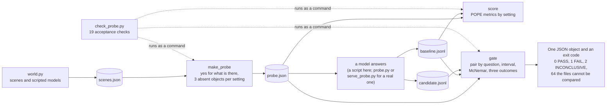

# Module 03: Capstone Project: A Hallucination Probe and Release Gate

> **Prerequisites:** [Module 00](../00-connectors-and-training-recipes/README.md) to [Module 02](../02-adapting-and-serving-vlms/README.md) of this track, and the paired gate of [Track 18, Module 01](../../18-evaluation-harnesses-and-benchmarks/01-evaluation-in-practice-harnesses-inspect-and-regression-gates/README.md).  
> **Estimated Reading Time:** 30 minutes (specification) / 5-7 hours (implementation and testing)  
> **Target Audience:** AI Backend Engineers, ML Platform Engineers, Model Evaluation Leads

> [!TIP]
> **The Golden Rule of the Hallucination Capstone:** A probe is finished when every rule that builds it has a check that fails when the rule is broken. The models here are scripts, so the whole evaluation can be tested without a GPU, and a gate that has not been shown a model that invents objects, a model that cannot tell colours apart and a second run of an honest model has not been tested.

---

## 1. Problem Statement & Architecture

You will build the evaluation that Module 01 ran on SmolVLM, as three programs that any model can be put behind. A **probe builder** turns scenes (images written down as the objects in them) into POPE-style questions, such as "Is there a red circle in the image?", about every object that is there and about as many that are not, with the absent ones picked three ways. A **scorer** reports POPE's metrics for each way and counts the answers that are neither yes nor no. A **release gate** reads the answers of two models, or two versions of one, to the same probe, and says with an interval whether the candidate is worse than the baseline by more than the team allows.

The models are scripts with known failure modes, so all three programs can be tested offline, deterministically and in CI. A real model goes behind the same seam: Module 01's `probe.py` and Module 02's `serve_probe.py` write answer files in the format that the scorer and the gate read.



The parts come straight from the track: POPE's three ways of picking absent objects and its yes ratio (Module 01), the paired comparison with an interval, McNemar's exact test and an allowed drop (Module 01, after Track 18), and the habit of judging a model by the answers it actually gives, through the files it writes (Module 02).

### The Sample Project

Everything the world is lives in one provided file, `world.py`: 12 objects (four colours times three shapes), scenes of three objects drawn with uneven odds, a seeded generator that gives the same numbers in every language, and four scripted models. Save it as it is. You will not change it, and the checker imports it to rebuild the probe and to make answers.

```python
"""The probe world: scenes of coloured shapes, a seeded generator that gives the same numbers in every language, and scripted vision-language
models with different failure modes. Provided, do not edit.

A "scene" is an image written down: the list of objects in it. The scripted models stand in for a real model, as the scripted agent of
Track 18 stood in for a real agent. Everything you build in the capstone sees them only through the answer files they write.

usage: python world.py scenes --count 40 --seed 5 --out scenes.json
       python world.py answer --agent honest --scenes scenes.json --probe probe.json --out answers.jsonl
"""
import argparse
import json

COLORS = ["red", "green", "blue", "yellow"]
SHAPES = ["circle", "square", "triangle"]
OBJECTS = [f"{c} {s}" for c in COLORS for s in SHAPES]  # 12 objects, in this order
WEIGHTS = {"red circle": 9, "blue square": 8, "green triangle": 6, "yellow circle": 5, "red square": 4, "green circle": 4,
           "blue triangle": 3, "yellow square": 2, "red triangle": 2, "green square": 1, "blue circle": 1, "yellow triangle": 1}
PER_SCENE = 3  # objects in a scene
AGENTS = ["honest", "honest_b", "yes_biased", "attribute_blind"]


class Rng:
    """mulberry32, a small 32-bit generator that gives the same numbers in every language."""

    def __init__(self, seed):
        self.state = seed & 0xFFFFFFFF

    def next(self):
        self.state = (self.state + 0x6D2B79F5) & 0xFFFFFFFF
        t = self.state
        t = ((t ^ (t >> 15)) * (t | 1)) & 0xFFFFFFFF
        t = t ^ ((t + (((t ^ (t >> 7)) * (t | 61)) & 0xFFFFFFFF)) & 0xFFFFFFFF)
        return ((t ^ (t >> 14)) & 0xFFFFFFFF) / 4294967296.0


def stable_hash(text):
    """FNV-1a, 32 bits, over the UTF-8 bytes: the same in every language."""
    h = 2166136261
    for byte in text.encode("utf-8"):
        h = ((h ^ byte) * 16777619) & 0xFFFFFFFF
    return h


def make_scenes(count, seed):
    """`count` scenes of three different objects each, drawn without replacement with the odds in WEIGHTS."""
    rng = Rng(seed)
    scenes = []
    for image_id in range(count):
        pool, chosen = list(OBJECTS), []
        for _ in range(PER_SCENE):
            point = rng.next() * sum(WEIGHTS[o] for o in pool)
            upto = 0
            for o in pool:
                upto += WEIGHTS[o]
                if point < upto:
                    break
            chosen.append(o)
            pool.remove(o)
        scenes.append({"id": image_id, "objects": chosen})
    return scenes


def agent_answer(agent, scene, obj):
    """What a scripted model answers to 'Is there a <obj> in the image?' about this scene: 'yes' or 'no'.
    honest and honest_b: right 95% of the time, with different noise. yes_biased: says yes to 97% of present objects and to 85% of absent ones.
    attribute_blind: ignores colour, says yes whenever some object in the scene has the same shape, and is wrong 3% of the time."""
    present = scene["objects"]
    u = Rng(stable_hash(f"{agent}:{scene['id']}:{obj}")).next()
    if agent in ("honest", "honest_b"):
        said = obj in present
        return ("no" if said else "yes") if u < 0.05 else ("yes" if said else "no")
    if agent == "yes_biased":
        if obj in present:
            return "no" if u < 0.03 else "yes"
        return "no" if u < 0.15 else "yes"
    if agent == "attribute_blind":
        said = any(p.split(" ")[1] == obj.split(" ")[1] for p in present)
        return ("no" if said else "yes") if u < 0.03 else ("yes" if said else "no")
    raise ValueError(f"unknown agent: {agent}")


def main():
    parser = argparse.ArgumentParser()
    sub = parser.add_subparsers(dest="command", required=True)
    s = sub.add_parser("scenes")
    s.add_argument("--count", type=int, required=True)
    s.add_argument("--seed", type=int, required=True)
    s.add_argument("--out", required=True)
    a = sub.add_parser("answer")
    a.add_argument("--agent", required=True, choices=AGENTS)
    a.add_argument("--scenes", required=True)
    a.add_argument("--probe", required=True)
    a.add_argument("--out", required=True)
    args = parser.parse_args()
    if args.command == "scenes":
        with open(args.out, "w", encoding="utf-8", newline="\n") as out:
            json.dump(make_scenes(args.count, args.seed), out)
        print(f"{args.count} scenes written to {args.out}")
    else:
        scenes = {s["id"]: s for s in json.load(open(args.scenes, encoding="utf-8"))}
        probe = json.load(open(args.probe, encoding="utf-8"))
        with open(args.out, "w", encoding="utf-8", newline="\n") as out:
            for q in probe["questions"]:
                out.write(json.dumps({"qid": q["qid"], "answer": agent_answer(args.agent, scenes[q["image"]], q["object"])}) + "\n")
        print(f"{len(probe['questions'])} answers by {args.agent} written to {args.out}")


if __name__ == "__main__":
    main()
```

The four models are the points of comparison:

| Model | What it does | What a good probe and gate show |
| :--- | :--- | :--- |
| `honest` | Right 95% of the time | An F1 near 0.95 in every setting, and a yes ratio near 50% |
| `honest_b` | The same model with other noise: a second run of `honest` | Against `honest`, not FAIL |
| `yes_biased` | Says yes to 97% of the objects that are there and to 85% of those that are not | A yes ratio above 90% and an accuracy near 55%, the pattern of the models in the POPE paper. FAIL against `honest` |
| `attribute_blind` | Ignores colour: says yes whenever an object of the same shape is there, and is wrong 3% of the time | About ten points worse in the adversarial setting than in the random one, because the adversarial negatives share a colour or a shape with what is there |

Make scenes with `python world.py scenes --count 40 --seed 5 --out scenes.json`, and the answers of a model to your probe with `python world.py answer --agent yes_biased --scenes scenes.json --probe probe.json --out yes_biased.jsonl`.

### The Contract

The three programs are commands, and the checker uses only their files and their output, so you can write them in any language.

**The scenes** that `world.py scenes` writes are a JSON list with one object per scene: `{"id": 0, "objects": ["red circle", "blue square", "green triangle"]}`.

**The probe.** `make_probe --scenes scenes.json --seed 7 --out probe.json` asks these questions about each scene, scene by scene:

| Setting | The questions about one scene | Answer |
| :--- | :--- | :--- |
| All three | Every object that is there | yes |
| `random` | Three absent objects from a partial shuffle. Start from the absent objects in the order of `OBJECTS`, and for k = 0, 1, 2 swap item k with item k + floor(next() x (n - k)), where n is the number of absent objects and next() is the probe's one generator, seeded with `--seed` and shared by all the scenes in order. Take the first three | no |
| `popular` | The three absent objects that are in the most scenes of the whole set, ties broken by name | no |
| `adversarial` | The three absent objects that share a colour or a shape with the most of the objects that are there, ties broken by how many scenes they are in, then by name | no |

A question is one (image, object) pair, with the id `"<image>:<object>"`. A question that more than one setting asks is written once, with every setting it belongs to, in the order random, popular, adversarial. The file is `{"seed": 7, "questions": [...]}`, each question `{"qid", "image", "object", "answer", "settings"}`, sorted by image and then by object name. Names compare by code point, as Python's `sorted` does (`StringComparer.Ordinal` in C#). With 40 scenes every setting has 120 questions about objects that are there and 120 about objects that are not.

**An answer file** has one JSON object per line: `{"qid": "0:red circle", "answer": "yes"}`. An answer other than `"yes"` or `"no"` is invalid.

**The scorer.** `score probe.json answers.jsonl` prints one JSON object, `{"settings": {"random": {...}, "popular": {...}, "adversarial": {...}}, "invalid": 7}`, in which each setting has `questions`, `accuracy`, `precision`, `recall`, `f1`, `yes_ratio` and `invalid`. An invalid answer counts as not yes, which is a miss for an object that is there and a correct no for one that is not, and it is counted, so that a model that stops answering cannot hide. A division by zero gives 0.0. If the answers do not match the probe (a question missing, a question answered twice, or a question the probe does not have), it prints `{"refused": "<why>"}` and exits with code 64.

**The gate.** `gate probe.json baseline.jsonl candidate.jsonl --allowed-drop 0.02 [--setting all|random|popular|adversarial]` prints one JSON object on one line and exits with a code that a CI job can act on:

| Exit code | Meaning |
| :--- | :--- |
| 0 | **PASS**: the whole interval for the change is above minus the allowed drop |
| 1 | **FAIL**: the whole interval is below minus the allowed drop |
| 2 | **INCONCLUSIVE**: the interval straddles it |
| 64 | The files cannot be compared: a file answers a question the probe does not have, or does not answer all of its questions. The object has a `refused` field and no `verdict` |

The object has `verdict`; `setting`; `questions`, the number the comparison used; `difference`, the candidate's accuracy minus the baseline's on those questions, paired by question id; `low` and `high`, the 95% interval, a normal approximation from the per-question differences with the sample variance; `allowed_drop`; `baseline_accuracy` and `candidate_accuracy`; `only_baseline_right` and `only_candidate_right`; and `mcnemar_p`, McNemar's exact two-sided p-value on the questions that only one of them got right.

---

## 2. Requirements Specification & Design Matrices

### Functional Requirements (FR)

| ID | Requirement | Comes from |
| :--- | :--- | :--- |
| **FR1** | Every object that is in a scene is asked about in all three settings with the answer yes, so that each setting is balanced | Module 01, POPE |
| **FR2** | The random negatives come from the partial shuffle of the contract, with one generator seeded by `--seed` and called three times per scene | Module 01, and the seeded runs of Track 18, Module 00 |
| **FR3** | The popular negatives are the absent objects that appear in the most scenes | Module 01, POPE's popular setting |
| **FR4** | The adversarial negatives are the absent objects most like what is there, here by sharing a colour or a shape | Module 01, POPE's adversarial setting, which uses the objects that most often appear together |
| **FR5** | One question per (image, object), with every setting it belongs to, in a fixed order | Module 01, the polling program |
| **FR6** | The scorer reports accuracy, precision, recall, F1 and the yes ratio for each setting, and counts an invalid answer as not yes | Module 01, Metrics, and POPE's yes ratio |
| **FR7** | The scorer refuses answers that do not match the probe | Module 01 |
| **FR8** | The gate pairs the two files by question id, never by position | Module 01, the paired comparison |
| **FR9** | The gate's interval is the normal approximation over the per-question differences, and it reports McNemar's exact p-value | Module 01, `paired_interval` and `mcnemar_exact` |
| **FR10** | Three outcomes, decided by comparing the whole interval with an allowed drop that is an argument, with the exit codes of the contract | Module 01, the gate |
| **FR11** | The gate can compare one setting's questions, and says which it compared | Module 01, a verdict per set |

### Non-Functional Requirements (NFR)

| ID | Requirement | How it is measured |
| :--- | :--- | :--- |
| **NFR1** | No network, no GPU and no model: all three programs run offline | The checker runs them with nothing else |
| **NFR2** | Deterministic: one seed gives one probe, byte for byte | The `random-seeded` check |
| **NFR3** | Fast: a probe, the scores and the gates in seconds | The whole checker takes about 1.4 seconds on the Python reference solution, on a laptop |
| **NFR4** | No magic numbers: the seed and the allowed drop are arguments, and the number of absent objects per setting, the z value and the exit codes are named constants | Read your code, and the `margin-is-an-input` check |
| **NFR5** | The scorer and the gate print only their JSON object on standard output | The checker parses it |
| **NFR6** | A refusal names the problem: which question or which file, and why | Read what your programs print for a refused file |

### Technology & Implementation Choices Matrix

| Choice | Options | What this capstone requires |
| :--- | :--- | :--- |
| **Language** | Python, Go, TypeScript or C# | Any. The checker starts your programs as commands, and the starters are in all four. `world.py` stays Python: the checker imports it, and your programs only read the files it writes |
| **Random generator** | The language's own, or a named algorithm | **mulberry32**, given in every starter. The checker rebuilds the probe and compares the random negatives question by question |
| **How absent objects are picked** | Shuffle the whole list, sample with replacement, or a partial shuffle | The **partial shuffle** of the contract, three steps per scene. One call to the generator more or less changes every scene after it |
| **Unit of pairing** | Line by line, or by question id | **By question id**: answer files come in any order, from a batch job or from a server |
| **Interval** | A normal approximation, or a bootstrap | The **normal approximation** of Module 01, on 240 questions per setting. A bootstrap over images is the stretch, because questions about one image are not independent |
| **Invalid answers** | Drop them, count them as wrong, or count them as not yes | In the scorer, **as not yes, and reported**: POPE's yes ratio needs every answer, and a model that stops answering must not look better. In the gate, an invalid answer is simply not the right one |
| **Where the margin lives** | A constant in the code, or an argument | An **argument** (`--allowed-drop`), chosen before the run and printed in the result |

### Deliverable & Empirical Evidence Matrix

| Deliverable | Evidence it works | How it is checked |
| :--- | :--- | :--- |
| `make_probe` | A balanced probe with the right answers, the negatives of the contract in each setting, the same on every run with one seed | Checks 1 to 7 |
| `score` | Metrics that match an independent calculation, invalid answers counted, mismatched answers refused | Checks 8 to 10 |
| The scripted models through your probe | The honest model scores well, the yes bias shows in the yes ratio, and the adversarial setting exposes the model that ignores colour | Checks 11 to 13 |
| `gate` | FAIL for a model that invents objects, not FAIL for a second honest run, pairing by question, refusal of another probe's answers, and the margin and the setting as inputs | Checks 14 to 19 |
| Failure drills | For each drill, the check that catches it, with its output | Section 3 |
| Decision memo | The verdicts, the intervals and a recommendation, with what was not tested | Section 6 |

---

## 3. Failure Drills (Mandatory Verification)

A check that has never failed has not been shown to work. For each drill below, make the change in a **copy** of your working solution, run `python check_probe.py`, confirm that the named check fails, and keep the output as evidence. Then undo the change. These eight breakages are the ones the checker was built to catch: before this module was published, each was made in the reference solution, and each was caught by the check named.

| # | Break this | The check that must fail |
| :--- | :--- | :--- |
| D1 | Ask about six absent objects in the random setting instead of three | `balanced` |
| D2 | Give every question the answer yes | `truth-is-right` |
| D3 | Pick the popular negatives by the odds the scenes were drawn with (`WEIGHTS`), not by how many of these scenes each object is in | `popular-is-popular` |
| D4 | Pick the adversarial negatives the way the popular ones are picked, without looking at how alike the objects are | `adversarial-is-adversarial` |
| D5 | Seed the generator with a constant instead of `--seed` | `random-seeded` |
| D6 | Stop reporting invalid answers | `score-invalid-counted` |
| D7 | Stop reporting the yes ratio | `score-hand-computed` and `yes-bias-shows` |
| D8 | Pair the two answer files by position in the file instead of by question id | `gate-pairs-by-question` |

This is what the checker printed for two of them on the reference solution. D8 leaves the difference in accuracy unchanged and moves only the interval, which is why the check compares the difference and both ends of the interval:

```text
PASS  shape: every question has its fields, ids are unique, in order, and each setting is one of the three
PASS  balanced: in every setting as many questions about objects that are there as about objects that are not, three of each for every scene
PASS  truth-is-right: the answer is yes exactly when the object is in the scene
PASS  random-exact: the random negatives are the first three of the partial shuffle, advancing the generator three times per scene
PASS  popular-is-popular: the popular negatives are the three absent objects that are in the most scenes, ties by name
PASS  adversarial-is-adversarial: the adversarial negatives are the three absent objects most like those that are there
PASS  random-seeded: one seed gives one probe, byte for byte, and another seed gives other random negatives
PASS  score-hand-computed: accuracy, precision, recall, F1 and the yes ratio of every setting match an independent calculation
PASS  score-invalid-counted: an answer that is neither yes nor no is counted as invalid, and counts as not yes
PASS  score-refuses-mismatched-answers: a missing, a repeated and a foreign question are refused (exit code 64, no scores)
PASS  honest-is-good: a model that is right 95% of the time scores an F1 of at least 0.9 in every setting
PASS  yes-bias-shows: a model that says yes to most things answers yes at least 80% of the time and is right at most 65% of the time, in every setting
PASS  adversarial-exposes-shape-matching: a model that ignores colour does at least 0.08 worse in the adversarial setting than in the random one
PASS  gate-flags-hallucination: a model that invents objects is FAIL against an honest one, exit code 1
PASS  gate-no-false-alarm: another run of an honest model is not FAIL
FAIL  gate-pairs-by-question: shuffling the lines of an answer file changes nothing
        (difference, low, high) (-0.5417, -0.5966, -0.4868) against (-0.5417, -0.5982, -0.4852)
PASS  gate-refuses-another-probe: answers to the questions of another probe are not compared (exit code 64, no verdict)
PASS  margin-is-an-input: the same hallucination with an allowed drop of 0.9 is not FAIL, and the margin is reported
PASS  setting-is-honoured: with --setting adversarial the gate looks at the 240 questions of that setting

18 of 19 checks passed
```

D7 removes the one number that shows a yes bias. A scorer without it reports a model that says yes to 91% of the questions with nothing to flag it, and two checks notice:

```text
PASS  shape: every question has its fields, ids are unique, in order, and each setting is one of the three
PASS  balanced: in every setting as many questions about objects that are there as about objects that are not, three of each for every scene
PASS  truth-is-right: the answer is yes exactly when the object is in the scene
PASS  random-exact: the random negatives are the first three of the partial shuffle, advancing the generator three times per scene
PASS  popular-is-popular: the popular negatives are the three absent objects that are in the most scenes, ties by name
PASS  adversarial-is-adversarial: the adversarial negatives are the three absent objects most like those that are there
PASS  random-seeded: one seed gives one probe, byte for byte, and another seed gives other random negatives
FAIL  score-hand-computed: accuracy, precision, recall, F1 and the yes ratio of every setting match an independent calculation
        yours {'questions': 240, 'accuracy': 0.9667, 'precision': 0.9746, 'recall': 0.9583, 'f1': 0.9664, 'invalid': 2}, reference {'questions': 240, 'accuracy': 0.9666666666666667, 'precision': 0.9745762711864406, 'recall': 0.9583333333333334, 'f1': 0.9663865546218487, 'yes_ratio': 0.49166666666666664, 'invalid': 2}
PASS  score-invalid-counted: an answer that is neither yes nor no is counted as invalid, and counts as not yes
PASS  score-refuses-mismatched-answers: a missing, a repeated and a foreign question are refused (exit code 64, no scores)
PASS  honest-is-good: a model that is right 95% of the time scores an F1 of at least 0.9 in every setting
FAIL  yes-bias-shows: a model that says yes to most things answers yes at least 80% of the time and is right at most 65% of the time, in every setting
        {'random': {'questions': 240, 'accuracy': 0.55, 'precision': 0.5275, 'recall': 0.9583, 'f1': 0.6805, 'invalid': 0}, 'popular': {'questions': 240, 'accuracy': 0.5458, 'precision': 0.5251, 'recall': 0.9583, 'f1': 0.6785, 'invalid': 0}, 'adversarial': {'questions': 240, 'accuracy': 0.5458, 'precision': 0.5251, 'recall': 0.9583, 'f1': 0.6785, 'invalid': 0}}
PASS  adversarial-exposes-shape-matching: a model that ignores colour does at least 0.08 worse in the adversarial setting than in the random one
PASS  gate-flags-hallucination: a model that invents objects is FAIL against an honest one, exit code 1
PASS  gate-no-false-alarm: another run of an honest model is not FAIL
PASS  gate-pairs-by-question: shuffling the lines of an answer file changes nothing
PASS  gate-refuses-another-probe: answers to the questions of another probe are not compared (exit code 64, no verdict)
PASS  margin-is-an-input: the same hallucination with an allowed drop of 0.9 is not FAIL, and the margin is reported
PASS  setting-is-honoured: with --setting adversarial the gate looks at the 240 questions of that setting

17 of 19 checks passed
```

---

## 4. Multi-Language Starter (TODO Scaffolds, Not a Full Solution)

Make a folder with `world.py` from Section 1, and write the three programs in it. Each starter reads its arguments and its input files and writes its output in the format of the contract. The rules and the statistics are yours. The probe builder carries the generator, mulberry32, in each language: do not change it.

### The Probe Builder, in Four Languages

The Python tab is `make_probe.py`.

````carousel

```go
// Build a POPE-style probe from scenes: yes/no questions "Is there a <object> in the image?".
//
// Usage:
//
//	go run make_probe.go --scenes scenes.json --seed 7 --out probe.json
package main

import (
	"encoding/json"
	"flag"
	"fmt"
	"os"
	"slices"
)

var (
	colors   = []string{"red", "green", "blue", "yellow"}
	shapes   = []string{"circle", "square", "triangle"}
	settings = []string{"random", "popular", "adversarial"}
)

// perSetting is the number of absent objects per scene in each setting, and as many present ones.
const perSetting = 3

type scene struct {
	ID      int      `json:"id"`
	Objects []string `json:"objects"`
}

type question struct {
	QID      string   `json:"qid"`
	Image    int      `json:"image"`
	Object   string   `json:"object"`
	Answer   string   `json:"answer"`
	Settings []string `json:"settings"`
}

type probe struct {
	Seed      int        `json:"seed"`
	Questions []question `json:"questions"`
}

// rng is mulberry32: the same numbers in every language. Provided, do not change.
type rng struct{ state uint32 }

func (r *rng) next() float64 {
	r.state += 0x6D2B79F5
	t := r.state
	t = (t ^ (t >> 15)) * (t | 1)
	t ^= t + (t^(t>>7))*(t|61)
	return float64(t^(t>>14)) / 4294967296.0
}

// objects returns the 12 objects, colour by colour, in this order.
func objects() []string {
	var out []string
	for _, c := range colors {
		for _, s := range shapes {
			out = append(out, c+" "+s)
		}
	}
	return out
}

func build(scenes []scene, seed int) probe {
	r := &rng{state: uint32(seed)}
	questions := map[string]*question{}

	ask := func(image int, object, answer, setting string) {
		// TODO 1: keep one question for each (image, object) with the qid "<image>:<object>", and record every setting it belongs to.
		panic("TODO 1: ask")
	}

	// TODO 2: how many scenes is each object in? The popular and adversarial rules need it.
	for _, sc := range scenes {
		present := sc.Objects
		var absent []string
		for _, o := range objects() {
			if !slices.Contains(present, o) {
				absent = append(absent, o)
			}
		}
		// TODO 3: a question for every object that is there, in all three settings. The answer is "yes".
		// TODO 4: the random negatives: three absent objects, with the generator (Section 1 gives the rule).
		// TODO 5: the popular negatives: three absent objects (Section 1 gives the rule).
		// TODO 6: the adversarial negatives: three absent objects (Section 1 gives the rule).
		_, _, _ = absent, r, ask
	}
	// TODO 7: the questions sorted by (image, object), and each question's settings in the order of settings.
	_ = questions
	return probe{Seed: seed, Questions: []question{}}
}

func main() {
	scenesPath := flag.String("scenes", "", "the scenes, as written by world.py")
	seed := flag.Int("seed", 0, "the seed of the random negatives")
	out := flag.String("out", "", "where to write the probe")
	flag.Parse()
	if *scenesPath == "" || *out == "" {
		fmt.Fprintln(os.Stderr, "usage: go run make_probe.go --scenes scenes.json --seed 7 --out probe.json")
		os.Exit(2)
	}
	data, err := os.ReadFile(*scenesPath)
	if err != nil {
		fmt.Fprintln(os.Stderr, err)
		os.Exit(2)
	}
	var scenes []scene
	if err := json.Unmarshal(data, &scenes); err != nil {
		fmt.Fprintln(os.Stderr, err)
		os.Exit(2)
	}
	p := build(scenes, *seed)
	encoded, err := json.Marshal(p)
	if err == nil {
		err = os.WriteFile(*out, encoded, 0o644)
	}
	if err != nil {
		fmt.Fprintln(os.Stderr, err)
		os.Exit(2)
	}
	fmt.Printf("%d questions written to %s\n", len(p.Questions), *out)
}
```

<!-- slide -->

```typescript
// Build a POPE-style probe from scenes: yes/no questions "Is there a <object> in the image?".
// usage: node make_probe.ts --scenes scenes.json --seed 7 --out probe.json   (Node 24 or newer)
import { readFileSync, writeFileSync } from "node:fs";

const COLORS = ["red", "green", "blue", "yellow"];
const SHAPES = ["circle", "square", "triangle"];
const OBJECTS = COLORS.flatMap((c) => SHAPES.map((s) => `${c} ${s}`)); // 12 objects, in this order
const SETTINGS = ["random", "popular", "adversarial"];
const PER_SETTING = 3; // absent objects per scene in each setting, and as many present ones

type Scene = { id: number; objects: string[] };
type Question = { qid: string; image: number; object: string; answer: string; settings: string[] };

/** mulberry32: the same numbers in every language. Provided, do not change. */
class Rng {
  state: number;
  constructor(seed: number) {
    this.state = seed >>> 0;
  }
  next(): number {
    this.state = (this.state + 0x6d2b79f5) >>> 0;
    let t = this.state;
    t = Math.imul(t ^ (t >>> 15), t | 1);
    t ^= t + Math.imul(t ^ (t >>> 7), t | 61);
    return ((t ^ (t >>> 14)) >>> 0) / 4294967296;
  }
}

function build(scenes: Scene[], seed: number): { seed: number; questions: Question[] } {
  const rng = new Rng(seed);
  const questions = new Map<string, Question>();

  const ask = (image: number, object: string, answer: string, setting: string): void => {
    // TODO 1: keep one question for each (image, object) with the qid "<image>:<object>", and record every setting it belongs to.
    throw new Error("TODO 1: ask");
  };

  // TODO 2: how many scenes is each object in? The popular and adversarial rules need it.
  for (const scene of scenes) {
    const present = scene.objects;
    const absent = OBJECTS.filter((o) => !present.includes(o));
    // TODO 3: a question for every object that is there, in all three settings. The answer is "yes".
    // TODO 4: the random negatives: three absent objects, with the generator (Section 1 gives the rule).
    // TODO 5: the popular negatives: three absent objects (Section 1 gives the rule).
    // TODO 6: the adversarial negatives: three absent objects (Section 1 gives the rule).
    void absent;
    void rng;
    void ask;
  }
  // TODO 7: the questions sorted by (image, object), and each question's settings in the order of SETTINGS.
  void PER_SETTING;
  void SETTINGS;
  return { seed, questions: [] };
}

function option(name: string): string {
  const at = process.argv.indexOf(name);
  if (at < 0 || at + 1 >= process.argv.length) {
    console.error("usage: node make_probe.ts --scenes scenes.json --seed 7 --out probe.json");
    process.exit(2);
  }
  return process.argv[at + 1];
}

const probe = build(JSON.parse(readFileSync(option("--scenes"), "utf-8")), Number(option("--seed")));
writeFileSync(option("--out"), JSON.stringify(probe));
console.log(`${probe.questions.length} questions written to ${option("--out")}`);
```

<!-- slide -->

```python
"""Build a POPE-style probe from scenes: yes/no questions "Is there a <object> in the image?".

usage: python make_probe.py --scenes scenes.json --seed 7 --out probe.json
"""
import argparse
import json

COLORS = ["red", "green", "blue", "yellow"]
SHAPES = ["circle", "square", "triangle"]
OBJECTS = [f"{c} {s}" for c in COLORS for s in SHAPES]  # 12 objects, in this order
SETTINGS = ["random", "popular", "adversarial"]
PER_SETTING = 3  # absent objects per scene in each setting, and as many present ones


class Rng:
    """mulberry32: the same numbers in every language. Provided, do not change."""

    def __init__(self, seed):
        self.state = seed & 0xFFFFFFFF

    def next(self):
        self.state = (self.state + 0x6D2B79F5) & 0xFFFFFFFF
        t = self.state
        t = ((t ^ (t >> 15)) * (t | 1)) & 0xFFFFFFFF
        t = t ^ ((t + (((t ^ (t >> 7)) * (t | 61)) & 0xFFFFFFFF)) & 0xFFFFFFFF)
        return ((t ^ (t >> 14)) & 0xFFFFFFFF) / 4294967296.0


def build(scenes, seed):
    """{"seed": seed, "questions": [...]}: each question is {"qid", "image", "object", "answer", "settings"}."""
    rng = Rng(seed)
    questions = {}

    def ask(image, obj, answer, setting):
        # TODO 1: keep one question for each (image, object) with the qid "<image>:<object>", and record every setting it belongs to.
        raise NotImplementedError("ask")

    # TODO 2: how many scenes is each object in? The popular and adversarial rules need it.
    for scene in scenes:
        present = scene["objects"]
        absent = [o for o in OBJECTS if o not in present]
        # TODO 3: a question for every object that is there, in all three settings. The answer is "yes".
        # TODO 4: the random negatives: three absent objects, with the generator (Section 1 gives the rule).
        # TODO 5: the popular negatives: three absent objects (Section 1 gives the rule).
        # TODO 6: the adversarial negatives: three absent objects (Section 1 gives the rule).
    # TODO 7: the questions sorted by (image, object), and each question's settings in the order of SETTINGS.
    return {"seed": seed, "questions": []}


def main():
    parser = argparse.ArgumentParser()
    parser.add_argument("--scenes", required=True)
    parser.add_argument("--seed", type=int, required=True)
    parser.add_argument("--out", required=True)
    args = parser.parse_args()
    probe = build(json.load(open(args.scenes, encoding="utf-8")), args.seed)
    with open(args.out, "w", encoding="utf-8", newline="\n") as out:
        json.dump(probe, out)
    print(f"{len(probe['questions'])} questions written to {args.out}")


main()
```

<!-- slide -->

```csharp
// Build a POPE-style probe from scenes: yes/no questions "Is there a <object> in the image?".
// usage: dotnet run MakeProbe.cs -- --scenes scenes.json --seed 7 --out probe.json   (.NET 10 SDK)
using System;
using System.Collections.Generic;
using System.Globalization;
using System.IO;
using System.Linq;
using System.Text.Json;

string[] colors = { "red", "green", "blue", "yellow" };
string[] shapes = { "circle", "square", "triangle" };
string[] settings = { "random", "popular", "adversarial" };
const int PerSetting = 3; // absent objects per scene in each setting, and as many present ones
var objects = colors.SelectMany(c => shapes.Select(s => $"{c} {s}")).ToArray(); // 12 objects, in this order

string Option(string name)
{
    int at = Array.IndexOf(args, name);
    if (at < 0 || at + 1 >= args.Length)
    {
        Console.Error.WriteLine("usage: dotnet run MakeProbe.cs -- --scenes scenes.json --seed 7 --out probe.json");
        Environment.Exit(2);
    }
    return args[at + 1];
}

// The scenes, read with JsonDocument (a file-based app has reflection-based JSON turned off).
List<Scene> ReadScenes(string path)
{
    using var document = JsonDocument.Parse(File.ReadAllText(path));
    return document.RootElement.EnumerateArray()
        .Select(s => new Scene(s.GetProperty("id").GetInt32(), s.GetProperty("objects").EnumerateArray().Select(o => o.GetString()!).ToList()))
        .ToList();
}

List<Question> Build(List<Scene> scenes, uint seed)
{
    var rng = new Rng(seed);
    var questions = new Dictionary<string, Question>();

    Action<int, string, string, string> ask = (image, obj, answer, setting) =>
        // TODO 1: keep one question for each (image, object) with the qid "<image>:<object>", and record every setting it belongs to.
        throw new NotImplementedException("TODO 1: ask");

    // TODO 2: how many scenes is each object in? The popular and adversarial rules need it.
    foreach (var scene in scenes)
    {
        var present = scene.Objects;
        var absent = objects.Where(o => !present.Contains(o)).ToList();
        // TODO 3: a question for every object that is there, in all three settings. The answer is "yes".
        // TODO 4: the random negatives: three absent objects, with the generator (Section 1 gives the rule).
        // TODO 5: the popular negatives: three absent objects (Section 1 gives the rule).
        // TODO 6: the adversarial negatives: three absent objects (Section 1 gives the rule).
        _ = (absent, rng, ask);
    }
    // TODO 7: the questions sorted by (image, object), and each question's settings in the order of settings.
    // Compare names with StringComparer.Ordinal, the order every other language uses.
    _ = (questions, PerSetting, settings);
    return new List<Question>();
}

void WriteProbe(string path, uint seed, List<Question> questions)
{
    using var stream = File.Create(path);
    using var json = new Utf8JsonWriter(stream);
    json.WriteStartObject();
    json.WriteNumber("seed", seed);
    json.WriteStartArray("questions");
    foreach (var q in questions)
    {
        json.WriteStartObject();
        json.WriteString("qid", q.Qid);
        json.WriteNumber("image", q.Image);
        json.WriteString("object", q.Object);
        json.WriteString("answer", q.Answer);
        json.WriteStartArray("settings");
        foreach (var s in q.Settings) json.WriteStringValue(s);
        json.WriteEndArray();
        json.WriteEndObject();
    }
    json.WriteEndArray();
    json.WriteEndObject();
}

var outPath = Option("--out");
var seed = uint.Parse(Option("--seed"), CultureInfo.InvariantCulture);
var probe = Build(ReadScenes(Option("--scenes")), seed);
WriteProbe(outPath, seed, probe);
Console.WriteLine($"{probe.Count} questions written to {outPath}");

record Scene(int Id, List<string> Objects);

record Question(string Qid, int Image, string Object, string Answer, List<string> Settings);

// mulberry32: the same numbers in every language. Provided, do not change.
class Rng
{
    private uint state;
    public Rng(uint seed) { state = seed; }
    public double Next()
    {
        unchecked
        {
            state += 0x6D2B79F5u;
            uint t = state;
            t = (t ^ (t >> 15)) * (t | 1u);
            t ^= t + (t ^ (t >> 7)) * (t | 61u);
            return (t ^ (t >> 14)) / 4294967296.0;
        }
    }
}
```

````

### The Scorer, in Four Languages

The Python tab is `score.py`.

````carousel

```go
// Score a model's answers to a probe with POPE's metrics, for each of the three settings.
//
// Usage:
//
//	go run score.go probe.json answers.jsonl
//
// Prints one JSON object. Exit code 0, or 64 if the answers do not match the probe (a question missing, unknown or answered twice).
package main

import (
	"bufio"
	"encoding/json"
	"fmt"
	"os"
	"strings"
)

const refused = 64

var settings = []string{"random", "popular", "adversarial"}

type question struct {
	QID      string   `json:"qid"`
	Image    int      `json:"image"`
	Object   string   `json:"object"`
	Answer   string   `json:"answer"`
	Settings []string `json:"settings"`
}

type probe struct {
	Questions []question `json:"questions"`
}

// metrics is the row of one setting.
type metrics struct {
	Questions int     `json:"questions"`
	Accuracy  float64 `json:"accuracy"`
	Precision float64 `json:"precision"`
	Recall    float64 `json:"recall"`
	F1        float64 `json:"f1"`
	YesRatio  float64 `json:"yes_ratio"`
	Invalid   int     `json:"invalid"`
}

type report struct {
	Settings map[string]metrics `json:"settings"`
	Invalid  int                `json:"invalid"`
}

func refuse(reason string) {
	encoded, _ := json.Marshal(map[string]string{"refused": reason})
	fmt.Println(string(encoded))
	os.Exit(refused)
}

// loadAnswers returns {qid: "yes" | "no" | "invalid"} for every question of the probe.
func loadAnswers(path string, p probe) map[string]string {
	file, err := os.Open(path)
	if err != nil {
		fmt.Fprintln(os.Stderr, err)
		os.Exit(2)
	}
	defer file.Close()
	answers := map[string]string{}
	lines := bufio.NewScanner(file)
	for lines.Scan() {
		if strings.TrimSpace(lines.Text()) == "" {
			continue
		}
		var row struct {
			QID    string `json:"qid"`
			Answer string `json:"answer"`
		}
		if err := json.Unmarshal(lines.Bytes(), &row); err != nil {
			fmt.Fprintln(os.Stderr, err)
			os.Exit(2)
		}
		// TODO 1: refuse an answer to a question that is not in the probe, and a question answered twice.
		// TODO 2: an answer that is neither "yes" nor "no" is "invalid".
		answers[row.QID] = row.Answer
	}
	// TODO 3: refuse if a question of the probe has no answer.
	_ = p
	return answers
}

// score returns the metrics of every setting and the number of invalid answers in all.
func score(p probe, answers map[string]string) report {
	// TODO 4: for each setting count true positives, false positives, false negatives and true negatives ("invalid" counts as not yes),
	// then the five metrics. A division by zero is 0.0.
	_, _ = p, answers
	return report{Settings: map[string]metrics{}, Invalid: 0}
}

func main() {
	if len(os.Args) != 3 {
		fmt.Fprintln(os.Stderr, "usage: go run score.go probe.json answers.jsonl")
		os.Exit(2)
	}
	data, err := os.ReadFile(os.Args[1])
	if err != nil {
		fmt.Fprintln(os.Stderr, err)
		os.Exit(2)
	}
	var p probe
	if err := json.Unmarshal(data, &p); err != nil {
		fmt.Fprintln(os.Stderr, err)
		os.Exit(2)
	}
	encoded, _ := json.Marshal(score(p, loadAnswers(os.Args[2], p)))
	fmt.Println(string(encoded))
}
```

<!-- slide -->

```typescript
// Score a model's answers to a probe with POPE's metrics, for each of the three settings.
// usage: node score.ts probe.json answers.jsonl   (Node 24 or newer)
// Prints one JSON object. Exit code 0, or 64 if the answers do not match the probe (a question missing, unknown or answered twice).
import { readFileSync } from "node:fs";

const SETTINGS = ["random", "popular", "adversarial"];
const REFUSED = 64;

type Question = { qid: string; image: number; object: string; answer: string; settings: string[] };
type Probe = { questions: Question[] };

function refuse(reason: string): never {
  console.log(JSON.stringify({ refused: reason }));
  process.exit(REFUSED);
}

/** {qid: "yes" | "no" | "invalid"} for every question of the probe. */
function loadAnswers(path: string, probe: Probe): Map<string, string> {
  const answers = new Map<string, string>();
  for (const line of readFileSync(path, "utf-8").split("\n")) {
    if (line.trim() === "") continue;
    const row = JSON.parse(line);
    // TODO 1: refuse an answer to a question that is not in the probe, and a question answered twice.
    // TODO 2: an answer that is neither "yes" nor "no" is "invalid".
    answers.set(row.qid, row.answer);
  }
  // TODO 3: refuse if a question of the probe has no answer.
  void probe;
  void refuse;
  return answers;
}

/** {settings: {setting: {questions, accuracy, precision, recall, f1, yes_ratio, invalid}}, invalid: total} */
function score(probe: Probe, answers: Map<string, string>): object {
  // TODO 4: for each setting count true positives, false positives, false negatives and true negatives ("invalid" counts as not yes),
  // then the five metrics. A division by zero is 0.0.
  void SETTINGS;
  void answers;
  void probe;
  return { settings: {}, invalid: 0 };
}

if (process.argv.length !== 4) {
  console.error("usage: node score.ts probe.json answers.jsonl");
  process.exit(2);
}
const probe: Probe = JSON.parse(readFileSync(process.argv[2], "utf-8"));
console.log(JSON.stringify(score(probe, loadAnswers(process.argv[3], probe))));
```

<!-- slide -->

```python
"""Score a model's answers to a probe with POPE's metrics, for each of the three settings.

usage: python score.py probe.json answers.jsonl
Prints one JSON object. Exit code 0, or 64 if the answers do not match the probe (a question missing, unknown or answered twice).
"""
import json
import sys

SETTINGS = ["random", "popular", "adversarial"]
REFUSED = 64


def refuse(reason):
    print(json.dumps({"refused": reason}))
    sys.exit(REFUSED)


def load_answers(path, probe):
    """{qid: "yes" | "no" | "invalid"} for every question of the probe."""
    answers = {}
    for line in open(path, encoding="utf-8"):
        if line.strip():
            row = json.loads(line)
            # TODO 1: refuse an answer to a question that is not in the probe, and a question answered twice.
            # TODO 2: an answer that is neither "yes" nor "no" is "invalid".
            answers[row["qid"]] = row["answer"]
    # TODO 3: refuse if a question of the probe has no answer.
    return answers


def score(probe, answers):
    """{"settings": {setting: {questions, accuracy, precision, recall, f1, yes_ratio, invalid}}, "invalid": total}"""
    # TODO 4: for each setting count true positives, false positives, false negatives and true negatives ("invalid" counts as not yes),
    # then the five metrics. A division by zero is 0.0.
    return {"settings": {}, "invalid": 0}


def main():
    if len(sys.argv) != 3:
        sys.exit("usage: python score.py probe.json answers.jsonl")
    probe = json.load(open(sys.argv[1], encoding="utf-8"))
    print(json.dumps(score(probe, load_answers(sys.argv[2], probe))))


main()
```

<!-- slide -->

```csharp
// Score a model's answers to a probe with POPE's metrics, for each of the three settings.
// usage: dotnet run Score.cs -- probe.json answers.jsonl   (.NET 10 SDK)
// Prints one JSON object. Exit code 0, or 64 if the answers do not match the probe (a question missing, unknown or answered twice).
using System;
using System.Collections.Generic;
using System.IO;
using System.Linq;
using System.Text.Json;

string[] settings = { "random", "popular", "adversarial" };
const int Refused = 64;

void Refuse(string reason)
{
    Console.WriteLine($"{{\"refused\": \"{JsonEncodedText.Encode(reason)}\"}}");
    Environment.Exit(Refused);
}

// The questions of the probe, read with JsonDocument (a file-based app has reflection-based JSON turned off).
List<Question> ReadProbe(string path)
{
    if (!File.Exists(path)) Refuse("cannot read " + path);
    using var document = JsonDocument.Parse(File.ReadAllText(path));
    return document.RootElement.GetProperty("questions").EnumerateArray()
        .Select(q => new Question(q.GetProperty("qid").GetString()!, q.GetProperty("answer").GetString()!,
                                  q.GetProperty("settings").EnumerateArray().Select(s => s.GetString()!).ToList()))
        .ToList();
}

// {qid: "yes" | "no" | "invalid"} for every question of the probe.
Dictionary<string, string> LoadAnswers(string path, List<Question> probe)
{
    if (!File.Exists(path)) Refuse("cannot read " + path);
    var answers = new Dictionary<string, string>();
    foreach (var line in File.ReadLines(path))
    {
        if (line.Trim() == "") continue;
        using var row = JsonDocument.Parse(line);
        var qid = row.RootElement.GetProperty("qid").GetString()!;
        var answer = row.RootElement.GetProperty("answer").GetString()!;
        // TODO 1: refuse an answer to a question that is not in the probe, and a question answered twice.
        // TODO 2: an answer that is neither "yes" nor "no" is "invalid".
        answers[qid] = answer;
    }
    // TODO 3: refuse if a question of the probe has no answer.
    _ = probe;
    return answers;
}

// {"settings": {setting: {questions, accuracy, precision, recall, f1, yes_ratio, invalid}}, "invalid": total}, as JSON text.
// (Write it with Utf8JsonWriter or by hand, with CultureInfo.InvariantCulture for the numbers; JsonSerializer does not work here.)
string Score(List<Question> probe, Dictionary<string, string> answers)
{
    // TODO 4: for each setting count true positives, false positives, false negatives and true negatives ("invalid" counts as not yes),
    // then the five metrics. A division by zero is 0.0.
    _ = (probe, answers, settings);
    return "{\"settings\": {}, \"invalid\": 0}";
}

if (args.Length != 2)
{
    Console.Error.WriteLine("usage: dotnet run Score.cs -- probe.json answers.jsonl");
    Environment.Exit(2);
}
var questions = ReadProbe(args[0]);
Console.WriteLine(Score(questions, LoadAnswers(args[1], questions)));

record Question(string Qid, string Answer, List<string> Settings);
```

````

### The Gate, in Four Languages

The Python tab is `gate.py`.

````carousel

```go
// A release gate for a vision-language model on a probe: is the candidate worse than the baseline by more than we allow?
//
// Usage:
//
//	go run gate.go probe.json baseline.jsonl candidate.jsonl --allowed-drop 0.02 [--setting all|random|popular|adversarial]
//
// Pairs the two answer files by question and prints one JSON object. Exit code: 0 PASS, 1 FAIL, 2 INCONCLUSIVE, 64 the files cannot be compared.
package main

import (
	"encoding/json"
	"fmt"
	"math"
	"os"
	"slices"
	"strconv"
)

var exitCodes = map[string]int{"PASS": 0, "FAIL": 1, "INCONCLUSIVE": 2}

const (
	refused = 64
	z       = 1.96
)

type question struct {
	QID      string   `json:"qid"`
	Image    int      `json:"image"`
	Object   string   `json:"object"`
	Answer   string   `json:"answer"`
	Settings []string `json:"settings"`
}

type probe struct {
	Questions []question `json:"questions"`
}

func refuse(reason string) {
	encoded, _ := json.Marshal(map[string]string{"refused": reason})
	fmt.Println(string(encoded))
	os.Exit(refused)
}

// correctByQuestion returns {qid: 1 if the answer was right else 0} for the questions in members.
func correctByQuestion(p probe, path string, members []string) map[string]int {
	// TODO 1: read the file; refuse (exit 64) if it answers a question that is not in the probe, or does not answer exactly the questions of the probe.
	// Pair by qid, never by the position of a line in the file.
	panic("TODO 1: correctByQuestion")
}

// mcnemarExact is the exact two-sided p-value that the questions that flipped are equally likely to flip either way.
func mcnemarExact(onlyFirst, onlySecond int) float64 {
	// TODO 2: the binomial tail with p = 0.5, without a statistics package.
	panic("TODO 2: mcnemarExact")
}

// verdict is FAIL, PASS or INCONCLUSIVE: compare the whole interval with minus the allowed drop.
func verdict(low, high, allowedDrop float64) string {
	// TODO 3
	panic("TODO 3: verdict")
}

// option returns the value after name on the command line, or "" (the flag package stops at the first file name, so it is not used here).
func option(name string) string {
	for i := 1; i+1 < len(os.Args); i++ {
		if os.Args[i] == name {
			return os.Args[i+1]
		}
	}
	return ""
}

func main() {
	setting := option("--setting")
	if setting == "" {
		setting = "all"
	}
	allowedDrop, err := strconv.ParseFloat(option("--allowed-drop"), 64)
	if len(os.Args) < 4 || err != nil || !slices.Contains([]string{"all", "random", "popular", "adversarial"}, setting) {
		fmt.Fprintln(os.Stderr, "usage: go run gate.go probe.json baseline.jsonl candidate.jsonl --allowed-drop 0.02 [--setting all|random|popular|adversarial]")
		os.Exit(2)
	}
	probePath, baselinePath, candidatePath := os.Args[1], os.Args[2], os.Args[3]
	data, err := os.ReadFile(probePath)
	if err != nil {
		fmt.Fprintln(os.Stderr, err)
		os.Exit(2)
	}
	var p probe
	if err := json.Unmarshal(data, &p); err != nil {
		fmt.Fprintln(os.Stderr, err)
		os.Exit(2)
	}
	// TODO 4: the questions of the chosen setting ("all" is every question), and what each file got right on them.
	// TODO 5: the paired difference in accuracy (candidate minus baseline) with a 95% interval from the per-question differences
	//         (normal approximation, the sample variance), the number of questions only one of them got right, and McNemar's p-value.
	// TODO 6: print one JSON object with: verdict, setting, questions, difference, low, high, allowed_drop, baseline_accuracy,
	//         candidate_accuracy, only_baseline_right, only_candidate_right, mcnemar_p; and exit with the code of the verdict.
	_, _, _, _ = baselinePath, candidatePath, allowedDrop, p
	_, _, _ = exitCodes, z, math.Sqrt
	_, _, _ = correctByQuestion, mcnemarExact, verdict
	panic("TODO: the gate")
}
```

<!-- slide -->

```typescript
// A release gate for a vision-language model on a probe: is the candidate worse than the baseline by more than we allow?
// usage: node gate.ts probe.json baseline.jsonl candidate.jsonl --allowed-drop 0.02 [--setting all|random|popular|adversarial]   (Node 24 or newer)
// Pairs the two answer files by question and prints one JSON object. Exit code: 0 PASS, 1 FAIL, 2 INCONCLUSIVE, 64 the files cannot be compared.
import { readFileSync } from "node:fs";

const EXIT_CODES: Record<string, number> = { PASS: 0, FAIL: 1, INCONCLUSIVE: 2 };
const REFUSED = 64;
const Z = 1.96;

type Question = { qid: string; image: number; object: string; answer: string; settings: string[] };
type Probe = { questions: Question[] };

function refuse(reason: string): never {
  console.log(JSON.stringify({ refused: reason }));
  process.exit(REFUSED);
}

/** {qid: 1 if the answer was right else 0} for the questions in `members`. */
function correctByQuestion(probe: Probe, path: string, members: string[]): Map<string, number> {
  // TODO 1: read the file; refuse (exit 64) if it answers a question that is not in the probe, or does not answer exactly the questions of the probe.
  // Pair by qid, never by the position of a line in the file.
  void probe;
  void path;
  void members;
  void refuse;
  throw new Error("TODO 1: correctByQuestion");
}

/** Exact two-sided p-value that the questions that flipped are equally likely to flip either way. */
function mcnemarExact(onlyFirst: number, onlySecond: number): number {
  // TODO 2: the binomial tail with p = 0.5, without a statistics package.
  void onlyFirst;
  void onlySecond;
  throw new Error("TODO 2: mcnemarExact");
}

/** FAIL, PASS or INCONCLUSIVE: compare the whole interval with minus the allowed drop. */
function verdict(low: number, high: number, allowedDrop: number): string {
  // TODO 3
  void low;
  void high;
  void allowedDrop;
  throw new Error("TODO 3: verdict");
}

function option(name: string): string {
  const at = process.argv.indexOf(name);
  return at >= 0 && at + 1 < process.argv.length ? process.argv[at + 1] : "";
}

const [probePath, baselinePath, candidatePath] = process.argv.slice(2, 5);
const allowedDrop = Number(option("--allowed-drop"));
const setting = option("--setting") || "all";
if (!candidatePath || option("--allowed-drop") === "" || !["all", "random", "popular", "adversarial"].includes(setting)) {
  console.error("usage: node gate.ts probe.json baseline.jsonl candidate.jsonl --allowed-drop 0.02 [--setting all|random|popular|adversarial]");
  process.exit(2);
}
const probe: Probe = JSON.parse(readFileSync(probePath, "utf-8"));
// TODO 4: the questions of the chosen setting ("all" is every question), and what each file got right on them.
// TODO 5: the paired difference in accuracy (candidate minus baseline) with a 95% interval from the per-question differences
//         (normal approximation, the sample variance), the number of questions only one of them got right, and McNemar's p-value.
// TODO 6: print one JSON object with: verdict, setting, questions, difference, low, high, allowed_drop, baseline_accuracy,
//         candidate_accuracy, only_baseline_right, only_candidate_right, mcnemar_p; and exit with the code of the verdict.
void [baselinePath, allowedDrop, probe, EXIT_CODES, Z, correctByQuestion, mcnemarExact, verdict];
throw new Error("TODO: the gate");
```

<!-- slide -->

```python
"""A release gate for a vision-language model on a probe: is the candidate worse than the baseline by more than we allow?

usage: python gate.py probe.json baseline.jsonl candidate.jsonl --allowed-drop 0.02 [--setting all|random|popular|adversarial]
Pairs the two answer files by question and prints one JSON object. Exit code: 0 PASS, 1 FAIL, 2 INCONCLUSIVE, 64 the files cannot be compared.
"""
import argparse
import json
import math
import sys

EXIT_CODES = {"PASS": 0, "FAIL": 1, "INCONCLUSIVE": 2}
REFUSED = 64
Z = 1.96


def refuse(reason):
    print(json.dumps({"refused": reason}))
    sys.exit(REFUSED)


def correct_by_question(probe, path, members):
    """{qid: 1 if the answer was right else 0} for the questions in `members`."""
    # TODO 1: read the file; refuse (exit 64) if it answers a question that is not in the probe, or does not answer exactly the questions of the probe.
    # Pair by qid, never by the position of a line in the file.
    raise NotImplementedError("correct_by_question")


def mcnemar_exact(only_first, only_second):
    """Exact two-sided p-value that the questions that flipped are equally likely to flip either way."""
    # TODO 2: the binomial tail with p = 0.5, without a statistics package.
    raise NotImplementedError("mcnemar_exact")


def verdict(low, high, allowed_drop):
    """FAIL, PASS or INCONCLUSIVE: compare the whole interval with minus the allowed drop."""
    # TODO 3
    raise NotImplementedError("verdict")


def main():
    parser = argparse.ArgumentParser()
    parser.add_argument("probe")
    parser.add_argument("baseline")
    parser.add_argument("candidate")
    parser.add_argument("--allowed-drop", type=float, required=True)
    parser.add_argument("--setting", default="all", choices=["all", "random", "popular", "adversarial"])
    args = parser.parse_args()
    probe = json.load(open(args.probe, encoding="utf-8"))
    # TODO 4: the questions of the chosen setting ("all" is every question), and what each file got right on them.
    # TODO 5: the paired difference in accuracy (candidate minus baseline) with a 95% interval from the per-question differences
    #         (normal approximation, the sample variance), the number of questions only one of them got right, and McNemar's p-value.
    # TODO 6: print one JSON object with: verdict, setting, questions, difference, low, high, allowed_drop, baseline_accuracy,
    #         candidate_accuracy, only_baseline_right, only_candidate_right, mcnemar_p; and exit with the code of the verdict.
    raise NotImplementedError("gate")


main()
```

<!-- slide -->

```csharp
// A release gate for a vision-language model on a probe: is the candidate worse than the baseline by more than we allow?
// usage: dotnet run Gate.cs -- probe.json baseline.jsonl candidate.jsonl --allowed-drop 0.02 [--setting all|random|popular|adversarial]   (.NET 10 SDK)
// Pairs the two answer files by question and prints one JSON object. Exit code: 0 PASS, 1 FAIL, 2 INCONCLUSIVE, 64 the files cannot be compared.
using System;
using System.Collections.Generic;
using System.Globalization;
using System.IO;
using System.Linq;
using System.Text.Json;

var exitCodes = new Dictionary<string, int> { ["PASS"] = 0, ["FAIL"] = 1, ["INCONCLUSIVE"] = 2 };
const int Refused = 64;
const double Z = 1.96;
var inv = CultureInfo.InvariantCulture;

void Refuse(string reason)
{
    Console.WriteLine($"{{\"refused\": \"{JsonEncodedText.Encode(reason)}\"}}");
    Environment.Exit(Refused);
}

// The questions of the probe, read with JsonDocument (a file-based app has reflection-based JSON turned off).
List<Question> ReadProbe(string path)
{
    if (!File.Exists(path)) Refuse("cannot read " + path);
    using var document = JsonDocument.Parse(File.ReadAllText(path));
    return document.RootElement.GetProperty("questions").EnumerateArray()
        .Select(q => new Question(q.GetProperty("qid").GetString()!, q.GetProperty("answer").GetString()!,
                                  q.GetProperty("settings").EnumerateArray().Select(s => s.GetString()!).ToList()))
        .ToList();
}

// TODO 1: {qid: 1 if the answer was right else 0} for the questions in members. Read the file; refuse (exit 64) if it answers a question
// that is not in the probe, or does not answer exactly the questions of the probe. Pair by qid, never by the position of a line in the file.
Func<List<Question>, string, List<string>, Dictionary<string, int>> correctByQuestion = (probe, path, members) =>
    throw new NotImplementedException("TODO 1: correctByQuestion");

// TODO 2: the exact two-sided p-value that the questions that flipped are equally likely to flip either way: the binomial tail with p = 0.5.
Func<int, int, double> mcnemarExact = (onlyFirst, onlySecond) => throw new NotImplementedException("TODO 2: mcnemarExact");

// TODO 3: FAIL, PASS or INCONCLUSIVE: compare the whole interval with minus the allowed drop.
Func<double, double, double, string> verdict = (low, high, allowedDrop) => throw new NotImplementedException("TODO 3: verdict");

var paths = new List<string>();
double? drop = null;
var setting = "all";
for (int i = 0; i < args.Length; i++)
{
    if (args[i] == "--allowed-drop" && i + 1 < args.Length) drop = double.Parse(args[++i], inv);
    else if (args[i] == "--setting" && i + 1 < args.Length) setting = args[++i];
    else paths.Add(args[i]);
}
if (paths.Count != 3 || drop is null || !new[] { "all", "random", "popular", "adversarial" }.Contains(setting))
{
    Console.Error.WriteLine("usage: dotnet run Gate.cs -- probe.json baseline.jsonl candidate.jsonl --allowed-drop 0.02 [--setting all|random|popular|adversarial]");
    Environment.Exit(2);
}
var questions = ReadProbe(paths[0]);
// TODO 4: the questions of the chosen setting ("all" is every question), and what each file got right on them.
// TODO 5: the paired difference in accuracy (candidate minus baseline) with a 95% interval from the per-question differences
//         (normal approximation, the sample variance), the number of questions only one of them got right, and McNemar's p-value.
// TODO 6: print one JSON object with: verdict, setting, questions, difference, low, high, allowed_drop, baseline_accuracy,
//         candidate_accuracy, only_baseline_right, only_candidate_right, mcnemar_p; and exit with the code of the verdict.
_ = (questions, drop, exitCodes, Z, correctByQuestion, mcnemarExact, verdict);
throw new NotImplementedException("TODO 4: the gate");

record Question(string Qid, string Answer, List<string> Settings);
```

````

Each starter compiles and runs. Until its TODOs are filled, the probe builder writes a probe with no questions, the scorer prints empty scores, and the gate stops with a message that names what is missing, so the checker reports 0 of 19 in every language. Run them with `go run make_probe.go`, `node make_probe.ts` (Node 24 or newer), `python make_probe.py` or `dotnet run MakeProbe.cs --` (.NET 10 SDK), and the same for the other two, and tell the checker which with `MAKE_PROBE_CMD`, `SCORE_CMD` and `GATE_CMD`:

```bash
MAKE_PROBE_CMD="go run make_probe.go" SCORE_CMD="go run score.go" GATE_CMD="go run gate.go" python check_probe.py
MAKE_PROBE_CMD="dotnet run MakeProbe.cs --" SCORE_CMD="dotnet run Score.cs --" GATE_CMD="dotnet run Gate.cs --" python check_probe.py
```

---

## 5. Automated Acceptance Verification CLI Checks

Save this as `check_probe.py` in the same folder. It starts your programs as commands (set `MAKE_PROBE_CMD`, `SCORE_CMD` and `GATE_CMD` if they are not the Python defaults), builds its own scenes, rebuilds the probe with its own copy of the rules, writes answers with the scripted models and with some it makes up, and compares your results with its own calculation.

```python
"""Acceptance checks for the capstone: a probe builder, a scorer and a release gate, run as commands. usage: python check_probe.py

Run it in the folder that holds world.py and your three programs. It starts them as commands, so they can be written in any language:
    MAKE_PROBE_CMD="go run make_probe.go"  SCORE_CMD="go run score.go"  GATE_CMD="go run gate.go"  python check_probe.py
(the defaults are "python make_probe.py", "python score.py" and "python gate.py"). It needs nothing from your code but the files and what
the programs print.
"""
import json
import os
import pathlib
import random
import shlex
import subprocess
import sys
import tempfile

import world

HERE = pathlib.Path(__file__).resolve().parent
MAKE = shlex.split(os.environ.get("MAKE_PROBE_CMD", "python make_probe.py"))
SCORE = shlex.split(os.environ.get("SCORE_CMD", "python score.py"))
GATE = shlex.split(os.environ.get("GATE_CMD", "python gate.py"))
WORK = pathlib.Path(tempfile.mkdtemp(prefix="probe-"))
SETTINGS = ["random", "popular", "adversarial"]
SEED = 7
results = []


def check(name, ok, detail=""):
    results.append(bool(ok))
    print(("PASS  " if ok else "FAIL  ") + name + ("" if ok else f"\n        {detail}"))


def run(command, *args):
    return subprocess.run(command + [str(a) for a in args], capture_output=True, text=True, cwd=HERE)


def json_of(result):
    try:
        return json.loads(result.stdout)
    except ValueError:
        return {}


# ---- the probe the programs should build, written again here with the same rules ----
def reference_probe(scenes, seed):
    rng = world.Rng(seed)
    count = {o: sum(1 for s in scenes if o in s["objects"]) for o in world.OBJECTS}
    questions = {}

    def ask(image, obj, answer, setting):
        q = questions.setdefault(f"{image}:{obj}", {"qid": f"{image}:{obj}", "image": image, "object": obj, "answer": answer, "settings": []})
        if setting not in q["settings"]:
            q["settings"].append(setting)

    def overlap(obj, present):
        return sum(1 for p in present if p.split(" ")[0] == obj.split(" ")[0] or p.split(" ")[1] == obj.split(" ")[1])

    for scene in scenes:
        present = scene["objects"]
        absent = [o for o in world.OBJECTS if o not in present]
        for setting in SETTINGS:
            for obj in present:
                ask(scene["id"], obj, "yes", setting)
        pool = list(absent)
        for k in range(3):
            j = k + int(rng.next() * (len(pool) - k))
            pool[k], pool[j] = pool[j], pool[k]
        for obj in pool[:3]:
            ask(scene["id"], obj, "no", "random")
        for obj in sorted(absent, key=lambda o: (-count[o], o))[:3]:
            ask(scene["id"], obj, "no", "popular")
        for obj in sorted(absent, key=lambda o: (-overlap(o, present), -count[o], o))[:3]:
            ask(scene["id"], obj, "no", "adversarial")
    ordered = sorted(questions.values(), key=lambda q: (q["image"], q["object"]))
    for q in ordered:
        q["settings"] = [s for s in SETTINGS if s in q["settings"]]
    return {"seed": seed, "questions": ordered}


def reference_scores(probe, answers):
    """POPE's metrics by setting, with an answer that is not yes or no counted as invalid and as not yes."""
    out = {}
    for setting in SETTINGS:
        tp = fp = fn = tn = invalid = 0
        for q in probe["questions"]:
            if setting in q["settings"]:
                said = answers[q["qid"]]
                invalid += said not in ("yes", "no")
                tp += q["answer"] == "yes" and said == "yes"
                fn += q["answer"] == "yes" and said != "yes"
                fp += q["answer"] == "no" and said == "yes"
                tn += q["answer"] == "no" and said != "yes"
        n = tp + fp + fn + tn
        p, r = (tp / (tp + fp) if tp + fp else 0.0), (tp / (tp + fn) if tp + fn else 0.0)
        out[setting] = {"questions": n, "accuracy": (tp + tn) / n, "precision": p, "recall": r, "f1": 2 * p * r / (p + r) if p + r else 0.0, "yes_ratio": (tp + fp) / n, "invalid": invalid}
    return out


def write_lines(path, rows):
    path.write_text("".join(json.dumps(r) + "\n" for r in rows), encoding="utf-8")


def answers_of(agent, scenes_by_id, probe, path):
    write_lines(path, [{"qid": q["qid"], "answer": world.agent_answer(agent, scenes_by_id[q["image"]], q["object"])} for q in probe["questions"]])
    return path


scenes = world.make_scenes(40, 5)
by_id = {s["id"]: s for s in scenes}
scenes_file = WORK / "scenes.json"
scenes_file.write_text(json.dumps(scenes), encoding="utf-8")
expected = reference_probe(scenes, SEED)

# ---- the probe builder ----
probe_file = WORK / "probe.json"
r = run(MAKE, "--scenes", scenes_file, "--seed", SEED, "--out", probe_file)
probe = json.loads(probe_file.read_text(encoding="utf-8")) if probe_file.exists() else {"questions": []}
qs = probe["questions"]
check("shape: every question has its fields, ids are unique, in order, and each setting is one of the three",
      r.returncode == 0 and qs and all({"qid", "image", "object", "answer", "settings"} <= set(q) for q in qs) and len({q["qid"] for q in qs}) == len(qs)
      and [(q["image"], q["object"]) for q in qs] == sorted((q["image"], q["object"]) for q in qs) and all(q["settings"] and set(q["settings"]) <= set(SETTINGS) for q in qs),
      f"exit code {r.returncode}, {len(qs)} questions. {r.stderr.strip()[-200:]}")
sizes = {s: (sum(1 for q in qs if s in q["settings"] and q["answer"] == "yes"), sum(1 for q in qs if s in q["settings"] and q["answer"] == "no")) for s in SETTINGS}
check("balanced: in every setting as many questions about objects that are there as about objects that are not, three of each for every scene",
      qs and all(sizes[s] == (120, 120) for s in SETTINGS), f"(yes, no) by setting: {sizes}")
wrong = [q["qid"] for q in qs if (q["answer"] == "yes") != (q["object"] in by_id[q["image"]]["objects"])]
check("truth-is-right: the answer is yes exactly when the object is in the scene", qs and not wrong, f"{len(wrong)} questions have the wrong answer, such as {wrong[:3]}")


def negatives(p, setting):
    return sorted(q["qid"] for q in p["questions"] if q["answer"] == "no" and setting in q["settings"])


for setting, name in [("random", "random-exact: the random negatives are the first three of the partial shuffle, advancing the generator three times per scene"),
                      ("popular", "popular-is-popular: the popular negatives are the three absent objects that are in the most scenes, ties by name"),
                      ("adversarial", "adversarial-is-adversarial: the adversarial negatives are the three absent objects most like those that are there")]:
    check(name, qs and negatives(probe, setting) == negatives(expected, setting), f"{len(set(negatives(probe, setting)) ^ set(negatives(expected, setting)))} questions differ from the reference")
again = WORK / "probe-again.json"
other_seed = WORK / "probe-seed8.json"
run(MAKE, "--scenes", scenes_file, "--seed", SEED, "--out", again)
run(MAKE, "--scenes", scenes_file, "--seed", SEED + 1, "--out", other_seed)
check("random-seeded: one seed gives one probe, byte for byte, and another seed gives other random negatives",
      probe_file.exists() and again.exists() and other_seed.exists() and probe_file.read_bytes() == again.read_bytes()
      and negatives(json.loads(other_seed.read_text(encoding="utf-8")), "random") != negatives(probe, "random"), "the probe does not follow the seed")

# ---- the scorer, on a probe and answers made here ----
ref_file = WORK / "reference-probe.json"
ref_file.write_text(json.dumps(expected), encoding="utf-8")
honest = world.agent_answer
rows = [{"qid": q["qid"], "answer": honest("honest", by_id[q["image"]], q["object"])} for q in expected["questions"]]
for i in (3, 40, 100, 150, 210, 300, 350):
    rows[i]["answer"] = "maybe"  # answers that are neither yes nor no
answers_file = WORK / "answers-with-invalid.jsonl"
write_lines(answers_file, rows)
said = {row["qid"]: row["answer"] for row in rows}
want = reference_scores(expected, said)
got = json_of(run(SCORE, ref_file, answers_file))
close = lambda a, b: abs(a - b) < 1e-3
check("score-hand-computed: accuracy, precision, recall, F1 and the yes ratio of every setting match an independent calculation",
      got.get("settings") and all(close(got["settings"].get(s, {}).get(k, -9), want[s][k]) for s in SETTINGS for k in ("accuracy", "precision", "recall", "f1", "yes_ratio")),
      f"yours {got.get('settings', {}).get('adversarial')}, reference {want['adversarial']}")
check("score-invalid-counted: an answer that is neither yes nor no is counted as invalid, and counts as not yes",
      got.get("invalid") == 7 and all(got["settings"].get(s, {}).get("invalid") == want[s]["invalid"] for s in SETTINGS), f"invalid {got.get('invalid')} in total, {[got.get('settings', {}).get(s, {}).get('invalid') for s in SETTINGS]} by setting")
broken = []
for label, lines in (("a question is missing", [json.dumps(r) for r in rows[:-1]]), ("a question is answered twice", [json.dumps(r) for r in rows] + [json.dumps(rows[0])]),
                     ("a question of another probe", [json.dumps(r) for r in rows] + [json.dumps({"qid": "999:red circle", "answer": "yes"})])):
    path = WORK / "broken.jsonl"
    path.write_text("\n".join(lines) + "\n", encoding="utf-8")
    result = run(SCORE, ref_file, path)
    if result.returncode != 64 or "settings" in json_of(result):
        broken.append(label)
check("score-refuses-mismatched-answers: a missing, a repeated and a foreign question are refused (exit code 64, no scores)", not broken, f"not refused: {broken}")

# ---- the three scripted models through your probe ----
files = {a: answers_of(a, by_id, probe, WORK / f"{a}.jsonl") for a in world.AGENTS}
scored = {a: json_of(run(SCORE, probe_file, files[a])).get("settings", {}) for a in files}
check("honest-is-good: a model that is right 95% of the time scores an F1 of at least 0.9 in every setting", scored["honest"] and all(scored["honest"].get(s, {}).get("f1", 0) >= 0.9 for s in SETTINGS), f"{ {s: scored['honest'].get(s, {}).get('f1') for s in SETTINGS} }")
check("yes-bias-shows: a model that says yes to most things answers yes at least 80% of the time and is right at most 65% of the time, in every setting",
      scored["yes_biased"] and all(scored["yes_biased"].get(s, {}).get("yes_ratio", 0) >= 0.8 and scored["yes_biased"].get(s, {}).get("accuracy", 1) <= 0.65 for s in SETTINGS), f"{scored['yes_biased']}")
blind = scored["attribute_blind"]
check("adversarial-exposes-shape-matching: a model that ignores colour does at least 0.08 worse in the adversarial setting than in the random one",
      blind and blind.get("adversarial", {}).get("accuracy", 1) <= blind.get("random", {}).get("accuracy", 0) - 0.08, f"random {blind.get('random', {}).get('accuracy')}, adversarial {blind.get('adversarial', {}).get('accuracy')}")


# ---- the gate ----
def gate(baseline, candidate, allowed_drop=0.02, *extra, probe_path=probe_file):
    result = run(GATE, probe_path, baseline, candidate, "--allowed-drop", allowed_drop, *extra)
    return result.returncode, json_of(result)


code, out = gate(files["honest"], files["yes_biased"])
check("gate-flags-hallucination: a model that invents objects is FAIL against an honest one, exit code 1", code == 1 and out.get("verdict") == "FAIL", f"exit code {code}, verdict {out.get('verdict')}")
code, out = gate(files["honest"], files["honest_b"])
check("gate-no-false-alarm: another run of an honest model is not FAIL", code in (0, 2) and out.get("verdict") in ("PASS", "INCONCLUSIVE"), f"exit code {code}, verdict {out.get('verdict')}")
lines = files["yes_biased"].read_text(encoding="utf-8").splitlines()
random.Random(5).shuffle(lines)
shuffled = WORK / "shuffled.jsonl"
shuffled.write_text("\n".join(lines) + "\n", encoding="utf-8")
plain, mixed = gate(files["honest"], files["yes_biased"]), gate(files["honest"], shuffled)
check("gate-pairs-by-question: shuffling the lines of an answer file changes nothing", plain == mixed and plain[1] != {}, f"(difference, low, high) {tuple(plain[1].get(x) for x in ('difference', 'low', 'high'))} against {tuple(mixed[1].get(x) for x in ('difference', 'low', 'high'))}")
scenes2 = world.make_scenes(40, 6)
foreign_probe = reference_probe(scenes2, SEED)
foreign = answers_of("honest", {s["id"]: s for s in scenes2}, foreign_probe, WORK / "foreign.jsonl")
code, out = gate(files["honest"], foreign)
check("gate-refuses-another-probe: answers to the questions of another probe are not compared (exit code 64, no verdict)", code == 64 and "verdict" not in out, f"exit code {code}, verdict {out.get('verdict')}")
code, out = gate(files["honest"], files["yes_biased"], 0.9)
check("margin-is-an-input: the same hallucination with an allowed drop of 0.9 is not FAIL, and the margin is reported", code in (0, 2) and out.get("allowed_drop") == 0.9, f"exit code {code}, verdict {out.get('verdict')}, allowed_drop {out.get('allowed_drop')}")
code, out = gate(files["honest"], files["attribute_blind"], 0.02, "--setting", "adversarial")
check("setting-is-honoured: with --setting adversarial the gate looks at the 240 questions of that setting", out.get("setting") == "adversarial" and out.get("questions") == 240, f"setting {out.get('setting')}, questions {out.get('questions')}")

print(f"\n{sum(results)} of {len(results)} checks passed")
sys.exit(0 if all(results) else 1)
```

```bash
python check_probe.py
```

A finished solution prints this. It is the output of the reference solution:

```text
PASS  shape: every question has its fields, ids are unique, in order, and each setting is one of the three
PASS  balanced: in every setting as many questions about objects that are there as about objects that are not, three of each for every scene
PASS  truth-is-right: the answer is yes exactly when the object is in the scene
PASS  random-exact: the random negatives are the first three of the partial shuffle, advancing the generator three times per scene
PASS  popular-is-popular: the popular negatives are the three absent objects that are in the most scenes, ties by name
PASS  adversarial-is-adversarial: the adversarial negatives are the three absent objects most like those that are there
PASS  random-seeded: one seed gives one probe, byte for byte, and another seed gives other random negatives
PASS  score-hand-computed: accuracy, precision, recall, F1 and the yes ratio of every setting match an independent calculation
PASS  score-invalid-counted: an answer that is neither yes nor no is counted as invalid, and counts as not yes
PASS  score-refuses-mismatched-answers: a missing, a repeated and a foreign question are refused (exit code 64, no scores)
PASS  honest-is-good: a model that is right 95% of the time scores an F1 of at least 0.9 in every setting
PASS  yes-bias-shows: a model that says yes to most things answers yes at least 80% of the time and is right at most 65% of the time, in every setting
PASS  adversarial-exposes-shape-matching: a model that ignores colour does at least 0.08 worse in the adversarial setting than in the random one
PASS  gate-flags-hallucination: a model that invents objects is FAIL against an honest one, exit code 1
PASS  gate-no-false-alarm: another run of an honest model is not FAIL
PASS  gate-pairs-by-question: shuffling the lines of an answer file changes nothing
PASS  gate-refuses-another-probe: answers to the questions of another probe are not compared (exit code 64, no verdict)
PASS  margin-is-an-input: the same hallucination with an allowed drop of 0.9 is not FAIL, and the margin is reported
PASS  setting-is-honoured: with --setting adversarial the gate looks at the 240 questions of that setting

19 of 19 checks passed
```

The checker was also run against a TypeScript port of the reference solution, written only to test the checker, and the port passed all 19 checks. The checker judges your programs by their files and their output, not by their language.

### What Each Check Protects

| Checks | What they protect | Where to look when one fails |
| :--- | :--- | :--- |
| `shape`, `balanced`, `truth-is-right` | The probe has the questions it should, with the right answers, and as many yes as no in every setting | `ask`, and the loop over the objects that are there |
| `random-exact`, `random-seeded` | The random negatives follow the generator exactly, and the seed is used | The partial shuffle: one generator for the whole probe, three calls per scene, in scene order |
| `popular-is-popular`, `adversarial-is-adversarial` | The two harder settings pick what the contract says | The counts over the scenes, the overlap, and the ties |
| `score-hand-computed`, `score-invalid-counted` | The five metrics and the invalid count are right in every setting | The four counts, and what an invalid answer counts as |
| `score-refuses-mismatched-answers` | Answers that do not belong to the probe are not scored | Reading the answers: missing, repeated and unknown questions |
| `honest-is-good`, `yes-bias-shows`, `adversarial-exposes-shape-matching` | Your probe and your scorer together tell the scripted models apart, the way POPE tells real ones apart | Usually the probe: a setting with the wrong negatives cannot expose the model that ignores colour |
| `gate-flags-hallucination`, `gate-no-false-alarm` | The gate separates a model that invents objects from a second run of an honest one | The sign of the difference, and the verdict |
| `gate-pairs-by-question` | Questions are paired by id | How the two files are lined up |
| `gate-refuses-another-probe` | Answers to another probe's questions are not compared | `correct_by_question` |
| `margin-is-an-input`, `setting-is-honoured` | The allowed drop and the setting are the caller's decisions | Where the verdict gets its margin, and which questions are compared |

---

## 6. Milestone Checklist, Evaluation Rubric & Design Hints

### Milestone Execution Checklist

1. **The probe builder (60 to 90 minutes).** Fill TODO 1 to 7 of `make_probe`. When `shape`, `balanced`, `truth-is-right`, `random-exact`, `popular-is-popular`, `adversarial-is-adversarial` and `random-seeded` pass, you have a probe you can trust.
2. **The scorer (45 minutes).** Fill TODO 1 to 4 of `score`. Check one number by hand: with the probe of scenes seed 5 and probe seed 7, `yes_biased` says yes in the random setting to 115 of the 120 objects that are there and to 103 of the 120 that are not, so its accuracy is (115 + 17) / 240 = 0.55, its precision 115 / 218 = 0.5275 and its yes ratio 218 / 240 = 0.9083.
3. **The scripted models (15 minutes).** No new code. `honest-is-good`, `yes-bias-shows` and `adversarial-exposes-shape-matching` pass once the probe and the scorer are right. If they fail while the checks before them pass, look at the settings of your questions.
4. **The gate (60 minutes).** Fill TODO 1 to 6 of `gate`. The six gate checks should pass, including the refusal.
5. **The failure drills (60 minutes).** Do D1 to D8 and keep the output of each. If a drill is *not* caught, the checker has a hole: say so, and write the check that closes it.
6. **The decision memo (45 minutes).** With the scenes of seed 5 and the probe of seed 7, gate `honest` against `yes_biased`, against `attribute_blind` and against `honest_b`, on all questions and on each setting, at an allowed drop of 0.02 and of 0.05. Write ten lines: the verdicts, the intervals, what changed when the margin moved, which setting told you most, and what you would ship. The reference solution gives, on all 360 questions at an allowed drop of 0.02: `yes_biased` FAIL, a difference of -0.5417 with an interval of [-0.5966, -0.4868]; `attribute_blind` FAIL, -0.4083 [-0.4642, -0.3525]; `honest_b` INCONCLUSIVE, -0.0056 [-0.0383, 0.0272]. At 0.05 the tie becomes PASS on all questions but stays INCONCLUSIVE on the random setting alone, -0.0167 [-0.0583, 0.025].
7. **Stretch (optional).** Add an interval that resamples images instead of questions, because the questions about one image are not independent (Module 01, exercise 5), and compare its width with the gate's. Or put a real model behind the seam: give each object of a scene a cell, draw the scene with Module 01's `render`, answer the probe's questions with the loop of `probe.py` or through a server with Module 02's `serve_probe.py`, and gate prompt 2 against prompt 1.

### Grading & Self-Evaluation Rubric (100 Points)

| Area | Points | Full marks when |
| :--- | ---: | :--- |
| Acceptance checks | 40 | All 19 checks pass (about 2.1 points each) |
| Failure drills | 15 | All eight drills done, each with the output that shows the named check failing |
| Statistical correctness | 15 | Pairing by question, the sample variance, McNemar's test without a statistics package, three outcomes, and one number recomputed by hand and shown to match |
| Code quality | 15 | No magic numbers, JSON only on standard output, refusals that name the problem, and the scripted models kept out of the probe builder and the gate |
| Decision memo | 15 | The verdicts and intervals are right, INCONCLUSIVE is explained, the recommendation follows from them, and what was not tested is stated |

### Design Hints

- **The generator:** one `Rng(seed)` for the whole probe, called three times per scene, in scene order. `Rng(7)` gives 0.011704753153026104, 0.06195825757458806 and 0.97690763277933 as its first three numbers. A port that gives anything else will disagree with the checker.
- **The partial shuffle:** j = k + floor(next() x (n - k)), with n the number of absent objects (9 in a scene of three), then swap items k and j. Do not sort the absent objects first, and do not shuffle the whole list: both change which three are picked.
- **Counts and ties:** count once, before the loop, how many scenes each object is in. Sort the absent objects by that count, most first, then by name; for the adversarial setting sort by the overlap first.
- **One question per pair:** keep the questions in a map keyed by qid, and add a setting to a question that is already there instead of making a second one.
- **McNemar:** with b and c the questions that only one model got right, the p-value is twice the binomial tail P(X <= min(b, c)) for X ~ Binomial(b + c, 0.5), capped at 1. Compute the terms as a running product that starts at 0.5 to the power b + c and is multiplied by (n - i + 1) / i, as Module 01's `mcnemar_exact` does: factorials overflow.
- **The interval:** the per-question differences are -1, 0 or +1. Their mean is the difference in accuracy, and the half-width is 1.96 times the square root of s squared over n, with s squared the sample variance (divide by n - 1).
- **JSON and exit codes:** round to four decimals, print the JSON, then exit with the code of the verdict. In Node, set `process.exitCode` rather than calling `process.exit()` right after printing: `process.exit()` can cut short output that is still being written to a pipe.

---

## 7. Operational Validation Checkpoints

<details><summary><strong>Checkpoint 1: INCONCLUSIVE for a tie</strong></summary>

You gate `honest` against `honest_b` at an allowed drop of 0.02, and the gate says INCONCLUSIVE. A teammate says the gate is broken, because the two are the same model. What do you say?

**Validation:** The gate is right. The two differ only in their noise, and 360 questions cannot show that to within two points: the difference is -0.0056 with an interval of [-0.0383, 0.0272], which holds zero and also a drop bigger than 0.02. INCONCLUSIVE means the data cannot tell. More questions narrow the interval, and they should come from more scenes rather than more questions per scene, because questions about one scene are correlated. The other lever is the margin, chosen for a reason and written down: at 0.05 the same comparison is PASS.

</details>

<details><summary><strong>Checkpoint 2: Random passes, adversarial does not</strong></summary>

A fine-tuned model passes the gate on the random and popular settings and is INCONCLUSIVE on the adversarial one, as the adapter of Module 02 was. What do you tell the team?

**Validation:** The adversarial setting asks about objects like the ones in the picture, which is where a model that has learned to say yes more often invents objects. Module 02's adapter found 46 more of the objects that were there and gave 35 more false yeses on the adversarial set, and the interval there could not rule out a loss beyond the margin. Report the verdict for each setting, never only the pooled one, and either gate the release on the adversarial setting or collect the questions it would take to settle it (Module 01's n to settle) before shipping.

</details>

<details><summary><strong>Checkpoint 3: A real model behind the seam</strong></summary>

You replace the scripted model with a vision-language model behind an API. What stops being true, and what must you add?

**Validation:** The answers are no longer a function of the model's name, the scene and the object. They depend on the weights and their precision, the processor's settings, the prompt and the server (Module 02), so record all of them with each answer file, and run the probe through the interface you serve. The probe builder, the scorer and the gate do not change: they read files. Two things need more care. Questions about one image are not independent, so widen the interval or resample images. And a real model can answer something that is neither yes nor no, so watch the invalid count, which the scripted models never produce.

</details>

---

## Further Reading & Sources

- [Evaluating Object Hallucination in Large Vision-Language Models (Li, Du, Zhou, Wang, Zhao and Wen, EMNLP 2023)](https://arxiv.org/abs/2305.10355) — POPE: the polling questions, the three sampling settings, the 1:1 balance, the metrics and the yes ratio that this capstone builds.
- [Are We on the Right Way for Evaluating Large Vision-Language Models? (Chen et al., 2024)](https://arxiv.org/abs/2403.20330) — MMStar: why a probe needs a control that shows the image is used.
- [MMBench: Is Your Multi-modal Model an All-around Player? (Liu et al., 2023)](https://arxiv.org/abs/2307.06281) — CircularEval, another way to keep a model's preference for an answer from passing for perception.
- [Module 00: From Vision Encoder to Language Model](../00-connectors-and-training-recipes/README.md), [Module 01: Evaluating Vision-Language Models](../01-evaluating-vlms-benchmarks-hallucination-and-polling/README.md) and [Module 02: Adapting and Serving Vision-Language Models](../02-adapting-and-serving-vlms/README.md) — the three modules this project assembles.
- [Track 18, Module 03: Build an Evaluation Harness and a Release Gate](../../18-evaluation-harnesses-and-benchmarks/03-capstone-project/README.md) — the same kind of gate for agents, with a bootstrap over tasks.

## Next

[Track 19 overview](../README.md)
