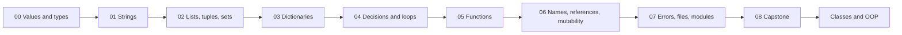

# Track 00: Python Refresher

> **Prerequisites:** None. If you can read a short program in any language, you are ready.  
> **Estimated Reading Time:** about 4 hours for the whole track (20 to 45 minutes per module, with exercises)  
> **Who this is for:** Anyone who has written Python or another language and wants it fresh before classes, larger programs, or a Python interview.  
> **Interview relevance:** Every module ends with the edge cases interviewers ask about, a mini Q&A and a one-page cheat sheet, so the track doubles as a revision plan.

> [!note]
> This track teaches the part of Python you use every single day, and spends the most time on the ideas that cause the most confusion: how strings, lists and dictionaries behave, how functions pass values around, and why two names can point at the same object. That last idea matters more than anything else here, because **objects are the whole idea of the next topic**, [object-oriented programming](../../lld/01-classes-objects-and-oop-building-blocks/README.md).

> [!tip]
> Predict the output of every example *before* you press Run. The gaps you find are exactly the topics worth another look. Then cover each answer in the Mini Q&A sections and say it aloud in two sentences, as you would to an interviewer.

You have written Python before, or you have written code in another language, and you want it fresh in your head before you move on. This track is that: a few hours, deliberately small. It does not teach every feature of the language. It teaches the ones that every later lesson on this site quietly assumes.

## The path



## How this track works

- **Go in order.** Each lesson uses what the one before it taught.
- **Press Run on every example.** Each example is a complete program and runs right here in the page. Then change something and run it again. Predicting what will happen *before* you press Run is the fastest way to find the gaps in what you remember.
- **Every lesson ends the same way:** edge cases with real output, a mini interview Q&A (answers hidden until you want them), a cheat sheet, a few exercises, a short self-check, and links to the official documentation.
- **Everything printed under an example is real.** Each example was run, and its output is what you see.

## Lessons

| # | Lesson | What it covers | Time with exercises |
|---|--------|----------------|---------------------|
| 00 | [Running Python, values and types](00-running-python-values-and-types/README.md) | The three ways to run Python, variables, numbers, text, `True`, `False` and `None` | 20 min |
| 01 | [Strings and text](01-strings-and-text/README.md) | Indexing and slicing, the string methods you actually use, f-strings | 20 min |
| 02 | [Lists, tuples and sets](02-lists-tuples-and-sets/README.md) | Ordered collections, changing them, sorting, and picking the right one | 25 min |
| 03 | [Dictionaries](03-dictionaries/README.md) | Looking things up by key, counting, grouping, and records | 25 min |
| 04 | [Decisions and loops](04-decisions-and-loops/README.md) | `if`, `for`, `while`, `range`, `enumerate`, `zip` and comprehensions | 25 min |
| 05 | [Functions](05-functions/README.md) | Parameters, defaults, return values, scope, and functions as values | 25 min |
| 06 | [Names, references and mutability](06-names-references-and-mutability/README.md) | What a variable really is, why `b = a` can surprise you, and how to copy | 25 min |
| 07 | [Errors, files and modules](07-errors-files-and-modules/README.md) | Reading a traceback, `try`/`except`, reading and writing files, `import` | 25 min |
| 08 | [Capstone: an expense tracker](08-capstone-expense-tracker/README.md) | A small program that uses all of it, and a first look at how it becomes a class | 45 min |

## The ten ideas behind most Python interview questions

| Idea | One line | Where |
|------|----------|-------|
| Names point at objects | `b = a` copies the *name*, not the object | [06](06-names-references-and-mutability/README.md) |
| Mutable vs immutable | Lists, dicts, sets change in place; ints, strings, tuples never do | [06](06-names-references-and-mutability/README.md), [02](02-lists-tuples-and-sets/README.md) |
| `is` vs `==` | Identity versus equal value; use `is` for `None` | [06](06-names-references-and-mutability/README.md) |
| Defaults are built once | Never use `[]` or `{}` as a default argument | [05](05-functions/README.md) |
| Floats are approximate | Use cents, `Decimal` or `math.isclose` | [00](00-running-python-values-and-types/README.md) |
| Dictionaries are hash tables | O(1) lookup, ordered, hashable keys | [03](03-dictionaries/README.md) |
| Strings are immutable | Build with `join`, not `+=` in a loop | [01](01-strings-and-text/README.md) |
| Don't edit what you loop over | Build a new list instead | [04](04-decisions-and-loops/README.md), [02](02-lists-tuples-and-sets/README.md) |
| Catch narrowly, clean up with `with` | No bare `except`; chain with `raise ... from` | [07](07-errors-files-and-modules/README.md) |
| Imports run once | Top-level code runs on first import only | [07](07-errors-files-and-modules/README.md) |

## Track Q&A: quick checks before you start

<details>
<summary><strong>1. I know another language. What will trip me up first? [BASIC]</strong></summary>

Three things: **indentation is syntax** (there are no braces), **names are labels attached to objects** (assignment never copies), and **types belong to values, not variables**. Modules 04, 06 and 00 cover them in that order of importance.

</details>

<details>
<summary><strong>2. Which version of Python does this track assume? [BASIC]</strong></summary>

Python 3.10 or newer; a few notes mention 3.11 or later where behaviour or error messages differ. Check yours with `python --version`.

</details>

<details>
<summary><strong>3. How should I study for an interview with this track? [SCENARIO]</strong></summary>

Work through modules 06, 05, 03, 02 and 07 first: aliasing, defaults and scope, dictionaries, collection costs, and error handling produce most fundamentals questions. Run every edge-case example, answer each Mini Q&A aloud, then redo the capstone from a blank file. Finish with the Python interview track for classes, decorators, generators, the GIL and `asyncio`.

</details>

<details>
<summary><strong>4. Do I need to install anything? [BASIC]</strong></summary>

No: every example runs in the page. For your own programs, install Python from python.org, create a virtual environment (`python -m venv .venv`), and run files with `python file.py`.

</details>

## Cheat sheet for the whole track

```text
Run          python file.py | python (REPL) | python -m module        Style  PEP 8, snake_case
Types        int float str bool None | list tuple set dict              f"{x:.2f}"
Truthy       all but None False 0 "" [] () {} set()                    use `is None`
Identity     == value, is object    b = a shares   copy.copy / deepcopy
Mutable      list dict set          Immutable  int float str tuple frozenset
Loops        for x in xs | enumerate | zip | range(stop excluded) | while | for-else
Functions    defaults once -> None   *args **kwargs   LEGB   closures capture variables
Errors       try/except(specific)/else/finally   raise X from e   with open(..., encoding="utf-8")
Modules      import runs once   if __name__ == "__main__":
```

## Where this leads

When you finish, the next stop is [classes and objects](../../lld/01-classes-objects-and-oop-building-blocks/README.md) and the [object-oriented programming guide](/topics/oop-python/), which has coding exercises such as a movie ticket booking class that you can now do with confidence. For interview depth, continue with the [Python interview track](../../lld/27-python-interview/README.md).
