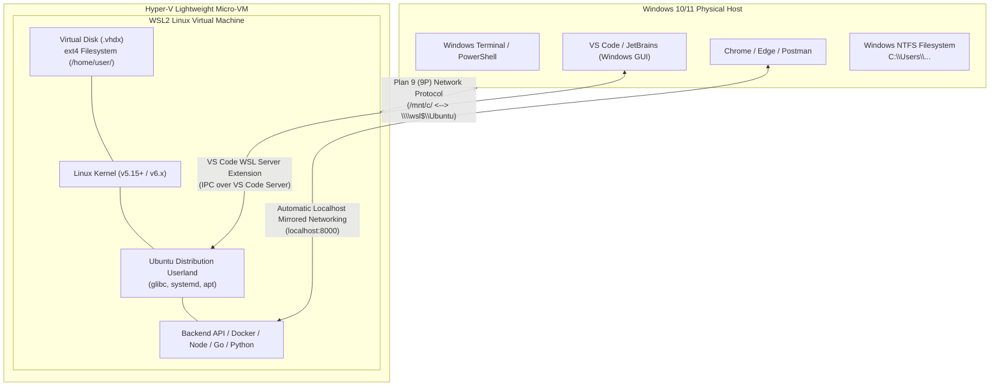
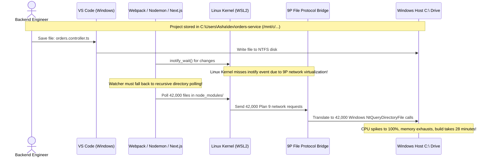

# Module 00: Set Up WSL2 and Ubuntu

> **Prerequisites:** Windows 10 (Build 19041+) or Windows 11 with hardware virtualization (VT-x/AMD-V) enabled in BIOS/UEFI.  
> **Estimated Reading Time:** 25 minutes  
> **Target Audience:** Backend Engineers, Cloud/Platform Developers, DevOps Engineers transitioning to modern Linux environments.

> [!TIP]
> **The Golden Rule of WSL2 Engineering:** Always maintain your development code, repositories, and build artifacts inside the native Linux ext4 virtual disk filesystem (`/home/$USER/` or `~/projects/`), **never** inside the Windows NTFS mount (`/mnt/c/`). Crossing the Plan 9 (9P) network filesystem bridge introduces a 10x–50x I/O latency penalty and prevents Linux kernel `inotify` events from propagating to your file watchers.

---

## 1. Architectural Mental Model: WSL2 vs. The Windows Host

WSL2 is not a lightweight translation shim or an emulator; it is a **fully virtualized Linux utility environment** running a custom Microsoft-built Linux kernel atop a lightweight Hyper-V hypervisor.



### Key Architectural Realities
1. **True Linux Kernel:** Unlike WSL1 (which translated Linux system calls into Windows NT kernel calls), WSL2 runs real Linux ELF64 binaries against a real Linux kernel. System calls such as `epoll`, `clone`, `fork`, and `ptrace` run natively.
2. **Virtual Hard Disk (.vhdx):** The Ubuntu filesystem is stored as an expanding virtual hard disk file (`ext4.vhdx`) in Windows at `%LOCALAPPDATA%\Packages\...\LocalState\ext4.vhdx`.
3. **The 9P Filesystem Bridge:** When you access `/mnt/c/`, the Linux kernel communicates across a Hyper-V socket using the Plan 9 network filesystem protocol. This boundary turns simple local disk reads into cross-boundary remote file operations.

---

## 2. Taxonomic Comparison: Virtualization & Environments

| Dimension | WSL1 (Legacy) | WSL2 (Modern Standard) | Type-2 Hypervisor (VirtualBox / VMware) | Production Cloud VM (AWS EC2 / GCP GCE) |
| :--- | :--- | :--- | :--- | :--- |
| **Kernel Implementation** | LXCore NT translation layer (no Linux kernel) | Real Linux Kernel running in managed micro-VM | Full hardware virtualization kernel | Full KVM/Nitro bare-metal hypervisor |
| **System Call Compatibility** | Partial (broken Docker, eBPF, io_uring) | 100% native Linux syscalls | 100% native | 100% native |
| **ext4 File I/O Performance** | Mediocre (NTFS translated) | **Near-native bare-metal speed** | High overhead | Native cloud block storage (NVMe/EBS) |
| **Cross-OS File Access** | Fast to NTFS | Slow across 9P bridge | Requires guest addition shared folders | Network file shares (NFS/SMB) |
| **Memory Footprint** | Extremely low (shares NT RAM) | Dynamic allocation (balloon driver, defaults to 50% host RAM) | Fixed static RAM allocation | Static dedicated instance RAM |
| **Docker Engine Compatibility** | Incompatible (requires Docker Desktop VM) | Native Linux Docker daemon / Docker Desktop WSL2 backend | Requires nested virtualization | Native Docker / containerd |

---

## 3. Command Context: Windows PowerShell vs. Ubuntu Bash

A major source of developer confusion is invoking commands in the wrong context. You must consciously identify your active shell prompt:

| Context | Shell Prompt Indicator | Primary Purpose | Lifecycle Commands |
| :--- | :--- | :--- | :--- |
| **Windows Host** | `PS C:\Users\Username>` | Managing the WSL VM, updating Windows drivers, launching IDEs | `wsl --status`<br>`wsl --list --verbose`<br>`wsl --shutdown`<br>`wsl --update` |
| **Ubuntu Guest** | `username@hostname:~$` | Developing backend services, installing packages, compiling code | `sudo apt update`<br>`uname -a`<br>`pwd`<br>`curl` |

```
  WINDOWS POWERSHELL CONTEXT (Admin / User)
  ┌────────────────────────────────────────────────────────┐
  │ PS C:\Users\Asha> wsl --list --verbose                 │
  │   NAME      STATE           VERSION                    │
  │ * Ubuntu    Running         2                          │
  └────────────────────────────────────────────────────────┘
                              │
                      wsl (Enter VM)
                              ▼
  UBUNTU BASH CONTEXT (Native Linux Terminal)
  ┌────────────────────────────────────────────────────────┐
  │ asha@laptop:~$ uname -a                                │
  │ Linux laptop 5.15.153.1-microsoft-standard-WSL2 ...    │
  │ asha@laptop:~$ pwd                                     │
  │ /home/asha                                             │
  └────────────────────────────────────────────────────────┘
```

---

## 4. Production War Story: The Cross-Filesystem 9P I/O Thrashing Incident



### The Incident
During a high-priority deployment freeze, an engineering team migrating from macOS to Windows machines reported that local microservice compilation times ballooned from 15 seconds to **28 minutes**. Multiple developers reported that hot reloading completely failed to detect file changes, forcing them to manually restart Docker containers after every single code edit.

### The Root Cause
Developers had cloned the corporate monorepo into `C:\Users\Developer\workspace` and accessed it from inside Ubuntu at `/mnt/c/Users/Developer/workspace`. 

1. **Plan 9 Network Bottleneck:** Every TypeScript compile operation involved scanning `node_modules` (over 45,000 files). Each stat call had to cross the hypervisor memory boundary via the 9P network protocol, translating POSIX file queries into Windows NTFS system calls.
2. **Missing Inotify Events:** The Windows NTFS kernel does not generate native Linux `inotify` signals. Node.js watchers fell back to aggressive, CPU-intensive directory polling, maxing out all CPU cores.

### The Fix & Hardening
1. The repository was cloned directly inside the ext4 filesystem: `cd /home/username/projects && git clone <repo>`.
2. Compilation times instantly dropped from **28 minutes to 14 seconds** (a 120x improvement).
3. Configured `C:\Users\<WindowsUser>\.wslconfig` to enforce strict memory and CPU boundaries so WSL2 does not consume all host resources:

```ini
# %USERPROFILE%\.wslconfig
[wsl2]
memory=8GB
processors=4
swap=4GB
localhostForwarding=true
```

---

## 5. Multi-Language Implementation: Environment & Platform Boundary Detection

In production CLI tools, microservice bootstrappers, and deployment scripts, your code must safely detect whether it is executing inside a native Linux kernel, a container, or WSL2, and ensure files are written to safe paths.

### Go
```go
package main

import (
	"fmt"
	"os"
	"path/filepath"
	"runtime"
	"strings"
)

// EnvironmentInfo holds detected virtualization metadata
type EnvironmentInfo struct {
	OS        string
	IsWSL     bool
	IsSafeDir bool
	CurrentDir string
}

func DetectEnvironment() (*EnvironmentInfo, error) {
	cwd, err := os.Getwd()
	if err != nil {
		return nil, fmt.Errorf("failed to get current working directory: %w", err)
	}

	info := &EnvironmentInfo{
		OS:         runtime.GOOS,
		CurrentDir: cwd,
		IsWSL:      false,
		IsSafeDir:  true,
	}

	if runtime.GOOS == "linux" {
		// Inspect /proc/version for Microsoft/WSL signature
		data, err := os.ReadFile("/proc/version")
		if err == nil {
			versionStr := strings.ToLower(string(data))
			if strings.Contains(versionStr, "microsoft") || strings.Contains(versionStr, "wsl") {
				info.IsWSL = true
			}
		}

		// Detect dangerous 9P mount crossing
		cleanPath := filepath.Clean(cwd)
		if strings.HasPrefix(cleanPath, "/mnt/") {
			info.IsSafeDir = false
		}
	}

	return info, nil
}

func main() {
	env, err := DetectEnvironment()
	if err != nil {
		fmt.Fprintf(os.Stderr, "Error: %v\n", err)
		os.Exit(1)
	}

	fmt.Printf("[Platform Detected] OS: %s | WSL: %t | CWD: %s\n", env.OS, env.IsWSL, env.CurrentDir)
	if env.IsWSL && !env.IsSafeDir {
		fmt.Println("⚠️  WARNING: You are running inside a Windows mount (/mnt/c/).")
		fmt.Println("   Move your project to ~/projects/ to avoid severe 9P I/O degradation!")
	} else {
		fmt.Println("✅ Environment sanity check passed: Running on fast native filesystem.")
	}
}
```

### Node.js / TypeScript
```typescript
import * as fs from 'fs';
import * as os from 'os';
import * as path from 'path';

interface PlatformMetadata {
  platform: NodeJS.Platform;
  isWSL: boolean;
  isSafePath: boolean;
  cwd: string;
}

export function auditWSLEnvironment(): PlatformMetadata {
  const currentPlatform = process.platform;
  const cwd = process.cwd();
  let isWSL = false;

  if (currentPlatform === 'linux') {
    try {
      const procVersion = fs.readFileSync('/proc/version', 'utf8').toLowerCase();
      isWSL = procVersion.includes('microsoft') || procVersion.includes('wsl');
    } catch {
      isWSL = false;
    }
  }

  // Paths under /mnt/ are 9P Windows bridges
  const isSafePath = !isWSL || !cwd.startsWith('/mnt/');

  return {
    platform: currentPlatform,
    isWSL,
    isSafePath,
    cwd
  };
}

const audit = auditWSLEnvironment();
console.log(`[Platform Audit] OS: ${audit.platform} | WSL: ${audit.isWSL}`);
if (!audit.isSafePath) {
  console.warn('⚠️  CRITICAL PERFORMANCE WARNING: Project resides on /mnt/c/ bridge.');
  console.warn('   File watchers and package compilation will suffer severe degradation.');
} else {
  console.log('✅ Native ext4 storage verified.');
}
```

### Python
```python
import os
import platform
import sys
from pathlib import Path

def inspect_wsl_boundary() -> dict:
    uname = platform.uname()
    is_linux = sys.platform.startswith("linux")
    is_wsl = False

    if is_linux:
        try:
            with open("/proc/version", "r", encoding="utf-8") as f:
                content = f.read().lower()
                is_wsl = "microsoft" in content or "wsl" in content
        except OSError:
            is_wsl = False

    cwd = Path.cwd().resolve()
    is_mnt = str(cwd).startswith("/mnt/")

    return {
        "system": uname.system,
        "release": uname.release,
        "is_wsl": is_wsl,
        "is_safe_storage": not (is_wsl and is_mnt),
        "cwd": str(cwd),
    }

if __name__ == "__main__":
    status = inspect_wsl_boundary()
    print(f"[Python Runtime] System: {status['system']} | WSL: {status['is_wsl']}")
    if not status["is_safe_storage"]:
        print(f"⚠️  High latency alert: {status['cwd']} is crossing the 9P hypervisor bridge.")
    else:
        print(f"✅ I/O performance optimized at: {status['cwd']}")
```

---

## 6. Practical Hands-On Verification CLI Workflows

Follow this step-by-step verification pipeline in your environment.

### Workflow 1: Inspect Status from Windows PowerShell
Run from Windows PowerShell to ensure WSL2 engine health:
```powershell
# 1. Check WSL system status and default version
wsl --status

# 2. List installed distros and enforce Version 2
wsl --list --verbose
```
**Expected Output:**
```text
Default Distribution: Ubuntu
Default Version: 2

  NAME      STATE           VERSION
* Ubuntu    Running         2
```

### Workflow 2: Launch Ubuntu and Verify Linux Kernel Architecture
Inside Ubuntu terminal:
```bash
# 1. Print kernel release and machine architecture
uname -a

# 2. Check Ubuntu OS release information
cat /etc/os-release | grep -E "^(NAME|VERSION)="

# 3. Verify user and home directory context
whoami && pwd
```
**Expected Output:**
```text
Linux dev-box 5.15.153.1-microsoft-standard-WSL2 #1 SMP Fri Mar 29 23:14:13 UTC 2024 x86_64 x86_64 x86_64 GNU/Linux
NAME="Ubuntu"
VERSION="24.04 LTS (Noble Numbat)"
asha
/home/asha
```

### Workflow 3: End-to-End Server Verification Across Host Boundaries
Test bidirectional network bridging between the Linux micro-VM and Windows host:
```bash
# 1. Create a safe workspace in the native ext4 filesystem
mkdir -p ~/projects/wsl-verification
cd ~/projects/wsl-verification

# 2. Create a minimal index file
cat << 'EOF' > index.html
<!DOCTYPE html>
<html><body><h1>WSL2 Backend Verification Server Active</h1></body></html>
EOF

# 3. Start Python HTTP server on port 8000
python3 -m http.server 8000
```
Open a browser or PowerShell window on Windows and verify:
```powershell
curl http://localhost:8000
```
**Expected Output:**
```text
<!DOCTYPE html>
<html><body><h1>WSL2 Backend Verification Server Active</h1></body></html>
```
*(WSL2 automatically bridges port 8000 to Windows localhost via its internal virtual switch).*

---

## 7. Operational Validation Checkpoint

<details>
<summary><strong>Question 1: The Monorepo File-Watcher Freeze</strong></summary>

**Scenario:** A developer moves from macOS to Windows 11. They clone their team's Node.js/Go repository into `C:\Users\John\repo`. When running `npm run dev` inside Ubuntu WSL2 (`/mnt/c/Users/John/repo`), modifying a TypeScript file does not trigger a recompile. CPU usage spikes to 100% across all cores. 

Why is this happening, and what is the definitive architectural fix?

**Answer:**
The project resides on the Windows NTFS filesystem mounted over the **Plan 9 (9P) network protocol bridge** (`/mnt/c/`). NTFS file modifications do not generate Linux kernel `inotify` signals across the hypervisor bridge, forcing Node.js watchers (`chokidar`) to fall back to brute-force CPU polling over 40,000+ files in `node_modules`. 

**The Fix:** Move the project into native Linux ext4 storage:
```bash
mkdir -p ~/projects && cd ~/projects
git clone <repo-url>
```
File writes now trigger instant, native `inotify` kernel events with sub-millisecond latency.
</details>

<details>
<summary><strong>Question 2: Reclaiming Virtual Disk Space and Stale Daemon States</strong></summary>

**Scenario:** After testing several high-memory Docker builds and database migrations inside WSL2, you notice that Windows Task Manager shows `Vmmem` consuming 14 GB of RAM even though all programs inside Ubuntu have been closed. Furthermore, a background PostgreSQL service inside WSL appears to be in an unkillable deadlock state. 

What single Windows command cleanly terminates all background processes, releases allocated dynamic memory, and resets the micro-VM?

**Answer:**
From **Windows PowerShell (not Bash)**, execute:
```powershell
wsl --shutdown
```
This terminates the entire Hyper-V micro-VM instance, safely stopping all background daemons, flushing disk buffers, releasing dynamic balloon RAM back to Windows, and returning the `Vmmem` memory footprint to zero. Subsequent invocations of `wsl` boot a fresh kernel instance in under 1.5 seconds.
</details>

<details>
<summary><strong>Question 3: Network Binding & External Accessibility</strong></summary>

**Scenario:** A backend developer starts an HTTP server inside WSL2 using `app.listen(3000, '127.0.0.1')`. The developer can access it via `http://localhost:3000` from their Windows host browser, but their mobile device connected to the same local Wi-Fi network cannot reach `http://<WINDOWS_IP>:3000`.

Why can the local Windows host reach it, but external LAN devices cannot?

**Answer:**
WSL2 runs inside an isolated virtual network with a private subnet (NAT). Microsoft implements an internal port-proxy that mirrors `localhost` between the Windows host and the WSL2 guest. 

However, external LAN requests hitting `<WINDOWS_IP>` arrive on the physical network adapter. Because the service is bound strictly to `127.0.0.1` and Windows does not automatically bridge external physical interfaces into the internal Hyper-V switch, the traffic is dropped. To expose it to the LAN, the application must bind to `0.0.0.0` and a Windows port proxy rule must be created using:
```powershell
netsh interface portproxy add v4tov4 listenport=3000 listenaddress=0.0.0.0 connectport=3000 connectaddress=<WSL_IP>
```
</details>

---

## Next Step

Now that your Linux kernel and Ubuntu environment are properly isolated and verified, proceed to **[01 · Shell Basics and Unix Philosophy](../01-shell-basics-and-philosophy/README.md)** to master how command interpreters, processes, and pipelines execute in the Unix programming model.
