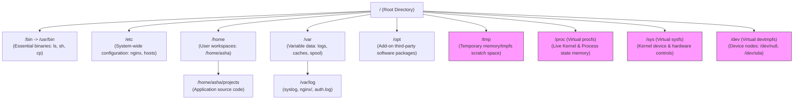
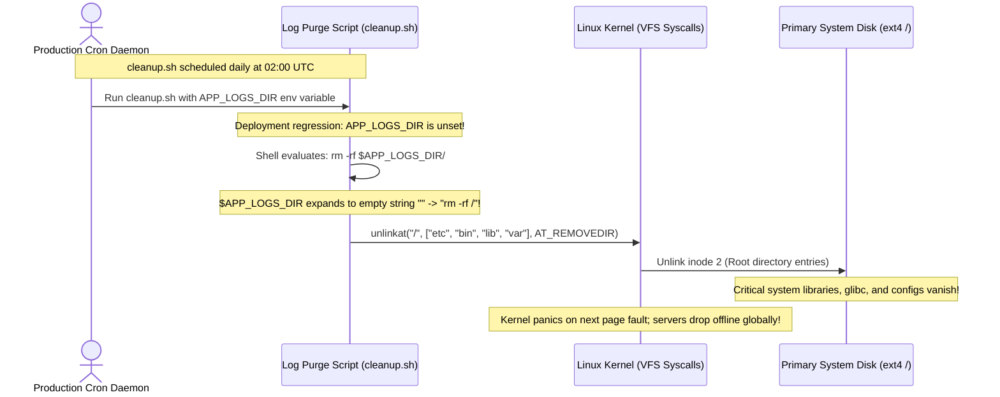

# Module 02: Filesystem Navigation and the Linux Directory Tree

> **Prerequisites:** Module 01 (Shell Basics and Unix Philosophy), working terminal shell.  
> **Estimated Reading Time:** 30 minutes  
> **Target Audience:** Backend Engineers, Infrastructure Developers, Site Reliability Engineers.

> [!TIP]
> **The Golden Rule of Filesystem Navigation:** Always inspect before you mutate. In Linux, there are no drive letters (`C:`, `D:`); there is only **one unified inverted tree rooted at `/`**. In production automation and backend APIs, never rely on relative paths or unquoted wildcards; always resolve paths to their canonical physical addresses (`realpath`) and validate directory boundaries before executing mutating system calls.

---

## 1. Architectural Mental Model: The Unified Virtual File System (VFS)

In Linux, the filesystem is not merely a collection of files on a hard drive—it is a **Virtual File System (VFS)** abstraction. Every physical storage device, network share, virtual disk, kernel runtime interface, and memory-backed buffer is mounted seamlessly under a single root directory (`/`).



### The Three Classes of Directories in the VFS
1. **Persistent Storage Mounts (`/`, `/home`, `/opt`):** Backed by physical or virtual block storage (ext4, XFS, Btrfs, NVMe). Data persists across reboots.
2. **System State & Configuration (`/etc`, `/var`):** `/etc` holds static host configuration files; `/var` stores state that changes dynamically during execution (service logs, databases, runtime locks).
3. **Pseudo-Filesystems (`/proc`, `/sys`, `/dev`, `/tmp`):** Pure in-memory kernel interfaces. Files in `/proc` do not exist on disk; reading `/proc/cpuinfo` or `/proc/meminfo` queries the Linux kernel's internal data structures directly in RAM.

---

## 2. Taxonomic Reference: Filesystem Hierarchy Standard (FHS 3.0)

When deploying, debugging, or containerizing backend microservices, files must reside in predictable standardized locations:

| Directory | Purpose | Expected File Types | Production Engineering Relevance |
| :--- | :--- | :--- | :--- |
| **`/`** | The root of the entire tree | Top-level mount points | Primary system mount. Keep it clean of ad-hoc files. |
| **`/etc`** | Host-specific system configuration | `nginx.conf`, `hosts`, `systemd/` | Read by services during bootstrap. Must be version-controlled or templated. |
| **`/var/log`** | Persistent daemon logs | `syslog`, `nginx/access.log` | Target for log rotation daemons (`logrotate`) and log forwarders (Fluentbit). |
| **`/home`** | User home directories | Dotfiles, local projects | Default user workspace (`~`). Stores personal SSH keys (`~/.ssh`). |
| **`/opt`** | Self-contained third-party software | `google/`, `datadog/`, `aws/` | Dedicated location for standalone binaries and proprietary vendor packages. |
| **`/tmp`** | Ephemeral scratch storage | Socket files, temporary chunks | Backed by `tmpfs` (RAM). Emptied upon reboot; writable by all users (`1777` sticky). |
| **`/proc`** | Kernel & process memory state | `cpuinfo`, `meminfo`, `<pid>/` | Inspect container resource limits (`/proc/cgroups`) and open file descriptors. |
| **`/dev`** | Device special files | `/dev/null`, `/dev/urandom` | I/O redirection sinks (`> /dev/null 2>&1`) and cryptographically secure random bytes. |

---

## 3. Systematic Reference: Path Navigation & Core Vocabulary

| Syntax / Command | Name / Operation | Description | Production Gotcha |
| :--- | :--- | :--- | :--- |
| **`/`** | Root directory | Anchor for all absolute paths | Never put unquoted variables before `/` in deletion scripts. |
| **`.`** | Current directory | The directory your process is currently in | Executing `./binary` prevents `$PATH` lookup spoofing. |
| **`..`** | Parent directory | One level higher in the directory hierarchy | `cd ../..` moves up two levels. Canonicalize in web APIs. |
| **`~`** | User home directory | Expands to `/home/$USER` | Shell-expanded; fails when placed inside double or single quotes. |
| **`-`** | Previous working directory | Returns to the directory you were previously in | `cd -` toggles between two directory paths quickly. |
| **`pwd -P`** | Physical working directory | Prints the real path resolving all symlinks | Default `pwd -L` prints logical path, which can deceive scripts. |
| **`ls -la`** | List all with details | Shows permissions, links, owner, size, timestamp | Always check for dotfiles (`.env`, `.git`) when troubleshooting. |
| **`mkdir -p`** | Parent directory creation | Creates nested paths without failing if they exist | Idempotent; ideal for Dockerfile and Ansible automation. |
| **`cp -a`** | Archive copy | Preserves timestamps, ownership, modes, and links | Essential when migrating database data directories or config files. |
| **`find`** | Recursive search engine | Evaluates filesystem trees by name, type, age, size | Use `-exec ... {} +` or `-delete` to avoid shell glob limits. |

---

## 4. Production War Story: The Empty Variable Traversal Catastrophe



### The Incident
At 02:00 UTC, an automated maintenance job intended to clean rotated logs executed on a fleet of 40 bare-metal Kubernetes worker nodes. Within 90 seconds, all 40 nodes transitioned to `NotReady`. Node health checks failed, and SSH access was completely severed.

### The Post-Mortem Data
* **Severity:** SEV-1 (Global Production Outage)
* **Mean Time to Detect (MTTD):** 4 minutes (Prometheus blackbox alerts fired)
* **Mean Time to Resolution (MTTR):** 180 minutes (Physical BMC/IPMI console re-imaging required)

### The Root Cause
The maintenance script contained:
```bash
rm -rf $APP_LOGS_DIR/
```
Due to an upstream environment secret rotation, `$APP_LOGS_DIR` was missing from the cron environment. The variable expanded to empty text `""`. The resulting command executed was:
```bash
rm -rf /
```
GNU `rm` has a safety guard `--preserve-root` (default on `rm -rf /`), but the trailing slash `rm -rf //` or `$VAR/` bypassed older glibc safety checks on the nodes, immediately unlinking `/etc`, `/usr/lib`, and running binaries.

### The Fix & Hardening
1. **Never use recursive `rm -rf` on variable paths in automated scripts.** Use targeted `find` commands with explicit constraints:
```bash
# Hardened log cleanup: Restrict strictly to files under /var/log/app older than 7 days
find /var/log/app -mindepth 1 -maxdepth 2 -type f -name "*.log" -mtime +7 -delete
```
2. **Guard all shell variables with mandatory existence checks:**
```bash
TARGET_DIR="${APP_LOGS_DIR:?FATAL: APP_LOGS_DIR environment variable is undefined or empty}"
# Canonicalize and verify directory boundary
REAL_PATH=$(realpath "$TARGET_DIR")
if [[ "$REAL_PATH" == "/" || "$REAL_PATH" == "/home" ]]; then
    echo "FATAL: Dangerous target path detected: $REAL_PATH" >&2
    exit 1
fi
```
3. **Mount Root Filesystem as Read-Only (`ro`):** In containerized environments, run microservice containers with read-only root filesystems (`--read-only`), granting write access only to specific `tmpfs` mounts.

---

## 5. Multi-Language Production Code: Safe Path Resolution & Directory Traversal Prevention

When accepting file paths from API clients, user inputs, or configuration files, backend services must sanitize and validate that the resolved path does not traverse outside the intended sandbox boundary (preventing `../../../../etc/passwd` attacks).

### Go
```go
package main

import (
	"errors"
	"fmt"
	"os"
	"path/filepath"
	"strings"
)

var ErrPathTraversal = errors.New("security violation: path traversal detected")

// ResolveSecurePath canonicalizes a user-supplied relative path and ensures
// that the physical target remains strictly inside the designated base directory.
func ResolveSecurePath(baseDir, untrustedInput string) (string, error) {
	// 1. Resolve base directory to its physical canonical path
	absBase, err := filepath.Abs(baseDir)
	if err != nil {
		return "", fmt.Errorf("failed to resolve base directory: %w", err)
	}
	absBase = filepath.Clean(absBase)

	// 2. Join base and untrusted input, then clean all ./ and ../ elements
	targetPath := filepath.Clean(filepath.Join(absBase, untrustedInput))

	// 3. Security Check: The target must start with the base directory path + separator
	if targetPath != absBase && !strings.HasPrefix(targetPath, absBase+string(filepath.Separator)) {
		return "", fmt.Errorf("%w: attempted access to %s outside %s", ErrPathTraversal, targetPath, absBase)
	}

	return targetPath, nil
}

func main() {
	sandbox := "/var/data/uploads"

	// Test 1: Valid relative upload
	safePath, err := ResolveSecurePath(sandbox, "reports/2026/q1.csv")
	fmt.Printf("Safe Path Result: %s (Err: %v)\n", safePath, err)

	// Test 2: Malicious path traversal attack
	maliciousInput := "../../etc/shadow"
	attackPath, err := ResolveSecurePath(sandbox, maliciousInput)
	if errors.Is(err, ErrPathTraversal) {
		fmt.Printf("🛡️ Blocked Traversal Attack: %v\n", err)
	} else {
		fmt.Printf("Vulnerability: Resolved to %s\n", attackPath)
	}
}
```

### Node.js / TypeScript
```typescript
import * as path from 'path';
import * as fs from 'fs';

export class PathSanitizer {
  private readonly baseDir: string;

  constructor(baseDirectory: string) {
    // Resolve base path to absolute canonical format
    this.baseDir = path.resolve(baseDirectory);
  }

  /**
   * Resolves an untrusted user path against the base sandbox.
   * Throws an error if the path attempts to escape the root boundary.
   */
  public resolveSafePath(userPath: string): string {
    // Normalize and join safely
    const resolvedPath = path.resolve(this.baseDir, userPath);

    // Boundary validation: Must start with base directory followed by delimiter
    if (resolvedPath !== this.baseDir && !resolvedPath.startsWith(this.baseDir + path.sep)) {
      throw new Error(`Security Exception: Directory traversal attempt detected: ${userPath}`);
    }

    return resolvedPath;
  }
}

// Example usage
const storage = new PathSanitizer('/var/data/storage');
try {
  console.log('Valid:', storage.resolveSafePath('user-avatars/avatar_12.png'));
  console.log('Attack:', storage.resolveSafePath('../../../etc/passwd'));
} catch (err: any) {
  console.error(`🛡️ ${err.message}`);
}
```

### Python
```python
import os
from pathlib import Path
from typing import Union

class SecurePathResolver:
    def __init__(self, base_directory: Union[str, Path]):
        self.base_dir = Path(base_directory).resolve()

    def resolve_safe(self, untrusted_path: Union[str, Path]) -> Path:
        """
        Resolves the user path strictly within the sandbox base directory.
        Raises PermissionError if a directory traversal is detected.
        """
        # Resolve symlinks and normalize path
        target = (self.base_dir / untrusted_path).resolve()

        # Enforce boundary containment
        try:
            target.relative_to(self.base_dir)
        except ValueError:
            raise PermissionError(f"Directory traversal blocked: {untrusted_path} escapes {self.base_dir}")

        return target

if __name__ == "__main__":
    resolver = SecurePathResolver("/tmp/sandbox")
    
    # Safe resolution
    valid = resolver.resolve_safe("documents/statement.pdf")
    print(f"✅ Safe path resolved: {valid}")

    # Malicious traversal
    try:
        resolver.resolve_safe("../../../../etc/hosts")
    except PermissionError as e:
        print(f"🛡️ {e}")
```

---

## 6. Practical Hands-On Verification CLI Workflows

Work in your Ubuntu terminal to practice safe navigation and directory inspection:

### Workflow 1: Build and Inspect a Backend Directory Hierarchy
```bash
# 1. Create a simulated microservice layout idempotently
mkdir -p ~/projects/lab-fs/{configs,logs,src/{controllers,models},build}

# 2. Verify physical working directory (-P resolves physical address)
cd ~/projects/lab-fs
pwd -P

# 3. Create dummy files
touch configs/app.yaml src/controllers/user.go logs/access.log
ls -lahR .
```
**Expected Output:**
```text
/home/asha/projects/lab-fs
.:
total 24K
drwxr-xr-x 6 asha asha 4.0K Nov 10 15:00 .
drwxr-xr-x 3 asha asha 4.0K Nov 10 15:00 ..
drwxr-xr-x 2 asha asha 4.0K Nov 10 15:00 build
drwxr-xr-x 2 asha asha 4.0K Nov 10 15:00 configs
drwxr-xr-x 2 asha asha 4.0K Nov 10 15:00 logs
drwxr-xr-x 4 asha asha 4.0K Nov 10 15:00 src
```

### Workflow 2: Logical vs. Physical Paths Across Symlinks
Understand how symlinks deceive tools when `-P` is omitted:
```bash
# 1. Create a symbolic link pointing to /var/log
ln -s /var/log ~/projects/lab-fs/system-logs

# 2. Navigate via symlink and compare logical vs physical directory
cd ~/projects/lab-fs/system-logs
pwd       # Prints logical path: /home/asha/projects/lab-fs/system-logs
pwd -P    # Prints real physical path: /var/log

# 3. Step back up using cd ..
cd ..
pwd -P    # Notice you are back in /home/asha/projects/lab-fs!
```

### Workflow 3: Enterprise File Discovery with `find`
Locate files accurately without shell glob limits:
```bash
# 1. Search for all .go files modified in the last 24 hours
find ~/projects/lab-fs -type f -name "*.go" -mtime -1

# 2. Calculate directory space usage summarized by top-level item
du -sh ~/projects/lab-fs/*
```

---

## 7. Operational Validation Checkpoint

<details>
<summary><strong>Question 1: The Symlink Escape Vulnerability</strong></summary>

**Scenario:** A web server hosts user static uploads under `/var/www/uploads`. An attacker uploads an archive containing a symbolic link:
`evil_link -> /etc/passwd`.
When a browser requests `GET /uploads/evil_link`, the backend web server serves the system's sensitive credential file.

Which Linux command verifies whether a path is a symbolic link, and what web server configuration directive neutralizes this exploit?

**Answer:**
To verify the link in the terminal:
```bash
ls -l /var/www/uploads/evil_link
# Or check the real physical target:
readlink -f /var/www/uploads/evil_link
```
In Nginx / Apache, disable symlink following or enforce ownership matching:
* **Nginx:** `disable_symlinks on;` (or `disable_symlinks if_not_owner;`).
* **Backend Code:** Always resolve the path with `realpath()` and assert that the physical canonical directory prefix matches `/var/www/uploads`.
</details>

<details>
<summary><strong>Question 2: Shell Glob Argument List Exhaustion</strong></summary>

**Scenario:** An image processing microservice accumulates 450,000 files in `/var/images/processed/`. A maintenance script attempts to clean the directory:
```bash
rm -f /var/images/processed/*.png
```
The command fails immediately with:
`bash: /bin/rm: Argument list too long`.

Why did this occur, and what is the production-grade command to delete these files safely?

**Answer:**
Bash expands wildcards (`*`) **before** invoking the target program. Expanding 450,000 filenames exceeds the Linux kernel's `ARG_MAX` buffer limit (typically 2MB to 4MB of memory allocated for command arguments via `execve`). 

**The Production Fix:** Use `find` with `-delete` or `-exec ... +`, which processes items without passing all filenames through shell argument expansion:
```bash
find /var/images/processed -maxdepth 1 -type f -name "*.png" -delete
```
This runs directly via kernel filesystem calls without invoking shell tokenization.
</details>

<details>
<summary><strong>Question 3: Inode Exhaustion Despite Free Disk Space</strong></summary>

**Scenario:** A backend monitoring alert fires: `DiskWriteFailed: No space left on device` on `/var`. You run `df -h` and observe that `/var` is only at 28% capacity with 85 GB of free space available. 

What is the underlying cause, what command proves it, and how does filesystem navigation help diagnose the offending directory?

**Answer:**
The filesystem has run out of **inodes (index nodes)**, not raw disk bytes. Every file and directory requires an inode metadata record. If an application generates millions of zero-byte or tiny log/session files, all available inodes are consumed while disk byte capacity remains largely free.

1. **Verify with:**
   ```bash
   df -i /var
   ```
   *(This displays inode usage; `IUse%` will be 100%).*
2. **Find the offending directory with:**
   ```bash
   find /var -xdev -printf '%h\n' | sort | uniq -c | sort -k1 -n | tail -n 10
   ```
   *(This counts files per directory to locate the directory hoarding millions of small files).*
</details>

---

## Further reading & sources

* [Filesystem Hierarchy Standard 3.0](https://refspecs.linuxfoundation.org/FHS_3.0/fhs-3.0.pdf) - the Linux Foundation specification describing the conventional organization of major filesystem directories.
* [GNU Coreutils Manual](https://www.gnu.org/software/coreutils/manual/html_node/index.html) - authoritative documentation for commands such as `ls`, `mkdir`, `cp`, `mv`, and `rm`.
* [GNU Findutils Manual](https://www.gnu.org/software/findutils/manual/) - detailed documentation for `find` and related filesystem-search tools.
* [`hier(7)` Linux manual page](https://man7.org/linux/man-pages/man7/hier.7.html) - a practical reference for the Linux filesystem hierarchy.
* [`find(1)` Linux manual page](https://man7.org/linux/man-pages/man1/find.1.html) - detailed reference for `find` options and search expressions.

---

## Next Step

Continue to **[03-file-permissions-ownership](../03-file-permissions-ownership/README.md)** to master Linux permission bits, octal vs. symbolic modes, ownership models (`chmod`, `chown`, `umask`), and privilege boundaries.
