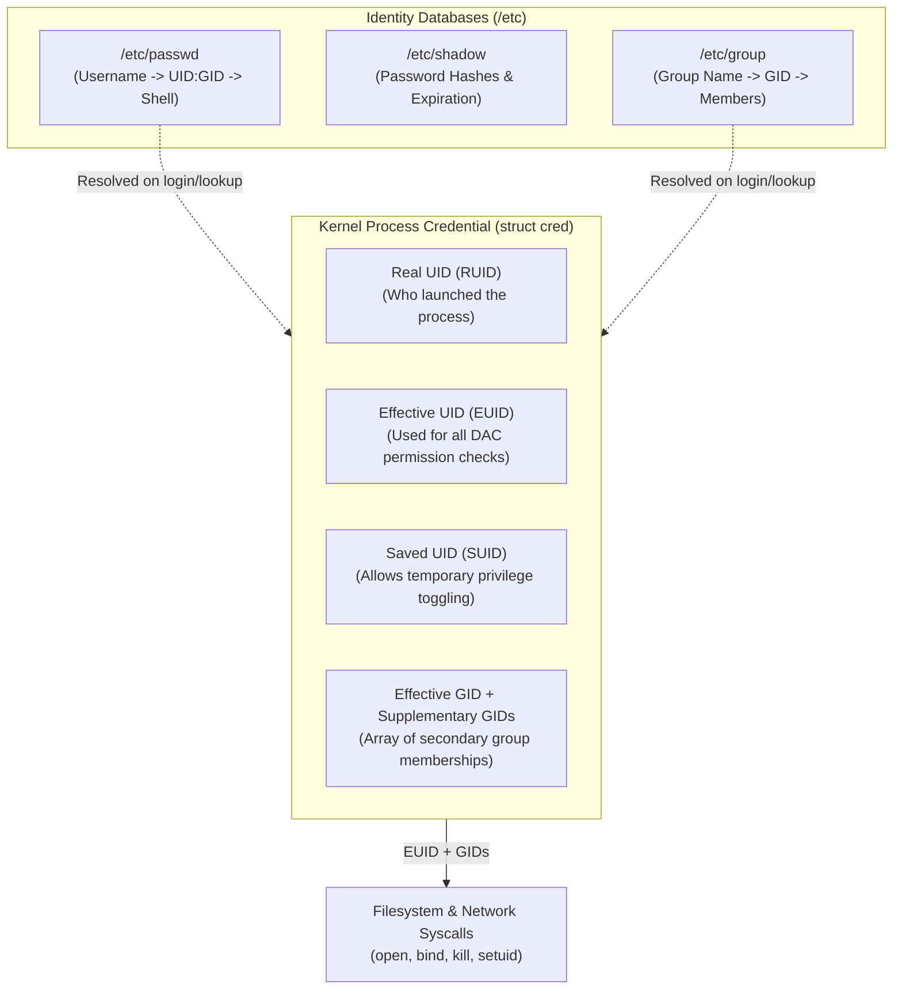
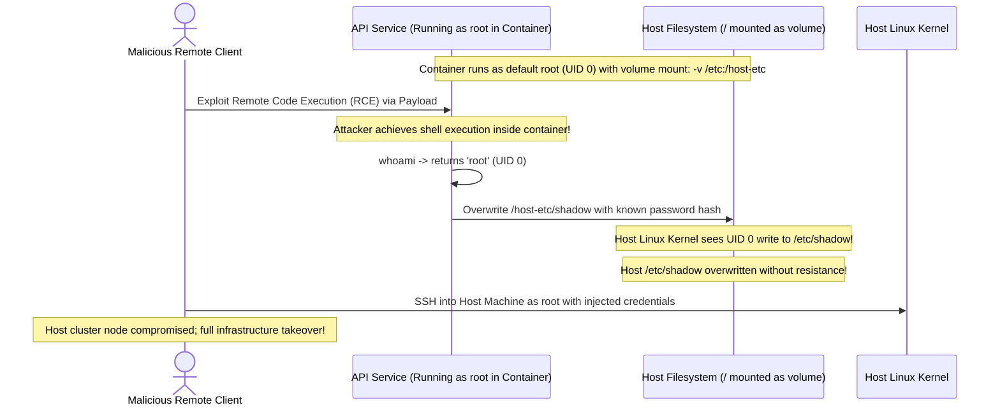

# Module 04: Users and Groups

> **Prerequisites:** Module 03 (File Permissions and Ownership), working Linux terminal.  
> **Estimated Reading Time:** 25 minutes  
> **Target Audience:** Backend Engineers, Site Reliability Engineers, Platform Security Architects.

> [!TIP]
> **The Golden Rule of Linux Identity:** In the Linux kernel, human names like `alice` or `nginx` do not exist—**only numeric User IDs (UIDs) and Group IDs (GIDs) exist**. UID `0` is the omnipotent root superuser. Never run application servers, microservices, or containers as UID `0`. Always provision a dedicated non-login system service account (UID `< 1000` or container non-root UID `10001+`) with `/usr/sbin/nologin` as its shell.

---

## 1. Architectural Mental Model: Process Identity and Credentials

Every running process in Linux carries a kernel credentials structure (`struct cred`) containing multiple numeric identifiers that govern Discretionary Access Control (DAC):



### The Three UID Types in Process Context
1. **Real UID (RUID):** Identifies the user account that originally invoked the process.
2. **Effective UID (EUID):** The UID evaluated by the kernel for filesystem and network access permissions. When executing standard binaries, `EUID == RUID`. When executing a **SetUID (SUID)** binary (like `/usr/bin/passwd`), the kernel sets `EUID` to the file owner's UID (typically root `0`) while keeping `RUID` intact.
3. **Saved UID (SUID):** Stores previous privileges, allowing processes like daemons to drop root privileges to an unprivileged user and temporarily regain them if needed.

---

## 2. Taxonomic Reference: Linux UID Allocation Ranges

Linux standardizes UID numeric ranges to prevent service collisions:

| Range | Identity Category | Purpose | Login Shell Allowed? | Example Accounts |
| :--- | :--- | :--- | :--- | :--- |
| **`0`** | **Superuser (`root`)** | Full system control, kernel access, raw sockets, bypasses DAC | Yes (`/bin/bash`) | `root` |
| **`1 – 999`** | **System / Service Accounts** | Dedicated accounts running background daemons | **No** (`/usr/sbin/nologin`) | `systemd-resolve`, `www-data`, `postgres`, `redis` |
| **`1000 – 59999`** | **Interactive Human Users** | Standard developer and operator login accounts | Yes (`/bin/bash`, `/usr/bin/zsh`) | `asha`, `devops`, `ubuntu` |
| **`60000 – 65533`** | **Special System Ranges** | Distro-specific dynamic allocations | No | Distro reserves |
| **`65534`** | **Nobody (`nogroup`)** | Minimum possible unprivileged placeholder identity | No (`/usr/sbin/nologin`) | `nobody` (NFS squashing, sandboxes) |
| **`10000+`** | **Container Non-Root Users** | Unprivileged service users inside Docker/Kubernetes | No (`/sbin/nologin`) | `appuser (10001:10001)` |

---

## 3. Systematic Breakdown: The Account Configuration Files

User identity in Linux is managed across three core text configuration files in `/etc`:

### 1. `/etc/passwd` (Publicly Readable by All Users)
Each line represents one user formatted into seven colon-delimited fields:

```text
postgres:x:114:122:PostgreSQL administrator,,,:/var/lib/postgresql:/bin/bash
   │     │  │   │                │                      │            │
   │     │  │   │                │                      │            └── 7. Login Shell
   │     │  │   │                │                      └─────────────── 6. Home Directory
   │     │  │   │                └────────────────────────────────────── 5. User Information (GECOS)
   │     │  │   └─────────────────────────────────────────────────────── 4. Primary Group ID (GID)
   │     │  └─────────────────────────────────────────────────────────── 3. User ID (UID)
   │     └────────────────────────────────────────────────────────────── 2. Password Placeholder ('x' indicates /etc/shadow)
   └──────────────────────────────────────────────────────────────────── 1. Username
```

### 2. `/etc/shadow` (Restricted to Root Only: Mode `0640` or `0600`)
Contains cryptographically salted password hashes (e.g. SHA-512 `$6$` or yescrypt `$y$`), account aging, and expiration rules.

### 3. `/etc/group` (Publicly Readable)
Defines groups and their members:
```text
docker:x:999:asha,devops
```
*(Group `docker` has GID `999` and contains supplementary members `asha` and `devops`).*

---

## 4. Production War Story: Root Container Breakout via Host Volume Mounting



### The Incident
An e-commerce backend deployed on Kubernetes utilized an administrative container configured with `hostPath: /etc` for legacy log scraping. The Dockerfile omitted the `USER` directive, allowing the container processes to execute as default `root` (UID `0`).

### The Post-Mortem Data
* **Severity:** SEV-1 (Complete Host Infrastructure Compromise)
* **Mean Time to Detect (MTTD):** 12 minutes (Falco security agent detected `/etc/shadow` modification)
* **Mean Time to Resolution (MTTR):** 75 minutes (Node drained, quarantined, and re-provisioned)

### The Root Cause
Containers share the host operating system's Linux kernel. **UID `0` inside a container without user namespaces is identical to UID `0` on the host machine.** When the container gained an RCE exploit, the attacker leveraged its UID `0` status to modify host configuration files mounted via the volume, escalating privileges from container to bare-metal host.

### The Fix & Hardening
1. **Never run containers as root:** Enforce unprivileged user context in Dockerfiles:
```dockerfile
# Create dedicated system group and user
RUN groupadd -g 10001 appgroup && \
    useradd -u 10001 -g appgroup -s /usr/sbin/nologin -M appuser

USER 10001:10001
```
2. **Kubernetes Security Context:** Enforce non-root execution in pod manifests:
```yaml
securityContext:
  runAsNonRoot: true
  runAsUser: 10001
  allowPrivilegeEscalation: false
```
3. **Enable Linux User Namespaces (`userns`):** Remap container UID `0` to an unprivileged high UID (e.g., UID `100000`) on the host.

---

## 5. Multi-Language Production Code: Inspecting Process Identity & Dropping Privileges

Production daemons that start with elevated permissions (e.g. to bind to privileged low ports like 80/443) must drop privileges to an unprivileged user immediately after initialization.

### Go
```go
package main

import (
	"fmt"
	"os"
	"os/user"
)

// AuditProcessIdentity checks current process credentials and flags dangerous root execution.
func AuditProcessIdentity() error {
	uid := os.Getuid()
	euid := os.Geteuid()
	gid := os.Getgid()

	currentUser, err := user.Current()
	if err != nil {
		return fmt.Errorf("failed to lookup current user: %w", err)
	}

	fmt.Printf("[Process Security Audit]\n")
	fmt.Printf(" - Username: %s\n", currentUser.Username)
	fmt.Printf(" - Real UID: %d | Effective UID: %d\n", uid, euid)
	fmt.Printf(" - Primary GID: %d\n", gid)

	if euid == 0 {
		return fmt.Errorf("CRITICAL SECURITY RISK: Service is executing as root (UID 0)! Drop privileges immediately.")
	}

	fmt.Println("✅ Service running safely as unprivileged service user.")
	return nil
}

func main() {
	if err := AuditProcessIdentity(); err != nil {
		fmt.Fprintf(os.Stderr, "Security Alert: %v\n", err)
	}
}
```

### Node.js / TypeScript
```typescript
import * as os from 'os';

interface ProcessIdentity {
  username: string;
  uid: number;
  gid: number;
  groups: number[];
  isRoot: boolean;
}

export function inspectProcessIdentity(): ProcessIdentity {
  const userInfo = os.userInfo();
  const uid = typeof process.getuid === 'function' ? process.getuid() : -1;
  const gid = typeof process.getgid === 'function' ? process.getgid() : -1;
  const groups = typeof process.getgroups === 'function' ? process.getgroups() : [];

  const isRoot = uid === 0;

  return {
    username: userInfo.username,
    uid,
    gid,
    groups,
    isRoot,
  };
}

const identity = inspectProcessIdentity();
console.log(`[Identity Report] User: ${identity.username} (UID: ${identity.uid}, GID: ${identity.gid})`);

if (identity.isRoot) {
  console.warn('⚠️  SECURITY WARNING: Process is executing as UID 0 (root).');
  console.warn('   Ensure this service is enclosed in an unprivileged container boundary.');
} else {
  console.log('✅ Verified non-root execution context.');
}
```

### Python
```python
import os
import pwd
import grp
import sys

def audit_and_drop_privileges(target_user: str = "nobody") -> None:
    """
    Audits process credentials and drops root privileges to target_user if running as root.
    """
    current_uid = os.getuid()
    current_euid = os.geteuid()
    print(f"[Identity Pre-Check] UID={current_uid}, EUID={current_euid}")

    if current_uid == 0:
        print(f"⚠️ Process started as root. Dropping privileges to '{target_user}'...")
        try:
            target_pw = pwd.getpwnam(target_user)
            target_uid = target_pw.pw_uid
            target_gid = target_pw.pw_gid

            # 1. Drop supplementary groups first
            os.setgroups([])

            # 2. Drop primary group
            os.setgid(target_gid)

            # 3. Drop user ID (must be last)
            os.setuid(target_uid)

            print(f"✅ Successfully dropped privileges to {target_user} (UID: {os.getuid()}, GID: {os.getgid()})")
        except Exception as e:
            print(f"FATAL: Failed to drop privileges: {e}")
            sys.exit(1)
    else:
        print("✅ Process is already running as an unprivileged user.")

if __name__ == "__main__":
    audit_and_drop_privileges()
```

---

## 6. Practical Hands-On Verification CLI Workflows

Work in your Ubuntu terminal to inspect and manage Linux accounts:

### Workflow 1: Inspect Current Identity and Group Memberships
```bash
# 1. Print current UID, GID, and all supplementary groups
id

# 2. Check the raw entry for your user in /etc/passwd
getent passwd $(whoami)

# 3. Check group definitions for your user
groups
```
**Expected Output:**
```text
uid=1000(asha) gid=1000(asha) groups=1000(asha),4(adm),24(cdrom),27(sudo)
asha:x:1000:1000:Asha,,,:/home/asha:/bin/bash
asha adm cdrom sudo
```

### Workflow 2: Provision a Hardened Service Account
Learn how to create a production-grade service user that cannot be used for interactive shell logins:
```bash
# 1. Create a dedicated system user with no login shell and no home directory
sudo useradd --system \
             --no-create-home \
             --shell /usr/sbin/nologin \
             --comment "Backend Payment Service Daemon" \
             paymentsvc

# 2. Verify account creation in /etc/passwd
getent passwd paymentsvc
```
**Expected Output:**
```text
paymentsvc:x:998:998:Backend Payment Service Daemon:/home/paymentsvc:/usr/sbin/nologin
```

### Workflow 3: Test Login Rejection on Service Account
Verify that the account cannot be abused for SSH or interactive access:
```bash
# 1. Attempt to run a shell as the service user
sudo -u paymentsvc /bin/bash
```
*(Notice that `sudo -u paymentsvc` allows root to run specific tasks as that UID, but attempting to log in directly drops out because the shell is `/usr/sbin/nologin`).*

### Workflow 4: Clean Up Test Account
```bash
sudo userdel paymentsvc
```

---

## 7. Operational Validation Checkpoint

<details>
<summary><strong>Question 1: Container UID 0 vs. Host Root Identity</strong></summary>

**Scenario:** A developer argues: "It doesn't matter if our microservice runs as `root` inside Docker, because containers are completely isolated virtual machines." 

Is this statement accurate? What is the technical mechanism that disproves it?

**Answer:**
**The statement is dangerously false.** 
Containers are **not** virtual machines; they share the host machine's Linux kernel. Process isolation is implemented via Linux kernel **Namespaces and Cgroups**. 

By default, Docker does not isolate user namespaces (`CLONE_NEWUSER`). Therefore, UID `0` inside a container is **the exact same numeric UID `0` (root) on the host kernel**. If an application inside the container escapes via a vulnerability (or accesses a mounted host volume or Docker socket), it possesses full root capabilities on the host hardware.
</details>

<details>
<summary><strong>Question 2: SUID Privilege Escalation</strong></summary>

**Scenario:** You inspect the binary permissions of `/usr/bin/passwd` and observe:
`-rwsr-xr-x 1 root root 68208 Apr 11 2024 /usr/bin/passwd`
Notice the `s` instead of `x` in the owner permission slot.

What does `s` indicate, and what security problem would arise if this binary lacked this bit?

**Answer:**
The `s` bit is the **SetUID (SUID)** attribute (octal `4755`). 

When an unprivileged user executes a SetUID binary, the Linux kernel temporarily sets the process's **Effective UID (EUID) to the file's owner** (`root`). 

Standard users must be able to change their passwords, which requires updating the restricted `/etc/shadow` file (readable/writable only by root). Without the SetUID bit, `/usr/bin/passwd` would execute with the standard user's unprivileged UID and fail with `Permission denied` when trying to update `/etc/shadow`.
</details>

<details>
<summary><strong>Question 3: Why Service Accounts Must Have `/usr/sbin/nologin`</strong></summary>

**Scenario:** A systems administrator creates a service account for an internal Redis instance:
`sudo useradd -r -s /bin/bash redis`
A security auditor flags this configuration as a high-severity finding.

Why is assigning `/bin/bash` to a service account a critical security vulnerability?

**Answer:**
Service accounts should only execute their specific background daemon. 

If an attacker finds an application exploit (such as command injection or weak credentials), an account with a valid shell like `/bin/bash` allows the attacker to obtain an **interactive, persistent shell session**, log in via SSH, and navigate the system freely. 

Assigning `/usr/sbin/nologin` (or `/bin/false`) ensures that any attempt to establish an interactive session, allocate a PTY, or authenticate via SSH is immediately terminated by the operating system.
</details>

---

## Next Step

Now that you understand Linux identity, UIDs, GIDs, and service account isolation, proceed to **[05 · Package Management with APT](../05-package-management-apt/README.md)** to master package archives, dependency resolution, repository management, and reproducible system builds.
