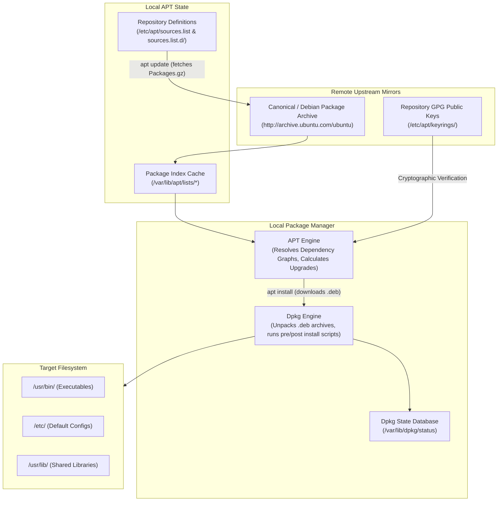
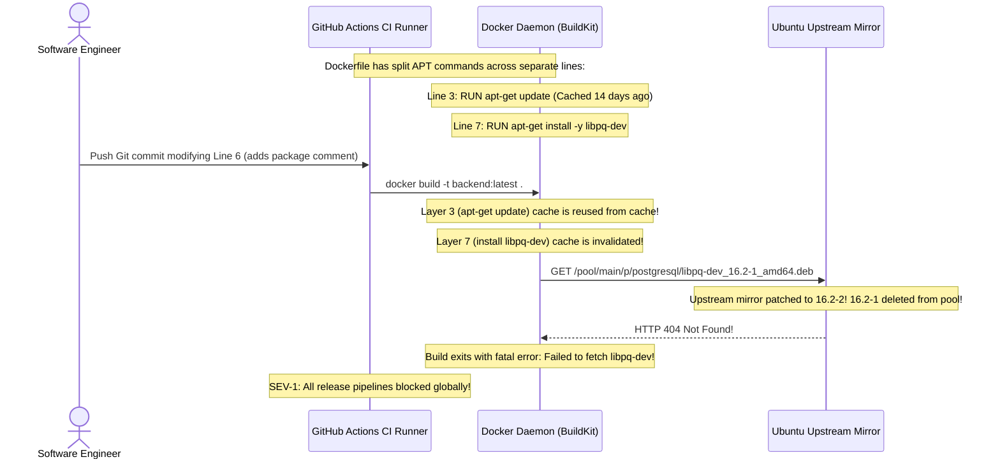

# Module 05: Package Management with APT

> **Prerequisites:** Module 04 (Users and Groups), Ubuntu environment with sudo access.  
> **Estimated Reading Time:** 25 minutes  
> **Target Audience:** Backend Engineers, DevOps Engineers, Platform / Container Architects.

> [!TIP]
> **The Golden Rule of APT Package Management:** `apt update` updates your local index of *metadata*; `apt upgrade` downloads and installs the actual *software packages*. In Dockerfiles and automated infrastructure provisioning, **always combine update, install, and cache cleanup into a single atomic layer**: `apt-get update && apt-get install -y --no-install-recommends <package> && rm -rf /var/lib/apt/lists/*`. Separating them causes stale cache build failures and inflates container images with hundreds of megabytes of junk.

---

## 1. Architectural Mental Model: The APT and Dpkg Lifecycle

APT (Advanced Package Tool) is the high-level front-end that handles dependency resolution and repository fetching over HTTP/HTTPS, while `dpkg` is the low-level engine that unpacks and registers `.deb` archive binaries onto the local filesystem.



### The Two-Tier Package System
1. **High-Level (`apt` / `apt-get`):** Understands the global dependency graph. If you install `nginx`, APT inspects `/var/lib/apt/lists/`, identifies that `nginx` requires `libssl3` and `nginx-common`, downloads all three `.deb` archives from the network mirror, verifies their GPG checksums, and feeds them to `dpkg` in topological order.
2. **Low-Level (`dpkg`):** Knows only about local files. It takes a local `.deb` archive, unzips it, copies files into `/usr/bin/` and `/etc/`, and records the installation state in `/var/lib/dpkg/status`. `dpkg` cannot resolve or download remote dependencies.

---

## 2. Systematic Reference: Essential APT & Dpkg Commands

| Command | Action Performed | Network Call? | Modifies Disk? | Production Engineering Context |
| :--- | :--- | :--- | :--- | :--- |
| **`sudo apt update`** | Synchronizes local package metadata against mirrors | **Yes** | Updates `/var/lib/apt/lists/` | Run before any package search or installation. |
| **`sudo apt upgrade -y`** | Upgrades all installed packages to candidate versions | **Yes** | Modifies all outdated binaries | Standard on VM provisioning; avoid inside container images. |
| **`sudo apt install -y <pkg>`** | Resolves dependencies, downloads, and installs | **Yes** | Installs binaries & configs | Use `--no-install-recommends` to keep footprints lean. |
| **`sudo apt remove <pkg>`** | Uninstalls binaries, but **keeps configuration files** | No | Removes `/usr/bin` entries | Leaves config residue in `/etc`. |
| **`sudo apt purge <pkg>`** | Uninstalls binaries **and purges all configuration files** | No | Deletes configs in `/etc` | Preferred for clean database/service teardowns. |
| **`sudo apt autoremove -y`** | Removes orphaned dependencies no longer required | No | Frees unneeded libraries | Cleans kernel headers and unused transitive packages. |
| **`apt-cache policy <pkg>`** | Shows installed version vs available candidate versions | No | Read-only | Essential for debugging version pinning and backports. |
| **`dpkg -S <file_path>`** | Identifies which package installed a specific file | No | Read-only | Debugging: `dpkg -S /usr/bin/curl` -> `curl`. |
| **`dpkg -L <package_name>`** | Lists all files installed by a package | No | Read-only | Finding binary locations, default configs, and doc paths. |

---

## 3. Production Dockerfile Best Practices: The Lean Layer Rule

In Docker containers, bad APT hygiene creates enormous image bloat and broken build caches:

```dockerfile
# ❌ ANTI-PATTERN: Bloated, broken cache layers
FROM ubuntu:24.04
RUN apt-get update                    # Layer 1: Cached forever
RUN apt-get install -y curl python3   # Layer 2: Installs docs, manpages, and uses stale index
RUN apt-get install -y postgresql-client
# Result: 350MB of cached index files and unnecessary packages left inside image!

# ✅ PRODUCTION PATTERN: Atomic, non-interactive, lean layer
FROM ubuntu:24.04
ENV DEBIAN_FRONTEND=noninteractive
RUN apt-get update && apt-get install -y --no-install-recommends \
    curl \
    python3 \
    postgresql-client \
    ca-certificates \
 && rm -rf /var/lib/apt/lists/*
# Result: 85MB image footprint; zero stale cache vulnerability; clean audit trail
```

---

## 4. Production War Story: The Stale Docker Cache CI Meltdown



### The Incident
During a critical sprint release, every microservice build pipeline in GitHub Actions failed simultaneously with:
`E: Failed to fetch http://archive.ubuntu.com/ubuntu/pool/main/p/postgresql/libpq-dev_16.2-1_amd64.deb 404 Not Found`.
Developers made no changes to dependencies, leading to hours of finger-pointing between teams and infrastructure providers.

### The Post-Mortem Data
* **Severity:** SEV-1 (Global Deployment Pipeline Freeze)
* **Mean Time to Detect (MTTD):** 10 minutes (Failed CI webhooks)
* **Mean Time to Resolution (MTTR):** 40 minutes (Dockerfile refactoring and cache purge)

### The Root Cause
The base Dockerfile contained split commands:
```dockerfile
RUN apt-get update
...
RUN apt-get install -y libpq-dev
```
Docker cached the `apt-get update` layer. Two weeks later, Ubuntu mirrors released a minor security revision for `libpq-dev` (`16.2-2`) and pruned the old binary (`16.2-1`) from their HTTP pool. 

When a developer triggered a rebuild that invalidated layer caches after line 3, Docker reused the **stale 14-day-old package metadata** from cache. `apt-get install` attempted to download the deleted version `16.2-1` from the mirror, crashing with `HTTP 404 Not Found`.

### The Fix & Hardening
1. **Combine Update and Install Atomically:** In the same `RUN` command, execute `apt-get update` immediately prior to `apt-get install`. If the install line changes, the update step is guaranteed to re-run.
2. **Purge `/var/lib/apt/lists/*` in the Same Layer:**
```dockerfile
RUN apt-get update && apt-get install -y --no-install-recommends \
    libpq-dev \
 && rm -rf /var/lib/apt/lists/*
```
3. **Pin Container Base Images by Digest:** Instead of `FROM ubuntu:latest`, use immutable digest hashes (`FROM ubuntu:24.04@sha256:7229788...`) to guarantee bit-for-bit reproducibility.

---

## 5. Multi-Language Production Code: Verifying System Dependencies Programmatically

In enterprise backend applications that rely on native C bindings or system binaries (like `openssl`, `libvips`, or `pg_config`), your application health check or startup script must verify that the underlying system packages are present.

### Go
```go
package main

import (
	"context"
	"fmt"
	"os/exec"
	"strings"
	"time"
)

// CheckSystemPackage verifies if a debian/ubuntu package is installed and configured.
func CheckSystemPackage(ctx context.Context, packageName string) (bool, string, error) {
	// dpkg-query queries the low-level /var/lib/dpkg/status database directly without network overhead
	cmd := exec.CommandContext(ctx, "dpkg-query", "-W", "-f=${Status}|${Version}", packageName)
	output, err := cmd.Output()
	if err != nil {
		// Exit code 1 means package is not installed
		return false, "", nil
	}

	parts := strings.Split(strings.TrimSpace(string(output)), "|")
	if len(parts) == 2 && parts[0] == "install ok installed" {
		return true, parts[1], nil
	}

	return false, "", nil
}

func main() {
	ctx, cancel := context.WithTimeout(context.Background(), 3*time.Second)
	defer cancel()

	packages := []string{"curl", "ca-certificates", "nonexistent-pkg"}
	for _, pkg := range packages {
		installed, version, err := CheckSystemPackage(ctx, pkg)
		if err != nil {
			fmt.Printf("Error checking %s: %v\n", pkg, err)
			continue
		}
		if installed {
			fmt.Printf("✅ Package '%s' is active (Version: %s)\n", pkg, version)
		} else {
			fmt.Printf("❌ Package '%s' is NOT installed.\n", pkg)
		}
	}
}
```

### Node.js / TypeScript
```typescript
import { execFile } from 'child_process';
import { promisify } from 'util';

const execFileAsync = promisify(execFile);

interface PackageStatus {
  name: string;
  isInstalled: boolean;
  version?: string;
}

/**
 * Validates that required system dependencies are installed via dpkg-query.
 */
export async function auditPackage(pkgName: string): Promise<PackageStatus> {
  try {
    const { stdout } = await execFileAsync('dpkg-query', [
      '-W',
      '-f=${Status};${Version}',
      pkgName,
    ]);

    const [status, version] = stdout.trim().split(';');
    return {
      name: pkgName,
      isInstalled: status === 'install ok installed',
      version,
    };
  } catch {
    return {
      name: pkgName,
      isInstalled: false,
    };
  }
}

async function verifyAppDependencies() {
  const required = ['curl', 'libssl3'];
  for (const pkg of required) {
    const res = await auditPackage(pkg);
    if (!res.isInstalled) {
      throw new Error(`FATAL: Missing essential operating system package: ${pkg}`);
    }
    console.log(`✅ System dependency verified: ${res.name} (v${res.version})`);
  }
}

verifyAppDependencies().catch(console.error);
```

### Python
```python
import subprocess
from typing import Optional, Tuple

def query_dpkg_package(package_name: str) -> Tuple[bool, Optional[str]]:
    """
    Directly queries local dpkg status database to determine package availability.
    """
    try:
        proc = subprocess.run(
            ["dpkg-query", "-W", "-f=${Status}###${Version}", package_name],
            capture_output=True,
            text=True,
            check=False,
            timeout=5
        )
        if proc.returncode != 0:
            return False, None

        status, version = proc.stdout.strip().split("###")
        if status == "install ok installed":
            return True, version
        return False, None
    except (subprocess.SubprocessError, FileNotFoundError):
        return False, None

if __name__ == "__main__":
    for pkg in ["ca-certificates", "git", "fake-package-xyz"]:
        ok, ver = query_dpkg_package(pkg)
        if ok:
            print(f"✅ Found '{pkg}': version {ver}")
        else:
            print(f"❌ Missing required package: '{pkg}'")
```

---

## 6. Practical Hands-On Verification CLI Workflows

Follow these workflows in your Ubuntu terminal:

### Workflow 1: Inspect Package Version Policies Before Installing
```bash
# 1. Update the local repository index
sudo apt update

# 2. Check installed vs. available versions for htop
apt-cache policy htop
```
**Expected Output:**
```text
htop:
  Installed: (none)
  Candidate: 3.3.0-4build1
  Version table:
     3.3.0-4build1 500
        500 http://archive.ubuntu.com/ubuntu noble/main amd64 Packages
```

### Workflow 2: Find File Ownership and Contents via `dpkg`
```bash
# 1. Find which installed package owns the curl binary
dpkg -S /usr/bin/curl

# 2. List the first 10 files installed by the curl package
dpkg -L curl | head -n 10
```
**Expected Output:**
```text
curl: /usr/bin/curl
/.
/usr
/usr/bin
/usr/bin/curl
/usr/share
/usr/share/doc
...
```

### Workflow 3: Simulate an Installation Without Touching Disk
```bash
# Test installing nginx in dry-run simulation mode
apt-get install -s nginx
```
*(Notice how APT computes the complete dependency graph and displays the exact disk space required without making any filesystem changes).*

---

## 7. Operational Validation Checkpoint

<details>
<summary><strong>Question 1: The Docker Build Cache 404 Bug</strong></summary>

**Scenario:** A DevOps engineer notices that a team's Docker build passes locally on their laptop, but fails in the cloud CI runner with:
`E: Failed to fetch http://security.ubuntu.com/... 404 Not Found`.
The Dockerfile has:
```dockerfile
RUN apt-get update
RUN apt-get install -y nginx
```
Explain why this happens and provide the exact production Dockerfile fix.

**Answer:**
Docker caches intermediate layers by comparing the text of the Dockerfile instructions. 

Because `RUN apt-get update` never changed textually, Docker reuses the layer cached weeks ago from the host's local cache. Meanwhile, upstream mirrors deleted old patch versions when publishing new security updates. When the second command (`apt-get install -y nginx`) runs with invalidated cache, it consults the stale index and requests dead URLs.

**The Fix:** Chain the operations into one atomic command:
```dockerfile
RUN apt-get update && apt-get install -y --no-install-recommends nginx \
 && rm -rf /var/lib/apt/lists/*
```
</details>

<details>
<summary><strong>Question 2: Removing a Service vs. Purging Configuration Residue</strong></summary>

**Scenario:** A developer attempts to reinstall Postgres after accidentally messing up its configuration files. They run:
```bash
sudo apt remove postgresql
sudo apt install postgresql
```
To their frustration, the new installation still contains their corrupted configuration files in `/etc/postgresql/`. 

Why did this occur, and what command completely erases both binaries and configuration files?

**Answer:**
`apt remove` deliberately uninstalls binaries from `/usr/bin` and `/usr/lib`, but **preserves user-modified configuration files in `/etc`** to prevent catastrophic data loss during routine package upgrades or uninstalls. 

**The Fix:** Use `apt purge` (or `apt remove --purge`):
```bash
sudo apt purge postgresql postgresql-common
```
Purging deletes both binaries and all associated configuration directories under `/etc`.
</details>

<details>
<summary><strong>Question 3: The Hanging Automated Server Provisioning Script</strong></summary>

**Scenario:** An automated Ansible or cloud-init provisioning script hangs indefinitely on:
`Setting up tzdata (2024a-0ubuntu1) ...`
`Configuring tzdata`
`Please select the geographic area in which you live:`
The deployment times out after 60 minutes and terminates.

What environment variable was omitted, and how must automated package scripts be invoked?

**Answer:**
Package installation tools assume an interactive human terminal by default. When packages like `tzdata` or `debconf` require user configuration, they launch interactive ncurses UI prompts. When run inside non-interactive CI/CD runners or headless scripts, the process blocks waiting for keyboard input that never arrives.

**The Fix:** Set `DEBIAN_FRONTEND=noninteractive`:
```bash
export DEBIAN_FRONTEND=noninteractive
apt-get install -y -q tzdata
```
Or in a Dockerfile:
```dockerfile
ENV DEBIAN_FRONTEND=noninteractive
```
</details>

---

## Next Step

Now that you have mastered package management and dependency isolation, proceed to **[06 · Process Management](../06-process-management/README.md)** to explore the Linux process tree, signals (`SIGTERM`, `SIGKILL`), process lifecycles, and PID tracking.
