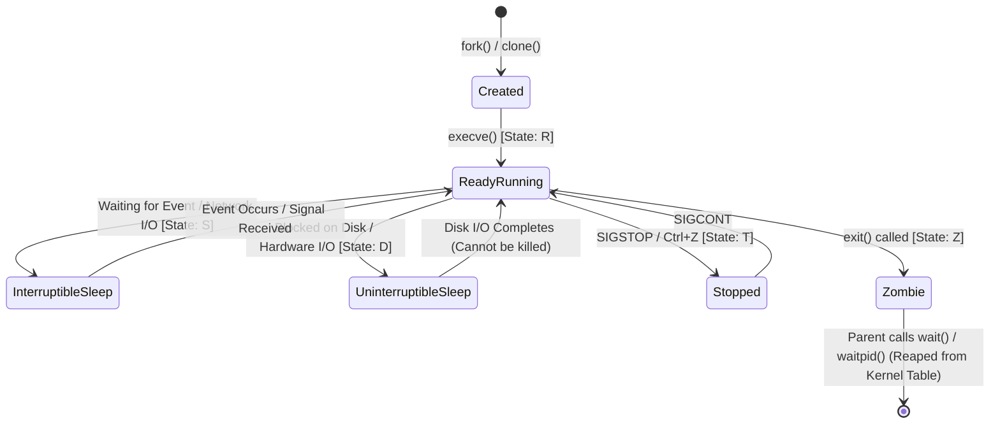
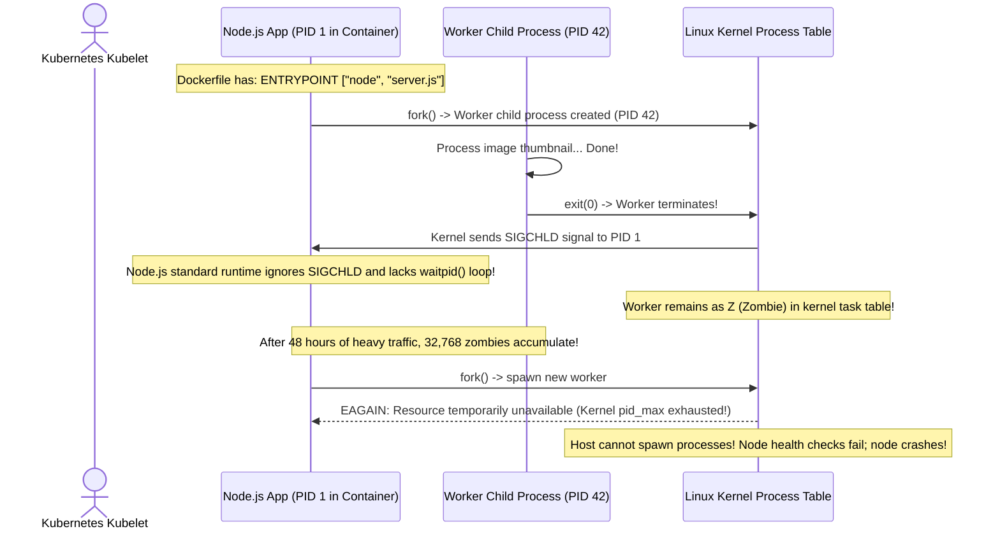

# Module 06: Process Management and Signal Handling

> **Prerequisites:** Module 04 (Users and Groups), Linux terminal shell.  
> **Estimated Reading Time:** 25 minutes  
> **Target Audience:** Backend Engineers, Site Reliability Engineers, DevOps & Container Developers.

> [!TIP]
> **The Golden Rule of Process Management:** Never start with `kill -9` (`SIGKILL`). Always escalate deliberately: start with `SIGTERM` (Signal 15) to allow processes to complete in-flight HTTP requests, commit database transactions, flush disk buffers, and close socket listeners. Only if the process fails to terminate after a bounded grace period (typically 10s–30s) should you escalate to `SIGKILL` (Signal 9).

---

## 1. Architectural Mental Model: The Linux Process Lifecycle and Tree

In Linux, every program in execution is represented as a `task_struct` inside the kernel and assigned a unique numeric **Process ID (PID)**. The operating system organizes all processes into a strict hierarchical tree rooted at **PID 1** (`systemd` on physical/VM Linux, or your entrypoint command inside Docker).



### The Fundamental Process States
* **`R` (Running / Runnable):** The process is either currently executing on a CPU core or waiting in the scheduler's run queue.
* **`S` (Interruptible Sleep):** The process is paused waiting for an event (e.g. incoming socket connection, sleep timer). It awakens immediately if a signal is sent.
* **`D` (Uninterruptible Sleep):** The process is blocked awaiting a direct hardware driver or synchronous disk I/O response. **Processes in D state cannot be terminated by `SIGKILL`** until the hardware/kernel call completes.
* **`Z` (Zombie / Defunct):** The process has finished executing and released its memory, but its entry remains in the kernel's process table because its parent process has not yet read its exit status via the `wait()` or `waitpid()` system call.
* **`T` (Stopped):** Suspended by a job control signal (`Ctrl+Z` or `SIGSTOP`).

---

## 2. Taxonomic Reference: Essential Linux Signals

Signals are asynchronous notifications dispatched by the kernel or userspace to inform a process of a specific event:

| Signal Number | Signal Name | Default Action | Can be Caught or Blocked? | Production Engineering Use Case |
| :--- | :--- | :--- | :--- | :--- |
| **`1`** | **`SIGHUP`** | Terminate | **Yes** | **Configuration Reload:** Nginx, Prometheus, and PostgreSQL reload config files without dropping connections. |
| **`2`** | **`SIGINT`** | Terminate | **Yes** | **Terminal Interrupt:** Sent when a user presses `Ctrl+C`. Triggers graceful interactive shutdown. |
| **`3`** | **`SIGQUIT`** | Core Dump | **Yes** | **Diagnostic Dump:** Sent via `Ctrl+\`. Instructs runtimes (Go, JVM) to dump thread stack traces. |
| **`9`** | **`SIGKILL`** | Terminate | **NO (Kernel Enforced)** | **Forced Termination:** Kernel destroys process memory immediately. Cannot flush buffers or clean temp files. |
| **`15`** | **`SIGTERM`** | Terminate | **Yes** | **Standard Graceful Termination:** Sent by `systemctl stop`, Docker `docker stop`, and Kubernetes pod teardowns. |
| **`17`** | **`SIGCHLD`** | Ignore | **Yes** | **Child Death Notification:** Sent to parent process when a child exits so parent can reap zombies. |
| **`18`** | **`SIGCONT`** | Continue | **Yes** | **Resume Execution:** Resumes execution of a process previously paused by `SIGSTOP`. |
| **`19`** | **`SIGSTOP`** | Pause | **NO (Kernel Enforced)** | **Uncatchable Pause:** Freezes process execution immediately without terminating it. |

---

## 3. Systematic Reference: Process Diagnostics & Triage Commands

| Command | Purpose | Production Use Case |
| :--- | :--- | :--- |
| **`ps aux`** | BSD-style snapshot of all running system processes | Inspect user, PID, %CPU, %MEM, VSZ, RSS, and process status. |
| **`ps -ef`** | Standard POSIX snapshot displaying Parent PID (PPID) | Tracing zombie processes back to their misbehaving parent. |
| **`pgrep -l <name>`** | Search for PIDs matching a process name pattern | `pgrep -l node` quickly returns all running Node.js PIDs. |
| **`pkill -15 -f <name>`** | Send a signal to all processes matching regex string | Send `SIGTERM` to all background Celery workers. |
| **`pstree -p`** | Visual ASCII tree of processes with their PIDs | Understand parent-child relationships and daemon ancestry. |
| **`ss -tulpn`** | Show listening TCP/UDP sockets with owning process & PID | Find which process is locking port 8080: `sudo ss -tulpn \| grep :8080`. |
| **`lsof -i :<port>`** | List open files / sockets for a specific TCP port | Instant lookup: `lsof -i :3000` reveals offending rogue process. |

---

## 4. Production War Story: The PID 1 Zombie Apocalypse Outage



### The Incident
A high-throughput video encoding platform running on Kubernetes experienced sudden, cascading node crashes. All nodes in the cluster became unresponsive. SSH sessions were rejected with:
`-bash: fork: retry: Resource temporarily unavailable`.

### The Post-Mortem Data
* **Severity:** SEV-1 (Cluster-Wide Infrastructure Collapse)
* **Mean Time to Detect (MTTD):** 30 minutes (Pods entered `CrashLoopBackOff`)
* **Mean Time to Resolution (MTTR):** 45 minutes (Node reboots and Dockerfile refactor)

### The Root Cause
The microservice Dockerfile specified:
```dockerfile
ENTRYPOINT ["node", "server.js"]
```
In Linux, **PID 1 is special**: the kernel expects PID 1 to adopt orphaned child processes and reap terminated children by invoking `wait()` or `waitpid()`. Because standard Node.js does not implement an init system's reaping loop, every child process spawned for video transcoding died and remained in the Linux kernel process table as a **Zombie (`Z`)**. 

Over two days, the process table consumed all 32,768 available PIDs on the host operating system (`/proc/sys/kernel/pid_max`), preventing the kernel from creating any new threads or processes.

### The Fix & Hardening
1. **Use an Init System in Docker Containers:** Prepend lightweight init supervisors such as `dumb-init` or `tini`:
```dockerfile
# Hardened Dockerfile
RUN apt-get update && apt-get install -y dumb-init && rm -rf /var/lib/apt/lists/*
ENTRYPOINT ["/usr/bin/dumb-init", "--"]
CMD ["node", "server.js"]
```
2. **Or enable Docker's built-in init flag:**
```bash
docker run --init -d my-app:latest
```
`dumb-init` runs as PID 1, correctly forwards all signals (`SIGTERM`) to the child application, and continuously reaps zombie processes.

---

## 5. Multi-Language Production Code: Graceful Shutdown & Signal Trapping

In production cloud environments, Kubernetes pods and Docker containers are terminated frequently during autoscaling and deployments. Applications must trap `SIGTERM` and shut down gracefully.

### Go
```go
package main

import (
	"context"
	"errors"
	"fmt"
	"net/http"
	"os"
	"os/signal"
	"syscall"
	"time"
)

func main() {
	server := &http.Server{
		Addr: ":8080",
		Handler: http.HandlerFunc(func(w http.ResponseWriter, r *http.Request) {
			// Simulate long-running request
			time.Sleep(2 * time.Second)
			w.Write([]byte(`{"status":"success"}`))
		}),
	}

	// Channel to listen for OS signals
	shutdownSignal := make(chan os.Signal, 1)
	signal.Notify(shutdownSignal, syscall.SIGINT, syscall.SIGTERM)

	go func() {
		fmt.Println("🚀 Server listening on port 8080...")
		if err := server.ListenAndServe(); err != nil && !errors.Is(err, http.ErrServerClosed) {
			fmt.Printf("Fatal server error: %v\n", err)
		}
	}()

	// Block until SIGINT or SIGTERM arrives
	sig := <-shutdownSignal
	fmt.Printf("\n🛑 Received signal: %v. Initiating graceful shutdown...\n", sig)

	// Grant 10 seconds for in-flight requests to complete
	ctx, cancel := context.WithTimeout(context.Background(), 10*time.Second)
	defer cancel()

	if err := server.Shutdown(ctx); err != nil {
		fmt.Printf("Forced shutdown due to timeout: %v\n", err)
	} else {
		fmt.Println("✅ All connections drained cleanly. Exiting safely.")
	}
}
```

### Node.js / TypeScript
```typescript
import * as http from 'http';

const server = http.createServer((req, res) => {
  // Simulate active workload
  setTimeout(() => {
    res.writeHead(200, { 'Content-Type': 'application/json' });
    res.end(JSON.stringify({ status: 'completed' }));
  }, 1500);
});

server.listen(8080, () => {
  console.log('🚀 HTTP Server listening on port 8080 (PID: ' + process.pid + ')');
});

function handleGracefulShutdown(signal: string) {
  console.log(`\n🛑 Received ${signal}. Draining active connections...`);

  // Stop accepting new client connections
  server.close((err) => {
    if (err) {
      console.error('Error during shutdown:', err);
      process.exit(1);
    }
    console.log('✅ Server stopped cleanly. Zero requests dropped.');
    process.exit(0);
  });

  // Enforce a hard timeout if connections refuse to drain
  setTimeout(() => {
    console.error('⚠️  Graceful shutdown timed out. Forcing termination.');
    process.exit(1);
  }, 10000).unref(); // unref prevents timeout from keeping event loop open
}

process.on('SIGTERM', () => handleGracefulShutdown('SIGTERM'));
process.on('SIGINT', () => handleGracefulShutdown('SIGINT'));
```

### Python
```python
import http.server
import signal
import sys
import threading
import time

class GracefulServer:
    def __init__(self, port=8080):
        self.server = http.server.HTTPServer(("0.0.0.0", port), http.server.SimpleHTTPRequestHandler)
        self.is_running = True

        # Register signal handlers
        signal.signal(signal.SIGTERM, self._signal_handler)
        signal.signal(signal.SIGINT, self._signal_handler)

    def _signal_handler(self, signum, frame):
        sig_name = signal.Signals(signum).name
        print(f"\n🛑 Intercepted {sig_name}. Initiating graceful teardown...")
        self.is_running = False
        threading.Thread(target=self.server.shutdown).start()

    def start(self):
        print(f"🚀 Server running on port 8080 (PID: {sys.argv[0]})")
        self.server.serve_forever()
        print("✅ Server shutdown complete. Resources freed.")

if __name__ == "__main__":
    app = GracefulServer()
    app.start()
```

---

## 6. Practical Hands-On Verification CLI Workflows

Work in your Ubuntu terminal:

### Workflow 1: Process Lifecycles, Backgrounding, and Job Control
```bash
# 1. Start a long-running process in the background (&)
sleep 1000 &
SLEEP_PID=$!
echo "Spawned background sleep with PID: $SLEEP_PID"

# 2. View active shell jobs
jobs -l

# 3. Bring job to foreground, pause it with Ctrl+Z, then resume with bg
# (Or programmatically pause and continue via signals):
kill -SIGSTOP $SLEEP_PID
ps -o pid,stat,cmd -p $SLEEP_PID
kill -SIGCONT $SLEEP_PID
ps -o pid,stat,cmd -p $SLEEP_PID
```
**Expected Output:**
```text
[1]+ 12345 Running                 sleep 1000 &
  PID STAT CMD
12345 T    sleep 1000
  PID STAT CMD
12345 S    sleep 1000
```

### Workflow 2: Safe Process Termination Escrow
```bash
# 1. Send graceful SIGTERM first
kill -15 $SLEEP_PID
sleep 1

# 2. Verify process is gone
ps -p $SLEEP_PID || echo "Process cleanly terminated via SIGTERM."
```

### Workflow 3: Discovering Port Ownership
```bash
# Identify which process is listening on an HTTP port
python3 -m http.server 9999 &
SRV_PID=$!
sleep 1

# Inspect using ss
ss -tulpn | grep 9999

# Clean up
kill -15 $SRV_PID
```

---

## 7. Operational Validation Checkpoint

<details>
<summary><strong>Question 1: The Unkillable Process in State D</strong></summary>

**Scenario:** An application server hangs. You run `ps aux` and observe the process state is `D`. You run `kill -9 <PID>` as root, but the process continues to appear in `ps aux` and refuses to terminate.

Why does `kill -9` fail to terminate a process in `D` state, and how can the system recover?

**Answer:**
A process in **State `D` (Uninterruptible Sleep)** is blocked inside the Linux kernel awaiting hardware I/O (most commonly an unresponsive NFS network mount, a dying physical disk with bad sectors, or a stalled GPU driver). 

The Linux kernel guarantees driver data consistency by **refusing to deliver any signals—including `SIGKILL`—while a thread is in uninterruptible kernel sleep**. 

The process cannot be killed until the underlying hardware system call returns or times out. If the network share or physical device is permanently dead, the only way to clear a D-state process is to fix the underlying hardware connection or **reboot the operating system**.
</details>

<details>
<summary><strong>Question 2: Zombie Processes and Memory Reclamation</strong></summary>

**Scenario:** A junior developer alerts you: "Our server has 500 zombie processes (`Z` state)! We must kill them immediately with `kill -9` before they exhaust all of the server's RAM!"

Is the junior developer's concern about memory consumption accurate? Why can you NOT run `kill -9` on a zombie?

**Answer:**
**The developer is mistaken on both counts:**
1. **Memory:** Zombie processes consume **zero RAM**. When a process calls `exit()`, the kernel deallocates all of its virtual memory, stack, heap, and open file descriptors. A zombie is merely a single 4KB metadata entry in the kernel's process table waiting for its parent to read its exit code.
2. **Signal Delivery:** You **cannot kill a zombie with `kill -9` because the process is already dead**. 

To remove zombies, you must either:
* Send `SIGCHLD` to the **parent process** so it executes `waitpid()`.
* If the parent process is broken or hung, **terminate the parent process**. When the parent dies, the zombies are reparented to PID 1, which instantly reaps them.
</details>

<details>
<summary><strong>Question 3: Why Container PID 1 Ignores SIGTERM</strong></summary>

**Scenario:** You deploy a microservice inside Docker with `ENTRYPOINT ["./my-service"]`. When you run `docker stop <container>`, Docker waits 10 seconds before forcibly killing the container with `SIGKILL`. Your graceful shutdown logic never executed.

Why did the service fail to respond to `SIGTERM` when running as PID 1?

**Answer:**
In Linux, **PID 1 receives special protection from the kernel**: by default, the kernel will NOT deliver any signal to PID 1 for which the process has not installed an **explicit signal handler**. 

For normal processes (PID > 1), receiving `SIGTERM` triggers the kernel's default termination action. But for PID 1, if the binary does not register an explicit handler for `SIGTERM`, the kernel silently drops the signal! 

When `docker stop` sends `SIGTERM`, the application ignores it. After the 10-second grace timeout expires, Docker issues `SIGKILL` (which cannot be ignored), abruptly terminating the container without graceful cleanup.

**The Fix:** Explicitly register a `SIGTERM` handler in application code or run inside an init supervisor like `dumb-init` or `docker run --init`.
</details>

---

## Next Step

Now that you understand process lifecycles and signal handling, proceed to **[07 · I/O Redirection and Pipes](../07-io-redirection-and-pipes/README.md)** to master standard streams (stdin, stdout, stderr), pipeline composition, file descriptor duplication, and subshells.
