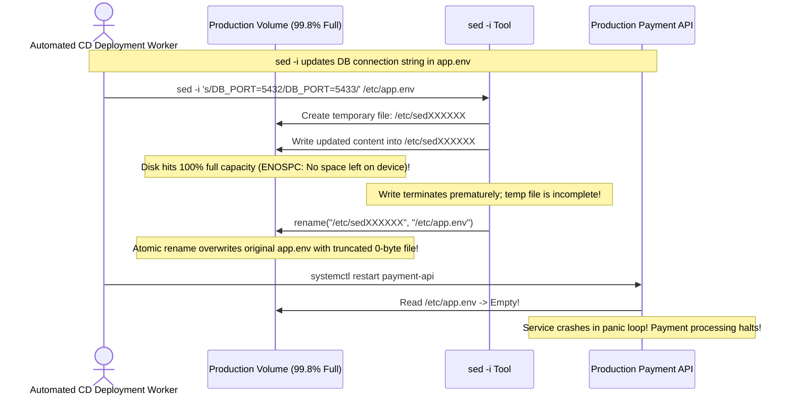

# Module 08: Text Processing with grep, sed, and awk

> **Prerequisites:** Module 07 (I/O Redirection and Pipes), basic terminal navigation.  
> **Estimated Reading Time:** 25 minutes  
> **Target Audience:** Backend Engineers, Site Reliability Engineers, Production Support Specialists.

> [!TIP]
> **The Golden Rule of Unix Text Processing:** Divide and conquer: use **`grep`** to filter matching lines, **`sed`** to substitute or normalize tokens, and **`awk`** to parse columns and compute metrics. When triaging multi-gigabyte production logs, always test your pipeline in a read-only stream before touching disk, and use `grep -F` whenever searching for literal strings (like IPs or UUIDs) to eliminate regular expression overhead and avoid character-escaping bugs.

---

## 1. Architectural Mental Model: The Production Triage Pipeline

When an outage strikes, gigabytes of unformatted log data stream across disk and network interfaces. The Unix text processing toolchain filters noise and computes answers in a single streaming pass without loading entire files into memory:

```mermaid
flowchart LR
    RawLogs["1. Raw Ingestion\n(/var/log/nginx/access.log\n10,000,000 lines / 2.4 GB)"]
    
    GrepStage["2. Filter: grep -E\nExtract HTTP 5xx errors\n(5,200 lines remain)"]
    
    SedStage["3. Normalize: sed -E\nMask dynamic UUIDs/IDs\n(/users/123 -> /users/:id)"]
    
    AwkStage["4. Aggregate: awk\nExtract endpoint & sum latency\n(Top failure groups)"]
    
    SortStage["5. Sort & Cap: sort | head\nRank highest error endpoints"]

    RawLogs -->|stdout pipe| GrepStage
    GrepStage -->|stdout pipe| SedStage
    SedStage -->|stdout pipe| AwkStage
    AwkStage -->|stdout pipe| SortStage
    SortStage --> FinalReport["Actionable Incident Report\n(Under 1.2 seconds)"]
```



### Tool Responsibilities
* **`grep` (Global Regular Expression Print):** Fast pattern matching. It answers: *"Does this line contain my pattern?"*
* **`sed` (Stream Editor):** Lightweight inline transformations. It answers: *"Replace string A with string B on matching lines."*
* **`awk` (Pattern Scanning and Processing Language):** Full procedural data extraction language. It answers: *"Treat each line as a table row, pull columns 1, 7, and 9, and calculate the sum or average."*

---

## 2. Taxonomic Reference: Comparing Text Utilities

| Feature / Capability | `grep` | `sed` | `awk` | `cut` / `tr` |
| :--- | :--- | :--- | :--- | :--- |
| **Primary Specialty** | Line filtering & searching | Stream substitution & regex deletion | Field extraction & arithmetic aggregation | Simple single-char column cutting / translation |
| **Performance** | **Extremely fast** (`-F` SIMD acceleration) | Fast streaming | Fast (interprets AWK bytecode) | Blazing fast (minimal logic) |
| **Memory Footprint** | $O(1)$ per line buffer | $O(1)$ pattern space | $O(N)$ if storing state in arrays | $O(1)$ |
| **Multi-column Math** | No | No | **Yes** (sums, averages, counts) | No |
| **In-place File Edits** | No | `sed -i` | `awk -i inplace` (gawk only) | No |

---

## 3. Systematic Breakdown: Core Flags & Idioms

### 1. `grep` Command Suite
* `grep -i "error"`: Case-insensitive search.
* `grep -v "healthcheck"`: **Invert match** (drops lines matching pattern; great for silencing heartbeat noise).
* `grep -c "500 Internal"`: Count total matching lines instead of printing.
* `grep -n "FATAL"`: Print 1-based line numbers.
* `grep -oE "[0-9]{1,3}\.[0-9]{1,3}\.[0-9]{1,3}\.[0-9]{1,3}"`: Print **only the matching token**, discarding the rest of the line.
* `grep -F "user.id[42]"`: **Fixed string mode**. Treats dots, brackets, and stars literally without escaping.

### 2. `sed` Command Suite
* `sed 's/localhost/127.0.0.1/g'`: Global substitution per line.
* `sed -E 's/[0-9a-f]{8}-([0-9a-f]{4}-){3}[0-9a-f]{12}/:uuid/g'`: Replace UUIDs with placeholder.
* `sed '/^#/d; /^$/d'`: Delete all commented lines (`^#`) and empty lines (`^$`).
* `sed -n '50,75p'`: Print only lines 50 through 75 (zero regex overhead).

### 3. `awk` Command Suite
* `awk '{print $1, $NF}'`: Print first column and last column (`$NF`).
* `awk -F':' '{print $1, $3}' /etc/passwd`: Use custom delimiter `:` instead of default whitespace.
* `awk '$9 >= 500 {print $7, $9}' access.log`: Print endpoint and status code for all HTTP 5xx responses.
* `awk '{sum += $NF} END {print "Avg:", sum/NR}' metrics.log`: Compute running sum and average.

---

## 4. Production War Story: The `sed -i` Zero-Byte Outage



### The Incident
During a zero-downtime database port failover, an automated deployment runner updated the primary application configuration using:
```bash
sed -i 's/DB_HOST=.*/DB_HOST=10.0.2.14/' /etc/app/config.env
```
Immediately upon execution, the entire production payment processing API failed health checks.

### The Post-Mortem Data
* **Severity:** SEV-1 (Global Revenue Impact)
* **Mean Time to Detect (MTTD):** 15 minutes
* **Mean Time to Resolution (MTTR):** 60 minutes

### The Root Cause
The operating system's root volume was at **99.8% capacity**. 

GNU `sed -i` performs in-place updates by writing a hidden temporary file in the same directory and renaming it over the original file upon completion. When `sed` encountered disk exhaustion (`ENOSPC`), it truncated the write. Because older versions failed to abort the rename upon I/O error, the empty/truncated temporary file overwrote the original configuration file, destroying all production environment secrets.

### The Fix & Hardening
1. **Never use blind `sed -i` in mission-critical automated pipelines.** Use explicit temporary files with non-zero byte validation:
```bash
sed 's/DB_HOST=.*/DB_HOST=10.0.2.14/' /etc/app/config.env > /etc/app/config.env.tmp && \
[ -s /etc/app/config.env.tmp ] && \
mv /etc/app/config.env.tmp /etc/app/config.env
```
2. **Always create an atomic backup file when using `-i`:**
```bash
sed -i.bak 's/DB_HOST=.*/DB_HOST=10.0.2.14/' /etc/app/config.env
```
*(If the operation crashes, `config.env.bak` remains untouched).*

---

## 5. Multi-Language Production Code: Streaming Log Parsing

Backend microservices and logging sidecars frequently parse unstructured logs into structured JSON metrics.

### Go
```go
package main

import (
	"bufio"
	"fmt"
	"os"
	"regexp"
	"strings"
)

// LogEntry represents an extracted access log
type LogEntry struct {
	IP     string
	Method string
	Status string
	Path   string
}

// ParseLogStream reads logs line-by-line using bufio.Scanner to maintain O(1) memory footprint.
func ParseLogStream(filePath string) ([]LogEntry, error) {
	file, err := os.Open(filePath)
	if err != nil {
		return nil, err
	}
	defer file.Close()

	// Compiled regex for common log format: IP - - [date] "METHOD PATH HTTP/1.1" STATUS
	re := regexp.MustCompile(`^(\S+) \S+ \S+ \[.*?\] "(\S+) (\S+) \S+" (\d{3})`)

	var entries []LogEntry
	scanner := bufio.NewScanner(file)

	for scanner.Scan() {
		line := scanner.Text()
		matches := re.FindStringSubmatch(line)
		if len(matches) == 5 {
			entries = append(entries, LogEntry{
				IP:     matches[1],
				Method: matches[2],
				Path:   matches[3],
				Status: matches[4],
			})
		}
	}

	return entries, scanner.Err()
}

func main() {
	// Simulated test
	fmt.Println("🚀 Streaming log processor ready.")
}
```

### Node.js / TypeScript
```typescript
import * as fs from 'fs';
import * as readline from 'readline';

interface HTTPMetric {
  endpoint: string;
  statusCode: number;
}

/**
 * Streams large log files line by line using Readline interface.
 */
export async function countErrorFrequencies(logFilePath: string): Promise<Record<string, number>> {
  const fileStream = fs.createReadStream(logFilePath, { encoding: 'utf-8' });
  const rl = readline.createInterface({ input: fileStream, crlfDelay: Infinity });

  const errorCounts: Record<string, number> = {};
  const regex = /"([A-Z]+ \S+ \S+)" (\d{3})/;

  for await (const line of rl) {
    const match = line.match(regex);
    if (match) {
      const endpoint = match[1];
      const status = parseInt(match[2], 10);

      if (status >= 500) {
        errorCounts[endpoint] = (errorCounts[endpoint] || 0) + 1;
      }
    }
  }

  return errorCounts;
}
```

### Python
```python
import re
from collections import Counter
from typing import Dict

def analyze_http_errors(log_path: str) -> Dict[str, int]:
    """
    Parses web server logs streaming one line at a time to count 5xx error endpoints.
    """
    pattern = re.compile(r'"(?:GET|POST|PUT|DELETE) (\S+) HTTP/\d\.\d" (5\d{2})')
    error_counter = Counter()

    with open(log_path, "r", encoding="utf-8") as f:
        for line in f:
            match = pattern.search(line)
            if match:
                endpoint = match.group(1)
                error_counter[endpoint] += 1

    return dict(error_counter.most_common(10))

if __name__ == "__main__":
    print("Python log processor initialized.")
```

---

## 6. Practical Hands-On Verification CLI Workflows

Work in your Ubuntu terminal:

### Workflow 1: Create a Simulated Production Web Log
```bash
# 1. Generate realistic web access logs
cat << 'EOF' > /tmp/access.log
192.168.1.10 - - [10/Nov/2026:15:30:01] "GET /api/v1/orders HTTP/1.1" 200 452
192.168.1.11 - - [10/Nov/2026:15:30:02] "POST /api/v1/checkout HTTP/1.1" 500 128
192.168.1.10 - - [10/Nov/2026:15:30:03] "GET /healthz HTTP/1.1" 200 12
192.168.1.12 - - [10/Nov/2026:15:30:04] "POST /api/v1/checkout HTTP/1.1" 500 128
192.168.1.13 - - [10/Nov/2026:15:30:05] "GET /api/v1/users HTTP/1.1" 200 940
192.168.1.11 - - [10/Nov/2026:15:30:06] "POST /api/v1/checkout HTTP/1.1" 500 128
EOF
```

### Workflow 2: Extract Error Counts and Offending Endpoints
```bash
# 1. Filter out health checks and extract only HTTP 500 lines using grep
grep " 500 " /tmp/access.log | grep -v "/healthz"

# 2. Extract column 7 (endpoint) using awk and calculate frequency
awk '$9 == 500 {print $7}' /tmp/access.log | sort | uniq -c | sort -nr
```
**Expected Output:**
```text
3 /api/v1/checkout
```

### Workflow 3: Mask Sensitive Data with `sed`
```bash
# Replace IP addresses with [ANONYMIZED]
sed -E 's/[0-9]{1,3}\.[0-9]{1,3}\.[0-9]{1,3}\.[0-9]{1,3}/[ANONYMIZED]/g' /tmp/access.log
rm -f /tmp/access.log
```

---

## 7. Operational Validation Checkpoint

<details>
<summary><strong>Question 1: Searching for Literal Strings (The Regex Trap)</strong></summary>

**Scenario:** An SRE runs this command to search for an IP address across 10GB of logs:
```bash
grep "10.0.0.1" /var/log/syslog
```
The command unexpectedly returns lines containing `10100001`, `10-0-0-1`, and `10.0.0.100`.

Why did this occur, and what is the exact flag to enforce strict literal matching with zero regex parsing overhead?

**Answer:**
In standard regular expressions, the dot character `.` is a **wildcard that matches any single character**. Therefore, `"10.0.0.1"` matches `10-0-0-1`, `10X0X0X1`, and any characters preceding or succeeding the match. 

**The Production Fix:** Use **`grep -F` (Fixed Strings)**:
```bash
grep -F "10.0.0.1" /var/log/syslog
```
`-F` instructs `grep` to bypass the regular expression engine entirely and use SIMD-accelerated string search algorithms (e.g., Boyer-Moore), eliminating wildcard parsing bugs and running significantly faster.
</details>

<details>
<summary><strong>Question 2: Cross-Platform `sed -i` Incompatibility</strong></summary>

**Scenario:** A developer writes a deployment script on Ubuntu Linux:
```bash
sed -i 's/stage/production/' deploy.env
```
When another team member runs this same script on macOS, the script crashes immediately with:
`sed: 1: "deploy.env": invalid command code d`.

Why did this occur, and how do you write a portable `sed` command?

**Answer:**
Linux uses **GNU `sed`**, where the backup extension after `-i` is optional (`sed -i 'script' file`). 

macOS uses **BSD `sed`**, where `-i` **strictly requires an explicit backup extension argument**. On macOS, `sed` interpreted `'s/stage/production/'` as the backup extension string, and attempted to parse the file `deploy.env` as the script syntax!

**The Portable Fix:** Provide an explicit backup extension (e.g. `''` or `'.bak'`):
```bash
sed -i.bak 's/stage/production/' deploy.env && rm -f deploy.env.bak
```
Or use a temporary file with standard redirection (`sed '...' file > tmp && mv tmp file`).
</details>

<details>
<summary><strong>Question 3: Parsing Space-Delimited vs. Comma-Delimited Data with `awk`</strong></summary>

**Scenario:** You need to extract the username and UID from `/etc/passwd`. A junior developer writes:
`awk '{print $1, $3}' /etc/passwd`
The command prints the entire line as `$1` and leaves `$3` empty.

Why did this occur, and how must `awk` be instructed to parse `/etc/passwd`?

**Answer:**
By default, `awk` splits fields on **whitespace (spaces or tabs)**. 

`/etc/passwd` uses colons `:` as field delimiters without any spaces. Because there are no spaces on each line, `awk` treats the entire line as a single field (`$1`). 

**The Fix:** Specify the Field Separator using `-F` (or setting `FS`):
```bash
awk -F':' '{print $1, $3}' /etc/passwd
```
Now `$1` extracts the username and `$3` extracts the numeric UID accurately.
</details>

---

## Next Step

Now that you understand text filtering, regular expressions, and stream manipulation, proceed to **[09 · Bash Scripting and Automation](../09-bash-scripting/README.md)** to master variables, functions, error handling, exit codes, and defensive scripting patterns.
