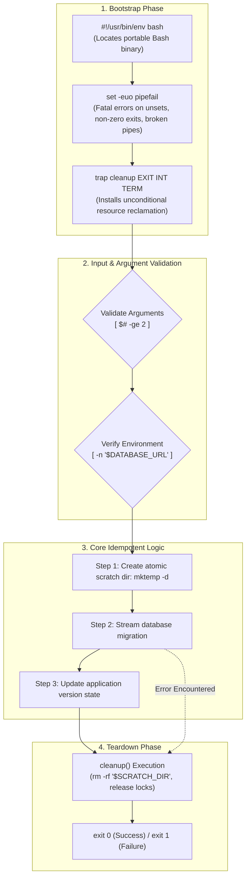
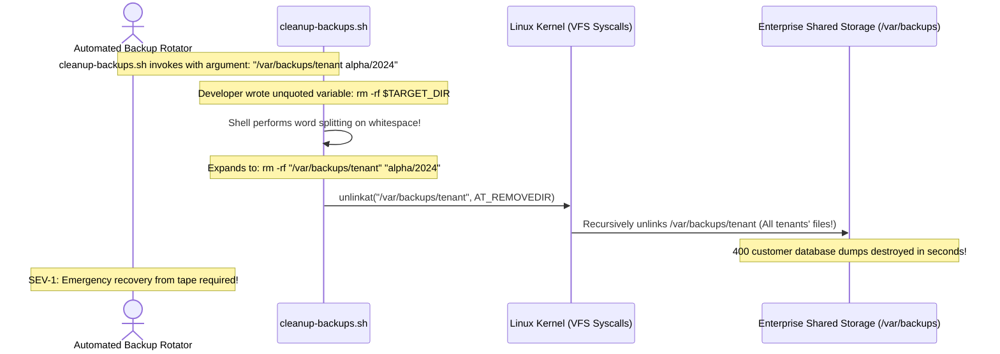

# Module 09: Bash Scripting and Automation

> **Prerequisites:** Module 07 (I/O Redirection and Pipes), Module 08 (Text Processing).  
> **Estimated Reading Time:** 25 minutes  
> **Target Audience:** DevOps Engineers, Backend Automation Authors, Platform Engineers.

> [!TIP]
> **The Golden Rule of Defensive Bash Scripting:** Always begin mission-critical scripts with the defensive preamble: `set -euo pipefail` and `IFS=$'\n\t'`. Enforce double quotes around **every single variable expansion** (`"$VAR"`) to neutralize word-splitting and wildcard globbing attacks, and bind a cleanup function to the `EXIT` pseudo-signal (`trap cleanup EXIT`) to guarantee that temporary locks, sockets, and files are purged regardless of how the script terminates.

---

## 1. Architectural Mental Model: The Defensive Script Execution Engine

A production shell script is not a series of loosely typed commands; it is a compiled-on-the-fly program running inside an isolated child shell environment with explicit signal handling and error traps:



---

## 2. Taxonomic Reference: The Defensive Bash Preamble

Never write a production automation script without understanding the four essential safety flags:

| Flag | Name | Failure Prevented Without It | Production Impact |
| :--- | :--- | :--- | :--- |
| **`set -e`** | `errexit` | Scripts continue executing subsequent commands after a fatal crash. | Halts execution immediately if any command returns a non-zero exit code. |
| **`set -u`** | `nounset` | Unset variables silently expand to empty strings (`""`). | Catastrophic typos like `rm -rf "$MNT_DIR/*"` become fatal errors before deletion. |
| **`set -o pipefail`** | `pipefail` | Pipelines return the exit status of the *last* command only. | If `pg_dump` fails before `gzip`, the pipeline correctly fails with a non-zero status. |
| **`set -x`** | `xtrace` | Silent debugging during CI/CD failures. | Prints each command and its expanded arguments to stderr before executing. |

---

## 3. Systematic Reference: Parameters and Conditional Operators

### 1. Special Shell Parameters
* **`$0`**: Path/name of the executing script.
* **`$1, $2, ... $9`**: Positional arguments passed to the script.
* **`$#`**: Total number of positional arguments.
* **`"$@"`**: Expands to all positional arguments as **separate quoted strings** (`"$1" "$2" "$3"`). Always use this for looping!
* **`"$*"`**: Expands to all arguments joined into a single string (`"$1 $2 $3"`).
* **`$?`**: Exit status of the most recently executed foreground pipeline (`0` = success).
* **`$$`**: Process ID (PID) of the current script instance.

### 2. Modern Conditional Tests (`[[ ... ]]`)
Always prefer double brackets `[[ ... ]]` over legacy POSIX single brackets `[ ... ]`:

| Expression | Meaning | Example |
| :--- | :--- | :--- |
| **`-f "$FILE"`** | True if path exists and is a regular file | `[[ -f "/etc/app.yaml" ]]` |
| **`-d "$DIR"`** | True if path exists and is a directory | `[[ -d "/var/log/nginx" ]]` |
| **`-z "$STR"`** | True if string length is **zero** (empty) | `[[ -z "$AUTH_TOKEN" ]]` |
| **`-n "$STR"`** | True if string length is **non-zero** (not empty) | `[[ -n "$CLUSTER_NAME" ]]` |
| **`"$A" == "$B"`** | String equality | `[[ "$ENV" == "production" ]]` |
| **`"$A" =~ $REGEX`** | Regular expression match | `[[ "$VERSION" =~ ^v[0-9]+\.[0-9]+ ]]` |
| **`"$N" -eq "$M"`** | Numeric equality (`-ne`, `-lt`, `-le`, `-gt`, `-ge`) | `[[ "$RETRY_COUNT" -gt 5 ]]` |

---

## 4. Production War Story: The Unquoted Word-Splitting Data Deletion



### The Incident
An enterprise cloud multi-tenant backup system ran a nightly script to purge customer snapshots older than 30 days. One customer configured their organization display name with a space: `"tenant alpha"`.

### The Post-Mortem Data
* **Severity:** SEV-1 (Critical Data Loss)
* **Mean Time to Detect (MTTD):** 10 minutes
* **Mean Time to Resolution (MTTR):** 90 minutes

### The Root Cause
The maintenance script contained:
```bash
TARGET_PATH="/var/backups/$CUSTOMER_NAME/$DATE"
rm -rf $TARGET_PATH
```
Because `$TARGET_PATH` was **unquoted**, Bash evaluated whitespace as parameter delimiters during the word-splitting expansion phase. The single argument expanded into:
```bash
rm -rf /var/backups/tenant alpha/2024
```
The command deleted `/var/backups/tenant`, completely obliterating every single snapshot belonging to every tenant on the system.

### The Fix & Hardening
1. **Always Quote All Variable Expansions:**
```bash
rm -rf "$TARGET_PATH"
```
2. **Implement Guardrails Against Dangerous Deletions:**
```bash
if [[ -z "$TARGET_PATH" || "$TARGET_PATH" == "/" || "$TARGET_PATH" == "/var/backups" ]]; then
    echo "FATAL: Dangerous target path blocked: '$TARGET_PATH'" >&2
    exit 1
fi
```
3. **Mandatory CI/CD Static Analysis:** Enforce `shellcheck` across all repositories to automatically fail builds that contain unquoted variables or unsafe expansion patterns.

---

## 5. Multi-Language Production Code: Scripting & Automation Wrappers

When building production backend tools, engineers often wrap system automation in typed, testable languages.

### Go
```go
package main

import (
	"context"
	"fmt"
	"os"
	"os/exec"
	"os/signal"
	"syscall"
	"time"
)

// RunAutomationTask executes a system script with strict context timeouts and signal propagation.
func RunAutomationTask(ctx context.Context, scriptPath string, args ...string) error {
	cmd := exec.CommandContext(ctx, scriptPath, args...)
	cmd.Stdout = os.Stdout
	cmd.Stderr = os.Stderr

	fmt.Printf("🚀 Executing automation: %s %v\n", scriptPath, args)
	if err := cmd.Run(); err != nil {
		return fmt.Errorf("automation failed: %w", err)
	}

	fmt.Println("✅ Task completed successfully.")
	return nil
}

func main() {
	// Root context with graceful cancellation
	ctx, cancel := signal.NotifyContext(context.Background(), syscall.SIGINT, syscall.SIGTERM)
	defer cancel()

	// 30-second execution deadline
	timeoutCtx, timeoutCancel := context.WithTimeout(ctx, 30*time.Second)
	defer timeoutCancel()

	if err := RunAutomationTask(timeoutCtx, "/bin/echo", "Automated deployment task active"); err != nil {
		fmt.Fprintf(os.Stderr, "Error: %v\n", err)
		os.Exit(1)
	}
}
```

### Node.js / TypeScript
```typescript
import { spawn } from 'child_process';

interface ScriptOptions {
  timeoutMs?: number;
  env?: NodeJS.ProcessEnv;
}

/**
 * Spawns an automation script with robust error and exit code handling.
 */
export function runScript(command: string, args: string[], options: ScriptOptions = {}): Promise<number> {
  return new Promise((resolve, reject) => {
    const child = spawn(command, args, {
      stdio: 'inherit',
      timeout: options.timeoutMs || 30000,
      env: { ...process.env, ...options.env },
    });

    child.on('error', (err) => reject(new Error(`Failed to start process: ${err.message}`)));

    child.on('close', (code) => {
      if (code === 0) {
        resolve(code);
      } else {
        reject(new Error(`Script ${command} exited with non-zero status code: ${code}`));
      }
    });
  });
}

async function execute() {
  try {
    await runScript('bash', ['-c', 'echo "Deploying version $APP_VER"'], {
      env: { APP_VER: 'v2.4.1' },
    });
    console.log('✅ Deployment script passed.');
  } catch (err: any) {
    console.error(`❌ ${err.message}`);
    process.exit(1);
  }
}

execute();
```

### Python
```python
import subprocess
import sys
import tempfile
from pathlib import Path

def run_isolated_task(script_content: str, timeout_sec: int = 15) -> int:
    """
    Writes script to a safe temporary file, sets execution bits, and runs it safely.
    """
    with tempfile.NamedTemporaryFile("w", suffix=".sh", delete=False) as temp_script:
        temp_script.write("#!/usr/bin/env bash\nset -euo pipefail\n")
        temp_script.write(script_content)
        temp_path = Path(temp_script.name)

    try:
        temp_path.chmod(0o700)
        proc = subprocess.run(
            [str(temp_path)],
            check=True,
            timeout=timeout_sec,
            text=True
        )
        return proc.returncode
    except subprocess.CalledProcessError as e:
        print(f"❌ Script failed with code {e.returncode}", file=sys.stderr)
        return e.returncode
    finally:
        if temp_path.exists():
            temp_path.unlink()

if __name__ == "__main__":
    task = """
    echo "Running data migration..."
    uname -a
    """
    sys.exit(run_isolated_task(task))
```

---

## 6. Practical Hands-On Verification CLI Workflows

Follow these workflows in your Ubuntu terminal:

### Workflow 1: Author a Production-Grade Defensive Script
Create an automated backup script with strict parameter guards and cleanup traps:
```bash
cat << 'EOF' > ~/projects/safe-backup.sh
#!/usr/bin/env bash
set -euo pipefail
IFS=$'\n\t'

# 1. Require target argument
BACKUP_DIR="${1:?FATAL: You must provide a backup directory argument}"

# 2. Setup atomic scratchpad with guaranteed cleanup trap
TMP_DIR=$(mktemp -d "/tmp/backup_scratch.XXXXXX")
cleanup() {
    echo "🧹 Cleaning temporary scratchpad: $TMP_DIR"
    rm -rf "$TMP_DIR"
}
trap cleanup EXIT INT TERM

# 3. Perform work
mkdir -p "$BACKUP_DIR"
echo "Backup Manifest Created: $(date)" > "$TMP_DIR/manifest.txt"
cp "$TMP_DIR/manifest.txt" "$BACKUP_DIR/"
echo "✅ Backup successfully archived to $BACKUP_DIR"
EOF

chmod 755 ~/projects/safe-backup.sh
```

### Workflow 2: Test Parameter Enforcement and Trapping
```bash
# 1. Test missing argument rejection
~/projects/safe-backup.sh || echo "Expected: Aborted due to missing argument"

# 2. Test successful execution and observe automatic cleanup
~/projects/safe-backup.sh ~/projects/backup-archive
ls -l ~/projects/backup-archive/manifest.txt

# 3. Clean up
rm -rf ~/projects/safe-backup.sh ~/projects/backup-archive
```

---

## 7. Operational Validation Checkpoint

<details>
<summary><strong>Question 1: `"$@"` vs `"$*"` in Array Looping</strong></summary>

**Scenario:** A script accepts multiple file names as arguments:
`./process-files.sh "report 1.pdf" "summary 2.pdf"`
Inside the script, the developer writes:
```bash
for file in "$*"; do
    echo "Processing: $file"
done
```
The script runs only once, printing: `Processing: report 1.pdf summary 2.pdf`.

Why did the loop not iterate through the two individual files, and what is the fix?

**Answer:**
`"$*"` joins all positional arguments into a **single string**, separated by the first character of `$IFS` (space by default). Therefore, the `for` loop received exactly one combined string and iterated once.

**The Fix:** Use `"$@"`:
```bash
for file in "$@"; do
    echo "Processing: $file"
done
```
`"$@"` expands to each parameter as an **individual quoted string** (`"report 1.pdf"` `"summary 2.pdf"`), preserving argument boundaries and spaces correctly.
</details>

<details>
<summary><strong>Question 2: The `set -e` Condition Evaluation Bypass</strong></summary>

**Scenario:** A developer relies on `set -e` to stop the script on errors. They write:
```bash
set -e
if grep "database_error" /var/log/app.log; then
    echo "Errors detected!"
fi
echo "Script finished successfully!"
```
When `grep` finds no errors, it exits with return code `1`. The developer expects `set -e` to terminate the script, but the script prints `Script finished successfully!`.

Why did `set -e` not abort the script?

**Answer:**
Under the POSIX specification for `errexit` (`set -e`), the shell will **NOT exit if the failing command is part of a conditional test**, such as the condition of an `if`, `while`, or `until` statement, or on the left-hand side of a `&&` or `||` list. 

The `if` statement's purpose is specifically to inspect and branch on the command's exit status. Therefore, a non-zero exit from `grep` is treated as a boolean `false`, allowing the script to jump over the `then` branch and proceed.
</details>

<details>
<summary><strong>Question 3: The `trap cleanup EXIT` Invariant</strong></summary>

**Scenario:** A deployment script creates a temporary database lock file `/tmp/deploy.lock`. The developer installs:
```bash
trap "rm -f /tmp/deploy.lock" INT TERM
```
During deployment, the script crashes due to a syntax error on line 45. The lock file remains on disk, blocking all subsequent automated deployments until manual intervention.

Why did the trap not fire, and what is the proper pseudo-signal?

**Answer:**
The developer trapped only `INT` (`Ctrl+C`) and `TERM` (`kill -15`). A syntax error or command failure that causes a script to exit naturally (or via `set -e` / `exit 1`) does not generate an `INT` or `TERM` signal. 

**The Fix:** Trap the **`EXIT` pseudo-signal**:
```bash
trap "rm -f /tmp/deploy.lock" EXIT
```
In Bash, `EXIT` (signal 0) is guaranteed to execute whenever the shell process exits for **any reason whatsoever**—including normal completion, `set -e` failures, syntax errors, or received signals.
</details>

---

## Next Step

Now that you have mastered shell scripting and automated workflows, proceed to **[10 · Networking Basics](../10-networking-basics/README.md)** to explore TCP/UDP sockets, DNS resolution, IP routing, `ss`, and `curl` wire diagnostics.
