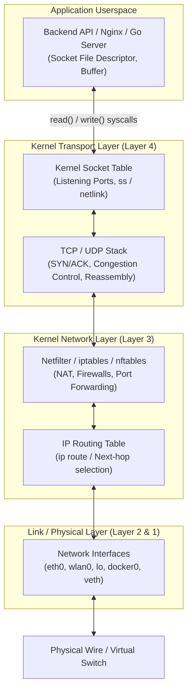
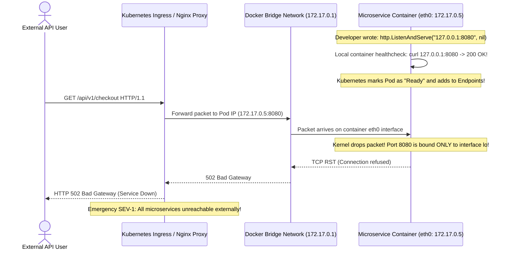

# Module 10: Networking Basics and Wire Diagnostics

> **Prerequisites:** Module 06 (Process Management), Module 07 (I/O Redirection and Pipes).  
> **Estimated Reading Time:** 25 minutes  
> **Target Audience:** Backend Developers, DevOps Engineers, Cloud Infrastructure Architects.

> [!TIP]
> **The Golden Rule of Linux Network Diagnostics:** When an API connection fails, **triage from the bottom up**: Link (`ip link`) ➔ Address (`ip addr`) ➔ Route (`ip route`) ➔ Listening Socket (`ss -tulpn`) ➔ DNS Resolution (`dig` / `nslookup`) ➔ Application Layer (`curl -v`). In containerized microservices, **never bind your HTTP server to `127.0.0.1`**; always bind to `0.0.0.0` so the process accepts routed packets from the bridge interface.

---

## 1. Architectural Mental Model: The Linux Network Subsystem

Every incoming and outgoing network packet traverses the Linux kernel's network stack before reaching application userspace:



---

## 2. Taxonomic Reference: Modern `iproute2` vs. Deprecated Legacy Utilities

Older Linux tutorials frequently mention obsolete network tools. Modern Linux distributions replace the legacy `net-tools` package with `iproute2`, which communicates directly with the kernel via fast **Netlink sockets** rather than parsing slow text in `/proc`:

| Diagnostic Category | Deprecated Legacy Tool | Modern `iproute2` Standard | Command Example | Key Advantages |
| :--- | :--- | :--- | :--- | :--- |
| **Interface & IP Address** | `ifconfig` | **`ip addr`** (`ip a`) | `ip addr show eth0` | Shows CIDR masks, secondary IPs, and interface flags. |
| **Routing Table** | `route -n` | **`ip route`** (`ip r`) | `ip route show` | Instant next-hop gateway resolution and metric prioritization. |
| **Socket & Port Inspection** | `netstat -tulnp` | **`ss -tulpn`** | `ss -tulpn \| grep :8080` | **100x faster** on high-traffic servers with 50,000+ open connections. |
| **Neighbor / ARP Table** | `arp -n` | **`ip neigh`** | `ip neigh show` | Resolves IP-to-MAC hardware mappings across local segments. |
| **DNS Resolution** | `nslookup` | **`dig`** | `dig +short api.github.com` | Queries DNS root servers, returns TTLs, inspects CNAME chains. |

---

## 3. Systematic Breakdown: Loopback (`127.0.0.1`) vs. Wildcard (`0.0.0.0`)

Understanding socket binding addresses is mandatory for container and cloud deployments:

```
  ┌────────────────────────────────────────────────────────┐
  │ Physical Host / Container Namespace                    │
  │                                                        │
  │  ┌──────────────────────┐    ┌──────────────────────┐  │
  │  │ Loopback Interface   │    │ Network Interface    │  │
  │  │ lo (127.0.0.1)       │    │ eth0 (172.17.0.2)    │  │
  │  └──────────┬───────────┘    └──────────┬───────────┘  │
  │             │                           │              │
  │             ▼                           ▼              │
  │   Listening on 127.0.0.1        Listening on 0.0.0.0   │
  │   (Internal only; isolated)     (Accepts traffic from  │
  │                                  ALL local & ext IFs!) │
  └────────────────────────────────────────────────────────┘
```

| Bind Address | Interface Scope | Reachable From | Production Engineering Context |
| :--- | :--- | :--- | :--- |
| **`127.0.0.1`** (`localhost`) | `lo` (Loopback only) | Only processes on the **same local OS host** | Safe for local dev tools and intra-node proxies. |
| **`0.0.0.0`** (`INADDR_ANY`) | All IPv4 interfaces (`lo`, `eth0`, `docker0`) | Anyone on the LAN/WAN that can route to host | **Mandatory for Docker containers and public API servers**. |
| **`::`** (IPv6 Wildcard) | All IPv6 (and IPv4 via dual-stack) | Modern dual-stack cloud VPCs | Standard default in Go and Node.js when binding without an explicit IP. |

---

## 4. Production War Story: The `127.0.0.1` Container Black Hole Outage



### The Incident
Following a major Go microservice upgrade deployed to Amazon EKS, automated rollout health checks reported all pods in state `Running (Ready)`. However, customer traffic collapsed: the AWS Application Load Balancer immediately began returning `HTTP 502 Bad Gateway` across 100% of incoming checkout transactions.

### The Post-Mortem Data
* **Severity:** SEV-1 (Complete Checkout Outage)
* **Mean Time to Detect (MTTD):** 20 minutes (Synthetic alerting triggered on 502 spike)
* **Mean Time to Resolution (MTTR):** 10 minutes (Rollback and config patch)

### The Root Cause
A developer copied configuration from a local debugging session where the HTTP server was bound explicitly to `127.0.0.1:8080`:
```go
server := &http.Server{Addr: "127.0.0.1:8080"}
```
The Kubernetes readiness probe ran `curl http://localhost:8080/healthz` *inside* the container, which routed through the loopback interface (`lo`) and succeeded. 

However, external traffic from the load balancer arrived across the container's virtual ethernet interface (`eth0`, IP `172.17.0.5`). Because the socket was bound strictly to `127.0.0.1`, the Linux kernel dropped incoming packets on `eth0`, returning `TCP RST (Connection Refused)` to the ingress gateway.

### The Fix & Hardening
1. **Bind to Wildcard Address `0.0.0.0`:**
```go
// Bind to all interfaces inside the container
server := &http.Server{Addr: "0.0.0.0:8080"}
```
2. **Container Linter Enforcement:** Add static linting to CI pipelines that flags any backend configuration binding to `127.0.0.1` inside Docker containers.

---

## 5. Multi-Language Production Code: Production Network Sockets

Backend applications must properly configure bind addresses, socket reuse, and dial timeouts.

### Go
```go
package main

import (
	"context"
	"fmt"
	"net"
	"net/http"
	"time"
)

func startServer() {
	mux := http.NewServeMux()
	mux.HandleFunc("/healthz", func(w http.ResponseWriter, r *http.Request) {
		w.WriteHeader(http.StatusOK)
		w.Write([]byte(`{"status":"healthy"}`))
	})

	// 0.0.0.0:8080 binds across all host/container interfaces
	server := &http.Server{
		Addr:         "0.0.0.0:8080",
		Handler:      mux,
		ReadTimeout:  5 * time.Second,
		WriteTimeout: 10 * time.Second,
		IdleTimeout:  120 * time.Second,
	}

	fmt.Println("🚀 Production HTTP server active on 0.0.0.0:8080")
	_ = server.ListenAndServe()
}

// DialWithTimeout performs a resilient TCP handshake check
func DialWithTimeout(targetAddr string) error {
	d := net.Dialer{Timeout: 3 * time.Second}
	ctx, cancel := context.WithTimeout(context.Background(), 3*time.Second)
	defer cancel()

	conn, err := d.DialContext(ctx, "tcp", targetAddr)
	if err != nil {
		return fmt.Errorf("TCP connection to %s failed: %w", targetAddr, err)
	}
	defer conn.Close()

	fmt.Printf("✅ TCP handshake verified with %s\n", targetAddr)
	return nil
}

func main() {
	go startServer()
	time.Sleep(100 * time.Millisecond)
	_ = DialWithTimeout("127.0.0.1:8080")
}
```

### Node.js / TypeScript
```typescript
import * as http from 'http';
import * as dns from 'dns/promises';

const PORT = 8080;
// '0.0.0.0' binds across all container/host network interfaces
const HOST = '0.0.0.0';

const server = http.createServer((req, res) => {
  res.writeHead(200, { 'Content-Type': 'application/json' });
  res.end(JSON.stringify({ message: 'Network socket ready' }));
});

server.listen(PORT, HOST, () => {
  console.log(`🚀 Node.js server actively listening on ${HOST}:${PORT}`);
});

// Diagnostic DNS resolver utility
export async function testDnsResolution(hostname: string): Promise<string[]> {
  try {
    const addresses = await dns.resolve4(hostname);
    console.log(`✅ DNS resolved ${hostname} -> [${addresses.join(', ')}]`);
    return addresses;
  } catch (err: any) {
    console.error(`❌ DNS lookup failed for ${hostname}: ${err.message}`);
    throw err;
  }
}
```

### Python
```python
import socket
import sys

def check_tcp_port(host: str, port: int, timeout_sec: float = 3.0) -> bool:
    """
    Attempts a raw TCP 3-way handshake to verify socket reachability.
    """
    sock = socket.socket(socket.AF_INET, socket.SOCK_STREAM)
    sock.settimeout(timeout_sec)
    try:
        sock.connect((host, port))
        sock.close()
        return True
    except (socket.timeout, ConnectionRefusedError, OSError):
        return False

if __name__ == "__main__":
    target = "8.8.8.8"
    port = 53
    is_open = check_tcp_port(target, port)
    print(f"TCP Check {target}:{port} -> {'REACHABLE' if is_open else 'UNREACHABLE'}")
```

---

## 6. Practical Hands-On Verification CLI Workflows

Follow these workflows in your Ubuntu terminal:

### Workflow 1: Inspect Local IP Configuration and Routing
```bash
# 1. Show all network interfaces and IP addresses
ip -brief addr show

# 2. Inspect kernel IP routing table (default gateway)
ip route show
```
**Expected Output:**
```text
lo               UNKNOWN        127.0.0.1/8 ::1/128
eth0             UP             172.28.140.85/20 fe80::...
default via 172.28.128.1 dev eth0 proto kernel onlink
```

### Workflow 2: Discover Listening Sockets with `ss`
```bash
# Start a temporary background Python web server
python3 -m http.server 8080 &
SRV_PID=$!
sleep 1

# Inspect listening TCP sockets, display numeric ports, and owning PID
ss -tulpn | grep :8080

# Clean up
kill -15 $SRV_PID
```
**Expected Output:**
```text
tcp   LISTEN 0      5            0.0.0.0:8080      0.0.0.0:*    users:(("python3",pid=12345,fd=3))
```

### Workflow 3: Full-Stack Wire Diagnostics with `curl`
```bash
# Connect with verbose output, timing breakdowns, and IP resolution
curl -iv -o /dev/null -s -w "DNS: %{time_namelookup}s | TCP: %{time_connect}s | Total: %{time_total}s\n" https://api.github.com/
```
**Expected Output:**
```text
* Connected to api.github.com (140.82.112.6) port 443
* SSL connection using TLSv1.3
< HTTP/2 200 
DNS: 0.021s | TCP: 0.054s | Total: 0.182s
```

---

## 7. Operational Validation Checkpoint

<details>
<summary><strong>Question 1: The Container `Connection Refused` Diagnostic</strong></summary>

**Scenario:** A backend API running in container `A` attempts to connect to a Redis database running in container `B`: `redis-cli -h 172.17.0.3 -p 6379`. The command fails with:
`Error: Connection refused`.
Inside container `B`, the developer runs `redis-cli ping` and receives `PONG`.

What is the root cause, and how does `ss -tulpn` reveal it?

**Answer:**
Redis in container `B` is configured to listen strictly on `127.0.0.1` (`bind 127.0.0.1` in `redis.conf`). 

Inside container `B`, `redis-cli ping` uses `localhost` (`lo` interface) and succeeds. However, traffic from container `A` arrives on container `B`'s ethernet interface `172.17.0.3` (`eth0`). Because Redis is not bound to `0.0.0.0`, the kernel immediately rejects the TCP SYN packet with `Connection refused`.

Running `ss -tulpn` inside container `B` will display:
`tcp LISTEN 127.0.0.1:6379` instead of `0.0.0.0:6379`.

**The Fix:** Set `bind 0.0.0.0` in `redis.conf`.
</details>

<details>
<summary><strong>Question 2: Diagnosing DNS Failure vs. TCP Timeout</strong></summary>

**Scenario:** An automated billing cron job fails intermittently. The developer suspects the third-party payment gateway is down. 
How do you determine from the CLI whether the failure is a **DNS resolution failure** or a **network packet drop / firewall block**?

**Answer:**
Triage the two layers separately:
1. **Test DNS Resolution:**
   ```bash
   dig +short api.stripe.com
   ```
   If `dig` returns no IP address or reports `SERVFAIL` / `NXDOMAIN`, the problem is in `/etc/resolv.conf` or the upstream DNS provider.
2. **Test TCP Connectivity:**
   ```bash
   nc -zv -w 3 <RESOLVED_IP> 443
   ```
   * If it reports `Connection refused`, the host is reachable but no service is listening.
   * If it hangs for 3 seconds and times out (`Connection timed out`), packets are being dropped by a firewall, security group, or routing black hole.
</details>

<details>
<summary><strong>Question 3: Why `ss` Replaced `netstat` on High-Throughput Linux</strong></summary>

**Scenario:** On a Kubernetes cluster node handling 100,000 active web connections, an engineer runs `netstat -an`. The command takes 45 seconds to finish and pegs the CPU at 100%. When they run `ss -t`, the command finishes in 0.15 seconds.

What is the underlying Linux kernel architectural difference between `netstat` and `ss`?

**Answer:**
`netstat` is a legacy utility that gathers connection data by opening, reading, and parsing the pseudo-filesystem file `/proc/net/tcp` line by line. On a high-scale server with 100,000 sockets, formatting and parsing this gigantic virtual text file in userspace imposes massive CPU memory-copy overhead.

`ss` (Socket Statistics) bypasses `/proc` entirely. It queries the Linux kernel's networking stack directly using **Netlink kernel sockets (`NETLINK_INET_DIAG`)**. The kernel packages socket metadata as raw binary structs directly from its internal hash tables, eliminating text serialization and returning results in milliseconds.
</details>

---

## Next Step

Now that you have mastered networking, wire diagnostics, and socket bindings, proceed to **[11 · Systemd Services and Daemons](../11-systemd-services/README.md)** to manage long-running background services, unit files, restarts, and runtime dependencies.
