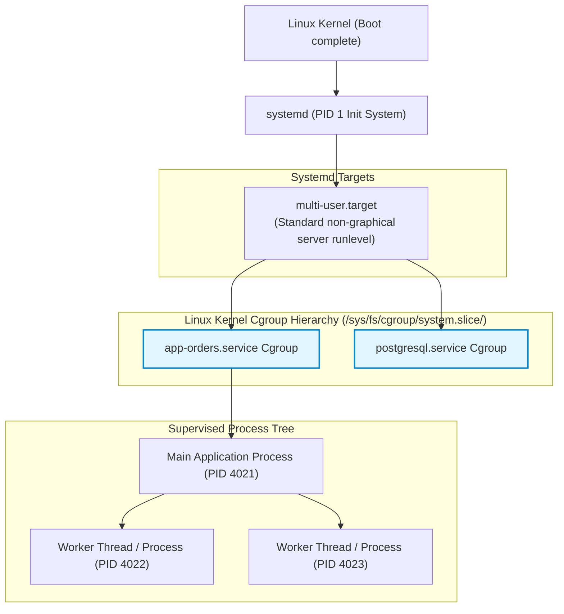
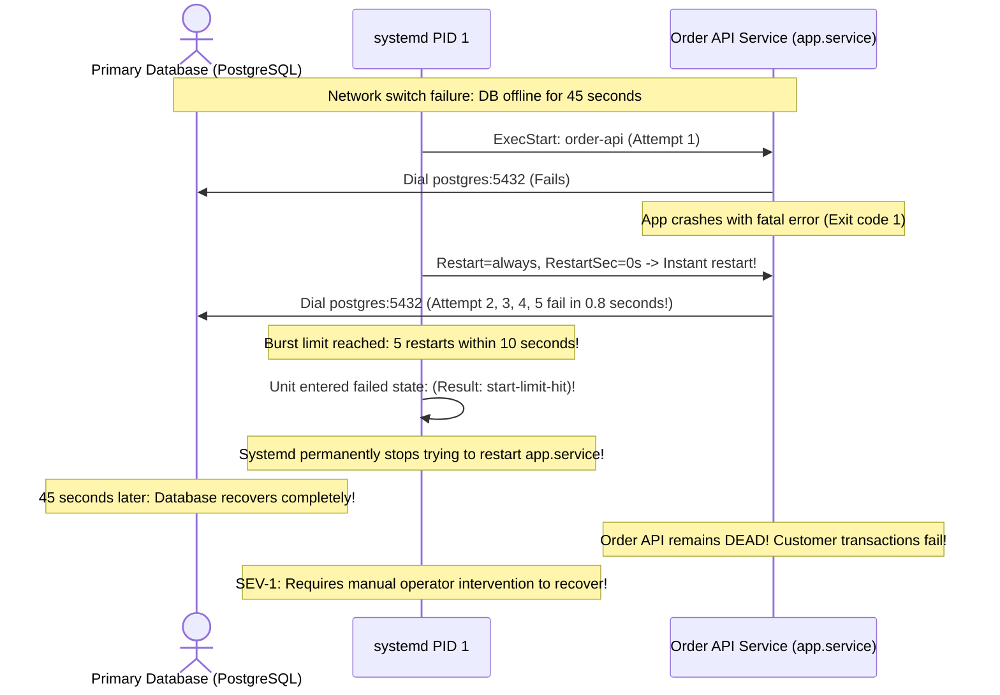

# Module 11: Systemd Services and Daemons

> **Prerequisites:** Module 06 (Process Management), Module 10 (Networking Basics).  
> **Estimated Reading Time:** 25 minutes  
> **Target Audience:** Backend Engineers, Site Reliability Engineers, Systems Architects.

> [!TIP]
> **The Golden Rule of Systemd Service Management:** A service being **`active (running)`** is fundamentally different from being **`enabled`**. `systemctl start` manipulates running memory; `systemctl enable` creates a symlink in `/etc/systemd/system/` so the service restarts upon machine reboot. In production unit files, always enforce `Restart=on-failure`, set `RestartSec=5s`, specify an unprivileged `User=`, and define strict file descriptor boundaries (`LimitNOFILE=65536`).

---

## 1. Architectural Mental Model: Systemd PID 1 and Control Groups (Cgroups)

On modern Linux distributions, `systemd` is the first process launched by the kernel (**PID 1**). It initializes userspace, tracks hardware events, mounts filesystems, and supervises background services using **Linux Control Groups (Cgroups)**:



### The Cgroup Advantage Over Legacy SysVinit
In older Linux systems (`/etc/init.d`), if an application daemon spawned child processes and crashed, the children became orphaned and continued running in the background. 

`systemd` eliminates this: every service is placed into an isolated **Cgroup slice**. When you run `systemctl stop app`, `systemd` interrogates the kernel Cgroup table and sends `SIGTERM` (followed by `SIGKILL` if necessary) to **every single process in the tree**, guaranteeing zero lingering orphan processes.

---

## 2. Anatomy of a Production Systemd Unit File

Custom systemd services reside in `/etc/systemd/system/<service-name>.service`. A production unit is organized into three distinct sections:

```ini
# /etc/systemd/system/order-service.service
[Unit]
Description=High-Throughput Order Processing API
Documentation=https://docs.example.com/services/orders
After=network.target postgresql.service
Wants=postgresql.service

[Service]
Type=simple
User=appuser
Group=appgroup
WorkingDirectory=/opt/order-service
ExecStart=/opt/order-service/bin/order-api --config=/etc/order-service/config.yaml
ExecReload=/bin/kill -HUP $MAINPID
Restart=on-failure
RestartSec=5s
StartLimitIntervalSec=60s
StartLimitBurst=5
EnvironmentFile=/etc/order-service/production.env
LimitNOFILE=65536
TimeoutStopSec=30s

[Install]
WantedBy=multi-user.target
```

### Key Directives Explained
* **`After=network.target`**: Delay starting this service until the network stack is up.
* **`Type=simple`**: The process defined in `ExecStart` is the main service process (standard for Go, Node.js, Python, and Rust).
* **`User=appuser`**: Drops root privileges immediately before executing the binary.
* **`Restart=on-failure`**: Automatically restarts the process if it crashes or exits with a non-zero exit code (does NOT restart if terminated cleanly via `exit 0` or `systemctl stop`).
* **`LimitNOFILE=65536`**: Overrides system-wide open file descriptor limits (preventing `Too many open files` errors under high traffic).
* **`WantedBy=multi-user.target`**: Enables the service to start automatically during standard multi-user system boot.

---

## 3. Systematic Reference: `systemctl` Command Matrix

| Command | Action Performed | Affects Boot? | Affects RAM Now? |
| :--- | :--- | :--- | :--- |
| **`sudo systemctl start <svc>`** | Starts the service immediately | No | **Yes** |
| **`sudo systemctl stop <svc>`** | Sends `SIGTERM` (then `SIGKILL` after 90s) to Cgroup | No | **Yes** |
| **`sudo systemctl restart <svc>`** | Stops and immediately restarts the service | No | **Yes** |
| **`sudo systemctl reload <svc>`** | Sends `SIGHUP` to trigger zero-downtime config reload | No | **Yes** |
| **`sudo systemctl enable <svc>`** | Creates symlink in `/etc/systemd/system/*.wants/` | **Yes** | No |
| **`sudo systemctl disable <svc>`** | Removes boot symlinks | **Yes** | No |
| **`sudo systemctl status <svc>`** | Displays state, PID, memory, uptime, and last 10 log lines | No | Read-only |
| **`sudo systemctl daemon-reload`** | Reloads all `.service` files from disk into systemd RAM | No | Read-only |
| **`sudo systemctl reset-failed`** | Resets `failed` state and cleared burst rate-limit timers | No | **Yes** |

---

## 4. Production War Story: The CrashLoop Rate-Limit Permanent Outage



### The Incident
During a brief 45-second network hiccup affecting a cloud database cluster, a mission-critical checkout service crashed. Even after the database recovered completely, the checkout service remained permanently offline for 4 hours until an on-call engineer logged into the server.

### The Post-Mortem Data
* **Severity:** SEV-1 (Extended Service Blackout)
* **Mean Time to Detect (MTTD):** 10 minutes
* **Mean Time to Resolution (MTTR):** 30 minutes (Manual intervention required)

### The Root Cause
The service unit file was misconfigured with:
```ini
Restart=always
RestartSec=0
```
When the database blipped, the API crashed immediately upon boot. Systemd aggressively restarted it with zero delay. Within 800 milliseconds, the service restarted 5 times.

Systemd has a built-in safety circuit breaker: **`StartLimitBurst`** (defaults to 5) and **`StartLimitIntervalSec`** (defaults to 10s). Because the service restarted 5 times within 10 seconds, systemd assumed the service was hopelessly broken and abandoned it, locking it in state:
`failed (Result: start-limit-hit)`.

### The Fix & Hardening
1. **Configure Graceful Restart Backoff:**
```ini
[Service]
Restart=on-failure
RestartSec=5s

[Unit]
StartLimitIntervalSec=120s
StartLimitBurst=10
```
*(Waiting 5 seconds between attempts ensures transient outages lasting up to 50 seconds do not trigger the burst rate limiter).*
2. **Clear Failed States in Recovery Runbooks:**
```bash
sudo systemctl daemon-reload
sudo systemctl reset-failed app.service
sudo systemctl start app.service
```

---

## 5. Multi-Language Production Code: Integrating with Systemd Watchdog & Readiness

Modern backend microservices can signal systemd when they are fully ready to accept traffic (using `Type=notify`).

### Go (`coreos/go-systemd`)
```go
package main

import (
	"fmt"
	"net"
	"os"
	"time"
)

// SendSdNotify transmits a readiness state string to systemd over the NOTIFY_SOCKET UNIX socket.
func SendSdNotify(state string) error {
	socketAddr := os.Getenv("NOTIFY_SOCKET")
	if socketAddr == "" {
		// Not running under systemd Type=notify; ignore safely
		return nil
	}

	conn, err := net.Dial("unixgram", socketAddr)
	if err != nil {
		return fmt.Errorf("failed to connect to NOTIFY_SOCKET: %w", err)
	}
	defer conn.Close()

	_, err = conn.Write([]byte(state))
	return err
}

func main() {
	fmt.Println("🚀 Initializing backend caches and database pools...")
	time.Sleep(2 * time.Second) // Simulate initialization

	// Signal systemd that initialization is complete and HTTP listener is ready
	if err := SendSdNotify("READY=1\nSTATUS=Ready to accept API traffic"); err != nil {
		fmt.Printf("Notice: Failed to notify systemd: %v\n", err)
	} else {
		fmt.Println("✅ Notified systemd: READY=1")
	}

	// Keep service alive
	select {}
}
```

### Node.js / TypeScript
```typescript
import * as dgram from 'dgram';

/**
 * Signals systemd readiness over the Unix domain datagram socket.
 */
export function notifySystemd(message: string): void {
  const socketPath = process.env.NOTIFY_SOCKET;
  if (!socketPath) {
    return; // Not executing in a systemd notify context
  }

  const client = dgram.createSocket('unix_dgram');
  const buffer = Buffer.from(message);

  client.send(buffer, 0, buffer.length, socketPath, (err) => {
    client.close();
    if (err) {
      console.warn('Systemd notify failed:', err.message);
    } else {
      console.log(`✅ Systemd signaled: ${message}`);
    }
  });
}

// Example usage upon HTTP server ready event
notifySystemd('READY=1');
```

### Python
```python
import os
import socket

def notify_systemd(message: str = "READY=1") -> bool:
    """
    Sends notification message to systemd via $NOTIFY_SOCKET.
    """
    notify_socket = os.environ.get("NOTIFY_SOCKET")
    if not notify_socket:
        return False

    # Unix domain datagram socket
    sock = socket.socket(socket.AF_UNIX, socket.SOCK_DGRAM)
    try:
        sock.connect(notify_socket)
        sock.sendall(message.encode("utf-8"))
        return True
    except OSError:
        return False
    finally:
        sock.close()

if __name__ == "__main__":
    if notify_systemd("READY=1\nSTATUS=Worker processing queue"):
        print("✅ Systemd successfully notified.")
    else:
        print("Notice: NOTIFY_SOCKET not present (local dev).")
```

---

## 6. Practical Hands-On Verification CLI Workflows

Follow these workflows in your Ubuntu terminal:

### Workflow 1: Inspect Systemd Init Engine Status
```bash
# 1. Verify that systemd is active as PID 1
ps -p 1 -o comm=

# 2. Check the system-wide operational state
systemctl is-system-running
```
**Expected Output:**
```text
systemd
running
```
*(Note: If running on older WSL2 configurations without systemd enabled, `/etc/wsl.conf` requires `[boot]\nsystemd=true`).*

### Workflow 2: Author and Test a Managed Systemd Service
```bash
# 1. Create a minimal heartbeat service unit
sudo tee /etc/systemd/system/heartbeat.service << 'EOF'
[Unit]
Description=Test Heartbeat Logger Service
After=network.target

[Service]
Type=simple
ExecStart=/bin/sh -c 'while true; do echo "HEARTBEAT: System healthy $(date)"; sleep 5; done'
Restart=always
RestartSec=3s

[Install]
WantedBy=multi-user.target
EOF

# 2. Reload daemon definitions from disk
sudo systemctl daemon-reload

# 3. Start the service
sudo systemctl start heartbeat.service

# 4. Inspect status and logs
systemctl status heartbeat.service --no-pager
```

### Workflow 3: Clean Up
```bash
# Stop and delete test service
sudo systemctl stop heartbeat.service
sudo rm -f /etc/systemd/system/heartbeat.service
sudo systemctl daemon-reload
```

---

## 7. Operational Validation Checkpoint

<details>
<summary><strong>Question 1: Active vs. Enabled vs. Static Units</strong></summary>

**Scenario:** You inspect a monitoring daemon and observe:
`Loaded: loaded (/etc/systemd/system/datadog.service; disabled; vendor preset: enabled)`
`Active: active (running) since Tue 2026-11-10 14:00:00 UTC; 2h ago`

What will happen to this service if the server undergoes an unscheduled reboot tonight?

**Answer:**
The service will **NOT start automatically after the reboot**. 

* **`Active: active (running)`** means the process is currently executing in RAM.
* **`Loaded: ... disabled`** means there is no symlink in `/etc/systemd/system/multi-user.target.wants/`. 

To guarantee that a service survives server reboots, it must be explicitly **enabled**:
```bash
sudo systemctl enable datadog.service
```
</details>

<details>
<summary><strong>Question 2: Why `systemctl daemon-reload` is Mandatory</strong></summary>

**Scenario:** A developer modifies `/etc/systemd/system/api.service` to change `PORT=3000` to `PORT=4000`. They immediately execute `sudo systemctl restart api.service`. When checking the logs, the service still launched on port 3000!

Why did systemd ignore the unit file modification?

**Answer:**
Systemd parses all unit files from disk into an **in-memory dependency graph** during operating system boot. 

Modifying a `.service` file on disk does **not** automatically update systemd's in-memory representation. When you run `systemctl restart`, systemd simply re-executes the configuration cached in its RAM.

**The Fix:** Instruct systemd to re-read and recompile unit definitions from disk:
```bash
sudo systemctl daemon-reload
sudo systemctl restart api.service
```
</details>

<details>
<summary><strong>Question 3: Escaping the Cgroup Sandbox</strong></summary>

**Scenario:** A legacy Java application uses `Runtime.getRuntime().exec("python3 worker.py")` to spawn background tasks. An operator runs `sudo systemctl stop legacy-app`. 
Will `worker.py` continue running in the background as an orphaned process?

**Answer:**
**No.** 
Systemd assigns every child process spawned by `ExecStart` into the service's dedicated Linux **Control Group (Cgroup)**. 

When `systemctl stop` is invoked, systemd sends signals not just to the root parent process, but to **every process registered inside that Cgroup's task list**. Even if `worker.py` was disowned or reparented to PID 1, it remains bound to `/sys/fs/cgroup/system.slice/legacy-app.service/` and will be cleanly terminated.
</details>

---

## Next Step

Now that you understand systemd services, daemons, and Cgroup process supervision, proceed to **[12 · Disk Storage and Mounts](../12-disk-storage-and-mounts/README.md)** to master block devices, filesystems, `lsblk`, `mount`, and `/etc/fstab`.
