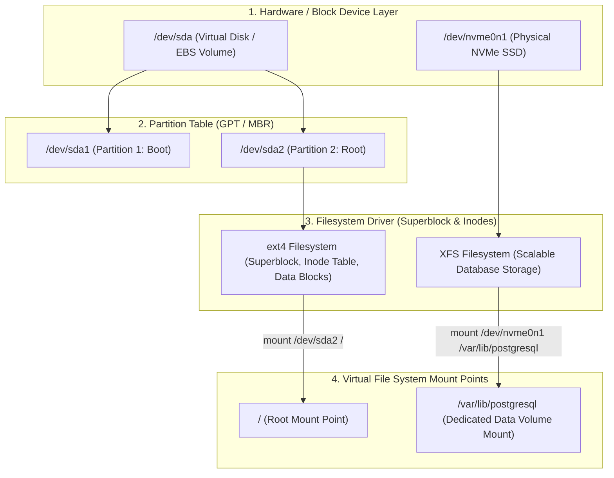
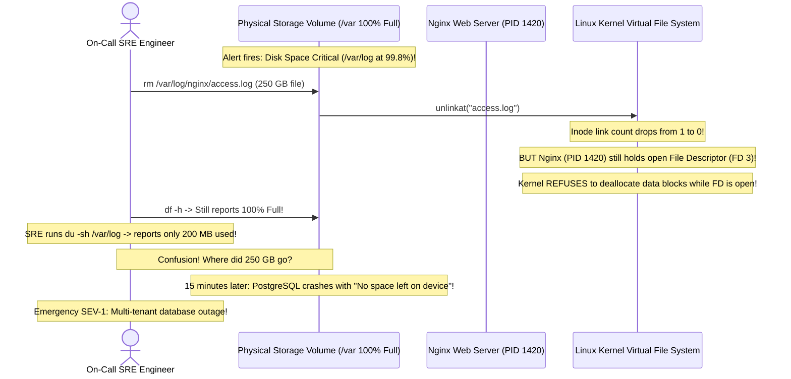

# Module 12: Disk Storage, Mounts, and Filesystems

> **Prerequisites:** Module 02 (Filesystem Navigation), Module 06 (Process Management).  
> **Estimated Reading Time:** 25 minutes  
> **Target Audience:** Backend Engineers, Site Reliability Engineers, DevOps & Storage Architects.

> [!TIP]
> **The Golden Rule of Linux Storage:** Unlinking a file (`rm`) merely removes its directory entry; the underlying disk blocks are **NOT freed until every process holding an open file descriptor to that file terminates**. When investigating "Disk Full" alerts where `df` reports 100% capacity but `du` cannot find the large files, always run `lsof +L1` (or `lsof \| grep deleted`) to find running daemons holding deleted files in memory.

---

## 1. Architectural Mental Model: Block Devices, Filesystems, and Mounts

Linux separates physical block storage from the directory tree through three distinct layers: Block Devices, Filesystems, and Mount Points.



### The Inode vs. Data Block Reality
Every file on an ext4 or XFS filesystem consists of:
1. **The Inode (Index Node):** Stores file metadata (size, owner, permissions, timestamps, and pointers to disk blocks). It does **not** store the file name or file data.
2. **Directory Entry:** A special directory table entry that maps a human-readable file name (e.g. `access.log`) to an inode number (e.g. `inode 140291`).
3. **Data Blocks:** The actual storage sectors (typically 4 KB blocks) containing file contents.

---

## 2. Hard Links vs. Symbolic (Soft) Links

Understanding links prevents catastrophic data loss and subtle bugs in build caches:

```
  HARD LINK: Two names pointing to the EXACT SAME INODE
  "app.log"     ───┐
                   ├──▶ Inode #45021 [Link Count: 2] ───▶ [ Data Blocks on Disk ]
  "app.log.bak" ───┘

  SYMBOLIC LINK: A pointer file containing the string path to another file
  "latest.log" ──▶ Inode #89110 [Content: "/var/log/app-2026.log"]
                         │
                         ▼
                   Inode #45021 ───▶ [ Data Blocks on Disk ]
```

| Feature | Hard Link (`ln target link`) | Symbolic Link (`ln -s target link`) |
| :--- | :--- | :--- |
| **Inode Number** | **Identical** to the target inode | **New, distinct inode** allocated |
| **Spans Multiple Filesystems?** | **NO** (Inodes are local to a specific filesystem) | **YES** (Simply stores a path string) |
| **Can Link Directories?** | NO (Prevents filesystem recursion loops) | YES |
| **What happens if target is deleted?** | Data remains intact! Link count decrements to 1. | **Dangling symlink!** Link breaks (`No such file`). |
| **Storage Overhead** | Zero additional disk blocks | 1 inode + small path string |

---

## 3. Systematic Reference: Storage Diagnostics & Management

| Command | Action Performed | What it Measures | Production Gotcha |
| :--- | :--- | :--- | :--- |
| **`df -h`** | Reports filesystem disk space usage | Free blocks on mounted filesystems | Inspects filesystem superblock; includes unlinked open files! |
| **`df -i`** | Reports filesystem **inode** capacity | Total free inodes | Server crashes with "No space left" if inodes hit 100% even if 50GB free! |
| **`du -sh <dir>`** | Sums space consumed by directory tree | Recursively adds sizes of existing files | Does **not** account for deleted files held open by running processes. |
| **`lsblk -f`** | Lists block devices, partitions, and UUIDs | Filesystem types (ext4, xfs) and mounts | Run before mounting volumes in cloud instances. |
| **`lsof +L1`** | Finds open files with link count `< 1` | Unlinked files consuming active disk space | Identifies rogue processes holding deleted log files. |

---

## 4. Production War Story: The Deleted-Yet-Open Log File Disk Exhaustion Outage



### The Incident
A high-throughput e-commerce gateway triggered an automated pager alert: `/var` disk usage reached **99.8%**. The on-call engineer connected via SSH, located a 250 GB log file `/var/log/nginx/access.log`, and executed:
```bash
sudo rm /var/log/nginx/access.log
```
The file disappeared from `ls`. However, running `df -h` continued to show **99.8% disk usage**. Ten minutes later, PostgreSQL crashed when its write-ahead log (WAL) could not allocate disk space, causing a global checkout blackout.

### The Post-Mortem Data
* **Severity:** SEV-1 (Global Production Database Crash)
* **Mean Time to Detect (MTTD):** 15 minutes
* **Mean Time to Resolution (MTTR):** 25 minutes

### The Root Cause
In Linux, **deleting a file name unlinks the directory reference, but does not free disk blocks if any process holds an open file descriptor to that inode**. Nginx maintained an open file handle to `access.log`. Because Nginx was never signaled or reloaded, the kernel kept all 250 GB of disk blocks allocated to the open inode.

### The Fix & Hardening
1. **Locate Holding Processes with `lsof`:**
```bash
sudo lsof +L1
# Output: nginx 1420 www-data 3w REG 8,1 268435456000 0 /var/log/nginx/access.log (deleted)
```
2. **Truncate Files Instead of Unlinking Them:**
If a process is holding an active log file that cannot be stopped immediately, **truncate the inode directly without removing the link**:
```bash
# Truncates file length to 0 bytes instantly while preserving the open file descriptor!
: > /var/log/nginx/access.log
# Or:
truncate -s 0 /var/log/nginx/access.log
```
3. **Signal Daemons to Reopen Logs:**
```bash
sudo nginx -s reopen
```

---

## 5. Multi-Language Production Code: Inspecting Disk & Inode Metrics

Production backend microservices should inspect local storage capacity in health checks to avert database corruption.

### Go
```go
package main

import (
	"fmt"
	"golang.org/x/sys/unix"
)

// StorageStats holds filesystem disk capacity metrics
type StorageStats struct {
	TotalBytes     uint64
	AvailableBytes uint64
	UsedPercent    float64
	TotalInodes    uint64
	FreeInodes     uint64
	InodePercent   float64
}

// CheckStorageCapacity queries the filesystem superblock using statfs(2).
func CheckStorageCapacity(mountPath string) (*StorageStats, error) {
	var stat unix.Statfs_t
	if err := unix.Statfs(mountPath, &stat); err != nil {
		return nil, fmt.Errorf("statfs failed on %s: %w", mountPath, err)
	}

	totalBytes := stat.Blocks * uint64(stat.Bsize)
	availBytes := stat.Bavail * uint64(stat.Bsize)
	usedBytes := totalBytes - availBytes
	usedPct := (float64(usedBytes) / float64(totalBytes)) * 100

	totalInodes := stat.Files
	freeInodes := stat.Ffree
	usedInodes := totalInodes - freeInodes
	inodePct := (float64(usedInodes) / float64(totalInodes)) * 100

	return &StorageStats{
		TotalBytes:     totalBytes,
		AvailableBytes: availBytes,
		UsedPercent:    usedPct,
		TotalInodes:    totalInodes,
		FreeInodes:     freeInodes,
		InodePercent:   inodePct,
	}, nil
}

func main() {
	stats, err := CheckStorageCapacity("/")
	if err != nil {
		fmt.Printf("Error: %v\n", err)
		return
	}

	fmt.Printf("[Storage Audit for /]\n")
	fmt.Printf(" - Disk Space: %.2f%% used (%.2f GB available)\n",
		stats.UsedPercent, float64(stats.AvailableBytes)/(1024*1024*1024))
	fmt.Printf(" - Inodes: %.2f%% used (%d free inodes)\n", stats.InodePercent, stats.FreeInodes)

	if stats.UsedPercent > 90.0 || stats.InodePercent > 90.0 {
		fmt.Println("⚠️  CRITICAL STORAGE THRESHOLD EXCEEDED!")
	} else {
		fmt.Println("✅ Storage health verified.")
	}
}
```

### Node.js / TypeScript
```typescript
import * as fs from 'fs/promises';

interface DiskHealth {
  path: string;
  freeBytes: bigint;
  totalBytes: bigint;
  usedPercentage: number;
}

/**
 * Evaluates storage metrics using Node's fs.statfs API.
 */
export async function auditDiskSpace(mountPath = '/'): Promise<DiskHealth> {
  const stats = await fs.statfs(mountPath);
  const total = stats.bsize * stats.blocks;
  const free = stats.bsize * stats.bavail;
  const used = total - free;
  const usedPercentage = Number((used * 100n) / total);

  return {
    path: mountPath,
    freeBytes: free,
    totalBytes: total,
    usedPercentage,
  };
}

auditDiskSpace().then((health) => {
  console.log(`[Disk Audit] Mount: ${health.path} | Used: ${health.usedPercentage}%`);
  if (health.usedPercentage >= 90) {
    console.warn('⚠️  ALERT: Low disk space threshold reached!');
  }
});
```

### Python
```python
import shutil
import os
import sys

def check_filesystem_health(mount_point: str = "/") -> dict:
    """
    Checks byte storage and inode capacity on target filesystem mount.
    """
    total, used, free = shutil.disk_usage(mount_point)
    used_pct = (used / total) * 100

    # Inode inspection via statvfs
    vfs = os.statvfs(mount_point)
    total_inodes = vfs.f_files
    free_inodes = vfs.f_ffree
    used_inodes = total_inodes - free_inodes
    inode_pct = (used_inodes / total_inodes) * 100 if total_inodes > 0 else 0

    return {
        "mount": mount_point,
        "disk_used_percent": round(used_pct, 2),
        "inode_used_percent": round(inode_pct, 2),
        "free_gb": round(free / (1024**3), 2)
    }

if __name__ == "__main__":
    h = check_filesystem_health()
    print(f"Mount '{h['mount']}': {h['disk_used_percent']}% bytes used, {h['inode_used_percent']}% inodes used.")
```

---

## 6. Practical Hands-On Verification CLI Workflows

Follow these workflows in your Ubuntu terminal:

### Workflow 1: Inspect Filesystem and Inode Capacity
```bash
# 1. Inspect human-readable disk capacity
df -h

# 2. Inspect inode capacity
df -i
```

### Workflow 2: Demonstrate Hard Link vs. Symlink Inode Identity
```bash
# 1. Create a base file
mkdir -p /tmp/link-lab && cd /tmp/link-lab
echo "Original data payload" > base.txt

# 2. Create a hard link and a symbolic link
ln base.txt hardlink.txt
ln -s base.txt symlink.txt

# 3. Inspect inode numbers (-i displays inode)
ls -li base.txt hardlink.txt symlink.txt
```
**Expected Output:**
```text
45021 -rw-r--r-- 2 asha asha 22 Nov 10 16:00 base.txt
45021 -rw-r--r-- 2 asha asha 22 Nov 10 16:00 hardlink.txt
89110 lrwxrwxrwx 1 asha asha  8 Nov 10 16:00 symlink.txt -> base.txt
```
*(Notice that `base.txt` and `hardlink.txt` share inode `45021` and report link count `2`, while `symlink.txt` has its own inode `89110`).*

### Workflow 3: Delete Target and Observe Link Behavior
```bash
# 1. Delete original file
rm base.txt

# 2. Test reading hard link (data persists!)
cat hardlink.txt

# 3. Test reading symlink (broken link!)
cat symlink.txt || echo "Symlink is broken!"

# 4. Clean up
cd ~ && rm -rf /tmp/link-lab
```

---

## 7. Operational Validation Checkpoint

<details>
<summary><strong>Question 1: Why `df` and `du` Disagree on Disk Usage</strong></summary>

**Scenario:** During an incident, `df -h /var` reports that the volume is 100% full with 0 bytes free. However, running `sudo du -sh /var` reports that the total sum of all directories under `/var` is only 12 GB on a 100 GB disk.

What accounts for this 88 GB discrepancy, and how do you recover the space?

**Answer:**
`du` (Disk Usage) traverses the visible filesystem tree and sums the sizes of files it can locate by name. 

`df` (Disk Free) queries the filesystem superblock directly, which accounts for **all allocated disk blocks—including deleted files that are still held open by running processes**. 

If a 88 GB log file was unlinked with `rm`, it disappears from directory listings (so `du` cannot see it), but its blocks remain allocated on disk until the holding process closes its file descriptor.

**Recovery:** Run `sudo lsof +L1` to identify the process holding the deleted file, and reload or restart that service (`sudo systemctl restart <service>`) or truncate the file descriptor directly via `/proc/<PID>/fd/<FD>`.
</details>

<details>
<summary><strong>Question 2: Inode Exhaustion Outage</strong></summary>

**Scenario:** A backend service crashes with:
`Fatal error: No space left on device`.
You run `df -h` and observe that the disk is only 30% full with 70 GB of free space available. 

What command diagnoses the real problem, and what application pattern typically causes it?

**Answer:**
Run:
```bash
df -i
```
The filesystem has run out of **Inodes (`IUse% = 100%`)**, not disk bytes. 

This is typically caused by applications that generate millions of tiny files without cleanup (such as unpurged PHP/Node.js session files, orphaned cache chunks, or millions of zero-byte temporary files in `/tmp` or `/var/spool/clientmqueue`). Each file requires an inode metadata structure; once the inode table is exhausted, no new files can be created regardless of free byte capacity.
</details>

<details>
<summary><strong>Question 3: Why Hard Links Cannot Span Filesystems</strong></summary>

**Scenario:** A developer attempts to create a hard link from an external NVMe mount to their home directory:
`ln /mnt/nvme/large_dataset.bin ~/dataset.bin`
The command fails with:
`ln: failed to create hard link: Invalid cross-device link`.

Why does the Linux kernel forbid hard links across different filesystems?

**Answer:**
A hard link is simply a directory entry that points directly to a numeric **inode number**. 

Inode numbers are **unique only within a single filesystem instance**. Filesystem A (`/`) and Filesystem B (`/mnt/nvme`) each maintain their own independent inode tables; inode `45021` on `/mnt/nvme` refers to completely different physical disk blocks than inode `45021` on `/`. Allowing cross-device hard links would corrupt filesystem data structures.

**The Fix:** Use a **Symbolic Link** (`ln -s`), which stores a path string and resolves across different mount points seamlessly.
</details>

---

## Next Step

Now that you understand block storage, mounts, filesystems, and inodes, proceed to **[13 · SSH and Remote Access](../13-ssh-remote-access/README.md)** to master public-key authentication, key generation, host verification, and bastion configuration.
