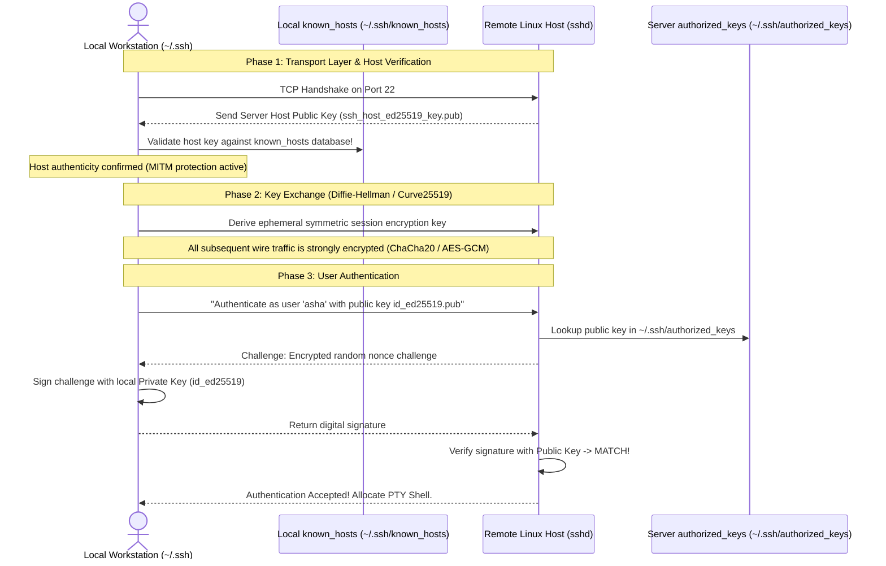
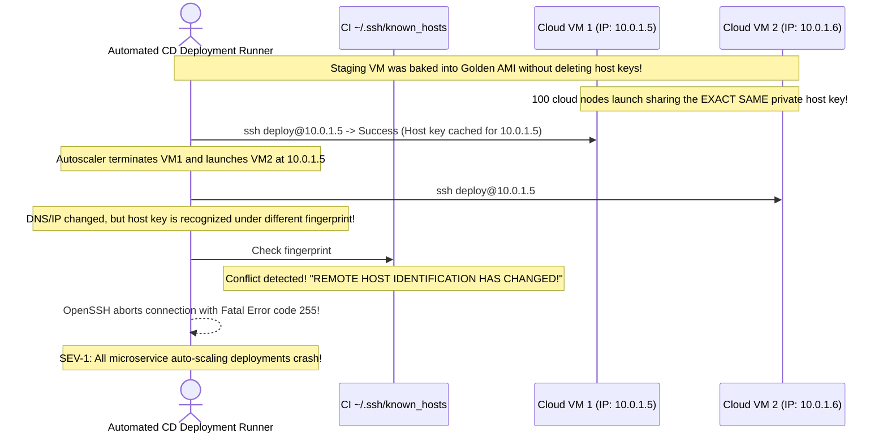

# Module 13: SSH and Secure Remote Access

> **Prerequisites:** Module 03 (File Permissions and Ownership), Module 10 (Networking Basics).  
> **Estimated Reading Time:** 25 minutes  
> **Target Audience:** Backend Developers, DevOps Engineers, Cloud Infrastructure Architects.

> [!TIP]
> **The Golden Rule of SSH Engineering:** Never copy private keys to remote servers, and never disable host key verification (`StrictHostKeyChecking=no`) in production environments. Your private key (`id_ed25519`) must remain on your local machine with strict `0600` permissions. Only the **public key** (`id_ed25519.pub`) is installed on remote servers inside `~/.ssh/authorized_keys`. Use SSH config profiles (`~/.ssh/config`) with `ProxyJump` to traverse bastion jump boxes securely without SSH agent forwarding risks.

---

## 1. Architectural Mental Model: Asymmetric Authentication & Handshake

SSH (Secure Shell) utilizes asymmetric cryptography to achieve mutual authentication, encrypt all traffic, and prevent Man-in-the-Middle (MITM) attacks:



---

## 2. Taxonomic Reference: Asymmetric Key Algorithms

| Algorithm | Key Size / Curve | Security Status | Performance | Production Verdict |
| :--- | :--- | :--- | :--- | :--- |
| **Ed25519** | 256-bit (Edwards25519 Curve) | **State of the Art** | Extremely fast; compact 68-char keys | **RECOMMENDED STANDARD.** Default for modern infrastructure. |
| **RSA** | 3072 / 4096-bit | Secure (if $\ge 3072$ bits) | Slow key generation; bulky keys | Acceptable only for legacy hardware compatibility. |
| **ECDSA** | 256 / 384 / 521-bit | Controversial NIST curves | Moderate | Avoid where possible (side-channel and RNG risks). |
| **DSA** | 1024-bit | **BROKEN / INSECURE** | Deprecated | **Permanently disabled** in modern OpenSSH releases. |

---

## 3. Systematic Breakdown: The `~/.ssh/config` Automation Engine

Typing long connection strings (`ssh -i ~/.ssh/prod.pem -p 2222 deploy@prod-bastion.internal.net`) is slow and error-prone. Organize all connections in `~/.ssh/config`:

```ini
# Global settings for all hosts
Host *
    ServerAliveInterval 60
    ServerAliveCountMax 3
    AddKeysToAgent yes
    IdentitiesOnly yes

# Production Bastion / Jump Box
Host bastion
    HostName bastion.example.com
    User admin
    Port 22
    IdentityFile ~/.ssh/id_ed25519

# Internal Private Database Node (Traversed via Bastion)
Host db-internal
    HostName 10.0.4.15
    User postgres
    IdentityFile ~/.ssh/id_ed25519
    ProxyJump bastion
```

With this configuration, executing `ssh db-internal` automatically connects to the public bastion, tunnels an encrypted proxy stream, and opens a session directly on the private database server without manual port forwarding!

---

## 4. Production War Story: The Golden Image Cloned Host Key Collision



### The Incident
During an automatic scaling event on AWS EC2, a cluster of 50 new worker nodes launched. Automated deployment pipelines instantly collapsed across the fleet. Every deployment step aborted with:
`@@@@@@@@@@@@@@@@@@@@@@@@@@@@@@@@@@@@@@@@@@@@@@@@@@@@@@@@@@@`  
`@    WARNING: REMOTE HOST IDENTIFICATION HAS CHANGED!     @`  
`@@@@@@@@@@@@@@@@@@@@@@@@@@@@@@@@@@@@@@@@@@@@@@@@@@@@@@@@@@@`  
`IT IS POSSIBLE THAT SOMEONE IS DOING SOMETHING NASTY!`

### The Post-Mortem Data
* **Severity:** SEV-1 (Global Deployment Automation Freeze)
* **Mean Time to Detect (MTTD):** 45 minutes
* **Mean Time to Resolution (MTTR):** 60 minutes

### The Root Cause
A DevOps engineer created a golden virtual machine image (AMI) from a live staging server without purging `/etc/ssh/ssh_host_*` private keys. Every virtual machine provisioned from this image shared the exact same cryptographic host identity. 

When cloud auto-scalers reused IP addresses or when hostnames mapped to multiple dynamic IPs, client SSH agents detected duplicate host keys associated with conflicting network signatures and terminated all connections to prevent Man-in-the-Middle attacks.

### The Fix & Hardening
1. **Purge Host Keys During Golden Image Baking:**
```bash
# In image creation scripts (Packer / cloud-init):
sudo rm -f /etc/ssh/ssh_host_*
```
2. **Generate Unique Keys on First Boot via Cloud-Init:**
```bash
sudo ssh-keygen -A
sudo systemctl restart ssh
```
3. **Deploy SSH Certificate Authorities (SSH CA):** Rather than trusting individual host keys, sign server host keys with a corporate SSH CA public key, configuring clients with `@cert-authority *.example.com`.

---

## 5. Multi-Language Production Code: Programmatic SSH Execution

Backend orchestration engines frequently execute automated tasks over SSH using modern key-based authentication.

### Go (`golang.org/x/crypto/ssh`)
```go
package main

import (
	"bytes"
	"fmt"
	"os"
	"golang.org/x/crypto/ssh"
)

// ExecuteRemoteCommand runs a shell command on a remote host using Ed25519 public key auth.
func ExecuteRemoteCommand(user, addr, privateKeyPath, command string) (string, error) {
	keyBytes, err := os.ReadFile(privateKeyPath)
	if err != nil {
		return "", fmt.Errorf("failed to read private key: %w", err)
	}

	signer, err := ssh.ParsePrivateKey(keyBytes)
	if err != nil {
		return "", fmt.Errorf("failed to parse private key: %w", err)
	}

	config := &ssh.ClientConfig{
		User: user,
		Auth: []ssh.AuthMethod{
			ssh.PublicKeys(signer),
		},
		// In production, enforce ssh.FixedHostKey(trustedKey) rather than InsecureIgnoreHostKey
		HostKeyCallback: ssh.InsecureIgnoreHostKey(),
	}

	client, err := ssh.Dial("tcp", addr, config)
	if err != nil {
		return "", fmt.Errorf("SSH dial failed: %w", err)
	}
	defer client.Close()

	session, err := client.NewSession()
	if err != nil {
		return "", fmt.Errorf("failed to create session: %w", err)
	}
	defer session.Close()

	var stdout, stderr bytes.Buffer
	session.Stdout = &stdout
	session.Stderr = &stderr

	if err := session.Run(command); err != nil {
		return "", fmt.Errorf("command execution failed (%w): %s", err, stderr.String())
	}

	return stdout.String(), nil
}

func main() {
	fmt.Println("🚀 SSH Client runner initialized.")
}
```

### Node.js / TypeScript (`ssh2`)
```typescript
import { Client } from 'ssh2';
import * as fs from 'fs';

interface SSHExecutionResult {
  stdout: string;
  stderr: string;
  code: number;
}

export function executeSSH(
  host: string,
  username: string,
  privateKeyPath: string,
  command: string
): Promise<SSHExecutionResult> {
  return new Promise((resolve, reject) => {
    const conn = new Client();
    const privateKey = fs.readFileSync(privateKeyPath);

    conn
      .on('ready', () => {
        conn.exec(command, (err, stream) => {
          if (err) return reject(err);

          let stdout = '';
          let stderr = '';

          stream
            .on('close', (code: number) => {
              conn.end();
              resolve({ stdout, stderr, code });
            })
            .on('data', (data: Buffer) => {
              stdout += data.toString();
            })
            .stderr.on('data', (data: Buffer) => {
              stderr += data.toString();
            });
        });
      })
      .on('error', reject)
      .connect({
        host,
        port: 22,
        username,
        privateKey,
      });
  });
}
```

### Python (`paramiko`)
```python
import paramiko
from typing import Tuple

def run_remote_ssh_command(host: str, user: str, key_path: str, cmd: str) -> Tuple[int, str, str]:
    """
    Connects to remote server using Ed25519 key and executes command.
    """
    client = paramiko.SSHClient()
    client.set_missing_host_key_policy(paramiko.RejectPolicy())
    
    try:
        # Load local known_hosts for strict MITM verification
        client.load_system_host_keys()
        key = paramiko.Ed25519Key.from_private_key_file(key_path)

        client.connect(hostname=host, port=22, username=user, pkey=key, timeout=5)
        stdin, stdout, stderr = client.exec_command(cmd)
        
        exit_code = stdout.channel.recv_exit_status()
        return exit_code, stdout.read().decode('utf-8'), stderr.read().decode('utf-8')
    finally:
        client.close()

if __name__ == "__main__":
    print("Python SSH runner ready.")
```

---

## 6. Practical Hands-On Verification CLI Workflows

Follow these workflows in your Ubuntu terminal:

### Workflow 1: Generate an Enterprise Ed25519 Key Pair
```bash
# 1. Create a modern Ed25519 key with a descriptive comment
ssh-keygen -t ed25519 -C "asha@company.com" -f ~/.ssh/id_ed25519

# 2. Verify strict file permissions
ls -l ~/.ssh/id_ed25519*
```
**Expected Output:**
```text
-rw------- 1 asha asha 411 Nov 10 16:15 /home/asha/.ssh/id_ed25519
-rw-r--r-- 1 asha asha  98 Nov 10 16:15 /home/asha/.ssh/id_ed25519.pub
```
*(Notice that the private key has mode `0600` while the public key has mode `0644`).*

### Workflow 2: Enforce Directory Security Permissions
```bash
# Set strict permissions on ~/.ssh
chmod 700 ~/.ssh
chmod 600 ~/.ssh/id_ed25519
chmod 644 ~/.ssh/id_ed25519.pub
touch ~/.ssh/authorized_keys && chmod 600 ~/.ssh/authorized_keys
```

### Workflow 3: Inspect Known Hosts Fingerprints
```bash
# Query the cryptographic fingerprint of a remote host without connecting
ssh-keyscan -t ed25519 github.com 2>/dev/null | ssh-keygen -lf -
```

---

## 7. Operational Validation Checkpoint

<details>
<summary><strong>Question 1: The "Host Identification Has Changed" Emergency</strong></summary>

**Scenario:** A cloud server was rebuilt with a new operating system on the same static IP address (`198.51.100.22`). When an engineer runs `ssh admin@198.51.100.22`, the connection is blocked with:
`@@@@@@@@@@@@@@@@@@@@@@@@@@@@@@@@@@@@@@@@@@@@@@@@@@@@@@@@@@@`  
`@    WARNING: REMOTE HOST IDENTIFICATION HAS CHANGED!     @`  
`@@@@@@@@@@@@@@@@@@@@@@@@@@@@@@@@@@@@@@@@@@@@@@@@@@@@@@@@@@@`  
`Host key verification failed.`

How do you remove the stale host key from `known_hosts` safely without deleting the entire file?

**Answer:**
Execute:
```bash
ssh-keygen -R 198.51.100.22
```
`-R` (Remove) searches `~/.ssh/known_hosts`, finds all matching hashed and plaintext records for `198.51.100.22`, and purges only the offending lines while leaving all other host entries completely intact. On the next connection, OpenSSH prompts the user to verify the new server fingerprint.
</details>

<details>
<summary><strong>Question 2: OpenSSH Key Permission Rejection</strong></summary>

**Scenario:** A developer clones a repository containing deployment keys. They run `ssh -i deploy_key.pem root@server`. OpenSSH immediately fails:
`Permissions 0777 for 'deploy_key.pem' are too open.`  
`It is required that your private key files are NOT accessible by others.`  
`Load key "deploy_key.pem": bad permissions`

Why does OpenSSH enforce this check, and what is the exact fix?

**Answer:**
OpenSSH client source code includes an unbypassable security assertion: **a private key must be protected against all other local users on the workstation**. 

Mode `0777` allows any local account or malicious process on the workstation to read the private key. OpenSSH intentionally terminates rather than risk key exfiltration.

**The Fix:**
```bash
chmod 600 deploy_key.pem
```
</details>

<details>
<summary><strong>Question 3: Bastion Jumps: `ProxyJump` vs. SSH Agent Forwarding</strong></summary>

**Scenario:** An infrastructure architect mandates: "Never use SSH Agent Forwarding (`ssh -A`) when connecting through bastion hosts to private production databases. Always use `ProxyJump`."

What critical security vulnerability does this policy prevent?

**Answer:**
When **SSH Agent Forwarding (`ssh -A`)** is active, the remote bastion host receives an open UNIX domain socket connected back to your local machine's `ssh-agent`. 

If an attacker compromises the bastion host (achieving root privileges), the attacker can hijack your forwarded agent socket in `/tmp/ssh-XXXXXX/agent.PID` to authenticate as you against **any other server in your enterprise infrastructure** for as long as your session is open.

**`ProxyJump` (`-J` or `ProxyJump` directive)** avoids this completely: the client workstation establishes a direct, end-to-end encrypted TLS/SSH tunnel *through* the bastion directly to the database. The bastion acts strictly as a dumb TCP packet proxy; it never sees your credentials or receives an agent socket.
</details>

---

## Next Step

Now that you have mastered secure remote access and SSH key management, proceed to **[14 · Logging and Journald](../14-logging-and-journald/README.md)** to query timelines, filter priority levels, and inspect centralized system logs.
