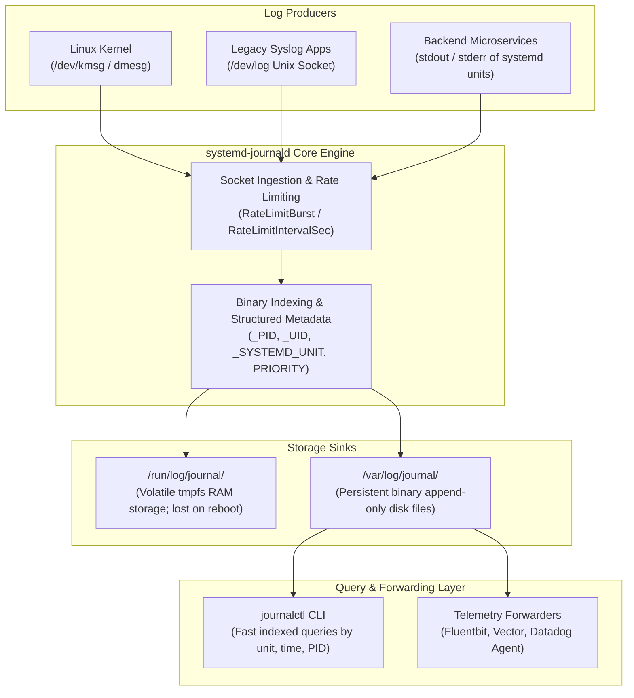
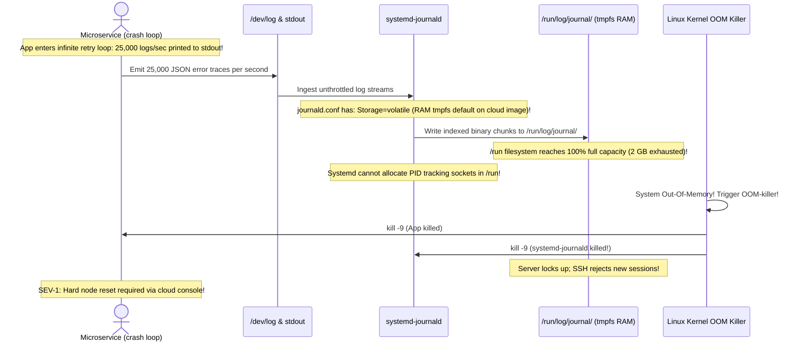

# Module 14: Logging and Journald

> **Prerequisites:** Module 06 (Process Management), Module 11 (Systemd Services).  
> **Estimated Reading Time:** 25 minutes  
> **Target Audience:** Backend Developers, Site Reliability Engineers, Production Support Engineers.

> [!TIP]
> **The Golden Rule of Systemd Logging:** Everything written to `stdout` and `stderr` by a managed systemd service is automatically ingested, timestamped, indexed, and structured by `systemd-journald`. Never write custom log rotation cron jobs or unbuffered disk log writers; emit structured logs directly to standard output, filter via `journalctl -u <unit> -p err --since "15 min ago"`, and cap journal disk consumption in `/etc/systemd/journald.conf` with `SystemMaxUse=1G`.

---

## 1. Architectural Mental Model: The Linux Logging Pipeline

In modern Linux systems, `systemd-journald` is the central telemetry hub that captures log events from kernel ring buffers, system calls, syslog daemons, and application containers:



### Binary Storage vs. Plaintext Text Files
Unlike traditional syslog text files (`/var/log/syslog`), journald stores logs in **indexed binary format**:
* **High-Speed Searching:** Queries by service (`-u`), process ID (`_PID`), or timestamp range do not require scanning entire multi-gigabyte files with `grep`.
* **Tamper-Evident Security:** Includes Forward Secure Sealing (FSS) to prevent attackers from altering historical log records after a system compromise.
* **Rich Metadata:** Every line automatically records the process UID, GID, SELinux context, systemd unit, and kernel timestamp.

---

## 2. Taxonomic Reference: Standard Syslog Priority Levels

Journald maps all log records to RFC 5424 severity levels (0 through 7):

| Numeric | Severity Code | Name | Semantic Meaning | Production Example |
| :--- | :--- | :--- | :--- | :--- |
| **`0`** | `emerg` | **Emergency** | System is completely unusable | Kernel panic, power supply failure |
| **`1`** | `alert` | **Alert** | Action must be taken immediately | Database corruption, RAID degradation |
| **`2`** | `crit` | **Critical** | Critical conditions | Hardware device read error, out of inodes |
| **`3`** | `err` | **Error** | Non-fatal error conditions | HTTP 500 spike, database connection refused |
| **`4`** | `warning` | **Warning** | Warning indicators | Disk space > 85%, deprecated API call |
| **`5`** | `notice` | **Notice** | Normal but significant condition | Service starting, network interface up |
| **`6`** | `info` | **Informational** | Standard operational metrics | HTTP 200 requests, user authentication |
| **`7`** | `debug` | **Debug** | Detailed developer diagnostics | Raw SQL queries, payload hex dumps |

---

## 3. Systematic Breakdown: `journalctl` Query Power Tools

| Need / Query Goal | Command Syntax | Description |
| :--- | :--- | :--- |
| **Stream Service Logs in Real Time** | `journalctl -u app.service -f` | Equivalent to `tail -f` for a specific systemd unit. |
| **Inspect Only Failures & Errors** | `journalctl -u app.service -p err` | Filters out all info/debug noise; shows only priority $\le 3$. |
| **Query Narrow Time Windows** | `journalctl --since "2026-11-10 14:00" --until "14:15"` | Pinpoint the exact duration of a production incident. |
| **Inspect Prior Boot Logs** | `journalctl -b -1` | Reads logs from the previous system boot (diagnosing kernel panic reboots). |
| **Filter by Process ID** | `journalctl _PID=4021` | Traces logs from a specific PID across multiple unit lifecycles. |
| **Export Structured Machine Logs** | `journalctl -u app.service -o json-pretty` | Formats log records into structured JSON objects. |
| **Check Storage Footprint** | `journalctl --disk-usage` | Reports total megabytes consumed by journal files. |
| **Reclaim Storage Immediately** | `sudo journalctl --vacuum-size=500M` | Deletes oldest log chunks until storage is under 500 MB. |

---

## 4. Production War Story: The Unbounded Journal Memory Exhaustion



### The Incident
Following a third-party payment gateway outage, a high-throughput microservice entered an aggressive connection retry loop, logging over 25,000 full stack traces per second to `stdout`. Within 18 minutes, the Kubernetes cluster node became completely unresponsive and dropped offline.

### The Post-Mortem Data
* **Severity:** SEV-1 (Cluster Node Crash & Pod Eviction)
* **Mean Time to Detect (MTTD):** 20 minutes
* **Mean Time to Resolution (MTTR):** 35 minutes

### The Root Cause
The cloud operating system image had `Storage=volatile` configured in `/etc/systemd/journald.conf`, causing journal logs to be stored entirely in `/run` (backed by a `tmpfs` RAM allocation). 

Furthermore, `RateLimitBurst` was disabled. The flood of 25,000 logs per second filled the entire `/run` filesystem, leaving zero memory for system sockets, lock files, and IPC pipes. The kernel OOM killer activated and terminated critical system processes.

### The Fix & Hardening
1. **Enable Persistent Disk Storage with Strict Caps in `/etc/systemd/journald.conf`:**
```ini
[Journal]
Storage=persistent
SystemMaxUse=2G
SystemKeepFree=10G
MaxFileSec=1month
```
2. **Enforce Kernel-Level Rate Limiting:**
```ini
RateLimitIntervalSec=30s
RateLimitBurst=5000
```
*(If any single process exceeds 5,000 log lines within 30 seconds, journald drops subsequent logs from that process and emits a rate-limit warning, protecting system stability).*
3. **Apply Changes:**
```bash
sudo systemctl restart systemd-journald
```

---

## 5. Multi-Language Production Code: Emitting Native Journald Priority Logs

When your backend application writes to `stdout`, you can prefix lines with standard syslog priority tags (`<3>`, `<6>`) to allow `journald` and `journalctl -p` to index log levels automatically without parsing JSON.

### Go
```go
package main

import (
	"fmt"
	"os"
	"time"
)

// Systemd Priority Prefixes
const (
	SD_EMERG   = "<0>"
	SD_ALERT   = "<1>"
	SD_CRIT    = "<2>"
	SD_ERR     = "<3>"
	SD_WARNING = "<4>"
	SD_NOTICE  = "<5>"
	SD_INFO    = "<6>"
	SD_DEBUG   = "<7>"
)

func LogToJournald(priority, message string) {
	// systemd-journald automatically parses leading <N> tags on stdout/stderr
	fmt.Fprintf(os.Stdout, "%s%s: %s\n", priority, time.Now().UTC().Format(time.RFC3339), message)
}

func main() {
	LogToJournald(SD_INFO, "Database connection established on port 5432")
	LogToJournald(SD_WARNING, "High latency detected on Redis cache: 48ms")
	LogToJournald(SD_ERR, "Failed to deliver webhook payload to customer endpoint")
}
```

### Node.js / TypeScript
```typescript
enum SystemdLevel {
  EMERG = '<0>',
  ALERT = '<1>',
  CRIT = '<2>',
  ERR = '<3>',
  WARNING = '<4>',
  NOTICE = '<5>',
  INFO = '<6>',
  DEBUG = '<7>',
}

export class JournaldLogger {
  public static info(msg: string): void {
    process.stdout.write(`${SystemdLevel.INFO}${new Date().toISOString()} [INFO] ${msg}\n`);
  }

  public static warn(msg: string): void {
    process.stdout.write(`${SystemdLevel.WARNING}${new Date().toISOString()} [WARN] ${msg}\n`);
  }

  public static error(msg: string, err?: Error): void {
    const errorDetails = err ? ` | Error: ${err.message}` : '';
    process.stderr.write(`${SystemdLevel.ERR}${new Date().toISOString()} [ERROR] ${msg}${errorDetails}\n`);
  }
}

JournaldLogger.info('Microservice bootstrapped on port 8080');
JournaldLogger.error('Failed to commit transaction to replica', new Error('ETIMEDOUT'));
```

### Python
```python
import sys
import datetime

class JournaldLogger:
    @staticmethod
    def log(priority_code: int, message: str) -> None:
        """
        Emits standard syslog-tagged line to stdout for systemd indexing.
        """
        timestamp = datetime.datetime.utcnow().isoformat()
        stream = sys.stderr if priority_code <= 3 else sys.stdout
        stream.write(f"<{priority_code}>{timestamp} - {message}\n")
        stream.flush()

if __name__ == "__main__":
    JournaldLogger.log(6, "Application worker thread spawned successfully.")
    JournaldLogger.log(3, "CRITICAL: Downstream authentication service unresponsive.")
```

---

## 6. Practical Hands-On Verification CLI Workflows

Follow these workflows in your Ubuntu terminal:

### Workflow 1: Inspect System Logs by Time Window
```bash
# 1. Query error-level logs from the last 30 minutes
journalctl --since "30 minutes ago" -p err --no-pager

# 2. Check logs from the current machine boot
journalctl -b 0 -n 25 --no-pager
```

### Workflow 2: Test Native Journald Priority Tag Ingestion
```bash
# 1. Emit tagged logs directly using systemd-cat
echo "This is a regular notice log" | systemd-cat -t "test-app" -p notice
echo "This is a simulated critical database error!" | systemd-cat -t "test-app" -p err

# 2. Query only errors from test-app
journalctl -t "test-app" -p err --no-pager
```
**Expected Output:**
```text
Nov 10 16:30:00 dev-box test-app[12345]: This is a simulated critical database error!
```

### Workflow 3: Audit Journal Disk Usage and Vacuum
```bash
# 1. Check current journal disk consumption
journalctl --disk-usage

# 2. Retain at most the last 2 days of logs
sudo journalctl --vacuum-time=2d
```

---

## 7. Operational Validation Checkpoint

<details>
<summary><strong>Question 1: Ephemeral Volatile vs. Persistent Storage</strong></summary>

**Scenario:** A cloud server crashes due to a sudden kernel panic and reboots. When the SRE logs in and executes `journalctl -b -1` to inspect the cause of the panic, the terminal prints:
`Specifying boot ID or boot offset has no effect, no persistent journal was found.`

Why are the previous boot's logs missing, and how do you configure systemd to persist logs across reboots?

**Answer:**
By default on many base Ubuntu/Debian cloud images, `systemd-journald` operates in **volatile memory mode** (`/run/log/journal/`). Because `/run` is mounted on `tmpfs` (RAM), all log records are erased when the machine loses power or reboots.

**The Fix:** Create the persistent log directory on disk:
```bash
sudo mkdir -p /var/log/journal
sudo systemd-tmpfiles --create --prefix /var/log/journal
sudo systemctl restart systemd-journald
```
Once `/var/log/journal` exists on disk (or `Storage=persistent` is explicitly set in `/etc/systemd/journald.conf`), journald writes append-only files to disk, allowing `journalctl -b -1` to retrieve pre-crash logs reliably.
</details>

<details>
<summary><strong>Question 2: Why Journald Drops Log Lines During Traffic Spikes</strong></summary>

**Scenario:** During a major stress test, an application emits 50,000 log events in 10 seconds. In the journal log, you observe:
`systemd-journald[420]: Suppressed 42100 messages from app.service`
Why did journald suppress the messages, and how do you tune this threshold?

**Answer:**
`systemd-journald` enforces defensive **rate-limiting** to prevent rogue or looping processes from starving CPU or exhausting disk storage.

The rate limit is controlled by two parameters in `/etc/systemd/journald.conf`:
* `RateLimitIntervalSec` (Default: 30s)
* `RateLimitBurst` (Default: 10,000)

If a service exceeds `RateLimitBurst` within `RateLimitIntervalSec`, journald drops all subsequent lines until the interval resets.

**To tune for high-throughput services:**
In the unit file `/etc/systemd/system/app.service`, add:
```ini
[Service]
LogRateLimitIntervalSec=0
```
Setting it to `0` disables rate-limiting specifically for that critical service.
</details>

<details>
<summary><strong>Question 3: Extracting Machine-Parsable Logs for Alerting</strong></summary>

**Scenario:** You are authoring a monitoring script that checks for failed login attempts. How can you query `journalctl` to return output in structured JSON format rather than unparsed plaintext?

**Answer:**
Use the `-o json` (or `-o json-pretty`) flag:
```bash
journalctl -u ssh.service -p warning -o json --since "10 minutes ago"
```
Each entry is emitted as a complete JSON object containing fields such as `MESSAGE`, `PRIORITY`, `_PID`, `_UID`, `_SYSTEMD_UNIT`, and `__REALTIME_TIMESTAMP`, allowing direct piping into `jq` or custom parsers.
</details>

---

## Next Step

Now that you understand system logging and journal diagnostics, proceed to **[15 · Linux Security Basics — Sudo, Firewalls, and Hardening](../15-security-basics-sudo-firewall/README.md)** to master least-privilege delegation (`visudo`), UFW packet filtering, and host defense.
