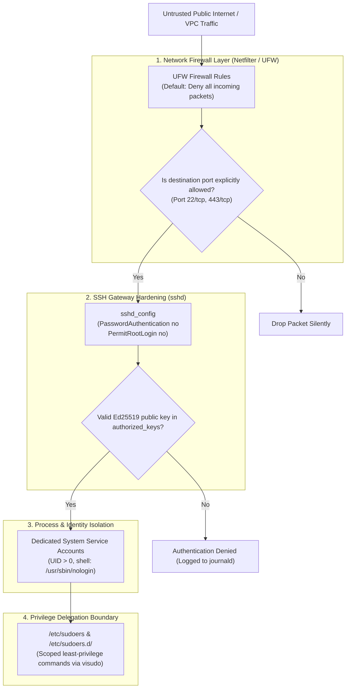
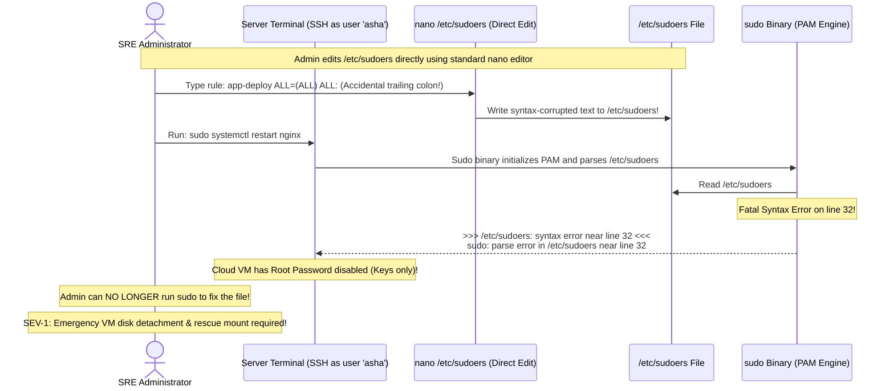

# Module 15: Security Basics — Sudo, Firewalls, and Hardening

> **Prerequisites:** Module 04 (Users and Groups), Module 10 (Networking Basics).  
> **Estimated Reading Time:** 25 minutes  
> **Target Audience:** Backend Developers, DevOps Engineers, Cloud Security Architects.

> [!TIP]
> **The Golden Rule of Linux Host Hardening:** **Never edit `/etc/sudoers` directly with a standard text editor**—always use **`sudo visudo`** (or `visudo -f /etc/sudoers.d/<file>`). `visudo` locks the file against concurrent edits and parses syntax before saving; a single typo in `/etc/sudoers` will immediately lock all administrators out of root access. When configuring host firewalls (UFW), **always allow SSH (`ufw allow 22/tcp` or your custom port) before enabling the firewall (`ufw enable`)**.

---

## 1. Architectural Mental Model: Linux Defense-in-Depth

Securing a production Linux host requires establishing multiple concentric defensive boundaries from the external network adapter down to the kernel execution layer:



---

## 2. Systematic Breakdown: Hardening `/etc/sudoers` with `visudo`

The `sudoers` file defines who can run which commands as which user on which machine.

### Sudoers Syntax Anatomy
```text
asha    ALL=(root)    NOPASSWD: /usr/bin/systemctl restart nginx
 │       │     │         │                     │
 │       │     │         │                     └── 5. Allowed Absolute Command Path
 │       │     │         └──────────────────────── 4. Bypass Password Prompt
 │       │     └────────────────────────────────── 3. Run As User
 │       └──────────────────────────────────────── 2. Target Host (ALL = any machine)
 └──────────────────────────────────────────────── 1. Authorized User or %Group
```

### Best Practices for Privilege Delegation
1. **Never grant `ALL=(ALL:ALL) ALL` to automated service accounts:** Specify the exact binary paths needed (e.g. `/usr/bin/docker`, `/usr/bin/systemctl`).
2. **Always use drop-in files:** Do not pollute the main `/etc/sudoers` file. Place isolated configurations in `/etc/sudoers.d/<service-name>`:
   ```bash
   sudo visudo -f /etc/sudoers.d/deploy-service
   ```
3. **Drop-in File Rules:** Files in `/etc/sudoers.d/` must **not** end in `~` or contain `.` (e.g. name it `deploy-service`, not `deploy-service.conf`), and must have mode `0440`.

---

## 3. Systematic Reference: UFW (Uncomplicated Firewall)

UFW acts as an intuitive userspace frontend to the Linux kernel's underlying `netfilter` / `iptables` packet filtering architecture:

| Operation | Command Syntax | Production Security Rationale |
| :--- | :--- | :--- |
| **Set Ingress Default** | `sudo ufw default deny incoming` | Drops all unsolicited incoming packets by default. |
| **Set Egress Default** | `sudo ufw default allow outgoing` | Permits outbound API calls, package updates, and DNS. |
| **Allow SSH Before Enabling** | `sudo ufw allow 22/tcp` | **MANDATORY PRE-REQUISITE** to avoid locking yourself out! |
| **Allow Web Traffic** | `sudo ufw allow 80/tcp && sudo ufw allow 443/tcp` | Permits HTTP and HTTPS public traffic. |
| **Restrict by Subnet** | `sudo ufw allow from 10.0.0.0/16 to any port 5432 proto tcp` | Restricts PostgreSQL access strictly to private VPC CIDR. |
| **Inspect Rules Numbered** | `sudo ufw status numbered` | Displays active rules with numeric IDs for clean deletion. |
| **Delete Specific Rule** | `sudo ufw delete <rule_number>` | Removes an obsolete rule by its numbered index. |
| **Enable Firewall** | `sudo ufw enable` | Activates kernel packet filtering rules in RAM and persists on boot. |

---

## 4. Production War Story: The Direct `/etc/sudoers` Syntax Error Lockout



### The Incident
An on-call engineer attempted to grant temporary deployment permissions to a CI/CD automation user. Instead of running `visudo`, the engineer executed:
```bash
sudo nano /etc/sudoers
```
The engineer introduced a typographical error on line 32 (an accidental trailing colon). Upon saving and exiting, the engineer attempted to verify with `sudo -l`. The terminal returned:
`>>> /etc/sudoers: syntax error near line 32 <<<`  
`sudo: parse error in /etc/sudoers near line 32`  
`sudo: no valid sudoers sources found, quitting`

Because root password authentication was disabled on the cloud VM, **every user on the machine was permanently locked out of administrative access**.

### The Post-Mortem Data
* **Severity:** SEV-1 (Complete Loss of Administrative Access)
* **Mean Time to Detect (MTTD):** 5 minutes
* **Mean Time to Resolution (MTTR):** 90 minutes (VM stopped, OS disk detached, mounted to a rescue VM, syntax fixed, and reattached)

### The Root Cause
Directly editing `/etc/sudoers` bypasses syntax validation. When `sudo` encounters an invalid token, it refuses to execute as a failsafe to prevent privilege escalation vulnerabilities.

### The Fix & Hardening
1. **MANDATORY USE OF `visudo`:**
`visudo` creates a temporary shadow copy (`/etc/sudoers.tmp`). It checks syntax before committing changes to disk. If a syntax error is present, it warns the operator and refuses to save:
```text
>>> /etc/sudoers: syntax error near line 32 <<<
What now? [x=exit, e=edit, d=diff]
```
2. **Automated Verification in CI/CD:**
If templating sudoers rules with Ansible or Terraform, always run:
```bash
visudo -c -f /path/to/generated_file
```
3. **Use Isolated Drop-ins:** Never edit `/etc/sudoers`. Always place files in `/etc/sudoers.d/` using `sudo visudo -f /etc/sudoers.d/<file>`.

---

## 5. Multi-Language Production Code: Verifying Execution Privileges

Backend services and CLI utilities must check that they are executing under appropriate least-privilege credentials before attempting operations.

### Go
```go
package main

import (
	"fmt"
	"os"
)

// AssertNonRoot ensures that the service is running under an unprivileged user identity.
func AssertNonRoot() error {
	euid := os.Geteuid()
	if euid == 0 {
		return fmt.Errorf("SECURITY RISK: Service cannot be run as root (EUID=0)")
	}
	fmt.Printf("✅ Least-privilege assertion verified: Running as UID %d\n", euid)
	return nil
}

func main() {
	if err := AssertNonRoot(); err != nil {
		fmt.Fprintf(os.Stderr, "FATAL: %v\n", err)
		os.Exit(1)
	}
}
```

### Node.js / TypeScript
```typescript
/**
 * Asserts that the current process is not executing with root privileges.
 */
export function enforceLeastPrivilege(): void {
  if (typeof process.getuid === 'function' && process.getuid() === 0) {
    console.error('❌ FATAL SECURITY VIOLATION: Refusing to start server as root (UID 0)!');
    process.exit(1);
  }
  console.log('✅ Verified: Process is executing in unprivileged userland.');
}

enforceLeastPrivilege();
```

### Python
```python
import os
import sys

def audit_runtime_security():
    """
    Terminates execution if executed as superuser.
    """
    if os.geteuid() == 0:
        sys.stderr.write("❌ FATAL: Application daemon must NOT be executed as root.\n")
        sys.exit(1)
    print(f"✅ Runtime security check passed: EUID={os.geteuid()}")

if __name__ == "__main__":
    audit_runtime_security()
```

---

## 6. Practical Hands-On Verification CLI Workflows

Follow these workflows in your Ubuntu terminal:

### Workflow 1: Audit Your Active Sudo Privileges
```bash
# List all commands permitted for your user without entering interactive edit mode
sudo -l
```

### Workflow 2: Create a Scoped Sudoers Drop-In File with `visudo`
```bash
# 1. Safely author a drop-in rule for an automated log scraper
sudo visudo -f /etc/sudoers.d/log-scraper

# 2. Add this line inside the editor:
# %sudo ALL=(root) NOPASSWD: /usr/bin/journalctl

# 3. Validate the syntax of all sudoers configurations
sudo visudo -c

# 4. Clean up test file
sudo rm -f /etc/sudoers.d/log-scraper
```
**Expected Output:**
```text
/etc/sudoers: parsed OK
/etc/sudoers.d/log-scraper: parsed OK
```

### Workflow 3: Configure UFW Defensive Baseline Safely
```bash
# 1. Set default policies
sudo ufw default deny incoming
sudo ufw default allow outgoing

# 2. Explicitly allow SSH FIRST
sudo ufw allow 22/tcp

# 3. Allow web traffic
sudo ufw allow 80/tcp
sudo ufw allow 443/tcp

# 4. Check status without enabling (simulation)
sudo ufw status verbose
```

---

## 7. Operational Validation Checkpoint

<details>
<summary><strong>Question 1: The SSH Lockout via UFW Default Deny</strong></summary>

**Scenario:** A junior administrator provisions a new cloud server and executes:
```bash
sudo ufw default deny incoming
sudo ufw enable
```
The active SSH terminal freezes immediately. When attempting to open a new SSH session, the connection times out. 

What went wrong, and how must UFW be initialized?

**Answer:**
`sudo ufw default deny incoming` sets the firewall's default policy to **drop every incoming packet on all network interfaces**. 

Because the administrator ran `sudo ufw enable` **before** adding an explicit rule for the SSH port (`22/tcp`), the Linux kernel's netfilter immediately began dropping all incoming TCP packets destined for port 22, severing the administrator's active session and blocking all future access.

**The Fix:** Always allow SSH before enabling the firewall:
```bash
sudo ufw allow 22/tcp
sudo ufw enable
```
</details>

<details>
<summary><strong>Question 2: What is the Vulnerability of `NOPASSWD: ALL`?</strong></summary>

**Scenario:** To make a CI/CD runner script work without prompting for a password, an engineer adds this line to `/etc/sudoers.d/ci-runner`:
`ci-runner ALL=(ALL) NOPASSWD: ALL`
A security auditor flags this configuration as a critical vulnerability.

Why is `NOPASSWD: ALL` hazardous even on an internal build machine?

**Answer:**
`NOPASSWD: ALL` completely dissolves the privilege boundary between the `ci-runner` user and `root`. 

If an attacker compromises the CI/CD pipeline (e.g. via a malicious dependency in a pull request or an unverified build script), the attacker can execute `sudo su -` or `sudo bash` without entering any password, gaining unrestricted root control over the operating system, kernel modules, network adapters, and host secrets.

**The Fix:** Scope `NOPASSWD` strictly to the exact, immutable binary paths required:
```text
ci-runner ALL=(root) NOPASSWD: /usr/bin/docker, /usr/bin/systemctl restart app
```
</details>

<details>
<summary><strong>Question 3: Why `visudo -c` is Mandatory in Infrastructure-as-Code</strong></summary>

**Scenario:** An automated Ansible playbook deploys a templated `/etc/sudoers.d/app` file across 400 bare-metal servers. A template syntax error corrupts the file on all 400 servers simultaneously. 

What Ansible directive or pre-commit command prevents deploying an invalid sudoers drop-in?

**Answer:**
Use the `validate` directive in Ansible's `template` or `copy` module:
```yaml
- name: Deploy sudoers drop-in safely
  ansible.builtin.template:
    src: app-sudoers.j2
    dest: /etc/sudoers.d/app
    mode: '0440'
    validate: '/usr/sbin/visudo -cf %s'
```
Ansible writes the file to a temporary location first and runs `visudo -cf <temp_file>`. If `visudo` detects a syntax error, Ansible aborts the task immediately without overwriting the destination file, preventing multi-server lockouts.
</details>

---

## Next Step

Now that you have mastered Linux host security, sudo delegation, and firewall baselines, proceed to **[16 · Capstone Project: Log Watchdog](../16-capstone-project/README.md)** to synthesize all 16 modules into a production-grade automated monitoring daemon.
