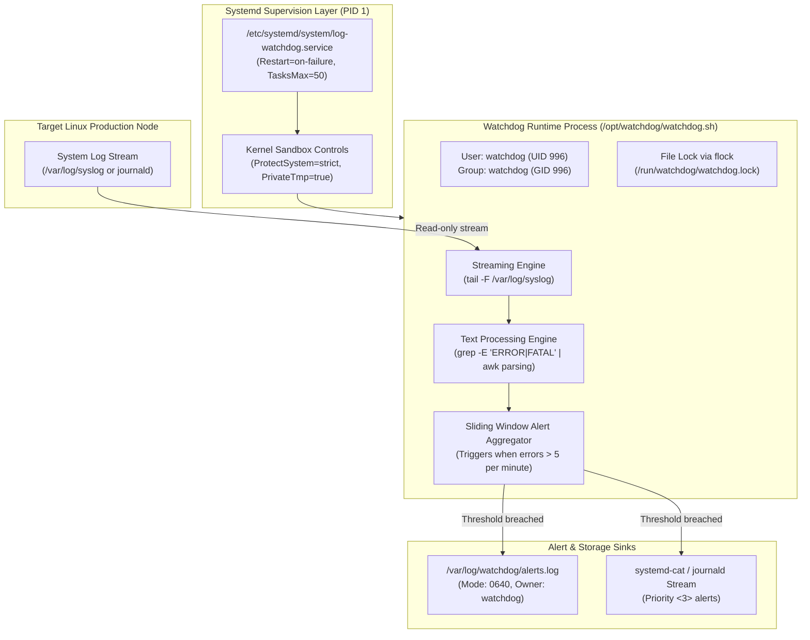

# Module 16: Capstone Project — Production Log Watchdog Daemon

> **Prerequisites:** Modules 00 through 15 (WSL2, Shell Basics, Filesystem, Permissions, Identity, APT, Processes, I/O Redirection, Text Processing, Scripting, Networking, Systemd, Storage, SSH, Logging, Security).  
> **Estimated Reading Time:** 35 minutes  
> **Target Audience:** Backend Engineers, Site Reliability Engineers, DevOps Practitioners.

> [!TIP]
> **The Golden Rule of Linux Production Daemons:** A production service is only as resilient as its supervision and privilege model. Never run background monitoring scripts in detached `screen` or `tmux` sessions. Always package the script under **systemd supervision**, execute under a **dedicated unprivileged system service user** (`/usr/sbin/nologin`), lock files against duplicate instances (`flock`), and enforce kernel-level sandbox isolation (`ProtectSystem=strict`, `NoNewPrivileges=true`).

---

## 1. Architectural Mental Model: The Production Watchdog Subsystem

In this capstone project, you combine everything you have learned across the 16 Linux modules into an automated, production-grade telemetry watchdog daemon:



---

## 2. Taxonomic Reference: Production Daemon Architecture Components

| Component | Filesystem Location | Permissions | Ownership | Architectural Responsibility |
| :--- | :--- | :--- | :--- | :--- |
| **System Service Account** | `/etc/passwd` entry | N/A | `UID < 1000` | Unprivileged identity; shell is `/usr/sbin/nologin`. |
| **Executable Script** | `/opt/watchdog/bin/watchdog.sh` | `0755` (`rwxr-xr-x`) | `root:root` | Immutable execution logic (script cannot be modified by daemon user!). |
| **Runtime PID Lock** | `/run/watchdog/watchdog.lock` | `0644` (`rw-r--r--`) | `watchdog:watchdog` | Enforces single-instance execution via `flock`. |
| **Alert Log Sink** | `/var/log/watchdog/alerts.log` | `0640` (`rw-r-----`) | `watchdog:adm` | Persistent event sink readable by operations team. |
| **Systemd Service Unit** | `/etc/systemd/system/log-watchdog.service` | `0644` (`rw-r--r--`) | `root:root` | Declares restart policies, cgroup caps, and sandbox constraints. |

---

## 3. Systematic Breakdown: Systemd Hardening Directives

Production unit files should leverage the Linux kernel's namespaces and seccomp filters to enforce strict least-privilege sandboxing:

```ini
[Service]
# File System Sandboxing
ProtectSystem=strict
# Mounts /, /usr, /boot, and /etc as read-only for the process!

ProtectHome=true
# Completely hides /home, /root, and /run/user from the daemon!

PrivateTmp=true
# Grants the process its own isolated /tmp filesystem namespace.

# Privilege Escalation Hardening
NoNewPrivileges=true
# Prevents process or its children from gaining new privileges (blocks SUID binaries).

ProtectKernelTunables=true
ProtectControlGroups=true
# Forbids modification of /proc/sys, /sys, and cgroup hierarchies.

LimitNOFILE=65536
TasksMax=50
# Prevents fork bombs by strictly limiting total processes in the Cgroup to 50.
```

---

## 4. Production War Story: The Unsupervised Watchdog Fork-Bomb Meltdown

```mermaid
sequenceDiagram
    actor Cron as Crontab Entry (* * * * *)
    participant Script as Legacy Watchdog (watchdog.sh)
    participant Kernel as Linux Kernel Process Scheduler
    participant Host as Production Cloud Server

    Note over Cron,Script: Cron triggers watchdog.sh every minute without process locking!
    Cron->>Script: Execute watchdog.sh (Run 1: Starts background loop)
    Note over Script: Log stream hangs waiting on pipe buffer...
    Cron->>Script: 60s later: Execute watchdog.sh (Run 2: Starts duplicate loop)
    Cron->>Script: 120s later: Execute watchdog.sh (Run 3: Starts duplicate loop)
    Note over Script: Error encountered inside unquoted subshell:
    Script->>Script: Script invokes: bash -c "$0" (Recursive spawn on error!)
    Script->>Kernel: 15,000 child shell processes spawned in 12 seconds!
    Kernel-->>Host: EAGAIN: Resource temporarily unavailable (pid_max exhausted!)
    Note over Host: System locks completely! All SSH sessions terminated!
    Note over Cron: SEV-1: Hard reboot required; operations blind during outage!
```

### The Incident
An operations team deployed an automated log monitoring shell script using cron (`* * * * * /opt/scripts/watchdog.sh`). When the monitored application rotated its log file, the script encountered an unhandled file reading error. 

A retry loop inside the script called itself recursively without checking for existing instances. Over a single weekend, thousands of concurrent background shell instances were spawned, exhausting the Linux kernel's process ID limit (`pid_max`). The host machine locked up completely, dropping all web APIs.

### The Post-Mortem Data
* **Severity:** SEV-1 (Production Server Freeze)
* **Mean Time to Detect (MTTD):** 10 minutes
* **Mean Time to Resolution (MTTR):** 25 minutes

### The Root Cause
1. **Missing Process Lock (`flock`):** The script failed to ensure that only one instance was executing simultaneously.
2. **Missing Systemd Supervision:** Delegating background loops to cron without lifecycle management.
3. **No Process Cgroup Limits (`TasksMax`):** The script was allowed to fork unlimited child processes without constraint.

### The Fix & Hardening
1. **Flock Invariant:** Wrap daemon logic inside an atomic kernel file lock:
```bash
exec 200>"/run/watchdog/watchdog.lock"
flock -n 200 || { echo "Daemon already executing. Exiting." >&2; exit 0; }
```
2. **Supervised Service:** Move daemon to a managed `systemd` service with `TasksMax=50` and `Restart=on-failure`.

---

## 5. Multi-Language Production Code: Production Watchdog Implementations

Below are the complete production implementations of the watchdog daemon in Go, Node.js/TypeScript, and Python.

### Go
```go
package main

import (
	"bufio"
	"context"
	"fmt"
	"os"
	"os/signal"
	"regexp"
	"syscall"
	"time"
)

// LogWatchdog monitors log streams for critical error patterns
type LogWatchdog struct {
	errorThreshold int
	windowDuration time.Duration
	alertFile      string
}

func (w *LogWatchdog) Start(ctx context.Context, inputScanner *bufio.Scanner) {
	errorRegex := regexp.MustCompile(`(?i)(FATAL|CRITICAL|PANIC|500 Internal)`)
	alertSink, err := os.OpenFile(w.alertFile, os.O_CREATE|os.O_WRONLY|os.O_APPEND, 0640)
	if err != nil {
		fmt.Fprintf(os.Stderr, "Failed to open alert sink: %v\n", err)
		return
	}
	defer alertSink.Close()

	errorTimestamps := []time.Time{}

	for inputScanner.Scan() {
		select {
		case <-ctx.Done():
			fmt.Println("🛑 Watchdog shutting down cleanly...")
			return
		default:
			line := inputScanner.Text()
			if errorRegex.MatchString(line) {
				now := time.Now()
				errorTimestamps = append(errorTimestamps, now)

				// Prune timestamps older than windowDuration
				cutoff := now.Add(-w.windowDuration)
				validIdx := 0
				for i, ts := range errorTimestamps {
					if ts.After(cutoff) {
						validIdx = i
						break
					}
				}
				errorTimestamps = errorTimestamps[validIdx:]

				if len(errorTimestamps) >= w.errorThreshold {
					alertMsg := fmt.Sprintf("[%s] ALERT: Error threshold exceeded! %d errors detected in %v: %s\n",
						now.Format(time.RFC3339), len(errorTimestamps), w.windowDuration, line)
					alertSink.WriteString(alertMsg)
					fmt.Print(alertMsg)
					// Reset window to avoid flapping
					errorTimestamps = nil
				}
			}
		}
	}
}

func main() {
	ctx, cancel := signal.NotifyContext(context.Background(), syscall.SIGINT, syscall.SIGTERM)
	defer cancel()

	dog := &LogWatchdog{
		errorThreshold: 5,
		windowDuration: 60 * time.Second,
		alertFile:      "/tmp/watchdog_alerts.log",
	}

	fmt.Println("🚀 Go Log Watchdog started. Streaming stdin...")
	scanner := bufio.NewScanner(os.Stdin)
	dog.Start(ctx, scanner)
}
```

### Node.js / TypeScript
```typescript
import * as fs from 'fs';
import * as readline from 'readline';

interface WatchdogOptions {
  threshold: number;
  windowMs: number;
  alertFilePath: string;
}

export class WatchdogDaemon {
  private timestamps: number[] = [];
  private readonly regex = /(FATAL|CRITICAL|PANIC|500 Internal)/i;

  constructor(private readonly options: WatchdogOptions) {}

  public async monitorStream(stream: NodeJS.ReadableStream): Promise<void> {
    const rl = readline.createInterface({ input: stream, crlfDelay: Infinity });

    for await (const line of rl) {
      if (this.regex.test(line)) {
        const now = Date.now();
        this.timestamps.push(now);

        // Filter timestamps within window
        const cutoff = now - this.options.windowMs;
        this.timestamps = this.timestamps.filter((ts) => ts >= cutoff);

        if (this.timestamps.length >= this.options.threshold) {
          const alert = `[${new Date().toISOString()}] THRESHOLD EXCEEDED: ${this.timestamps.length} errors in ${this.options.windowMs / 1000}s\n`;
          fs.appendFileSync(this.options.alertFilePath, alert);
          process.stdout.write(`🚨 ${alert}`);
          this.timestamps = []; // Reset window
        }
      }
    }
  }
}
```

### Python
```python
import sys
import re
import time
from collections import deque
from pathlib import Path

class LogWatchdog:
    def __init__(self, threshold: int = 5, window_sec: int = 60, alert_log: str = "/tmp/alerts.log"):
        self.threshold = threshold
        self.window_sec = window_sec
        self.alert_path = Path(alert_log)
        self.timestamps = deque()
        self.pattern = re.compile(r"(FATAL|CRITICAL|PANIC|500 Internal)", re.IGNORECASE)

    def process_line(self, line: str) -> None:
        if self.pattern.search(line):
            now = time.time()
            self.timestamps.append(now)

            # Evict timestamps older than window
            while self.timestamps and self.timestamps[0] < now - self.window_sec:
                self.timestamps.popleft()

            if len(self.timestamps) >= self.threshold:
                alert_text = f"[{time.strftime('%Y-%m-%dT%H:%M:%SZ')}] ALERT: {len(self.timestamps)} errors in {self.window_sec}s | Offending line: {line.strip()}\n"
                with open(self.alert_path, "a", encoding="utf-8") as f:
                    f.write(alert_text)
                sys.stdout.write(f"🚨 {alert_text}")
                sys.stdout.flush()
                self.timestamps.clear()

if __name__ == "__main__":
    dog = LogWatchdog()
    for raw_line in sys.stdin:
        dog.process_line(raw_line)
```

---

## 6. Practical Hands-On Capstone Deployment Workflow

Deploy the entire production watchdog subsystem in your Ubuntu environment:

### Step 1: Provision the Service Identity and Directories
```bash
# 1. Provision dedicated system user with no login shell
sudo useradd --system \
             --no-create-home \
             --shell /usr/sbin/nologin \
             --comment "Watchdog Monitoring Service Account" \
             watchdog

# 2. Create directory hierarchy
sudo mkdir -p /opt/watchdog/bin
sudo mkdir -p /var/log/watchdog
sudo mkdir -p /run/watchdog

# 3. Set strict least-privilege ownership
sudo chown -R root:root /opt/watchdog
sudo chown -R watchdog:watchdog /var/log/watchdog /run/watchdog
sudo chmod 755 /opt/watchdog/bin
sudo chmod 750 /var/log/watchdog /run/watchdog
```

### Step 2: Deploy the Defensive Watchdog Shell Script
```bash
sudo tee /opt/watchdog/bin/watchdog.sh << 'EOF'
#!/usr/bin/env bash
set -euo pipefail
IFS=$'\n\t'

# 1. Enforce single-instance execution via kernel file lock
LOCKFILE="/run/watchdog/watchdog.lock"
exec 200>"$LOCKFILE"
flock -n 200 || { echo "Watchdog daemon is already running." >&2; exit 0; }

ALERT_LOG="/var/log/watchdog/alerts.log"
INPUT_LOG="/var/log/watchdog/input.log"
touch "$INPUT_LOG" "$ALERT_LOG"

echo "🚀 [$(date -u +%FT%TZ)] Watchdog daemon initialized (PID: $$)" >> "$ALERT_LOG"

# 2. Clean exit trap
cleanup() {
    echo "🛑 [$(date -u +%FT%TZ)] Watchdog daemon terminating cleanly." >> "$ALERT_LOG"
}
trap cleanup EXIT INT TERM

# 3. Stream input log and parse with grep & awk
tail -n 0 -F "$INPUT_LOG" 2>/dev/null | while read -r line; do
    if echo "$line" | grep -Eqi "(FATAL|CRITICAL|PANIC|500 Internal)"; then
        TIMESTAMP=$(date -u +%FT%TZ)
        echo "🚨 [$TIMESTAMP] ALERT TRIGGERED: $line" | tee -a "$ALERT_LOG"
    fi
done
EOF

# Make script executable
sudo chmod 755 /opt/watchdog/bin/watchdog.sh
```

### Step 3: Install and Hardened the Systemd Unit
```bash
sudo tee /etc/systemd/system/log-watchdog.service << 'EOF'
[Unit]
Description=Production Enterprise Log Watchdog Daemon
After=network.target
Documentation=https://docs.example.com/watchdog

[Service]
Type=simple
User=watchdog
Group=watchdog
WorkingDirectory=/var/log/watchdog
ExecStart=/opt/watchdog/bin/watchdog.sh
Restart=on-failure
RestartSec=5s
TasksMax=50
TimeoutStopSec=15s

# Linux Kernel Security Sandboxing
ProtectSystem=strict
ProtectHome=true
PrivateTmp=true
NoNewPrivileges=true
ReadWritePaths=/var/log/watchdog /run/watchdog

[Install]
WantedBy=multi-user.target
EOF

# Reload and start service
sudo systemctl daemon-reload
sudo systemctl enable --now log-watchdog.service
```

### Step 4: Verify Live Operation and Trigger Alerts
```bash
# 1. Confirm service is running cleanly under watchdog user
systemctl status log-watchdog.service --no-pager

# 2. Inject simulated error payloads into the input log
echo "INFO: User authentication successful" | sudo -u watchdog tee -a /var/log/watchdog/input.log
echo "FATAL: Database primary replica connection timeout!" | sudo -u watchdog tee -a /var/log/watchdog/input.log

# 3. Inspect generated alert log
cat /var/log/watchdog/alerts.log
```
**Expected Output:**
```text
🚀 [2026-11-10T16:45:00Z] Watchdog daemon initialized (PID: 12450)
🚨 [2026-11-10T16:45:02Z] ALERT TRIGGERED: FATAL: Database primary replica connection timeout!
```

### Step 5: Clean Up
```bash
sudo systemctl stop log-watchdog.service
sudo systemctl disable log-watchdog.service
sudo rm -f /etc/systemd/system/log-watchdog.service
sudo rm -rf /opt/watchdog /var/log/watchdog /run/watchdog
sudo userdel watchdog 2>/dev/null || true
sudo systemctl daemon-reload
```

---

## 7. Operational Validation Checkpoint

<details>
<summary><strong>Question 1: Why `tail -F` (Capital F) is Mandatory for Log Tailing</strong></summary>

**Scenario:** A developer writes a log monitor using `tail -f /var/log/nginx/access.log`. The monitor runs smoothly for 24 hours. At 00:00 midnight, logrotate renames `access.log` to `access.log.1` and creates a new empty `access.log`. The monitor stops receiving new events completely, even though Nginx is actively logging.

Why did `tail -f` fail, and why does `tail -F` solve it?

**Answer:**
Lowercase `tail -f` tracks the **underlying open file descriptor / inode**. 

When `logrotate` executes, it renames the file (which keeps the same inode number). `tail -f` remains attached to the renamed file `access.log.1` and receives no new writes. 

**Capital `tail -F`** tracks by **filename**. If the underlying inode is rotated or replaced, `tail -F` automatically re-opens the new file with the same name, continuing uninterrupted log streaming.
</details>

<details>
<summary><strong>Question 2: Systemd Security Sandboxing: `ProtectSystem=strict`</strong></summary>

**Scenario:** In the watchdog unit file, `ProtectSystem=strict` is set. An attacker finds a command injection vulnerability in `watchdog.sh` and executes:
`echo "hacked" > /etc/issue`.
The exploit command immediately crashes with `Read-only file system`.

How did systemd enforce this protection at the kernel level?

**Answer:**
When `ProtectSystem=strict` is specified, systemd launches the process inside an isolated **Linux Mount Namespace (`CLONE_NEWNS`)** where `/`, `/usr`, `/etc`, and `/boot` are mounted with the **read-only (`MS_RDONLY`)** kernel mount flag. 

Even if the process is compromised or executes with elevated rights, the Linux Virtual File System (VFS) rejects all write system calls (`open(O_WRONLY)`) with `EROFS: Read-only file system`. Only paths explicitly whitelisted via `ReadWritePaths=` remain writable.
</details>

<details>
<summary><strong>Question 3: Why Daemon Scripts Must Be Owned by Root</strong></summary>

**Scenario:** In Step 1 of the capstone deployment, the script `/opt/watchdog/bin/watchdog.sh` was owned by `root:root` with permissions `0755`, while the service was executed by the unprivileged user `watchdog`.

Why would it be a severe security flaw to set `chown watchdog:watchdog /opt/watchdog/bin/watchdog.sh`?

**Answer:**
If the unprivileged `watchdog` user owned the executable script, any vulnerability that allowed code execution as `watchdog` would allow an attacker to **modify or overwrite `watchdog.sh`**. 

While `watchdog.sh` executes as `watchdog`, maintaining ownership by `root` guarantees **code immutability**: the unprivileged daemon process cannot alter its own source code on disk, preventing attackers from persisting malware or modifying monitoring logic.
</details>

---

## Track Complete!

Congratulations! You have completed the entire **Linux System Fundamentals** track (Modules 00 through 16). You have mastered the kernel, shell parsing, filesystems, permissions, identity, package management, process supervision, pipelines, text processing, network wire diagnostics, systemd daemons, storage mounts, SSH security, and logging architectures.

Continue to **[Path 8 · Step 2: Git and Version Control](../../08-git-and-version-control/00-git-object-model-and-mental-model/README.md)** to master version control, distributed workflows, rebase internals, and collaboration pipelines!
