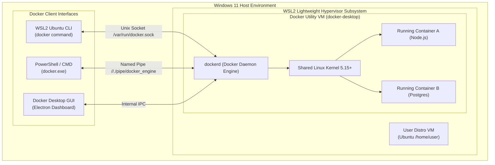
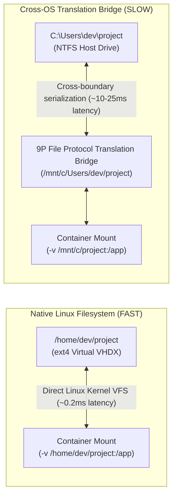
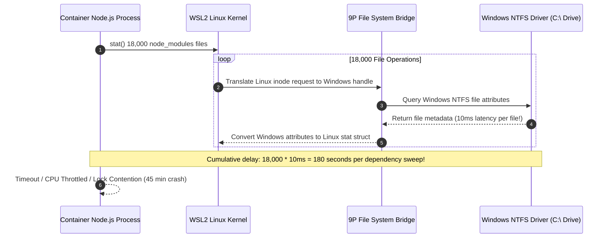

# Module 00: Setup — Docker Desktop on Windows 11 with WSL2

> **Status:** Production Standard  
> **Difficulty:** Foundational DevOps  
> **Estimated Time:** 1–2 Hours  
> **Prerequisites:** Windows 11 / 10 with virtualization enabled, basic shell navigation

---

> [!TIP]
> **The Golden Rule of WSL2 Docker Architecture**  
> Never store Docker build contexts, persistent database volumes, or source code directories across the Windows NTFS 9P translation bridge (`/mnt/c/...`). The 9P file protocol incurs a $10\times\text{–}50\times$ I/O latency penalty when performing high-frequency small-file operations (`npm install`, `cargo build`, database WAL syncs). Always store active container projects inside the native Linux ext4 filesystem (`/home/<user>/...` or `\\wsl$\Ubuntu\...`) and verify that Docker Desktop routes through the shared `docker-desktop` WSL2 VM with memory ceilings explicitly capped in `.wslconfig`.

---

## 1. Visual Mental Models

### 1.1 Docker Desktop WSL2 Engine & Client Multiplexing

Windows does not contain a native Linux kernel. Docker Desktop runs a single, lightweight utility VM (`docker-desktop`) that exposes the Linux kernel and `dockerd` engine to multiple independent CLI clients over inter-process sockets:



### 1.2 The Filesystem Performance Boundary (ext4 vs NTFS 9P)

Crossing the host OS translation bridge creates extreme I/O degradation during container mounts:



---

## 2. Technical Reference Matrices

### 2.1 WSL2 Diagnostic & Verification Command Grid

| Command | Operational Purpose | Expected Healthy Output | Troubleshooting Action on Failure |
| :--- | :--- | :--- | :--- |
| `wsl --list --verbose` | Lists installed distros and WSL execution version | `Ubuntu  Running  2` | If version is `1`, upgrade via `wsl --set-version Ubuntu 2` |
| `wsl --status` | Shows default distro, kernel version, and update status | `Default Version: 2` | If virtualization is disabled, enable Intel VT-x/AMD-V in BIOS |
| `docker version` | Verifies end-to-end client-to-engine socket connectivity | Displays both `Client:` and `Server: Engine` blocks | If `Server` fails: toggle Docker Settings $\to$ WSL Integration |
| `docker info` | Inspects daemon storage driver, CPU cores, and RAM limits | `Storage Driver: overlay2`<br/>`Operating System: Docker Desktop` | If memory is default 50% host RAM, configure `.wslconfig` |
| `docker system df` | Analyzes disk space across images, containers, and build cache | Breakdown of active vs reclaimable disk space | Run `docker system prune -a --volumes` to free disk |

### 2.2 Global Resource Optimization: `%USERPROFILE%\.wslconfig`

To prevent WSL2 and Docker Desktop from consuming $100\%$ of host machine memory, create or update `C:\Users\<YourUsername>\.wslconfig`:

```ini
[wsl2]
# Limits memory allocated to the WSL2 virtual machine to 8GB (or 50% total RAM)
memory=8GB

# Limits virtual machine processors to 4 vCPUs
processors=4

# Sets swap storage space to 4GB
swap=4GB

# Disables GUI memory allocation if running headless
guiApplications=false
```

---

## 3. Production War Story: The 45-Minute `npm install` Build Disaster

### The Incident
A software engineering team migrated their developer workflow to Docker on Windows 11. 

A newly hired developer cloned a frontend monolithic repository containing 18,000 files into their standard Windows directory:
`C:\Users\sarah\source\ecommerce-web`

They launched their development container via Docker Compose using a bind mount:
```yaml
services:
  web:
    image: node:20
    volumes:
      - /mnt/c/Users/sarah/source/ecommerce-web:/app
    command: npm install
```

When Sarah executed `docker compose up`, `npm install` stalled. The build ran for **45 minutes** and consumed $100\%$ of the host machine CPU before failing with an `ETIMEDOUT` error. Her colleagues running macOS and native Ubuntu completed the exact same install in 42 seconds.



### The Post-Mortem & Fix
1. **Root Cause:** The container attempted to read and write thousands of small dependency files across the `/mnt/c/` 9P network translation bridge. The overhead of context-switching between the Linux VFS and Windows NTFS on every single file read collapsed I/O performance.
2. **The Remediation:** The developer cloned the repository directly into the native WSL2 Linux filesystem:
   ```bash
   cd /home/sarah/projects/ecommerce-web
   ```
   When mounted from native ext4, file operations avoided the 9P bridge entirely. `npm install` finished in **38 seconds** ($71\times\text{ faster}$).

---

## 4. Multi-Language Container Health Check & Socket Inspection

Docker clients communicate with the Docker daemon via standard REST APIs over the local `/var/run/docker.sock` UNIX domain socket (or `//./pipe/docker_engine` named pipe on Windows). Below is multi-language code demonstrating how services inspect daemon health and active containers directly:

````carousel
```go
// docker_health.go
package main

import (
	"context"
	"encoding/json"
	"fmt"
	"log"
	"net"
	"net/http"
	"time"
)

type DockerVersionResponse struct {
	Version   string `json:"Version"`
	Os        string `json:"Os"`
	Kernel    string `json:"KernelVersion"`
	Arch      string `json:"Arch"`
}

func main() {
	// Connect directly to Docker daemon UNIX domain socket
	socketPath := "/var/run/docker.sock"
	client := &http.Client{
		Transport: &http.Transport{
			DialContext: func(_ context.Context, _, _ string) (net.Conn, error) {
				return net.Dial("unix", socketPath)
			},
		},
		Timeout: 5 * time.Second,
	}

	resp, err := client.Get("http://localhost/v1.45/version")
	if err != nil {
		log.Fatalf("Failed to connect to Docker daemon: %v", err)
	}
	defer resp.Body.Close()

	if resp.StatusCode != http.StatusOK {
		log.Fatalf("Unexpected status: %d", resp.StatusCode)
	}

	var versionInfo DockerVersionResponse
	if err := json.NewDecoder(resp.Body).Decode(&versionInfo); err != nil {
		log.Fatal(err)
	}

	fmt.Println("=== Docker Daemon Health Check (Go) ===")
	fmt.Printf("Docker Version : %s\n", versionInfo.Version)
	fmt.Printf("Engine OS      : %s (%s)\n", versionInfo.Os, versionInfo.Arch)
	fmt.Printf("Linux Kernel   : %s\n", versionInfo.Kernel)
}
```
<!-- slide -->
```typescript
// docker_health.ts
import http from 'http';

interface DockerPingResponse {
  Version: string;
  ApiVersion: string;
  Os: string;
  Arch: string;
}

function verifyDockerDaemon(): Promise<void> {
  return new Promise((resolve, reject) => {
    const options: http.RequestOptions = {
      socketPath: '/var/run/docker.sock',
      path: '/v1.45/version',
      method: 'GET',
    };

    const req = http.request(options, (res) => {
      let data = '';
      res.on('data', (chunk) => (data += chunk));
      res.on('end', () => {
        if (res.statusCode === 200) {
          const info: DockerPingResponse = JSON.parse(data);
          console.log('=== Docker Daemon Health Check (TypeScript) ===');
          console.log(`Docker Version : ${info.Version}`);
          console.log(`API Version    : ${info.ApiVersion}`);
          console.log(`OS / Arch      : ${info.Os} (${info.Arch})`);
          resolve();
        } else {
          reject(new Error(`Daemon returned status: ${res.statusCode}`));
        }
      });
    });

    req.on('error', (err) => {
      reject(new Error(`Cannot connect to /var/run/docker.sock: ${err.message}`));
    });

    req.end();
  });
}

verifyDockerDaemon().catch(console.error);
```
<!-- slide -->
```python
# docker_health.py
import socket
import json
import http.client

class DockerSocketClient:
    def __init__(self, socket_path: str = "/var/run/docker.sock"):
        self.socket_path = socket_path

    def get_version(self) -> dict:
        class UnixHTTPConnection(http.client.HTTPConnection):
            def __init__(conn_self, path):
                super().__init__("localhost")
                conn_self.path = path

            def connect(conn_self):
                conn_self.sock = socket.socket(socket.AF_UNIX, socket.SOCK_STREAM)
                conn_self.sock.connect(conn_self.path)

        conn = UnixHTTPConnection(self.socket_path)
        conn.request("GET", "/v1.45/version")
        resp = conn.getresponse()
        
        if resp.status != 200:
            raise ConnectionError(f"Docker API error: {resp.status}")
            
        data = resp.read().decode("utf-8")
        conn.close()
        return json.loads(data)

if __name__ == "__main__":
    client = DockerSocketClient()
    try:
        ver = client.get_version()
        print("=== Docker Daemon Health Check (Python) ===")
        print(f"Docker Version : {ver.get('Version')}")
        print(f"Engine OS      : {ver.get('Os')}")
        print(f"Kernel Version : {ver.get('KernelVersion')}")
    except Exception as ex:
        print(f"Error communicating with Docker socket: {ex}")
```
````

---

## 5. Practical Hands-On Verification CLI

Execute these commands in your WSL2 terminal to verify installation, engine configuration, and daemon status:

```bash
# 1. Verify Client and Server Daemon connectivity
docker version

# Expected output shows both Client and Server sections with API v1.45+
# Client: Docker Engine - Community
#  Version:           27.x.x
# Server: Docker Desktop
#  Engine:
#   Version:          27.x.x

# 2. Inspect engine storage driver and WSL2 resources
docker info --format 'Storage Driver: {{.Driver}} | CPUS: {{.NCPU}} | Memory: {{.MemTotal}}'

# Expected output:
# Storage Driver: overlay2 | CPUS: 4 | Memory: 8388608000 (matches .wslconfig)

# 3. Pull and run isolated test container
docker run --rm hello-world

# 4. Confirm disk space status
docker system df
```

---

## 6. Operational Validation Checkpoints

<details>
<summary><strong>Checkpoint 1: Why does running Docker containers from Windows PowerShell share the exact same state as running them from WSL2 Ubuntu?</strong></summary>

> **Root Cause Analysis:**  
> On Windows 11 with WSL2, Docker Desktop runs a single centralized daemon (`dockerd`) inside an isolated utility virtual machine named `docker-desktop`.  
> 
> Both the Windows PowerShell `docker.exe` client (which connects via the Windows Named Pipe `//./pipe/docker_engine`) and the WSL2 Ubuntu `docker` client (which connects via `/var/run/docker.sock`) are lightweight CLI frontends routing to the **same underlying daemon**. Containers, images, networks, and volumes are managed globally by this single daemon, making state instantly synchronized across all host environments.
</details>

<details>
<summary><strong>Checkpoint 2: What causes "Cannot connect to the Docker daemon at unix:///var/run/docker.sock" in WSL2 even when Docker Desktop is running?</strong></summary>

> **Root Cause Analysis:**  
> This error occurs when **WSL Integration** is disabled for your specific Linux distro.  
> Docker Desktop manages distro integration on an opt-in basis. If the integration toggle is turned off:
> 1. Docker Desktop does not inject the `docker` CLI symlinks or bind-mount the daemon socket `/var/run/docker.sock` into your distro's filesystem.
> 2. The client binary in Ubuntu cannot locate the daemon socket.  
> **Resolution:** Open Docker Desktop $\to$ **Settings** $\to$ **Resources** $\to$ **WSL Integration**, enable the checkbox for your distro (e.g. `Ubuntu`), and click **Apply & Restart**.
</details>

<details>
<summary><strong>Checkpoint 3: Why does Docker Desktop sometimes consume all available host RAM until Windows freezes, and how is this bounded?</strong></summary>

> **Root Cause Analysis:**  
> By default, WSL2 dynamically allocates up to $50\%$ of physical system RAM (or up to $100\%$ on older versions) to the virtual machine. Furthermore, the Linux kernel aggressively uses free RAM for disk Page Cache buffers (`buff/cache`).  
> 
> Because Windows treats WSL2's VHDX virtual hard drive memory allocation as active usage, the virtual machine will not automatically release cached memory back to Windows unless memory pressure forces it.  
> **Permanent Fix:** Bound the memory ceiling by creating `%USERPROFILE%\.wslconfig` with `memory=8GB` (or your chosen threshold) and running `wsl --shutdown` in PowerShell to apply the limit.
</details>

---

## 7. Curriculum Navigation

- [Back to Docker & Containers Overview](../README.md)
- [Proceed to Module 01: Containers vs. VMs Concepts](../01-containers-vs-vms-concepts/README.md)
