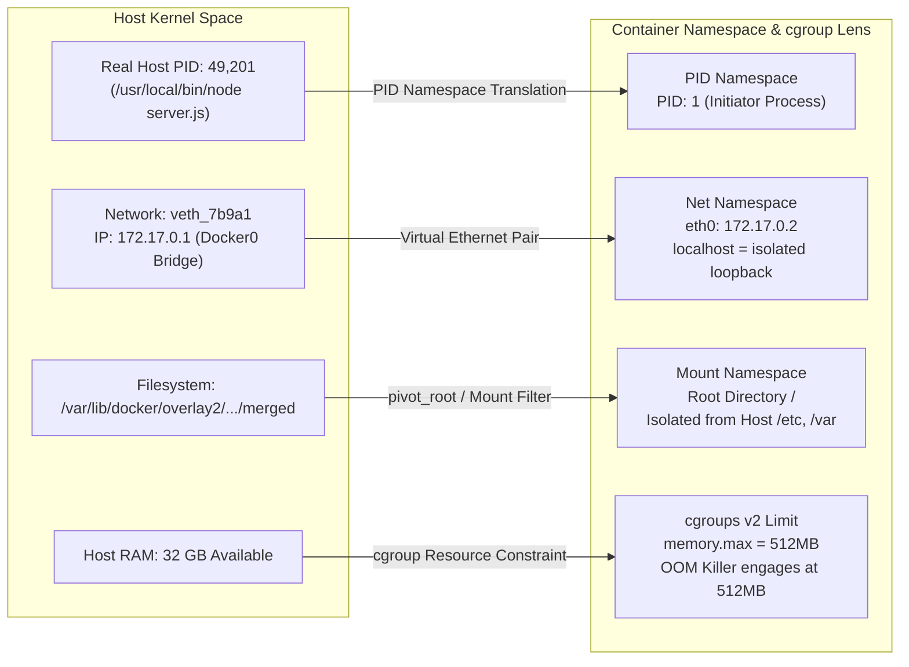
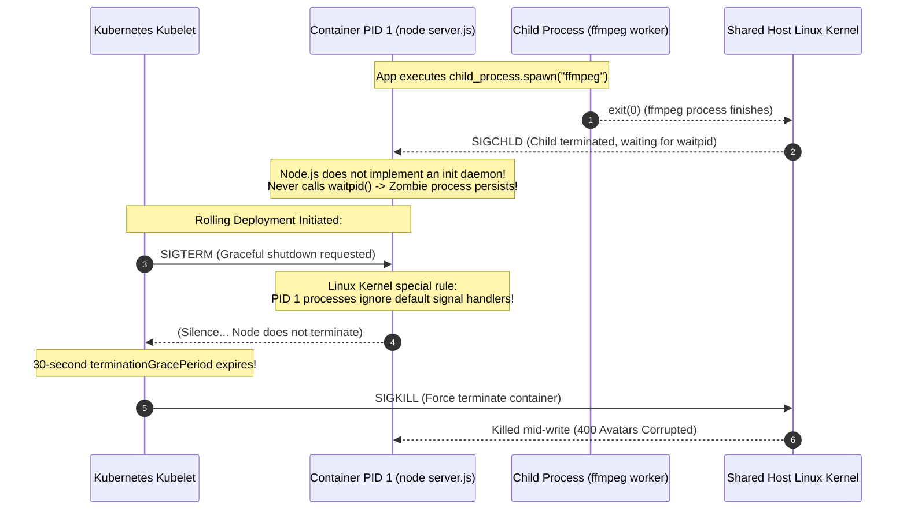

# Module 01: Containers vs. VMs — Linux Kernel Primitives & Architectural Concepts

> **Status:** Production Standard  
> **Difficulty:** Intermediate  
> **Estimated Time:** 1–2 Hours  
> **Prerequisites:** Module 00 (Docker WSL2 Setup), Basic Linux Shell & Process Management

---

> [!TIP]
> **The Golden Rule of Container Virtualization**  
> A container is NOT a lightweight virtual machine. It is an ordinary Linux process running directly on the host kernel, restricted by two foundational Linux kernel primitives: **Namespaces** (which dictate what a process can **SEE**: PID, Network, Mounts, Users) and **Control Groups / cgroups v2** (which enforce what a process can **USE**: CPU shares, Memory ceilings, I/O bandwidth). Because there is no guest kernel or hypervisor layer, container startup is instantaneous ($<50\text{ ms}$), memory overhead is near zero, and the termination of PID 1 terminates the entire container lifecycle immediately.

---

## 1. Visual Mental Models

### 1.1 Architectural Contrast: Containers vs. Hypervisor Virtual Machines

Virtual Machines emulate physical hardware to boot distinct guest operating systems, whereas containers virtualize the operating system kernel view:

```mermaid
flowchart TD
    subgraph VM_Arch["Virtual Machine Architecture (Type-2 Hypervisor)"]
        AppA_VM["App A (Python)"] --> BinsA_VM["Bins / Libs"]
        BinsA_VM --> GuestOS_A["Guest OS & Kernel A<br/>(Full 2GB+ Boot OS)"]
        
        AppB_VM["App B (Go)"] --> BinsB_VM["Bins / Libs"]
        BinsB_VM --> GuestOS_B["Guest OS & Kernel B<br/>(Full 2GB+ Boot OS)"]

        GuestOS_A & GuestOS_B --> Hypervisor["Hypervisor (KVM / VMware / Hyper-V)"]
        Hypervisor --> HostKernel_VM["Host OS & Kernel"]
        HostKernel_VM --> HW_VM["Bare-Metal Physical Hardware"]
    end

    subgraph Container_Arch["Container Architecture (Kernel Primitives)"]
        AppA_C["App A (Python)"] --> BinsA_C["App Dependencies"]
        AppB_C["App B (Go)"] --> BinsB_C["App Dependencies"]

        BinsA_C --> NS_A["Namespaces & cgroups A<br/>(PID 1, eth0, /app)"]
        BinsB_C --> NS_B["Namespaces & cgroups B<br/>(PID 1, eth0, /app)"]

        NS_A & NS_B --> SharedKernel["Single Shared Host Linux Kernel<br/>(System Calls: clone, unshare, pivot_root)"]
        SharedKernel --> HW_C["Bare-Metal Physical Hardware"]
    end
```



### 1.2 Linux Kernel Namespace Mapping: Host Reality vs. Container Lens

Namespaces remap system identifiers, creating the illusion of a dedicated operating system:



---

## 2. Technical Reference Matrices

### 2.1 The 7 Linux Namespaces Powering Container Isolation

| Namespace | Linux Kernel Flag | What It Isolates | Container Practical Effect |
| :--- | :--- | :--- | :--- |
| **PID (Process ID)** | `CLONE_NEWPID` | Process IDs and process tree hierarchy | The main application process sees itself as **PID 1**; cannot see host processes. |
| **NET (Network)** | `CLONE_NEWNET` | Network interfaces, IP routing tables, firewall rules, ports | Container receives private `eth0` and IP; binding port 80 does not conflict with host port 80. |
| **MNT (Mount)** | `CLONE_NEWNS` | Filesystem mount points and root directory | Container sees its own isolated root `/` via `pivot_root`; cannot access host disks unless bind-mounted. |
| **IPC (Inter-Process)** | `CLONE_NEWIPC` | System V IPC, POSIX message queues, shared memory | Prevents shared-memory attacks (`shmget`) between independent containers. |
| **UTS (UNIX Time-Sharing)** | `CLONE_NEWUTS` | System hostname and NIS domain name | Allows each container to assign its own independent `hostname` (defaulting to container ID). |
| **USER (User ID)** | `CLONE_NEWUSER` | UID/GID privilege mappings | Allows a process to run as `root` (UID 0) inside the container while mapped to an unprivileged UID on the host. |
| **CGROUP (Control Group)** | `CLONE_NEWCGROUP`| Virtualized view of `/sys/fs/cgroup` | Masks host resource controllers so container metrics only show allocated container limits. |

### 2.2 Containers vs. Virtual Machines Detailed Comparison

| Feature Metric | Linux Container (Docker / OCI) | Virtual Machine (Type-1 / Type-2 Hypervisor) |
| :--- | :--- | :--- |
| **Virtualization Layer** | Operating System / Kernel Level (`syscalls`) | Hardware / Hypervisor Level (`x86 VT-x / AMD-V`) |
| **Startup Latency** | **$10\text{–}100\text{ ms}$** (Fork/exec of Linux process) | **$15\text{–}90\text{ seconds}$** (Firmware, BIOS, kernel boot) |
| **Image Size Footprint** | **$5\text{ MB} - 250\text{ MB}$** (Alpine, Distroless) | **$2\text{ GB} - 20\text{ GB}$** (Full OS, kernels, drivers) |
| **Memory Overhead** | **$\approx 0\text{ MB}$** (Uses existing host page tables) | **$200\text{ MB} - 1\text{ GB}$** reserved per VM for guest OS |
| **Security Isolation** | Moderate (Shared kernel; secured via seccomp/apparmor) | High (Strict hardware boundary; hardware virtualization) |
| **Lifecycle Binding** | Tied directly to **PID 1** process lifecycle | Decoupled (Guest OS continues running if app dies) |

---

## 3. Production War Story: The PID 1 Zombie Reaping & Graceful Shutdown Disaster

### The Incident
A SaaS company running a Node.js image-processing service in Kubernetes deployed their container using a standard Dockerfile:
```dockerfile
FROM node:20-alpine
WORKDIR /app
COPY . .
CMD ["node", "server.js"]
```

The Node.js server used `child_process.spawn("ffmpeg", ...)` to resize uploaded profile avatars. 

During an automated rolling deployment:
1. Kubernetes sent a `SIGTERM` to the container pod to initiate a 30-second graceful shutdown.
2. The Node.js application failed to stop. It ignored the `SIGTERM` completely, continuing to accept web traffic.
3. After 30 seconds, Kubernetes issued a hard `SIGKILL` (`kill -9`), terminating the container mid-flight while 400 active customer uploads were being written to disk, corrupting customer avatar images.
4. Concurrently, before the rollout, containers that ran for $>7$ days accumulated over 45,000 `<defunct>` zombie processes, exhausting the host's PID table and freezing other workloads on the node.



### The Post-Mortem & Fix
1. **The Kernel PID 1 Invariant:** In the Linux kernel, processes assigned **PID 1** (traditionally `systemd` or `sysvinit`) receive special treatment: the kernel automatically protects them from accidental termination. If a process running as PID 1 does not install an explicit signal handler for `SIGTERM`, the kernel discards the signal!
2. **Zombie Reaping Failure:** In Linux, when a child process terminates, it becomes a "zombie" until its parent calls `waitpid()`. If the parent dies, orphans are adopted by PID 1, which must reap them. Node.js, Python, and Java are application runtimes, not init systems—they do not reap orphaned child processes by default.
3. **The Solution:** Use an explicit init process such as **`tini`** or Docker's native `--init` flag (`docker run --init` or `ENTRYPOINT ["/sbin/tini", "--", "node", "server.js"]`). Tini adopts PID 1, handles `SIGTERM` forwarding to child processes, and reaps all zombie processes cleanly.

---

## 4. Multi-Language Kernel Primitives & Namespace Inspection

Below is multi-language production code in Go, TypeScript, and Python that inspects its runtime environment from inside a container, reading its actual PID namespace view (`/proc/self/status`) and querying cgroup v2 resource ceilings (`/sys/fs/cgroup/`).

````carousel
```go
// inspect_runtime.go
package main

import (
	"fmt"
	"os"
	"strconv"
	"strings"
)

func main() {
	fmt.Println("=== Container Runtime & Namespace Inspection (Go) ===")

	// 1. Inspect PID from container lens
	pid := os.Getpid()
	ppid := os.Getppid()
	fmt.Printf("Container PID View  : PID %d (Parent PID %d)\n", pid, ppid)

	// 2. Read cgroup v2 Memory Limit
	memMaxPath := "/sys/fs/cgroup/memory.max"
	data, err := os.ReadFile(memMaxPath)
	if err == nil {
		raw := strings.TrimSpace(string(data))
		if raw == "max" {
			fmt.Println("cgroups v2 Memory   : Unlimited (Max Host RAM)")
		} else {
			bytesVal, _ := strconv.ParseInt(raw, 10, 64)
			fmt.Printf("cgroups v2 Memory   : %d MB (%d bytes)\n", bytesVal/(1024*1024), bytesVal)
		}
	} else {
		// Fallback for cgroups v1
		fmt.Println("cgroups v2 not detected; checking cgroups v1...")
	}

	// 3. Inspect Hostname (UTS Namespace)
	hostname, _ := os.Hostname()
	fmt.Printf("UTS Hostname        : %s\n", hostname)

	// 4. Verify if running as PID 1
	if pid == 1 {
		fmt.Println("CRITICAL: Application is running as PID 1! Ensure signal forwarding & zombie reaping.")
	} else {
		fmt.Println("Application is running as a child process under an init daemon.")
	}
}
```
<!-- slide -->
```typescript
// inspect_runtime.ts
import fs from 'fs';
import os from 'os';

function inspectContainerPrimacy() {
  console.log('=== Container Runtime & Namespace Inspection (TypeScript) ===');

  const pid = process.pid;
  const ppid = process.ppid;
  console.log(`Container PID View  : PID ${pid} (Parent PID ${ppid})`);
  console.log(`UTS Hostname        : ${os.hostname()}`);

  try {
    // Read cgroups v2 Memory Limit
    const memMax = fs.readFileSync('/sys/fs/cgroup/memory.max', 'utf8').trim();
    if (memMax === 'max') {
      console.log('cgroups v2 Memory   : Unlimited (Host Max)');
    } else {
      const mb = Math.round(parseInt(memMax, 10) / (1024 * 1024));
      console.log(`cgroups v2 Memory   : ${mb} MB`);
    }
  } catch {
    console.log('cgroup v2 path not found; host running cgroup v1 or non-Linux OS');
  }

  if (pid === 1) {
    console.warn('WARNING: Running as PID 1. Installing SIGTERM listener...');
    process.on('SIGTERM', () => {
      console.log('Received SIGTERM in PID 1. Gracefully closing sockets and exiting...');
      process.exit(0);
    });
  }
}

inspectContainerPrimacy();
```
<!-- slide -->
```python
# inspect_runtime.py
import os
import sys

def inspect_kernel_isolation():
    print("=== Container Runtime & Namespace Inspection (Python) ===")
    
    # 1. Process identity
    pid = os.getpid()
    ppid = os.getppid()
    print(f"Container PID View  : PID {pid} (Parent PID: {ppid})")
    
    # 2. Hostname isolation
    print(f"UTS Hostname        : {os.uname().nodename}")
    
    # 3. cgroups v2 resource ceiling
    cgroup_path = "/sys/fs/cgroup/memory.max"
    if os.path.exists(cgroup_path):
        with open(cgroup_path, "r") as f:
            val = f.read().strip()
            if val == "max":
                print("cgroups v2 Memory   : Unlimited")
            else:
                mb = int(val) // (1024 * 1024)
                print(f"cgroups v2 Memory   : {mb} MB ({val} bytes)")
    else:
        print("cgroups v2 memory controller not present")

    # 4. Check for PID 1 execution
    if pid == 1:
        print("ALERT: Process is PID 1. Default signals (SIGTERM/SIGINT) will be ignored unless trapped.")

if __name__ == "__main__":
    inspect_kernel_isolation()
```
````

---

## 5. Practical Hands-On Verification CLI

Run these commands inside your WSL2 environment to observe kernel sharing, PID remapping, and cgroup enforcement:

```bash
# 1. Prove the container shares the host kernel (Compare kernel strings)
uname -r
docker run --rm alpine uname -r
# Expected output: Exact identical kernel string (e.g. 5.15.x-microsoft-standard-WSL2)

# 2. Observe PID namespace remapping
# Start a detached container running sleep
docker run -d --name pid_demo alpine sleep 600

# Inspect PID from container perspective:
docker exec pid_demo ps
# Expected inside container:
# PID   USER     TIME  COMMAND
#   1   root     0:00  sleep 600

# Inspect the real PID from host kernel perspective:
docker inspect --format '{{.State.Pid}}' pid_demo
# Expected output: A high integer (e.g. 48192), proving PID 1 is a namespace lens!

# 3. Test cgroup memory constraint enforcement
# Launch container with 50MB memory ceiling
docker run --rm -m 50m alpine sh -c "cat /sys/fs/cgroup/memory.max"
# Expected output: 52428800 (50 * 1024 * 1024 bytes)

# 4. Clean up
docker rm -f pid_demo
```

---

## 6. Operational Validation Checkpoints

<details>
<summary><strong>Checkpoint 1: Why does a Linux container start in 50 milliseconds while an equivalent Virtual Machine takes 45 seconds?</strong></summary>

> **Root Cause Analysis:**  
> - **Virtual Machine:** The hypervisor must emulate hardware (virtual CPU, RAM, disk controllers, network cards), execute virtual BIOS/UEFI firmware, load the Linux bootloader (GRUB), initialize the Linux kernel, mount initial ramdisks (`initrd`), and boot system daemons (`systemd`). This hardware initialization cycle requires tens of seconds.  
> - **Container:** There is no hardware emulation or kernel boot. Starting a container is simply an ordinary `clone()` Linux system call made by the Docker runtime (`runc`) passing namespace flags (`CLONE_NEWPID`, `CLONE_NEWNET`, etc.) and assigning cgroup limits. The kernel executes the process instantly because the host kernel is already running.
</details>

<details>
<summary><strong>Checkpoint 2: What happens if a process running as PID 1 inside a container allocates memory until it exceeds its cgroup memory limit?</strong></summary>

> **Root Cause Analysis:**  
> When total memory consumption within the container reaches the cgroup boundary defined in `/sys/fs/cgroup/memory.max`:
> 1. The Linux kernel's Out-Of-Memory (OOM) killer engages specifically for that cgroup.
> 2. The kernel selects the process consuming the most memory and transmits an uncatchable `SIGKILL` (signal 9).
> 3. If that process is **PID 1**, the container's primary process dies.
> 4. Because a container's lifecycle is bound to the survival of PID 1, the entire container terminates immediately with exit code **137** ($128 + 9$).
</details>

<details>
<summary><strong>Checkpoint 3: If two containers run on the same physical host, can one container read or alter another container's network packets?</strong></summary>

> **Root Cause Analysis:**  
> By default, **No**. Each container is allocated its own distinct **Network Namespace (`CLONE_NEWNET`)** containing an independent loopback interface (`lo`), virtual interface (`eth0`), routing table, and iptables rules.  
> 
> The containers connect to the host via separate virtual ethernet (`veth`) pairs attached to a bridge network (`docker0`). Packets between them are isolated by Layer 2/Layer 3 routing rules. The only exceptions are if containers explicitly share a network namespace via `--net=container:<target>` or use host networking via `--net=host`.
</details>

---

## 7. Curriculum Navigation

- [← Back to Module 00: Setup — Docker Desktop on Windows 11 with WSL2](../00-setup-docker-desktop-wsl2/README.md)
- [Back to Docker & Containers Overview](../README.md)
- [Proceed to Module 02: Images and Containers Deep Dive](../02-images-and-containers/README.md)
