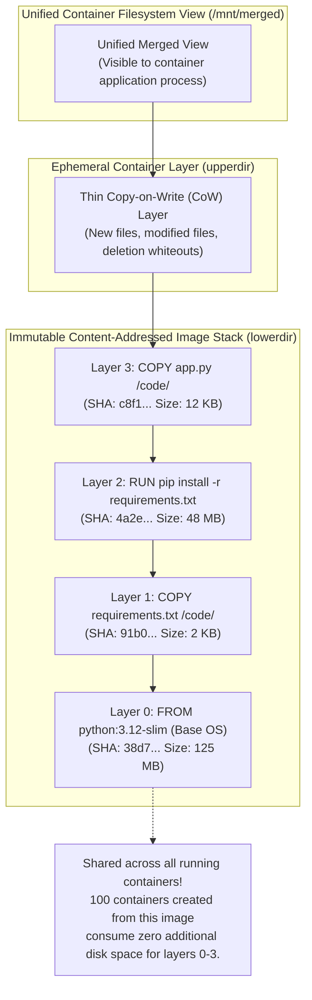
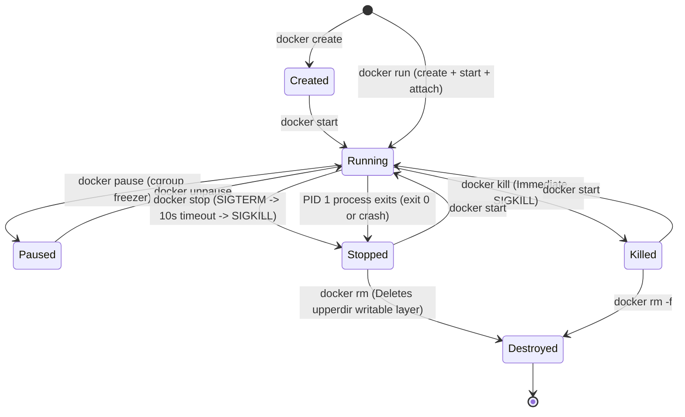
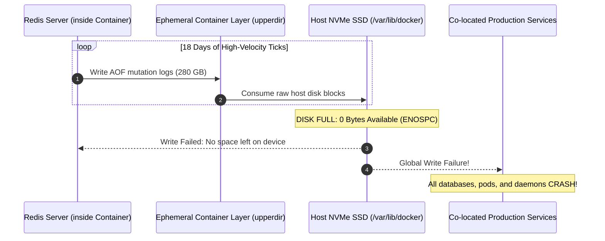

# Module 02: Images and Containers — OverlayFS, Layer Caching, and the Container Lifecycle

> **Status:** Production Standard  
> **Difficulty:** Intermediate  
> **Estimated Time:** 2–3 Hours  
> **Prerequisites:** Module 00 (WSL2 Docker Setup), Module 01 (Kernel Namespaces & cgroups)

---

> [!TIP]
> **The Golden Rule of Container Storage & Lifecycles**  
> An OCI container image is an immutable, content-addressed stack of read-only tar archives unified by the Linux kernel via **OverlayFS (`lowerdir`)**. A container is simply an active process namespace running on top of this read-only stack with a single, ephemeral **Copy-on-Write (CoW) writable layer (`upperdir`)** attached. Never store mutable application data, logs, or database records inside the container's writable layer: modifications incur a severe CoW performance penalty, and executing `docker rm` permanently destroys the layer. Always mount external **Volumes** for persistent state and run stateless containers with `--read-only` root filesystems.

---

## 1. Visual Mental Models

### 1.1 The OverlayFS Storage Architecture

Docker combines read-only image layers and ephemeral container write layers into a single unified directory tree using the Linux kernel `overlay2` storage driver:



### 1.2 The Complete Container Lifecycle State Machine

A container's lifecycle directly mirrors the operating system state of its **PID 1** process:



---

## 2. Technical Reference Matrices

### 2.1 Container Lifecycle Command Reference Grid

| Command | Action on Process | Filesystem Impact | Network & Port Impact | State Transition |
| :--- | :--- | :--- | :--- | :--- |
| `docker create <image>` | Allocates container ID; does not start process | Creates ephemeral `upperdir` layer | Reserves private IP & MAC address | `[Image] -> Created` |
| `docker run -d <image>` | Creates and forks PID 1 in background | Mounts OverlayFS `merged` directory | Binds host ports; attaches virtual interface | `[Image] -> Running` |
| `docker stop <container>` | Transmits `SIGTERM`; waits 10s; fires `SIGKILL` | `upperdir` writable layer persists intact | Releases host port bindings | `Running -> Stopped` |
| `docker start <container>` | Re-executes the original image `ENTRYPOINT/CMD` | Re-mounts previous `upperdir` with all modifications | Re-acquires host port bindings | `Stopped -> Running` |
| `docker exec -it <id> <cmd>`| Injects a secondary process into existing namespaces | Writes to existing `upperdir` | Shares container network namespace | `Running (Unchanged)` |
| `docker rm <container>` | Fails if running (requires `-f` to force) | **Permanently deletes `upperdir` from disk** | Releases IP address back to bridge pool | `Stopped -> [Purged]` |
| `docker image rm <image>`| Deletes read-only layers if unreferenced | Removes immutable blobs from overlay2 | None | `[Deleted from disk]` |

### 2.2 Signal Escalation & Shutdown Budget

When shutting down containers in production (e.g. Kubernetes pod termination or `docker stop`):

```
       0s                          10s (Default Timeout)
───────┼─────────────────────────────┼────────────────────────► Time
       │                             │
   SIGTERM (Signal 15)          SIGKILL (Signal 9)
   - Sockets close               - Kernel forcefully terminates process
   - In-flight requests drain    - No cleanup, buffers dumped
   - Database pools close        - Potential data corruption
```

---

## 3. Production War Story: The \$40,000 Uncommitted Container Log Leak

### The Incident
A high-throughput fin-tech analytics service deployed a Redis container to cache high-frequency market order ticks. The container was started using a standard command:
```bash
docker run -d --name market-redis -p 6379:6379 redis:7-alpine
```

The application logged order payloads and configured Redis to take append-only file snapshots (`appendonly yes`). The engineers omitted a mounted volume, assuming the container would run indefinitely.

Within 18 days:
- Redis wrote millions of order mutations to its local filesystem inside the container: `/data/appendonly.aof`.
- Because `/data` was located in the container's **Copy-on-Write `upperdir` layer** on host storage (`/var/lib/docker/overlay2/...`), the host's root NVMe SSD filled to $100\%$ capacity (280 GB consumed).
- With zero remaining disk space, Linux kernel writes failed globally across the host node.
- The Kubernetes kubelet crashed, the Docker daemon became unresponsive, and 14 co-located production microservices crashed simultaneously in a cascading outage resulting in \$40,000 in SLA penalty credits.



### The Post-Mortem & Fix
1. **Never write high-velocity logs to the container writable layer:** The ephemeral CoW layer is backed by OverlayFS, which requires search overhead through lower layers before copying modified blocks, slowing write operations.
2. **Mount Dedicated Volumes:** Persistent state must be bound to a named Docker volume or host directory:
   ```bash
   docker run -d --name market-redis -v redis-data:/data redis:7-alpine
   ```
3. **Run Containers Read-Only:** Enforce statelessness by adding the `--read-only` flag to container execution, mounting `/tmp` and runtime directories via `tmpfs`:
   ```bash
   docker run -d --read-only --tmpfs /tmp --tmpfs /run my-api-service
   ```

---

## 4. Multi-Language Container Lifecycle & Docker Engine API Management

Below is multi-language production code in Go, TypeScript, and Python demonstrating how orchestrators communicate directly with the Docker daemon API to programmatically create, start, stream logs from, and cleanly terminate containers.

````carousel
```go
// container_orchestrator.go
package main

import (
	"context"
	"fmt"
	"io"
	"log"
	"os"
	"os/signal"
	"syscall"
	"time"

	"github.com/docker/docker/api/types/container"
	"github.com/docker/docker/api/types/image"
	"github.com/docker/docker/client"
)

func main() {
	ctx := context.Background()
	cli, err := client.NewClientWithOpts(client.FromEnv, client.WithAPIVersionNegotiation())
	if err != nil {
		log.Fatalf("Failed to initialize Docker client: %v", err)
	}
	defer cli.Close()

	imageName := "alpine:latest"
	containerName := "orchestrated-worker"

	// 1. Pull Image
	fmt.Printf("Pulling base image: %s...\n", imageName)
	reader, err := cli.ImagePull(ctx, imageName, image.PullOptions{})
	if err != nil {
		log.Fatalf("Image pull failed: %v", err)
	}
	io.Copy(io.Discard, reader)
	reader.Close()

	// 2. Create Container with explicit memory and CPU limits
	fmt.Println("Creating container with isolated namespaces...")
	resp, err := cli.ContainerCreate(ctx,
		&container.Config{
			Image: imageName,
			Cmd:   []string{"sh", "-c", "trap 'echo Received SIGTERM, exiting...; exit 0' TERM; while true; do echo Worker heartbeat; sleep 2; done"},
		},
		&container.HostConfig{
			Resources: container.Resources{
				Memory:   64 * 1024 * 1024, // 64 MB memory limit
				NanoCPUs: 500000000,        // 0.5 CPU cores
			},
			AutoRemove: false,
		},
		nil, nil, containerName,
	)
	if err != nil {
		log.Fatalf("Container creation failed: %v", err)
	}

	// 3. Start Container
	fmt.Printf("Starting container (ID: %s)...\n", resp.ID[:12])
	if err := cli.ContainerStart(ctx, resp.ID, container.StartOptions{}); err != nil {
		log.Fatalf("Failed to start container: %v", err)
	}

	// Trap OS termination signals to demonstrate graceful container shutdown
	sigChan := make(chan os.Signal, 1)
	signal.Notify(sigChan, syscall.SIGINT, syscall.SIGTERM)

	go func() {
		<-sigChan
		fmt.Println("\nInitiating graceful container shutdown (SIGTERM)...")
		stopTimeout := 5 // 5 second grace period before SIGKILL
		stopOpts := container.StopOptions{Timeout: &stopTimeout}
		if err := cli.ContainerStop(ctx, resp.ID, stopOpts); err != nil {
			log.Printf("Stop error: %v", err)
		}
		// Remove container and its writable layer
		cli.ContainerRemove(ctx, resp.ID, container.RemoveOptions{Force: true})
		fmt.Println("Container removed cleanly.")
		os.Exit(0)
	}()

	// Stream logs for 6 seconds
	time.Sleep(6 * time.Second)
	logsReader, err := cli.ContainerLogs(ctx, resp.ID, container.LogsOptions{ShowStdout: true, Tail: "5"})
	if err == nil {
		fmt.Println("--- Recent Container Logs ---")
		io.Copy(os.Stdout, logsReader)
		logsReader.Close()
	}

	// Clean stop
	stopTimeout := 3
	cli.ContainerStop(ctx, resp.ID, container.StopOptions{Timeout: &stopTimeout})
	cli.ContainerRemove(ctx, resp.ID, container.RemoveOptions{Force: true})
	fmt.Println("Lifecycle demonstration complete.")
}
```
<!-- slide -->
```typescript
// container_orchestrator.ts
import Docker from 'dockerode';

const docker = new Docker({ socketPath: '/var/run/docker.sock' });

async function runContainerLifecycle() {
  const imageName = 'alpine:latest';
  const containerName = 'ts-worker-demo';

  console.log(`Pulling ${imageName}...`);
  await new Promise((resolve, reject) => {
    docker.pull(imageName, (err: any, stream: any) => {
      if (err) return reject(err);
      docker.modem.followProgress(stream, onFinished);
      function onFinished(err: any) {
        if (err) reject(err);
        else resolve(true);
      }
    });
  });

  console.log('Creating container with resource limits...');
  const container = await docker.createContainer({
    Image: imageName,
    name: containerName,
    Cmd: ['sh', '-c', 'echo "Hello from TypeScript container manager"; sleep 10'],
    HostConfig: {
      Memory: 50 * 1024 * 1024, // 50MB
    },
  });

  console.log(`Starting container ${container.id.substring(0, 12)}...`);
  await container.start();

  const data = await container.inspect();
  console.log(`Container State: ${data.State.Status} | PID: ${data.State.Pid}`);

  console.log('Waiting 3 seconds then gracefully stopping...');
  await new Promise((r) => setTimeout(r, 3000));

  await container.stop({ t: 5 }); // 5 second SIGTERM grace period
  console.log('Container stopped. Purging ephemeral writable layer...');
  await container.remove();
  console.log('Container deleted successfully.');
}

runContainerLifecycle().catch(console.error);
```
<!-- slide -->
```python
# container_orchestrator.py
import docker
import time

def manage_lifecycle():
    client = docker.from_env()
    image_tag = "alpine:latest"
    container_name = "py-worker-lifecycle"

    print(f"Ensuring image {image_tag} is present...")
    client.images.pull(image_tag)

    print("Creating and running container in detached mode...")
    container = client.containers.run(
        image_tag,
        command='sh -c "echo Started; sleep 10; echo Done"',
        name=container_name,
        detach=True,
        mem_limit="64m",
        remove=False
    )

    print(f"Container {container.short_id} is running (Status: {container.status}).")
    
    # Inspect runtime metadata
    container.reload()
    print(f"Host PID: {container.attrs['State']['Pid']}")

    # Wait 2 seconds, stream logs
    time.sleep(2)
    print("Logs:", container.logs().decode("utf-8").strip())

    print("Sending SIGTERM to container...")
    container.stop(timeout=5)
    print("Container stopped. Removing writable layer...")
    container.remove()
    print("Container lifecycle finished cleanly.")

if __name__ == "__main__":
    manage_lifecycle()
```
````

---

## 5. Practical Hands-On Verification CLI

Execute these steps inside your terminal to observe layer stacking and state persistence:

```bash
# 1. Pull a multi-layer base image and inspect its immutable layers
docker pull python:3.12-slim
docker history python:3.12-slim

# 2. Inspect the OverlayFS lowerdir and upperdir paths
docker run -d --name overlay_demo alpine sleep 300
docker inspect overlay_demo --format '{{json .GraphDriver.Data}}' | jq .
# Expected output shows:
# "LowerDir": "/var/lib/docker/overlay2/.../diff",
# "UpperDir": "/var/lib/docker/overlay2/.../diff",
# "MergedDir": "/var/lib/docker/overlay2/.../merged"

# 3. Test Copy-on-Write (CoW) layer persistence across stop/start
docker exec overlay_demo sh -c "echo 'State saved' > /tmp/persist.txt"
docker stop overlay_demo
docker start overlay_demo
docker exec overlay_demo cat /tmp/persist.txt
# Expected output: "State saved" (Proving upperdir persists through restart!)

# 4. Prove that container deletion purges the CoW layer
docker rm -f overlay_demo
docker run --rm alpine cat /tmp/persist.txt
# Expected output: cat: can't open '/tmp/persist.txt': No such file or directory
```

---

## 6. Operational Validation Checkpoints

<details>
<summary><strong>Checkpoint 1: If 1,000 containers are launched from the exact same 1 GB image, how much disk space is consumed on the host?</strong></summary>

> **Root Cause Analysis:**  
> Approximately **1 GB total** (plus a few megabytes for metadata).  
> 
> **Why:** The 1 GB base image consists of immutable, read-only layers (`lowerdir`). All 1,000 containers share the identical read-only layers on disk via Linux OverlayFS. Each container receives only an empty, pointer-based Copy-on-Write writable layer (`upperdir`) that occupies virtually zero disk space until the container writes or mutates files.
</details>

<details>
<summary><strong>Checkpoint 2: What is the exact difference between `docker stop` and `docker kill`?</strong></summary>

> **Root Cause Analysis:**  
> - **`docker stop`:** Sends **`SIGTERM` (Signal 15)** to PID 1, initiating a cooperative graceful shutdown. The process is allowed up to a grace period (default 10 seconds) to flush I/O buffers, drain HTTP connections, and close database handles. If the process does not terminate within the window, Docker follows up with **`SIGKILL` (Signal 9)**.  
> - **`docker kill`:** Immediately transmits **`SIGKILL` (Signal 9)** directly to PID 1. The Linux kernel forcefully frees process memory without notifying the application, risking corrupt files and aborted database transactions.
</details>

<details>
<summary><strong>Checkpoint 3: Why does `docker exec` allow you to inspect a container even if SSH is not installed in the image?</strong></summary>

> **Root Cause Analysis:**  
> `docker exec` does not communicate over the network or require an SSH server daemon.  
> Instead, the Docker daemon makes a Linux **`setns()` system call** on the host kernel, attaching a new child process directly into the existing namespaces (PID, Net, Mount, IPC, UTS) of the running target container. The executed process shares the filesystem and network views of the container while running as a distinct process on the host.
</details>

---

## 7. Curriculum Navigation

- [← Back to Module 01: Containers vs. VMs Concepts](../01-containers-vs-vms-concepts/README.md)
- [Back to Docker & Containers Overview](../README.md)
- [Proceed to Module 03: Dockerfile Deep Dive](../03-dockerfile-deep-dive/README.md)
