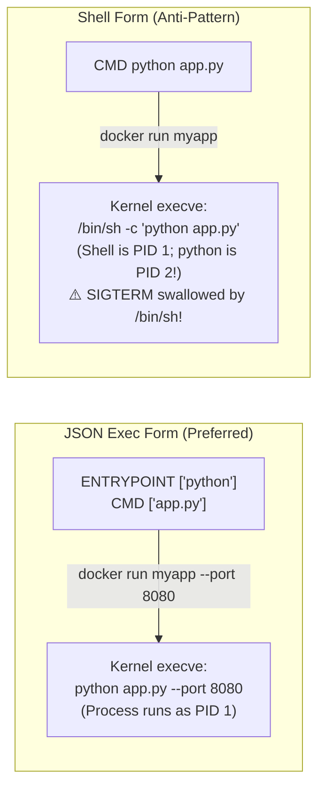
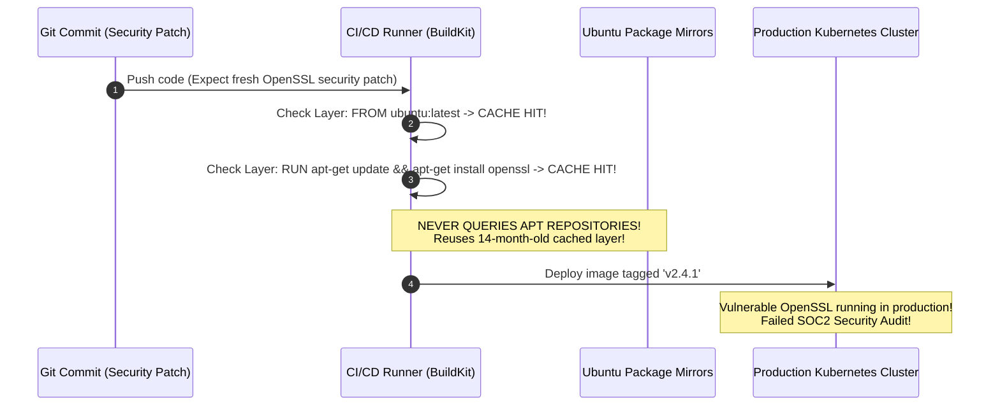

# Module 03: Dockerfile Deep Dive — BuildKit Layer Caching, Instruction Hygiene, and Context Trimming

> **Status:** Production Standard  
> **Difficulty:** Intermediate  
> **Estimated Time:** 2–3 Hours  
> **Prerequisites:** Module 01 (Kernel Namespaces & cgroups), Module 02 (OverlayFS & Images)

---

> [!TIP]
> **The Golden Rule of Production Dockerfile Authoring**  
> Order instructions strictly from lowest frequency of mutation to highest frequency of mutation to maximize **BuildKit Layer Cache** retention. Never execute `COPY . .` before copying dependency manifests (`package.json`, `go.mod`, `requirements.txt`) and running package installations. Always declare executable commands using the **JSON Exec Form (`CMD ["node", "server.js"]`)** rather than the Shell Form (`CMD node server.js`) to ensure the application runs directly as **PID 1** rather than a subshell that swallows `SIGTERM` signals. Finally, maintain a strict `.dockerignore` to avoid transmitting `.git`, local secrets, or virtual environments to the daemon context.

---

## 1. Visual Mental Models

### 1.1 BuildKit Layer Invalidation Cascade

Docker evaluates layer caches sequentially from top to bottom. The instant a single layer's inputs change, all downstream layers are invalidated:

```mermaid
flowchart TD
    subgraph BuildCache["Docker BuildKit Cache Evaluation"]
        L1["FROM python:3.12-slim"] -->|"No change"| C1["CACHE HIT (Layer Reused)"]
        C1 --> L2["WORKDIR /code"]
        L2 -->|"No change"| C2["CACHE HIT (Layer Reused)"]
        C2 --> L3["COPY requirements.txt ."]
        L3 -->|"Checksum matches"| C3["CACHE HIT (Layer Reused)"]
        C3 --> L4["RUN pip install --no-cache-dir -r requirements.txt"]
        L4 -->|"Dependencies identical"| C4["CACHE HIT (Saves 45s download)"]
        
        C4 --> L5["COPY app.py ."]
        L5 -->|"File hash changed (developer edit)"| M1["CACHE MISS (Layer Rebuilds)"]
        
        M1 --> L6["EXPOSE 8000"]
        L6 -->|"Downstream invalidated"| M2["REBUILT"]
        M2 --> L7["CMD ['python', 'app.py']"]
        L7 -->|"Downstream invalidated"| M3["REBUILT (Metadata updated)"]
    end
```



### 1.2 `ENTRYPOINT` vs. `CMD` Interaction and Exec Form

The syntax used to define container processes determines signal propagation and argument injection:



---

## 2. Technical Reference Matrices

### 2.1 Complete Dockerfile Instruction Reference Grid

| Instruction | Execution Phase | Creates Filesystem Layer? | Primary Purpose | Common Pitfall |
| :--- | :--- | :---: | :--- | :--- |
| `FROM` | Build Init | Yes (Base) | Defines the parent base image (e.g. `python:3.12-slim`) | Using unpinned mutable tags like `latest` |
| `WORKDIR` | Build / Runtime | Yes (Dir Metadata) | Sets the execution context directory; creates directory if missing | Using `RUN cd /app` (directory change does not persist across layers) |
| `COPY` | Build | Yes | Copies files/directories from build context to image | Copying entire workspace before dependency install |
| `ADD` | Build | Yes | Copies files, auto-extracts local `.tar` files, fetches URLs | Unintended archive extraction; prefer `COPY` |
| `RUN` | Build | Yes | Executes commands in a temporary container and commits the layer | Leaving package manager cache files (`/var/cache/apt`) |
| `ENV` | Build / Runtime | Yes (Metadata) | Sets persistent environment variables | Exposing secret API keys or database passwords |
| `ARG` | Build Only | No (Ephemeral) | Passes build-time parameters (`--build-arg`) | Assuming `ARG` is accessible at runtime |
| `EXPOSE` | Runtime Metadata | No | Documents container port listening intentions | Assuming `EXPOSE` binds the port to host interfaces |
| `USER` | Build / Runtime | Yes (Metadata) | Sets non-root user UID/GID for subsequent commands | Running containers as root (`UID 0`) in production |
| `HEALTHCHECK` | Runtime | No (Metadata) | Configures automated liveness probing by Docker daemon | Aggressive timeouts causing false-positive pod restarts |
| `ENTRYPOINT` | Runtime | No (Metadata) | Sets the immutable primary executable | Shell form wrapping in `/bin/sh -c` |
| `CMD` | Runtime | No (Metadata) | Sets default arguments or fallback command | Accidental override during `docker run` |

### 2.2 Shell Form vs. Exec Form Signal Handling

| Property | Shell Form (`CMD node app.js`) | JSON Exec Form (`CMD ["node", "app.js"]`) |
| :--- | :--- | :--- |
| **System Call** | `execve("/bin/sh", ["-c", "node app.js"])` | `execve("/usr/local/bin/node", ["node", "app.js"])` |
| **PID 1 Identity** | `/bin/sh` | `node` |
| **`SIGTERM` Forwarding** | ❌ **No.** `/bin/sh` does not forward signals to child processes | **Yes.** Application receives `SIGTERM` directly |
| **Shutdown Behavior** | Stalls until 10s timeout expires; terminated with `SIGKILL` | Graceful connection draining and socket cleanup |

---

## 3. Production War Story: The CI/CD Stale Cache Security Breach

### The Incident
A financial payments service built its Docker images in a GitLab CI/CD pipeline using a common pattern:
```dockerfile
FROM ubuntu:latest
RUN apt-get update && apt-get install -y openssl curl
COPY . /app
WORKDIR /app
CMD ["./start.sh"]
```

The CI runner had Docker layer caching enabled to accelerate builds. 

During an emergency zero-day patch cycle for an OpenSSL remote code execution vulnerability (CVE-2024-xxxx):
- The security team pushed a commit updating documentation, expecting CI to build a patched image.
- Because `FROM ubuntu:latest` was already cached on the runner and the text `RUN apt-get update ...` was unchanged, BuildKit returned `CACHED` for the dependency layer.
- The build finished in 4 seconds. The production team deployed the new image to production, assuming the latest OpenSSL packages were installed.
- **The Disaster:** A penetration testing audit discovered that production was still executing a 14-month-old OpenSSL binary with active vulnerabilities. The `apt-get update` command had not actually executed in over a year because the instruction text had never changed.



### The Post-Mortem & Fix
1. **Never use mutable base tags:** Pin base images by exact cryptographic SHA256 digest:
   ```dockerfile
   FROM ubuntu:24.04@sha256:72297848456d5d37d1262630108ab308d3e9ec7ed1c3286a32fe09856619a782
   ```
2. **Combine Package Updates with Cache Busting:** Use BuildKit's dedicated cache mounts to ensure package lists stay fresh without cache pollution:
   ```dockerfile
   RUN --mount=type=cache,target=/var/cache/apt \
       apt-get update && apt-get install -y --no-install-recommends openssl
   ```
3. **Automate Container Scanning:** Integrate tools like Trivy or Grype in CI to scan the final compiled image layers before deployment.

---

## 4. Multi-Language Production Dockerfile Blueprints

Below are complete, production-hardened Dockerfile templates for Go, Node.js/TypeScript, and Python. Each implements strict layer ordering, context isolation, non-root execution, and explicit `HEALTHCHECK` definitions.

````carousel
```dockerfile
# Dockerfile.go
# syntax=docker/dockerfile:1.7
# Stage 1: Build binary using official Go compiler
FROM golang:1.23-alpine AS builder
WORKDIR /src

# Cache dependencies independently from source code
COPY go.mod go.sum ./
RUN go mod download

# Copy application source and compile statically
COPY . .
RUN CGO_ENABLED=0 GOOS=linux GOARCH=amd64 go build -ldflags="-w -s" -o /bin/server .

# Stage 2: Minimal Distroless runtime
FROM gcr.io/distroless/static-debian12:nonroot
WORKDIR /app
COPY --from=builder /bin/server /app/server

# Expose documentation port
EXPOSE 8080

# Run as built-in non-root user (UID 65532)
USER nonroot:nonroot

# Exec form guarantees server is PID 1
ENTRYPOINT ["/app/server"]
```
<!-- slide -->
```dockerfile
# Dockerfile.node
# syntax=docker/dockerfile:1.7
FROM node:20-alpine AS base
WORKDIR /app

# Step 1: Install system security updates & dumb-init
RUN apk add --no-cache dumb-init

# Step 2: Cache package dependencies
COPY package.json package-lock.json ./
RUN npm ci --only=production && npm cache clean --force

# Step 3: Copy application source code
COPY . .

# Step 4: Configure non-root permissions
USER node

EXPOSE 3000
ENV NODE_ENV=production

# Healthcheck probing via native node script
HEALTHCHECK --interval=15s --timeout=3s --start-period=5s --retries=3 \
  CMD node -e "http.get('http://localhost:3000/health', (r) => process.exit(r.statusCode === 200 ? 0 : 1))"

# dumb-init adopts PID 1 and forwards signals
ENTRYPOINT ["/usr/bin/dumb-init", "--"]
CMD ["node", "src/server.js"]
```
<!-- slide -->
```dockerfile
# Dockerfile.python
# syntax=docker/dockerfile:1.7
FROM python:3.12-slim AS runtime
WORKDIR /app

# Ensure standard output is delivered directly to terminal without buffering
ENV PYTHONDONTWRITEBYTECODE=1 \
    PYTHONUNBUFFERED=1

# Create unprivileged system user
RUN groupadd -g 10001 appgroup && \
    useradd -u 10001 -g appgroup -s /sbin/nologin appuser

# Step 1: Install dependencies first to optimize caching
COPY requirements.txt .
RUN pip install --no-cache-dir --upgrade pip && \
    pip install --no-cache-dir -r requirements.txt

# Step 2: Copy application files and set ownership
COPY --chown=appuser:appgroup . .

# Switch to non-root user
USER appuser:appgroup
EXPOSE 8000

HEALTHCHECK --interval=20s --timeout=4s --start-period=5s --retries=3 \
  CMD python -c "import urllib.request; urllib.request.urlopen('http://localhost:8000/health')" || exit 1

# JSON exec form
ENTRYPOINT ["python", "-m", "uvicorn", "main:app", "--host", "0.0.0.0", "--port", "8000"]
```
````

---

## 5. Practical Hands-On Verification CLI

Execute these steps in your terminal to verify BuildKit layer caching and context isolation:

```bash
# 1. Create a clean lab directory
mkdir -p ~/dockerfile-verification && cd ~/dockerfile-verification

# 2. Write an optimal .dockerignore
cat > .dockerignore <<'EOF'
.git
.env*
node_modules
__pycache__
*.log
EOF

# 3. Create sample app files
cat > requirements.txt <<'EOF'
fastapi==0.111.0
uvicorn==0.30.0
EOF

cat > main.py <<'EOF'
from fastapi import FastAPI
app = FastAPI()

@app.get("/health")
def health():
    return {"status": "healthy"}
EOF

# 4. Build image and record initial build duration
time docker build -f - -t api-service:v1 . <<'EOF'
FROM python:3.12-slim
WORKDIR /app
COPY requirements.txt .
RUN pip install --no-cache-dir -r requirements.txt
COPY main.py .
EXPOSE 8000
HEALTHCHECK --interval=5s --timeout=2s CMD python -c "import urllib.request; urllib.request.urlopen('http://localhost:8000/health')" || exit 1
CMD ["python", "-m", "uvicorn", "main:app", "--host", "0.0.0.0", "--port", "8000"]
EOF

# 5. Modify application code ONLY and rebuild
echo "# Minor code edit" >> main.py
time docker build -f - -t api-service:v2 . <<'EOF'
FROM python:3.12-slim
WORKDIR /app
COPY requirements.txt .
RUN pip install --no-cache-dir -r requirements.txt
COPY main.py .
EXPOSE 8000
HEALTHCHECK --interval=5s --timeout=2s CMD python -c "import urllib.request; urllib.request.urlopen('http://localhost:8000/health')" || exit 1
CMD ["python", "-m", "uvicorn", "main:app", "--host", "0.0.0.0", "--port", "8000"]
EOF

# Expected observation: "RUN pip install..." is marked CACHED; rebuild completes in <1 second!

# 6. Verify HEALTHCHECK functionality
docker run -d --name test-api -p 8000:8000 api-service:v2
sleep 10
docker ps --filter name=test-api --format '{{.Names}} : {{.Status}}'
# Expected output: test-api : Up 10 seconds (healthy)

# 7. Clean up
docker rm -f test-api
```

---

## 6. Operational Validation Checkpoints

<details>
<summary><strong>Checkpoint 1: Why does declaring `CMD ["node", "app.js"]` allow graceful shutdown, while `CMD node app.js` causes 10-second delays during deployment?</strong></summary>

> **Root Cause Analysis:**  
> - **Shell Form (`CMD node app.js`):** The Docker daemon wraps the command in `/bin/sh -c "node app.js"`. The shell process (`/bin/sh`) becomes PID 1, and Node.js runs as an unattached child process (PID 2). By default, the POSIX shell does not forward `SIGTERM` signals to child processes. When orchestrators stop the container, Node.js never receives `SIGTERM`. The container hangs for the entire 10-second grace period until the orchestrator issues a forced `SIGKILL`.  
> - **JSON Exec Form (`CMD ["node", "app.js"]`):** Docker invokes `execve` directly without a shell wrapper. Node.js executes directly as PID 1, receives `SIGTERM` immediately, closes active HTTP sockets, and shuts down cleanly in milliseconds.
</details>

<details>
<summary><strong>Checkpoint 2: What is the security danger of passing secrets via `ARG` (e.g. `--build-arg NPM_TOKEN=...`)?</strong></summary>

> **Root Cause Analysis:**  
> Values passed via `ARG` are permanently recorded in the image's metadata and layer history.  
> Any user with read access to the compiled image can extract the secret by running:
> ```bash
> docker history --no-trunc <image-name>
> docker inspect <image-name>
> ```
> **Production Fix:** Never use `ARG` or `ENV` for credentials. Use BuildKit secret mounts:
> ```dockerfile
> RUN --mount=type=secret,id=npmrc,target=/root/.npmrc npm install
> ```
> Secret mounts expose the credential only in memory during that specific `RUN` step and never bake it into the resulting image layers.
</details>

<details>
<summary><strong>Checkpoint 3: How does a missing `.dockerignore` file degrade build performance even if the Dockerfile only copies one file?</strong></summary>

> **Root Cause Analysis:**  
> When you execute `docker build .`, the Docker CLI tar-archives the **entire current directory** (the build context) and uploads it across the daemon socket before parsing the first line of the Dockerfile.  
> 
> If the directory contains a `.git` folder ($500\text{ MB}$) or a `node_modules` directory ($800\text{ MB}$):
> 1. The CLI archives and transfers $1.3\text{ GB}$ of data to the Docker daemon on every single build.
> 2. Build initiation stalls for $15\text{–}30\text{ seconds}$ on "Transferring context."  
> Maintaining `.dockerignore` filters out irrelevant directories at the client level, reducing context uploads to a few kilobytes.
</details>

---

## 7. Curriculum Navigation

- [← Back to Module 02: Images and Containers Deep Dive](../02-images-and-containers/README.md)
- [Back to Docker & Containers Overview](../README.md)
- [Proceed to Module 04: Volumes and Bind Mounts](../04-volumes-and-bind-mounts/README.md)
