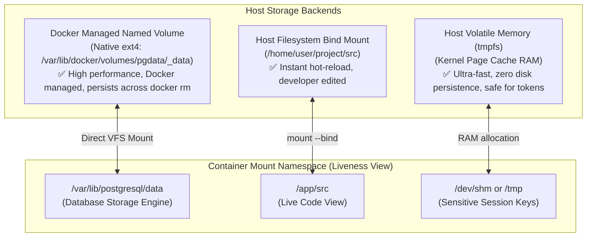
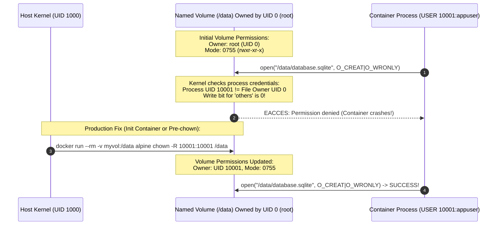
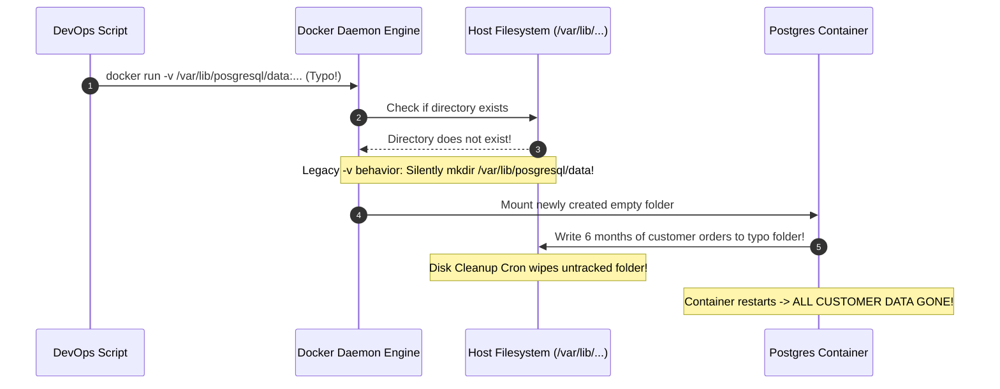

# Module 04: Volumes and Bind Mounts — Storage Drivers, Permission Boundaries, and Data Persistence

> **Status:** Production Standard  
> **Difficulty:** Intermediate  
> **Estimated Time:** 2–3 Hours  
> **Prerequisites:** Module 01 (Mount Namespaces), Module 02 (OverlayFS & Container Layering)

---

> [!TIP]
> **The Golden Rule of Container Storage Architecture**  
> Never store persistent state inside an ephemeral container layer. Categorize storage into three strict tiers: (1) Use **Named Volumes** for databases and persistent application state (`/var/lib/postgresql/data`) because Docker manages the physical ext4 directory directly without cross-OS translation overhead; (2) Use **Bind Mounts** strictly for local development hot-reloading (`-v $(pwd)/src:/app/src:ro`), always enforcing the `:ro` (read-only) flag in production environments; (3) Use **tmpfs Mounts** for secrets, temporary tokens, and IPC memory to guarantee sensitive data never touches physical host disks.

---

## 1. Visual Mental Models

### 1.1 The Three Mount Strategies Compared

Container storage bridges the gap between isolated Linux mount namespaces and host hardware:



### 1.2 Volume Permission & UID/GID Alignment

Because containers share the host kernel, file access permissions depend strictly on integer UIDs, not usernames:



---

## 2. Technical Reference Matrices

### 2.1 Storage Strategies Comparison Grid

| Storage Type | Survives `docker rm`? | Host Storage Location | Performance Characteristic | Production Best Use Case |
| :--- | :---: | :--- | :--- | :--- |
| **Ephemeral Writable Layer** | ❌ **No** | Inside OverlayFS `upperdir` | Slower (Copy-on-Write lookup latency) | Throwaway temporary files, stdout buffers |
| **Named Volume** | **Yes** | Docker-managed storage (`/var/lib/docker/volumes/...`) | **Native Near-Raw Disk I/O** | Production databases (PostgreSQL, MySQL, Redis, MongoDB) |
| **Bind Mount** | **Yes** | User-defined path (e.g. `/home/user/code`) | Native on Linux; Slow across WSL2 9P bridge | Local development hot-reload, host daemon configs (nginx.conf) |
| **tmpfs Mount** | ❌ **No** | Host System RAM / Swap | **Sub-microsecond RAM speed** | Ephemeral API keys, Unix domain sockets, decryption keys |

### 2.2 Volume Management Command Reference Grid

| Command | Action Performed | Production Safety Notes |
| :--- | :--- | :--- |
| `docker volume create <name>` | Provisions a named volume directory | Pre-allocate with `--opt` for custom volume drivers (NFS/EBS) |
| `docker volume ls` | Lists all volumes recognized by Docker daemon | Filter orphaned volumes via `docker volume ls -f dangling=true` |
| `docker volume inspect <name>` | Dumps JSON containing physical host `Mountpoint` | Use to inspect disk paths inside WSL2 VM |
| `docker run -v <vol>:<dst>` | Mounts volume to target path | Shorthand syntax; creates volume if it does not exist |
| `docker run --mount ...` | Explicit, typed mounting syntax | **Preferred in production:** Enforces validation on missing paths |
| `docker volume rm <name>` | Deletes volume and all contained data | **Destructive:** Fails if any container (running or stopped) is attached |
| `docker volume prune -f` | Deletes all unattached ("dangling") volumes | **Caution:** Permanently removes data from stopped database containers |

---

## 3. Production War Story: The Database Corruption on Volume Typo

### The Incident
A DevOps engineer deployed an automated database backup and restore script on an Ubuntu server:
```bash
docker run -d \
  --name production-postgres \
  -e POSTGRES_PASSWORD=secret \
  -v /var/lib/posgresql/data:/var/lib/postgresql/data \
  postgres:16-alpine
```

Notice the subtle typographical error in the host path: `/var/lib/posgresql/data` (missing the "t" in `posgresql`).

- Because Docker's legacy `-v <host>:<container>` shorthand syntax was used, Docker checked if `/var/lib/posgresql/data` existed on the host.
- Finding it absent, Docker **silently created an empty directory** at `/var/lib/posgresql/data` on the host root filesystem.
- The database ran for 6 months, accumulating 400 GB of client financial transactions.
- During a scheduled server maintenance cycle, a disk cleanup cron job wiped directories outside the standard `/var/lib/postgresql` path.
- When the container restarted, the host directory was empty. The database initialized a brand-new, blank database cluster. Production appeared completely wiped, causing a 6-hour disaster recovery emergency.



### The Post-Mortem & Fix
1. **Never use `-v` for host bind mounts in automated scripts:** Use the explicit `--mount` syntax:
   ```bash
   docker run --mount type=bind,source=/var/lib/postgresql/data,target=/var/lib/postgresql/data postgres:16-alpine
   ```
   If the source directory does not exist, `--mount` **aborts immediately with an error**, preventing silent directory creation.
2. **Use Named Volumes for Stateful Engines:** Named volumes are managed explicitly through the volume API (`docker volume create pg_data`), preventing accidental typos in filesystem paths.

---

## 4. Multi-Language Production Volume & Backup Automation

Below is production-grade automation code in Go, TypeScript, and Python that inspects container volumes, validates non-root directory ownership, and creates atomic `.tar.gz` stream backups from running volumes without taking services offline.

````carousel
```go
// volume_backup.go
package main

import (
	"context"
	"fmt"
	"io"
	"log"
	"os"
	"time"

	"github.com/docker/docker/api/types/container"
	"github.com/docker/docker/api/types/image"
	"github.com/docker/docker/client"
)

func main() {
	ctx := context.Background()
	cli, err := client.NewClientWithOpts(client.FromEnv, client.WithAPIVersionNegotiation())
	if err != nil {
		log.Fatalf("Docker client initialization failed: %v", err)
	}
	defer cli.Close()

	volumeName := "production-db-data"
	backupFile := fmt.Sprintf("backup_%s_%d.tar", volumeName, time.Now().Unix())

	// 1. Ensure volume exists
	vol, err := cli.VolumeInspect(ctx, volumeName)
	if err != nil {
		log.Fatalf("Target volume '%s' does not exist: %v", volumeName, err)
	}
	fmt.Printf("Volume verified: %s (Driver: %s)\n", vol.Name, vol.Driver)

	// 2. Launch an ephemeral backup container that streams tar archive
	fmt.Println("Launching ephemeral backup worker...")
	cli.ImagePull(ctx, "alpine:latest", image.PullOptions{})

	resp, err := cli.ContainerCreate(ctx,
		&container.Config{
			Image: "alpine:latest",
			Cmd:   []string{"tar", "-czf", "-", "-C", "/volume", "."},
		},
		&container.HostConfig{
			Binds: []string{fmt.Sprintf("%s:/volume:ro", volumeName)}, // Mount target volume READ-ONLY
		},
		nil, nil, "",
	)
	if err != nil {
		log.Fatalf("Failed to create backup worker: %v", err)
	}
	defer cli.ContainerRemove(ctx, resp.ID, container.RemoveOptions{Force: true})

	// Start container and stream stdout directly into a backup file
	if err := cli.ContainerStart(ctx, resp.ID, container.StartOptions{}); err != nil {
		log.Fatalf("Failed to start backup container: %v", err)
	}

	out, err := cli.ContainerLogs(ctx, resp.ID, container.LogsOptions{ShowStdout: true, Follow: true})
	if err != nil {
		log.Fatal(err)
	}
	defer out.Close()

	f, err := os.Create(backupFile)
	if err != nil {
		log.Fatal(err)
	}
	defer f.Close()

	bytesWritten, _ := io.Copy(f, out)
	fmt.Printf("Backup complete: %s (%d bytes written)\n", backupFile, bytesWritten)
}
```
<!-- slide -->
```typescript
// volume_backup.ts
import Docker from 'dockerode';
import fs from 'fs';

const docker = new Docker({ socketPath: '/var/run/docker.sock' });

async function createVolumeBackup(volumeName: string, outputFile: string): Promise<void> {
  console.log(`Verifying volume: ${volumeName}...`);
  try {
    const volume = docker.getVolume(volumeName);
    const info = await volume.inspect();
    console.log(`Volume Mountpoint: ${info.Mountpoint}`);

    console.log('Spawning ephemeral worker with read-only volume mount...');
    const container = await docker.createContainer({
      Image: 'alpine:latest',
      Cmd: ['tar', '-czf', '-', '-C', '/data', '.'],
      HostConfig: {
        Binds: [`${volumeName}:/data:ro`],
      },
    });

    await container.start();
    const stream = await container.logs({ stdout: true, follow: true });
    const writeStream = fs.createWriteStream(outputFile);

    stream.pipe(writeStream);

    await new Promise((resolve) => writeStream.on('finish', resolve));
    console.log(`Backup successfully written to: ${outputFile}`);

    await container.remove({ force: true });
  } catch (err: any) {
    console.error(`Backup execution failed: ${err.message}`);
  }
}

createVolumeBackup('production-db-data', './db_backup.tar.gz');
```
<!-- slide -->
```python
# volume_backup.py
import docker
import time
import os

def backup_named_volume(volume_name: str, destination_tar: str):
    client = docker.from_env()
    
    # 1. Verify existence of volume
    try:
        vol = client.volumes.get(volume_name)
        print(f"Verified volume {vol.name} on host mount {vol.attrs['Mountpoint']}")
    except docker.errors.NotFound:
        print(f"Error: Volume {volume_name} not found!")
        return

    # 2. Run ephemeral container to stream backup
    print("Executing atomic tar backup stream...")
    output_dir = os.path.dirname(os.path.abspath(destination_tar))
    tar_name = os.path.basename(destination_tar)

    client.containers.run(
        image="alpine:latest",
        command=f"tar -czf /backup/{tar_name} -C /volume .",
        volumes={
            volume_name: {"bind": "/volume", "mode": "ro"},
            output_dir: {"bind": "/backup", "mode": "rw"}
        },
        remove=True
    )
    print(f"Successfully generated persistent backup: {destination_tar}")

if __name__ == "__main__":
    backup_named_volume("production-db-data", "./db_snapshot.tar.gz")
```
````

---

## 5. Practical Hands-On Verification CLI

Execute these commands in your WSL2 terminal to observe volume lifecycles and solve permission boundary failures:

```bash
# 1. Create a persistent named volume
docker volume create app_storage
docker volume inspect app_storage --format '{{.Mountpoint}}'

# 2. Write data using container 1
docker run --rm -v app_storage:/app/data alpine sh -c "echo 'Persisted state 2026' > /app/data/token.txt"

# 3. Read data from container 2 (different container, same volume)
docker run --rm -v app_storage:/app/data alpine cat /app/data/token.txt
# Expected output: "Persisted state 2026"

# 4. Demonstrate read-only bind mount protection
mkdir -p ~/mount-test && echo "immutable-config" > ~/mount-test/config.json
docker run --rm --mount type=bind,source="$(pwd)/mount-test",target=/config,readonly alpine sh -c "touch /config/hack.txt"
# Expected output: touch: /config/hack.txt: Read-only file system

# 5. Simulate and resolve non-root volume permission conflict
docker volume create perm_vol
# Run as non-root UID 10001
docker run --rm -v perm_vol:/data -u 10001:10001 alpine touch /data/test.txt
# Expected output: touch: /data/test.txt: Permission denied

# Resolve ownership via root initialization step
docker run --rm -v perm_vol:/data alpine chown 10001:10001 /data
docker run --rm -v perm_vol:/data -u 10001:10001 alpine sh -c "touch /data/test.txt && echo 'Permission Resolved!'"
# Expected output: Permission Resolved!

# 6. Clean up
docker volume rm app_storage perm_vol
rm -rf ~/mount-test
```

---

## 6. Operational Validation Checkpoints

<details>
<summary><strong>Checkpoint 1: Why should database storage in production use Named Volumes rather than host Bind Mounts?</strong></summary>

> **Root Cause Analysis:**  
> 1. **Filesystem Compatibility:** Databases (PostgreSQL, MySQL) rely heavily on direct Linux kernel `fsync()` and `fdatasync()` system calls for ACID write-ahead logging (WAL). Bind mounts on developer workstations (especially macOS or Windows WSL2) cross 9P/VirtioFS file translation bridges, which do not reliably implement atomic filesystem locks and flush semantics, risking silent database corruption.  
> 2. **Permission Consistency:** Named volumes reside natively in `/var/lib/docker/volumes/...` on Linux ext4 with consistent POSIX ownership, whereas host bind mounts inherit unpredictable host OS permissions and UIDs.
</details>

<details>
<summary><strong>Checkpoint 2: What happens if you execute `docker volume prune` while a container using that volume is in the `Exited` state?</strong></summary>

> **Root Cause Analysis:**  
> The volume **is NOT deleted**.  
> `docker volume prune` removes only "dangling" volumes—volumes with zero references from **any** container. Even if a container is stopped (`Exited`), Docker retains its container metadata and volume attachment bindings. The volume is only considered dangling and eligible for deletion after the stopped container is explicitly destroyed via `docker rm`.
</details>

<details>
<summary><strong>Checkpoint 3: When should a tmpfs mount be chosen over a named volume or container layer?</strong></summary>

> **Root Cause Analysis:**  
> A `tmpfs` mount is stored strictly in volatile host memory (RAM), never persisting to physical disk blocks.  
> **Ideal Scenarios:**  
> 1. **Sensitive Security Credentials:** Temporary authentication tokens, decryption keys, or unencrypted certificates that must never be recoverable from physical host disk forensics after container termination.  
> 2. **Ultra-High-Frequency Ephemeral I/O:** High-velocity temporary buffers (such as image thumbnail rendering or Unix domain sockets) where disk write latency would create I/O bottlenecks.
</details>

---

## 7. Curriculum Navigation

- [← Back to Module 03: Dockerfile Deep Dive](../03-dockerfile-deep-dive/README.md)
- [Back to Docker & Containers Overview](../README.md)
- [Proceed to Module 05: Docker Networking Deep Dive](../05-docker-networking/README.md)
