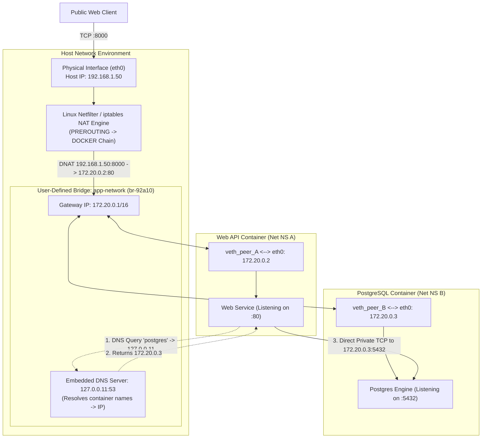
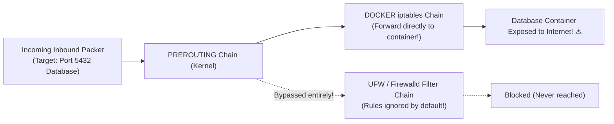
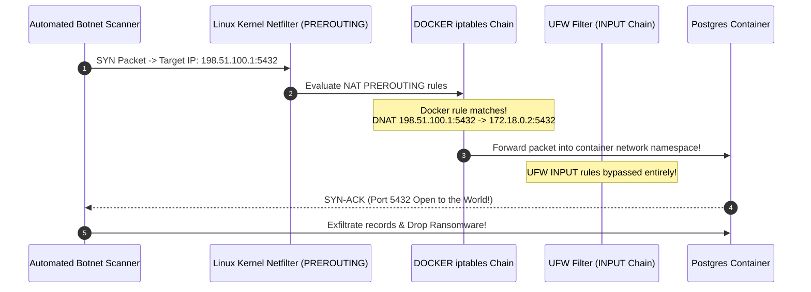

# Module 05: Docker Networking Deep Dive — Network Drivers, Service Discovery, and Port Forwarding

> **Status:** Production Standard  
> **Difficulty:** Intermediate to Advanced  
> **Estimated Time:** 2–3 Hours  
> **Prerequisites:** Module 01 (Network Namespaces), Module 02 (Containers & Lifecycles)

---

> [!TIP]
> **The Golden Rule of Container Networking & Security**  
> Never deploy multi-tier containerized architectures to the legacy default bridge network (`bridge`). The default bridge disables Docker's embedded DNS resolver (`127.0.0.11`), forcing fragile hardcoded IP routing and linking. Always create isolated **User-Defined Bridge Networks** (`docker network create`) to activate automatic DNS service discovery by container name. Furthermore, never publish ports using plain `-p <port>:<port>` in production environments: Docker injects rules directly into the Linux kernel `iptables` `PREROUTING` chain, silently **bypassing host-level firewalls (UFW/Firewalld)** and exposing private services to the public internet unless explicitly bound to loopback: `-p 127.0.0.1:8000:8000`.

---

## 1. Visual Mental Models

### 1.1 Docker Virtual Bridge Network & Linux `veth` Architecture

Containers communicate across private Linux network namespaces via virtual ethernet (`veth`) pairs attached to an internal bridge switch:



### 1.2 The Firewall Bypass Trap: Docker `iptables` Routing

Docker manipulates raw netfilter routing tables, circumventing higher-level Linux firewalls:



---

## 2. Technical Reference Matrices

### 2.1 Docker Network Drivers Compared

| Driver | Scope | Network Isolation | Routing & DNS Mechanism | Ideal Production Use Case |
| :--- | :--- | :--- | :--- | :--- |
| **Bridge (User-Defined)** | Single Host | Private subnet per network | Virtual switch (`br-xxx`) + Embedded DNS (`127.0.0.11`) | Standard multi-tier microservices (Default) |
| **Host (`--net=host`)** | Single Host | **Zero Isolation** (Shares host network namespace) | Binds directly to host interfaces; zero NAT overhead | Ultra-low-latency high-packet networking (VoIP, HFT) |
| **Overlay** | Multi-Host | Encrypted / VXLAN tunnel across Swarm/K8s nodes | Distributed key-value store routing | Multi-node Docker Swarm clusters |
| **Macvlan** | Single Host | Assigns real physical MAC address from LAN | Appears as a distinct physical machine on home/corp router | Legacy apps requiring static IPs on physical subnets |
| **None (`--net=none`)** | Container | **Complete Air-Gap Isolation** | Loopback interface (`127.0.0.1`) only | Offline batch compute, batch crypto signers |

### 2.2 Port Publishing Syntax Reference

| CLI Syntax | Interfaces Bound | Host Port Bound | Access Control Scope | Production Recommendation |
| :--- | :--- | :--- | :--- | :--- |
| `-p 8080:80` | `0.0.0.0` (All interfaces) | Port 8080 | **Publicly reachable** by any LAN/WAN client | Public API gateways only |
| `-p 127.0.0.1:8080:80` | `127.0.0.1` (Host Loopback only) | Port 8080 | Accessible **only from local host machine** | **Internal databases, Redis, admin panels** |
| `-p 80` | `0.0.0.0` (All interfaces) | Ephemeral port ($32768–60999$) | Dynamic random assignment | Automated parallel testing environments |
| `--expose 80` | **None** | No host port allocated | Accessible **only to peers on same Docker network** | Internal microservices, backend databases |

---

## 3. Production War Story: The Public Database Exposure via `iptables` Bypass

### The Incident
A healthcare startup hosted a HIPAA-regulated medical application on an Ubuntu cloud server. 

The infrastructure engineer configured the Ubuntu host firewall using UFW (Uncomplicated Firewall):
```bash
sudo ufw default deny incoming
sudo ufw allow 22/tcp
sudo ufw allow 80/tcp
sudo ufw allow 443/tcp
sudo ufw enable
```

Confident that port `5432` was firewalled from the public internet, they launched their production database:
```bash
docker run -d --name prod-db -p 5432:5432 -e POSTGRES_PASSWORD=CompanySecret2025 postgres:16
```

Four days later, customer health records were leaked online, and a ransom note appeared in the database:
- **What happened:** When the Docker daemon initialized `-p 5432:5432`, it inserted a `DNAT` forwarding rule into the Linux kernel's `iptables` `PREROUTING` chain.
- Because `PREROUTING` rules execute *before* UFW's `INPUT` filtering chain, inbound packets targeting port 5432 were translated and routed directly into the container before UFW was ever evaluated.
- The PostgreSQL database was completely exposed to the public internet, where an automated botnet brute-forced the credential and exfiltrated 80,000 patient records.



### The Post-Mortem & Fix
1. **Explicit Loopback Binding:** Never rely on host firewalls when using Docker `-p`. Always bind internal services strictly to loopback:
   ```bash
   docker run -d --name prod-db -p 127.0.0.1:5432:5432 postgres:16
   ```
2. **Use Docker Networks for Internal Communications:** If only the Web API container needs to reach Postgres, **do not publish port 5432 at all**. Attach both containers to a user-defined bridge network; the Web API reaches Postgres at `postgres:5432` with zero host port exposure.
3. **Configure the `DOCKER-USER` Chain:** If iptables must filter container traffic, place custom DROP rules in the `DOCKER-USER` chain, which executes before Docker's forwarding rules.

---

## 4. Multi-Language DNS Service Discovery & Port Verification

Below is production-grade code in Go, TypeScript, and Python demonstrating how services resolve peers via Docker's embedded DNS server (`127.0.0.11`) and verify network socket reachability across container namespaces.

````carousel
```go
// service_discovery.go
package main

import (
	"context"
	"fmt"
	"log"
	"net"
	"time"
)

func main() {
	peerHostname := "database" // Docker container name on user-defined network
	targetPort := "5432"

	fmt.Println("=== Docker Embedded DNS & Socket Verification (Go) ===")

	// 1. Resolve peer container IP via Docker DNS (127.0.0.11)
	ctx, cancel := context.WithTimeout(context.Background(), 3*time.Second)
	defer cancel()

	resolver := &net.Resolver{}
	ips, err := resolver.LookupHost(ctx, peerHostname)
	if err != nil {
		log.Fatalf("DNS Resolution failed for '%s': %v (Are you on a user-defined bridge network?)", peerHostname, err)
	}

	fmt.Printf("Resolved peer '%s' to IP addresses: %v\n", peerHostname, ips)

	// 2. Perform TCP socket handshake
	address := net.JoinHostPort(peerHostname, targetPort)
	conn, err := net.DialTimeout("tcp", address, 2*time.Second)
	if err != nil {
		log.Fatalf("TCP handshake failed to %s: %v", address, err)
	}
	defer conn.Close()

	fmt.Printf("Successfully established TCP connection to %s\n", address)
	fmt.Printf("Local Socket: %s <--> Remote Socket: %s\n", conn.LocalAddr(), conn.RemoteAddr())
}
```
<!-- slide -->
```typescript
// service_discovery.ts
import dns from 'dns';
import net from 'net';

const peerName = 'cache';
const peerPort = 6379;

async function testContainerDiscovery(): Promise<void> {
  console.log('=== Docker Embedded DNS & Socket Verification (TypeScript) ===');

  // 1. Resolve container name
  dns.lookup(peerName, (err, address, family) => {
    if (err) {
      console.error(`DNS lookup failed for '${peerName}': ${err.message}`);
      console.error('Note: Default bridge does not support DNS resolution. Use a user-defined network.');
      return;
    }

    console.log(`Resolved '${peerName}' -> IP: ${address} (IPv${family})`);

    // 2. Test TCP socket connection
    const socket = new net.Socket();
    socket.setTimeout(2000);

    socket.connect(peerPort, address, () => {
      console.log(`Connected successfully to ${peerName}:${peerPort}`);
      socket.end();
    });

    socket.on('error', (netErr) => {
      console.error(`Connection failed: ${netErr.message}`);
    });
  });
}

testContainerDiscovery();
```
<!-- slide -->
```python
# service_discovery.py
import socket
import sys

def verify_peer_discovery(peer_name: str = "redis-service", port: int = 6379):
    print("=== Docker Embedded DNS & Socket Verification (Python) ===")
    
    # 1. Resolve peer container hostname
    try:
        ip = socket.gethostbyname(peer_name)
        print(f"Successfully resolved '{peer_name}' to IP: {ip}")
    except socket.gaierror as e:
        print(f"DNS Resolution Failed: {e}")
        print("Tip: Automatic DNS only functions on custom user-defined bridge networks.")
        sys.exit(1)

    # 2. Test TCP connectivity
    s = socket.socket(socket.AF_INET, socket.SOCK_STREAM)
    s.settimeout(2.0)
    try:
        s.connect((ip, port))
        print(f"TCP socket opened successfully to {peer_name} ({ip}:{port})")
        s.close()
    except Exception as e:
        print(f"Socket connection error: {e}")

if __name__ == "__main__":
    verify_peer_discovery()
```
````

---

## 5. Practical Hands-On Verification CLI

Execute these steps in your WSL2 terminal to prove the difference between the default bridge and user-defined networks:

```bash
# 1. Prove that the default bridge network FAILS DNS name resolution
docker run -d --name default_a alpine sleep 300
docker run -d --name default_b alpine sleep 300

# Try to ping default_a by name from default_b
docker exec default_b ping -c 2 default_a
# Expected output: ping: bad address 'default_a' (No DNS on default bridge!)

# 2. Create an isolated user-defined network
docker network create microservices_net
docker network inspect microservices_net --format '{{.Subnet}}'

# 3. Attach containers to the user-defined network
docker run -d --network microservices_net --name service_a alpine sleep 300
docker run -d --network microservices_net --name service_b alpine sleep 300

# Verify automatic DNS resolution
docker exec service_b ping -c 2 service_a
# Expected output: 64 bytes from service_a (172.20.0.2): seq=1 ttl=64 time=0.082 ms

# 4. Inspect container network endpoints and assigned IPs
docker network inspect microservices_net --format '{{json .Containers}}' | jq .

# 5. Verify local loopback port binding security
docker run -d --name secure_api --network microservices_net -p 127.0.0.1:8080:80 nginx:alpine
docker port secure_api
# Expected output: 80/tcp -> 127.0.0.1:8080

# 6. Clean up
docker rm -f default_a default_b service_a service_b secure_api
docker network rm microservices_net
```

---

## 6. Operational Validation Checkpoints

<details>
<summary><strong>Checkpoint 1: Why does pinging another container by name work on a custom network but fail on the default bridge?</strong></summary>

> **Root Cause Analysis:**  
> When containers attach to the default bridge (`bridge`), Docker configures their `/etc/resolv.conf` to use external host DNS resolvers directly. The default bridge does not activate Docker's internal DNS daemon.  
> 
> When containers attach to a **user-defined network**, Docker injects an embedded DNS server listening at **`127.0.0.11:53`** inside the container's network namespace. When Container B issues a lookup for `service_a`, the embedded DNS daemon queries Docker's internal container directory and returns Container A's internal IP (`172.20.0.2`).
</details>

<details>
<summary><strong>Checkpoint 2: From inside a container, why does `curl http://localhost:8000` fail to reach another container that published port 8000?</strong></summary>

> **Root Cause Analysis:**  
> `localhost` (`127.0.0.1`) is bound to the container's **private loopback interface** inside its isolated Network Namespace (`CLONE_NEWNET`).  
> 
> A container's loopback interface routes exclusively to processes executing inside that exact same container. It cannot route to the host, and it cannot route to neighboring containers. To communicate with peer containers, use the peer's container name on a shared user-defined network (`http://web:8000`). To communicate with services running on the host, use `host.docker.internal`.
</details>

<details>
<summary><strong>Checkpoint 3: How does Docker publish ports without requiring application processes to run as root on the host?</strong></summary>

> **Root Cause Analysis:**  
> Docker uses the host kernel's **iptables Destination Network Address Translation (DNAT)**.  
> When you specify `-p 80:8080`:
> 1. The container process runs in its isolated namespace listening on port 8080.
> 2. The Docker daemon configures an iptables DNAT rule on the host:
>    ```
>    iptables -t nat -A DOCKER -p tcp --dport 80 -j DNAT --to-destination 172.20.0.2:8080
>    ```
> 3. When packets arrive at host port 80, the Linux kernel rewrites the destination IP/port to the container's private IP and port 8080 at the packet layer, bypassing user-space permission boundaries.
</details>

---

## 7. Curriculum Navigation

- [← Back to Module 04: Volumes and Bind Mounts](../04-volumes-and-bind-mounts/README.md)
- [Back to Docker & Containers Overview](../README.md)
- [Proceed to Module 06: Docker Compose Multi-Container Orchestration](../06-docker-compose/README.md)
