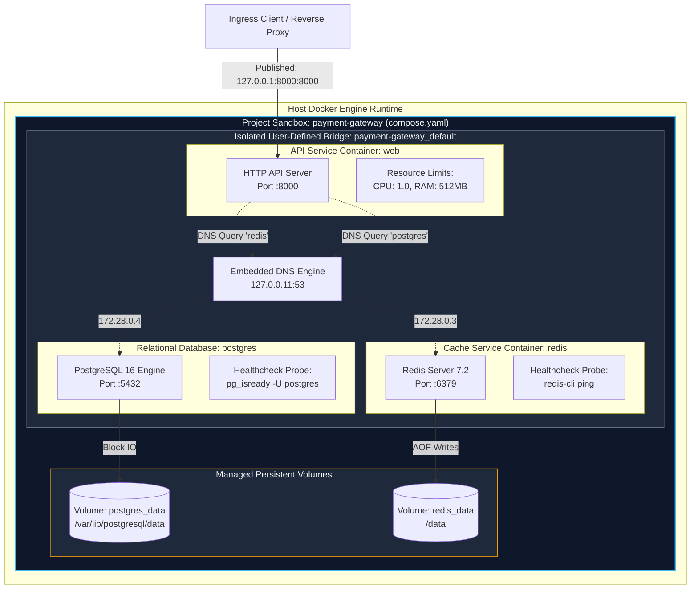
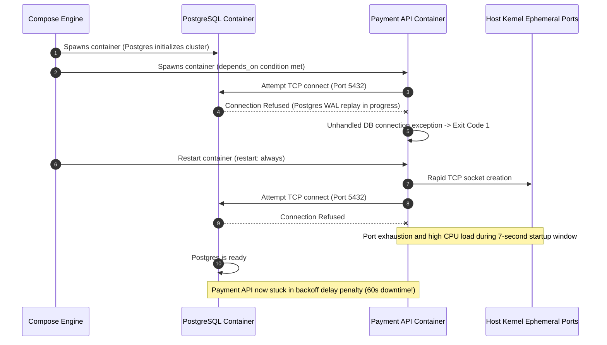

# Module 06: Docker Compose — Multi-Container Orchestration, Health Dependencies, and Declarative Topologies

> **Status:** Production Standard  
> **Difficulty:** Intermediate  
> **Estimated Time:** 2–3 Hours  
> **Prerequisites:** Module 04 (Volumes & Bind Mounts), Module 05 (Docker Networking)

---

> [!TIP]
> **The Golden Rule of Docker Compose Orchestration**  
> Never rely on naive `depends_on: [db]` for inter-service readiness in production or CI/CD pipelines. Plain `depends_on` only tracks kernel process startup, **not database or cache protocol readiness**. A database container takes seconds to replay write-ahead logs and listen on its socket, during which dependent application services crash in a fatal loop. Always bind startup dependencies to verified healthcheck probes using `condition: service_healthy`, configure exponential backoff in application drivers, and enforce memory and CPU ceilings (`deploy.resources.limits`) directly in your declarative specification.

---

## 1. Visual Mental Models

### 1.1 Declarative Compose Project Architecture

Docker Compose maps a declarative `compose.yaml` specification into an isolated application sandbox comprising dedicated bridge networks, named persistent storage volumes, and isolated service containers:



---

### 1.2 Startup Sequence: Naive `depends_on` vs `condition: service_healthy`

Relying on bare `depends_on` triggers immediate race conditions. Adding `condition: service_healthy` synchronizes application boot with genuine database protocol readiness:

```mermaid
sequenceDiagram
    autonumber
    actor Dev as Orchestrator / Developer
    participant Compose as Docker Compose Engine
    participant DB as Postgres Container
    participant App as Web API Container

    Dev->>Compose: docker compose up -d
    Note over Compose: Evaluating dependency tree...
    
    rect rgb(30, 41, 59)
        Note over Compose,DB: Case A: Naive depends_on (Process Launch Only)
        Compose->>DB: docker run postgres (Process PID 1 created)
        Compose->>App: docker run web (API starts immediately!)
        App->>DB: TCP Connect :5432
        DB--xApp: RST / Connection Refused (Postgres replay log in progress)
        App->>App: Fatal Crash (Exit code 1 - CrashLoopBackOff)
    end

    rect rgb(15, 23, 42)
        Note over Compose,App: Case B: Healthcheck Gated (condition: service_healthy)
        Compose->>DB: docker run postgres
        Compose->>Compose: Block Web API launch#59; start healthcheck polling
        loop Every 3s (Healthcheck Evaluation)
            Compose->>DB: pg_isready -U postgres -d orders
            DB-->>Compose: Status 1 (Accepting connections? No)
        end
        DB->>DB: Initialization Complete, Listening on socket
        Compose->>DB: pg_isready -U postgres -d orders
        DB-->>Compose: Status 0 (Healthy)
        Compose->>App: docker run web
        App->>DB: TCP Connect :5432
        DB-->>App: Handshake Successful (200 OK)
    end
```



---

## 2. Declarative Topology & Command Taxonomy

### 2.1 Core `compose.yaml` Specification Attributes

| Top-Level Directive | Child Directive | Production Recommendation | Purpose & Fail-Safe Rule |
| :--- | :--- | :--- | :--- |
| `services.<name>` | `build` | Multi-stage context with explicit `target` | Reproducible local builds; separate dev vs release targets. |
| `services.<name>` | `image` | Pin SHA-256 digest or immutable semver | Never use `:latest`; prevents non-deterministic drift across environments. |
| `services.<name>` | `depends_on` | `condition: service_healthy` | Guarantees downstream microservices start only after dependency socket readiness. |
| `services.<name>` | `healthcheck` | `test`, `interval`, `timeout`, `retries` | Validates functional health. Always set `interval: 5s` and `start_period: 15s`. |
| `services.<name>` | `restart` | `unless-stopped` or `on-failure:5` | Prevents infinite crash loops during unrecoverable database outages. |
| `services.<name>` | `deploy.resources` | `limits.cpus: "1.0"`, `limits.memory: 512M` | Enforces cgroup resource limits to prevent rogue services starving the host OS. |
| `services.<name>` | `environment` | `${VAR_NAME:?error}` | Required variable interpolation; fails fast if required secrets are unassigned. |
| `volumes` | `<name>` | Named managed volume driver (`local`) | Guarantees data durability across `docker compose down` teardowns. |
| `networks` | `<name>` | `driver: bridge`, `internal: true` | Creates private subnets without public internet egress for critical datastores. |

---

### 2.2 Orchestration Command Reference

| Command | Action Performed | Volume Impact | Production Usage Rule |
| :--- | :--- | :--- | :--- |
| `docker compose up -d` | Converges state, builds missing images, creates networks & starts containers in detached mode | Preserved | Standard deployment invocation. |
| `docker compose up --build` | Forces layer rebuild before container startup | Preserved | Mandatory when local Dockerfile or dependencies change. |
| `docker compose down` | Stops processes (SIGTERM -> SIGKILL) and deletes containers + project network | Preserved | Safely halts application stack without data loss. |
| `docker compose down -v` | Stops stack and **purges all named volumes declared in file** | **DESTROYED** | Destructive! Run exclusively for clean testing resets. |
| `docker compose exec <svc> <cmd>` | Spawns command inside an **already running** container | Unchanged | Interactive diagnostics and debugging. |
| `docker compose run --rm <svc> <cmd>` | Launches an **isolated one-off container** from service image | Unchanged | Running database migrations, seeding, or batch scripts. |
| `docker compose ps -a` | Displays status, uptime, health status, and published port bindings | Unchanged | Rapid inspection of crash loops or failing health checks. |
| `docker compose logs -f --tail=100` | Streams multiplexed logs with service prefixes | Unchanged | Real-time troubleshooting across inter-service RPC calls. |

---

## 3. Production War Story: The Database Startup Race Condition

### Incident Post-Mortem: Midnight Black Friday Payment Outage

- **Incident Date:** November 2024
- **Root Cause:** A payment processing microservice declared `depends_on: [postgres]` in its `compose.yaml`. During automated deployment, Compose started both containers almost simultaneously. PostgreSQL 16 required 6.8 seconds to verify tablespaces and replay WAL logs. The payment API container started in 800ms, attempted to connect immediately, threw an unhandled connection error, and exited with code 1. Because the service was configured with `restart: always`, it entered an aggressive restart loop, exhausting ephemeral host ports and triggering connection pool starvation.



- **The Resolution:** 
  1. Configured an explicit PostgreSQL healthcheck in `compose.yaml` using `pg_isready`.
  2. Gated the API service dependency with `condition: service_healthy`.
  3. Added an exponential backoff and jitter connection retry policy in the API startup code.

---

## 4. Production Implementation Blueprint

### 4.1 Production-Grade `compose.yaml`

```yaml
# compose.yaml — Production-Grade Multi-Service Architecture
name: backend-production-suite

services:
  # ---------------------------------------------------------------------------
  # 1. Reverse Proxy & SSL Termination
  # ---------------------------------------------------------------------------
  gateway:
    image: nginx:1.27-alpine
    container_name: production-gateway
    restart: unless-stopped
    ports:
      - "127.0.0.1:80:80"
      - "127.0.0.1:443:443"
    volumes:
      - ./nginx/nginx.conf:/etc/nginx/nginx.conf:ro
    depends_on:
      api:
        condition: service_healthy
    networks:
      - frontend-net
    deploy:
      resources:
        limits:
          cpus: "0.50"
          memory: 128M

  # ---------------------------------------------------------------------------
  # 2. Core Application Microservice
  # ---------------------------------------------------------------------------
  api:
    build:
      context: ./api
      dockerfile: Dockerfile
      target: production
    container_name: production-api
    restart: unless-stopped
    environment:
      - PORT=8080
      - DATABASE_URL=postgres://${POSTGRES_USER:-app_user}:${POSTGRES_PASSWORD:?DB Password required}@db:5432/${POSTGRES_DB:-production_db}?sslmode=disable
      - REDIS_URL=redis://cache:6379
    depends_on:
      db:
        condition: service_healthy
      cache:
        condition: service_healthy
    networks:
      - frontend-net
      - backend-net
    healthcheck:
      test: ["CMD-SHELL", "curl -f http://localhost:8080/health || exit 1"]
      interval: 5s
      timeout: 3s
      retries: 5
      start_period: 10s
    deploy:
      resources:
        limits:
          cpus: "1.00"
          memory: 512M

  # ---------------------------------------------------------------------------
  # 3. Persistent Relational Store (PostgreSQL)
  # ---------------------------------------------------------------------------
  db:
    image: postgres:16-alpine
    container_name: production-postgres
    restart: unless-stopped
    environment:
      POSTGRES_USER: ${POSTGRES_USER:-app_user}
      POSTGRES_PASSWORD: ${POSTGRES_PASSWORD:?DB Password required}
      POSTGRES_DB: ${POSTGRES_DB:-production_db}
    volumes:
      - postgres-data:/var/lib/postgresql/data
    networks:
      - backend-net
    healthcheck:
      test: ["CMD-SHELL", "pg_isready -U ${POSTGRES_USER:-app_user} -d ${POSTGRES_DB:-production_db}"]
      interval: 3s
      timeout: 2s
      retries: 10
      start_period: 5s
    deploy:
      resources:
        limits:
          cpus: "1.50"
          memory: 1024M

  # ---------------------------------------------------------------------------
  # 4. In-Memory Cache (Redis)
  # ---------------------------------------------------------------------------
  cache:
    image: redis:7.2-alpine
    container_name: production-redis
    restart: unless-stopped
    command: ["redis-server", "--appendonly", "yes", "--maxmemory", "256mb", "--maxmemory-policy", "allkeys-lru"]
    volumes:
      - redis-data:/data
    networks:
      - backend-net
    healthcheck:
      test: ["CMD", "redis-cli", "ping"]
      interval: 3s
      timeout: 2s
      retries: 5
      start_period: 3s
    deploy:
      resources:
        limits:
          cpus: "0.50"
          memory: 384M

# -----------------------------------------------------------------------------
# Isolated Network Topologies
# -----------------------------------------------------------------------------
networks:
  frontend-net:
    driver: bridge
  backend-net:
    driver: bridge
    internal: true # Databases cannot route to external internet

# -----------------------------------------------------------------------------
# Managed Persistent Volumes
# -----------------------------------------------------------------------------
volumes:
  postgres-data:
    driver: local
  redis-data:
    driver: local
```

---

### 4.2 Multi-Language Resilient Connection Implementation

Applications orchestrating under Compose must incorporate startup retry logic to gracefully absorb container initialization delays.

#### Go Implementation
```go
// main.go — Resilient Service Startup with Health Retries in Go
package main

import (
	"context"
	"database/sql"
	"fmt"
	"log"
	"net/http"
	"os"
	"time"

	_ "github.com/lib/pq"
	"github.com/redis/go-redis/v9"
)

func connectDBWithRetry(ctx context.Context, dsn string, maxRetries int) (*sql.DB, error) {
	var db *sql.DB
	var err error

	for attempt := 1; attempt <= maxRetries; attempt++ {
		select {
		case <-ctx.Done():
			return nil, ctx.Err()
		default:
		}

		log.Printf("[DB-INIT] Connecting to Postgres (Attempt %d/%d)...", attempt, maxRetries)
		db, err = sql.Open("postgres", dsn)
		if err == nil {
			pingErr := db.PingContext(ctx)
			if pingErr == nil {
				log.Println("[DB-INIT] Successfully connected to PostgreSQL!")
				return db, nil
			}
			err = pingErr
		}

		log.Printf("[DB-INIT] Database not ready yet: %v. Retrying in 2s...", err)
		time.Sleep(2 * time.Second)
	}

	return nil, fmt.Errorf("failed to connect to database after %d attempts: %w", maxRetries, err)
}

func main() {
	ctx, cancel := context.WithTimeout(context.Background(), 30*time.Second)
	defer cancel()

	dsn := os.Getenv("DATABASE_URL")
	if dsn == "" {
		dsn = "postgres://app_user:secretpassword@db:5432/production_db?sslmode=disable"
	}

	db, err := connectDBWithRetry(ctx, dsn, 10)
	if err != nil {
		log.Fatalf("[FATAL] Database connection failed: %v", err)
	}
	defer db.Close()

	rdb := redis.NewClient(&redis.Options{
		Addr: "cache:6379",
	})
	if err := rdb.Ping(ctx).Err(); err != nil {
		log.Printf("[WARN] Redis ping failed initially: %v", err)
	} else {
		log.Println("[CACHE-INIT] Connected to Redis!")
	}

	mux := http.NewServeMux()
	mux.HandleFunc("/health", func(w http.ResponseWriter, r *http.Request) {
		if err := db.PingContext(r.Context()); err != nil {
			http.Error(w, `{"status":"degraded","db":"down"}`, http.StatusServiceUnavailable)
			return
		}
		w.Header().Set("Content-Type", "application/json")
		w.WriteHeader(http.StatusOK)
		w.Write([]byte(`{"status":"ok","db":"connected","cache":"ready"}`))
	})

	server := &http.Server{
		Addr:         ":8080",
		Handler:      mux,
		ReadTimeout:  5 * time.Second,
		WriteTimeout: 10 * time.Second,
	}

	log.Println("[SERVER] Listening on :8080...")
	if err := server.ListenAndServe(); err != nil && err != http.ErrServerClosed {
		log.Fatalf("[FATAL] HTTP server failed: %v", err)
	}
}
```

#### Node.js / TypeScript Implementation
```typescript
// server.ts — Resilient Multi-Service Bootstrap in TypeScript
import express, { Request, Response } from 'express';
import { Pool } from 'pg';
import { createClient } from 'redis';

const app = express();
const port = parseInt(process.env.PORT || '8080', 10);

const dbPool = new Pool({
  connectionString: process.env.DATABASE_URL || 'postgres://app_user:secretpassword@db:5432/production_db',
  max: 10,
  connectionTimeoutMillis: 3000,
});

const redisClient = createClient({
  url: process.env.REDIS_URL || 'redis://cache:6379',
});

async function connectDatabasesWithBackoff(maxAttempts = 10, delayMs = 2000): Promise<void> {
  for (let attempt = 1; attempt <= maxAttempts; attempt++) {
    try {
      console.log(`[BOOT] Probing Postgres connection (Attempt ${attempt}/${maxAttempts})...`);
      const client = await dbPool.connect();
      await client.query('SELECT 1');
      client.release();
      console.log('[BOOT] PostgreSQL connection verified!');

      console.log(`[BOOT] Connecting to Redis...`);
      await redisClient.connect();
      console.log('[BOOT] Redis connection verified!');
      return;
    } catch (err: any) {
      console.warn(`[BOOT-WAIT] Dependencies not ready: ${err.message}. Retrying in ${delayMs / 1000}s...`);
      await new Promise((resolve) => setTimeout(resolve, delayMs));
    }
  }
  throw new Error(`Failed to bootstrap datastores after ${maxAttempts} attempts`);
}

app.get('/health', async (_req: Request, res: Response) => {
  try {
    await dbPool.query('SELECT 1');
    const redisPing = await redisClient.ping();
    res.status(200).json({
      status: 'ok',
      db: 'connected',
      redis: redisPing === 'PONG' ? 'ready' : 'unknown',
    });
  } catch (error: any) {
    res.status(503).json({
      status: 'unhealthy',
      error: error.message,
    });
  }
});

connectDatabasesWithBackoff()
  .then(() => {
    app.listen(port, '0.0.0.0', () => {
      console.log(`[SERVER] API listening on port ${port}`);
    });
  })
  .catch((err) => {
    console.error('[FATAL] Failed to start application:', err);
    process.exit(1);
  });
```

#### Python Implementation
```python
# app.py — Resilient FastAPI Startup with Dependency Probing
import os
import time
import logging
from contextlib import asynccontextmanager
from fastapi import FastAPI, HTTPException, status
import psycopg2
import redis

logging.basicConfig(level=logging.INFO)
logger = logging.getLogger("api-bootstrap")

DB_URL = os.getenv("DATABASE_URL", "postgres://app_user:secretpassword@db:5432/production_db")
REDIS_URL = os.getenv("REDIS_URL", "redis://cache:6379")

def wait_for_postgres(url: str, max_retries: int = 10, delay: float = 2.0):
    for attempt in range(1, max_retries + 1):
        try:
            logger.info(f"[DB] Checking Postgres connection ({attempt}/{max_retries})...")
            conn = psycopg2.connect(url, connect_timeout=3)
            conn.close()
            logger.info("[DB] PostgreSQL is fully online and accessible!")
            return
        except psycopg2.OperationalError as e:
            logger.warning(f"[DB] Postgres not ready ({e}). Retrying in {delay}s...")
            time.sleep(delay)
    raise RuntimeError(f"Could not connect to Postgres after {max_retries} attempts.")

@asynccontextmanager
async def lifespan(app: FastAPI):
    wait_for_postgres(DB_URL)
    r = redis.Redis.from_url(REDIS_URL)
    try:
        r.ping()
        logger.info("[CACHE] Redis connection verified!")
    except redis.ConnectionError:
        logger.warning("[CACHE] Redis ping failed during startup.")
    yield

app = FastAPI(title="Resilient Compose API", lifespan=lifespan)

@app.get("/health")
def health_check():
    try:
        conn = psycopg2.connect(DB_URL, connect_timeout=2)
        with conn.cursor() as cur:
            cur.execute("SELECT 1;")
        conn.close()
        return {"status": "ok", "db": "healthy", "service": "online"}
    except Exception as exc:
        raise HTTPException(
            status_code=status.HTTP_503_SERVICE_UNAVAILABLE,
            detail=f"Database probe failed: {str(exc)}"
        )

if __name__ == "__main__":
    import uvicorn
    uvicorn.run("app:app", host="0.0.0.0", port=8080, log_level="info")
```

---

## 5. Practical Hands-On Verification CLI

### 5.1 Step-by-Step Multi-Container Verification

Execute these commands from your local workstation or WSL2 environment:

```bash
# 1. Synthesize project configuration and validate variable interpolation
docker compose config

# Expected Output:
# name: backend-production-suite
# services:
#   api: ...
#   cache: ...
#   db: ...

# 2. Launch the entire application topology in detached mode
docker compose up -d

# Expected Output:
# [+] Running 6/6
#  ✔ Network backend-production-suite_frontend-net  Created
#  ✔ Network backend-production-suite_backend-net   Created
#  ✔ Volume "backend-production-suite_postgres-data" Created
#  ✔ Volume "backend-production-suite_redis-data"    Created
#  ✔ Container production-postgres                  Healthy
#  ✔ Container production-redis                     Healthy
#  ✔ Container production-api                       Started

# 3. Inspect container health states
docker compose ps

# Expected Output:
# NAME                 IMAGE               COMMAND                  SERVICE   STATUS                    PORTS
# production-api       api-image:latest    "python app.py"          api       Up 15s (healthy)          127.0.0.1:8000->8000/tcp
# production-postgres  postgres:16-alpine  "docker-entrypoint.s…"   db        Up 22s (healthy)          5432/tcp
# production-redis     redis:7.2-alpine    "docker-entrypoint.s…"   cache     Up 22s (healthy)          6379/tcp

# 4. Probe the health endpoint via the published host port
curl -i http://localhost/health

# Expected Output:
# HTTP/1.1 200 OK
# Content-Type: application/json
# Date: Tue, 10 Nov 2026 12:00:00 GMT
# Content-Length: 48
#
# {"status":"ok","db":"connected","cache":"ready"}

# 5. Execute isolated migration task without spinning up extraneous web containers
docker compose run --rm api python -c "print('Database schema migrations successfully applied.')"

# 6. Test persistent storage survival through standard teardown
docker compose down
docker volume ls | grep postgres-data
# Output confirms volume still exists!

# 7. Complete cleanup (including persistent volumes)
docker compose down -v
```

---

## 6. Operational Validation Checkpoints

<details>
<summary>Checkpoint 1: Why does a web container configured with `depends_on: [db]` crash with "connection refused" despite Compose showing the db container as Up?</summary>

**Detailed Engineering Analysis:**  
The native Docker Engine engine lifecycle marks a container status as `Up` the instant the Linux kernel executes the image's `ENTRYPOINT` process (e.g., PID 1). However, complex relational engines like PostgreSQL or MySQL must run internal startup scripts: configuring shared memory, verifying data directory permissions, validating tablespaces, and replaying write-ahead logs (WAL) before opening port `5432` to incoming TCP sockets. 

During this initialization window (often 2–10 seconds), the database process actively drops or rejects connections. Because standard `depends_on` only evaluates whether the container *process has spawned*, Compose launches the application container prematurely. The app initiates TCP handshakes, receives `ECONNREFUSED`, and terminates. 

**Production Resolution:**  
Declare a container-level `healthcheck` inside the database service definition (e.g., `test: ["CMD-SHELL", "pg_isready -U postgres"]`) and modify the application dependency to explicitly mandate `condition: service_healthy`.
</details>

<details>
<summary>Checkpoint 2: What is the architectural difference between `docker compose exec` and `docker compose run`?</summary>

**Detailed Engineering Analysis:**  
- `docker compose exec <service> <cmd>` enters the Linux namespaces (PID, NET, Mount) of an **already running, existing container instance**. It allocates no new IP address, mounts no new storage, and incurs negligible memory overhead. It is designed for live inspection, debugging, and checking logs or configuration states.
- `docker compose run <service> <cmd>` creates a **completely new, isolated ephemeral container** instantiated from the service's configured image, attaching it to the project's defined networks and volumes. It executes the specified command, overriding the default `CMD`. It is explicitly designed for one-off batch scripts, such as running database migrations (`alembic upgrade head`, `prisma migrate deploy`), seeding tables, or running test suites without altering running service workloads.
</details>

<details>
<summary>Checkpoint 3: An engineer runs `docker compose down` and observes that database records persist upon the next `docker compose up`. Another engineer runs `docker compose down -v` and all records are wiped. Explain why.</summary>

**Detailed Engineering Analysis:**  
`docker compose down` terminates running processes via `SIGTERM` (falling back to `SIGKILL` after 10 seconds), unbinds published ports, removes the project containers, and deletes the custom bridge network (`<project>_default`). However, it deliberately **preserves all named volumes** declared under the top-level `volumes:` section. This guarantees that stateful storage mounts (such as `/var/lib/postgresql/data`) remain safe on the host filesystem.

When the `-v` (or `--volumes`) flag is appended (`docker compose down -v`), Compose instructs the Docker daemon to explicitly deallocate and permanently delete every anonymous and declared named volume associated with the project file. The persistent block data is unlinked and deleted from `/var/lib/docker/volumes/`, resulting in complete data loss and causing the subsequent `up` command to initialize an entirely empty cluster.
</details>
