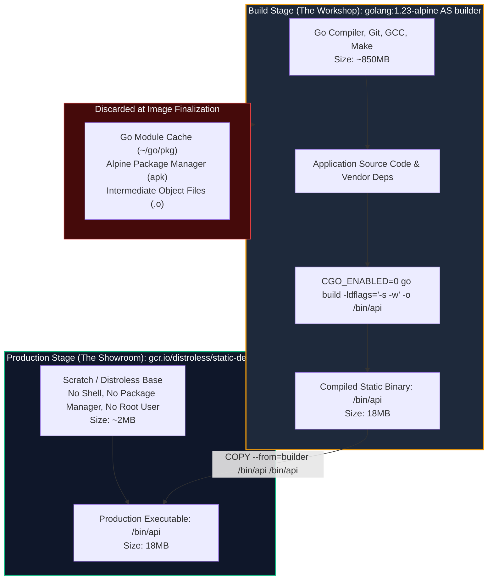
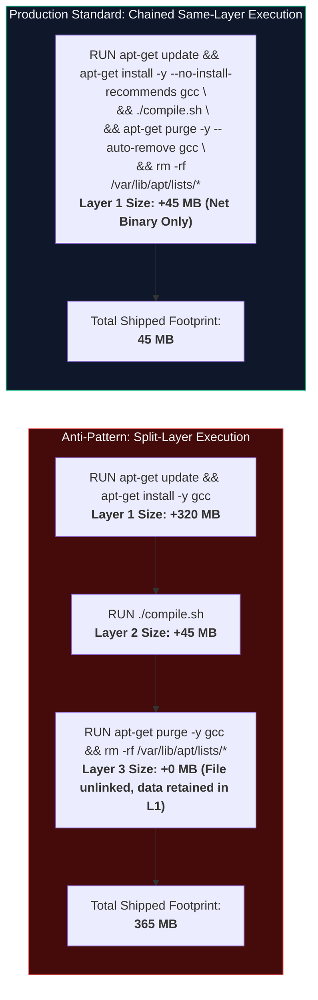
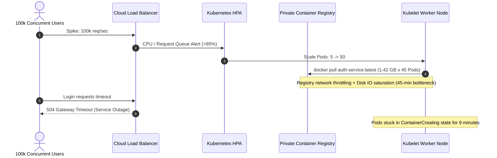

# Module 07: Multi-Stage Builds & Image Optimization — Distroless, BuildKit Caching, and Minimal Attack Surface

> **Status:** Production Standard  
> **Difficulty:** Intermediate to Advanced  
> **Estimated Time:** 2–3 Hours  
> **Prerequisites:** Module 03 (Dockerfile Deep Dive), Module 06 (Docker Compose)

---

> [!TIP]
> **The Golden Rule of Container Image Optimization**  
> Never ship build toolchains, SDKs, package managers, or shell interpreters to production runtime environments. Compilers (`gcc`, `g++`, `go`), build caches (`.m2`, `~/.npm`, `~/.cache/pip`), and interactive shells (`/bin/sh`, `/bin/bash`) inflate image sizes from 20MB to over 1.5GB, induce crippling network pull latencies during autoscaling events, and expose vulnerable CVE vectors to remote code execution. Always decouple compilation from execution using **Multi-Stage Builds (`COPY --from=builder`)**, enforce minimal execution baselines (**Distroless** or static scratch binaries), and isolate ephemeral build caches with BuildKit cache mounts (`--mount=type=cache`).

---

## 1. Visual Mental Models

### 1.1 Workshop vs Showroom: Multi-Stage Artifact Extraction

A single-stage build permanently captures all intermediate dependencies into immutable filesystem layers. Multi-stage builds act as a filter, discarding the compilation toolchain and carrying only the statically linked binary forward:



---

### 1.2 Layer Immutability: Same-Layer Cleanup vs Split-Layer Leakage

Docker layers are strictly additive. Deleting temporary files in subsequent instructions does not decrease previous layer sizes on the disk or wire:



---

## 2. Optimization Strategy Taxonomy & Base Image Comparison

### 2.1 Base Image Variant Architecture

| Base Image Distribution | Typical Base Size | C Library (`libc`) | Package Manager | Shell Included? | Vulnerability Surface | Recommended Production Use Case |
| :--- | :--- | :--- | :--- | :--- | :--- | :--- |
| `debian:12` / `ubuntu:24.04` | ~120–180 MB | `glibc` | `apt` | Yes (`/bin/bash`) | High (80+ CVEs) | Legacy software requiring systemd, PAM, or extensive POSIX tools. |
| `python:3.12-slim` | ~130 MB | `glibc` | `apt` | Yes (`/bin/sh`) | Medium (~20 CVEs) | Interpreted languages with binary wheels requiring `glibc` ABI. |
| `alpine:3.20` | ~7 MB | `musl` | `apk` | Yes (`/bin/ash`) | Very Low (< 3 CVEs) | Lightweight utilities, static proxies, or Go/Rust binaries with musl linking. |
| `gcr.io/distroless/static` | ~2.5 MB | None | None | **None** | Minimal (0 CVEs) | Statically compiled Go, Rust, or C++ binaries. |
| `scratch` | 0 MB | None | None | **None** | Zero | Pure static binaries (`CGO_ENABLED=0`) with baked CA certificates. |

---

### 2.2 BuildKit Performance Flags & Cache Directives

| Directive / CLI Flag | Mechanism | Cache Persistence | Production Benefit |
| :--- | :--- | :--- | :--- |
| `COPY --from=<stage> <src> <dest>` | Selective filesystem transfer | Immutable layer | Extracts compiled binaries without shipping toolchain layers. |
| `--mount=type=cache,target=<dir>` | Ephemeral BuildKit shared volume | Persistent across host builds | Reuses compiler/package manager download caches without baking bytes into layers. |
| `--mount=type=secret,id=<id>` | In-memory RAM mount | Erased after `RUN` completion | Safely passes GitHub tokens or NPM credentials without leaking secrets into image history. |
| `docker build --target <stage>` | Conditional DAG execution | Stored in Docker build cache | Rapid testing of isolated unit-test or lint stages in CI pipelines. |
| `RUN --no-install-recommends` | Omits optional dependencies | Layer-level | Prevents `apt` from installing documentation, man pages, and X11 graphics libs. |

---

## 3. Production War Story: The 1.4 GB Autoscaling Latency Cascade

### Incident Post-Mortem: Black-Box Scale-Out Failure

- **Incident Date:** October 2025
- **Root Cause:** A high-traffic authentication microservice was built using a single-stage `FROM node:20` image containing full TypeScript compilation dependencies (`tsc`), Python build tools for native `node-gyp` crypto bindings, local git histories, and developer `devDependencies`. The resulting image was **1.42 GB**. During a flash marketing promotion, Kubernetes Horizontal Pod Autoscaler (HPA) triggered an immediate scale-out from 5 to 50 pods. Node provisioners exhausted local node disk caches, triggering parallel container image pulls across the cluster. Network interfaces saturated, pod startup latencies surged from 3.2 seconds to 8 minutes 45 seconds, and inbound HTTP requests queued up until ingress gateway buffers exhausted, triggering global 504 Gateway Timeouts.



- **The Resolution:** 
  1. Converted the Dockerfile into a 3-stage multi-stage pipeline: (1) Builder, (2) Pruner (`npm prune --omit=dev`), and (3) Distroless Node runtime.
  2. Image size dropped from **1,420 MB to 78 MB** (94.5% reduction).
  3. Average node pull time dropped from **184 seconds to 1.8 seconds**, stabilizing HPA scale-out within acceptable SLO limits.

---

## 4. Multi-Language Production Dockerfile Implementations

### 4.1 Go Production Dockerfile (Static Binary on Scratch)

```dockerfile
# syntax=docker/dockerfile:1.7
# Stage 1: Compilation Environment
FROM golang:1.23-alpine AS builder

WORKDIR /src

# Step 1: Cache dependencies separately from source code
COPY go.mod go.sum ./
RUN --mount=type=cache,target=/go/pkg/mod \
    go mod download -x

# Step 2: Compile static binary with symbol stripping (-s -w)
COPY . .
RUN --mount=type=cache,target=/go/pkg/mod \
    --mount=type=cache,target=/root/.cache/go-build \
    CGO_ENABLED=0 GOOS=linux GOARCH=amd64 \
    go build -trimpath -ldflags="-s -w -X main.version=1.0.0" -o /bin/server ./cmd/api

# Stage 2: Runtime Sandbox (Zero Overhead)
FROM scratch

# Import system CA certificates for HTTPS outbound calls
COPY --from=builder /etc/ssl/certs/ca-certificates.crt /etc/ssl/certs/

# Run as non-privileged user (nobody:nobody -> UID 65534)
USER 65534:65534

WORKDIR /app
COPY --from=builder --chown=65534:65534 /bin/server /app/server

EXPOSE 8080
ENTRYPOINT ["/app/server"]
```

---

### 4.2 Node.js / TypeScript Production Dockerfile (Distroless)

```dockerfile
# syntax=docker/dockerfile:1.7
# Stage 1: Build & Transpile TypeScript
FROM node:20-bookworm-slim AS builder

WORKDIR /app

COPY package*.json tsconfig.json ./
RUN --mount=type=cache,target=/root/.npm \
    npm ci --include=dev

COPY src/ ./src
RUN npm run build

# Prune development dependencies to isolate runtime packages
RUN npm prune --omit=dev

# Stage 2: Distroless Production Runtime
FROM gcr.io/distroless/nodejs20-debian12:nonroot

WORKDIR /app

ENV NODE_ENV=production
ENV PORT=8080

# Copy node_modules and compiled JavaScript
COPY --from=builder --chown=nonroot:nonroot /app/node_modules ./node_modules
COPY --from=builder --chown=nonroot:nonroot /app/dist ./dist
COPY --from=builder --chown=nonroot:nonroot /app/package.json ./package.json

USER nonroot
EXPOSE 8080

CMD ["dist/server.js"]
```

---

### 4.3 Python Production Dockerfile (Multi-Stage Wheels Builder)

```dockerfile
# syntax=docker/dockerfile:1.7
# Stage 1: Build Wheels & Compile C-Extensions
FROM python:3.12-slim-bookworm AS builder

WORKDIR /build

RUN apt-get update && apt-get install -y --no-install-recommends \
    gcc \
    libpq-dev \
    build-essential \
    && rm -rf /var/lib/apt/lists/*

COPY requirements.txt .
RUN --mount=type=cache,target=/root/.cache/pip \
    pip wheel --no-cache-dir --wheel-dir=/build/wheels -r requirements.txt

# Stage 2: Clean Production Runtime
FROM python:3.12-slim-bookworm AS runner

# Install only shared runtime libraries (libpq without gcc/make)
RUN apt-get update && apt-get install -y --no-install-recommends \
    libpq5 \
    curl \
    && rm -rf /var/lib/apt/lists/*

# Create dedicated non-root application user
RUN groupadd -g 10001 appgroup && \
    useradd -u 10001 -g appgroup -s /bin/false -m appuser

WORKDIR /app

# Install pre-compiled wheels without internet access
COPY --from=builder /build/wheels /wheels
RUN pip install --no-cache-dir /wheels/* && rm -rf /wheels

COPY --chown=appuser:appgroup app.py .

USER appuser
EXPOSE 8000

HEALTHCHECK --interval=5s --timeout=3s --retries=3 \
  CMD curl -f http://localhost:8000/health || exit 1

CMD ["python", "app.py"]
```

---

## 5. Practical Hands-On Verification CLI

Execute the following commands to compare build targets, inspect layer bloat, and verify size reductions:

```bash
# 1. Enable BuildKit features explicitly
export DOCKER_BUILDKIT=1

# 2. Build single-stage baseline image and record footprint
docker build -f Dockerfile.baseline -t myapp:baseline .
docker images myapp:baseline

# Expected Baseline Output:
# REPOSITORY   TAG        IMAGE ID       CREATED          SIZE
# myapp        baseline   9f123bc45e67   10 seconds ago   1.24GB

# 3. Build optimized multi-stage image
docker build -f Dockerfile.multistage -t myapp:optimized .
docker images myapp:optimized

# Expected Optimized Output:
# REPOSITORY   TAG         IMAGE ID       CREATED         SIZE
# myapp        optimized   3a812fe89c10   2 seconds ago   42.8MB

# 4. Inspect per-layer breakdown to verify zero compiler leakage
docker history myapp:optimized

# Expected Output:
# IMAGE          CREATED BY                                      SIZE      COMMENT
# 3a812fe89c10   CMD ["python" "app.py"]                         0B        buildkit.dockerfile.v0
# <missing>      USER appuser                                    0B        buildkit.dockerfile.v0
# <missing>      COPY app.py . # buildkit                        4.2kB     buildkit.dockerfile.v0
# <missing>      RUN pip install --no-cache-dir /wheels/*...    28.4MB    buildkit.dockerfile.v0
# <missing>      apt-get update && apt-get install -y libpq5...  14.4MB    buildkit.dockerfile.v0

# 5. Verify image execution and security boundary
docker run --rm -d --name optim-test -p 8000:8000 myapp:optimized
curl -i http://localhost:8000/health

# Verify container cannot spawn shell (Distroless / Minimal verification)
docker exec -it optim-test sh
# Expected Output:
# OCI runtime exec failed: exec: "sh": executable file not found in $PATH: unknown

# 6. Teardown test container
docker stop optim-test
```

---

## 6. Operational Validation Checkpoints

<details>
<summary>Checkpoint 1: Why does executing `RUN rm -rf /var/lib/apt/lists/*` in a separate Dockerfile instruction fail to reduce the final image size?</summary>

**Detailed Engineering Analysis:**  
The Open Container Initiative (OCI) image specification operates on a union filesystem (OverlayFS) where each Dockerfile instruction (`RUN`, `COPY`, `ADD`) generates an immutable, read-only layer (changeset) identified by a cryptographic content hash. 

When `apt-get install` runs in Layer 1, package archives and cache indexes are written to physical disk blocks. When `RUN rm -rf` executes in Layer 2, OverlayFS creates a **whiteout marker** (`.wh.<filename>`) in the upper directory. This whiteout masks the files so they appear deleted from the perspective of running containers, but the underlying disk blocks in Layer 1 remain entirely untouched. Because image distribution bundles all historical layers into a `.tar.gz` payload, every client downloading the image downloads the unmasked Layer 1 bytes. 

**Production Resolution:**  
Always chain installation, compilation, and cache cleanup into a single contiguous `RUN` instruction via shell operators (`&&`), ensuring the temporary cache is deleted before the layer commit is finalized.
</details>

<details>
<summary>Checkpoint 2: What runtime operational challenges arise when deploying Google Distroless or `scratch` container images, and how do SRE teams debug them in production?</summary>

**Detailed Engineering Analysis:**  
Distroless and `scratch` images strip out all non-essential binaries, including `/bin/sh`, `/bin/bash`, `curl`, `netstat`, `ps`, and package managers. This provides exceptional security and minimal image size, but renders standard debugging commands (`docker exec -it <container> /bin/bash`) completely inoperative.

**Production Remediation Strategies:**  
1. **Kubernetes Ephemeral Debug Containers:** Modern orchestrators use `kubectl debug -it <pod> --image=busybox --target=<container>`, which injects a separate debugging container sharing the Linux process and network namespaces of the running Distroless pod.
2. **Standardized Instrumentation:** Rely on structured telemetry (OpenTelemetry metrics, distributed traces, and JSON logs streamed to stdout) rather than interactive shell inspection.
3. **Dedicated Diagnostic Endpoints:** Implement internal HTTP endpoints (e.g., `/debug/pprof` in Go, `/debug/vars`) bound to internal ports.
</details>

<details>
<summary>Checkpoint 3: How does BuildKit's `--mount=type=cache` differ from normal Docker layer caching, and why is it superior for CI/CD pipelines?</summary>

**Detailed Engineering Analysis:**  
Standard Docker layer caching is strictly linear and fragile: if a `package.json` or `requirements.txt` file changes by a single byte, the caching engine invalidates the `COPY` instruction and **every subsequent layer**. Consequently, `npm install` or `pip install` must re-download all packages over the public internet, consuming significant network bandwidth and increasing CI pipeline duration.

BuildKit cache mounts (`--mount=type=cache,target=/root/.cache`) allocate a persistent directory outside the container layer graph. When files change:
1. The layer instruction still re-executes, but the compiler or package manager points to an already-populated local cache directory.
2. Only newly added packages are downloaded; previously cached `.whl` or `.tgz` files are served instantly from host storage.
3. Crucially, the cache directory is **never committed to the resulting image layer**, preventing cache bloat in the shipped production artifact.
</details>
