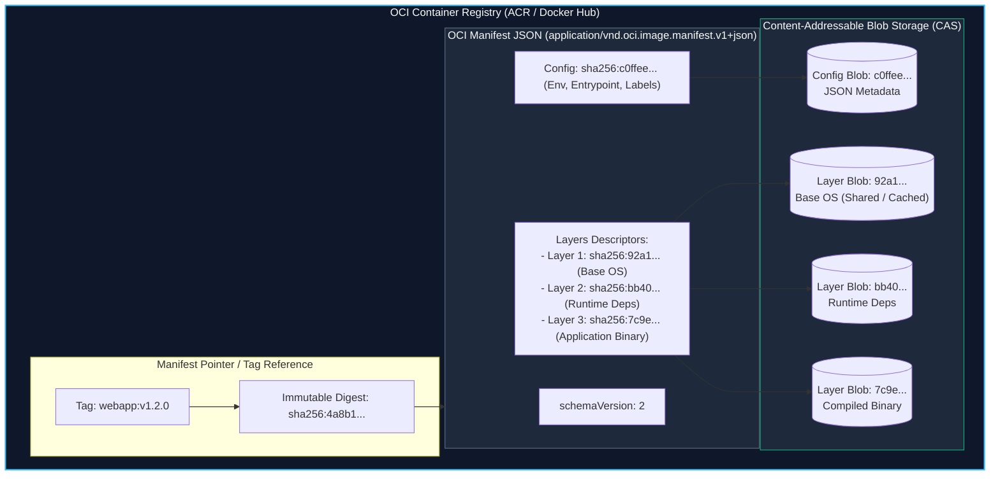
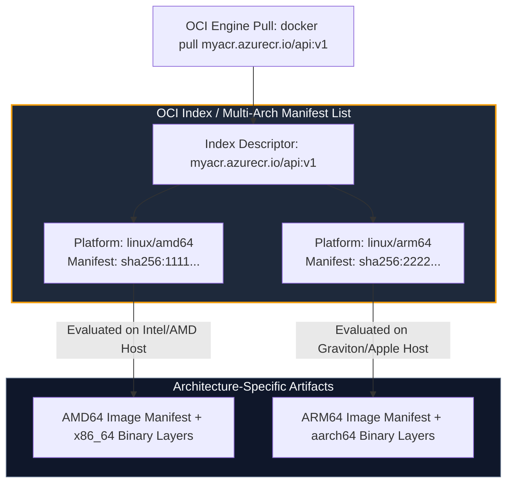
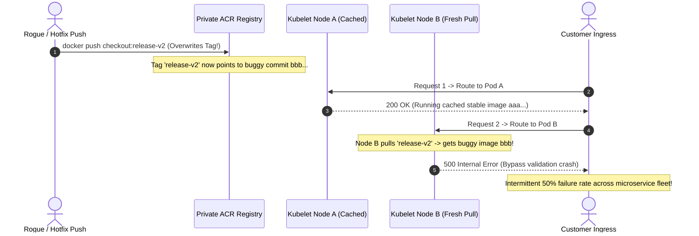

# Module 08: Container Registries — OCI Manifests, Digest Pinning, and Enterprise Registry Distribution (Docker Hub & ACR)

> **Status:** Production Standard  
> **Difficulty:** Intermediate  
> **Estimated Time:** 2 Hours  
> **Prerequisites:** Module 03 (Dockerfile Deep Dive), Module 07 (Multi-Stage Builds & Optimization)

---

> [!TIP]
> **The Golden Rule of Container Registry Operations & Supply Chain Security**  
> Never deploy container images using mutable tags such as `:latest`, `:main`, or `:prod` in production orchestrators. Mutable tags can be overwritten or poisoned at any moment, destroying deployment reproducibility and making rollbacks non-deterministic. Always pin production image references to immutable cryptographic SHA-256 digests (`image@sha256:7f3a...`) or unique git-commit semver tags (`image:v1.4.2-c3a10e`), enforce container image signing (Cosign / Notary), and configure registry immutability rules to reject tag overwrites.

---

## 1. Visual Mental Models

### 1.1 OCI Image Manifest & Content-Addressable Blob Storage

An OCI container registry does not store monolithic virtual machine disks. It acts as a content-addressable storage engine storing a JSON **Image Manifest**, an **Image Configuration Blob**, and deduplicated **Content Layer Blobs**:



---

### 1.2 Multi-Architecture Manifest List (`docker buildx`)

Modern production deployments target both ARM64 (AWS Graviton, Apple Silicon) and AMD64 (x86_64 Cloud instances) using OCI Manifest Lists:



---

## 2. Registry Anatomy & Comparison Taxonomy

### 2.1 Fully Qualified Image Name Syntax Breakdown

```
myregistry.azurecr.io / payment-team / order-api : v1.4.0 @ sha256:8f2a...
└────────┬──────────┘   └─────┬─────┘   └───┬───┘  └─┬──┘   └─────┬──────┘
    Registry Host          Namespace      Repo      Tag         Digest
(Omitted = docker.io)    (Org / Group)   (Image) (Mutable)   (Immutable)
```

---

### 2.2 Enterprise Registry Comparison Grid

| Feature / Metric | Docker Hub (Pro/Team) | Azure Container Registry (ACR) | AWS ECR | GitHub Packages (GHCR) |
| :--- | :--- | :--- | :--- | :--- |
| **Primary Deployment Focus** | Public open-source, local dev | Azure Kubernetes (AKS), ACI, App Service | AWS EKS, ECS, Lambda | GitHub Actions CI/CD workflows |
| **Authentication Standard** | Token / Password (`docker login`) | Azure CLI (`az acr login`), Managed Identity | AWS IAM (`aws ecr get-login-password`) | GITHUB_TOKEN / Fine-grained PAT |
| **Tag Immutability Support** | No (Overwrites allowed by default) | **Yes** (`az acr repository update --write-enabled false`) | **Yes** (Immutable setting per repository) | No (Mutable tag overrides) |
| **Vulnerability Scanning** | Scout (Static Docker analysis) | Microsoft Defender for Cloud | Amazon Inspector | GitHub Dependabot / Trivy |
| **Cloud-Side Build Engine** | Docker Automated Builds | `az acr build` (ACR Tasks) | AWS CodeBuild integration | GitHub Actions Runner |
| **Geo-Replication** | Multi-region CDN | Native Multi-Master Replication (Premium) | Native Replication across AWS regions | Global CDN caching |

---

## 3. Production War Story: The Silent Tag Overwrite Outage

### Incident Post-Mortem: Ghost Deployments and Cryptographic Drift

- **Incident Date:** January 2025
- **Root Cause:** A platform engineering team configured their Kubernetes deployment manifests with `image: internal-registry.azurecr.io/checkout:release-v2`. A developer working on a hotfix branch accidentally tagged their local debug build as `release-v2` and executed `docker push`. The registry accepted the write, overwriting the manifest digest pointer from `sha256:aaa...` to `sha256:bbb...`.
- **The Cascade:**
  1. Existing pods running on node pool A continued serving traffic using the cached `aaa` image.
  2. An autoscaling event spun up node pool B, which pulled `release-v2` fresh from the registry, fetching the buggy `bbb` image.
  3. Half the cluster was running the stable build; the other half was throwing null-pointer exceptions, leading to intermittent 500 errors that evaded canary detection.



- **The Resolution:** 
  1. Activated ACR Repository Tag Immutability: `az acr repository update --name myacr --repository checkout --write-enabled false`.
  2. Mandated SHA-256 digest pinning in all deployment manifests (`checkout@sha256:...`).
  3. Integrated automated CI image signing using Cosign to reject unsigned container images.

---

## 4. Multi-Language Programmatic Registry Interaction

### 4.1 Go: Inspecting Image Digests via OCI Client
```go
// main.go — Programmatic Image Digest Resolution in Go
package main

import (
	"context"
	"fmt"
	"log"

	"github.com/google/go-containerregistry/pkg/authn"
	"github.com/google/go-containerregistry/pkg/name"
	"github.com/google/go-containerregistry/pkg/v1/remote"
)

func fetchImmutableDigest(imageRef string) (string, error) {
	ref, err := name.ParseReference(imageRef)
	if err != nil {
		return "", fmt.Errorf("invalid image reference %q: %w", imageRef, err)
	}

	// Authenticate using local docker config credentials (~/.docker/config.json)
	desc, err := remote.Get(ref, remote.WithAuthFromKeychain(authn.DefaultKeychain))
	if err != nil {
		return "", fmt.Errorf("failed to fetch remote descriptor: %w", err)
	}

	return desc.Digest.String(), nil
}

func main() {
	image := "docker.io/library/alpine:3.20"
	digest, err := fetchImmutableDigest(image)
	if err != nil {
		log.Fatalf("Error: %v", err)
	}

	fmt.Printf("[OCI RESOLVER] Image: %s\n", image)
	fmt.Printf("[OCI RESOLVER] Immutable Digest: %s\n", digest)
	fmt.Printf("[OCI RESOLVER] Immutable Production Reference: %s@%s\n", image, digest)
}
```

---

### 4.2 Node.js / TypeScript: Automating ACR Tag Governance
```typescript
// registryGovernance.ts — Enforcing Tag Immutability in Azure Container Registry
import { ContainerRegistryClient } from '@azure/container-registry';
import { DefaultAzureCredential } from '@azure/identity';

interface TagSecurityAudit {
  repository: string;
  tag: string;
  digest: string;
  isWriteEnabled: boolean;
}

async function auditAndLockRepository(acrEndpoint: string, repositoryName: string): Promise<TagSecurityAudit> {
  const credential = new DefaultAzureCredential();
  const client = new ContainerRegistryClient(acrEndpoint, credential);

  console.log(`[ACR-AUDIT] Inspecting repository ${repositoryName} on ${acrEndpoint}...`);
  const artifact = client.getArtifact(repositoryName, 'latest');
  const properties = await artifact.getManifestProperties();

  console.log(`[ACR-AUDIT] Tag: latest | Digest: ${properties.digest}`);

  // Enforce Tag Immutability (Lock artifact to prevent overwrites)
  await client.getArtifact(repositoryName, properties.digest).updateManifestProperties({
    canDelete: false,
    canWrite: false, // Prevents tag mutability
  });

  console.log(`[ACR-SECURITY] Successfully enforced immutability lock on ${repositoryName}@${properties.digest}`);

  return {
    repository: repositoryName,
    tag: 'latest',
    digest: properties.digest,
    isWriteEnabled: false,
  };
}

// Example usage:
// auditAndLockRepository('https://myenterpriseacr.azurecr.io', 'order-api');
```

---

### 4.3 Python: Container Vulnerability & Digest Validation
```python
# registry_verifier.py — Querying Registry Manifests and Enforcing Digests
import urllib.request
import json
import re

def parse_image_reference(image_str: str):
    pattern = r"^(?:(?P<registry>[^/]+)/)?(?:(?P<namespace>[^/]+)/)?(?P<repo>[^:@]+)(?::(?P<tag>[^@]+))?(?:@(?P<digest>sha256:[a-f0-9]{64}))?$"
    match = re.match(pattern, image_str)
    if not match:
        raise ValueError(f"Invalid container image reference: {image_str}")
    return match.groupdict()

def verify_production_safety(image_ref: str) -> bool:
    parsed = parse_image_reference(image_ref)
    
    if not parsed.get("digest"):
        print(f"[REJECT] Image {image_ref} is using mutable tag '{parsed.get('tag')}'.")
        print("[POLICY ERROR] Production deployments MUST be pinned to a cryptographic SHA-256 digest!")
        return False
        
    print(f"[ACCEPT] Image reference {image_ref} is pinned to immutable digest: {parsed.get('digest')}")
    return True

if __name__ == "__main__":
    test_cases = [
        "myacr.azurecr.io/payment/api:latest",
        "myacr.azurecr.io/payment/api:v1.2.0",
        "myacr.azurecr.io/payment/api@sha256:7f3a8b1a3e6c5d4b9f2e1a0b8c7d6e5f4a3b2c1d0e9f8a7b6c5d4e3f2a1b0c9d"
    ]
    for case in test_cases:
        verify_production_safety(case)
```

---

## 5. Practical Hands-On Verification CLI

Execute the end-to-end registry workflow across local tagging, digest resolution, and Azure Container Registry governance:

```bash
# 1. Build and tag an immutable production artifact
docker build -t payment-api:v1.0.0 .

# 2. Add remote registry reference (Pointer creation - zero bytes copied)
docker tag payment-api:v1.0.0 myregistry.azurecr.io/core/payment-api:v1.0.0

# 3. Authenticate to Azure Container Registry using Azure CLI session
az acr login --name myregistry

# Expected Output:
# Login Succeeded

# 4. Push image to ACR
docker push myregistry.azurecr.io/core/payment-api:v1.0.0

# Expected Output:
# The push refers to repository [myregistry.azurecr.io/core/payment-api]
# 8f2a10e...: Pushed
# 4c3b99a...: Pushed
# v1.0.0: digest: sha256:8f2a10eb9f31c7d24a91e57c... size: 1362

# 5. Resolve immutable digest using docker inspect
docker inspect --format='{{index .RepoDigests 0}}' myregistry.azurecr.io/core/payment-api:v1.0.0

# Expected Output:
# myregistry.azurecr.io/core/payment-api@sha256:8f2a10eb9f31c7d24a91e57c...

# 6. Enforce tag immutability on ACR repository
az acr repository update \
  --name myregistry \
  --repository core/payment-api \
  --write-enabled false

# 7. Test and verify overwrite rejection
docker tag payment-api:v1.0.0 myregistry.azurecr.io/core/payment-api:v1.0.0
docker push myregistry.azurecr.io/core/payment-api:v1.0.0

# Expected Error Output:
# failed to commit: manifest invalid: tag "v1.0.0" is read-only
```

---

## 6. Operational Validation Checkpoints

<details>
<summary>Checkpoint 1: Why is deploying with `image: app:latest` considered a critical anti-pattern in production Kubernetes and ACI clusters?</summary>

**Detailed Engineering Analysis:**  
1. **Lack of Immutability:** `:latest` is merely a pointer that shifts whenever a subsequent push occurs without an explicit tag. If a developer accidentally pushes an unverified commit, any newly scaled pod or node reboot immediately pulls the broken build.
2. **Cluster Inconsistency:** Kubernetes uses an `imagePullPolicy` of `Always` for `:latest`. If node A already pulled `:latest` at 10:00 AM (Commit A) and node B pulls `:latest` at 10:30 AM after a new push (Commit B), the cluster runs two conflicting software revisions under the same Service endpoint.
3. **Rollback Impossibility:** If a deployment breaks, issuing `kubectl rollout undo` with an image set to `:latest` re-pulls the exact same broken container because the tag name has not changed.

**Production Resolution:**  
Pin deployments to the immutable image digest: `app@sha256:<hash>` or unique Git SHA tags (`app:git-4a18f9c`).
</details>

<details>
<summary>Checkpoint 2: What is the architectural role of an OCI Manifest List (Fat Manifest), and how does it prevent runtime architecture mismatches?</summary>

**Detailed Engineering Analysis:**  
A standard OCI Image Manifest maps to a single hardware architecture (e.g., `linux/amd64`). If an engineer builds an image on an Apple Silicon M-series chip (`linux/arm64`) and pushes it without multi-architecture configuration, running that image on an Intel/AMD x86_64 cloud server triggers an instantaneous kernel execution panic: `exec format error`.

An **OCI Manifest List (or Index)** acts as a polymorphic router. It bundles multiple individual architecture manifests under a single unified tag. When an orchestrator issues `docker pull myapp:v1`, the container engine inspects the manifest index, matches its host kernel architecture (`uname -m`), and selectively pulls only the matching architecture blob layer.
</details>

<details>
<summary>Checkpoint 3: What is the security advantage of authenticating Azure Container Instances (ACI) or AKS to ACR via Managed Identities rather than Admin Credentials?</summary>

**Detailed Engineering Analysis:**  
Enabling `--admin-enabled true` on an ACR instance generates a root username and two long-lived shared passwords. These credentials possess full read/write administrative authority over all repositories in the registry. If stored in source control, environment files, or deployment templates, their leakage exposes the entire container supply chain to tampering or ransomware.

**Managed Identity Architecture:**  
Azure Managed Identities leverage Microsoft Entra ID (formerly Azure AD) to eliminate credentials entirely. The compute instance (AKS kubelet or ACI container group) receives an ephemeral, auto-rotated OAuth 2.0 token via the local Azure Instance Metadata Service (IMDS). Role-Based Access Control (RBAC) scopes the identity strictly to `AcrPull`, ensuring read-only permissions without any credential storage in application manifests.
</details>
