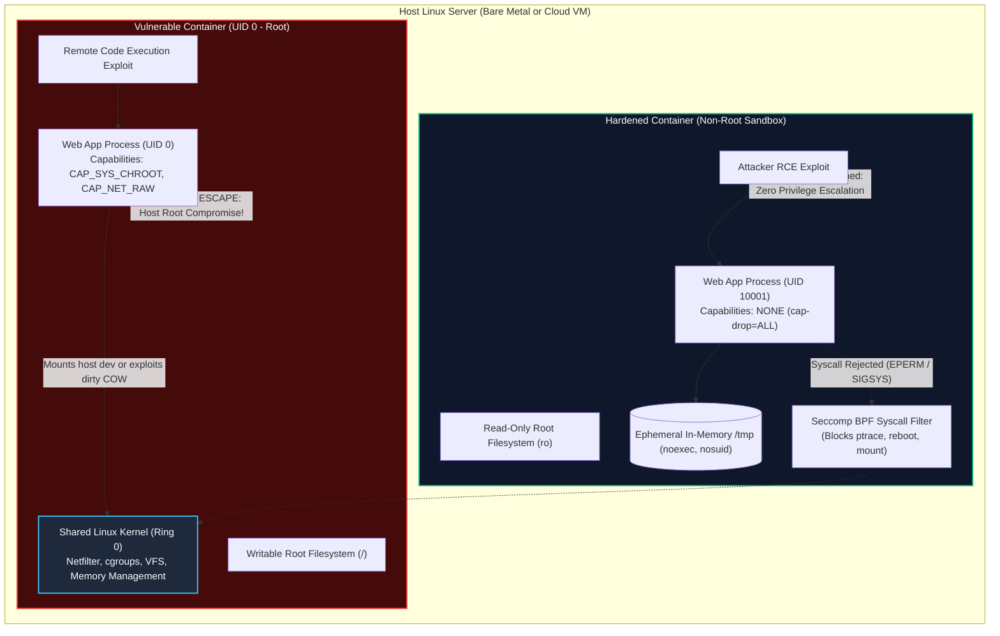

# Module 09: Container Security Best Practices — Rootless Execution, Capability Dropping, Seccomp, and Secret Management

> **Status:** Production Standard  
> **Difficulty:** Advanced  
> **Estimated Time:** 2–3 Hours  
> **Prerequisites:** Module 03 (Dockerfile Deep Dive), Module 07 (Multi-Stage Builds), Module 08 (Container Registries)

---

> [!TIP]
> **The Golden Rule of Container Hardening & Defense-in-Depth**  
> Never run containers as UID 0 (root) and never deploy with a writable root filesystem. Because containers share the host Linux kernel without a hardware virtualization boundary, a root process inside a container possesses UID 0 identity against kernel syscalls. Any container breakout or kernel vulnerability grants the attacker immediate ring-0 or host-level root control. Always enforce **`USER 10001:10001`**, drop all default Linux capabilities (**`--cap-drop=ALL`**), mandate an immutable read-only root filesystem (**`--read-only`** with a restricted in-memory `--tmpfs /tmp`), and inject secrets exclusively via RAM mounts or runtime secret stores.

---

## 1. Visual Mental Models

### 1.1 The Shared Kernel Threat Model & Container Breakout Boundary

Containers rely on kernel namespaces and cgroups for process isolation. Running as UID 0 inside a container means the process executes kernel syscalls with root privileges:



---

### 1.2 Build-Time Secret Injection: BuildKit In-Memory RAM Mount vs Layer Leakage

Passing credentials via `ARG` or plain `RUN` permanently seals secrets into Docker history layers. BuildKit secret mounts expose secrets strictly into ephemeral kernel memory during execution:

```mermaid
sequenceDiagram
    autonumber
    actor Dev as Build Engine (CI/CD)
    participant HostRAM as Host Kernel Tmpfs / Secret Store
    participant BuildKit as BuildKit Engine
    participant LayerFS as OCI Layer Filesystem (OverlayFS)
    actor Attacker as Image Consumer / Inspecter

    rect rgb(30, 41, 59)
        Note over Dev,Attacker: Anti-Pattern: Secret Baked into Layer or ARG
        Dev->>BuildKit: docker build --build-arg DB_PASS=secret123 .
        BuildKit->>LayerFS: Writes commit layer with ARG metadata
        Dev->>BuildKit: RUN echo $DB_PASS > /app/cfg && ./build && rm /app/cfg
        BuildKit->>LayerFS: Layer N: /app/cfg created | Layer N+1: /app/cfg unlinked
        Attacker->>LayerFS: docker history --no-trunc leaky-image
        LayerFS-->>Attacker: LEAK: "echo secret123 > /app/cfg" visible in cleartext!
    end

    rect rgb(15, 23, 42)
        Note over Dev,Attacker: Production Standard: BuildKit Secret Mount (--mount=type=secret)
        Dev->>HostRAM: Allocate secret in-memory buffer (ID: pip_token)
        Dev->>BuildKit: docker build --secret id=pip_token,src=/tmp/token.txt .
        BuildKit->>HostRAM: Mounts read-only virtual memory at /run/secrets/pip_token
        BuildKit->>BuildKit: Execute pip install using /run/secrets/pip_token
        BuildKit->>HostRAM: Unmount memory buffer immediately upon RUN termination
        BuildKit->>LayerFS: Commit layer (Contains only downloaded package wheels)
        Attacker->>LayerFS: docker history --no-trunc hardened-image
        LayerFS-->>Attacker: Secure: Zero trace of secret or mount path in layer metadata!
    end
```



---

## 2. Hardening Directives & Linux Security Taxonomy

### 2.1 Linux Kernel Capabilities Taxonomy

Linux capabilities divide monolithic root privileges into distinct units. By default, Docker grants a container 14 capabilities. Production hardening mandates dropping **ALL** capabilities and selectively adding only the bare minimum:

| Capability Name | Default in Docker? | Security Risk & Exploit Vector | Production Action |
| :--- | :---: | :--- | :--- |
| `ALL` | N/A | Full set of standard root capabilities. | **`--cap-drop=ALL`** (Mandatory baseline) |
| `CAP_NET_RAW` | **YES** | Allows raw packet forging, ARP poisoning, and internal network sniffing. | **DROP** (Omit unless building a network scanner). |
| `CAP_SYS_ADMIN` | NO | Equivalent to full root. Allows mounting filesystems, cgroup manipulation, and device breakouts. | **NEVER GRANT** in production. |
| `CAP_CHOWN` | **YES** | Allows changing arbitrary file ownership permissions across mounted directories. | **DROP** (Application process should not modify file owners). |
| `CAP_SETUID` / `CAP_SETGID` | **YES** | Allows arbitrary UID switching (enables `sudo` and SUID binary escalation). | **DROP** (Prevents privilege escalation scripts). |
| `CAP_NET_BIND_SERVICE` | **YES** | Allows binding to privileged network ports ($< 1024$). | **DROP** (Configure application to bind to non-privileged ports $\ge 1024$, e.g., 8080). |

---

### 2.2 Container Runtime Isolation Primitives

| Hardening Flag | Underlying Kernel Primitive | Operational Impact | SRE Remediation |
| :--- | :--- | :--- | :--- |
| `--read-only` | VFS Mount `MS_RDONLY` | Prevents writing to `/`, `/usr`, `/etc`, or application code directories. Attacker cannot drop malware or overwrite binaries. | Mount in-memory `--tmpfs /tmp:rw,noexec,nosuid,size=64m` for temporary file needs. |
| `--security-opt no-new-privileges:true` | `prctl(PR_SET_NO_NEW_PRIVS)` | Prevents child processes from gaining elevated privileges via SUID/SGID binaries (disables `sudo`, `ping`). | None required; transparent to well-behaved application code. |
| `--security-opt seccomp=default.json` | Linux Seccomp-BPF | Filters kernel syscalls (e.g., blocks `keyctl`, `reboot`, `sys_ptrace`, `bpf`). | Test custom seccomp profiles in staging to ensure required syscalls aren't blocked. |
| `--memory-swap=512m` | Memory cgroup `memory.memsw.limit_in_bytes` | Prevents container from thrashing host swap disk during memory spikes. | Set swap ceiling equal to physical RAM limit (`--memory=512m`). |
| `--pids-limit=100` | PID cgroup `pids.max` | Prevents fork bombs from exhausting host kernel process tables. | Set limit to $3\times$ maximum expected application worker threads. |

---

## 3. Production War Story: The Root Compromise & Host Breakout

### Incident Post-Mortem: Misconfigured Ingress & Kernel Device Mounting

- **Incident Date:** February 2025
- **Root Cause:** A microservice was deployed with default Docker settings (`USER root`, `--privileged` disabled, but default capabilities retained, writable root filesystem). An attacker exploited an unauthenticated Remote Code Execution (RCE) vulnerability in an image-rendering dependency.
- **The Escalation Path:**
  1. The attacker achieved interactive shell access inside the container as `root (UID 0)`.
  2. Because the root filesystem was writable, the attacker installed network scanners (`apt-get install -y nmap`) and compiled a dirty COW kernel privilege escalation exploit.
  3. Because the container retained `CAP_DAC_OVERRIDE` and lacked `no-new-privileges`, the attacker accessed host block device nodes exposed under `/dev`, altered host `/etc/shadow`, and compromised the underlying cloud VM to install an unauthorized cryptocurrency miner.

```mermaid
sequenceDiagram
    autonumber
    actor Attacker as Threat Actor
    participant App as Web App (UID 0 - Writable FS)
    participant Kernel as Host Linux Kernel
    participant HostOS as Host Cloud Instance

    Attacker->>App: Sends Malicious RCE Payload to /render endpoint
    App->>App: Executes payload -> Spawns reverse shell as root (UID 0)
    Attacker->>App: apt-get update && apt-get install -y gcc kmod
    Note over App: Writable rootfs allows attacker to drop persistence scripts
    Attacker->>Kernel: Calls unblocked privileged syscalls (CAP_DAC_OVERRIDE)
    Kernel-->>Attacker: Grants block device write access
    Attacker->>HostOS: Injects root SSH key into host /etc/ssh/authorized_keys
    HostOS-->>Attacker: Root Access on Host VM Granted!
    Note over HostOS: Cluster node compromised; lateral movement begins!
```

- **The Resolution:** 
  1. Added explicit `USER 10001:10001` in the Dockerfile.
  2. Enforced `--read-only` rootfs with `--tmpfs /tmp:rw,noexec,nosuid,size=32m`.
  3. Added `--cap-drop=ALL` and `--security-opt no-new-privileges:true` across all orchestrator manifests.
  4. Subsequent penetration testing confirmed identical RCE attempts failed immediately due to lack of write permissions on `/tmp` and missing compiler capabilities.

---

## 4. Multi-Language Hardened Runtime Implementations

### 4.1 Go: Rootless Microservice with Read-Only Filesystem & In-Memory Tmpfs
```go
// main.go — Production Hardened Go HTTP Server
package main

import (
	"context"
	"fmt"
	"log"
	"net/http"
	"os"
	"os/signal"
	"syscall"
	"time"
)

func main() {
	// 1. Verify process is running as an unprivileged UID
	uid := os.Getuid()
	gid := os.Getgid()
	log.Printf("[SECURITY] Starting process under UID=%d, GID=%d", uid, gid)
	if uid == 0 || gid == 0 {
		log.Fatal("[FATAL ERROR] Container is running as root (UID 0)! Terminating for security compliance.")
	}

	// 2. Demonstrate safe writing to designated ephemeral /tmp directory
	tmpFile := "/tmp/heartbeat.pid"
	if err := os.WriteFile(tmpFile, []byte(fmt.Sprintf("%d", os.Getpid())), 0600); err != nil {
		log.Fatalf("[FATAL ERROR] Failed to write to /tmp (Verify tmpfs is mounted): %v", err)
	}
	defer os.Remove(tmpFile)

	mux := http.NewServeMux()
	mux.HandleFunc("/health", func(w http.ResponseWriter, r *http.Request) {
		w.Header().Set("Content-Type", "application/json")
		w.WriteHeader(http.StatusOK)
		w.Write([]byte(fmt.Sprintf(`{"status":"ok","uid":%d,"read_only_rootfs":true}`, uid)))
	})

	server := &http.Server{
		Addr:         ":8080", // Non-privileged port >= 1024
		Handler:      mux,
		ReadTimeout:  5 * time.Second,
		WriteTimeout: 10 * time.Second,
	}

	go func() {
		log.Println("[SERVER] Listening securely on :8080...")
		if err := server.ListenAndServe(); err != nil && err != http.ErrServerClosed {
			log.Fatalf("Server listen failed: %v", err)
		}
	}()

	// Graceful shutdown handling
	stop := make(chan os.Signal, 1)
	signal.Notify(stop, os.Interrupt, syscall.SIGTERM)
	<-stop

	log.Println("[SERVER] Shutting down gracefully...")
	ctx, cancel := context.WithTimeout(context.Background(), 5*time.Second)
	defer cancel()
	server.Shutdown(ctx)
}
```

---

### 4.2 Node.js / TypeScript: Reading Injected Secrets without Disk Persistence
```typescript
// server.ts — Hardened Node.js Service with Memory Secret Consumption
import express, { Request, Response } from 'express';
import fs from 'fs';

const app = express();
const port = parseInt(process.env.PORT || '8080', 10);

// Verify unprivileged execution
if (process.getuid && process.getuid() === 0) {
  console.error('[SECURITY VIOLATION] Process running as root (UID 0)! Exiting.');
  process.exit(1);
}

// Function to resolve secrets from mounted RAM path (/run/secrets) or ENV
function loadSecret(secretName: string, envFallback: string): string {
  const secretPath = `/run/secrets/${secretName}`;
  try {
    if (fs.existsSync(secretPath)) {
      console.log(`[SECURITY] Loaded secret '${secretName}' from secure in-memory mount.`);
      return fs.readFileSync(secretPath, 'utf8').trim();
    }
  } catch (err) {
    console.warn(`[WARN] Failed reading ${secretPath}:`, err);
  }

  const fallback = process.env[envFallback];
  if (!fallback) {
    throw new Error(`Required secret '${secretName}' not provided via mount or environment!`);
  }
  return fallback;
}

const dbPassword = loadSecret('db_password', 'DB_PASSWORD');

app.get('/health', (_req: Request, res: Response) => {
  res.status(200).json({
    status: 'ok',
    uid: process.getuid ? process.getuid() : 'n/a',
    secretLoaded: Boolean(dbPassword),
  });
});

app.listen(port, '0.0.0.0', () => {
  console.log(`[SERVER] Hardened Node process listening on port ${port} (UID: ${process.getuid?.()})`);
});
```

---

### 4.3 Python: Read-Only Filesystem Verification & Non-Privileged Execution
```python
# app.py — Hardened Python/FastAPI Service
import os
import sys
import logging
from fastapi import FastAPI, HTTPException

logging.basicConfig(level=logging.INFO)
logger = logging.getLogger("secure-app")

# Enforce non-root execution
current_uid = os.getuid() if hasattr(os, "getuid") else 10001
logger.info(f"[SECURITY] Initializing process under UID: {current_uid}")
if current_uid == 0:
    logger.critical("[CRITICAL] Refusing to start service as root (UID 0)!")
    sys.exit(1)

app = FastAPI(title="Hardened Python Service")

@app.get("/health")
def health():
    # Verify root filesystem immutability
    rootfs_writable = True
    try:
        with open("/test_probe.txt", "w") as f:
            f.write("probe")
        os.remove("/test_probe.txt")
    except OSError:
        rootfs_writable = False

    return {
        "status": "healthy",
        "uid": current_uid,
        "root_filesystem_immutable": not rootfs_writable
    }

if __name__ == "__main__":
    import uvicorn
    uvicorn.run("app:app", host="0.0.0.0", port=8080, log_level="info")
```

---

## 5. Practical Hands-On Verification CLI

Execute the following commands to harden, run, and audit a containerized service against standard CIS Docker Benchmarks:

```bash
# 1. Inspect existing image default user (Confirm baseline root vulnerability)
docker inspect --format='{{.Config.User}}' python:3.12-slim
# Expected Output: "" (Empty string signifies default root UID 0)

# 2. Build hardened production container image
cat > Dockerfile.hardened <<'EOF'
FROM python:3.12-slim AS runner
RUN groupadd -g 10001 appgroup && \
    useradd -u 10001 -g appgroup -s /bin/false -m appuser
WORKDIR /app
COPY app.py .
USER 10001:10001
EXPOSE 8080
CMD ["python", "app.py"]
EOF

docker build -f Dockerfile.hardened -t secapp:hardened .

# 3. Launch container with maximum kernel isolation directives
docker run -d \
  --name hardened-api \
  --read-only \
  --tmpfs /tmp:rw,noexec,nosuid,size=32m \
  --cap-drop=ALL \
  --security-opt no-new-privileges:true \
  --pids-limit 50 \
  --memory 256m \
  --memory-swap 256m \
  -p 8080:8080 \
  secapp:hardened

# 4. Verify runtime status and non-root UID
docker exec hardened-api id

# Expected Output:
# uid=10001(appuser) gid=10001(appgroup) groups=10001(appgroup)

# 5. Verify root filesystem is strictly immutable (Write rejection)
docker exec hardened-api touch /app/hacked.txt

# Expected Output:
# touch: cannot touch '/app/hacked.txt': Read-only file system

# 6. Verify /tmp memory mount allows writes but blocks binary execution
docker exec hardened-api touch /tmp/test.pid
docker exec hardened-api cp /bin/sh /tmp/sh
docker exec hardened-api /tmp/sh

# Expected Output:
# OCI runtime exec failed: exec: "/tmp/sh": permission denied (Blocked by noexec flag)

# 7. Scan image for known published CVEs using Docker Scout or Trivy
docker scout cves secapp:hardened

# 8. Teardown test container
docker rm -f hardened-api
```

---

## 6. Operational Validation Checkpoints

<details>
<summary>Checkpoint 1: Why is running a container with `--read-only` rootfs one of the most effective deterrents against web application exploitation?</summary>

**Detailed Engineering Analysis:**  
When an attacker discovers an arbitrary file upload or Remote Code Execution (RCE) flaw in a web application, standard post-exploitation playbooks rely on three sequential operations:
1. **Payload Dropping:** Writing web shells, reverse shell scripts (`.py`, `.sh`), or compiled ELF binaries into the filesystem (frequently under `/tmp`, `/var/www`, or `/opt`).
2. **Persistence & Modification:** Overwriting configuration files, tampering with `.bashrc`, or modifying application source files.
3. **Tool Installation:** Invoking `apt-get`, `apk`, or `pip` to install network scanners (`nmap`, `curl`, `netcat`).

Deploying with `--read-only` renders the entire container filesystem immutable. The VFS layer rejects write syscalls with `EROFS` (Read-only file system). Even if an attacker achieves arbitrary code execution, they cannot write a payload to disk, modify any application files, or download external binaries. Pairing this with a `noexec` in-memory `--tmpfs /tmp` completely closes the payload staging loop.
</details>

<details>
<summary>Checkpoint 2: What is the risk of retaining the `CAP_NET_RAW` capability in production microservice containers?</summary>

**Detailed Engineering Analysis:**  
`CAP_NET_RAW` allows a process to craft arbitrary network packets, bypass kernel transport-layer protocol handling, and bind directly to raw IP sockets. 

**Threat Scenarios:**
1. **Network Sniffing:** If an attacker compromises a container sharing a custom bridge or Kubernetes pod network, `CAP_NET_RAW` permits putting the virtual network interface into promiscuous mode to intercept unencrypted plaintext traffic (tokens, database queries, internal HTTP traffic) intended for neighboring containers.
2. **ARP Spoofing & Man-in-the-Middle (MitM):** The compromised container can inject forged ARP packets into the virtual bridge switch, redirecting intra-cluster microservice traffic through itself for interception and tampering.

**Production Hardening:** Dropping `CAP_NET_RAW` via `--cap-drop=ALL` completely eliminates raw socket creation without impacting standard TCP/UDP client or server operations.
</details>

<details>
<summary>Checkpoint 3: Why are container build arguments (`ARG` / `--build-arg`) unsafe for private tokens, and how does BuildKit's secret mounting solve this?</summary>

**Detailed Engineering Analysis:**  
Docker build arguments (`ARG`) were designed exclusively for non-sensitive compilation variables (e.g., `APP_VERSION`, `NODE_ENV`). When a build argument is declared, Docker Engine stores the key-value pair directly in the image's configuration JSON metadata and commit history. 

Anyone with read access to the image can execute `docker history --no-trunc <image>` or `docker inspect <image>` and extract the argument string in plaintext—even if the Dockerfile never explicitly wrote the argument to a file.

**BuildKit Secret Mount Resolution:**  
BuildKit introduces `--mount=type=secret,id=<id>`. When invoked, BuildKit mounts an ephemeral tmpfs filesystem containing the secret directly into the executing container's `/run/secrets/` directory for the duration of that single `RUN` instruction only. Once the instruction finishes, the memory mount unbinds. **No bytes are ever committed to the filesystem layer, and zero metadata is stored in image history.**
</details>
