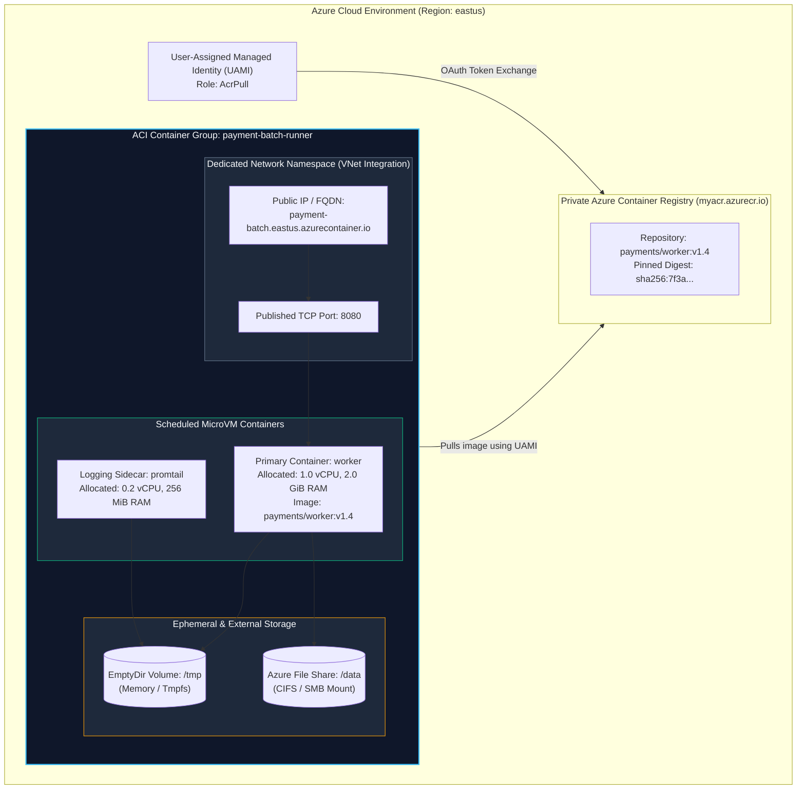
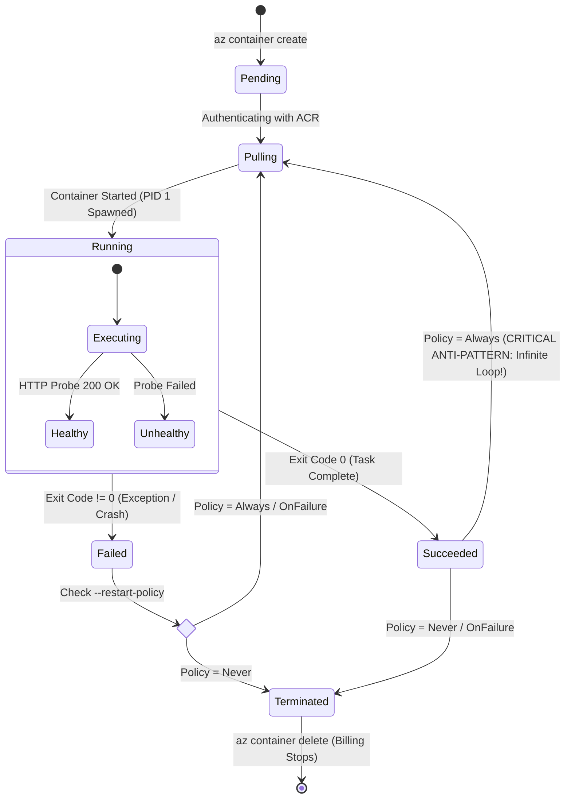
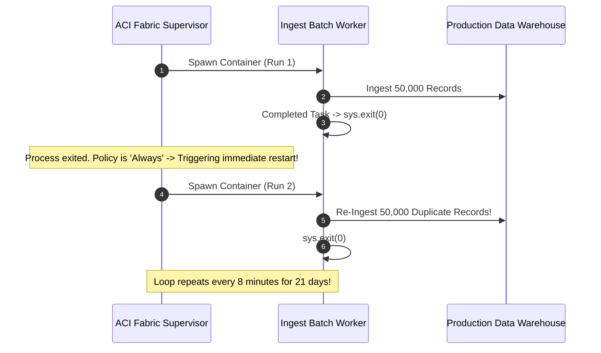

# Module 10: Serverless Container Deployment — Azure Container Instances (ACI), Managed Identity, and Ephemeral Batch Lifecycles

> **Status:** Production Standard  
> **Difficulty:** Intermediate  
> **Estimated Time:** 2 Hours  
> **Prerequisites:** Module 08 (Container Registries: ACR), Module 09 (Container Security)

---

> [!TIP]
> **The Golden Rule of Serverless Container Orchestration (ACI)**  
> Never configure one-shot batch tasks or asynchronous workers with the default `restart-policy: Always`. If a job completes with exit code 0, ACI will restart the container indefinitely in an infinite loop, billing vCPU and RAM per second and corrupting stateful queues or data pipelines. Always configure one-off workloads with **`--restart-policy Never`** or **`OnFailure`**, authenticate against private registries using **User-Assigned Managed Identities (UAMI)** rather than fragile admin credentials, and automate group teardown via ARM/Bicep lifecycle webhooks.

---

## 1. Visual Mental Models

### 1.1 ACI Architecture & Container Group Topology

Azure Container Instances provisions managed Linux kernel instances running in isolated Hyper-V microVMs without requiring VM infrastructure or Kubernetes cluster provisioning:



---

### 1.2 Lifecycle State Transitions & Restart Policy Mechanics

Understanding the state machine of ACI is essential to prevent infinite billing loops on batch jobs:



---

## 2. Parameter Taxonomy & Configuration Matrix

### 2.1 ACI Configuration Directives

| CLI Parameter | Accepted Values | Production Default | Engineering Purpose & Trade-Off |
| :--- | :--- | :--- | :--- |
| `--restart-policy` | `Always`, `OnFailure`, `Never` | `Always` (Web API) / `Never` (Batch) | Controls restart behavior. Never use `Always` for batch scripts or migrations. |
| `--os-type` | `Linux`, `Windows` | `Linux` | Selects underlying Hyper-V container host operating system. |
| `--cpu` | $0.1$ to $4.0$ (vCPUs) | $1.0$ | Fractional CPU allocation; billing scales linearly per millicore-second. |
| `--memory` | $0.1$ to $16.0$ (GiB) | $1.5$ | RAM allocation; strictly enforced via cgroups (OOMKills on exceedance). |
| `--dns-name-label` | Alpha-numeric string | Regional unique label | Generates public DNS record: `<label>.<region>.azurecontainer.io`. |
| `--acr-identity` | Resource ID of UAMI | Explicit UAMI Resource ID | Eliminates admin passwords; pulls using Microsoft Entra ID authentication. |
| `--secure-environment-variables` | Key-value pairs | Encrypted storage | Masks secrets from `az container show` JSON inspect outputs. |
| `--azure-file-volume-...` | Storage account + File share | Mounted CIFS volume | Persists stateful artifacts across container group teardown. |

---

### 2.2 Serverless Pricing & Billing Model

ACI charges **per-second resource allocation** (vCPU-seconds and GiB-seconds) from the instant image pulling initiates until the container group is explicitly deleted or stops:

$$\text{Total Cost} = (\text{vCPUs} \times \text{Rate}_{\text{CPU}} + \text{RAM (GB)} \times \text{Rate}_{\text{RAM}}) \times \text{Duration (seconds)}$$

> [!CAUTION]
> A container group in the `Terminated` or `Stopped` state **retains its allocated IP address and configuration** until explicitly deleted. Always execute `az container delete --yes` or configure automated janitor scripts to purge completed execution groups.

---

## 3. Production War Story: The Infinite Cryptic Batch Re-Run

### Incident Post-Mortem: Midnight Billing Burn

- **Incident Date:** December 2024
- **Root Cause:** A data engineering team deployed a nocturnal machine learning data ingestion job to ACI. The script was packaged into a container and deployed using an automated CI script with default settings:
  ```bash
  az container create --name data-ingest --image myacr.azurecr.io/ingest:v1 # Default: --restart-policy Always
  ```
- **The Cascade:**
  1. The container executed its workload in 8 minutes, processed 50,000 records, and terminated cleanly with `exit(0)`.
  2. Because the restart policy defaulted to `Always`, the ACI fabric supervisor interpreted the exit as a service stoppage and immediately restarted the container.
  3. The script ran again, appending duplicate records to the data warehouse, and exited with `0`.
  4. The container restarted **3,420 times over a three-week period**, burning \$2,840 in redundant cloud compute and corrupting downstream analytics pipelines.



- **The Resolution:** 
  1. Mandated `--restart-policy OnFailure` or `Never` for all non-daemon container deployments.
  2. Integrated an automated Azure Function janitor to scan for completed container groups and issue `DELETE` calls.
  3. Added idempotency checks and deduplication keys in the worker process.

---

## 4. Multi-Language Programmatic Deployment Automation

### 4.1 Go: Provisioning ACI via Azure SDK
```go
// main.go — Automated Serverless Container Group Provisioning in Go
package main

import (
	"context"
	"fmt"
	"log"

	"github.com/Azure/azure-sdk-for-go/sdk/azcore/to"
	"github.com/Azure/azure-sdk-for-go/sdk/azidentity"
	"github.com/Azure/azure-sdk-for-go/sdk/resourcemanager/containerinstance/armcontainerinstance"
)

func deployContainerGroup(ctx context.Context, subscriptionID, resourceGroup, groupName string) error {
	cred, err := azidentity.NewDefaultAzureCredential(nil)
	if err != nil {
		return fmt.Errorf("failed to obtain Azure credential: %w", err)
	}

	clientFactory, err := armcontainerinstance.NewClientFactory(subscriptionID, cred, nil)
	if err != nil {
		return fmt.Errorf("failed to create client factory: %w", err)
	}

	client := clientFactory.NewContainerGroupsClient()

	log.Printf("[ACI] Deploying serverless container group %q in %q...", groupName, resourceGroup)

	poller, err := client.BeginCreateOrUpdate(ctx, resourceGroup, groupName, armcontainerinstance.ContainerGroup{
		Location: to.Ptr("eastus"),
		Properties: &armcontainerinstance.ContainerGroupPropertiesProperties{
			OSType:        to.Ptr(armcontainerinstance.OperatingSystemTypesLinux),
			RestartPolicy: to.Ptr(armcontainerinstance.ContainerGroupRestartPolicyNever), // Explicit Batch Policy!
			IPAddress: &armcontainerinstance.IPAddress{
				Type:         to.Ptr(armcontainerinstance.ContainerGroupIPAddressTypePublic),
				DNSNameLabel: to.Ptr(fmt.Sprintf("%s-demo", groupName)),
				Ports: []*armcontainerinstance.Port{
					{
						Port:     to.Ptr[int32](8080),
						Protocol: to.Ptr(armcontainerinstance.ContainerGroupNetworkProtocolTCP),
					},
				},
			},
			Containers: []*armcontainerinstance.Container{
				{
					Name: to.Ptr("api-worker"),
					Properties: &armcontainerinstance.ContainerProperties{
						Image: to.Ptr("mcr.microsoft.com/azuredocs/aci-helloworld:latest"),
						Resources: &armcontainerinstance.ResourceRequirements{
							Requests: &armcontainerinstance.ResourceRequests{
								CPU:        to.Ptr[float64](1.0),
								MemoryInGB: to.Ptr[float64](1.5),
							},
						},
						Ports: []*armcontainerinstance.ContainerPort{
							{Port: to.Ptr[int32](8080)},
						},
					},
				},
			},
		},
	}, nil)

	if err != nil {
		return fmt.Errorf("failed to initiate container group creation: %w", err)
	}

	res, err := poller.PollUntilDone(ctx, nil)
	if err != nil {
		return fmt.Errorf("failed during container deployment polling: %w", err)
	}

	log.Printf("[ACI SUCCESS] Container Group deployed! FQDN: %s", *res.Properties.IPAddress.Fqdn)
	return nil
}
```

---

### 4.2 Node.js / TypeScript: Automating ACI Deployment with Managed Identity
```typescript
// deployAci.ts — TypeScript Automation for ACI with Managed Identity
import { ContainerInstanceManagementClient } from '@azure/arm-containerinstance';
import { DefaultAzureCredential } from '@azure/identity';

interface DeployConfig {
  subscriptionId: string;
  resourceGroup: string;
  groupName: string;
  image: string;
  uamiResourceId: string;
}

export async function deployServerlessWorker(config: DeployConfig): Promise<string> {
  const credential = new DefaultAzureCredential();
  const client = new ContainerInstanceManagementClient(credential, config.subscriptionId);

  console.log(`[ACI] Provisioning container group '${config.groupName}' using Managed Identity...`);

  const poller = await client.containerGroups.beginCreateOrUpdate(
    config.resourceGroup,
    config.groupName,
    {
      location: 'eastus',
      identity: {
        type: 'UserAssigned',
        userAssignedIdentities: {
          [config.uamiResourceId]: {},
        },
      },
      osType: 'Linux',
      restartPolicy: 'OnFailure',
      ipAddress: {
        type: 'Public',
        dnsNameLabel: `${config.groupName}-service`,
        ports: [{ port: 8080, protocol: 'TCP' }],
      },
      imageRegistryCredentials: [
        {
          server: config.image.split('/')[0],
          identity: config.uamiResourceId, // Passwordless ACR Pull!
        },
      ],
      containers: [
        {
          name: 'batch-processor',
          image: config.image,
          resources: {
            requests: {
              cpu: 1.0,
              memoryInGB: 1.5,
            },
          },
          ports: [{ port: 8080 }],
        },
      ],
    }
  );

  const result = await poller.pollUntilDone();
  console.log(`[ACI DEPLOYED] Successfully online at: http://${result.ipAddress?.fqdn}:8080`);
  return result.ipAddress?.fqdn || '';
}
```

---

### 4.3 Python: Container Group Lifecycle Auditing & Janitor Cleanup
```python
# aci_janitor.py — Automated ACI Orphan Cleanup Script
import os
import sys
from azure.identity import DefaultAzureCredential
from azure.mgmt.containerinstance import ContainerInstanceManagementClient

def cleanup_terminated_aci(subscription_id: str, resource_group: str):
    credential = DefaultAzureCredential()
    client = ContainerInstanceManagementClient(credential, subscription_id)

    print(f"[JANITOR] Scanning resource group '{resource_group}' for finished ACI workloads...")
    groups = client.container_groups.list_by_resource_group(resource_group)

    for group in groups:
        state = group.instance_view.state if group.instance_view else "Unknown"
        print(f"[AUDIT] Container Group: {group.name} | State: {state}")

        # Purge stopped or succeeded groups to halt idle billing
        if state in ["Succeeded", "Stopped", "Failed"]:
            print(f"[ACTION] Deleting non-running container group: {group.name}...")
            client.container_groups.begin_delete(resource_group, group.name)
            print(f"[DELETED] Group {group.name} deallocated successfully.")

if __name__ == "__main__":
    sub_id = os.getenv("AZURE_SUBSCRIPTION_ID")
    rg = os.getenv("AZURE_RESOURCE_GROUP", "learn-docker-rg")
    if not sub_id:
        print("[ERROR] AZURE_SUBSCRIPTION_ID environment variable required!")
        sys.exit(1)
    cleanup_terminated_aci(sub_id, rg)
```

---

## 5. Practical Hands-On Verification CLI

Execute the following end-to-end verification commands using Azure CLI in PowerShell or Bash:

```bash
# 1. Authenticate to Azure and set active subscription
az login
az account set --subscription "<your-subscription-id>"

# 2. Deploy serverless container instance with explicit resource limits and DNS label
az container create \
  --resource-group learn-docker-rg \
  --name payment-api-aci \
  --image mcr.microsoft.com/azuredocs/aci-helloworld:latest \
  --dns-name-label "payment-api-$RANDOM" \
  --ports 80 \
  --cpu 1 \
  --memory 1.5 \
  --restart-policy Always \
  --output table

# Expected Output:
# Name             ResourceGroup    Status       Image                                                    IP:Port           Network    CPU/Memory       OsType    Location
# payment-api-aci  learn-docker-rg  Succeeded    mcr.microsoft.com/azuredocs/aci-helloworld:latest        20.120.45.10:80   Public     1.0 core/1.5 gb  Linux     eastus

# 3. Retrieve public FQDN and state
az container show \
  --resource-group learn-docker-rg \
  --name payment-api-aci \
  --query "{FQDN:ipAddress.fqdn,State:instanceView.state}" \
  --output table

# Expected Output:
# FQDN                                            State
# payment-api-8492.eastus.azurecontainer.io      Running

# 4. Probe public endpoint via curl
curl -i "http://payment-api-8492.eastus.azurecontainer.io"

# Expected Output:
# HTTP/1.1 200 OK
# Content-Type: text/html
# Content-Length: 720
#
# <html>Welcome to Azure Container Instances!</html>

# 5. Stream container execution logs
az container logs \
  --resource-group learn-docker-rg \
  --name payment-api-aci

# 6. CRITICAL TEARDOWN: Halt billing by deleting container group
az container delete \
  --resource-group learn-docker-rg \
  --name payment-api-aci \
  --yes

# Verify deletion is finalized
az container list --resource-group learn-docker-rg --output table
```

---

## 6. Operational Validation Checkpoints

<details>
<summary>Checkpoint 1: Why does changing an environment variable or image tag on an existing ACI container group require a full delete-and-recreate lifecycle?</summary>

**Detailed Engineering Analysis:**  
Unlike Kubernetes Pods or Azure App Service slots, Azure Container Instances (ACI) treats a **Container Group as an immutable declarative resource specification**. 

When `az container create` runs, Azure's resource provider allocates dedicated Hyper-V microVM sandboxes, configures virtual network interface controllers (vNICs) directly into Azure's Software Defined Networking (SDN) fabric, mounts storage volumes, and issues static IP leases. Azure does not support in-place mutating updates to running container properties (such as image digests, CPU allocations, or environment variables) because doing so would violate the isolation boundary and require re-attaching kernel namespaces live. 

**Production Resolution:**  
Infrastructure-as-Code (IaC) pipelines using Terraform or Bicep automatically orchestrate the blue-green tear-down and re-provisioning of container groups when manifest properties change.
</details>

<details>
<summary>Checkpoint 2: What is the operational distinction between `--restart-policy OnFailure` and `--restart-policy Never` in ACI batch architectures?</summary>

**Detailed Engineering Analysis:**  
- **`Never`:** The container executes exactly once. Regardless of whether the process finishes cleanly (`exit code 0`) or crashes fatally (`exit code 1` due to an unhandled runtime error or OOMKill), ACI permanently halts process supervision and places the container into a terminal state (`Succeeded` or `Failed`). It is suited for non-idempotent batch scripts where retrying could cause duplicate credit charges.
- **`OnFailure`:** If the process terminates with `exit code 0`, ACI marks the execution `Succeeded` and halts. However, if the process crashes with a non-zero exit code (e.g., database timeout, transient network drop), the ACI supervisor automatically relaunches the container up to its internal backoff retry limit. It is suited for idempotent ETL jobs and queue-processing workers.
</details>

<details>
<summary>Checkpoint 3: How does authenticating ACI to ACR via Managed Identities eliminate the credential rotation risks inherent in ACR Admin Accounts?</summary>

**Detailed Engineering Analysis:**  
The ACR Admin Account generates static root credentials (`username` and two shared `passwords`) that provide unrestricted read/write/delete access across all image repositories. If an engineer hardcodes these credentials into an `az container create` script or CI secret store:
1. They cannot be scoped: ACI gains excessive write privileges to the registry.
2. They do not auto-rotate: Compromised keys remain valid indefinitely until manually regenerated.
3. Access is un-auditable: All services using the admin password appear under the same audit identity.

**Managed Identity Architecture:**  
A User-Assigned Managed Identity (UAMI) binds an Azure Entra ID service principal to the container group. Using Azure RBAC, the identity is granted strictly the `AcrPull` built-in role. When pulling images, the ACI fabric requests a short-lived (1-hour) OAuth 2.0 JSON Web Token (JWT) directly from Azure IMDS. **No passwords exist, no secrets are passed in deployment commands, and credentials rotate automatically without human intervention.**
</details>
