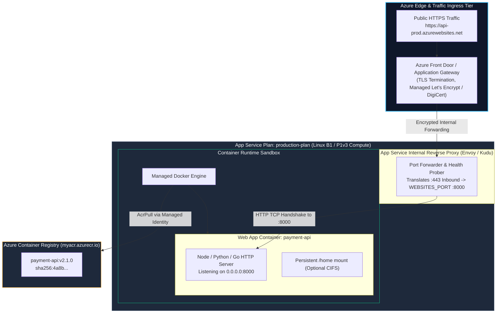
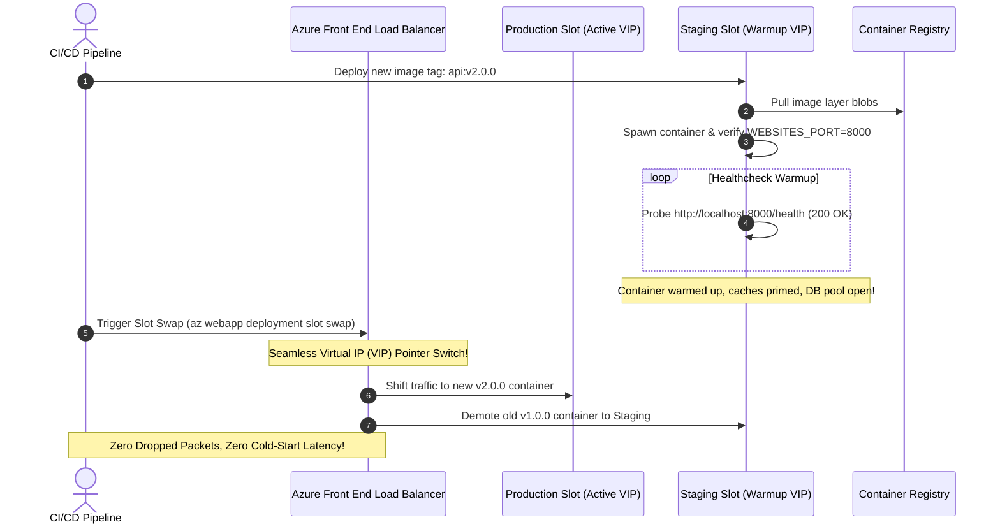
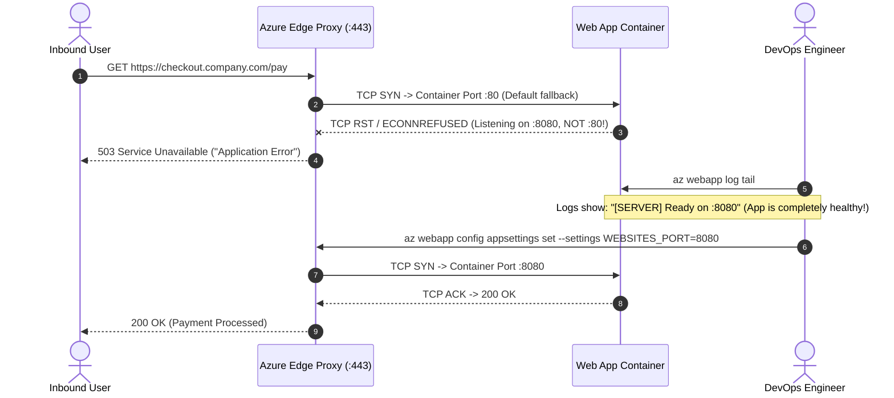

# Module 11: Production PaaS Deployment — Azure App Service for Containers, Zero-Downtime Slots, and Auto-TLS Ingress

> **Status:** Production Standard  
> **Difficulty:** Intermediate  
> **Estimated Time:** 2 Hours  
> **Prerequisites:** Module 08 (Container Registries: ACR), Module 10 (Deploy to ACI)

---

> [!TIP]
> **The Golden Rule of Web App for Containers Routing & Ingress**  
> Never deploy custom container images to Azure App Service without explicitly configuring the **`WEBSITES_PORT`** application setting. Azure App Service front doors route inbound TLS traffic strictly to port `80` (or `8080` if auto-detected). If your container listens on an alternative port (e.g., `3000`, `5000`, or `8000`) and `WEBSITES_PORT` is omitted, the container will start and run cleanly in the background, but the load balancer will time out and present users with a fatal **503 Service Unavailable ("Application Error")**. Always set `WEBSITES_PORT=<container-port>`, configure deployment slots for zero-downtime swaps, and enable filesystem container logging.

---

## 1. Visual Mental Models

### 1.1 App Service Compute Plan vs Web App Container Routing

An **App Service Plan** represents dedicated managed compute virtual machines. One or more **Web Apps** execute container instances on that compute, receiving traffic routed via Azure's front-end reverse proxy tier:



---

### 1.2 Zero-Downtime Blue/Green Deployment Slots

Deployment slots eliminate cold-start downtime. New container images are warmed up in an isolated staging environment before traffic is swapped instantaneously via Azure DNS/VIP pointer switching:



---

## 2. Configuration Taxonomy & Routing Matrix

### 2.1 Essential App Service Container Settings

| Setting Name | Configuration Type | Production Value | Architectural Consequence |
| :--- | :--- | :--- | :--- |
| `WEBSITES_PORT` | App Setting | `8000` (Matches application port) | **Mandatory.** Directs internal App Service proxy routing to the container port. |
| `WEBSITES_CONTAINER_START_TIME_LIMIT` | App Setting | `300` to `600` (Seconds) | Extends initialization timeout from default 230s for heavy container startup tasks. |
| `WEBSITES_ENABLE_APP_SERVICE_STORAGE` | App Setting | `false` | Disables slow SMB `/home` network shares; enhances IOPS performance by using local SSDs. |
| `DOCKER_ENABLE_CI` | App Setting | `true` | Activates automated deployment webhooks triggered upon new ACR image pushes. |
| `DOCKER_REGISTRY_SERVER_URL` | Container Config | `https://<acr-name>.azurecr.io` | Fully qualified URL of private enterprise registry. |
| `DOCKER_REGISTRY_SERVER_USERNAME` | Container Config | Managed Identity or ACR Admin | Credentials utilized by Kudu/App Service daemon to pull private images. |

---

### 2.2 App Service Plan Tiers Comparison

| Tier | Scale Out (Max Instances) | Deployment Slots? | Auto-Scaling? | Production Recommendation |
| :--- | :---: | :---: | :---: | :--- |
| **Basic (B1)** | Up to 3 | No | Manual only | Dev, testing, internal prototypes. |
| **Standard (S1)** | Up to 10 | Yes (5 slots) | Schedule & Metric-based | Production baseline with blue-green slot requirements. |
| **Premium v3 (P1v3)** | Up to 30 | Yes (20 slots) | Fast-scale, zone redundant | Mission-critical high-traffic microservices requiring NVMe SSDs. |

---

## 3. Production War Story: The Ingress Port Black Hole

### Incident Post-Mortem: 503 Service Unavailable During Black Friday Flash Sale

- **Incident Date:** November 2024
- **Root Cause:** A fintech startup containerized their core payment API (written in Go, listening on `:8080`). The Dockerfile included `EXPOSE 8080`, and the image was deployed to an Azure App Service `P1v3` Linux plan. However, the engineer failed to set the `WEBSITES_PORT` environment setting in the Azure portal.
- **The Failure Cascade:**
  1. The container started in 1.2 seconds, initialized its database connections, and printed: `[SERVER] Listening on 0.0.0.0:8080`.
  2. The Azure App Service frontend reverse proxy evaluated default routing rules, attempting to forward public requests to port `80`.
  3. Because nothing was listening on port `80` inside the container, TCP handshakes reset (`RST`).
  4. The frontend reverse proxy timed out after 230 seconds and returned standard Azure 503 "Application Error" pages to all inbound customers.
  5. The DevOps team spent 90 minutes debugging database connectivity and Dockerfile layers before discovering the missing routing key.



- **The Resolution:**
  1. Configured `az webapp config appsettings set --settings WEBSITES_PORT=8080`.
  2. Added deployment verification smoke-tests to CI/CD pipelines to validate that `WEBSITES_PORT` matches the container's exposed port.

---

## 4. Multi-Language Production Service Implementations

All containerized web services running in PaaS environments must dynamically bind to the injected `PORT` or `WEBSITES_PORT` environment variable and handle POSIX `SIGTERM` signals for graceful container shutdown.

### 4.1 Go Implementation
```go
// main.go — Resilient Cloud-Ready HTTP Service in Go
package main

import (
	"context"
	"fmt"
	"log"
	"net/http"
	"os"
	"os/signal"
	"syscall"
	"time"
)

func main() {
	// 1. Resolve port from environment (App Service injects WEBSITES_PORT or PORT)
	port := os.Getenv("WEBSITES_PORT")
	if port == "" {
		port = os.Getenv("PORT")
		if port == "" {
			port = "8080" // Local fallback
		}
	}

	mux := http.NewServeMux()
	mux.HandleFunc("/health", func(w http.ResponseWriter, r *http.Request) {
		w.Header().Set("Content-Type", "application/json")
		w.WriteHeader(http.StatusOK)
		w.Write([]byte(fmt.Sprintf(`{"status":"ok","port":"%s","runtime":"azure-app-service"}`, port)))
	})

	mux.HandleFunc("/", func(w http.ResponseWriter, r *http.Request) {
		w.Header().Set("Content-Type", "application/json")
		w.WriteHeader(http.StatusOK)
		w.Write([]byte(`{"message":"Enterprise PaaS Container API online"}`))
	})

	server := &http.Server{
		Addr:         "0.0.0.0:" + port,
		Handler:      mux,
		ReadTimeout:  10 * time.Second,
		WriteTimeout: 10 * time.Second,
	}

	go func() {
		log.Printf("[SERVER] Starting HTTP listener on 0.0.0.0:%s...", port)
		if err := server.ListenAndServe(); err != nil && err != http.ErrServerClosed {
			log.Fatalf("[FATAL] Server terminated: %v", err)
		}
	}()

	// 2. Handle Graceful Shutdown when App Service scales or swaps slots
	quit := make(chan os.Signal, 1)
	signal.Notify(quit, syscall.SIGINT, syscall.SIGTERM)
	<-quit

	log.Println("[SHUTDOWN] Received termination signal. Draining active connections...")
	ctx, cancel := context.WithTimeout(context.Background(), 15*time.Second)
	defer cancel()

	if err := server.Shutdown(ctx); err != nil {
		log.Fatalf("[FATAL] Server forced to shutdown: %v", err)
	}
	log.Println("[SHUTDOWN] Container exited cleanly.")
}
```

---

### 4.2 Node.js / TypeScript Implementation
```typescript
// server.ts — Production TypeScript Web App for Azure Containers
import express, { Request, Response } from 'express';
import http from 'http';

const app = express();
const port = parseInt(process.env.WEBSITES_PORT || process.env.PORT || '8080', 10);

app.use(express.json());

app.get('/health', (_req: Request, res: Response) => {
  res.status(200).json({
    status: 'ok',
    port,
    platform: 'Azure App Service for Containers',
    timestamp: new Date().toISOString(),
  });
});

app.get('/', (_req: Request, res: Response) => {
  res.status(200).json({
    message: 'Production API Gateway Active',
    version: process.env.APP_VERSION || 'v1.0.0',
  });
});

const server = http.createServer(app);

server.listen(port, '0.0.0.0', () => {
  console.log(`[BOOT] Application container online and listening on 0.0.0.0:${port}`);
});

// Graceful termination handling
process.on('SIGTERM', () => {
  console.log('[SIGTERM] App Service requested shutdown. Closing server...');
  server.close(() => {
    console.log('[SHUTDOWN] HTTP connections drained. Process exiting.');
    process.exit(0);
  });
});
```

---

### 4.3 Python Implementation
```python
# app.py — FastAPI Production Service for Azure Web App for Containers
import os
import signal
import sys
import logging
from fastapi import FastAPI
import uvicorn

logging.basicConfig(level=logging.INFO)
logger = logging.getLogger("azure-app")

port = int(os.getenv("WEBSITES_PORT", os.getenv("PORT", "8000")))

app = FastAPI(title="Azure Container PaaS API")

@app.get("/health")
def health():
    return {
        "status": "healthy",
        "port": port,
        "worker_pid": os.getpid(),
        "cloud": "azure-app-service"
    }

@app.get("/")
def read_root():
    return {"message": "Azure App Service Container Microservice Ready"}

def sigterm_handler(_signum, _frame):
    logger.info("[SIGTERM] Gracefully terminating Uvicorn worker...")
    sys.exit(0)

signal.signal(signal.SIGTERM, sigterm_handler)

if __name__ == "__main__":
    logger.info(f"[BOOT] Starting ASGI server on 0.0.0.0:{port}")
    uvicorn.run("app:app", host="0.0.0.0", port=port, log_level="info")
```

---

## 5. Practical Hands-On Verification CLI

Execute the following end-to-end commands to provision an App Service Plan, deploy a containerized application, set port routing, and stream live diagnostic logs:

```bash
# 1. Create dedicated App Service Plan on Linux compute
az appservice plan create \
  --resource-group learn-docker-rg \
  --name webapp-prod-plan \
  --is-linux \
  --sku B1 \
  --location eastus

# 2. Deploy Web App referencing private ACR container image
az webapp create \
  --resource-group learn-docker-rg \
  --plan webapp-prod-plan \
  --name "payment-gateway-$RANDOM" \
  --deploy-container-image-name "myacr.azurecr.io/payment/api:v1.0.0"

# 3. Configure ACR private credentials and explicit WEBSITES_PORT routing
ACR_PASS=$(az acr credential show --name myacr --query "passwords[0].value" -o tsv)

az webapp config container set \
  --resource-group learn-docker-rg \
  --name "payment-gateway-$RANDOM" \
  --container-image-name "myacr.azurecr.io/payment/api:v1.0.0" \
  --container-registry-url "https://myacr.azurecr.io" \
  --container-registry-user "myacr" \
  --container-registry-password "$ACR_PASS"

az webapp config appsettings set \
  --resource-group learn-docker-rg \
  --name "payment-gateway-$RANDOM" \
  --settings WEBSITES_PORT=8000 WEBSITES_ENABLE_APP_SERVICE_STORAGE=false

# 4. Enable container filesystem logging
az webapp log config \
  --resource-group learn-docker-rg \
  --name "payment-gateway-$RANDOM" \
  --docker-container-logging filesystem

# 5. Restart application to enforce new container topology
az webapp restart \
  --resource-group learn-docker-rg \
  --name "payment-gateway-$RANDOM"

# 6. Stream live container logs in real time
az webapp log tail \
  --resource-group learn-docker-rg \
  --name "payment-gateway-$RANDOM"

# Expected Log Stream:
# 2026-11-10T12:00:00.123Z INFO  - Pulling image: myacr.azurecr.io/payment/api:v1.0.0
# 2026-11-10T12:00:04.456Z INFO  - Image pull complete.
# 2026-11-10T12:00:05.789Z INFO  - Starting container for site
# 2026-11-10T12:00:07.012Z INFO  - Container started successfully.
# 2026-11-10T12:00:07.123Z INFO  - Initiating warmup request to container on port 8000...
# 2026-11-10T12:00:07.456Z INFO  - Container responded with HTTP 200 OK. Ready to receive traffic!

# 7. Probe public HTTPS endpoint (Verify automated TLS termination)
curl -i "https://payment-gateway-$RANDOM.azurewebsites.net/health"

# Expected Output:
# HTTP/1.1 200 OK
# Content-Type: application/json
# Date: Tue, 10 Nov 2026 12:00:08 GMT
#
# {"status":"ok","port":"8000","runtime":"azure-app-service"}

# 8. Clean up compute resources to prevent recurring charges
az webapp delete --resource-group learn-docker-rg --name "payment-gateway-$RANDOM"
az appservice plan delete --resource-group learn-docker-rg --name webapp-prod-plan --yes
```

---

## 6. Operational Validation Checkpoints

<details>
<summary>Checkpoint 1: Why does Azure App Service for Containers provide built-in HTTPS termination at `*.azurewebsites.net`, whereas raw ACI does not?</summary>

**Detailed Engineering Analysis:**  
- **Azure Container Instances (ACI):** Operates at Layer 4 (Transport Layer). ACI provisions a raw virtual network interface (vNIC) and directly forwards incoming TCP/UDP packets on published ports to the container process. It does not provide reverse proxying, TLS handshake offloading, or certificate management. Securing ACI with TLS requires running an internal sidecar (e.g., NGINX with certbot) or placing an Azure Application Gateway in front.
- **Azure App Service:** Operates as a fully managed Layer 7 (Application Layer) PaaS platform. Traffic routes through Microsoft's global front-end reverse proxy tier. Microsoft owns the root domain `azurewebsites.net` and issues wildcard TLS certificates automatically. The front-end proxy handles TLS handshakes, offloads encryption, and forwards decapsulated HTTP requests internally over an encrypted backbone to the container's designated `WEBSITES_PORT`.
</details>

<details>
<summary>Checkpoint 2: What is the purpose of setting `WEBSITES_ENABLE_APP_SERVICE_STORAGE=false` in production container workloads?</summary>

**Detailed Engineering Analysis:**  
By default, Azure App Service mounts an Azure Files (SMB/CIFS) network share into the container's `/home` directory. This allows historical file-upload state to persist across container restarts. However, in modern cloud-native 12-factor architectures:
1. **Performance Degradation:** Networked SMB filesystem IO exhibits high latency ($>15\text{ms}$) and low IOPS, severely bottlenecking applications that perform local disk writes, logging, or SQLite operations.
2. **Container Immutability:** Cloud-native microservices must remain strictly stateless, persisting data to managed databases (PostgreSQL/CosmosDB) or Object Storage (Azure Blob Storage).

Disabling this setting (`WEBSITES_ENABLE_APP_SERVICE_STORAGE=false`) switches the container's writable layer to high-speed local host ephemeral SSD storage, decreasing container boot times and dramatically improving disk throughput.
</details>

<details>
<summary>Checkpoint 3: How does a Blue/Green deployment slot swap in Azure App Service guarantee zero dropped client connections?</summary>

**Detailed Engineering Analysis:**  
During an App Service deployment slot swap:
1. **Pre-Swap Warmup:** The platform boots the new container in the staging slot, checks `WEBSITES_PORT`, and issues HTTP warmup requests against configured health check paths until the application responds with `200 OK`.
2. **VIP Switching:** Rather than moving code or stopping containers, Azure's internal routing fabric updates its Software Defined Network (SDN) routing tables, atomically swapping the external Virtual IP (VIP) and host header mapping between Production and Staging.
3. **Connection Draining:** Existing in-flight TCP connections connected to the previous (old) production container are allowed to complete gracefully within a configured timeout window. Only newly initiated TLS handshakes are directed to the new container, resulting in true zero-downtime cutovers.
</details>
