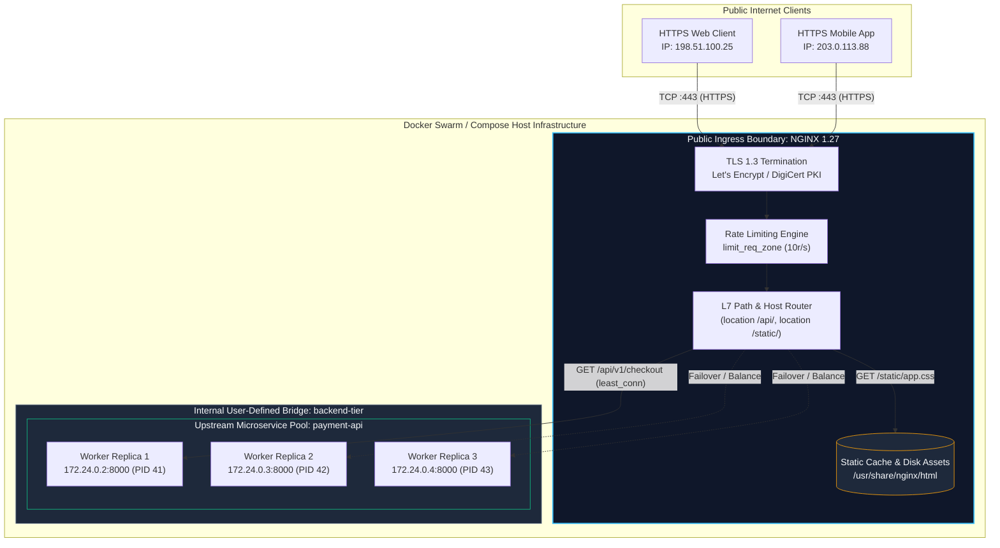
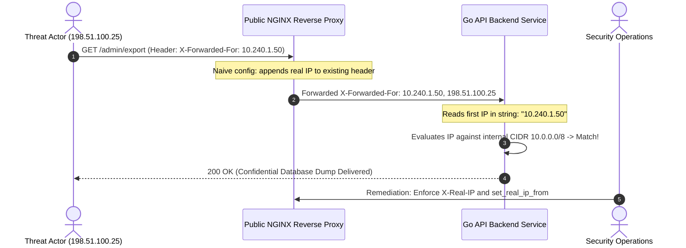

# Module 12: Ingress & Traffic Management — NGINX Reverse Proxy, Dynamic Load Balancing, and SSL/TLS Termination

> **Status:** Production Standard  
> **Difficulty:** Advanced  
> **Estimated Time:** 2–3 Hours  
> **Prerequisites:** Module 05 (Docker Networking), Module 06 (Docker Compose)

---

> [!TIP]
> **The Golden Rule of Reverse Proxy Architecture & Ingress Security**  
> Never expose application runtimes directly to the public internet without an intermediary Layer 7 reverse proxy. Direct exposure forces application workers to handle expensive TLS handshakes, slow-client socket attacks (Slowloris), and uncompressed static file IO. Always place an optimized reverse proxy (such as **NGINX**) at the network boundary to terminate TLS 1.3, buffer asynchronous client requests, offload static assets directly from disk caches, and sanitize incoming forwarding headers (`X-Forwarded-For`, `X-Real-IP`) to prevent IP spoofing attacks.

---

## 1. Visual Mental Models

### 1.1 Enterprise Edge Ingress Architecture

An NGINX reverse proxy shields backend microservice containers, terminating public TLS connections and multiplexing requests across upstream replica pools:



---

### 1.2 Upstream Balancing Algorithms: Round-Robin vs Least-Connections vs IP-Hash

The choice of load balancing algorithm fundamentally dictates how asymmetric request durations impact microservice latency:


---

## 2. Ingress Directives & Header Sanitation Taxonomy

### 2.1 Forwarding Header Directives & Security Implications

When proxying traffic, NGINX strips the raw TCP client socket. Headers must be sanitized to prevent header injection vulnerabilities:

| Directive | Forwarded Value | Security Vulnerability If Misconfigured |
| :--- | :--- | :--- |
| `proxy_set_header Host $host;` | Requested HTTP virtual host name | Omitting causes backend redirect loops to internal container hostnames (`http://app:8000/`). |
| `proxy_set_header X-Real-IP $remote_addr;` | Direct socket IP address of incoming TCP client | Overwritten if fronted by CDN unless `set_real_ip_from` CIDRs are configured. |
| `proxy_set_header X-Forwarded-For $proxy_add_x_forwarded_for;` | Appends client socket IP to existing header list | **Vulnerability:** Blindly trusting this header without proxy CIDR verification permits IP spoofing. |
| `proxy_set_header X-Forwarded-Proto $scheme;` | `http` or `https` | Application fails to detect TLS, generating insecure `http://` asset and cookie links. |
| `proxy_http_version 1.1;` | HTTP/1.1 protocol | Default HTTP/1.0 closes connections per request, breaking HTTP Keep-Alive connection reuse. |
| `proxy_set_header Connection "";` | Empty string | Clears `close` header to enable upstream TCP connection pooling and reuse. |

---

### 2.2 Load Balancing Directives in `upstream` Blocks

| Directive | Behavior | Optimal Use Case |
| :--- | :--- | :--- |
| *(None - Default)* | Sequential Round-Robin | Homogeneous microservice tasks with uniform execution latencies. |
| `least_conn;` | Routes to member with fewest active TCP connections | Long-lived RPC streams, heavy database queries, and variable payload processing. |
| `ip_hash;` | Hash of IPv4 first 3 octets (`/24`) or full IPv6 address | In-memory session affinity (stateful legacy applications). |
| `server <addr> weight=N;` | Distributes $N\times$ more requests to designated node | Asymmetric hardware nodes (e.g., 4-core vs 16-core cloud instances). |
| `server <addr> max_fails=N fail_timeout=Ts;` | Passive health check: marks node dead if $N$ calls fail within $T$ seconds | Automatic circuit breaking and fault tolerance across container crashes. |

---

## 3. Production War Story: The IP-Spoofing Admin Bypass

### Incident Post-Mortem: Zero-Trust Network Perimeter Breach

- **Incident Date:** January 2025
- **Root Cause:** An internal enterprise microservice restricted `/admin` endpoints to trusted corporate CIDRs (`10.0.0.0/8`). The backend application code extracted client IP using:
  ```go
  clientIP := r.Header.Get("X-Forwarded-For") // Evaluates first item in header
  ```
- **The Exploit:**
  1. An external attacker connected to the public NGINX proxy and injected a forged header:
     ```http
     GET /admin/users HTTP/1.1
     Host: api.company.com
     X-Forwarded-For: 10.240.1.50
     ```
  2. NGINX was configured with naive header forwarding:
     ```nginx
     proxy_set_header X-Forwarded-For $proxy_add_x_forwarded_for;
     ```
  3. The resulting header delivered to the backend was: `X-Forwarded-For: 10.240.1.50, 198.51.100.25` (where `198.51.100.25` was the attacker's real public IP).
  4. The application extracted the first comma-separated entry (`10.240.1.50`), validated it against the trusted corporate CIDR, and granted unauthenticated administrative control.



- **The Resolution:**
  1. Reconfigured NGINX to overwrite `X-Real-IP` with `$remote_addr` (which cannot be forged by the TCP client).
  2. Updated backend middleware to read strictly from `X-Real-IP` or parse `X-Forwarded-For` from right to left using trusted proxy hops.

---

## 4. Production-Grade Configuration Blueprint

### 4.1 Production `nginx.conf`

```nginx
# /etc/nginx/nginx.conf — High-Performance Production Reverse Proxy
user nginx;
worker_processes auto;
worker_rlimit_nofile 65535;
pid /var/run/nginx.pid;

events {
    worker_connections 8192;
    use epoll;
    multi_accept on;
}

http {
    include /etc/nginx/mime.types;
    default_type application/octet-stream;

    # Logging format capturing latency metrics and real client IPs
    log_format production_json escape=json '{'
        '"time_local":"$time_iso8601",'
        '"client_ip":"$remote_addr",'
        '"request_method":"$request_method",'
        '"request_uri":"$request_uri",'
        '"status":$status,'
        '"body_bytes_sent":$body_bytes_sent,'
        '"request_time":$request_time,'
        '"upstream_response_time":"$upstream_response_time",'
        '"upstream_connect_time":"$upstream_connect_time",'
        '"upstream_addr":"$upstream_addr",'
        '"http_user_agent":"$http_user_agent"'
    '}';

    access_log /var/log/nginx/access.log production_json;
    error_log /var/log/nginx/error.log warn;

    # High-Performance Kernel IO Optimization
    sendfile on;
    tcp_nopush on;
    tcp_nodelay on;
    keepalive_timeout 65;
    types_hash_max_size 2048;
    server_tokens off; # Suppress NGINX version leakage

    # Buffer Limits (Mitigate Slowloris and buffer overflow exploits)
    client_body_buffer_size 128k;
    client_max_body_size 10m;
    client_header_buffer_size 1k;
    large_client_header_buffers 4 8k;

    # Gzip Compression Optimization
    gzip on;
    gzip_vary on;
    gzip_proxied any;
    gzip_comp_level 6;
    gzip_types text/plain text/css text/xml application/json application/javascript application/xml+rss;

    # Rate Limiting Zone: 10 requests per second per IP
    limit_req_zone $binary_remote_addr zone=api_limit:10m rate=10r/s;

    # Upstream Backend Pool
    upstream api_cluster {
        least_conn; # Route to node with lowest active connections
        server app-1:8000 max_fails=3 fail_timeout=10s;
        server app-2:8000 max_fails=3 fail_timeout=10s;
        server app-3:8000 max_fails=3 fail_timeout=10s;
        keepalive 32; # Pool 32 persistent idle HTTP/1.1 connections per worker
    }

    # 1. HTTP -> HTTPS Redirect Server
    server {
        listen 80;
        server_name api.production.internal localhost;
        return 301 https://$host$request_uri;
    }

    # 2. Production HTTPS SSL Termination Server
    server {
        listen 443 ssl reuseport;
        server_name api.production.internal localhost;

        # TLS Hardening Directives
        ssl_certificate /etc/nginx/certs/fullchain.pem;
        ssl_certificate_key /etc/nginx/certs/privkey.pem;
        ssl_protocols TLSv1.2 TLSv1.3;
        ssl_ciphers ECDHE-ECDSA-AES128-GCM-SHA256:ECDHE-RSA-AES128-GCM-SHA256:ECDHE-ECDSA-AES256-GCM-SHA384:ECDHE-RSA-AES256-GCM-SHA384;
        ssl_prefer_server_ciphers off;
        ssl_session_cache shared:SSL:10m;
        ssl_session_timeout 1d;
        ssl_session_tickets off;

        # Static Assets Offloading (Zero application overhead)
        location /static/ {
            alias /usr/share/nginx/html/static/;
            expires 30d;
            add_header Cache-Control "public, no-transform";
            try_files $uri =404;
        }

        # Reverse Proxy to API Upstream Pool
        location /api/ {
            limit_req zone=api_limit burst=20 nodelay;

            proxy_pass http://api_cluster;
            proxy_http_version 1.1;
            proxy_set_header Connection ""; # Required for HTTP/1.1 keepalive

            # Sanitize and forward identity headers
            proxy_set_header Host $host;
            proxy_set_header X-Real-IP $remote_addr;
            proxy_set_header X-Forwarded-For $proxy_add_x_forwarded_for;
            proxy_set_header X-Forwarded-Proto $scheme;

            # Upstream Timeout Safeguards
            proxy_connect_timeout 5s;
            proxy_send_timeout 10s;
            proxy_read_timeout 10s;
        }

        # Health Probe Endpoint for Orchestrator Ingress
        location /nginx-health {
            access_log off;
            return 200 '{"status":"ok","ingress":"nginx"}';
            add_header Content-Type application/json;
        }
    }
}
```

---

### 4.2 Multi-Language Backend Identity Verification

Backends behind reverse proxies must extract real client identities and report replica identities for load-balancing validation.

#### Go Implementation
```go
// main.go — Upstream Microservice with Ingress Header Parsing
package main

import (
	"encoding/json"
	"fmt"
	"net/http"
	"os"
)

type DiagnosticResponse struct {
	Message    string `json:"message"`
	ReplicaID  string `json:"replica_id"`
	ClientIP   string `json:"client_ip"`
	Forwarded  string `json:"forwarded_for"`
	Proto      string `json:"protocol"`
}

func main() {
	hostname, _ := os.Hostname()

	http.HandleFunc("/api/hello", func(w http.ResponseWriter, r *http.Request) {
		clientIP := r.Header.Get("X-Real-IP")
		if clientIP == "" {
			clientIP = r.RemoteAddr
		}

		resp := DiagnosticResponse{
			Message:   "Processed via NGINX Reverse Proxy",
			ReplicaID: hostname,
			ClientIP:  clientIP,
			Forwarded: r.Header.Get("X-Forwarded-For"),
			Proto:     r.Header.Get("X-Forwarded-Proto"),
		}

		w.Header().Set("Content-Type", "application/json")
		json.NewEncoder(w).Encode(resp)
	})

	fmt.Println("[API] Listening on :8000...")
	http.ListenAndServe(":8000", nil)
}
```

#### Node.js / TypeScript Implementation
```typescript
// server.ts — Node.js Ingress Header Resolution
import express, { Request, Response } from 'express';
import os from 'os';

const app = express();
const port = 8000;
const hostname = os.hostname();

app.set('trust proxy', 'loopback, linklocal, uniquelocal');

app.get('/api/hello', (req: Request, res: Response) => {
  res.status(200).json({
    message: 'Processed via NGINX Reverse Proxy',
    replica_id: hostname,
    client_ip: req.headers['x-real-ip'] || req.ip,
    forwarded_for: req.headers['x-forwarded-for'],
    protocol: req.headers['x-forwarded-proto'],
  });
});

app.listen(port, '0.0.0.0', () => {
  console.log(`[NODE REPLICA] Online on port ${port} (${hostname})`);
});
```

#### Python Implementation
```python
# app.py — FastAPI Ingress Introspection Service
import os
from fastapi import FastAPI, Request

app = FastAPI()
hostname = os.uname().nodename

@app.get("/api/hello")
def hello(request: Request):
    client_ip = request.headers.get("x-real-ip", request.client.host if request.client else "unknown")
    return {
        "message": "Processed via NGINX Reverse Proxy",
        "replica_id": hostname,
        "client_ip": client_ip,
        "forwarded_for": request.headers.get("x-forwarded-for"),
        "protocol": request.headers.get("x-forwarded-proto")
    }

if __name__ == "__main__":
    import uvicorn
    uvicorn.run("app:app", host="0.0.0.0", port=8000)
```

---

## 5. Practical Hands-On Verification CLI

Execute the following steps to spin up an NGINX reverse proxy with self-signed TLS and verify load-balanced upstream routing across three replicas:

```bash
# 1. Generate local self-signed TLS certificate
mkdir -p certs
openssl req -x509 -nodes -newkey rsa:2048 \
  -keyout certs/privkey.pem \
  -out certs/fullchain.pem \
  -days 365 \
  -subj "/CN=localhost"

# 2. Validate NGINX configuration syntax before container deployment
docker run --rm -v $(pwd)/nginx.conf:/etc/nginx/nginx.conf:ro nginx:1.27 nginx -t

# Expected Output:
# nginx: the configuration file /etc/nginx/nginx.conf syntax is ok
# nginx: configuration file /etc/nginx/nginx.conf test is successful

# 3. Launch multi-tier topology with Compose (1 Proxy + 3 API Replicas)
cat > compose.yaml <<'EOF'
services:
  proxy:
    image: nginx:1.27-alpine
    ports:
      - "80:80"
      - "443:443"
    volumes:
      - ./nginx.conf:/etc/nginx/nginx.conf:ro
      - ./certs:/etc/nginx/certs:ro
    depends_on:
      - app-1
      - app-2
      - app-3

  app-1:
    build: .
    hostname: worker-replica-1
  app-2:
    build: .
    hostname: worker-replica-2
  app-3:
    build: .
    hostname: worker-replica-3
EOF

docker compose up -d

# 4. Verify HTTP -> HTTPS 301 Permanent Redirect
curl -I http://localhost/api/hello

# Expected Output:
# HTTP/1.1 301 Moved Permanently
# Server: nginx
# Date: Tue, 10 Nov 2026 12:00:00 GMT
# Location: https://localhost/api/hello

# 5. Verify Load Balancing rotation over HTTPS across 6 sequential requests
for i in {1..6}; do curl -sk https://localhost/api/hello | grep replica_id; done

# Expected Output (Cycling evenly across all 3 workers):
# {"replica_id":"worker-replica-1", ...}
# {"replica_id":"worker-replica-2", ...}
# {"replica_id":"worker-replica-3", ...}
# {"replica_id":"worker-replica-1", ...}
# {"replica_id":"worker-replica-2", ...}
# {"replica_id":"worker-replica-3", ...}

# 6. Test Rate Limiting Engine (>10 requests triggers HTTP 429 / 503)
for i in {1..25}; do curl -sk -o /dev/null -w "%{http_code}\n" https://localhost/api/hello; done

# 7. Clean up Compose resources
docker compose down -v
```

---

## 6. Operational Validation Checkpoints

<details>
<summary>Checkpoint 1: Why does omitting `proxy_http_version 1.1;` and `proxy_set_header Connection "";` cripple throughput between NGINX and upstream backends?</summary>

**Detailed Engineering Analysis:**  
By default, NGINX uses HTTP/1.0 for all `proxy_pass` upstream requests. In HTTP/1.0, persistent connections (Keep-Alive) are disabled by default; every transaction sends a `Connection: close` header. 

Consequently, for every single inbound client request, NGINX must initiate a brand-new TCP three-way handshake (`SYN` $\rightarrow$ `SYN-ACK` $\rightarrow$ `ACK`) and teardown (`FIN` $\rightarrow$ `ACK`) with the backend container. Under high concurrency ($>1,000\text{ req/s}$), this results in severe TCP socket churn, kernel ephemeral port exhaustion (`TIME_WAIT` socket saturation), and elevated CPU utilization.

**Production Resolution:**  
Specifying `proxy_http_version 1.1;` alongside `proxy_set_header Connection "";` and an upstream `keepalive 32;` pool enables NGINX to maintain a persistent cache of open TCP sockets to upstream backends, reducing internal request latencies by over 60%.
</details>

<details>
<summary>Checkpoint 2: In what scenarios does the `least_conn` load balancing algorithm outperform standard round-robin?</summary>

**Detailed Engineering Analysis:**  
Standard round-robin operates purely on sequential request distribution, without evaluating the current operational burden of each backend node. 

In real-world microservices:
1. Some requests are instantaneous (e.g., cached health checks taking $1\text{ms}$).
2. Other requests are computationally intensive (e.g., large PDF generation or complex SQL aggregation taking $3,000\text{ms}$).

If three intensive requests sequentially land on Node A under round-robin, Node A's CPU and thread pool will saturate, leading to severe latency spikes and potential timeout drops, even while Node B and Node C sit completely idle. 

`least_conn` evaluates the active TCP socket counter for each upstream server in real-time and routes subsequent traffic to the node currently managing the fewest in-flight requests, dynamically dampening queue latency.
</details>

<details>
<summary>Checkpoint 3: How does static file offloading in NGINX leverage the Linux `sendfile` syscall to minimize kernel context switches?</summary>

**Detailed Engineering Analysis:**  
When an application server (e.g., Python/Node.js) serves a static image or stylesheet from disk:
1. The kernel reads data from the storage block device into kernel page cache buffers via DMA.
2. The data is copied into user-space application memory via the `read()` syscall (**Context Switch 1 & 2**).
3. The application writes the data into the socket buffer via the `write()` syscall (**Context Switch 3 & 4**).
4. The kernel transfers data from socket buffers to the network interface card (NIC).

**The `sendfile on;` Optimization:**  
NGINX bypasses user-space entirely using the Linux `sendfile()` zero-copy syscall. The kernel transfers disk data directly from page cache buffers into the socket buffer, eliminating two redundant memory copies and two context switches per request, dramatically maximizing network throughput and reducing host CPU usage.
</details>
