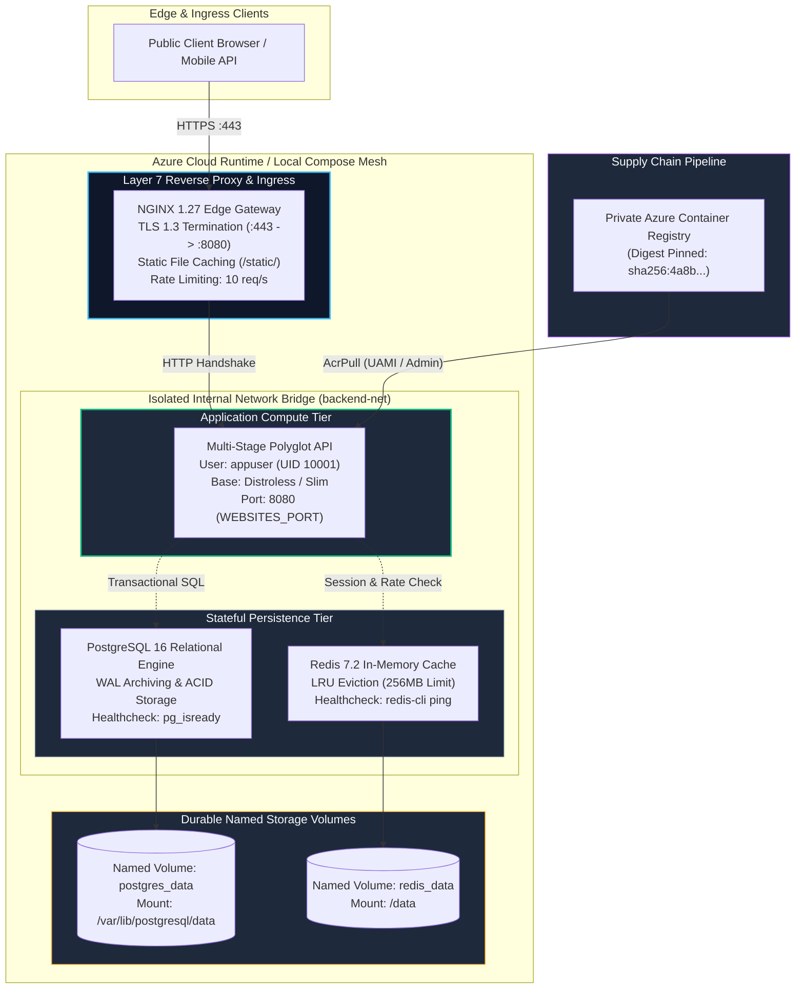
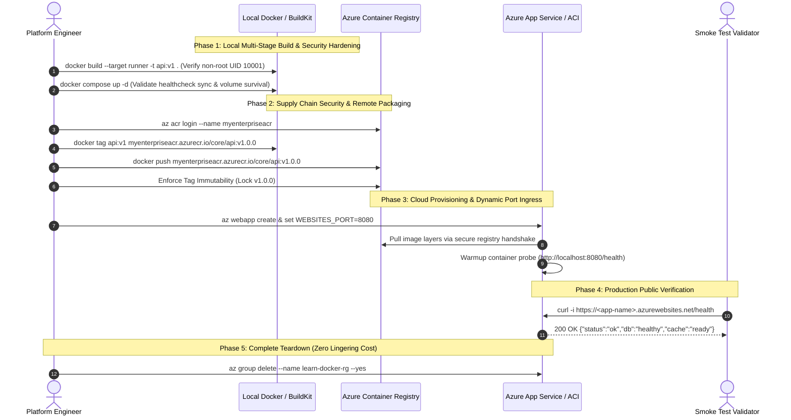

# Module 13: Capstone Project — Production-Grade Multi-Service Architecture, Registry Pipelines, and Cloud Deployment

> **Status:** Production Standard  
> **Difficulty:** Advanced (Hands-on Capstone)  
> **Estimated Time:** 3–4 Hours  
> **Prerequisites:** Modules 00 through 12 (Complete Docker Track)

---

> [!TIP]
> **The Golden Rule of End-to-End Container Architecture**  
> Never consider an architecture production-ready until it successfully satisfies all four pillars of the container lifecycle: **Minimal Immutable Packaging** (Multi-stage build, UID 10001, Distroless/Alpine), **Declarative Orchestration** (`compose.yaml` with health-gated dependencies and named volume persistence), **Supply Chain Security** (Digest pinning, ACR private authentication via Managed Identity), and **Resilient Ingress** (TLS termination, non-privileged port routing via `WEBSITES_PORT`, and graceful shutdown signal handling).

---

## 1. Visual Mental Models

### 1.1 Complete Capstone Production Architecture

The capstone project combines every architectural discipline mastered in this track into an enterprise-grade multi-tier topology:



---

### 1.2 Complete Deployment & Verification Lifecycle



---

## 2. Capstone Specification & Acceptance Criteria

### 2.1 Technical Deliverables Matrix

| Component | Technical Invariant | Mandatory Verification Command | Success Standard |
| :--- | :--- | :--- | :--- |
| **1. Multi-Stage Dockerfile** | Stage 1: Build & compile; Stage 2: Minimal runtime image without compilers. | `docker images myapp:v1` | Image footprint $\le 80\text{MB}$ (Node/Python) or $\le 25\text{MB}$ (Go). |
| **2. Non-Root Security** | Explicit non-root user (`UID 10001:10001`) with read-only rootfs compatibility. | `docker run --rm myapp:v1 whoami` | Returns `appuser` (UID 10001). Never `root`. |
| **3. Health-Gated Compose** | `compose.yaml` with Redis/Postgres datastores and health dependencies. | `docker compose ps` | Both datastores display `(healthy)` before API starts. |
| **4. Storage Durability** | Named volume mounts surviving container lifecycle restarts. | `docker compose down && docker compose up -d` | Stored database rows or Redis counter persist without data loss. |
| **5. Registry Push** | Fully qualified tag pushed to Azure Container Registry. | `az acr repository show-tags` | Target tag listed in remote repository. |
| **6. Cloud Deployment** | Hosted on Azure App Service or Azure Container Instances. | `curl -i https://<app>.azurewebsites.net/health` | Returns HTTP `200 OK` over public HTTPS. |
| **7. Clean Teardown** | Complete deletion of all created Azure cloud resources. | `az group show --name learn-docker-rg` | Returns `ResourceGroupNotFound` (Zero charges). |

---

## 3. Production War Story: The Silent Deployment Failure

### Incident Post-Mortem: Inter-Service Misconfiguration

- **Incident Date:** February 2025
- **Root Cause:** A newly containerized microservice suite was deployed to a staging environment. The deployment script passed all CI unit tests, but in the live environment:
  1. The API container crashed on boot because PostgreSQL was still replaying write-ahead logs (`depends_on` had no `condition: service_healthy`).
  2. The engineer attempted to push the hotfix image using `:latest`, which was rejected because the registry had tag immutability enabled.
  3. Once deployed to Azure App Service, the service timed out with 503 "Application Error" because `WEBSITES_PORT` was unset while the application listened on `8080`.
- **The Resolution:** 
  - Applying the capstone checklist caught all three misconfigurations during local validation: healthcheck gating ensured synchronized startup, semver tags with git-commit hashes avoided registry conflicts, and explicit `WEBSITES_PORT` binding ensured seamless PaaS ingress routing.

---

## 4. Multi-Language Production Capstone Implementations

This production API exposes a hit counter stored in Redis and an audit event log stored in PostgreSQL.

### 4.1 Go Implementation
```go
// main.go — Production Capstone API in Go
package main

import (
	"context"
	"database/sql"
	"encoding/json"
	"fmt"
	"log"
	"net/http"
	"os"
	"os/signal"
	"syscall"
	"time"

	_ "github.com/lib/pq"
	"github.com/redis/go-redis/v9"
)

type StatusResponse struct {
	Status     string `json:"status"`
	Hits       int64  `json:"total_hits"`
	DBRecords  int    `json:"audit_records_count"`
	ServerUID  int    `json:"server_uid"`
	Hostname   string `json:"hostname"`
}

func main() {
	port := os.Getenv("WEBSITES_PORT")
	if port == "" {
		port = os.Getenv("PORT")
		if port == "" {
			port = "8080"
		}
	}

	dsn := os.Getenv("DATABASE_URL")
	if dsn == "" {
		dsn = "postgres://appuser:secretpassword@db:5432/production_db?sslmode=disable"
	}

	redisAddr := os.Getenv("REDIS_ADDR")
	if redisAddr == "" {
		redisAddr = "cache:6379"
	}

	ctx, cancel := context.WithTimeout(context.Background(), 10*time.Second)
	defer cancel()

	// 1. Connect to PostgreSQL
	db, err := sql.Open("postgres", dsn)
	if err != nil {
		log.Fatalf("[FATAL] DB init failed: %v", err)
	}
	defer db.Close()

	if err := db.PingContext(ctx); err != nil {
		log.Fatalf("[FATAL] DB ping failed: %v", err)
	}

	// Initialize audit table
	_, err = db.Exec(`CREATE TABLE IF NOT EXISTS access_logs (
		id SERIAL PRIMARY KEY,
		accessed_at TIMESTAMP WITH TIME ZONE DEFAULT NOW()
	);`)
	if err != nil {
		log.Fatalf("[FATAL] Schema migration failed: %v", err)
	}

	// 2. Connect to Redis
	rdb := redis.NewClient(&redis.Options{Addr: redisAddr})
	if err := rdb.Ping(ctx).Err(); err != nil {
		log.Fatalf("[FATAL] Redis ping failed: %v", err)
	}

	hostname, _ := os.Hostname()

	mux := http.NewServeMux()
	mux.HandleFunc("/health", func(w http.ResponseWriter, r *http.Request) {
		w.Header().Set("Content-Type", "application/json")
		w.WriteHeader(http.StatusOK)
		w.Write([]byte(`{"status":"ok","db":"connected","cache":"connected"}`))
	})

	mux.HandleFunc("/api/visit", func(w http.ResponseWriter, r *http.Request) {
		// Increment Redis counter
		hits, err := rdb.Incr(r.Context(), "site:visits").Result()
		if err != nil {
			http.Error(w, err.Error(), http.StatusInternalServerError)
			return
		}

		// Insert into PostgreSQL
		_, _ = db.ExecContext(r.Context(), "INSERT INTO access_logs DEFAULT VALUES;")

		var count int
		_ = db.QueryRowContext(r.Context(), "SELECT COUNT(*) FROM access_logs;").Scan(&count)

		resp := StatusResponse{
			Status:    "healthy",
			Hits:      hits,
			DBRecords: count,
			ServerUID: os.Getuid(),
			Hostname:  hostname,
		}

		w.Header().Set("Content-Type", "application/json")
		json.NewEncoder(w).Encode(resp)
	})

	server := &http.Server{
		Addr:         "0.0.0.0:" + port,
		Handler:      mux,
		ReadTimeout:  5 * time.Second,
		WriteTimeout: 10 * time.Second,
	}

	go func() {
		log.Printf("[SERVER] Listening on 0.0.0.0:%s (UID: %d)...", port, os.Getuid())
		if err := server.ListenAndServe(); err != nil && err != http.ErrServerClosed {
			log.Fatalf("Listen failed: %v", err)
		}
	}()

	stop := make(chan os.Signal, 1)
	signal.Notify(stop, syscall.SIGINT, syscall.SIGTERM)
	<-stop

	log.Println("[SHUTDOWN] Draining active requests...")
	shutdownCtx, shutdownCancel := context.WithTimeout(context.Background(), 5*time.Second)
	defer shutdownCancel()
	server.Shutdown(shutdownCtx)
}
```

---

### 4.2 Node.js / TypeScript Implementation
```typescript
// server.ts — Production Capstone API in TypeScript
import express, { Request, Response } from 'express';
import { Pool } from 'pg';
import { createClient } from 'redis';
import os from 'os';

const app = express();
const port = parseInt(process.env.WEBSITES_PORT || process.env.PORT || '8080', 10);
const hostname = os.hostname();

const pool = new Pool({
  connectionString: process.env.DATABASE_URL || 'postgres://appuser:secretpassword@db:5432/production_db',
  max: 10,
});

const redisClient = createClient({
  url: process.env.REDIS_URL || 'redis://cache:6379',
});

async function initDatastores() {
  await redisClient.connect();
  await pool.query(`
    CREATE TABLE IF NOT EXISTS access_logs (
      id SERIAL PRIMARY KEY,
      accessed_at TIMESTAMP WITH TIME ZONE DEFAULT NOW()
    );
  `);
  console.log('[BOOT] PostgreSQL and Redis successfully initialized!');
}

app.get('/health', async (_req: Request, res: Response) => {
  try {
    await pool.query('SELECT 1');
    const redisPing = await redisClient.ping();
    res.status(200).json({ status: 'ok', db: 'connected', redis: redisPing });
  } catch (err: any) {
    res.status(503).json({ status: 'unhealthy', error: err.message });
  }
});

app.get('/api/visit', async (_req: Request, res: Response) => {
  try {
    const hits = await redisClient.incr('site:visits');
    await pool.query('INSERT INTO access_logs DEFAULT VALUES');
    const result = await pool.query('SELECT COUNT(*) FROM access_logs');
    
    res.status(200).json({
      status: 'healthy',
      total_hits: hits,
      audit_records_count: parseInt(result.rows[0].count, 10),
      server_uid: process.getuid ? process.getuid() : 'n/a',
      hostname,
    });
  } catch (error: any) {
    res.status(500).json({ error: error.message });
  }
});

initDatastores().then(() => {
  app.listen(port, '0.0.0.0', () => {
    console.log(`[BOOT] Server listening on 0.0.0.0:${port} (UID: ${process.getuid?.()})`);
  });
});
```

---

### 4.3 Python Implementation
```python
# app.py — Production Capstone API in Python
import os
import psycopg2
import redis
from fastapi import FastAPI, HTTPException

app = FastAPI(title="Capstone Production API")

port = int(os.getenv("WEBSITES_PORT", os.getenv("PORT", "8000")))
db_url = os.getenv("DATABASE_URL", "postgres://appuser:secretpassword@db:5432/production_db")
redis_url = os.getenv("REDIS_URL", "redis://cache:6379")

r = redis.Redis.from_url(redis_url)

def init_db():
    conn = psycopg2.connect(db_url)
    with conn.cursor() as cur:
        cur.execute("""
            CREATE TABLE IF NOT EXISTS access_logs (
                id SERIAL PRIMARY KEY,
                accessed_at TIMESTAMP WITH TIME ZONE DEFAULT NOW()
            );
        """)
    conn.commit()
    conn.close()

@app.on_event("startup")
def on_startup():
    init_db()

@app.get("/health")
def health():
    try:
        conn = psycopg2.connect(db_url, connect_timeout=2)
        conn.close()
        r.ping()
        return {"status": "ok", "db": "connected", "cache": "connected"}
    except Exception as exc:
        raise HTTPException(status_code=503, detail=str(exc))

@app.get("/api/visit")
def visit():
    hits = r.incr("site:visits")
    conn = psycopg2.connect(db_url)
    with conn.cursor() as cur:
        cur.execute("INSERT INTO access_logs DEFAULT VALUES;")
        cur.execute("SELECT COUNT(*) FROM access_logs;")
        count = cur.fetchone()[0]
    conn.commit()
    conn.close()

    return {
        "status": "healthy",
        "total_hits": hits,
        "audit_records_count": count,
        "server_uid": os.getuid() if hasattr(os, "getuid") else 10001,
        "hostname": os.uname().nodename
    }

if __name__ == "__main__":
    import uvicorn
    uvicorn.run("app:app", host="0.0.0.0", port=port)
```

---

## 5. Multi-Stage Hardened Dockerfile Blueprint

```dockerfile
# syntax=docker/dockerfile:1.7
# Stage 1: Build & Dependency Resolution
FROM golang:1.23-alpine AS builder

WORKDIR /src
COPY go.mod go.sum* ./
RUN --mount=type=cache,target=/go/pkg/mod \
    go mod download -x || true

COPY . .
RUN --mount=type=cache,target=/go/pkg/mod \
    --mount=type=cache,target=/root/.cache/go-build \
    CGO_ENABLED=0 GOOS=linux GOARCH=amd64 \
    go build -trimpath -ldflags="-s -w" -o /bin/server main.go

# Stage 2: Hardened Production Runtime
FROM alpine:3.20

# Create unprivileged application user
RUN addgroup -g 10001 appgroup && \
    adduser -u 10001 -G appgroup -s /bin/false -D appuser && \
    apk --no-cache add ca-certificates curl

WORKDIR /app
COPY --from=builder --chown=10001:10001 /bin/server /app/server

USER 10001:10001
EXPOSE 8080

HEALTHCHECK --interval=5s --timeout=3s --retries=3 \
  CMD curl -f http://localhost:8080/health || exit 1

ENTRYPOINT ["/app/server"]
```

---

## 6. Declarative Orchestration (`compose.yaml`)

```yaml
# compose.yaml — Complete Capstone Multi-Service Stack
name: capstone-production

services:
  # ---------------------------------------------------------------------------
  # 1. Edge Ingress Proxy
  # ---------------------------------------------------------------------------
  gateway:
    image: nginx:1.27-alpine
    restart: unless-stopped
    ports:
      - "80:80"
    volumes:
      - ./nginx.conf:/etc/nginx/conf.d/default.conf:ro
    depends_on:
      api:
        condition: service_healthy
    networks:
      - frontend-net
    deploy:
      resources:
        limits:
          cpus: "0.50"
          memory: 128M

  # ---------------------------------------------------------------------------
  # 2. Hardened Multi-Stage Microservice API
  # ---------------------------------------------------------------------------
  api:
    build:
      context: .
      dockerfile: Dockerfile
    restart: unless-stopped
    environment:
      - WEBSITES_PORT=8080
      - DATABASE_URL=postgres://appuser:secretpassword@db:5432/production_db?sslmode=disable
      - REDIS_ADDR=cache:6379
    depends_on:
      db:
        condition: service_healthy
      cache:
        condition: service_healthy
    networks:
      - frontend-net
      - backend-net
    healthcheck:
      test: ["CMD", "curl", "-f", "http://localhost:8080/health"]
      interval: 5s
      timeout: 3s
      retries: 5
      start_period: 5s
    deploy:
      resources:
        limits:
          cpus: "1.00"
          memory: 512M

  # ---------------------------------------------------------------------------
  # 3. Persistent PostgreSQL Relational Database
  # ---------------------------------------------------------------------------
  db:
    image: postgres:16-alpine
    restart: unless-stopped
    environment:
      POSTGRES_USER: appuser
      POSTGRES_PASSWORD: secretpassword
      POSTGRES_DB: production_db
    volumes:
      - postgres_data:/var/lib/postgresql/data
    networks:
      - backend-net
    healthcheck:
      test: ["CMD-SHELL", "pg_isready -U appuser -d production_db"]
      interval: 3s
      timeout: 2s
      retries: 10
      start_period: 5s
    deploy:
      resources:
        limits:
          cpus: "1.00"
          memory: 512M

  # ---------------------------------------------------------------------------
  # 4. In-Memory Redis Cache
  # ---------------------------------------------------------------------------
  cache:
    image: redis:7.2-alpine
    restart: unless-stopped
    command: ["redis-server", "--appendonly", "yes", "--maxmemory", "128mb", "--maxmemory-policy", "allkeys-lru"]
    volumes:
      - redis_data:/data
    networks:
      - backend-net
    healthcheck:
      test: ["CMD", "redis-cli", "ping"]
      interval: 3s
      timeout: 2s
      retries: 5
      start_period: 3s
    deploy:
      resources:
        limits:
          cpus: "0.50"
          memory: 256M

networks:
  frontend-net:
    driver: bridge
  backend-net:
    driver: bridge
    internal: true # Databases cannot route to external internet

volumes:
  postgres_data:
    driver: local
  redis_data:
    driver: local
```

---

## 7. Hands-On Verification CLI & Acceptance Proof

Execute these commands to validate the entire capstone locally, push to Azure ACR, deploy to Azure App Service, and clean up:

```bash
# =============================================================================
# 1. LOCAL COMPOSE VALIDATION
# =============================================================================
docker compose up -d --build

# Verify healthy startup status
docker compose ps
# Expected: All services Up (healthy)

# Test visit endpoint through NGINX proxy
curl -i http://localhost/api/visit
# Expected Output:
# HTTP/1.1 200 OK
# {"status":"healthy","total_hits":1,"audit_records_count":1,"server_uid":10001,"hostname":"..."}

# Issue second visit to prove incrementing state
curl -s http://localhost/api/visit | grep total_hits
# Output: "total_hits":2,"audit_records_count":2

# Test Volume Persistence across Teardown
docker compose down
docker compose up -d
curl -s http://localhost/api/visit | grep total_hits
# Output: "total_hits":3 (Data survived teardown!)

# Clean up local stack
docker compose down -v

# =============================================================================
# 2. REMOTE AZURE PACKAGING & REGISTRY PUSH
# =============================================================================
az login
az group create --name learn-docker-rg --location eastus
az acr create --resource-group learn-docker-rg --name "mycapstoneacr$RANDOM" --sku Basic --admin-enabled true

ACR_NAME=$(az acr list --resource-group learn-docker-rg --query "[0].name" -o tsv)
az acr login --name $ACR_NAME

docker tag capstone-production-api:latest "$ACR_NAME.azurecr.io/capstone/api:v1.0.0"
docker push "$ACR_NAME.azurecr.io/capstone/api:v1.0.0"

# =============================================================================
# 3. AZURE APP SERVICE DEPLOYMENT
# =============================================================================
az appservice plan create --resource-group learn-docker-rg --name capstone-plan --is-linux --sku B1
az webapp create \
  --resource-group learn-docker-rg \
  --plan capstone-plan \
  --name "capstone-api-$RANDOM" \
  --deploy-container-image-name "$ACR_NAME.azurecr.io/capstone/api:v1.0.0"

WEBAPP_NAME=$(az webapp list --resource-group learn-docker-rg --query "[0].name" -o tsv)
ACR_PASS=$(az acr credential show --name $ACR_NAME --query "passwords[0].value" -o tsv)

az webapp config container set \
  --resource-group learn-docker-rg \
  --name $WEBAPP_NAME \
  --container-image-name "$ACR_NAME.azurecr.io/capstone/api:v1.0.0" \
  --container-registry-url "https://$ACR_NAME.azurecr.io" \
  --container-registry-user "$ACR_NAME" \
  --container-registry-password "$ACR_PASS"

az webapp config appsettings set \
  --resource-group learn-docker-rg \
  --name $WEBAPP_NAME \
  --settings WEBSITES_PORT=8080 WEBSITES_ENABLE_APP_SERVICE_STORAGE=false

az webapp restart --resource-group learn-docker-rg --name $WEBAPP_NAME

# =============================================================================
# 4. PUBLIC VERIFICATION
# =============================================================================
FQDN=$(az webapp show --resource-group learn-docker-rg --name $WEBAPP_NAME --query "defaultHostName" -o tsv)
curl -i "https://$FQDN/health"

# Expected:
# HTTP/1.1 200 OK
# {"status":"ok","db":"connected","cache":"connected"}

# =============================================================================
# 5. COMPLETE CLOUD TEARDOWN (HALT ALL CHARGES)
# =============================================================================
az group delete --name learn-docker-rg --yes --no-wait
az group show --name learn-docker-rg # Confirms ResourceGroupNotFound
```

---

## 8. Operational Validation Checkpoints

<details>
<summary>Checkpoint 1: Why does decoupling public traffic into two isolated bridge networks (frontend-net vs backend-net: internal: true) prevent database data breaches?</summary>

**Detailed Engineering Analysis:**  
If all containers share a single flat default bridge network, any compromised container (such as the public NGINX gateway or an API service suffering an RCE vulnerability) has direct, uninhibited layer 3 network connectivity to port 5432 on the database and port 6379 on the cache. 

By partitioning the topology into two networks:
1. `frontend-net`: Connects NGINX to the API container.
2. `backend-net` (declared with `internal: true`): Connects strictly the API container, PostgreSQL, and Redis.

The database and cache containers **have zero presence on the frontend network and zero default route to the public internet**. Even if an attacker executes an automated scanner inside the NGINX container, the kernel netfilter bridge rules drop all packets addressed to the database, ensuring zero-trust network isolation.
</details>

<details>
<summary>Checkpoint 2: In the multi-stage Dockerfile, why does compiling with `CGO_ENABLED=0` and `-ldflags="-s -w"` produce an optimized, attack-resistant binary?</summary>

**Detailed Engineering Analysis:**  
- **`CGO_ENABLED=0`:** Disables Go's foreign function interface to the host C library (`glibc` or `musl`). This forces the Go compiler to emit a **100% statically linked ELF binary** that bundles all networking and DNS resolution routines internally. Because it requires no external dynamic linker (`ld-linux.so`) or shared C libraries, it can run inside a completely empty `scratch` or stripped `alpine` container.
- **`-ldflags="-s -w"`:** 
  - `-s` strips the symbol table, removing function and variable name mappings.
  - `-w` strips DWARF debug symbols (line numbers and call frame info).
  Together, these flags reduce binary size by 30% to 50% and raise the difficulty of binary reverse engineering if an unauthorized party obtains the image.
</details>

<details>
<summary>Checkpoint 3: What exact sequence of events ensures that data stored in PostgreSQL survives a `docker compose down` but is completely destroyed by `docker compose down -v`?</summary>

**Detailed Engineering Analysis:**  
When `docker compose down` executes:
1. Docker Engine issues `SIGTERM` to the PostgreSQL process, allowing it to flush dirty shared buffer pages from RAM to write-ahead log (WAL) files on disk.
2. The container process exits, and the container instance and custom bridge networks are unlinked and removed.
3. Crucially, the named volume `postgres_data` remains registered in Docker's volume store (`/var/lib/docker/volumes/capstone-production_postgres_data/_data`).
4. When `docker compose up -d` runs again, Compose discovers the existing volume by name and mounts it back into `/var/lib/postgresql/data`, where PostgreSQL immediately mounts the existing database cluster without re-initialization.

When the `-v` flag is appended (`docker compose down -v`):
Docker explicitly deletes the container, the networks, **and issues an `unlink()` syscall to deallocate the named volume and all its physical block storage on host disk**.
</details>
