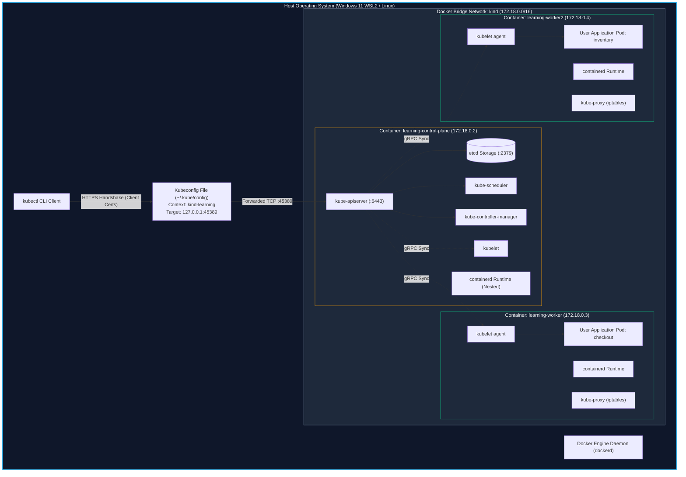
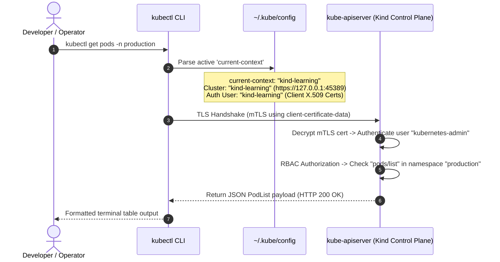
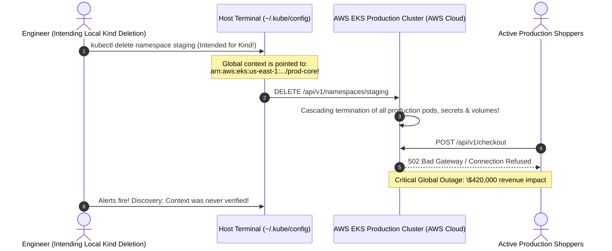

# Module 00: Kubernetes Setup — Local Clusters (Kind & Minikube), Docker-in-Docker Nodes, and Kubeconfig Context Isolation

> **Status:** Production Standard  
> **Difficulty:** Beginner to Intermediate  
> **Estimated Time:** 1.5–2 Hours  
> **Prerequisites:** Module 01 (Containers vs VMs), Module 05 (Docker Networking)

---

> [!TIP]
> **The Golden Rule of Kubernetes Context & Local Sandboxing**  
> Never execute write, delete, or mutating commands (`kubectl delete`, `kubectl apply`, `helm upgrade`) without explicitly verifying your active target context via **`kubectl config current-context`**. To eliminate the catastrophic risk of accidentally running local sandbox commands against remote staging or production clusters, isolate your local Kind/Minikube workflows using dedicated kubeconfig environments (`export KUBECONFIG=~/.kube/kind-learning.yaml`), integrate shell prompt guards (`kube-ps1` / `starship`), and verify that local cluster ports (`extraPortMappings`) do not conflict with host daemons.

---

## 1. Visual Mental Models

### 1.1 Kind ("Kubernetes-in-Docker") Node Architecture

Unlike traditional virtual machine emulators, Kind leverages Docker's container runtime to simulate physical Kubernetes nodes as sibling Docker containers running on the host bridge network:



---

### 1.2 Kubeconfig Context Resolution & Authentication Lifecycle

When an engineer issues a `kubectl` command, the client resolves a three-tier configuration hierarchy (Clusters $\rightarrow$ Users $\rightarrow$ Contexts) before transmitting TLS packets:



---

## 2. Cluster Emulators & Command Taxonomy

### 2.1 Local Kubernetes Runtimes: Kind vs Minikube vs K3d

| Feature / Metric | Kind (Kubernetes in Docker) | Minikube | K3d (Lightweight K3s) |
| :--- | :--- | :--- | :--- |
| **Node Virtualization** | Multi-container on Docker host | Single VM or single large container | Containerized lightweight K3s |
| **Multi-Node Simulation** | **Native & Instant** (`kind-config.yaml`) | Requires complex multi-VM setup | Native via container flags |
| **Startup / Teardown Speed** | **Fastest (15–30 seconds)** | Slower (1–3 minutes) | Extremely fast (10–20 seconds) |
| **Resource Footprint** | Low (~1GB RAM per node) | High (~3–4GB RAM baseline) | Extremely low (~512MB RAM) |
| **Standard Addons** | Manual deployment via manifests | Built-in (`minikube addons enable`) | Traefik pre-installed |
| **CI/CD Suitability** | **De facto standard for GitHub Actions** | Rarely used in headless CI | High |
| **Production Parity** | Pure upstream Kubernetes binaries | Upstream Kubernetes binaries | Uses SQLite instead of etcd by default |

---

### 2.2 Core `kubectl config` & Cluster Management Reference

| Command | Action Performed | Production Safety Rule |
| :--- | :--- | :--- |
| `kind create cluster --name <name>` | Synthesizes a new single-node control-plane cluster | Automatically injects and switches the active kubeconfig context. |
| `kind create cluster --config <file>` | Provisions custom multi-node topologies and port forwards | Use to test node affinity, pod disruption budgets, and ingress. |
| `kind delete cluster --name <name>` | Deletes node containers and purges kubeconfig entries | Safely releases host RAM and Docker networking bridges. |
| `kubectl config current-context` | Prints the active cluster context name | **Execute prior to any mutating command.** |
| `kubectl config get-contexts` | Lists all registered clusters, users, and active pointers (`*`) | Audit regularly to verify staging vs production endpoints. |
| `kubectl config use-context <name>` | Switches active pointer to target cluster | Verify target immediately with `kubectl cluster-info`. |
| `kubectl cluster-info` | Displays control plane and CoreDNS socket addresses | Confirms network connectivity to API server. |
| `kubectl get nodes -o wide` | Displays node names, internal IPs, OS images, and kernel versions | Verifies node health status (`Ready` vs `NotReady`). |

---

## 3. Production War Story: The Cross-Context Staging Annihilation

### Incident Post-Mortem: Midnight Cluster Confusion

- **Incident Date:** October 2024
- **Root Cause:** A backend platform engineer was debugging an ingress controller locally on a Kind cluster named `staging`. Simultaneously, the engineer maintained access to the company's AWS EKS production cluster inside their default `~/.kube/config` file.
- **The Catastrophe:**
  1. The engineer opened a new terminal window to clean up their local test environment:
     ```bash
     kubectl delete namespace staging
     ```
  2. Because the engineer had switched contexts in another terminal 30 minutes earlier, the active `current-context` in their global config was `arn:aws:eks:us-east-1:123456789012:cluster/prod-core`.
  3. The `kubectl delete` command executed against the live **AWS EKS Production Cluster**, terminating 45 production microservices, deleting production ConfigMaps, and unbinding persistent volume claims.
  4. Global production checkout functionality failed for 38 minutes while SREs restored etcd snapshots.



- **The Resolution:** 
  1. **Strict Kubeconfig Isolation:** Prohibited shared global `~/.kube/config`. Local clusters must output dedicated temporary files: `export KUBECONFIG=$(pwd)/.kube/kind.yaml`.
  2. **Shell Prompt Guards:** Mandated `kube-ps1` shell prompt hooks displaying active context and color-coding production clusters in flashing red.
  3. **Read-Only Developer Roles:** Stripped destructive namespace deletion permissions from developer AWS IAM roles.

---

## 4. Multi-Language Cluster Health Probing

Programmatic validation of cluster connectivity is a foundational pattern for health monitors, CI runners, and automated deployment agents.

### 4.1 Go: Inspecting Nodes via `client-go`
```go
// main.go — Programmatic Kubernetes Node Inspector in Go
package main

import (
	"context"
	"fmt"
	"log"
	"os"
	"path/filepath"
	"time"

	metav1 "k8s.io/apimachinery/pkg/apis/meta/v1"
	"k8s.io/client-go/kubernetes"
	"k8s.io/client-go/tools/clientcmd"
)

func main() {
	// 1. Resolve kubeconfig path (Prefer local isolated config, fallback to default)
	kubeconfig := os.Getenv("KUBECONFIG")
	if kubeconfig == "" {
		home, _ := os.UserHomeDir()
		kubeconfig = filepath.Join(home, ".kube", "config")
	}

	log.Printf("[K8S] Loading configuration from: %s", kubeconfig)

	// 2. Build REST configuration from active context
	config, err := clientcmd.BuildConfigFromFlags("", kubeconfig)
	if err != nil {
		log.Fatalf("[FATAL] Failed to parse kubeconfig: %v", err)
	}

	// 3. Initialize typed Kubernetes Clientset
	clientset, err := kubernetes.NewForConfig(config)
	if err != nil {
		log.Fatalf("[FATAL] Failed to create clientset: %v", err)
	}

	ctx, cancel := context.WithTimeout(context.Background(), 10*time.Second)
	defer cancel()

	// 4. Retrieve cluster nodes
	nodes, err := clientset.CoreV1().Nodes().List(ctx, metav1.ListOptions{})
	if err != nil {
		log.Fatalf("[FATAL] Failed to query cluster nodes: %v", err)
	}

	fmt.Printf("\n=== CLUSTER NODE INVENTORY (%d Nodes Found) ===\n", len(nodes.Items))
	for _, node := range nodes.Items {
		var status string = "NotReady"
		for _, condition := range node.Status.Conditions {
			if condition.Type == "Ready" && condition.Status == "True" {
				status = "Ready"
				break
			}
		}
		fmt.Printf("• Node: %-25s | Status: %-10s | Kubelet: %s | Arch: %s\n",
			node.Name, status, node.Status.NodeInfo.KubeletVersion, node.Status.NodeInfo.Architecture)
	}
}
```

---

### 4.2 Node.js / TypeScript: Health Verification via `@kubernetes/client-node`
```typescript
// clusterHealth.ts — TypeScript Cluster Health Validator
import * as k8s from '@kubernetes/client-node';

async function checkClusterHealth(): Promise<void> {
  const kc = new k8s.KubeConfig();
  
  // Load default or KUBECONFIG environment file
  kc.loadFromDefault();

  const currentContext = kc.getCurrentContext();
  console.log(`[K8S-CLIENT] Active Context: ${currentContext}`);

  const k8sApi = kc.makeApiClient(k8s.CoreV1Api);

  try {
    const res = await k8sApi.listNode();
    console.log(`[K8S-CLIENT] Successfully connected to cluster! Found ${res.body.items.length} nodes:`);
    
    for (const node of res.body.items) {
      const isReady = node.status?.conditions?.some(
        (c) => c.type === 'Ready' && c.status === 'True'
      );
      console.log(`  - Node: ${node.metadata?.name} | Ready: ${isReady} | OS: ${node.status?.nodeInfo?.osImage}`);
    }
  } catch (err: any) {
    console.error(`[CRITICAL] Cluster communication failure: ${err.message}`);
    process.exit(1);
  }
}

checkClusterHealth();
```

---

### 4.3 Python: Cluster Context Auditing via `kubernetes`
```python
# cluster_auditor.py — Python Cluster Health and Safety Inspector
import os
import sys
from kubernetes import client, config

def audit_active_cluster():
    # Enforce safe context checking
    try:
        contexts, active_context = config.list_kube_config_contexts()
    except Exception as e:
        print(f"[ERROR] Could not load kubeconfig: {e}")
        sys.exit(1)

    active_name = active_context['name']
    print(f"[SECURITY CHECK] Active Kubeconfig Context: '{active_name}'")

    # Safety guard: Prevent script from executing against production
    if "prod" in active_name.lower():
        print("[BLOCKED] Execution halted: Target context matches production pattern!")
        sys.exit(1)

    config.load_kube_config(context=active_name)
    v1 = client.CoreV1Api()

    print("[K8S] Fetching cluster nodes...")
    nodes = v1.list_node().items
    for node in nodes:
        ready_condition = next(
            (c.status for c in node.status.conditions if c.type == "Ready"), "False"
        )
        print(f"  • Node: {node.metadata.name} | Status: {'Ready' if ready_condition == 'True' else 'NotReady'} | InternalIP: {node.status.addresses[0].address}")

if __name__ == "__main__":
    audit_active_cluster()
```

---

## 5. Practical Hands-On Verification CLI

Execute the following end-to-end exercises inside your local terminal (WSL2 Ubuntu or Linux) to stand up a multi-node cluster, configure port mappings, and isolate contexts:

```bash
# 1. Verify Docker daemon connectivity from host/WSL2
docker ps

# Expected Output:
# CONTAINER ID   IMAGE     COMMAND   CREATED   STATUS    PORTS     NAMES

# 2. Define a multi-node Kind cluster topology with port forwarding for Ingress
cat > kind-cluster.yaml <<'EOF'
kind: Cluster
apiVersion: kind.x-k8s.io/v1alpha4
name: sandbox
nodes:
  - role: control-plane
    extraPortMappings:
      - containerPort: 80
        hostPort: 8080
        protocol: TCP
      - containerPort: 443
        hostPort: 8443
        protocol: TCP
  - role: worker
  - role: worker
EOF

# 3. Create cluster using an isolated Kubeconfig file
export KUBECONFIG=$(pwd)/kind-sandbox.kubeconfig
kind create cluster --config kind-cluster.yaml

# Expected Output:
# Creating cluster "sandbox" ...
#  • Ensuring node image (kindest/node:v1.30.0) 🖼
#  • Preparing nodes 📦 📦 📦
#  • Writing configuration 📜
#  • Starting control-plane 🕹️
#  • Installing CNI 🔌
#  • Installing StorageClass 💾
#  • Joining worker nodes 🚜
# Set kubectl context to "kind-sandbox"
# You can now use your cluster with:
# kubectl cluster-info

# 4. Verify cluster connectivity and node readiness
kubectl get nodes -o wide

# Expected Output:
# NAME                    STATUS   ROLES           AGE   VERSION   INTERNAL-IP   OS-IMAGE                         KERNEL-VERSION
# sandbox-control-plane   Ready    control-plane   65s   v1.30.0   172.18.0.4    Ubuntu 22.04.4 LTS (nested)      ...
# sandbox-worker          Ready    <none>          42s   v1.30.0   172.18.0.3    Ubuntu 22.04.4 LTS (nested)      ...
# sandbox-worker2         Ready    <none>          42s   v1.30.0   172.18.0.2    Ubuntu 22.04.4 LTS (nested)      ...

# 5. Inspect the physical Docker containers backing these Kubernetes nodes
docker ps --filter "label=io.x-k8s.kind.cluster=sandbox"

# Expected Output:
# Shows 3 Docker containers (sandbox-control-plane, sandbox-worker, sandbox-worker2)

# 6. Verify Context Isolation
kubectl config current-context
# Expected Output: kind-sandbox

# 7. Clean up cluster and release resources
kind delete cluster --name sandbox
rm -f kind-cluster.yaml kind-sandbox.kubeconfig
```

---

## 6. Operational Validation Checkpoints

<details>
<summary>Checkpoint 1: How does Kind run full Kubernetes worker nodes as single Docker containers without running an underlying hypervisor?</summary>

**Detailed Engineering Analysis:**  
Kind ("Kubernetes in Docker") relies on **nested containerization (Docker-in-Docker / containerd-in-Docker)**. 

When Kind launches a node container:
1. It mounts cgroups, `/sys`, and necessary host kernel subsystems into the container namespace.
2. Inside that node container, an internal system manager launches standard system services: `containerd` (the node container runtime), `kubelet` (the node agent), and `kube-proxy`.
3. When the `kubelet` receives instructions to schedule user pods, it communicates via CRI (Container Runtime Interface) with its *internal* `containerd` daemon, spawning sibling container namespaces inside the node container boundary.
4. Because all processes share the host Linux kernel, execution performance matches bare-metal speeds without the overhead of hardware virtualization.
</details>

<details>
<summary>Checkpoint 2: What is the architectural role of `extraPortMappings` in a Kind cluster configuration, and why is it necessary for local Ingress testing?</summary>

**Detailed Engineering Analysis:**  
In a standard Kind cluster, all node containers are attached to a private Docker bridge network (`kind` subnet, typically `172.18.0.0/16`). On macOS and Windows (WSL2), this subnet is encapsulated within a virtual network boundary and is not directly routeable from the host browser.

`extraPortMappings` instructs Kind to publish ports from the control-plane container directly to the host loopback interface (`127.0.0.1`). For example, mapping `containerPort: 80` to `hostPort: 8080` allows an Ingress Controller (like NGINX) listening on node port 80 to receive HTTP traffic sent to `http://localhost:8080` on the developer's laptop. Without this mapping, local browsers cannot route traffic to Ingress-managed microservices.
</details>

<details>
<summary>Checkpoint 3: An engineer opens a terminal, runs `kubectl get pods`, and receives: `The connection to the server 127.0.0.1:6443 was refused - did you specify the right host or port?`. What are the root causes?</summary>

**Detailed Engineering Analysis:**  
This error indicates that the `kubectl` client failed to establish a TCP three-way handshake with the address configured under `clusters.cluster.server` in the active kubeconfig context.

**Root Causes & Diagnostic Hierarchy:**
1. **Docker Daemon Halted:** Kind nodes are Docker containers. If Docker Desktop or `dockerd` stopped or crashed, the node containers are halted. Verify with `docker ps`.
2. **Cluster Suspended / Re-created:** Kind randomizes the forwarded host port for `kube-apiserver` upon each cluster recreation unless explicitly pinned. If a cluster was recreated, the old kubeconfig context points to a stale, dead port. Verify with `kind get clusters` and refresh credentials using `kind export kubeconfig --name <cluster>`.
3. **Control Plane Crash:** If `kube-apiserver` or `etcd` inside the control-plane container failed, port 6443 drops. Inspect container logs via `docker logs <cluster>-control-plane`.
</details>
