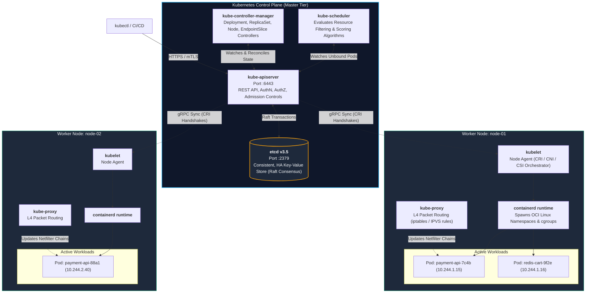
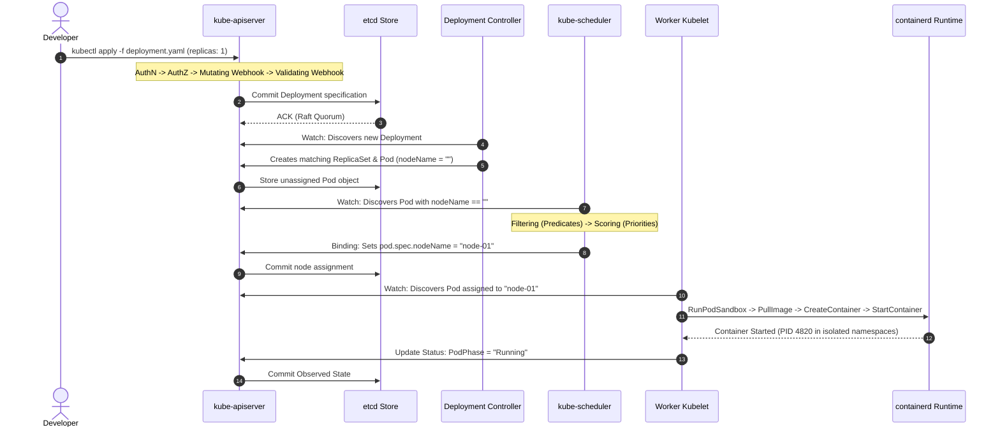
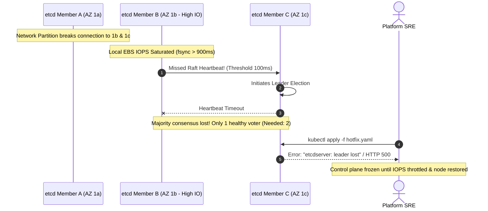

# Module 01: Kubernetes Architecture — Control Plane Mechanics, Etcd Consensus, and the Declarative Reconciliation Loop

> **Status:** Production Standard  
> **Difficulty:** Intermediate  
> **Estimated Time:** 2 Hours  
> **Prerequisites:** Module 00 (Local Cluster Setup: Kind & Minikube)

---

> [!TIP]
> **The Golden Rule of Kubernetes Declarative Reconciliation**  
> Never treat Kubernetes as an imperative execution engine. You never tell a node to "start a container"; you declare the **Desired State** of your system in etcd via the `kube-apiserver`, and autonomous, decoupled **Control Loops (Reconciliation Controllers)** continuously observe reality and execute mutating actions to converge **Observed State** toward Desired State. If an unexpected gap emerges (a crashed process, an evicting node, or a killed container), the cluster self-heals without external intervention.

---

## 1. Visual Mental Models

### 1.1 Cluster Topology: Control Plane vs Worker Data Plane

Every Kubernetes cluster strictly partitions authority between the **Control Plane** (the centralized decision engine) and **Worker Nodes** (the distributed compute executors):



---

### 1.2 End-to-End Declarative Lifecycle: From `kubectl apply` to Running Pod

The life of a Kubernetes resource transitions across five decoupled, asynchronous phases:



---

## 2. Component Taxonomy & Failure Matrix

### 2.1 Core Subsystems Reference

| Subsystem | Location | Primary Protocol & Port | Architectural Role | Impact of Total Failure |
| :--- | :--- | :--- | :--- | :--- |
| **`kube-apiserver`** | Control Plane | HTTPS / TCP 6443 | Stateless gateway; terminates TLS, validates schemas, serializes state to etcd. | **Complete Cluster Blindness.** `kubectl` commands fail; controllers stall. Running pods continue serving existing traffic. |
| **`etcd`** | Control Plane | gRPC / TCP 2379, 2380 | Distributed Raft key-value database; single source of truth. | **Cluster Freeze.** All mutating and read operations halt. If disk corrupted without backup, entire cluster topology is lost. |
| **`kube-scheduler`** | Control Plane | HTTPS / TCP 10259 | Matches unscheduled Pods to optimal worker nodes based on resource filtering. | **Scheduling Halts.** Existing Pods run uninterrupted; newly created or scaled Pods remain stuck in `Pending`. |
| **`kube-controller-manager`** | Control Plane | HTTPS / TCP 10257 | Multiplexes ~30 controllers (ReplicaSet, Node lifecycle, EndpointSlice, Namespace). | **Reconciliation Fails.** Killed pods are not replaced; scale-out actions do not create pods; rolling updates freeze. |
| **`kubelet`** | Worker Nodes | HTTPS / TCP 10250 | Node supervisor; translates PodSpecs into OCI runtime calls (CRI), verifies health probes. | **Node Eviction.** Node marked `NotReady`. Control plane initiates 5-minute timeout before rescheduling pods elsewhere. |
| **`kube-proxy`** | Worker Nodes | Metrics / TCP 10249 | Manages Linux netfilter `iptables` or IPVS tables to route Service VIP traffic to Pod IPs. | **Service Mesh Failure.** Intra-cluster service discovery breaks; traffic to Service ClusterIPs times out. |

---

### 2.2 Health Probe Endpoints

Modern Kubernetes control plane binaries expose granular health probes used by load balancers and orchestrator supervisors:

$$\text{Healthy Node} \iff \text{Kubelet Status: Ready} \land \text{API Probe } (\text{HTTP 200 on } \texttt{/readyz})$$

- **`/livez`:** Validates whether the process is alive. Failure triggers container restart.
- **`/readyz`:** Validates whether the process has established its dependencies (e.g., API server connected to etcd quorum). Failure pulls the node out of load balancer rotation.

---

## 3. Production War Story: The Split-Brain etcd Quorum Loss

### Incident Post-Mortem: Control Plane Freeze During Cloud Network Partition

- **Incident Date:** September 2024
- **Cluster Specs:** 3-Node Control Plane (AWS EKS Self-Managed, etcd running across 3 Availability Zones: `us-east-1a`, `us-east-1b`, `us-east-1c`).
- **The Failure Sequence:**
  1. An underlying AWS network fiber degradation severed connectivity between `us-east-1a` and the other two zones.
  2. Simultaneously, a runaway logging container on the `us-east-1b` control plane node saturated local EBS disk IOPS, increasing etcd fsync disk commit latency from $2\text{ms}$ to $950\text{ms}$.
  3. The etcd Raft leader in `1b` missed heartbeat intervals ($100\text{ms}$ threshold), triggering continuous, disruptive leader election churn.
  4. Quorum requires a strict majority:
     $$Q = \left\lfloor \frac{N}{2} \right\rfloor + 1 = \left\lfloor \frac{3}{2} \right\rfloor + 1 = 2 \text{ healthy voting members}$$
  5. With `1a` partitioned and `1b` dropping Raft heartbeats due to disk IO starvation, the cluster could not achieve consensus.
  6. **The Impact:** All `kube-apiserver` instances entered read-only degraded mode or timed out. Horizontal Pod Autoscalers could not scale workloads, GitHub Actions deployment pipelines failed with 500 Internal Errors, and dead application pods could not be rescheduled.



- **The Resolution:** 
  1. Relocated etcd data directories (`/var/lib/etcd`) to dedicated high-IOPS NVMe instance-store SSDs (`io2` volumes with guaranteed 3,000 IOPS).
  2. Added Prometheus alerting on `etcd_disk_wal_fsync_duration_seconds_bucket{le="0.01"} < 0.99`.
  3. Configured separate cgroup CPU/Memory reservations for control plane system daemons.

---

## 4. Multi-Language Reconciliation Loop Implementations

Writing custom controllers reinforces the core reconciliation loop mechanism: reading current state, comparing against desired state, and issuing compensating actions.

### 4.1 Go: Custom Controller using `client-go` Informers
```go
// controller.go — Production Control Loop Pattern in Go
package main

import (
	"context"
	"fmt"
	"log"
	"time"

	corev1 "k8s.io/api/core/v1"
	metav1 "k8s.io/apimachinery/pkg/apis/meta/v1"
	"k8s.io/client-go/informers"
	"k8s.io/client-go/kubernetes"
	"k8s.io/client-go/tools/cache"
	"k8s.io/client-go/tools/clientcmd"
)

type PodReconciler struct {
	clientset kubernetes.Interface
	informer  cache.SharedIndexInformer
}

func (c *PodReconciler) Reconcile(ctx context.Context, key string) error {
	namespace, name, err := cache.SplitMetaNamespaceKey(key)
	if err != nil {
		return err
	}

	pod, err := c.clientset.CoreV1().Pods(namespace).Get(ctx, name, metav1.GetOptions{})
	if err != nil {
		log.Printf("[RECONCILER] Pod %s deleted. Closing observed gap.", key)
		return nil
	}

	// Compare Desired vs Observed: Enforce mandatory label
	if _, ok := pod.Labels["reconciled-by"]; !ok {
		log.Printf("[RECONCILER] Drift detected on %s! Applying mandatory compliance label...", name)
		if pod.Labels == nil {
			pod.Labels = make(map[string]string)
		}
		pod.Labels["reconciled-by"] = "custom-platform-controller"
		_, err = c.clientset.CoreV1().Pods(namespace).Update(ctx, pod, metav1.UpdateOptions{})
		return err
	}

	log.Printf("[RECONCILER] Pod %s is in sync with desired state.", name)
	return nil
}

func main() {
	config, _ := clientcmd.BuildConfigFromFlags("", clientcmd.RecommendedHomeFile)
	clientset, _ := kubernetes.NewForConfig(config)

	factory := informers.NewSharedInformerFactory(clientset, 10*time.Minute)
	podInformer := factory.Core().V1().Pods().Informer()

	reconciler := &PodReconciler{clientset: clientset, informer: podInformer}

	podInformer.AddEventHandler(cache.ResourceEventHandlerFuncs{
		AddFunc: func(obj interface{}) {
			key, _ := cache.MetaNamespaceKeyFunc(obj)
			reconciler.Reconcile(context.Background(), key)
		},
		UpdateFunc: func(oldObj, newObj interface{}) {
			key, _ := cache.MetaNamespaceKeyFunc(newObj)
			reconciler.Reconcile(context.Background(), key)
		},
	})

	stopCh := make(chan struct{})
	defer close(stopCh)
	log.Println("[CONTROLLER] Starting custom control loop...")
	factory.Start(stopCh)
	<-stopCh
}
```

---

### 4.2 Node.js / TypeScript: Watch Loop Reconciliation
```typescript
// reconciler.ts — TypeScript Control Loop Pattern
import * as k8s from '@kubernetes/client-node';

const kc = new k8s.KubeConfig();
kc.loadFromDefault();

const k8sApi = kc.makeApiClient(k8s.CoreV1Api);
const watch = new k8s.Watch(kc);

console.log('[WATCHER] Listening to API Server pod events across all namespaces...');

watch.watch(
  '/api/v1/pods',
  {},
  async (type: string, apiObj: k8s.V1Pod) => {
    const podName = apiObj.metadata?.name;
    const namespace = apiObj.metadata?.namespace || 'default';
    const phase = apiObj.status?.phase;

    console.log(`[EVENT: ${type}] Pod: ${namespace}/${podName} | Phase: ${phase}`);

    // Reconcile: If Pod failed, log operational anomaly for incident alerting
    if (phase === 'Failed') {
      console.warn(`[RECONCILE GAP] Detected failed pod: ${podName}. Initiating telemetry alert!`);
    }
  },
  (err) => {
    if (err) console.error('[WATCH ERROR]', err);
  }
);
```

---

### 4.3 Python: Declarative State Polling & Disruption Detection
```python
# loop_auditor.py — Python Declarative State Reconciler
import time
from kubernetes import client, config, watch

config.load_kube_config()
v1 = client.CoreV1Api()
w = watch.Watch()

print("[RECONCILER] Monitoring Pod state stream from kube-apiserver...")

for event in w.stream(v1.list_pod_for_all_namespaces, timeout_seconds=60):
    event_type = event['type']
    pod = event['object']
    name = pod.metadata.name
    ns = pod.metadata.namespace
    node = pod.spec.node_name or "UNSCHEDULED"

    # Demonstrate reconciliation detection
    if event_type == "MODIFIED" and pod.status.phase == "Running":
        print(f"[CONVERGED] Pod {ns}/{name} is RUNNING on {node}")
    elif event_type == "DELETED":
        print(f"[GAP DETECTED] Pod {ns}/{name} deleted from cluster state.")
```

---

## 5. Practical Hands-On Verification CLI

Execute the following commands inside your local terminal to dissect the active control plane, trace events, and simulate node failure:

```bash
# 1. Query live control-plane components in kube-system namespace
kubectl get pods -n kube-system -o wide

# Expected Output:
# NAME                                             READY   STATUS    RESTARTS   IP           NODE
# coredns-7db6d8ff4d-2k8v2                         1/1     Running   0          10.244.0.2   learning-control-plane
# etcd-learning-control-plane                      1/1     Running   0          172.18.0.2   learning-control-plane
# kube-apiserver-learning-control-plane            1/1     Running   0          172.18.0.2   learning-control-plane
# kube-controller-manager-learning-control-plane   1/1     Running   0          172.18.0.2   learning-control-plane
# kube-proxy-4r8q9                                 1/1     Running   0          172.18.0.2   learning-control-plane
# kube-scheduler-learning-control-plane            1/1     Running   0          172.18.0.2   learning-control-plane

# 2. Inspect kube-apiserver operational parameters and static pod flags
kubectl describe pod -n kube-system -l component=kube-apiserver | grep -E "Command:|--etcd-servers|--service-cluster-ip-range"

# Expected Output:
# Command:
#   kube-apiserver
#   --etcd-servers=https://127.0.0.1:2379
#   --service-cluster-ip-range=10.96.0.0/12

# 3. Stream real-time cluster reconciliation events in the background
kubectl get events -A --watch &
EVENT_PID=$!

# 4. Trigger a declarative state change (Deploy NGINX Pod)
kubectl run lifecycle-trace --image=nginx:alpine -n default

# Expected Event Output from Background Watch:
# default   0s    Normal   Scheduled   pod/lifecycle-trace   Successfully assigned default/lifecycle-trace to learning-control-plane
# default   0s    Normal   Pulling     pod/lifecycle-trace   Pulling image "nginx:alpine"
# default   2s    Normal   Pulled      pod/lifecycle-trace   Successfully pulled image "nginx:alpine"
# default   2s    Normal   Created     pod/lifecycle-trace   Created container lifecycle-trace
# default   2s    Normal   Started     pod/lifecycle-trace   Started container lifecycle-trace

# Kill event background watcher
kill $EVENT_PID

# 5. Prove Kubelet self-healing: Terminate process under Kubernetes' back
CONTAINER_ID=$(kubectl get pod lifecycle-trace -o jsonpath='{.status.containerStatuses[0].containerID}' | sed 's|containerd://||')
docker exec learning-control-plane crictl stop $CONTAINER_ID

# 6. Watch the kubelet detect observed drift and restart the container
kubectl get pod lifecycle-trace --watch

# Expected Output:
# NAME              READY   STATUS    RESTARTS      AGE
# lifecycle-trace   1/1     Running   1 (3s ago)    45s

# 7. Clean up resource
kubectl delete pod lifecycle-trace
```

---

## 6. Operational Validation Checkpoints

<details>
<summary>Checkpoint 1: Why does a Pod remain stuck in the `Pending` state indefinitely if the `kube-scheduler` component crashes?</summary>

**Detailed Engineering Analysis:**  
When a user submits a Pod manifest via `kubectl apply`, the `kube-apiserver` validates the request, records the object in `etcd`, and sets the field `spec.nodeName: ""` (empty). 

The `kubelet` agent on each worker node only evaluates and spawns containers for Pods where `spec.nodeName` matches its own node identity. The only component responsible for calculating resource feasibility (CPU/memory requests, node affinity, taints) and mutating `spec.nodeName` is the **`kube-scheduler`**. 

If the scheduler process is dead or partitioned, no component assigns nodes. The Pod remains permanently in `Pending` with no scheduling events generated.
</details>

<details>
<summary>Checkpoint 2: What is the architectural difference between a Static Pod and a standard Controller-managed Pod?</summary>

**Detailed Engineering Analysis:**  
- **Standard Controller-Managed Pods:** Defined via API manifests (`kubectl apply`), stored in `etcd`, assigned by `kube-scheduler`, and supervised by the `kubelet` through API server watch streams.
- **Static Pods:** Managed directly by the **`kubelet` daemon** on a specific physical node by reading local manifest files from a designated directory (typically `/etc/kubernetes/manifests`). The kubelet supervises them without scheduler intervention.
  
**Why this matters:**  
This is how Kubernetes bootstraps itself: the control plane components (`kube-apiserver`, `etcd`, `kube-scheduler`, `kube-controller-manager`) run as Static Pods initialized directly by the local node kubelet before the API server even exists! The kubelet then creates a read-only **Mirror Pod** in the API server so the control plane can observe itself.
</details>

<details>
<summary>Checkpoint 3: If all control plane nodes crash simultaneously in a production cluster, what happens to client traffic currently hitting existing running application pods?</summary>

**Detailed Engineering Analysis:**  
**Client traffic continues to flow uninterrupted.** 

Kubernetes strictly separates the **Control Plane** from the **Data Plane (Worker Nodes)**:
1. Active application containers execute inside Linux network namespaces managed by the local node `containerd` runtime.
2. Ingress traffic routing and Service load balancing are executed locally by `kube-proxy` via pre-compiled Linux kernel `iptables` or IPVS rules resident in memory.
3. As long as worker nodes experience no physical hardware failure, existing workloads continue serving TCP sockets.

**The Limitation:**  
The cluster becomes completely **static and frozen**:
- No autoscaling (HPA is dead).
- No self-healing across nodes (if a worker node dies, its pods cannot be rescheduled).
- Zero deployment rollouts or configuration updates can execute until control plane consensus is restored.
</details>
