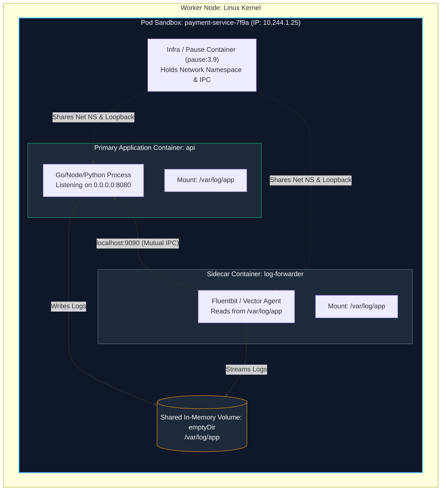
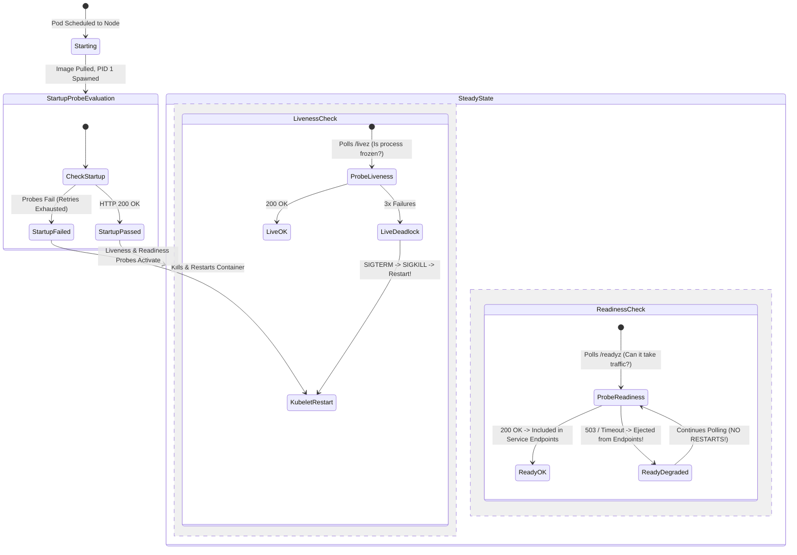
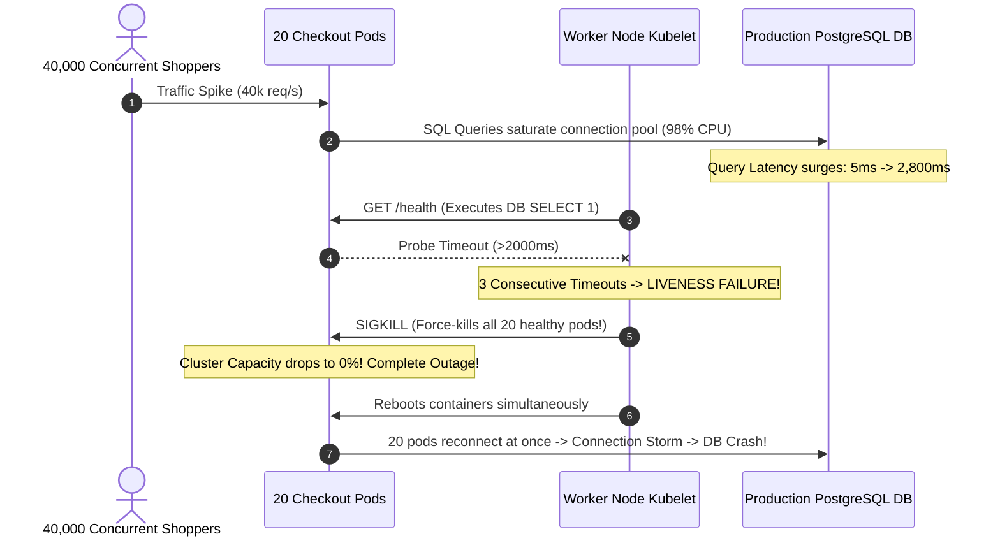

# Module 02: Pod Internals — Multi-Container Lifecycles, Probes, Resource Contracts, and Failure States

> **Status:** Production Standard  
> **Difficulty:** Intermediate  
> **Estimated Time:** 2 Hours  
> **Prerequisites:** Module 01 (Kubernetes Architecture & Reconciliation)

---

> [!TIP]
> **The Golden Rule of Kubernetes Probes & Resource Guarantees**  
> Never configure a **Liveness Probe** to query downstream dependencies such as databases, caches, or external third-party APIs. A liveness probe answers only one question: *Is this internal process permanently deadlocked or frozen?* If a downstream database degrades, a dependency-coupled liveness probe will fail, triggering the local kubelet to violently kill and restart the container, converting a temporary database latency spike into a **catastrophic, cascading restart death spiral**. Always separate shallow **Liveness Probes (`/livez`)** from dependency-aware **Readiness Probes (`/readyz`)**, guard slow-starting apps with **Startup Probes**, and declare explicit **`requests` and `limits`** to prevent node-wide Out-Of-Memory (OOM) evictions.

---

## 1. Visual Mental Models

### 1.1 Anatomy of a Multi-Container Pod & The "Pause" Container

A Kubernetes Pod is not a single container. It is a shared execution context composed of a lightweight kernel namespace anchor (the `pause` container) holding a network namespace and IPC socket, allowing co-located application and sidecar containers to communicate over `localhost`:



---

### 1.2 The Three-Tier Health Probe Decision Lifecycle

Understanding the operational boundaries of Startup, Liveness, and Readiness probes prevents premature restarts and traffic leakage:



---

## 2. Resource Contracts & Probe Taxonomy

### 2.1 The Three Kubernetes Health Probes Compared

| Probe Type | Primary Target Question | Action Taken on Consecutive Failures | Safe Target Endpoint | Fatal Anti-Pattern |
| :--- | :--- | :--- | :--- | :--- |
| **Startup Probe** | Has the legacy application or heavy runtime completed initialization? | Kills container and restarts Pod lifecycle. | Internal socket or simple HTTP `/healthz`. | Setting `failureThreshold` too low for cold-start Java/Python runtimes. |
| **Liveness Probe** | Has the process deadlocked in memory or suffered fatal thread lock? | **SIGTERM $\rightarrow$ SIGKILL $\rightarrow$ Restarts container**. | **Shallow `/livez`** (In-memory sanity check only). | **Calling downstream PostgreSQL, Redis, or payment gateways.** |
| **Readiness Probe** | Can this container accept incoming client requests right now? | **Ejects Pod IP from Service EndpointSlices** (Zero traffic routed). | **Deep `/readyz`** (Checks DB pools and cache connections). | Using `readinessProbe` to trigger container restarts (Readiness never restarts!). |

---

### 2.2 Resource Sizing: Requests vs Limits

Kubernetes implements Quality of Service (QoS) classes based on resource definitions:

$$\text{Guaranteed QoS} \iff \text{requests.cpu} == \text{limits.cpu} \land \text{requests.memory} == \text{limits.memory}$$

| Metric | Measurement Unit | Purpose | Behavior When Breached |
| :--- | :--- | :--- | :--- |
| **CPU Requests** | Millicores ($1000\text{m} = 1\text{ vCPU}$) | Used by `kube-scheduler` to find feasible nodes. | Guarantees minimum CPU allocation during contention. |
| **CPU Limits** | Millicores | CFS (Completely Fair Scheduler) quota ceiling. | **Throttling.** Process CPU cycles are compressed; application slows down but **never terminated**. |
| **Memory Requests** | Binary Bytes ($128\text{Mi} = 128 \times 2^{20}\text{ bytes}$) | Reservation floor on node memory. | Node guarantees physical RAM reservation. |
| **Memory Limits** | Binary Bytes | Strict Linux memory cgroup (`memory.max`). | **OOMKilled.** Kernel terminates process with Exit Code 137 (`SIGKILL`). |

---

## 3. Production War Story: The Liveness Probe Death Spiral

### Incident Post-Mortem: Black Friday Ingress Collapse

- **Incident Date:** November 2024
- **The Setup:** A high-volume checkout microservice declared identical endpoints for liveness and readiness:
  ```yaml
  livenessProbe:
    httpGet:
      path: /health # Executes: SELECT 1 FROM orders;
      port: 8080
    periodSeconds: 5
    timeoutSeconds: 2
    failureThreshold: 3
  ```
- **The Cascade:**
  1. A flash promotion generated $40,000\text{ req/s}$. The PostgreSQL database CPU utilization spiked to 98%, causing query latencies to increase from $5\text{ms}$ to $2,800\text{ms}$.
  2. Because `/health` queried the database with a 2-second timeout, the liveness probes on all 20 checkout pods timed out.
  3. After 15 seconds (3 failed probes), the kubelet on all nodes simultaneously issued `SIGKILL` to all 20 application pods.
  4. The pods restarted at the exact same moment. During container startup, all 20 pods flooded PostgreSQL with new database connection handshakes, forcing the database into complete deadlock.
  5. The pods failed their liveness probes immediately upon reboot, entering a permanent **Cluster-Wide Restart Loop**.



- **The Resolution:** 
  1. Decoupled the liveness endpoint to a pure in-memory shallow check: `/livez` (returns `200 OK` if the HTTP thread pool is active).
  2. Moved the database connectivity validation exclusively to `/readyz`. When the database slowed down, pods were gracefully removed from traffic rotation without being slaughtered by the kubelet.

---

## 4. Multi-Language Production Probe Implementations

Production services must expose decoupled `/livez` and `/readyz` endpoints.

### 4.1 Go Implementation
```go
// main.go — Production Kubernetes Probing Pattern in Go
package main

import (
	"context"
	"database/sql"
	"encoding/json"
	"fmt"
	"log"
	"net/http"
	"os"
	"sync/atomic"
	"time"

	_ "github.com/lib/pq"
)

type ServerStatus struct {
	isReady atomic.Bool
	db      *sql.DB
}

func main() {
	status := &ServerStatus{}
	status.isReady.Store(false)

	// Simulated async initialization (e.g. database pool, warming caches)
	go func() {
		log.Println("[STARTUP] Warming application caches and establishing DB pools...")
		time.Sleep(5 * time.Second) // Simulate warm-up latency
		status.isReady.Store(true)
		log.Println("[STARTUP] Application is fully initialized and ready to serve!")
	}()

	mux := http.NewServeMux()

	// 1. SHALLOW LIVENESS PROBE: Zero dependencies! Checks if goroutine scheduler works.
	mux.HandleFunc("/livez", func(w http.ResponseWriter, r *http.Request) {
		w.Header().Set("Content-Type", "application/json")
		w.WriteHeader(http.StatusOK)
		w.Write([]byte(`{"status":"alive"}`))
	})

	// 2. DEEP READINESS PROBE: Checks dependencies. Fails gracefully WITHOUT restarts.
	mux.HandleFunc("/readyz", func(w http.ResponseWriter, r *http.Request) {
		if !status.isReady.Load() {
			http.Error(w, `{"status":"unready","reason":"warming_up"}`, http.StatusServiceUnavailable)
			return
		}
		w.Header().Set("Content-Type", "application/json")
		w.WriteHeader(http.StatusOK)
		w.Write([]byte(`{"status":"ready","db":"connected"}`))
	})

	// 3. CORE BUSINESS ROUTE
	mux.HandleFunc("/api/orders", func(w http.ResponseWriter, r *http.Request) {
		w.WriteHeader(http.StatusOK)
		json.NewEncoder(w).Encode(map[string]string{"message": "Order processed"})
	})

	server := &http.Server{
		Addr:         ":8080",
		Handler:      mux,
		ReadTimeout:  5 * time.Second,
		WriteTimeout: 10 * time.Second,
	}

	log.Println("[SERVER] Listening on port 8080...")
	if err := server.ListenAndServe(); err != nil && err != http.ErrServerClosed {
		log.Fatalf("Server error: %v", err)
	}
}
```

---

### 4.2 Node.js / TypeScript Implementation
```typescript
// server.ts — Resilient Health Probing in TypeScript
import express, { Request, Response } from 'express';

const app = express();
const port = 8080;

let isReady = false;

// Simulate async bootstrap phase (cache warming, schema check)
setTimeout(() => {
  isReady = true;
  console.log('[BOOT] Initialization complete. Marking application READY.');
}, 6000);

// Shallow Liveness Probe: Never query DB!
app.get('/livez', (_req: Request, res: Response) => {
  res.status(200).json({ status: 'alive', uptime: process.uptime() });
});

// Deep Readiness Probe: Returns 503 if warming or dependencies degraded
app.get('/readyz', (_req: Request, res: Response) => {
  if (!isReady) {
    return res.status(503).json({ status: 'not_ready', error: 'Dependencies warming up' });
  }
  return res.status(200).json({ status: 'ready', pool: 'healthy' });
});

app.get('/api/checkout', (_req: Request, res: Response) => {
  res.status(200).json({ status: 'checkout_success' });
});

app.listen(port, '0.0.0.0', () => {
  console.log(`[SERVER] Node microservice active on 0.0.0.0:${port}`);
});
```

---

### 4.3 Python Implementation
```python
# app.py — Resilient FastAPI Probe Architecture
import time
from fastapi import FastAPI, HTTPException, status

app = FastAPI()

START_TIME = time.time()
WARMUP_PERIOD = 5.0 # Seconds

@app.get("/livez")
def liveness():
    # Shallow probe: Verifies event loop is responsive
    return {"status": "alive"}

@app.get("/readyz")
def readiness():
    # Deep probe: Gates traffic without causing container termination
    if time.time() - START_TIME < WARMUP_PERIOD:
        raise HTTPException(
            status_code=status.HTTP_503_SERVICE_UNAVAILABLE,
            detail="Application warming up"
        )
    return {"status": "ready", "db": "healthy"}

if __name__ == "__main__":
    import uvicorn
    uvicorn.run("app:app", host="0.0.0.0", port=8080)
```

---

## 5. Practical Hands-On Verification CLI

Execute the following end-to-end exercises inside your local terminal using your `kind-learning` cluster:

```bash
# 1. Author a production-standard Pod specification with init container, probes, and resource contracts
cat > production-pod.yaml <<'EOF'
apiVersion: v1
kind: Pod
metadata:
  name: resilient-api
  namespace: default
  labels:
    app: order-api
spec:
  initContainers:
    - name: init-prerequisites
      image: busybox:1.36
      command: ['sh', '-c', 'echo "Checking network connectivity..."; sleep 3; echo "Prerequisites verified!"']
  containers:
    - name: api
      image: nginx:alpine
      ports:
        - containerPort: 80
      resources:
        requests:
          cpu: "100m"
          memory: "64Mi"
        limits:
          cpu: "250m"
          memory: "128Mi"
      startupProbe:
        httpGet:
          path: /
          port: 80
        failureThreshold: 30
        periodSeconds: 2
      livenessProbe:
        httpGet:
          path: /
          port: 80
        periodSeconds: 10
        timeoutSeconds: 2
      readinessProbe:
        httpGet:
          path: /
          port: 80
        periodSeconds: 5
        timeoutSeconds: 2
EOF

# 2. Apply manifest and stream pod lifecycle transitions
kubectl apply -f production-pod.yaml
kubectl get pod resilient-api --watch &
WATCH_PID=$!

# Expected Status Progression:
# resilient-api   0/1   Pending                  0s
# resilient-api   0/1   Init:0/1                 0s
# resilient-api   0/1   PodInitializing          3s
# resilient-api   0/1   Running (Startup probe)  4s
# resilient-api   1/1   Running (Ready for traffic) 6s

kill $WATCH_PID

# 3. Inspect live resource allocation against the physical node
kubectl describe pod resilient-api | grep -A 8 "Limits:"

# Expected Output:
#     Limits:
#       cpu:     250m
#       memory:  128Mi
#     Requests:
#       cpu:     100m
#       memory:  64Mi

# 4. Diagnose an OOMKilled event: Deploy a pod that deliberately exceeds memory limits
cat > oom-pod.yaml <<'EOF'
apiVersion: v1
kind: Pod
metadata:
  name: oom-victim
spec:
  containers:
    - name: memory-eater
      image: busybox:1.36
      command: ["sh", "-c", "x='x'; while true; do x=\"$x$x$x$x\"; done"]
      resources:
        limits:
          memory: "16Mi"
EOF

kubectl apply -f oom-pod.yaml
sleep 5
kubectl get pod oom-victim

# Expected Output:
# NAME         READY   STATUS      RESTARTS      AGE
# oom-victim   0/1     OOMKilled   1 (3s ago)    8s

# 5. Extract termination code from previous container run
kubectl describe pod oom-victim | grep -E "Last State:|Exit Code:"

# Expected Output:
#     Last State:     Terminated
#       Reason:       OOMKilled
#       Exit Code:    137

# 6. Clean up test pods
kubectl delete pod resilient-api oom-victim
```

---

## 6. Operational Validation Checkpoints

<details>
<summary>Checkpoint 1: Why does a memory limit breach cause a container to be `OOMKilled` (Exit Code 137), while a CPU limit breach only results in throttling?</summary>

**Detailed Engineering Analysis:**  
- **Memory is an Incompressible Resource:** Once a process allocates physical RAM blocks, the kernel cannot reclaim them without destroying data or swapping. When a container exceeds its cgroup `memory.max` boundary, the Linux kernel Out-Of-Memory (OOM) Killer triggers an immediate, uncatchable `SIGKILL` (Signal 9). Exit codes reflect `128 + Signal`: $128 + 9 = \mathbf{137}$.
- **CPU is a Compressible Resource:** The Linux Completely Fair Scheduler (CFS) enforces CPU limits via time slices (e.g., $100\text{ms}$ periods). If a container reaches its allocated CPU quota within a period, the kernel simply suspends scheduling that process until the next period arrives. The process slows down (throttles), but **it is never terminated**.
</details>

<details>
<summary>Checkpoint 2: What is the architectural purpose of a Startup Probe, and why should it be used instead of inflating `initialDelaySeconds` on Liveness Probes?</summary>

**Detailed Engineering Analysis:**  
Legacy or JVM-based applications can take 60–180 seconds to perform classloading, database schema checks, and cache warming. 

- **The Anti-Pattern (`initialDelaySeconds: 120` on Liveness):**  
  If `initialDelaySeconds` is set to 120 seconds, and the container crashes or deadlocks during normal operations after boot, Kubernetes will wait a full 120 seconds before initiating health checks, significantly increasing mean time to recovery (MTTR).
- **The Startup Probe Solution:**  
  A Startup Probe disables liveness and readiness evaluations until it passes. With `periodSeconds: 5` and `failureThreshold: 30`, it gives slow containers up to $150\text{ seconds}$ to boot. Crucially, **the instant the app boots and responds with 200 OK (even if in 12 seconds), the startup probe succeeds immediately and activates the fast liveness probe**, providing maximum boot leniency with zero sacrifice in steady-state recovery speed.
</details>

<details>
<summary>Checkpoint 3: Why do all containers inside the same Pod share the exact same IP address, and how do they avoid port collisions?</summary>

**Detailed Engineering Analysis:**  
When the `kubelet` initializes a Pod on a node, it first deploys a specialized infrastructure container known as the **`pause` container**. The `pause` container executes `clone()` with the `CLONE_NEWNET` flag, creating a unique Linux **Network Namespace**. 

When the primary application and sidecar containers are launched:
1. They do **not** create new network namespaces.
2. They are instructed to join the `pause` container's network namespace (`--net=container:<pause-id>`).
3. Consequently, all containers inside the Pod share a single virtual network interface (`eth0`) and one loopback interface (`lo`). 

**Port Collision Rule:** Because they share the exact same TCP/UDP port table, two containers inside the same Pod cannot bind to the same port (e.g., both cannot bind to `:8080`). They communicate with each other over `localhost` with zero serialization network overhead.
</details>
