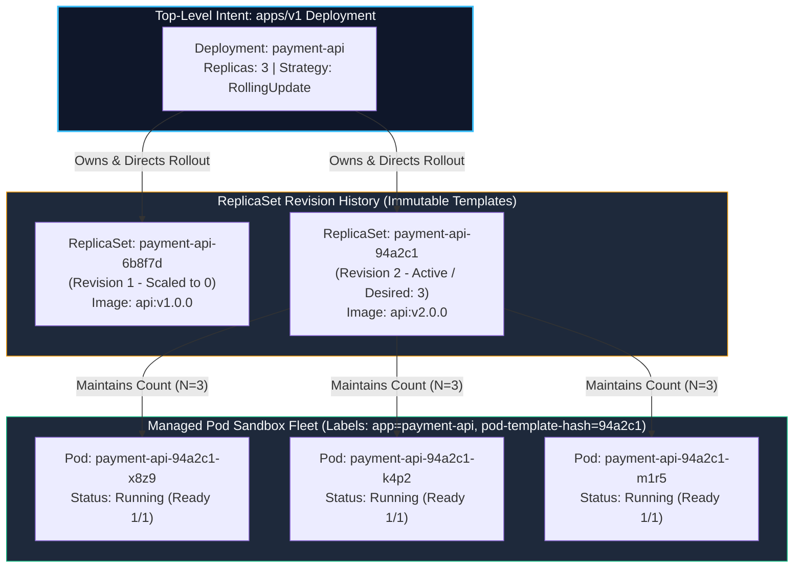
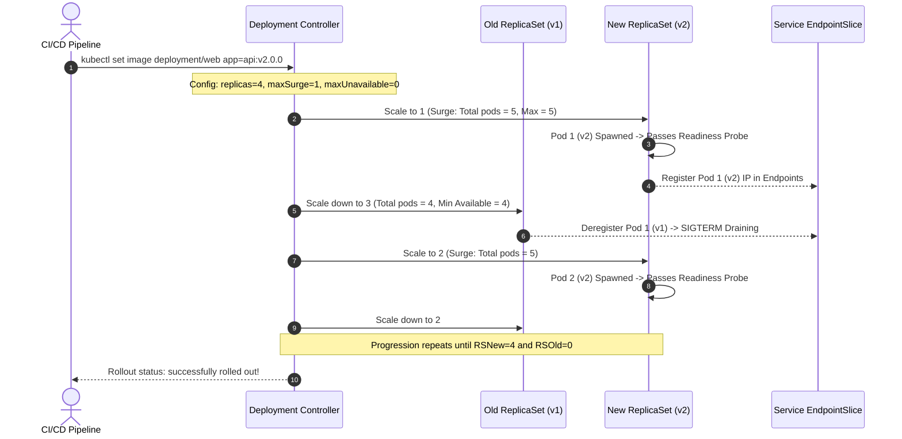
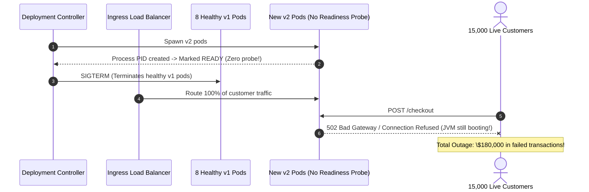

# Module 03: Workload Orchestration — Deployments, ReplicaSets, RollingUpdate Strategies, and Rollback Mechanics

> **Status:** Production Standard  
> **Difficulty:** Intermediate  
> **Estimated Time:** 2 Hours  
> **Prerequisites:** Module 01 (Kubernetes Architecture), Module 02 (Pod Internals)

---

> [!TIP]
> **The Golden Rule of Zero-Downtime Rolling Updates**  
> A Kubernetes Rolling Update is **only as zero-downtime as your Readiness Probe**. If your container lacks a valid readiness probe, the Deployment controller marks newly spawned pods as `Ready` the microsecond their process starts. The controller immediately terminates old pods before the new application has initialized its framework, opened database pools, or primed caches. Always pair **`strategy.rollingUpdate`** with explicit readiness probes, configure **`minReadySeconds: 10`** to guarantee post-startup stability, enforce **`maxUnavailable: 0`** for mission-critical APIs, and protect node drains with **PodDisruptionBudgets (PDB)**.

---

## 1. Visual Mental Models

### 1.1 The 3-Tier Declarative Ownership Hierarchy

Deployments do not manage Pods directly. A Deployment manages an immutable revision history of **ReplicaSets**, which in turn manage individual Pod lifecycles via Kubernetes `ownerReferences` and label selectors:



---

### 1.2 Progressive RollingUpdate State Progression

When `spec.template` changes, the Deployment orchestrates traffic transition by dynamically scaling up the new ReplicaSet while scaling down the old ReplicaSet within mathematical surge bounds:



---

## 2. Rollout Strategies & Configuration Taxonomy

### 2.1 Deployment Strategies: RollingUpdate vs Recreate

| Feature / Metric | `type: RollingUpdate` (Default) | `type: Recreate` |
| :--- | :--- | :--- |
| **Downtime Behavior** | **Zero Downtime.** Old pods serve while new pods warm up. | **Guaranteed Downtime.** Kills all old pods *before* starting any new ones. |
| **Resource Overhead** | Requires extra cluster headroom for surging pods (`maxSurge`). | Zero surge overhead; uses existing node capacity. |
| **Multi-Version Concurrency** | Old (v1) and New (v2) pods run simultaneously for minutes. | Single version runs at any point in time. |
| **Database Schema Requirement** | **Mandates backward-compatible migrations** (Expand/Contract). | Permits breaking, non-backward compatible schema migrations. |
| **Optimal Use Case** | Web APIs, microservices, stateless web applications. | Legacy stateful singletons, batch processors with single-write locks. |

---

### 2.2 Mathematical Surge Bounds Formula

For a deployment with $R$ replicas:

$$\text{Maximum Allowed Pods During Rollout} = R + \lceil R \times \text{maxSurge} \rceil$$

$$\text{Minimum Available Pods During Rollout} = R - \lfloor R \times \text{maxUnavailable} \rfloor$$

> [!IMPORTANT]
> If a cluster has no spare CPU/Memory capacity to accommodate `maxSurge`, newly surging pods will remain stuck in `Pending`, causing the entire rollout to freeze. For resource-constrained clusters, configure `maxSurge: 0` and `maxUnavailable: 1` (accepting a temporary reduction in capacity).

---

## 3. Production War Story: The Cold-Start Traffic Slaughter

### Incident Post-Mortem: 100% HTTP 500 Outage During Rolling Deployment

- **Incident Date:** December 2024
- **The Deployment Config:** A production Spring Boot microservice running 8 replicas with:
  ```yaml
  strategy:
    rollingUpdate:
      maxSurge: 25%
      maxUnavailable: 0
  # Notice: ZERO readinessProbe configured!
  ```
- **The Failure Sequence:**
  1. The DevOps engineer deployed `v2.4.0` containing a new payment integration.
  2. The Kubernetes Deployment controller launched 2 new pods (`maxSurge: 2`).
  3. Because no `readinessProbe` was defined, the kubelet marked the containers `Ready: 1/1` the instant the JVM process PID spawned (80ms after container start).
  4. The Deployment controller observed that the new pods were "Ready" and immediately issued termination commands to 2 old `v1` pods.
  5. The external load balancer directed 25% of incoming user checkout requests to the new pods.
  6. However, the Spring Boot application required 45 seconds to perform internal dependency injection and connect to database connection pools. Every request routed to the new pods was abruptly rejected with `ECONNREFUSED`.
  7. The controller continued this cycle, killing all remaining stable `v1` pods. Within 90 seconds, **100% of user traffic was routing to uninitialized containers**, causing a company-wide 4-minute outage.



- **The Resolution:** 
  1. Configured an explicit `readinessProbe` targeting `/actuator/health/readiness`.
  2. Configured `minReadySeconds: 15` to ensure newly ready pods maintain health for at least 15 seconds before the controller proceeds to terminate older replicas.

---

## 4. Multi-Language Programmatic Rollout Management

Automating rollouts and monitoring health progress programmatically is a critical responsibility of deployment operators and custom GitOps engines.

### 4.1 Go: Triggering Rolling Updates & Polling Status via `client-go`
```go
// rollout.go — Programmatic Deployment Rollout in Go
package main

import (
	"context"
	"fmt"
	"log"
	"time"

	metav1 "k8s.io/apimachinery/pkg/apis/meta/v1"
	"k8s.io/client-go/kubernetes"
	"k8s.io/client-go/tools/clientcmd"
)

func triggerAndWatchRollout(clientset *kubernetes.Clientset, namespace, deployName, newImage string) error {
	ctx := context.Background()
	deployClient := clientset.AppsV1().Deployments(namespace)

	// 1. Fetch current Deployment
	deployment, err := deployClient.Get(ctx, deployName, metav1.GetOptions{})
	if err != nil {
		return fmt.Errorf("failed to get deployment: %w", err)
	}

	// 2. Mutate Pod template image
	log.Printf("[ROLLOUT] Updating deployment %q image to %q...", deployName, newImage)
	deployment.Spec.Template.Spec.Containers[0].Image = newImage

	// Trigger annotation timestamp to guarantee rollout even if tag is unchanged
	if deployment.Spec.Template.Annotations == nil {
		deployment.Spec.Template.Annotations = make(map[string]string)
	}
	deployment.Spec.Template.Annotations["kubectl.kubernetes.io/restartedAt"] = time.Now().Format(time.RFC3339)

	_, err = deployClient.Update(ctx, deployment, metav1.UpdateOptions{})
	if err != nil {
		return fmt.Errorf("failed to update deployment: %w", err)
	}

	// 3. Poll Rollout Status until Convergence
	log.Println("[ROLLOUT] Monitoring progressive deployment status...")
	for {
		d, err := deployClient.Get(ctx, deployName, metav1.GetOptions{})
		if err != nil {
			return err
		}

		desired := *d.Spec.Replicas
		updated := d.Status.UpdatedReplicas
		ready := d.Status.ReadyReplicas
		available := d.Status.AvailableReplicas

		log.Printf("[STATUS] Desired: %d | Updated: %d | Ready: %d | Available: %d",
			desired, updated, ready, available)

		if updated == desired && ready == desired && available == desired && d.Status.ObservedGeneration >= d.Generation {
			log.Println("[SUCCESS] Deployment rollout successfully completed!")
			break
		}

		time.Sleep(2 * time.Second)
	}

	return nil
}

func main() {
	config, _ := clientcmd.BuildConfigFromFlags("", clientcmd.RecommendedHomeFile)
	clientset, _ := kubernetes.NewForConfig(config)
	_ = triggerAndWatchRollout(clientset, "default", "web", "nginx:1.27-alpine")
}
```

---

### 4.2 Node.js / TypeScript: Automating Rollback Execution
```typescript
// rollback.ts — TypeScript Deployment Rollback Automation
import * as k8s from '@kubernetes/client-node';

const kc = new k8s.KubeConfig();
kc.loadFromDefault();
const appsApi = kc.makeApiClient(k8s.AppsV1Api);

async function executeRollback(namespace: string, deploymentName: string, targetRevision?: number): Promise<void> {
  console.log(`[ROLLBACK] Initiating rollback for ${namespace}/${deploymentName}...`);

  try {
    // Read ReplicaSets to find history
    const rsList = await appsApi.listNamespacedReplicaSet(namespace);
    const ownedRS = rsList.body.items
      .filter((rs) => rs.metadata?.ownerReferences?.some((ref) => ref.name === deploymentName))
      .sort((a, b) => {
        const revA = parseInt(a.metadata?.annotations?.['deployment.kubernetes.io/revision'] || '0', 10);
        const revB = parseInt(b.metadata?.annotations?.['deployment.kubernetes.io/revision'] || '0', 10);
        return revB - revA; // Descending
      });

    if (ownedRS.length < 2) {
      throw new Error('No previous revision found to roll back to!');
    }

    const previousRS = ownedRS[1]; // Most recent previous revision
    const targetImage = previousRS.spec?.template?.spec?.containers[0].image;

    console.log(`[ROLLBACK] Reverting to revision ${previousRS.metadata?.annotations?.['deployment.kubernetes.io/revision']} (Image: ${targetImage})`);

    // Patch Deployment with historical template
    await appsApi.patchNamespacedDeployment(
      deploymentName,
      namespace,
      {
        spec: {
          template: {
            spec: {
              containers: [{ name: 'nginx', image: targetImage }],
            },
          },
        },
      },
      undefined,
      undefined,
      undefined,
      undefined,
      undefined,
      { headers: { 'Content-Type': 'application/strategic-merge-patch+json' } }
    );

    console.log('[ROLLBACK SUCCESS] Rollback patch applied successfully.');
  } catch (err: any) {
    console.error(`[ROLLBACK FAILED] Error: ${err.message}`);
  }
}

// executeRollback('default', 'web');
```

---

### 4.3 Python: Deployment Disruption & Capacity Validator
```python
# deploy_validator.py — Python Deployment Readiness Auditor
from kubernetes import client, config
import sys

def audit_deployment(namespace: str, name: str):
    config.load_kube_config()
    apps_v1 = client.AppsV1Api()

    try:
        dep = apps_v1.read_namespaced_deployment(name=name, namespace=namespace)
    except client.exceptions.ApiException as e:
        print(f"[ERROR] Deployment {name} not found: {e}")
        sys.exit(1)

    spec_replicas = dep.spec.replicas or 1
    ready_replicas = dep.status.ready_replicas or 0
    strategy = dep.spec.strategy.type

    print(f"\n=== DEPLOYMENT AUDIT: {namespace}/{name} ===")
    print(f"• Strategy:        {strategy}")
    print(f"• Desired Replicas: {spec_replicas}")
    print(f"• Ready Replicas:   {ready_replicas}")

    if dep.spec.strategy.rolling_update:
        ru = dep.spec.strategy.rolling_update
        print(f"• maxSurge:        {ru.max_surge}")
        print(f"• maxUnavailable:  {ru.max_unavailable}")

    # Check for Readiness Probe on all containers
    for ctr in dep.spec.template.spec.containers:
        if not ctr.readiness_probe:
            print(f"⚠️ [CRITICAL RISK] Container '{ctr.name}' lacks a readinessProbe! Rolling updates will cause downtime.")
        else:
            print(f"✅ Container '{ctr.name}' has configured readinessProbe.")

if __name__ == "__main__":
    audit_deployment("default", "web")
```

---

## 5. Practical Hands-On Verification CLI

Execute the following commands to create a hardened Deployment, observe a live rolling update, inspect surging, and execute an instant rollback:

```bash
# 1. Author a zero-downtime Deployment manifest with bounded surge
cat > production-deployment.yaml <<'EOF'
apiVersion: apps/v1
kind: Deployment
metadata:
  name: checkout-api
  namespace: default
  labels:
    app: checkout-api
spec:
  replicas: 4
  minReadySeconds: 5
  strategy:
    type: RollingUpdate
    rollingUpdate:
      maxSurge: 1
      maxUnavailable: 0
  selector:
    matchLabels:
      app: checkout-api
  template:
    metadata:
      labels:
        app: checkout-api
    spec:
      containers:
        - name: api
          image: nginx:1.26-alpine
          ports:
            - containerPort: 80
          resources:
            requests:
              cpu: "50m"
              memory: "64Mi"
            limits:
              cpu: "100m"
              memory: "128Mi"
          readinessProbe:
            httpGet:
              path: /
              port: 80
            initialDelaySeconds: 2
            periodSeconds: 3
EOF

# 2. Deploy initial version (v1.26)
kubectl apply -f production-deployment.yaml
kubectl rollout status deployment/checkout-api

# Expected Output:
# deployment "checkout-api" successfully rolled out

# 3. Inspect ownership chain: Deployment -> ReplicaSet -> Pods
kubectl get rs -l app=checkout-api
# Expected Output: 1 active ReplicaSet showing 4 DESIRED / 4 CURRENT / 4 READY

# 4. Trigger rolling update to newer version (v1.27) while watching in background
kubectl set image deployment/checkout-api api=nginx:1.27-alpine
kubectl rollout status deployment/checkout-api

# Expected Output:
# Waiting for deployment "checkout-api" rollout to finish: 1 out of 4 new replicas have been updated...
# Waiting for deployment "checkout-api" rollout to finish: 2 out of 4 new replicas have been updated...
# Waiting for deployment "checkout-api" rollout to finish: 3 out of 4 new replicas have been updated...
# Waiting for deployment "checkout-api" rollout to finish: 4 out of 4 new replicas have been updated...
# deployment "checkout-api" successfully rolled out

# 5. Review revision history
kubectl rollout history deployment/checkout-api

# Expected Output:
# REVISION  CHANGE-CAUSE
# 1         <none>
# 2         <none>

# 6. Intentionally deploy broken image to simulate rollout stall
kubectl set image deployment/checkout-api api=nginx:invalid-broken-tag
sleep 3
kubectl rollout status deployment/checkout-api --timeout=15s

# Expected Output:
# error: timed out waiting for the condition

# 7. Observe rollout stall: Existing 4 pods remain 100% available!
kubectl get pods -l app=checkout-api

# 8. Execute instant rollback to restore stable revision
kubectl rollout undo deployment/checkout-api
kubectl rollout status deployment/checkout-api

# Expected Output:
# deployment "checkout-api" successfully rolled out

# 9. Clean up resources
kubectl delete deployment checkout-api
```

---

## 6. Operational Validation Checkpoints

<details>
<summary>Checkpoint 1: Why does changing `spec.replicas` only resize the existing ReplicaSet, while updating an image tag generates an entirely new ReplicaSet?</summary>

**Detailed Engineering Analysis:**  
In the Kubernetes schema, a **ReplicaSet represents a specific, immutable Pod template specification** (`spec.template`). 

- When an operator changes `spec.replicas` from 3 to 6, the underlying Pod template (image, env, labels, mounts) has not changed. The Deployment controller simply mutates `spec.replicas` on the currently active ReplicaSet.
- When an operator changes the container image tag or an environment variable, `spec.template` changes. Because a single ReplicaSet cannot manage two differing Pod specifications simultaneously, the Deployment controller generates a **brand-new ReplicaSet** stamped with a unique 10-character hash (derived from hashing the Pod template). It then manages the progressive scaling up of the new ReplicaSet and the down-scaling of the old one.
</details>

<details>
<summary>Checkpoint 2: What is the purpose of `minReadySeconds` in a Deployment specification, and how does it prevent deployment flapping?</summary>

**Detailed Engineering Analysis:**  
By default, `minReadySeconds` is `0`. This means that as soon as a new Pod's readiness probe returns `200 OK` **for the very first time**, the Deployment controller immediately marks the pod as fully available and proceeds to terminate the next batch of older pods.

In real-world applications:
- Applications frequently experience immediate post-boot crashes (e.g., initial connection spikes causing race-condition thread pool crashes 5 seconds after boot).
- With `minReadySeconds: 0`, older stable pods would have already been terminated.

Configuring `minReadySeconds: 15` forces the Deployment controller to wait until the new pod has been **continuously healthy and Ready for at least 15 uninterrupted seconds** before counting it toward rollout progress. If the container crashes within that window, the rollout halts immediately.
</details>

<details>
<summary>Checkpoint 3: What happens when an engineer configures `strategy.rollingUpdate: { maxSurge: 0, maxUnavailable: 0 }`?</summary>

**Detailed Engineering Analysis:**  
The Kubernetes API server **rejects the manifest outright with a validation error**. 

- `maxSurge: 0` means the cluster is prohibited from creating any new pods above the desired replica count.
- `maxUnavailable: 0` means the cluster is prohibited from terminating any existing pods below the desired replica count.

Under these two constraints, it is mathematically impossible to begin a rolling update: the controller cannot create a new pod (violates `maxSurge: 0`) and cannot delete an old pod (violates `maxUnavailable: 0`). At least one of these parameters must be greater than zero.
</details>
