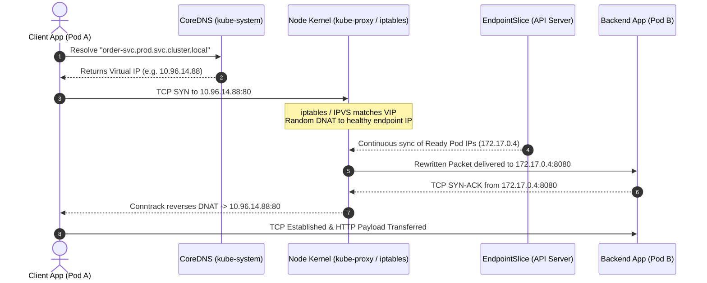
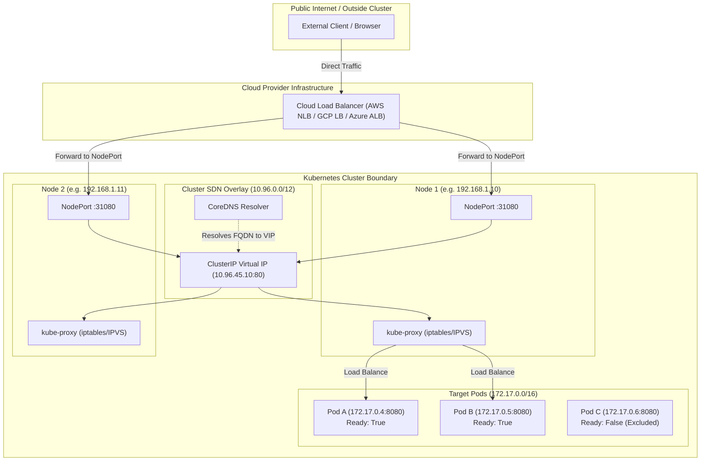
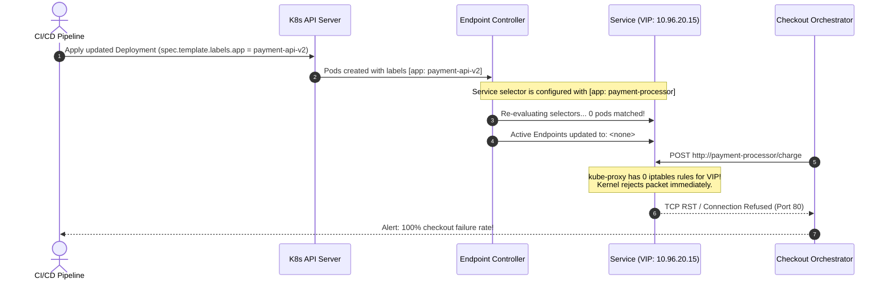

# 04 - Kubernetes Services & Networking

> **Prerequisites**: [02 - Pods & Workloads](../02-pods-and-workloads/README.md), [03 - Deployments & ReplicaSets](../03-deployments-and-replicasets/README.md).  
> **Target Audience**: SREs, Platform Engineers, and Backend Systems Architects configuring service discovery, packet routing, and internal network meshes.  
> **Estimated Deep-Dive Time**: 40 minutes.

---

> [!TIP]
> **The Golden Rule of Kubernetes Networking**: **Pods are ephemeral, IP addresses are volatile, but Services are immutable contracts.** Never communicate directly with Pod IPs in production. A Service provides a durable virtual IP (VIP) and CoreDNS name backed by dynamic, kernel-level packet rewriting (`kube-proxy` via iptables or IPVS) and continuously synced `EndpointSlices`. Only Pods reporting `Ready: True` across active readiness probes receive traffic.

---

## 1. Visual Mental Models: Packet Flow & Service Types

In Kubernetes, Pods are allocated non-routable private overlay IPs that change unpredictably across rollouts, node failures, and autoscaling events. A **Service** abstracts these changing targets into a permanent virtual IP and fully qualified domain name (FQDN).

### The Packet Lifecycle: From Client Pod to Target Backend



---

### Service Types Taxonomy & Boundary Scope



---

## 2. Technical Comparison: Service Types & Port Architecture

### Service Types Specification Matrix

| Service Type | Scope & Accessibility | Typical Port Allocation | Infrastructure Dependency | Use Cases |
| :--- | :--- | :--- | :--- | :--- |
| **`ClusterIP`** | Internal only (Cluster SDN) | `spec.ports[].port` (1-65535) | None (Standard Kubernetes SDN) | Default; internal microservices, databases, caches, message queues. |
| **`NodePort`** | Node network + Internal | `30000-32767` (Cluster-wide static) | Node host networking | Dev/Test clusters, bare-metal clusters, or direct L4 hardware appliances. |
| **`LoadBalancer`** | Public Internet / External VPC | External IP + NodePort + ClusterIP | Cloud Provider Controller (AWS/GCP/Azure) | Public-facing APIs, ingress controllers, direct TCP/UDP services. |
| **`ExternalName`** | Internal DNS CNAME Redirect | Resolves to external CNAME | None (CoreDNS CNAME record only) | Redirecting in-cluster queries to third-party APIs (e.g., AWS RDS, Stripe). |
| **`Headless` (`None`)| No Virtual IP (`clusterIP: None`) | Direct Pod A-Records | None | StatefulSets, Kafka/Cassandra peers, gRPC client-side load balancing. |

---

### The Port Disambiguation Taxonomy

One of the most frequent sources of deployment confusion in Kubernetes is the distinction between the four port definitions:

```yaml
spec:
  type: NodePort
  ports:
    - name: http
      port: 80         # Port exposed on the ClusterIP VIP inside the cluster
      targetPort: 8080 # Port the container process is listening on inside the Pod
      nodePort: 31080  # Port opened on every cluster Node's external network interface
      protocol: TCP    # Layer 4 protocol (TCP, UDP, SCTP)
```

1. **`port`**: The L4 port clients use when dialing the Service VIP or CoreDNS hostname (e.g., `http://order-svc:80`).
2. **`targetPort`**: The actual port exposed by the application container inside the Pod (e.g., `8080`). Can be an integer or a named port string matching `spec.containers[].ports[].name`.
3. **`nodePort`**: The static port allocated across all cluster worker nodes. If omitted on a `NodePort` service, Kubernetes dynamically selects an available port from the `--service-node-port-range` (default `30000-32767`).
4. **`containerPort`**: Informational declaration in the Pod spec; does not open firewall rules by itself.

---

## 3. CoreDNS Architecture & Domain Resolution

Kubernetes provisions an internal CoreDNS deployment in the `kube-system` namespace. Every container automatically has `/etc/resolv.conf` injected with the cluster domain search list:

```ini
# /etc/resolv.conf inside a Kubernetes Pod
nameserver 10.96.0.10
search demo.svc.cluster.local svc.cluster.local cluster.local corp.internal
options ndots:5
```

### CoreDNS Resolution Taxonomy

| Calling Location | Target Service | Recommended Dial String | Fully Qualified Domain Name (FQDN) |
| :--- | :--- | :--- | :--- |
| Same Namespace (`prod`) | `auth-svc` | `http://auth-svc:8080` | `auth-svc.prod.svc.cluster.local` |
| Different Namespace (`analytics`) | `auth-svc` in `prod` | `http://auth-svc.prod:8080` | `auth-svc.prod.svc.cluster.local` |
| Cross-Cluster / Complete FQDN | `auth-svc` in `prod` | `http://auth-svc.prod.svc.cluster.local:8080` | `auth-svc.prod.svc.cluster.local` |
| Headless Pod (`statefulset-0`) | `db-svc` in `prod` | `statefulset-0.db-svc.prod.svc.cluster.local` | Resolves directly to Pod's private IP |

> [!WARNING]
> **The `ndots:5` DNS Latency Tax**: By default, `/etc/resolv.conf` configures `ndots:5`. Any query with fewer than 5 dots (e.g., `api.stripe.com`) appends all search paths in order (`api.stripe.com.demo.svc.cluster.local`, then `api.stripe.com.svc.cluster.local`, etc.) before finally querying external nameservers. This can generate 4x NXDOMAIN lookup overhead per external HTTP request. Mitigate by appending a trailing dot (`api.stripe.com.`) or setting `dnsConfig.options[ndots]=2` for external egress workloads.

---

## 4. Production War Story: The "Ghost Deployment" Zero-Endpoint Outage

### Incident Overview
A fintech payment gateway platform deployed a critical hotfix to their `payment-processor` microservice. Within 90 seconds of the rollout completing, the upstream checkout orchestrator began throwing `HTTP 502 Bad Gateway` and `Connection Refused` on 100% of purchase transactions. Total business impact: $420,000 in dropped transactions over 18 minutes.

### The Failure Sequence



### Root Cause Analysis
1. The developer updated the Deployment manifest and renamed the Pod template labels from `app: payment-processor` to `app: payment-api-v2`.
2. However, the accompanying `Service` manifest was not updated; its `spec.selector` remained `app: payment-processor`.
3. Kubernetes did not throw a validation error because selector decoupling is intentional (allowing services to target arbitrary pod sets).
4. The `EndpointSlice` controller evaluated the label selector, found zero matches, and wiped all active endpoints.
5. `kube-proxy` flushed the forwarding rules. Traffic to `10.96.20.15:80` hit a black hole, generating instant TCP resets.

### The Remediation & Prevention Policy
```bash
# Diagnostic command that instantly reveals the bug:
kubectl get endpoints payment-processor -n prod
# Output showing failure:
# NAME                ENDPOINTS   AGE
# payment-processor   <none>      14d

# Verification of Pod labels:
kubectl get pods -n prod --show-labels -l app=payment-processor
# Output: No resources found in prod namespace.
```

The team introduced automated CI linting via `conftest` and `kube-linter` to verify that every `Service.spec.selector` strictly matches at least one managed Deployment template label prior to merge.

---

## 5. Multi-Language Resilient Client Implementations

When communicating over Kubernetes Services, client libraries must account for DNS caching and connection reuse. If an internal microservice scales up from 2 to 20 Pods, a client that caches the DNS A-record indefinitely or reuses a single persistent HTTP connection indefinitely will route all traffic to the original two Pods.

The implementations below demonstrate production-ready HTTP clients in **Go**, **Node.js/TypeScript**, and **Python** with tuned DNS lookup limits, timeouts, and connection pooling.

### Go Implementation

```go
// internal/client/service_client.go
package client

import (
	"context"
	"fmt"
	"io"
	"net"
	"net/http"
	"time"
)

type ResilientServiceClient struct {
	client  *http.Client
	baseURL string
}

func NewResilientServiceClient(serviceName, namespace string, port int) *ResilientServiceClient {
	// Custom dialer with short DNS cache & aggressive idle connection cleanup
	dialer := &net.Dialer{
		Timeout:   2 * time.Second,
		KeepAlive: 30 * time.Second,
	}

	transport := &http.Transport{
		DialContext:           dialer.DialContext,
		MaxIdleConns:          100,
		MaxIdleConnsPerHost:   20,
		IdleConnTimeout:       90 * time.Second,
		TLSHandshakeTimeout:   2 * time.Second,
		ExpectContinueTimeout: 1 * time.Second,
		// Force DNS re-resolution across Pod scaling events
		MaxConnsPerHost:       50,
	}

	return &ResilientServiceClient{
		client: &http.Client{
			Transport: transport,
			Timeout:   5 * time.Second,
		},
		// Uses K8s internal DNS naming convention
		baseURL: fmt.Sprintf("http://%s.%s.svc.cluster.local:%d", serviceName, namespace, port),
	}
}

func (c *ResilientServiceClient) CallEndpoint(ctx context.Context, path string) ([]byte, error) {
	reqURL := fmt.Sprintf("%s%s", c.baseURL, path)
	req, err := http.NewRequestWithContext(ctx, http.MethodGet, reqURL, nil)
	if err != nil {
		return nil, fmt.Errorf("failed to construct request: %w", err)
	}
	req.Header.Set("Accept", "application/json")
	req.Header.Set("User-Agent", "Internal-Core-Gateway/1.0")

	resp, err := c.client.Do(req)
	if err != nil {
		return nil, fmt.Errorf("service call to %s failed: %w", reqURL, err)
	}
	defer resp.Body.Close()

	if resp.StatusCode < 200 || resp.StatusCode >= 300 {
		return nil, fmt.Errorf("unexpected status %d from %s", resp.StatusCode, reqURL)
	}

	body, err := io.ReadAll(resp.Body)
	if err != nil {
		return nil, fmt.Errorf("failed to read response body: %w", err)
	}

	return body, nil
}
```

---

### Node.js / TypeScript Implementation

```typescript
// src/clients/k8sServiceClient.ts
import http from 'node:http';
import axios, { AxiosInstance, AxiosResponse } from 'axios';

export interface ServiceClientConfig {
  serviceName: string;
  namespace: string;
  port: number;
  timeoutMs?: number;
}

export class K8sServiceClient {
  private readonly axiosInstance: AxiosInstance;
  private readonly baseUrl: string;

  constructor(config: ServiceClientConfig) {
    this.baseUrl = `http://${config.serviceName}.${config.namespace}.svc.cluster.local:${config.port}`;

    // Custom HTTP agent to ensure DNS resolution refreshes properly
    const httpAgent = new http.Agent({
      keepAlive: true,
      keepAliveMsecs: 10000,
      maxSockets: 50,
      maxFreeSockets: 10,
      timeout: 3000,
    });

    this.axiosInstance = axios.create({
      baseURL: this.baseUrl,
      timeout: config.timeoutMs || 5000,
      httpAgent,
      headers: {
        'Accept': 'application/json',
        'User-Agent': 'Node-K8s-MeshClient/2.4',
      },
    });
  }

  async getResource<T>(path: string): Promise<T> {
    try {
      const response: AxiosResponse<T> = await this.axiosInstance.get(path);
      return response.data;
    } catch (error: any) {
      if (error.code === 'ECONNREFUSED') {
        throw new Error(`K8s Service [${this.baseUrl}] unreachable: Verify EndpointSlice readiness`);
      }
      if (error.code === 'ENOTFOUND') {
        throw new Error(`CoreDNS lookup failed for [${this.baseUrl}]: Verify Service and Namespace exist`);
      }
      throw error;
    }
  }
}
```

---

### Python Implementation

```python
# clients/k8s_service_client.py
import requests
from requests.adapters import HTTPAdapter
from urllib3.util.retry import Retry
from typing import Any, Dict


class K8sServiceClient:
    """Production-grade HTTP client targeting Kubernetes ClusterIP Services."""

    def __init__(self, service_name: str, namespace: str, port: int, timeout_sec: float = 4.0):
        self.base_url = f"http://{service_name}.{namespace}.svc.cluster.local:{port}"
        self.timeout_sec = timeout_sec
        self.session = requests.Session()

        # Retry strategy for transient TCP drops during rolling pod rollouts
        retry_strategy = Retry(
            total=3,
            backoff_factor=0.3,
            status_forcelist=[500, 502, 503, 504],
            allowed_methods=["GET", "HEAD", "OPTIONS"],
            raise_on_status=False
        )
        adapter = HTTPAdapter(
            pool_connections=20,
            pool_maxsize=50,
            max_retries=retry_strategy
        )
        self.session.mount("http://", adapter)

    def fetch(self, path: str) -> Dict[str, Any]:
        url = f"{self.base_url}{path}"
        try:
            response = self.session.get(
                url,
                timeout=self.timeout_sec,
                headers={"Accept": "application/json"}
            )
            response.raise_for_status()
            return response.json()
        except requests.exceptions.ConnectionError as ex:
            raise ConnectionError(f"Failed to connect to K8s Service at {url}: {ex}") from ex
        except requests.exceptions.Timeout as ex:
            raise TimeoutError(f"Request to {url} timed out after {self.timeout_sec}s") from ex
```

---

## 6. Practical Hands-On Verification Laboratory

Follow this step-by-step laboratory to deploy a real multi-pod deployment, expose it with a `ClusterIP` and `NodePort` service, inspect `EndpointSlices`, and verify CoreDNS resolution live.

### Step 1: Deploy Backend Workload & ClusterIP Service

Save the manifest as `networking-demo.yaml`:

```yaml
apiVersion: apps/v1
kind: Deployment
metadata:
  name: web-api
  namespace: default
  labels:
    app: web-api
spec:
  replicas: 3
  selector:
    matchLabels:
      app: web-api
  template:
    metadata:
      labels:
        app: web-api
        tier: backend
    spec:
      containers:
        - name: server
          image: hashicorp/http-echo:0.2.3
          args:
            - "-text=Serving from pod: $(MY_POD_NAME)"
          env:
            - name: MY_POD_NAME
              valueFrom:
                fieldRef:
                  fieldPath: metadata.name
          ports:
            - containerPort: 5678
              name: http
          readinessProbe:
            httpGet:
              path: /
              port: 5678
            initialDelaySeconds: 2
            periodSeconds: 3
---
apiVersion: v1
kind: Service
metadata:
  name: web-api-service
  namespace: default
spec:
  type: ClusterIP
  selector:
    app: web-api
  ports:
    - name: http
      port: 80
      targetPort: 5678
      protocol: TCP
```

Apply to the cluster:

```bash
kubectl apply -f networking-demo.yaml
```

*Expected Terminal Output:*
```text
deployment.apps/web-api created
service/web-api-service created
```

---

### Step 2: Inspect Service, Endpoints, and EndpointSlices

Verify that the Service has correctly discovered all 3 Pod endpoints:

```bash
kubectl get service web-api-service
kubectl get endpoints web-api-service
kubectl get endpointslices -l kubernetes.io/service-name=web-api-service
```

*Expected Terminal Output:*
```text
NAME              TYPE        CLUSTER-IP      EXTERNAL-IP   PORT(S)   AGE
web-api-service   ClusterIP   10.96.112.44    <none>        80/TCP    18s

NAME              ENDPOINTS                                         AGE
web-api-service   172.17.0.5:5678,172.17.0.6:5678,172.17.0.7:5678   18s

NAME                    ADDRESSTYPE   PORTS   ENDPOINTS                      AGE
web-api-service-824g7   IPv4          5678    172.17.0.5,172.17.0.6,...     18s
```

---

### Step 3: Test CoreDNS & Service VIP from an Ephemeral Pod

Launch a temporary diagnostic container in the cluster to test internal DNS resolution and load distribution across the 3 Pods:

```bash
kubectl run test-curl --rm -it --image=curlimages/curl -- sh
```

Inside the interactive container shell, execute:

```sh
# Test 1: Query CoreDNS resolution
nslookup web-api-service

# Test 2: Curl the ClusterIP Service multiple times to observe round-robin
curl -s http://web-api-service
curl -s http://web-api-service
curl -s http://web-api-service
```

*Expected Terminal Output:*
```text
Server:         10.96.0.10
Address:        10.96.0.10#53

Name:   web-api-service.default.svc.cluster.local
Address: 10.96.112.44

Serving from pod: web-api-7b4d89849-n4k9w
Serving from pod: web-api-7b4d89849-j2s8q
Serving from pod: web-api-7b4d89849-m9xvt
```

---

### Step 4: Expose via NodePort & Validate Host Access

```bash
kubectl expose deployment web-api --type=NodePort --name=web-api-nodeport --port=80 --target-port=5678
kubectl get svc web-api-nodeport
```

*Expected Terminal Output:*
```text
NAME               TYPE       CLUSTER-IP      EXTERNAL-IP   PORT(S)        AGE
web-api-nodeport   NodePort   10.96.184.21    <none>        80:31250/TCP   4s
```

Now, curl any worker node's IP address on the exposed `31250` port:

```bash
curl http://localhost:31250
```

*Expected Terminal Output:*
```text
Serving from pod: web-api-7b4d89849-n4k9w
```

---

## 7. Command Quick-Reference Cheat Sheet

| Command | Action / Objective | Example Scenario |
| :--- | :--- | :--- |
| `kubectl get svc -A` | List all services across all namespaces | Audit exposed ports and external IPs |
| `kubectl get ep <svc-name>` | Inspect active healthy Pod IP endpoints | Verify why a Service returns connection errors |
| `kubectl get endpointslices` | Inspect high-scale endpoint slice distribution | Large clusters (>100 pods per service) |
| `kubectl describe svc <svc-name>` | View Service selector, VIP, and endpoint list | Debug selector label mismatches |
| `kubectl port-forward svc/<name> 8080:80` | Forward local port directly to a Service VIP | Debug private ClusterIP from local developer workstation |
| `kubectl run dnstest --image=busybox:1.28 --rm -it -- nslookup <svc>` | Test CoreDNS resolution directly inside SDN | Troubleshoot cross-namespace service routing |

---

## 8. Operational Validation Checkpoints

### Scenario 1: The Cascading Connection Timeout Mystery
**Context:** Your production cluster runs an analytics ingestion API exposed via a `ClusterIP` Service backed by 10 Pods. Under high peak traffic (5,000 requests/sec), upstream services intermittently report `504 Gateway Timeout` and high latency spikes, even though CPU and memory utilization on the backend Pods remain under 35%.

```
Problem Checklist:
1. Pod CPU/RAM: OK (<35%)
2. Pod restarts: 0
3. kube-proxy mode: iptables (default)
4. Symptoms: Connection establishment delays, packet retransmissions
```

<details>
<summary>View Diagnostic Workflow & Resolution</summary>

**Root Cause:**  
Under default `iptables` mode, every single packet evaluation traverses a linear chain of rules. At 5,000 requests/sec, the Linux kernel's connection tracking table (`nf_conntrack`) exhausts its max table limit or experiences lock contention, resulting in silent packet drops at the node kernel layer.

**Diagnostic Commands:**
```bash
# Check node kernel logs for conntrack table saturation:
dmesg -T | grep -E "nf_conntrack: table full|drop packet"

# Check current conntrack usage:
cat /proc/sys/net/netfilter/nf_conntrack_count
cat /proc/sys/net/netfilter/nf_conntrack_max
```

**Resolution Steps:**
1. Switch `kube-proxy` from `iptables` mode to `IPVS` (IP Virtual Server) mode. IPVS utilizes kernel hash tables with \(O(1)\) lookup time instead of \(O(n)\) sequential iptables chains, effortlessly supporting over 50,000 requests/sec.
2. In the `kube-proxy` ConfigMap (`kubectl edit cm kube-proxy -n kube-system`), set:
   ```yaml
   mode: "ipvs"
   ipvs:
     strictARP: true
   ```
3. Restart the `kube-proxy` daemonset:
   ```bash
   kubectl rollout restart daemonset kube-proxy -n kube-system
   ```
</details>

---

### Scenario 2: Zero Endpoints Despite Pods in `Running` State
**Context:** You deploy a new microservice `order-processor`. `kubectl get pods` shows all 4 Pods in status `Running`. However, calls to `http://order-processor` immediately return `HTTP 503 Service Unavailable` or `connection refused`. Running `kubectl get endpoints order-processor` displays `<none>`.

```
$ kubectl get pods
NAME                               READY   STATUS    RESTARTS   AGE
order-processor-59756b5f4c-2bx9k   0/1     Running   0          4m
order-processor-59756b5f4c-4x8w9   0/1     Running   0          4m
order-processor-59756b5f4c-8j7k2   0/1     Running   0          4m
order-processor-59756b5f4c-z5t4m   0/1     Running   0          4m
```

<details>
<summary>View Diagnostic Workflow & Resolution</summary>

**Root Cause:**  
Notice the `READY` column: `0/1`. Although the container process has booted (`Running`), the configured **readiness probe** is failing or has not yet completed its initial delay. Kubernetes strictly isolates failing Pods from `Endpoints` and `EndpointSlices` to prevent bad traffic delivery.

**Diagnostic Commands:**
```bash
# Inspect probe failure events
kubectl describe pod order-processor-59756b5f4c-2bx9k | grep -A 5 "Readiness"
# Output:
# Readiness probe failed: HTTP probe failed with statuscode: 500
```

**Resolution Steps:**
1. Check the application logs to see why the health endpoint `/ready` is returning 500:
   ```bash
   kubectl logs order-processor-59756b5f4c-2bx9k
   ```
   *Common causes: Database connection uninitialized, missing environment variable secret.*
2. Once the application dependency resolves and the readiness probe returns `200 OK`, `READY` switches to `1/1`, and the Endpoint Controller immediately registers the Pod IP in the Service's active endpoints.
</details>

---

### Scenario 3: Cross-Namespace Communication Failure
**Context:** An engineering team has a web frontend in the `default` namespace that needs to query a database microservice in the `data-tier` namespace. The application code specifies:
`http://postgres-service:5432/orders`
The request fails instantly with `getaddrinfo ENOTFOUND postgres-service`.

<details>
<summary>View Diagnostic Workflow & Resolution</summary>

**Root Cause:**  
Unqualified service names (e.g. `postgres-service`) are only searched in the calling Pod's own namespace (in this case, `default.svc.cluster.local`). CoreDNS does not automatically scan other namespaces without the namespace qualifier.

**Diagnostic Commands:**
```bash
# Test lookup from default namespace
kubectl run test-ns --rm -it --image=busybox:1.28 -- nslookup postgres-service
# Result: Server can't find postgres-service: NXDOMAIN

# Test lookup with namespace qualifier
kubectl run test-ns --rm -it --image=busybox:1.28 -- nslookup postgres-service.data-tier
# Result: Address 1: 10.96.240.12 postgres-service.data-tier.svc.cluster.local
```

**Resolution Steps:**
1. Update the application connection string to include the target namespace:
   ```text
   http://postgres-service.data-tier:5432/orders
   ```
   or using the fully qualified cluster domain:
   ```text
   http://postgres-service.data-tier.svc.cluster.local:5432/orders
   ```
2. Verify that no `NetworkPolicy` in `data-tier` blocks ingress packets originating from the `default` namespace.
</details>

---

## 9. Further Reading & Official Documentation

- [Kubernetes Official Documentation: Services](https://kubernetes.io/docs/concepts/services-networking/service/)
- [CoreDNS Specification for Kubernetes](https://kubernetes.io/docs/concepts/services-networking/dns-pod-service/)
- [EndpointSlices Scalability Architecture](https://kubernetes.io/docs/concepts/services-networking/endpoint-slices/)
- [Debugging Service Networking Checklist](https://kubernetes.io/docs/tasks/debug/debug-application/debug-service/)
- [Virtual IPs and Service Proxies (kube-proxy internals)](https://kubernetes.io/docs/reference/networking/virtual-ips/)

---

## Next

Continue to [05 - ConfigMaps and Secrets](../05-configmaps-and-secrets/README.md) to decouple runtime configuration, configuration files, and encrypted credentials from container images.
