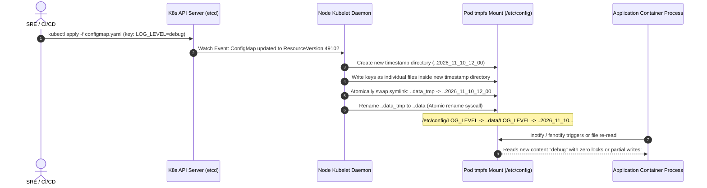
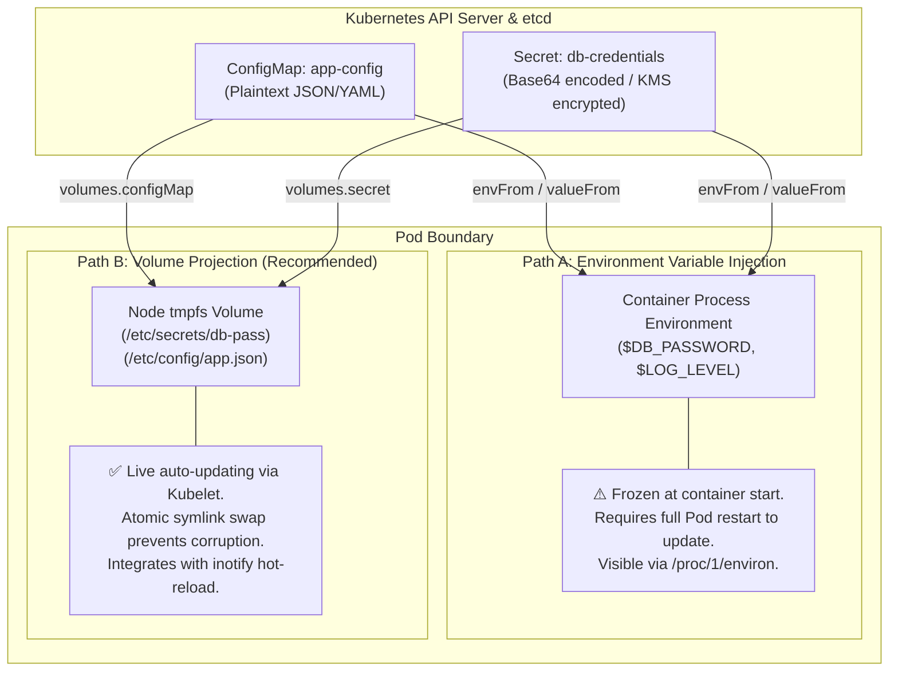
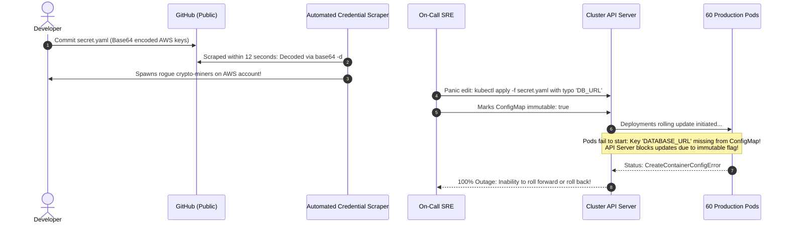

# 05 - ConfigMaps and Secrets

> **Prerequisites**: [02 - Pods & Workloads](../02-pods-and-workloads/README.md), [03 - Deployments & ReplicaSets](../03-deployments-and-replicasets/README.md), [04 - Services & Networking](../04-services-and-networking/README.md).  
> **Target Audience**: Backend Engineers, DevOps Architects, and Security Engineers decoupling runtime state, credentials, and configuration from immutable container images.  
> **Estimated Deep-Dive Time**: 40 minutes.

---

> [!TIP]
> **The Golden Rule of Kubernetes Configuration**: **Base64 is an encoding, never an encryption mechanism.** Never commit raw Secret or ConfigMap manifests to public or private version control. Store non-sensitive configuration in ConfigMaps, treat Secrets as sensitive payloads requiring KMS envelope encryption at rest in `etcd`, and prefer **Volume Projection** over environment variables to enable zero-downtime, live-updating atomic configuration hot-reloads without Pod restarts.

---

## 1. Visual Mental Models: Storage, Projection, and Hot-Reloading

In containerized architectures, the Twelve-Factor App methodology mandates strict separation of config from code. Kubernetes fulfills this with two foundational primitives: `ConfigMap` and `Secret`.

### Secret Lifecycle & Volume Projection (Atomic Symlink Swapping)

When Kubernetes mounts a ConfigMap or Secret as a volume, the `kubelet` writes the data to a memory-backed file system (`tmpfs`) on the node. It uses a triple-symlink indirection scheme to swap updated files atomically without partial reads or race conditions:



---

### Environmental Injection vs Volume Projection



---

## 2. Technical Comparison: ConfigMap vs Secret vs External Vaults

### Primitives Specification Matrix

| Feature | `ConfigMap` | `Secret` (Opaque) | External Secrets Operator (Vault/KMS) |
| :--- | :--- | :--- | :--- |
| **Primary Intent** | Non-confidential app config, flags, server files | Passwords, TLS certificates, OAuth tokens | Enterprise-grade key management & auto-rotation |
| **Storage in etcd** | Plaintext JSON | Base64 encoded (Plaintext unless KMS enabled) | Encrypted at rest in Cloud KMS / Vault |
| **Payload Size Limit** | 1 MiB total manifest size | 1 MiB total manifest size | Unlimited (stored externally; synced on demand) |
| **Live Dynamic Reload** | Supported when mounted as volume | Supported when mounted as volume | Supported with automated rotation triggers |
| **GitOps Safety** | Safe to commit (no secrets) | ❌ **UNSAFE**: Base64 is trivially decoded | Safe: manifest holds external references only |
| **Recommended Access** | Read by broad internal developers | Strict RBAC isolation per namespace | IAM token exchange + automated ephemeral leases |

---

### Secret Types Taxonomy

Kubernetes provides built-in Secret types that enforce schema validation:

```yaml
# 1. kubernetes.io/dockerconfigjson (Container Registry Auth)
apiVersion: v1
kind: Secret
metadata:
  name: acr-registry-auth
type: kubernetes.io/dockerconfigjson
data:
  .dockerconfigjson: eyJhdXRocyI6... # Base64 of ~/.docker/config.json

---
# 2. kubernetes.io/tls (HTTPS Ingress & Service Mesh MTLS)
apiVersion: v1
kind: Secret
metadata:
  name: api-tls-cert
type: kubernetes.io/tls
data:
  tls.crt: LS0tLS1CRUdJTi... # Base64 of public PEM certificate
  tls.key: LS0tLS1CRUdJTi... # Base64 of private RSA/ECDSA key

---
# 3. Opaque (Arbitrary Key-Value Credentials)
apiVersion: v1
kind: Secret
metadata:
  name: db-credentials
type: Opaque
stringData:                 # stringData allows plaintext input; K8s encodes on save!
  DB_USERNAME: "postgres"
  DB_PASSWORD: "SuperSecretPassword123!"
```

---

## 3. Production War Story: The Plaintext Git Leak & The Broken Hotfix

### Incident Overview
A Series-B marketplace platform experienced a credential exfiltration incident followed by a production crash across 60 microservices. An engineer pushed a Kubernetes `Secret` manifest containing AWS production root credentials directly to a public GitHub repository. 

To mitigate the leak, another engineer hastily executed `kubectl edit configmap global-config` to change database endpoints and set `immutable: true`. The ensuing configuration drift triggered widespread `CreateContainerConfigError` loops, knocking the platform offline for 48 minutes.

### The Catastrophic Failure Sequence



### Root Cause Analysis
1. **Base64 Confusion**: The team treated Base64 encoding as security, believing it obfuscated credentials from casual git history scans.
2. **Missing Invariant Validation**: The application referenced `DATABASE_URL` via `env.valueFrom.configMapKeyRef`. The hasty fix renamed the key to `DB_URL`. When a pod spec references a non-existent key, Kubernetes enters `CreateContainerConfigError` and refuses to start the container.
3. **Lockout via Immutable Flag**: Marking the ConfigMap `immutable: true` prevented live emergency hot-patching via `kubectl edit`.

### The Remediation & Modern Hardening Pattern
1. **KMS Envelope Encryption**: Configured `etcd` encryption providers with AWS KMS / GCP Cloud KMS so that raw etcd disk dumps reveal zero cleartext secrets.
2. **Adopted External Secrets Operator (ESO)**: Secret definitions are replaced with `ExternalSecret` custom resources that pull credentials dynamically from HashiCorp Vault or Cloud Secret Manager at runtime.
3. **Automated Secret Scanning**: Pre-commit hooks (`gitleaks`, `trufflehog`) running locally and in CI to block Base64/plaintext credentials from entering git history.

---

## 4. Multi-Language In-Memory Config Hot-Reloading

When mounting ConfigMaps as volumes, modifying the ConfigMap causes the file contents on the volume to update automatically within 10–60 seconds (kubelet sync period). Production applications should watch the file descriptor using OS filesystem notifications (`inotify`) to hot-reload configuration in memory without incurring Pod restarts.

### Go Implementation (fsnotify)

```go
// internal/config/watcher.go
package config

import (
	"context"
	"encoding/json"
	"log"
	"os"
	"path/filepath"
	"sync"

	"github.com/fsnotify/fsnotify"
)

type DynamicAppConfig struct {
	mu       sync.RWMutex
	LogLevel string `json:"log_level"`
	MaxConns int    `json:"max_conns"`
}

type ConfigWatcher struct {
	filePath string
	config   *DynamicAppConfig
	watcher  *fsnotify.Watcher
}

func NewConfigWatcher(filePath string) (*ConfigWatcher, error) {
	w, err := fsnotify.NewWatcher()
	if err != nil {
		return nil, err
	}

	cw := &ConfigWatcher{
		filePath: filePath,
		config:   &DynamicAppConfig{},
		watcher:  w,
	}

	if err := cw.reload(); err != nil {
		return nil, err
	}

	// Kubernetes swaps the parent symlink (..data), so we watch the directory!
	dir := filepath.Dir(filePath)
	if err := w.Add(dir); err != nil {
		return nil, err
	}

	return cw, nil
}

func (cw *ConfigWatcher) reload() error {
	cw.config.mu.Lock()
	defer cw.config.mu.Unlock()

	data, err := os.ReadFile(cw.filePath)
	if err != nil {
		return err
	}

	if err := json.Unmarshal(data, cw.config); err != nil {
		return err
	}

	log.Printf("[Config Hot-Reload] Successfully loaded: LogLevel=%s, MaxConns=%d",
		cw.config.LogLevel, cw.config.MaxConns)
	return nil
}

func (cw *ConfigWatcher) StartWatching(ctx context.Context) {
	go func() {
		for {
			select {
			case <-ctx.Done():
				cw.watcher.Close()
				return
			case event, ok := <-cw.watcher.Events:
				if !ok {
					return
				}
				// Kubernetes atomic symlink swaps emit CREATE/RENAME events on ..data
				if event.Has(fsnotify.Create) || event.Has(fsnotify.Write) {
					if filepath.Base(event.Name) == "..data" || event.Name == cw.filePath {
						_ = cw.reload()
					}
				}
			case err, ok := <-cw.watcher.Errors:
				if !ok {
					return
				}
				log.Printf("[Config Hot-Reload ERROR] Watch error: %v", err)
			}
		}
	}()
}
```

---

### Node.js / TypeScript Implementation (chokidar)

```typescript
// src/config/dynamicConfig.ts
import fs from 'node:fs/promises';
import path from 'node:path';
import chokidar from 'chokidar';

export interface AppConfig {
  logLevel: string;
  cacheTtlSeconds: number;
}

export class DynamicConfigManager {
  private currentConfig: AppConfig = { logLevel: 'info', cacheTtlSeconds: 300 };
  private readonly configPath: string;

  constructor(filePath: string) {
    this.configPath = path.resolve(filePath);
    this.loadInitial();
    this.initWatcher();
  }

  private async loadInitial(): Promise<void> {
    try {
      const raw = await fs.readFile(this.configPath, 'utf8');
      this.currentConfig = JSON.parse(raw);
      console.log(`[Config Initialized] LogLevel: ${this.currentConfig.logLevel}`);
    } catch (err) {
      console.error(`[Config Error] Failed initial load from ${this.configPath}`, err);
    }
  }

  private initWatcher(): void {
    const parentDir = path.dirname(this.configPath);

    // Watch directory for K8s ..data symlink rotation
    const watcher = chokidar.watch(parentDir, {
      ignoreInitial: true,
      depth: 1,
      usePolling: false,
    });

    watcher.on('all', async (event, changedPath) => {
      if (changedPath.endsWith('..data') || changedPath === this.configPath) {
        try {
          const raw = await fs.readFile(this.configPath, 'utf8');
          this.currentConfig = JSON.parse(raw);
          console.log(`[Config Hot-Reload] Config refreshed live without restart!`, this.currentConfig);
        } catch (err) {
          console.error('[Config Hot-Reload] Failed to parse updated config file:', err);
        }
      }
    });
  }

  public get<K extends keyof AppConfig>(key: K): AppConfig[K] {
    return this.currentConfig[key];
  }
}
```

---

### Python Implementation (watchdog)

```python
# config/dynamic_config.py
import json
import logging
import os
import threading
from typing import Any, Dict
from watchdog.observers import Observer
from watchdog.events import FileSystemEventHandler

logger = logging.getLogger("config-watcher")


class K8sConfigEventHandler(FileSystemEventHandler):
    def __init__(self, target_file: str, callback):
        self.target_file = os.path.abspath(target_file)
        self.callback = callback

    def on_any_event(self, event):
        # Kubernetes updates mounted volumes via atomic symlink swaps on "..data"
        if event.src_path.endswith("..data") or os.path.abspath(event.src_path) == self.target_file:
            self.callback()


class DynamicConfig:
    def __init__(self, file_path: str):
        self.file_path = os.path.abspath(file_path)
        self._lock = threading.Lock()
        self._config: Dict[str, Any] = {}
        self._reload()

        # Watch the parent directory
        parent_dir = os.path.dirname(self.file_path)
        self.observer = Observer()
        event_handler = K8sConfigEventHandler(self.file_path, self._reload)
        self.observer.schedule(event_handler, path=parent_dir, recursive=False)
        self.observer.start()

    def _reload(self):
        try:
            with open(self.file_path, "r", encoding="utf-8") as f:
                new_data = json.load(f)
            with self._lock:
                self._config = new_data
            logger.info("[Config Hot-Reload] Loaded configuration: %s", self._config)
        except Exception as exc:
            logger.error("[Config Hot-Reload Failed] %s", exc)

    def get(self, key: str, default: Any = None) -> Any:
        with self._lock:
            return self._config.get(key, default)
```

---

## 5. Practical Hands-On Verification Laboratory

In this lab, you will configure a `ConfigMap` and a `Secret`, inject them as both environment variables and projected volumes, inspect the underlying Linux atomic symlink tree, and observe live updates without restarting the Pod.

### Step 1: Create ConfigMap & Secret with Plaintext `stringData`

Create `05-config-demo.yaml`:

```yaml
apiVersion: v1
kind: ConfigMap
metadata:
  name: app-settings
  namespace: default
data:
  APP_ENV: "production"
  CACHE_ENABLED: "true"
  app_config.json: |
    {
      "log_level": "info",
      "timeout_ms": 3500
    }
---
apiVersion: v1
kind: Secret
metadata:
  name: app-secrets
  namespace: default
type: Opaque
stringData:
  DB_PASSWORD: "CorrectHorseBatteryStaple!"
  API_KEY: "live_sk_9481948194"
```

Apply to the cluster:

```bash
kubectl apply -f 05-config-demo.yaml
```

*Expected Terminal Output:*
```text
configmap/app-settings created
secret/app-secrets created
```

---

### Step 2: Deploy Workload Consuming Both via Env & Volume

Create `05-workload.yaml`:

```yaml
apiVersion: v1
kind: Pod
metadata:
  name: config-explorer
  namespace: default
spec:
  containers:
    - name: explorer
      image: alpine:latest
      command: ["/bin/sh", "-c", "sleep 3600"]
      # 1. Environment Variable Injection
      env:
        - name: RUNTIME_ENV
          valueFrom:
            configMapKeyRef:
              name: app-settings
              key: APP_ENV
        - name: DATABASE_SECRET
          valueFrom:
            secretKeyRef:
              name: app-secrets
              key: DB_PASSWORD
      # 2. Volume Projection
      volumeMounts:
        - name: config-volume
          mountPath: /etc/app/config
          readOnly: true
        - name: secret-volume
          mountPath: /etc/app/secrets
          readOnly: true
  volumes:
    - name: config-volume
      configMap:
        name: app-settings
    - name: secret-volume
      secret:
        secretName: app-secrets
```

Apply and verify:

```bash
kubectl apply -f 05-workload.yaml
kubectl wait --for=condition=Ready pod/config-explorer --timeout=30s
```

---

### Step 3: Inspect Injected Env Vars & Projected Atomic Symlinks

Execute commands inside the running container to inspect the environment and filesystem:

```bash
# Verify environment variables
kubectl exec config-explorer -- env | grep -E "RUNTIME_ENV|DATABASE_SECRET"
```

*Expected Output:*
```text
RUNTIME_ENV=production
DATABASE_SECRET=CorrectHorseBatteryStaple!
```

Now inspect the filesystem volume structure in `/etc/app/config`:

```bash
kubectl exec config-explorer -- ls -la /etc/app/config
```

*Expected Output:*
```text
total 4
drwxrwxrwx    3 root     root          4096 Nov 10 06:40 .
drwxr-xr-x    4 root     root          4096 Nov 10 06:40 ..
drwxr-xr-x    2 root     root          4096 Nov 10 06:40 ..2026_11_10_06_40_12.394109827
lrwxrwxrwx    1 root     root            31 Nov 10 06:40 ..data -> ..2026_11_10_06_40_12.394109827
lrwxrwxrwx    1 root     root            14 Nov 10 06:40 APP_ENV -> ..data/APP_ENV
lrwxrwxrwx    1 root     root            20 Nov 10 06:40 CACHE_ENABLED -> ..data/CACHE_ENABLED
lrwxrwxrwx    1 root     root            22 Nov 10 06:40 app_config.json -> ..data/app_config.json
```

Notice how `APP_ENV` points to `..data/APP_ENV`, which points to the versioned directory `..2026_11_10_...`!

---

### Step 4: Mutate ConfigMap and Observe Live Hot-Reload

Update the ConfigMap in place:

```bash
kubectl patch configmap app-settings --type merge -p '{"data":{"APP_ENV":"disaster-recovery"}}'
```

Wait ~15–30 seconds for the kubelet sync loop, then re-check both the file and the environment variable:

```bash
# 1. Check mounted file (Updates automatically without restart!)
kubectl exec config-explorer -- cat /etc/app/config/APP_ENV

# 2. Check environment variable (STAYS STALE!)
kubectl exec config-explorer -- sh -c 'echo $RUNTIME_ENV'
```

*Expected Output:*
```text
disaster-recovery
production
```

> [!IMPORTANT]
> The mounted file updated live to `disaster-recovery`, while the environment variable remained stale at `production`. To update environment variables, you **must** trigger a rollout restart (`kubectl rollout restart deployment/<name>`).

---

## 6. Command Quick-Reference Cheat Sheet

| Command | Action / Objective | Example Scenario |
| :--- | :--- | :--- |
| `kubectl create cm <name> --from-literal=k=v` | Fast imperative ConfigMap creation | Quick testing in local development |
| `kubectl create cm <name> --from-file=cfg.json` | Load entire configuration file as key | Nginx, Envoy, or Redis config files |
| `kubectl create secret generic <name> --from-literal=k=v` | Imperative Secret creation | Avoid committing plaintext to YAML |
| `kubectl create secret docker-registry <name> ...` | Create container registry auth token | Private image pulling (`imagePullSecrets`) |
| `kubectl get secret <name> -o jsonpath='{.data.<k>}' \| base64 -d` | Direct CLI Secret decoding | Inspecting encoded credentials |
| `kubectl rollout restart deployment <name>` | Force restart pods to pick up new env vars | Applying non-volume config updates |

---

## 7. Operational Validation Checkpoints

### Scenario 1: The `CreateContainerConfigError` Stalemate
**Context:** During an automated CD promotion to staging, several new Pods fail to start, hanging in `CreateContainerConfigError`. The container logs cannot be retrieved (`container not found`).

```
$ kubectl get pods
NAME                             READY   STATUS                       RESTARTS   AGE
billing-worker-674b5c7f8-r8q2m   0/1     CreateContainerConfigError   0          2m
```

<details>
<summary>View Diagnostic Workflow & Resolution</summary>

**Root Cause:**  
The Pod definition contains an `env.valueFrom.configMapKeyRef` or `secretKeyRef` referencing a key or resource name that does not exist or has a typographical error. Unlike volume mounts where a missing ConfigMap by default blocks scheduling with a mount warning, a missing `configMapKeyRef` triggers `CreateContainerConfigError`.

**Diagnostic Commands:**
```bash
# Inspect the Pod's specific Kubernetes events:
kubectl describe pod billing-worker-674b5c7f8-r8q2m | grep -A 8 Events:
# Output:
# Warning  Failed     2m   kubelet  Error: configmap "billing-flags" not found
# (or: Error: couldn't find key STRIPE_SECRET_KEY in Secret default/billing-secrets)
```

**Resolution Steps:**
1. If the key is truly optional, update the Pod manifest to set `optional: true`:
   ```yaml
   valueFrom:
     secretKeyRef:
       name: billing-secrets
       key: STRIPE_SECRET_KEY
       optional: true
   ```
2. Otherwise, provision the missing ConfigMap/Secret or correct the spelling mismatch in the manifest.
</details>

---

### Scenario 2: TLS Secret Rotation Ignored by Long-Lived Connections
**Context:** Your security team rotated the ingress TLS certificate Secret `api-tls-cert`. Running `kubectl describe secret api-tls-cert` confirms the new certificate is active in the cluster. However, external monitoring alerts report that browsers are still receiving the old, expiring certificate.

<details>
<summary>View Diagnostic Workflow & Resolution</summary>

**Root Cause:**  
While Kubernetes updates the projected certificate files in `/etc/tls/` inside the Ingress Controller Pods, many reverse proxies (such as older NGINX ingress configurations or custom Envoy builds) only read certificates into memory upon daemon initialization or require an explicit `SIGHUP` signal / administrative reload call. Furthermore, clients with open HTTP/2 multiplexed connections retain the initial TLS handshake session ticket.

**Diagnostic Commands:**
```bash
# Query certificate directly from pod disk:
kubectl exec -it <ingress-controller-pod> -n ingress-nginx -- openssl x509 -in /etc/ingress-controller/ssl/default-api-tls-cert.pem -noout -dates

# Check live served TLS certificate over the wire:
echo | openssl s_client -servername api.example.com -connect api.example.com:443 2>/dev/null | openssl x509 -noout -dates
```

**Resolution Steps:**
1. Ensure the Ingress Controller has hot-reload watchers enabled or execute a graceful rollout restart:
   ```bash
   kubectl rollout restart deployment ingress-nginx-controller -n ingress-nginx
   ```
2. For custom Go/Node applications serving TLS directly, implement `tls.Config.GetCertificate` to dynamically read updated disk files for every new TLS ClientHello handshake.
</details>

---

### Scenario 3: Cross-Namespace Secret Referencing Attempt
**Context:** A team creates a shared database password Secret in namespace `infra`. An application in namespace `tenant-a` attempts to reference it via:
```yaml
env:
  - name: DB_PASSWORD
    valueFrom:
      secretKeyRef:
        name: infra/shared-db-creds
        key: password
```
The manifest fails to apply or the Pod fails with `Secret "infra/shared-db-creds" not found`.

<details>
<summary>View Diagnostic Workflow & Resolution</summary>

**Root Cause:**  
Kubernetes ConfigMaps and Secrets are strictly **namespaced resources**. A Pod in namespace `tenant-a` can **only** mount or reference ConfigMaps and Secrets that reside in `tenant-a`. The `name` field cannot take slash-delimited namespace paths.

**Resolution Steps:**
1. Do not duplicate secrets manually across namespaces. Use a Kubernetes-native replication operator such as `Reflector` or `External Secrets Operator` (ClusterSecretStore) to automatically mirror approved secrets from `infra` into authorized tenant namespaces.
2. In GitOps pipelines, generate the required Secret into each target namespace using sealed-secrets or SOPS encryption.
</details>

---

## 8. Further Reading & Official Documentation

- [Kubernetes Official Documentation: ConfigMaps](https://kubernetes.io/docs/concepts/configuration/configmap/)
- [Kubernetes Official Documentation: Secrets](https://kubernetes.io/docs/concepts/configuration/secret/)
- [Encrypting Confidential Data at Rest in etcd](https://kubernetes.io/docs/tasks/administer-cluster/encrypt-data/)
- [External Secrets Operator (ESO) Multi-Cloud Sync](https://external-secrets.io/)
- [Atomic Volume Projection and Inotify in Linux Kernels](https://kubernetes.io/docs/concepts/storage/volumes/#projected)

---

## Next

Continue to [06 - Persistent Storage (PV, PVC, and StorageClass)](../06-storage-pv-and-pvc/README.md) to provide stateful database and message broker workloads with durable disk storage that survives Pod restarts and node evictions.
