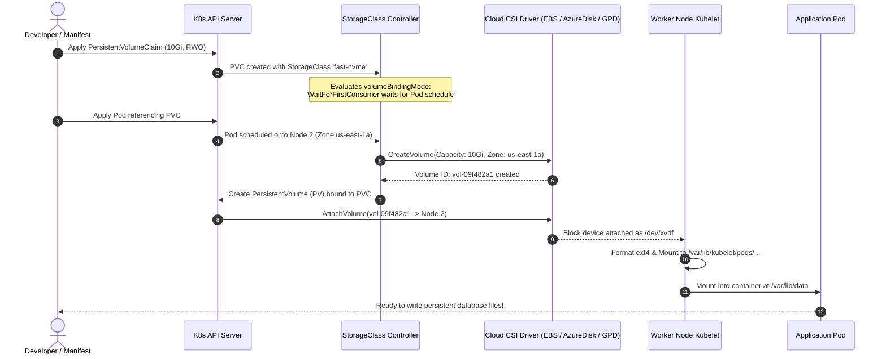
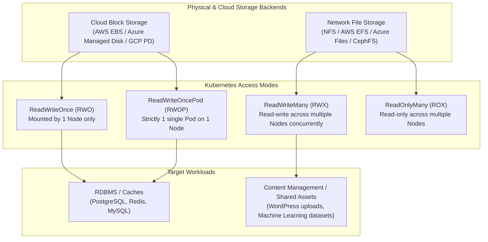
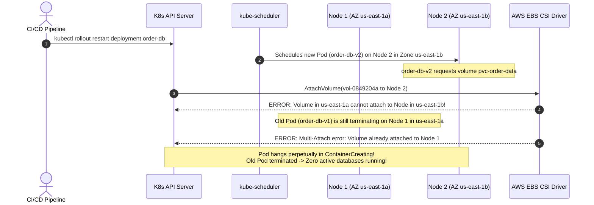

# 06 - Storage: PersistentVolumes, PVCs, and StorageClasses

> **Prerequisites**: [02 - Pods & Workloads](../02-pods-and-workloads/README.md), [03 - Deployments & ReplicaSets](../03-deployments-and-replicasets/README.md).  
> **Target Audience**: Infrastructure Architects, Database Administrators, and Senior Backend Engineers designing durable storage, stateful services, and disaster recovery on Kubernetes.  
> **Estimated Deep-Dive Time**: 40 minutes.

---

> [!TIP]
> **The Golden Rule of Kubernetes Storage**: **Decouple storage requirements from storage mechanics.** Applications must only declare abstract storage requests via `PersistentVolumeClaims` (PVCs); infrastructure engines fulfill them dynamically via `StorageClasses` and Container Storage Interface (CSI) drivers. In multi-availability-zone clusters, **always set `volumeBindingMode: WaitForFirstConsumer`** to prevent catastrophic cross-AZ volume scheduling deadlocks.

---

## 1. Visual Mental Models: The Dynamic Provisioning Pipeline

Unlike stateless web tiers, stateful workloads (PostgreSQL, Kafka, Elasticsearch, Redis) require data on disk to persist across Pod restarts, node evictions, and cluster upgrades.

### The Dynamic Provisioning & Volume Attachment Lifecycle



---

### PersistentVolume Lifecycle State Machine

A PersistentVolume transitions through four discrete phases managed by the volume controller:

```mermaid
stateDiagram-v2
    [*] --> Available: Admin pre-provisions or StorageClass dynamically provisions PV
    Available --> Bound: PVC matches criteria & binds to PV
    Bound --> Released: User deletes PVC; PV retains data
    Released --> Retained: ReclaimPolicy = Retain (Manual recovery / inspection)
    Released --> [*]: ReclaimPolicy = Delete (CSI deletes real cloud disk)
    Bound --> Failed: Automated reclamation error or disk failure
    Failed --> [*]
```



---

### Storage Access Modes Architecture



---

## 2. Technical Comparison: StorageClasses, Provisioners & Policies

### StorageClass Specification Matrix

| Feature | AWS EBS CSI (`ebs.csi.aws.com`) | Azure Disk CSI (`disk.csi.azure.com`) | GCP PD CSI (`pd.csi.storage.gke.io`) | Local Path (`rancher.io/local-path`) |
| :--- | :--- | :--- | :--- | :--- |
| **Backend Type** | Cloud Block Volume (gp3/io2) | Managed Disk (Premium_LRS) | Persistent Disk (pd-ssd) | Local Node Directory (`/opt/local-path`) |
| **Supported Access Modes** | `RWO`, `RWOP` | `RWO`, `RWOP` | `RWO`, `RWOP` | `RWO` only |
| **Multi-Node Sharing (RWX)** | ❌ No (Requires EFS CSI) | ❌ No (Requires Azure File CSI) | ❌ No (Requires Filestore CSI) | ❌ No |
| **Volume Expansion** | Supported (`AllowVolumeExpansion: true`) | Supported | Supported | Not supported |
| **Snapshot Support** | Supported via VolumeSnapshot | Supported | Supported | ❌ No |
| **Node Failure Survival** | Detaches and re-attaches to new node in same AZ | Detaches and re-attaches | Detaches and re-attaches | ❌ Bound permanently to node filesystem |

---

### Reclaim Policies & Binding Modes

```yaml
apiVersion: storage.k8s.io/v1
kind: StorageClass
metadata:
  name: production-sc
provisioner: ebs.csi.aws.com
reclaimPolicy: Retain              # 'Delete' (default) destroys disk; 'Retain' keeps it for safety
volumeBindingMode: WaitForFirstConsumer # DELAYS volume creation until Pod is scheduled!
allowVolumeExpansion: true         # Allows resizing PVC online without data loss
parameters:
  type: gp3
  iops: "3000"
  throughput: "125"
```

1. **`reclaimPolicy: Delete`**: As soon as the developer deletes the PVC, the underlying cloud disk is permanently destroyed. Recommended for ephemeral preview environments.
2. **`reclaimPolicy: Retain`**: When the PVC is deleted, the PV transitions to `Released`. The underlying cloud disk remains untouched in AWS/Azure/GCP, allowing platform engineers to salvage raw database files.
3. **`volumeBindingMode: Immediate`**: The storage backend provisions the disk the moment the PVC is created. If your cluster is multi-AZ, the disk may be provisioned in `us-east-1a`, while your Pod is later scheduled in `us-east-1b`, resulting in a fatal mounting deadlock!
4. **`volumeBindingMode: WaitForFirstConsumer`**: Kubernetes delays disk provisioning until the Pod is placed onto a specific node by `kube-scheduler`, guaranteeing zone alignment.

---

## 3. Production War Story: The Cross-AZ Multi-Attach Deadlock

### Incident Overview
An e-commerce order processing database running on PostgreSQL was scheduled for a rolling upgrade during Black Friday preparations. Within 60 seconds of triggering `kubectl rollout restart deployment/order-db`, the database went completely dark. Upstream checkout services cascaded into 500 errors. Total downtime: 38 minutes.

### The Catastrophic Failure Sequence



### Root Cause Analysis
1. The original StorageClass was configured with `volumeBindingMode: Immediate`. The EBS volume had been pre-allocated in Availability Zone `us-east-1a`.
2. When the Deployment rollout triggered, `kube-scheduler` scheduled the replacement Pod on a worker node in `us-east-1b` because `us-east-1a` had higher CPU pressure.
3. Cloud block storage (AWS EBS, Azure Disk) cannot cross physical availability zone boundaries. The volume could physically never attach to Node 2.
4. Furthermore, because a `Deployment` was used instead of a `StatefulSet`, the new Pod attempted to attach the `ReadWriteOnce` volume before the old Pod had unmounted and detached it, causing the Linux kernel and cloud hypervisor to throw `Multi-Attach error for volume`.

### The Remediation & Permanent Prevention
1. The platform team rebuilt the StorageClass with `volumeBindingMode: WaitForFirstConsumer`.
2. Stateful workloads were migrated from `Deployment` to `StatefulSet` with `volumeClaimTemplates` to ensure strict single-replica termination before re-attachment (`OrderedReady`).
3. Node affinity and zone constraints were explicitly injected to lock stateful workloads to their persistent volume's topology zone:

```yaml
spec:
  affinity:
    nodeAffinity:
      requiredDuringSchedulingIgnoredDuringExecution:
        nodeSelectorTerms:
          - matchExpressions:
              - key: topology.kubernetes.io/zone
                operator: In
                values:
                  - us-east-1a
```

---

## 4. Multi-Language Resilient Disk I/O Implementations

When writing data to network-attached or cloud-managed persistent volumes, backend applications must guarantee that buffers are committed to non-volatile storage (`fsync`) and use atomic file swapping (`write-to-temp + rename`) to prevent partial writes during unexpected Pod evictions.

### Go Implementation

```go
// internal/storage/persistent_writer.go
package storage

import (
	"fmt"
	"os"
	"path/filepath"
	"syscall"
)

type AtomicPersistentWriter struct {
	baseDir string
}

func NewAtomicPersistentWriter(mountPath string) (*AtomicPersistentWriter, error) {
	if err := os.MkdirAll(mountPath, 0755); err != nil {
		return nil, fmt.Errorf("failed to initialize mount dir: %w", err)
	}
	return &AtomicPersistentWriter{baseDir: mountPath}, nil
}

// WriteAtomic writes data to a temporary file, flushes to disk (fsync), and renames atomically.
func (w *AtomicPersistentWriter) WriteAtomic(filename string, data []byte) error {
	finalPath := filepath.Join(w.baseDir, filename)
	tmpPath := filepath.Join(w.baseDir, fmt.Sprintf(".%s.tmp", filename))

	// 1. Open temporary file with exclusive write lock
	f, err := os.OpenFile(tmpPath, os.O_CREATE|os.O_WRONLY|os.O_TRUNC, 0644)
	if err != nil {
		return fmt.Errorf("cannot create tmp file: %w", err)
	}
	defer os.Remove(tmpPath) // Cleanup if error occurs before rename

	// Lock file to avoid concurrent writes from multiple goroutines
	if err := syscall.Flock(int(f.Fd()), syscall.LOCK_EX); err != nil {
		f.Close()
		return fmt.Errorf("file lock failed: %w", err)
	}
	defer syscall.Flock(int(f.Fd()), syscall.LOCK_UN)

	// 2. Write payload
	if _, err := f.Write(data); err != nil {
		f.Close()
		return fmt.Errorf("write payload failed: %w", err)
	}

	// 3. Force kernel dirty pages to flush to physical cloud storage (fsync)
	if err := f.Sync(); err != nil {
		f.Close()
		return fmt.Errorf("fsync failed: %w", err)
	}
	f.Close()

	// 4. POSIX atomic rename replaces destination without race conditions
	if err := os.Rename(tmpPath, finalPath); err != nil {
		return fmt.Errorf("atomic rename failed: %w", err)
	}

	return nil
}
```

---

### Node.js / TypeScript Implementation

```typescript
// src/storage/resilientStorage.ts
import fs from 'node:fs/promises';
import path from 'node:path';
import crypto from 'node:crypto';

export class ResilientStorageManager {
  private readonly mountPath: string;

  constructor(mountPath: string) {
    this.mountPath = path.resolve(mountPath);
  }

  async saveRecordAtomic(recordId: string, payload: Record<string, unknown>): Promise<void> {
    const finalFile = path.join(this.mountPath, `${recordId}.json`);
    const tempFile = path.join(this.mountPath, `.${recordId}.${crypto.randomUUID()}.tmp`);

    const serialized = JSON.stringify(payload, null, 2);

    let fileHandle;
    try {
      // 1. Open temp file
      fileHandle = await fs.open(tempFile, 'w');

      // 2. Write buffer
      await fileHandle.writeFile(serialized, 'utf8');

      // 3. Issue OS sync syscall to guarantee cloud disk persistence
      await fileHandle.sync();
      await fileHandle.close();
      fileHandle = undefined;

      // 4. Atomic directory entry swap
      await fs.rename(tempFile, finalFile);
    } catch (error) {
      if (fileHandle) {
        await fileHandle.close();
      }
      // Clean up orphaned temp file
      await fs.unlink(tempFile).catch(() => {});
      throw new Error(`Atomic write to PVC at [${finalFile}] failed: ${(error as Error).message}`);
    }
  }
}
```

---

### Python Implementation

```python
# storage/resilient_storage.py
import json
import os
import tempfile
from typing import Any, Dict


class ResilientPvcStorage:
    """Production-grade persistent file storage for K8s PVC mounts."""

    def __init__(self, mount_path: str):
        self.mount_path = os.path.abspath(mount_path)
        os.makedirs(self.mount_path, exist_ok=True)

    def write_atomic(self, filename: str, data: Dict[str, Any]) -> str:
        final_path = os.path.join(self.mount_path, filename)
        dir_name = os.path.dirname(final_path)

        # 1. Create secure temp file in the same filesystem (same PVC mount)
        with tempfile.NamedTemporaryFile("w", dir=dir_name, delete=False, encoding="utf-8") as tf:
            temp_name = tf.name
            json.dump(data, tf, indent=2)
            tf.flush()
            # 2. Force hardware/CSI sync
            os.fsync(tf.fileno())

        # 3. Atomic rename guarantees no readers see half-written files
        try:
            os.replace(temp_name, final_path)
            return final_path
        except Exception as ex:
            if os.path.exists(temp_name):
                os.remove(temp_name)
            raise IOError(f"Failed atomic swap to {final_path}: {ex}") from ex
```

---

## 5. Practical Hands-On Verification Laboratory

In this lab, you will inspect your cluster's default `StorageClass`, dynamically allocate a 1Gi `PersistentVolumeClaim`, run a Pod that writes persistent state, destroy the Pod, and verify that a newly provisioned Pod mounts the same volume with 100% data integrity.

### Step 1: Inspect Cluster StorageClasses

Check what dynamic provisioners exist in your cluster:

```bash
kubectl get storageclass
```

*Expected Terminal Output (e.g. on kind / AKS):*
```text
NAME                 PROVISIONER             RECLAIMPOLICY   VOLUMEBINDINGMODE      ALLOWVOLUMEEXPANSION   AGE
standard (default)   rancher.io/local-path   Delete          WaitForFirstConsumer   false                  14d
```

---

### Step 2: Create PersistentVolumeClaim (PVC)

Save the manifest as `06-storage-claim.yaml`:

```yaml
apiVersion: v1
kind: PersistentVolumeClaim
metadata:
  name: app-data-pvc
  namespace: default
spec:
  accessModes:
    - ReadWriteOnce
  resources:
    requests:
      storage: 1Gi
```

Apply and inspect:

```bash
kubectl apply -f 06-storage-claim.yaml
kubectl get pvc app-data-pvc
```

*Expected Terminal Output:*
```text
NAME           STATUS    VOLUME   CAPACITY   ACCESS MODES   STORAGECLASS   AGE
app-data-pvc   Pending                                      standard       5s
```

> [!NOTE]
> The status is `Pending` because `volumeBindingMode` is set to `WaitForFirstConsumer`! It is waiting for a Pod to be scheduled before creating the PV.

---

### Step 3: Run Pod to Write Persistent State

Create `06-writer-pod.yaml`:

```yaml
apiVersion: v1
kind: Pod
metadata:
  name: data-writer
  namespace: default
spec:
  containers:
    - name: writer
      image: alpine:latest
      command:
        - "/bin/sh"
        - "-c"
        - |
          echo "Persisted Transaction: TX-90021-SUCCESS" >> /data/transactions.log
          echo "Pod $(hostname) wrote entry at $(date)" >> /data/transactions.log
          sleep 3600
      volumeMounts:
        - name: storage
          mountPath: /data
  volumes:
    - name: storage
      persistentVolumeClaim:
        claimName: app-data-pvc
```

Apply and watch binding:

```bash
kubectl apply -f 06-writer-pod.yaml
kubectl wait --for=condition=Ready pod/data-writer --timeout=60s
kubectl get pvc app-data-pvc
kubectl get pv
```

*Expected Terminal Output:*
```text
pod/data-writer condition met

NAME           STATUS   VOLUME                                     CAPACITY   ACCESS MODES   STORAGECLASS   AGE
app-data-pvc   Bound    pvc-89b5c328-98e1-456c-bc4a-912a784d14e1   1Gi        RWO            standard       45s

NAME                                       CAPACITY   ACCESS MODES   RECLAIMPOLICY   STATUS   CLAIM                  STORAGECLASS
pvc-89b5c328-98e1-456c-bc4a-912a784d14e1   1Gi        RWO            Delete          Bound    default/app-data-pvc   standard
```

---

### Step 4: Destroy the Pod and Validate Data Survival

Delete the writer Pod:

```bash
kubectl delete pod data-writer
```

Now, create a second reader Pod (`06-reader-pod.yaml`) referencing the identical PVC:

```yaml
apiVersion: v1
kind: Pod
metadata:
  name: data-reader
  namespace: default
spec:
  containers:
    - name: reader
      image: alpine:latest
      command:
        - "/bin/sh"
        - "-c"
        - "cat /data/transactions.log && sleep 3600"
      volumeMounts:
        - name: storage
          mountPath: /data
  volumes:
    - name: storage
      persistentVolumeClaim:
        claimName: app-data-pvc
```

Apply and inspect logs:

```bash
kubectl apply -f 06-reader-pod.yaml
kubectl wait --for=condition=Ready pod/data-reader --timeout=30s
kubectl logs data-reader
```

*Expected Output:*
```text
Persisted Transaction: TX-90021-SUCCESS
Pod data-writer wrote entry at Tue Nov 10 06:50:14 UTC 2026
```

The data written by `data-writer` survived the complete destruction of the Pod and was seamlessly read by `data-reader`.

---

## 6. Command Quick-Reference Cheat Sheet

| Command | Action / Objective | Example Scenario |
| :--- | :--- | :--- |
| `kubectl get sc` | List all StorageClasses & identify default | Check cluster storage provisioners |
| `kubectl get pv,pvc` | List physical storage volumes & claims | Debug volume binding issues |
| `kubectl describe pvc <name>` | View dynamic provisioning events | Diagnose `FailedBinding` errors |
| `kubectl describe pv <name>` | Inspect underlying cloud volume ID | Map PV to AWS EBS / Azure Disk ID |
| `kubectl patch pv <name> -p '{"spec":{"persistentVolumeReclaimPolicy":"Retain"}}'` | Change reclaim policy on live PV | Prevent accidental data loss before deleting claim |
| `kubectl patch pvc <name> -p '{"spec":{"resources":{"requests":{"storage":"20Gi"}}}}'` | Trigger online volume expansion | Resize disk without downtime (if supported) |

---

## 7. Operational Validation Checkpoints

### Scenario 1: `Multi-Attach error for volume` During Rolling Deployment
**Context:** You deploy a rolling update to a stateful database running with `replicas: 1` as a `Deployment`. The new Pod stays in `ContainerCreating` for over 10 minutes. Running `kubectl describe pod` reveals:
`Multi-Attach error for volume "pvc-xyz". Volume is already exclusively attached to one node and can't be attached to another.`

<details>
<summary>View Diagnostic Workflow & Resolution</summary>

**Root Cause:**  
`Deployment` controllers use a rolling update strategy (`maxSurge: 25%`), which spins up the replacement Pod *before* terminating the existing Pod. Because the volume access mode is `ReadWriteOnce` (RWO), the cloud hypervisor refuses to attach the disk to the second node while the first node holds the block lock.

**Diagnostic Commands:**
```bash
# Check VolumeAttachment objects:
kubectl get volumeattachments
# Identify node holding lock:
kubectl describe volumeattachment <attachment-id>
```

**Resolution Steps:**
1. Stateful databases must **never** be managed by standard `Deployment` objects with rolling updates. Migrate to a `StatefulSet`.
2. If forced to use a `Deployment`, change the strategy to `type: Recreate`:
   ```yaml
   spec:
     strategy:
       type: Recreate
   ```
   This guarantees Kubernetes terminates the old Pod and detaches the disk before attempting to start the new Pod.
</details>

---

### Scenario 2: Volume Stuck in `Pending` Due to StorageClass Mismatch
**Context:** A developer submits a PVC manifest requesting `storageClassName: fast-nvme`. The PVC remains in `Pending` indefinitely. No error events appear on the PVC.

```
$ kubectl get pvc
NAME           STATUS    VOLUME   CAPACITY   ACCESS MODES   STORAGECLASS   AGE
cache-claim    Pending                                      fast-nvme      15m
```

<details>
<summary>View Diagnostic Workflow & Resolution</summary>

**Root Cause:**  
The requested `StorageClass` does not exist in the cluster, or its provisioner plugin is not installed. When a non-existent StorageClass is specified, the PVC controller waits indefinitely without throwing a hard validation error.

**Diagnostic Commands:**
```bash
# Check if StorageClass exists:
kubectl get storageclass fast-nvme
# Output: Error from server (NotFound): storageclasses.storage.k8s.io "fast-nvme" not found

# View PVC events:
kubectl describe pvc cache-claim | grep -A 5 Events:
# Output: Warning  ProvisioningFailed  storageclass.storage.k8s.io "fast-nvme" not found
```

**Resolution Steps:**
1. List available StorageClasses (`kubectl get sc`).
2. Update the PVC manifest with a valid StorageClass name or omit the field to use the cluster's default StorageClass.
</details>

---

### Scenario 3: Accidental PVC Deletion with `ReclaimPolicy: Retain`
**Context:** An engineer accidentally runs `kubectl delete pvc prod-db-claim`. The application crashes. The engineer realizes the PV had `persistentVolumeReclaimPolicy: Retain`. The underlying data still exists, but the PV is stuck in status `Released`. How do you re-bind it to a new PVC?

<details>
<summary>View Diagnostic Workflow & Resolution</summary>

**Root Cause:**  
When a PVC bound to a `Retain` PV is deleted, the PV transitions to `Released`, not `Available`. It retains a claim reference pointer (`spec.claimRef`) to the deleted PVC, preventing any new PVC from claiming it.

**Diagnostic Commands:**
```bash
kubectl get pv
# STATUS: Released
```

**Resolution Steps:**
1. Strip the old `claimRef` from the PV spec so Kubernetes marks it `Available` again:
   ```bash
   kubectl patch pv <pv-name> --type json -p '[{"op": "remove", "path": "/spec/claimRef"}]'
   ```
2. Verify the PV status changes from `Released` to `Available`:
   ```bash
   kubectl get pv <pv-name>
   ```
3. Re-create the PVC with the exact same name, capacity, and access mode. It will instantly re-bind to the existing PV with all data intact.
</details>

---

## 8. Further Reading & Official Documentation

- [Kubernetes Persistent Volumes Official Reference](https://kubernetes.io/docs/concepts/storage/persistent-volumes/)
- [Kubernetes Storage Classes Guide](https://kubernetes.io/docs/concepts/storage/storage-classes/)
- [Container Storage Interface (CSI) Specification](https://kubernetes.io/docs/concepts/storage/volumes/#csi)
- [Managing Stateful Applications with StatefulSets](https://kubernetes.io/docs/concepts/workloads/controllers/statefulset/)
- [Kubernetes Volume Snapshots and Restores](https://kubernetes.io/docs/concepts/storage/volume-snapshots/)

---

## Next

Continue to [07 - Helm: The Kubernetes Package Manager](../07-helm-package-manager/README.md) to package, template, parameterize, and version entire stacks of Kubernetes manifests into reusable charts.
