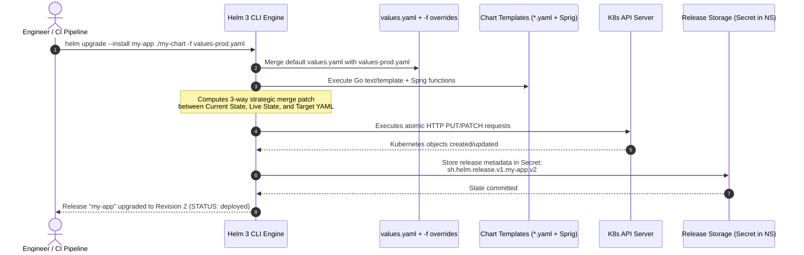
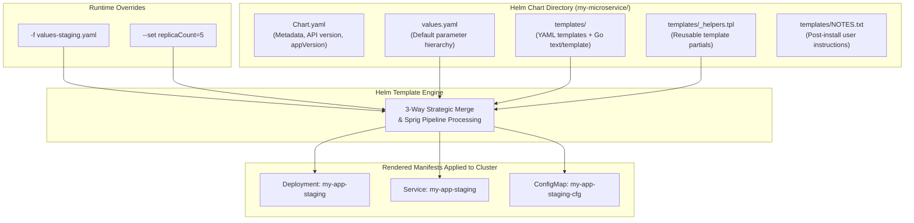
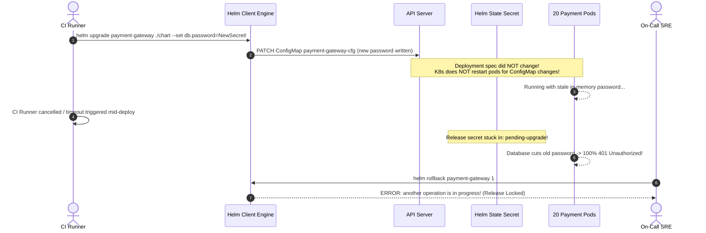

# 07 - Helm: The Kubernetes Package Manager

> **Prerequisites**: [03 - Deployments & ReplicaSets](../03-deployments-and-replicasets/README.md), [04 - Services & Networking](../04-services-and-networking/README.md), [05 - ConfigMaps & Secrets](../05-configmaps-and-secrets/README.md).  
> **Target Audience**: DevOps Engineers, Platform Architects, and Site Reliability Engineers standardizing multi-environment manifest templating, release lifecycles, and rollback automation.  
> **Estimated Deep-Dive Time**: 40 minutes.

---

> [!TIP]
> **The Golden Rule of Helm**: **Never deploy bare manifests without automated configuration rollouts.** In standard Kubernetes, updating a ConfigMap or Secret does not trigger a Deployment rollout. In production Helm charts, always annotate your Pod template with `checksum/config: {{ include (print $.Template.BasePath "/configmap.yaml") . | sha256sum }}` so changes to values automatically trigger rolling Pod updates. Treat Helm releases as atomic, versioned transaction units.

---

## 1. Visual Mental Models: Helm 3 Architecture & Lifecycle

Prior to Helm 3, Helm relied on an in-cluster pod called `Tiller` with cluster-admin rights, creating an enterprise security vulnerability. **Helm 3** eliminated Tiller completely. It operates entirely client-side, using your local `kubeconfig` context and storing release state directly as versioned Kubernetes Secrets inside the target namespace.

### The Helm Release & Templating Pipeline



---

### Chart Directory Anatomy & Evaluation Order



---

## 2. Technical Comparison: Helm Template Directives & Functions

### Built-in Objects Specification Matrix

| Built-in Object | Scope & Contents | Production Usage Example |
| :--- | :--- | :--- |
| **`.Values`** | Key-value pairs passed from `values.yaml` and CLI flags | `{{ .Values.image.repository }}:{{ .Values.image.tag }}` |
| **`.Release`** | Metadata regarding the active release lifecycle | `{{ .Release.Name }}`, `{{ .Release.Namespace }}`, `{{ .Release.Revision }}` |
| **`.Chart`** | Contents declared within `Chart.yaml` | `{{ .Chart.Name }}-{{ .Chart.Version }}` |
| **`.Files`** | Access to non-template files inside the chart directory | `{{ .Files.Get "config/server.conf" }}` |
| **`.Capabilities`** | Cluster API versions and Kubernetes version details | `{{ if .Capabilities.APIVersions.Has "monitoring.coreos.com/v1" }}` |
| **`.Template`** | Information about the executing template file | `{{ .Template.BasePath }}` |

---

### Essential Sprig Pipelines & Go Template Functions

Helm incorporates the [Sprig template library](https://masterminds.github.io/sprig/), providing over 100 cryptographic, string, and data transformation functions:

```yaml
# 1. nindent: Indent with leading newline (critical for embedding blocks)
resources:
  {{- toYaml .Values.resources | nindent 12 }}

# 2. default: Fallback value if parameter is empty
image: "{{ .Values.image.repository }}:{{ .Values.image.tag | default .Chart.AppVersion }}"

# 3. quote / squote: Enforce valid string quoting in generated YAML
env:
  - name: PORT
    value: {{ .Values.service.port | quote }}

# 4. required: Fail build early if a mandatory value was omitted
databasePassword: {{ required "A valid .Values.database.password is required!" .Values.database.password | b64enc | quote }}

# 5. sha256sum: Checksum calculation for zero-downtime rolling updates
annotations:
  checksum/config: {{ include (print $.Template.BasePath "/configmap.yaml") . | sha256sum }}
```

---

## 3. Production War Story: The Silent ConfigMap Stale Cache & The Locked Release

### Incident Overview
A fintech payment processing platform deployed a critical database credential rotation via Helm. The CI/CD pipeline logged `Release "payment-gateway" updated successfully`. However, 10 minutes later, the database old password expired, and all checkout requests failed with `Connection Authentication Error (401)`.

When the SRE attempted an immediate rollback, Helm threw an unrecoverable error: `Error: upgrade: another operation (install/upgrade/rollback) is in progress`. The release was locked in `pending-upgrade`.

### The Catastrophic Failure Sequence



### Root Cause Analysis
1. **Missing Config Checksum**: The chart mounted the database password as an environment variable via `configMapKeyRef`. In Kubernetes, updating a ConfigMap does **not** change the Deployment’s `spec.template.spec`, so no rollout occurs. The Pods continued running with the old password until the external database revoked it.
2. **Aborted Deployment Lock**: During the deployment, the CI runner timed out and terminated the process before Helm committed the final status. Helm marks releases as `pending-upgrade` during operations to prevent concurrent modifications. Because the previous job died abruptly, the release stayed locked.

### The Remediation & Permanent Fix
1. **Unlocking the Release**:
   ```bash
   # Identify the stuck pending release secret:
   kubectl get secret -l owner=helm,name=payment-gateway -n prod --sort-by=.metadata.creationTimestamp
   # Output: sh.helm.release.v1.payment-gateway.v5 (status: pending-upgrade)

   # Delete or patch the pending release secret:
   kubectl delete secret sh.helm.release.v1.payment-gateway.v5 -n prod

   # Rollback cleanly to the last stable revision:
   helm rollback payment-gateway 4 -n prod
   ```
2. **Automatic Rolling Restart via Pod Checksum**: Added the checksum annotation to `templates/deployment.yaml`:
   ```yaml
   spec:
     template:
       metadata:
         annotations:
           checksum/config: {{ include (print $.Template.BasePath "/configmap.yaml") . | sha256sum }}
   ```
   Now, any change to `values.yaml` or `configmap.yaml` changes the checksum string, forcing Kubernetes to execute a seamless rolling rollout of new Pods.

---

## 4. Multi-Language Programmatic Helm Deployments

While local developers use the `helm` CLI, production infrastructure platforms (such as internal developer portals, deployment orchestrators, or GitOps operators) trigger Helm releases programmatically using SDKs.

### Go Implementation (Official Helm v3 Action SDK)

```go
// internal/deployer/helm_deployer.go
package deployer

import (
	"fmt"
	"log"
	"os"
	"time"

	"helm.sh/helm/v3/pkg/action"
	"helm.sh/helm/v3/pkg/chart/loader"
	"helm.sh/helm/v3/pkg/cli"
)

type HelmReleaseManager struct {
	settings *cli.EnvSettings
}

func NewHelmReleaseManager() *HelmReleaseManager {
	return &HelmReleaseManager{
		settings: cli.New(),
	}
}

func (m *HelmReleaseManager) UpgradeOrInstall(releaseName, namespace, chartPath string, values map[string]interface{}) error {
	actionConfig := new(action.Configuration)
	if err := actionConfig.Init(m.settings.RESTClientGetter(), namespace, os.Getenv("HELM_DRIVER"), log.Printf); err != nil {
		return fmt.Errorf("failed to init helm configuration: %w", err)
	}

	// 1. Check if release exists to choose Upgrade or Install
	histClient := action.NewHistory(actionConfig)
	histClient.Max = 1
	_, err := histClient.Run(releaseName)

	chart, err := loader.Load(chartPath)
	if err != nil {
		return fmt.Errorf("failed to load chart from %s: %w", chartPath, err)
	}

	if err != nil {
		// Release does not exist -> Install
		install := action.NewInstall(actionConfig)
		install.ReleaseName = releaseName
		install.Namespace = namespace
		install.CreateNamespace = true
		install.Wait = true
		install.Timeout = 3 * time.Minute

		rel, err := install.Run(chart, values)
		if err != nil {
			return fmt.Errorf("helm install failed: %w", err)
		}
		log.Printf("Successfully installed %s (Revision %d)", rel.Name, rel.Version)
	} else {
		// Release exists -> Upgrade
		upgrade := action.NewUpgrade(actionConfig)
		upgrade.Namespace = namespace
		upgrade.Wait = true
		upgrade.Timeout = 3 * time.Minute

		rel, err := upgrade.Run(releaseName, chart, values)
		if err != nil {
			return fmt.Errorf("helm upgrade failed: %w", err)
		}
		log.Printf("Successfully upgraded %s (Revision %d)", rel.Name, rel.Version)
	}

	return nil
}
```

---

### Node.js / TypeScript Implementation (Helm Execution Wrapper)

```typescript
// src/deploy/helmService.ts
import { execFile } from 'node:child_process';
import { promisify } from 'node:util';
import fs from 'node:fs/promises';
import path from 'node:path';
import os from 'node:os';

const execFileAsync = promisify(execFile);

export interface HelmDeployOptions {
  releaseName: string;
  namespace: string;
  chartPath: string;
  values: Record<string, unknown>;
  timeoutMinutes?: number;
}

export class HelmDeploymentService {
  async deploy(options: HelmDeployOptions): Promise<string> {
    const tempDir = await fs.mkdtemp(path.join(os.tmpdir(), 'helm-values-'));
    const tempValuesPath = path.join(tempDir, 'override-values.json');

    try {
      // 1. Serialize dynamic values to temporary JSON file
      await fs.writeFile(tempValuesPath, JSON.stringify(options.values), 'utf8');

      // 2. Execute atomic helm upgrade --install
      const timeout = `${options.timeoutMinutes || 5}m`;
      const args = [
        'upgrade',
        '--install',
        options.releaseName,
        options.chartPath,
        '--namespace',
        options.namespace,
        '--create-namespace',
        '--values',
        tempValuesPath,
        '--wait',
        '--timeout',
        timeout,
      ];

      const { stdout } = await execFileAsync('helm', args);
      return stdout;
    } catch (error: any) {
      throw new Error(`Helm deployment of [${options.releaseName}] failed: ${error.stderr || error.message}`);
    } finally {
      // Clean up secure temporary values file
      await fs.rm(tempDir, { recursive: true, force: true }).catch(() => {});
    }
  }

  async rollback(releaseName: string, namespace: string, revision: number): Promise<string> {
    const args = ['rollback', releaseName, revision.toString(), '--namespace', namespace, '--wait'];
    const { stdout } = await execFileAsync('helm', args);
    return stdout;
  }
}
```

---

### Python Implementation (Subprocess Helm Wrapper)

```python
# deploy/helm_service.py
import json
import subprocess
import tempfile
from typing import Any, Dict


class HelmDeployer:
    """Production-grade Helm release automation engine."""

    def __init__(self, kubeconfig_path: str = None):
        self.kubeconfig = kubeconfig_path

    def upgrade_install(
        self,
        release_name: str,
        namespace: str,
        chart_dir: str,
        values: Dict[str, Any],
        timeout: str = "5m"
    ) -> str:
        with tempfile.NamedTemporaryFile("w", suffix=".json", delete=False) as f:
            json.dump(values, f)
            temp_values = f.name

        cmd = [
            "helm", "upgrade", "--install", release_name, chart_dir,
            "--namespace", namespace,
            "--create-namespace",
            "-f", temp_values,
            "--wait",
            "--timeout", timeout
        ]

        try:
            result = subprocess.run(
                cmd,
                check=True,
                capture_output=True,
                text=True
            )
            return result.stdout.strip()
        except subprocess.CalledProcessError as exc:
            raise RuntimeError(
                f"Helm command failed with exit code {exc.returncode}: {exc.stderr}"
            ) from exc
```

---

## 5. Practical Hands-On Verification Laboratory

In this hands-on laboratory, you will create a custom Helm chart from scratch, configure template partials (`_helpers.tpl`), embed dynamic ConfigMap checksum annotations, deploy to your cluster, perform an upgrade, and execute a verified rollback.

### Step 1: Scaffold Chart Directory

Create the chart directory tree:

```bash
mkdir -p demo-chart/templates
```

Create `demo-chart/Chart.yaml`:

```yaml
apiVersion: v2
name: demo-chart
description: High-reliability microservice chart
type: application
version: 0.1.0
appVersion: "1.25.0"
```

Create `demo-chart/values.yaml`:

```yaml
replicaCount: 2

image:
  repository: nginx
  tag: "1.25.0"
  pullPolicy: IfNotPresent

service:
  type: ClusterIP
  port: 80

config:
  appEnvironment: "production"
  logLevel: "info"
```

---

### Step 2: Create Template Files & Rolling Checksum

Create `demo-chart/templates/_helpers.tpl`:

```yaml
{{/*
Expand the name of the chart.
*/}}
{{- define "demo-chart.fullname" -}}
{{- printf "%s-%s" .Release.Name .Chart.Name | trunc 63 | trimSuffix "-" -}}
{{- end -}}
```

Create `demo-chart/templates/configmap.yaml`:

```yaml
apiVersion: v1
kind: ConfigMap
metadata:
  name: {{ include "demo-chart.fullname" . }}-config
  namespace: {{ .Release.Namespace }}
data:
  APP_ENV: {{ .Values.config.appEnvironment | quote }}
  LOG_LEVEL: {{ .Values.config.logLevel | quote }}
```

Create `demo-chart/templates/deployment.yaml`:

```yaml
apiVersion: apps/v1
kind: Deployment
metadata:
  name: {{ include "demo-chart.fullname" . }}
  namespace: {{ .Release.Namespace }}
spec:
  replicas: {{ .Values.replicaCount }}
  selector:
    matchLabels:
      app: {{ include "demo-chart.fullname" . }}
  template:
    metadata:
      labels:
        app: {{ include "demo-chart.fullname" . }}
      annotations:
        # Crucial: Forces Pod restart when ConfigMap changes!
        checksum/config: {{ include (print $.Template.BasePath "/configmap.yaml") . | sha256sum }}
    spec:
      containers:
        - name: web
          image: "{{ .Values.image.repository }}:{{ .Values.image.tag }}"
          imagePullPolicy: {{ .Values.image.pullPolicy }}
          ports:
            - containerPort: 80
          envFrom:
            - configMapRef:
                name: {{ include "demo-chart.fullname" . }}-config
```

---

### Step 3: Lint, Template, and Install

Run dry-run linting and inspect the rendered YAML before cluster execution:

```bash
# 1. Lint the chart
helm lint ./demo-chart

# 2. Render locally without contacting Kubernetes
helm template test-release ./demo-chart
```

Install the release into the `demo` namespace:

```bash
helm upgrade --install web-app ./demo-chart --namespace demo --create-namespace
```

*Expected Terminal Output:*
```text
Release "web-app" does not exist. Installing it now.
NAME: web-app
LAST DEPLOYED: Tue Nov 10 07:15:22 2026
NAMESPACE: demo
STATUS: deployed
REVISION: 1
TEST SUITE: None
```

Verify the underlying Helm release secret stored in Kubernetes:

```bash
kubectl get secret -n demo -l owner=helm
```

*Expected Terminal Output:*
```text
NAME                           TYPE                 DATA   AGE
sh.helm.release.v1.web-app.v1  helm.sh/release.v1   1      25s
```

---

### Step 4: Perform Upgrade and Validate Rollback

Perform an upgrade by increasing the replica count and updating the log level:

```bash
helm upgrade web-app ./demo-chart --namespace demo --set replicaCount=3 --set config.logLevel=debug
```

Inspect release history:

```bash
helm history web-app --namespace demo
```

*Expected Terminal Output:*
```text
REVISION  UPDATED                   STATUS      CHART             APP VERSION  DESCRIPTION
1         Tue Nov 10 07:15:22 2026  superseded  demo-chart-0.1.0  1.25.0       Install complete
2         Tue Nov 10 07:17:05 2026  deployed    demo-chart-0.1.0  1.25.0       Upgrade complete
```

Now, execute an instantaneous atomic rollback to Revision 1:

```bash
helm rollback web-app 1 --namespace demo
kubectl get deployment -n demo -l app=web-app-demo-chart
```

*Expected Terminal Output:*
```text
Rollback was a success! Happy Helming!

NAME                 READY   UP-TO-DATE   AVAILABLE   AGE
web-app-demo-chart   2/2     2            2           3m
```

The Deployment instantly scaled back down to 2 replicas, and the ConfigMap reverted to `LOG_LEVEL: "info"`.

---

## 6. Command Quick-Reference Cheat Sheet

| Command | Action / Objective | Example Scenario |
| :--- | :--- | :--- |
| `helm lint <path>` | Validate chart syntax and convention errors | Pre-commit Git hook verification |
| `helm template <rel> <path> -f <vals>` | Render full YAML without deploying | Inspect generated manifests for syntax bugs |
| `helm diff upgrade <rel> <path>` | Show colorized diff against live cluster state | Pre-deployment safety check (`helm-diff` plugin) |
| `helm upgrade --install <rel> <path>` | Idempotent deploy (install or upgrade) | Standard CI/CD automated deployment command |
| `helm history <rel>` | View revisions, timestamps, and descriptions | Review who changed what and when |
| `helm rollback <rel> <rev>` | Atomically revert entire release to past state | Instant mitigation during failed production deploy |
| `helm get values <rel>` | Inspect currently applied values overrides | Check what values are running in production |

---

## 7. Operational Validation Checkpoints

### Scenario 1: The `pending-upgrade` Lockout
**Context:** A Jenkins or GitLab CI/CD runner is forcibly cancelled or runs out of memory during a `helm upgrade` step. Subsequent pipeline executions fail instantly with:
`Error: UPGRADE FAILED: another operation (install/upgrade/rollback) is in progress`

<details>
<summary>View Diagnostic Workflow & Resolution</summary>

**Root Cause:**  
Helm 3 stores release history as Kubernetes Secrets in the target namespace. When an upgrade begins, Helm writes a new Secret in status `pending-upgrade`. If the client process terminates unexpectedly before completing the deployment, this status remains, preventing any new operations.

**Diagnostic Commands:**
```bash
# Locate all release secrets for the target release:
kubectl get secrets -n prod -l owner=helm,name=order-api
# Example output:
# sh.helm.release.v1.order-api.v10   helm.sh/release.v1   1   2d
# sh.helm.release.v1.order-api.v11   helm.sh/release.v1   1   10m
```

**Resolution Steps:**
1. Inspect the latest Secret's status:
   ```bash
   kubectl get secret sh.helm.release.v1.order-api.v11 -n prod -o jsonpath='{.data.release}' | base64 -d | base64 -d | gzip -d | jq .info.status
   # Output: "pending-upgrade"
   ```
2. Delete the orphaned pending Secret:
   ```bash
   kubectl delete secret sh.helm.release.v1.order-api.v11 -n prod
   ```
3. Re-run your `helm upgrade` or `helm rollback order-api 10 -n prod`.
</details>

---

### Scenario 2: Indentation Failure with `toYaml`
**Context:** You are exposing custom environment variables via `values.yaml`:
```yaml
extraEnv:
  - name: FEATURE_FLAG_X
    value: "true"
```
In your `templates/deployment.yaml`, you add:
```yaml
env:
  {{ toYaml .Values.extraEnv }}
```
Running `helm template` outputs invalid YAML with corrupted indentation errors.

<details>
<summary>View Diagnostic Workflow & Resolution</summary>

**Root Cause:**  
`toYaml` outputs the serialized YAML starting at column 0 on subsequent lines. In Kubernetes manifests, list items under `env:` must be indented by exactly 12 spaces (under `spec.template.spec.containers[0].env`).

**Resolution Steps:**
Always pipe `toYaml` through `nindent` (newline + indent) and trim the template tags:
```yaml
        env:
          {{- toYaml .Values.extraEnv | nindent 10 }}
```
`nindent` prepends a newline and automatically indents every line of the resulting block by the designated column count.
</details>

---

### Scenario 3: Accidental Release Collisions in Shared Namespaces
**Context:** Two developers install separate preview branches of the same chart in the `staging` namespace (`helm install pr-101 ./chart` and `helm install pr-102 ./chart`). The second installation fails with:
`Error: rendered manifests contain a resource that already exists: Service "web-service"`

<details>
<summary>View Diagnostic Workflow & Resolution</summary>

**Root Cause:**  
The template manifest hardcoded `metadata.name: web-service` instead of incorporating the release name dynamically. Because Kubernetes object names must be unique per namespace, the second release attempted to claim an existing resource.

**Resolution Steps:**
1. In `templates/_helpers.tpl`, define the standard full name macro:
   ```yaml
   {{- define "app.fullname" -}}
   {{- printf "%s-%s" .Release.Name .Chart.Name | trunc 63 | trimSuffix "-" -}}
   {{- end -}}
   ```
2. In all template manifests (`deployment.yaml`, `service.yaml`, `configmap.yaml`), replace hardcoded names with:
   ```yaml
   metadata:
     name: {{ include "app.fullname" . }}
   ```
</details>

---

## 8. Further Reading & Official Documentation

- [Official Helm Documentation](https://helm.sh/docs/)
- [The Chart Template Developer's Guide](https://helm.sh/docs/chart_template_guide/)
- [Masterminds Sprig Template Functions Reference](https://masterminds.github.io/sprig/)
- [Helm Best Practices: Labels, Selectors, and Naming](https://helm.sh/docs/chart_best_practices/)
- [Helm OCI Registry Support (Storing Charts in ACR/ECR/GAR)](https://helm.sh/docs/topics/registries/)

---

## Next

Continue to [08 - Ingress Controllers and Gateway API](../08-ingress-controllers/README.md) to route external HTTP(S) traffic into internal cluster Services using path-based and host-based routing.
