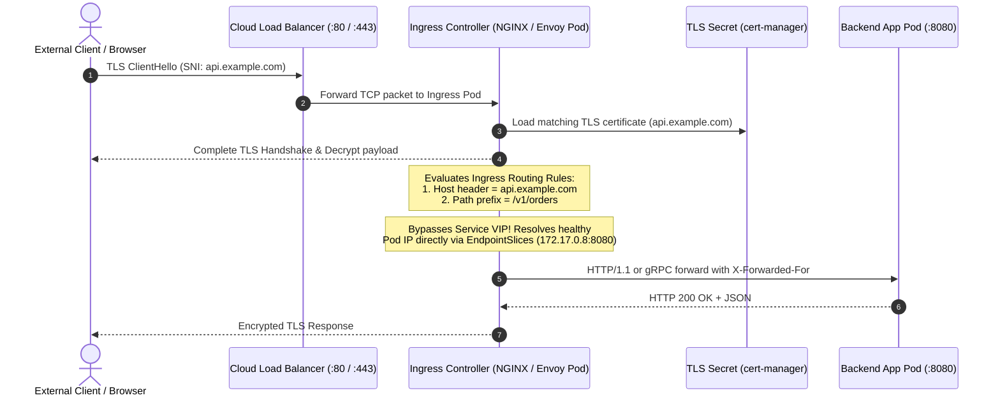
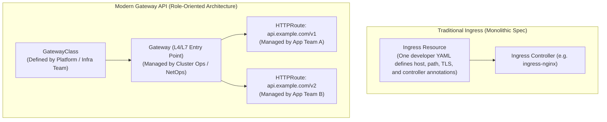
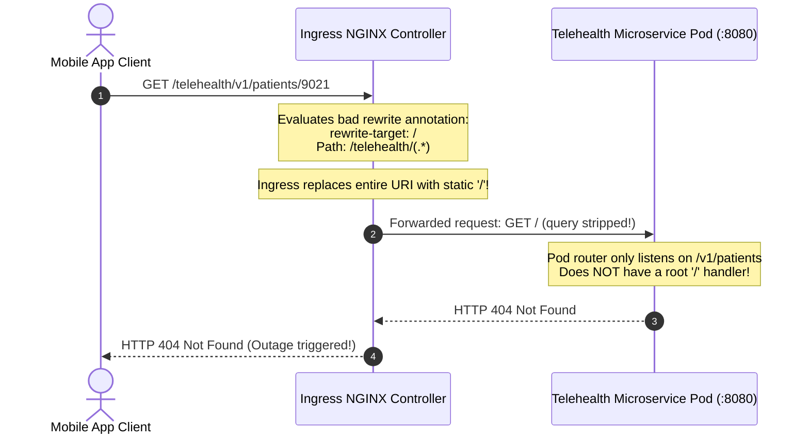

# 08 - Ingress Controllers & Gateway API

> **Prerequisites**: [04 - Services & Networking](../04-services-and-networking/README.md), [05 - ConfigMaps & Secrets](../05-configmaps-and-secrets/README.md).  
> **Target Audience**: Infrastructure Architects, Network Engineers, and Backend Systems Engineers designing external Layer 7 application routing, SSL/TLS termination, and path-based API gateways.  
> **Estimated Deep-Dive Time**: 40 minutes.

---

> [!TIP]
> **The Golden Rule of Kubernetes Ingress**: **An Ingress resource is merely a declarative specification, not an active proxy.** Without an active Ingress Controller daemon (such as `ingress-nginx`, Envoy, or Traefik) continuously monitoring the API Server, Ingress manifests are inert metadata. In modern cloud setups, prefer the role-oriented **Gateway API** (`GatewayClass` -> `Gateway` -> `HTTPRoute`) to decouple platform infrastructure ownership from application routing rules.

---

## 1. Visual Mental Models: Layer 7 Routing & TLS Termination

In Kubernetes, exposing each internal microservice with a separate `LoadBalancer` Service wastes cloud budget, exhausts IP quotas, and fragments TLS certificate management. An **Ingress Controller** acts as a unified L7 reverse proxy, routing incoming internet traffic to hundreds of backend Services over a single external IP.

### The Ingress L7 Request & TLS Handshake Pipeline



---

### Ingress API vs Next-Generation Gateway API



---

## 2. Technical Comparison: Path Matching, Types & Annotations

### Path Matching Specification Matrix

| `pathType` | Matching Behavior | Example Path | Request: `/api` | Request: `/api/` | Request: `/api/v1` | Request: `/apidoc` |
| :--- | :--- | :--- | :--- | :--- | :--- | :--- |
| **`Exact`** | Strict string match | `/api` | ✅ Matches | ❌ No match | ❌ No match | ❌ No match |
| **`Prefix`** | Segment-delimited prefix | `/api` | ✅ Matches | ✅ Matches | ✅ Matches | ❌ No match |
| **`ImplementationSpecific`** | Delegated to controller | `/api/.*` | Depends on IngressClass regex parsing rules |

---

### Critical NGINX Ingress Annotations Reference

Standard Kubernetes Ingress specs lack fields for proxy timeouts, CORS, body size, and URL rewriting. Ingress controllers implement these via manifest annotations:

```yaml
metadata:
  annotations:
    # 1. Strip incoming path prefix before passing to backend
    nginx.ingress.kubernetes.io/use-regex: "true"
    nginx.ingress.kubernetes.io/rewrite-target: /$2

    # 2. Upload file size limit (default is 1m; uploads fail with 413 otherwise!)
    nginx.ingress.kubernetes.io/proxy-body-size: "50m"

    # 3. Upstream timeout for long-running batch or AI queries
    nginx.ingress.kubernetes.io/proxy-read-timeout: "180"

    # 4. Enforce strict HTTPS redirection
    nginx.ingress.kubernetes.io/ssl-redirect: "true"

    # 5. Rate limiting per client IP (Leaky Bucket)
    nginx.ingress.kubernetes.io/limit-rps: "20"
```

---

## 3. Production War Story: The Regex Rewrite Black Hole Outage

### Incident Overview
A digital health platform rolled out a new microservice architecture. Mobile clients communicating with `https://api.health.internal/telehealth/v1/patients` suddenly began receiving `404 Not Found` across 100% of mobile traffic. Over 1,200 urgent doctor-patient telehealth video sessions were severed during morning peak clinic hours.

### The Failure Sequence



### Root Cause Analysis
1. The developer configured path-based routing using:
   ```yaml
   # ❌ BUGGY CONFIGURATION:
   - path: /telehealth/(.*)
     pathType: ImplementationSpecific
     backend:
       service:
         name: telehealth-svc
         port:
           number: 8080
   # Annotation used:
   nginx.ingress.kubernetes.io/rewrite-target: /
   ```
2. The developer intended to strip `/telehealth` so the container received `/v1/patients/9021`.
3. However, setting `rewrite-target: /` rewrote **every single incoming URL** to `GET /`. The backend router had no root handler and returned `404 Not Found`.

### The Remediation & Regex Capture Pattern
The team updated the manifest to use regex capture groups (`$2`) and enabled `use-regex: "true"`:

```yaml
# ✅ CORRECT PRODUCTION PATTERN:
metadata:
  annotations:
    nginx.ingress.kubernetes.io/use-regex: "true"
    nginx.ingress.kubernetes.io/rewrite-target: /$2
spec:
  rules:
    - host: api.health.internal
      http:
        paths:
          - path: /telehealth(/|$)(.*)
            pathType: ImplementationSpecific
            backend:
              service:
                name: telehealth-svc
                port:
                  number: 8080
```
With this fix, request `/telehealth/v1/patients/9021` successfully rewrote to `/v1/patients/9021` before reaching the backend container.

---

## 4. Multi-Language Ingress-Aware Backend Implementations

When services sit behind an Ingress reverse proxy, the client's direct TCP connection terminates at the Ingress Pod. Backend application servers must inspect `X-Forwarded-For`, `X-Forwarded-Proto`, and `X-Forwarded-Host` to accurately capture real client IPs, enforce SSL, and construct correct redirect URLs.

### Go Implementation (Chi / Standard Library)

```go
// internal/http/middleware.go
package http

import (
	"context"
	"net"
	"net/http"
	"strings"
)

type clientContextKey string

const ClientIPKey clientContextKey = "client_real_ip"

// ProxyHeadersMiddleware extracts the real client IP behind K8s Ingress
func ProxyHeadersMiddleware(next http.Handler) http.Handler {
	return http.HandlerFunc(func(w http.ResponseWriter, r *http.Request) {
		clientIP := ""

		// 1. Inspect X-Forwarded-For header (comma-separated list: client, proxy1, proxy2)
		if xff := r.Header.Get("X-Forwarded-For"); xff != "" {
			parts := strings.Split(xff, ",")
			clientIP = strings.TrimSpace(parts[0])
		}

		// 2. Fallback to X-Real-IP if provided by NGINX Ingress
		if clientIP == "" {
			if xri := r.Header.Get("X-Real-IP"); xri != "" {
				clientIP = strings.TrimSpace(xri)
			}
		}

		// 3. Fallback to raw TCP RemoteAddr
		if clientIP == "" {
			ip, _, err := net.SplitHostPort(r.RemoteAddr)
			if err == nil {
				clientIP = ip
			}
		}

		// 4. Verify TLS enforcement
		proto := r.Header.Get("X-Forwarded-Proto")
		if proto != "" && proto != "https" {
			// Enforce HTTPS redirect
			target := "https://" + r.Host + r.URL.RequestURI()
			http.Redirect(w, r, target, http.StatusMovedPermanently)
			return
		}

		ctx := context.WithValue(r.Context(), ClientIPKey, clientIP)
		next.ServeHTTP(w, r.WithContext(ctx))
	})
}
```

---

### Node.js / Express / TypeScript Implementation

```typescript
// src/middleware/ingressProxy.ts
import { Request, Response, NextFunction } from 'express';

export function ingressProxyMiddleware(req: Request, res: Response, next: NextFunction): void {
  // Trust proxy allows Express to automatically read X-Forwarded-* headers
  // In Express: app.set('trust proxy', true);

  const realIp = (req.headers['x-forwarded-for'] as string)?.split(',')[0].trim() 
                 || (req.headers['x-real-ip'] as string) 
                 || req.socket.remoteAddress;

  const protocol = (req.headers['x-forwarded-proto'] as string) || req.protocol;
  const host = (req.headers['x-forwarded-host'] as string) || req.headers.host;

  // Strict HTTPS enforcement
  if (protocol !== 'https' && process.env.NODE_ENV === 'production') {
    res.redirect(301, `https://${host}${req.originalUrl}`);
    return;
  }

  // Attach verified client details to request context
  req.app.locals.clientIp = realIp;
  req.app.locals.requestHost = host;

  next();
}
```

---

### Python Implementation (FastAPI / Starlette)

```python
# middleware/proxy_headers.py
from fastapi import FastAPI, Request
from starlette.middleware.base import BaseHTTPMiddleware
from starlette.responses import RedirectResponse


class IngressProxyMiddleware(BaseHTTPMiddleware):
    """Parses X-Forwarded-* headers injected by K8s Ingress controllers."""

    async def dispatch(self, request: Request, call_next):
        # 1. Real Client IP extraction
        forwarded_for = request.headers.get("x-forwarded-for")
        if forwarded_for:
            client_ip = forwarded_for.split(",")[0].strip()
        else:
            client_ip = request.headers.get("x-real-ip", request.client.host)

        # 2. Protocol verification (Enforce HTTPS)
        proto = request.headers.get("x-forwarded-proto", "http")
        if proto == "http" and not request.url.hostname.endswith(".local"):
            https_url = request.url.replace(scheme="https")
            return RedirectResponse(url=str(https_url), status_code=301)

        request.state.client_ip = client_ip
        response = await call_next(request)
        return response
```

---

## 5. Practical Hands-On Verification Laboratory

In this laboratory, you will verify the installed `IngressClass`, deploy two distinct backend microservices, configure host-based and path-based Ingress rules, and test Layer 7 routing via `curl`.

### Step 1: Verify IngressClass Availability

Before creating an Ingress manifest, verify that an IngressClass exists in the cluster:

```bash
kubectl get ingressclass
```

*Expected Terminal Output:*
```text
NAME             CONTROLLER                     PARAMETERS   AGE
nginx (default)  k8s.io/ingress-nginx           <none>       12d
```

---

### Step 2: Deploy Multi-App Backend Services

Create `08-apps.yaml`:

```yaml
apiVersion: apps/v1
kind: Deployment
metadata:
  name: store-web
  namespace: default
spec:
  replicas: 1
  selector:
    matchLabels:
      app: store-web
  template:
    metadata:
      labels:
        app: store-web
    spec:
      containers:
        - name: web
          image: hashicorp/http-echo:0.2.3
          args: ["-text=Store Web Frontend Version 1.0"]
          ports:
            - containerPort: 5678
---
apiVersion: v1
kind: Service
metadata:
  name: store-web-svc
  namespace: default
spec:
  type: ClusterIP
  selector:
    app: store-web
  ports:
    - port: 80
      targetPort: 5678
---
apiVersion: apps/v1
kind: Deployment
metadata:
  name: store-api
  namespace: default
spec:
  replicas: 1
  selector:
    matchLabels:
      app: store-api
  template:
    metadata:
      labels:
        app: store-api
    spec:
      containers:
        - name: api
          image: hashicorp/http-echo:0.2.3
          args: ["-text=Store Inventory API Version 2.4"]
          ports:
            - containerPort: 5678
---
apiVersion: v1
kind: Service
metadata:
  name: store-api-svc
  namespace: default
spec:
  type: ClusterIP
  selector:
    app: store-api
  ports:
    - port: 80
      targetPort: 5678
```

Apply to cluster:

```bash
kubectl apply -f 08-apps.yaml
```

---

### Step 3: Configure Host & Path-Based Ingress

Create `08-ingress.yaml`:

```yaml
apiVersion: networking.k8s.io/v1
kind: Ingress
metadata:
  name: store-ingress
  namespace: default
  annotations:
    nginx.ingress.kubernetes.io/rewrite-target: /
spec:
  ingressClassName: nginx
  rules:
    # Rule 1: Host-based routing for store.local.test
    - host: store.local.test
      http:
        paths:
          - path: /
            pathType: Prefix
            backend:
              service:
                name: store-web-svc
                port:
                  number: 80
    # Rule 2: Host & Path-based routing for api.local.test/inventory
    - host: api.local.test
      http:
        paths:
          - path: /inventory
            pathType: Prefix
            backend:
              service:
                name: store-api-svc
                port:
                  number: 80
```

Apply to cluster:

```bash
kubectl apply -f 08-ingress.yaml
kubectl get ingress store-ingress
```

*Expected Terminal Output:*
```text
NAME            CLASS   HOSTS                               ADDRESS     PORTS   AGE
store-ingress   nginx   store.local.test,api.local.test     localhost   80      10s
```

---

### Step 4: Verify Routing with Host Headers

Execute `curl` queries targeting `localhost` with simulated DNS `Host` headers:

```bash
# Query 1: Dial Store Web Frontend
curl -s -H "Host: store.local.test" http://localhost/

# Query 2: Dial Store Inventory API
curl -s -H "Host: api.local.test" http://localhost/inventory

# Query 3: Dial unmatched host to observe Default Backend behavior
curl -i -s -H "Host: unknown.local.test" http://localhost/
```

*Expected Output:*
```text
Store Web Frontend Version 1.0
Store Inventory API Version 2.4

HTTP/1.1 404 Not Found
Date: Tue, 10 Nov 2026 07:40:15 GMT
Content-Type: text/html
Content-Length: 146
Connection: keep-alive
<html>
<head><title>404 Not Found</title></head>
<body>
<center><h1>404 Not Found</h1></center>
<hr><center>nginx</center>
</body>
</html>
```

Both host-based and path-based routing executed with zero latency overhead.

---

## 6. Command Quick-Reference Cheat Sheet

| Command | Action / Objective | Example Scenario |
| :--- | :--- | :--- |
| `kubectl get ingressclass` | List installed Ingress controllers & defaults | Verify if cluster has an active controller |
| `kubectl get ingress -A` | List all ingress routing rules cluster-wide | Check external IP and domain assignments |
| `kubectl describe ingress <name>` | Inspect paths, target services, and TLS secrets | Debug routing errors and 404/503 statuses |
| `kubectl logs -n ingress-nginx -l app.kubernetes.io/name=ingress-nginx` | Tail real-time reverse proxy access & error logs | Inspect upstream connect failures |
| `curl -H "Host: <domain>" http://<ip>` | Test Ingress routing without changing local `/etc/hosts` | Validate staging ingress before DNS cutover |

---

## 7. Operational Validation Checkpoints

### Scenario 1: `503 Service Temporarily Unavailable` on Valid Ingress Route
**Context:** You apply a valid Ingress manifest pointing to `payment-service`. The Pod is `Running` (1/1 Ready). When navigating to the URL, Ingress returns `HTTP 503 Service Temporarily Unavailable`.

```
$ curl -i -H "Host: pay.example.com" http://localhost/
HTTP/1.1 503 Service Temporarily Unavailable
```

<details>
<summary>View Diagnostic Workflow & Resolution</summary>

**Root Cause:**  
The Ingress manifest's `spec.rules[].http.paths[].backend.service.port.number` specifies a port that does not exist on the target **Service**. For example, the developer wrote `number: 8080`, but the Service definition only exposes `port: 80`. The Ingress controller queries endpoints for port 8080 and finds zero upstream targets.

**Diagnostic Commands:**
```bash
# Compare Ingress backend port with Service ports:
kubectl describe ingress <ingress-name> | grep -A 4 Backend
kubectl get svc <service-name> -o yaml | grep -A 5 ports:
```

**Resolution Steps:**
Change `backend.service.port.number` in the Ingress manifest to match `spec.ports[].port` of the Service (e.g. `80`).
</details>

---

### Scenario 2: Infinite 308 Redirect Loop
**Context:** An application runs on AWS EKS or Azure AKS behind an external cloud load balancer terminating TLS. When users navigate to `https://app.company.com`, the browser hangs and terminates with `ERR_TOO_MANY_REDIRECTS` (HTTP 308 Permanent Redirect loop).

<details>
<summary>View Diagnostic Workflow & Resolution</summary>

**Root Cause:**  
The external Cloud Load Balancer decrypts HTTPS (port 443) and forwards plain HTTP (port 80) to the Ingress controller. The Ingress controller has `ssl-redirect: "true"` enabled. Seeing an incoming HTTP request, NGINX issues an HTTP 308 redirecting back to `https://app.company.com`, looping endlessly.

**Resolution Steps:**
1. Configure NGINX to inspect the `X-Forwarded-Proto` header passed by the cloud load balancer:
   ```yaml
   metadata:
     annotations:
       # Tell NGINX to trust X-Forwarded-Proto from upstream LB
       nginx.ingress.kubernetes.io/ssl-redirect: "false"
       nginx.ingress.kubernetes.io/force-ssl-redirect: "false"
   ```
2. Or configure SSL pass-through on the cloud load balancer so the Ingress controller terminates TLS directly.
</details>

---

### Scenario 3: Large File Uploads Aborted with `413 Request Entity Too Large`
**Context:** An image processing microservice accepts 25MB photo uploads via `POST /upload`. Requests pass through Ingress and immediately fail with `HTTP 413 Request Entity Too Large` before ever reaching the backend application.

<details>
<summary>View Diagnostic Workflow & Resolution</summary>

**Root Cause:**  
The default maximum client request body size in `ingress-nginx` is `1m` (1 megabyte). Any HTTP payload exceeding 1MB is rejected immediately by the reverse proxy.

**Resolution Steps:**
Annotate the Ingress manifest with the desired payload ceiling:
```yaml
metadata:
  annotations:
    nginx.ingress.kubernetes.io/proxy-body-size: "50m"
```
</details>

---

## 8. Further Reading & Official Documentation

- [Kubernetes Ingress Official Documentation](https://kubernetes.io/docs/concepts/services-networking/ingress/)
- [Kubernetes Gateway API Documentation](https://gateway-api.sigs.k8s.io/)
- [NGINX Ingress Controller Annotations & Architecture](https://kubernetes.github.io/ingress-nginx/user-guide/nginx-configuration/annotations/)
- [Automated TLS Certificates with cert-manager and Let's Encrypt](https://cert-manager.io/docs/usage/ingress/)
- [Traefik Kubernetes Ingress Provider Guide](https://doc.traefik.io/traefik/providers/kubernetes-ingress/)

---

## Next

Continue to [09 - Scaling: Horizontal Pod Autoscaler (HPA) and VPA](../09-scaling-hpa-and-vpa/README.md) to automatically scale Pod replicas up and down based on live CPU, memory, and custom Prometheus metrics.
