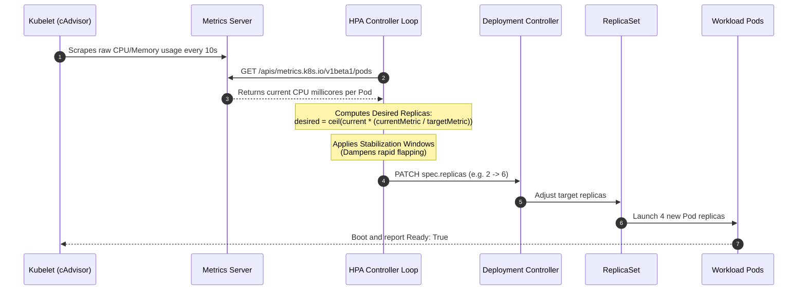
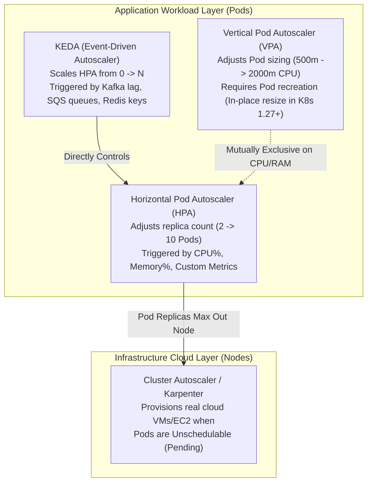
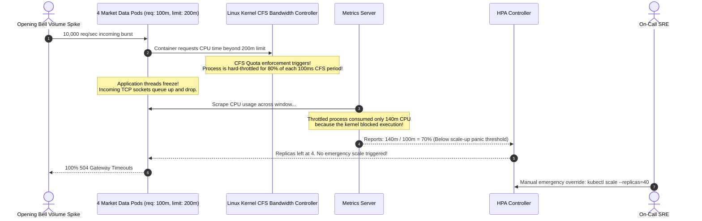

# 09 - Scaling: Horizontal Pod Autoscaler (HPA) & VPA

> **Prerequisites**: [02 - Pods & Workloads](../02-pods-and-workloads/README.md), [03 - Deployments & ReplicaSets](../03-deployments-and-replicasets/README.md).  
> **Target Audience**: Infrastructure Architects, SREs, and Platform Engineers building self-healing, load-responsive elastic compute architectures.  
> **Estimated Deep-Dive Time**: 40 minutes.

---

> [!TIP]
> **The Golden Rule of Kubernetes Autoscaling**: **Never autoscale without explicit resource requests.** The Horizontal Pod Autoscaler (HPA) calculates target utilization strictly as a percentage of `resources.requests`, never `resources.limits`. If `requests` are omitted, the HPA reports `TARGETS: <unknown>` and completely disables scaling. Furthermore, **never configure HPA and VPA to scale on the same metric (CPU/Memory) simultaneously**, as they will enter a destructive feedback loop.

---

## 1. Visual Mental Models: The Autoscaling Control Loop

Kubernetes decouples horizontal scaling (adding more Pod replicas) from vertical scaling (increasing CPU/memory allocations per Pod) and cluster infrastructure scaling (provisioning physical or cloud VMs).

### The HPA Control Loop & Metrics Pipeline

Every 15 seconds (configured via `--horizontal-pod-autoscaler-sync-period`), the `kube-controller-manager` executes an automated reconciliation loop:



---

### Scaling Spectrum: HPA vs VPA vs KEDA vs Cluster Autoscaler



---

## 2. Technical Comparison: Sizing, Metrics & Stabilization Policies

### Autoscaling Primitives Matrix

| Feature | Horizontal Pod Autoscaler (HPA) | Vertical Pod Autoscaler (VPA) | KEDA (Kubernetes Event-driven Autoscaling) |
| :--- | :--- | :--- | :--- |
| **Scaling Axis** | Horizontal (Replica count) | Vertical (CPU / Memory request sizes) | Horizontal (Replicas via HPA abstraction) |
| **Scaling to Zero** | ❌ No (Minimum 1 replica in standard HPA) | ❌ No | ✅ Yes (0 to 1 and 1 to N based on events) |
| **Disruption Level** | Zero disruption (adds/removes instances) | Pod restart required (in older kernels) | Zero disruption |
| **Metric Sources** | Metrics Server, Prometheus Adapter | Historical Prometheus / cAdvisor metrics | 60+ external event scalers (Kafka, RabbitMQ, SQS) |
| **Best Used For** | Stateless web APIs, gRPC microservices | Databases, singletons, batch machine learning | Asynchronous workers, queue consumers |

---

### The Mathematical Autoscaling Algorithm

The HPA evaluates the target replica count using the following deterministic ceiling formula:

$$\text{desiredReplicas} = \left\lceil \text{currentReplicas} \times \left( \frac{\text{currentMetricValue}}{\text{targetMetricValue}} \right) \right\rceil$$

*Example*: If a Deployment has 3 replicas, current average CPU is 180m, and the target is 100m:
$$\text{desiredReplicas} = \left\lceil 3 \times \left( \frac{180}{100} \right) \right\rceil = \lceil 3 \times 1.8 \rceil = \lceil 5.4 \rceil = 6 \text{ replicas}$$

---

### HPA v2 Behavior: Granular Scale-Up & Scale-Down Policies

In production, rapid scaling up is required to absorb flash traffic, but scaling down must be carefully dampened to avoid metric thrashing (flapping):

```yaml
apiVersion: autoscaling/v2
kind: HorizontalPodAutoscaler
metadata:
  name: order-api-hpa
spec:
  scaleTargetRef:
    apiVersion: apps/v1
    kind: Deployment
    name: order-api
  minReplicas: 2
  maxReplicas: 20
  metrics:
    - type: Resource
      resource:
        name: cpu
        target:
          type: Utilization
          averageUtilization: 75
    - type: Resource
      resource:
        name: memory
        target:
          type: AverageValue
          averageValue: 500Mi
  behavior:
    scaleUp:
      stabilizationWindowSeconds: 0 # React instantly to spikes
      policies:
        - type: Percent
          value: 100 # Double capacity every 15s if needed
          periodSeconds: 15
    scaleDown:
      stabilizationWindowSeconds: 300 # Wait 5 minutes of low traffic before scaling down!
      policies:
        - type: Percent
          value: 10 # Only scale down 10% of Pods at a time
          periodSeconds: 60
      selectPolicy: Min
```

---

## 3. Production War Story: The CPU Throttling Death Spiral

### Incident Overview
A fintech stock trading platform rolled out an autoscaled market-data microservice with an HPA targeting 60% CPU utilization. During market opening at 09:30 AM, inbound message throughput jumped 400%. 

Instead of scaling up to handle the load, the existing 4 Pods began dropping connections. The HPA failed to scale, and the application crashed with 100% gateway timeouts. The platform remained down for 26 minutes until engineers intervened manually.

### The Catastrophic Failure Sequence



### Root Cause Analysis
1. **The CFS Quota Trap**: The developer configured `requests: 100m` and `limits: 200m`. When CPU utilization spiked, the Linux Completely Fair Scheduler (CFS) throttled container threads because they exhausted their 100ms time slice quota.
2. **False Metric Telemetry**: Because the application threads were throttled and frozen by the kernel, they physically could not burn more CPU cycles. The `metrics-server` recorded moderate CPU usage (140m), blinding the HPA to the fact that the service was suffocating.
3. **Flapping Scale-Down**: The default scale-down stabilization window was too aggressive, causing the HPA to scale down prematurely during momentary lulls.

### The Remediation & Permanent Policy
1. **Remove Strict CPU Limits**: Removed hard CPU limits (`limits.cpu`) while retaining strict memory limits (`limits.memory`). This eliminated kernel CFS throttling completely, allowing CPU bursts to register true millicore spikes with `metrics-server`.
2. **Proper Sizing of Requests**: Raised `requests.cpu` to `500m`, aligning with actual baseline production throughput.
3. **Extended Stabilization Window**: Configured `scaleDown.stabilizationWindowSeconds: 300` to prevent premature scale-down during oscillating market bursts.

---

## 4. Multi-Language Custom Metrics Exporters for HPA

While CPU and memory metrics are built-in, production web services scale much more effectively when driven by **in-flight concurrent HTTP requests** or **active queue backlog**. Scaling on request concurrency scales the cluster *before* CPU spikes even register.

The implementations below expose custom Prometheus metrics scraped by Prometheus Adapter or KEDA.

### Go Implementation (Prometheus Metrics Exporter)

```go
// internal/metrics/autoscaling_metrics.go
package metrics

import (
	"net/http"

	"github.com/prometheus/client_golang/prometheus"
	"github.com/prometheus/client_golang/prometheus/promhttp"
)

var (
	// InFlightGauge tracks current concurrent connections for HPA
	InFlightGauge = prometheus.NewGauge(prometheus.GaugeOpts{
		Name: "http_requests_in_flight",
		Help: "Active concurrent HTTP requests currently being processed.",
	})

	RequestDuration = prometheus.NewHistogramVec(prometheus.HistogramOpts{
		Name:    "http_request_duration_seconds",
		Help:    "Latency distributions of HTTP requests.",
		Buckets: prometheus.DefBuckets,
	}, []string{"handler", "status"})
)

func init() {
	prometheus.MustRegister(InFlightGauge)
	prometheus.MustRegister(RequestDuration)
}

// ResilientMetricsMiddleware tracks in-flight requests for HPA
func ResilientMetricsMiddleware(next http.Handler) http.Handler {
	return http.HandlerFunc(func(w http.ResponseWriter, r *http.Request) {
		InFlightGauge.Inc() // Increment active load
		defer InFlightGauge.Dec() // Decrement on request completion

		next.ServeHTTP(w, r)
	})
}

// StartMetricsServer exposes metrics on dedicated internal port
func StartMetricsServer(addr string) {
	mux := http.NewServeMux()
	mux.Handle("/metrics", promhttp.Handler())
	_ = http.ListenAndServe(addr, mux)
}
```

---

### Node.js / TypeScript Implementation (prom-client)

```typescript
// src/metrics/hpaMetrics.ts
import { Request, Response, NextFunction } from 'express';
import client from 'prom-client';

// Collect default Node runtime metrics
client.collectDefaultMetrics({ prefix: 'node_app_' });

// In-Flight Gauge for Custom Metric Autoscaling
export const inFlightRequestsGauge = new client.Gauge({
  name: 'http_active_in_flight_requests',
  help: 'Number of active HTTP requests currently being handled by the process',
});

export function hpaMetricsMiddleware(req: Request, res: Response, next: NextFunction): void {
  inFlightRequestsGauge.inc();

  res.on('finish', () => {
    inFlightRequestsGauge.dec();
  });

  res.on('close', () => {
    inFlightRequestsGauge.dec();
  });

  next();
}

export async function metricsHandler(req: Request, res: Response): Promise<void> {
  res.set('Content-Type', client.register.contentType);
  res.end(await client.register.metrics());
}
```

---

### Python Implementation (prometheus_client)

```python
# metrics/hpa_metrics.py
import time
from fastapi import FastAPI, Request
from starlette.middleware.base import BaseHTTPMiddleware
from prometheus_client import Gauge, Counter, generate_latest, CONTENT_TYPE_LATEST
from starlette.responses import Response

IN_FLIGHT_GAUGE = Gauge(
    "http_active_in_flight_requests",
    "Current active concurrent requests for HPA custom metric autoscaling"
)

class HpaMetricsMiddleware(BaseHTTPMiddleware):
    async def dispatch(self, request: Request, call_next):
        if request.url.path == "/metrics":
            return await call_next(request)

        IN_FLIGHT_GAUGE.inc()
        try:
            response = await call_next(request)
            return response
        finally:
            IN_FLIGHT_GAUGE.dec()

def setup_metrics_route(app: FastAPI):
    @app.get("/metrics")
    def metrics():
        return Response(content=generate_latest(), media_type=CONTENT_TYPE_LATEST)
```

---

## 5. Practical Hands-On Verification Laboratory

In this lab, you will verify that `metrics-server` is functioning, deploy a CPU-intensive worker Deployment with precise resource requests, attach an `HPA v2`, generate heavy synthetic CPU load, and observe automated horizontal scaling and cooldown live.

### Step 1: Verify Metrics-Server Health

Confirm that metrics-server is collecting cluster resource usage:

```bash
kubectl top nodes
```

*Expected Terminal Output:*
```text
NAME                     CPU(cores)   CPU%   MEMORY(bytes)   MEMORY%
kind-control-plane       124m         3%     612Mi           7%
```

> [!NOTE]
> If `kubectl top nodes` returns `error: Metrics API not available`, install metrics-server with `--kubelet-insecure-tls` for local kind clusters:
> `kubectl apply -f https://github.com/kubernetes-sigs/metrics-server/releases/latest/download/components.yaml`

---

### Step 2: Deploy Workload with Resource Requests

Create `09-hpa-demo.yaml`:

```yaml
apiVersion: apps/v1
kind: Deployment
metadata:
  name: php-apache
  namespace: default
spec:
  replicas: 1
  selector:
    matchLabels:
      run: php-apache
  template:
    metadata:
      labels:
        run: php-apache
    spec:
      containers:
        - name: php-apache
          image: registry.k8s.io/hpa-example
          ports:
            - containerPort: 80
          resources:
            requests:
              cpu: 200m
              memory: 64Mi
            limits:
              memory: 128Mi
---
apiVersion: v1
kind: Service
metadata:
  name: php-apache
  namespace: default
spec:
  ports:
    - port: 80
  selector:
    run: php-apache
```

Apply and verify:

```bash
kubectl apply -f 09-hpa-demo.yaml
kubectl wait --for=condition=Ready pod -l run=php-apache --timeout=30s
```

---

### Step 3: Attach HorizontalPodAutoscaler

Create the HPA targeting 50% CPU utilization with a minimum of 1 and maximum of 8 replicas:

```bash
kubectl autoscale deployment php-apache --cpu-percent=50 --min=1 --max=8
```

Inspect the newly created HPA:

```bash
kubectl get hpa php-apache
```

*Expected Terminal Output:*
```text
NAME         REFERENCE               TARGETS   MINPODS   MAXPODS   REPLICAS   AGE
php-apache   Deployment/php-apache   0%/50%    1         8         1          14s
```

---

### Step 4: Generate Load & Observe Autoscaling

Open a second terminal window and launch a continuous load generator:

```bash
kubectl run -i --tty load-generator --rm --image=busybox:1.28 --restart=Never -- /bin/sh -c "while true; do wget -q -O- http://php-apache; done"
```

In your primary terminal, watch the HPA and Deployment react:

```bash
kubectl get hpa php-apache -w
```

*Expected Terminal Output Progression:*
```text
NAME         REFERENCE               TARGETS    MINPODS   MAXPODS   REPLICAS   AGE
php-apache   Deployment/php-apache   0%/50%     1         8         1          30s
php-apache   Deployment/php-apache   180%/50%   1         8         1          45s
php-apache   Deployment/php-apache   180%/50%   1         8         4          60s
php-apache   Deployment/php-apache   74%/50%    1         8         4          75s
php-apache   Deployment/php-apache   48%/50%    1         8         4          90s
```

Kubernetes automatically scaled the workload from 1 to 4 Pods, bringing the average CPU utilization back under the 50% target threshold.

Terminate the load generator (<kbd>Ctrl</kbd>+<kbd>C</kbd>). Observe that the HPA holds replicas at 4 for the duration of the stabilization window before gradually scaling back down to 1.

---

## 6. Command Quick-Reference Cheat Sheet

| Command | Action / Objective | Example Scenario |
| :--- | :--- | :--- |
| `kubectl top pods` | Show current millicores and memory consumption | Identify resource hogs in real time |
| `kubectl top nodes` | Check cluster-wide node resource allocation | Plan node capacity and identify bottlenecks |
| `kubectl get hpa -w` | Stream live HPA status updates | Watch autoscaling under test load |
| `kubectl describe hpa <name>` | Inspect scaling events, target metrics, and errors | Diagnose why an HPA is stuck or failing |
| `kubectl autoscale deploy <name> --cpu-percent=70 --min=2 --max=10` | Quick imperative HPA creation | Fast staging environment testing |

---

## 7. Operational Validation Checkpoints

### Scenario 1: HPA Displays `TARGETS: <unknown>/50%`
**Context:** You configure an HPA on a critical API deployment. The `TARGETS` column shows `<unknown>/50%` and the Deployment never scales up, even during massive user spikes.

<details>
<summary>View Diagnostic Workflow & Resolution</summary>

**Root Cause:**  
One or more containers in the target Deployment are missing `resources.requests.cpu`. The HPA algorithm requires requests as the denominator. Without a baseline request, calculating a percentage is mathematically impossible. Alternatively, `metrics-server` is not installed or cannot reach the kubelet's cAdvisor endpoint.

**Diagnostic Commands:**
```bash
# Check if pod specs define requests:
kubectl get deployment <deploy-name> -o yaml | grep -A 5 resources:

# Describe HPA to check controller events:
kubectl describe hpa <hpa-name> | grep -A 5 Conditions:
# Output:
# Warning FailedGetResourceMetric: missing request for cpu on container web
```

**Resolution Steps:**
Update the Deployment manifest to declare explicit `resources.requests.cpu: 250m` on all containers.
</details>

---

### Scenario 2: Node Resource Starvation Caused by Memory-Based HPA
**Context:** An engineering team configures an HPA to scale based on Memory utilization (`target: 70%`). As user sessions grow, Pod memory climbs, triggering scale-up. New Pods launch, but memory on existing Pods does not drop. The cluster runs out of memory, triggering node-wide `OOMKills`.

<details>
<summary>View Diagnostic Workflow & Resolution</summary>

**Root Cause:**  
Unlike CPU, memory in runtimes like Java (JVM heap), Node.js (V8 garbage collection), or Python is retained and not instantly freed when additional Pods launch. Adding Pods does not reduce memory on existing Pods; instead, it consumes even more node memory, causing a catastrophic cluster-wide OOM cascade.

**Resolution Steps:**
1. Avoid scaling on Memory alone. Use CPU utilization or Custom Metrics (requests in flight, queue length).
2. If memory scaling is mandatory, configure explicit `limits.memory` and tune the application garbage collector to aggressively release idle heaps.
</details>

---

### Scenario 3: Scale-Up Latency Drops Web Requests During Sudden Traffic Surges
**Context:** A marketing campaign triggers a 10x traffic spike in under 30 seconds. HPA detects the spike and scales from 2 to 15 Pods, but the Pods take 65 seconds to download images, initialize runtime caches, and pass readiness probes. Upstream users receive 504 timeouts during the boot window.

<details>
<summary>View Diagnostic Workflow & Resolution</summary>

**Root Cause:**  
Reactive metrics-based scaling always carries a latency lag: Metric scrape (15s) + HPA calculation (15s) + Pod scheduling & image pulling (10s) + Application bootstrap (30s) = 70s total delay.

**Resolution Steps:**
1. Implement **predictive scheduled scaling** or pre-warming prior to known marketing events:
   ```bash
   kubectl scale deployment order-api --replicas=15
   ```
2. Integrate **KEDA** (Kubernetes Event-driven Autoscaling) to trigger scaling immediately upon ingress request surge or queue backlog before CPU spikes.
3. Optimize container images (multi-stage builds) and use cached node base layers to reduce pull and startup latency to under 5 seconds.
</details>

---

## 8. Further Reading & Official Documentation

- [Kubernetes Official Documentation: Horizontal Pod Autoscaling](https://kubernetes.io/docs/tasks/run-application/horizontal-pod-autoscale/)
- [Configuring HPA Scaling Behavior & Stabilization Windows](https://kubernetes.io/docs/tasks/run-application/horizontal-pod-autoscale/#configurable-scaling-behavior)
- [Kubernetes Metrics Server Repository](https://github.com/kubernetes-sigs/metrics-server)
- [Vertical Pod Autoscaler (VPA) Architecture](https://github.com/kubernetes/autoscaler/tree/master/vertical-pod-autoscaler)
- [KEDA: Kubernetes Event-Driven Autoscaling](https://keda.sh/)

---

## Next

Continue to [10 - Observability: Centralized Logging and Prometheus Metrics](../10-observability-logging-and-metrics/README.md) to implement cluster-wide observability, structured logging pipelines, and telemetry dashboards across distributed Pods.
