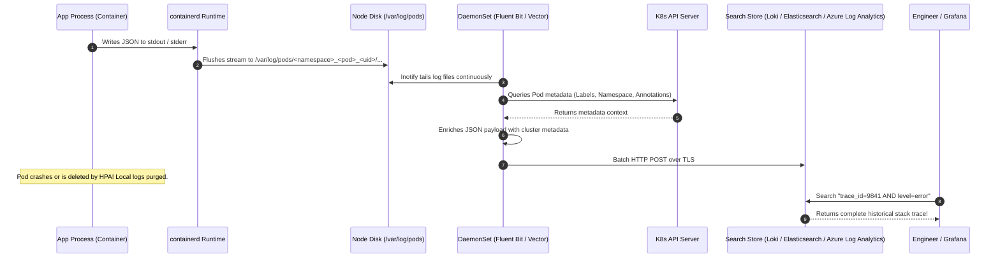
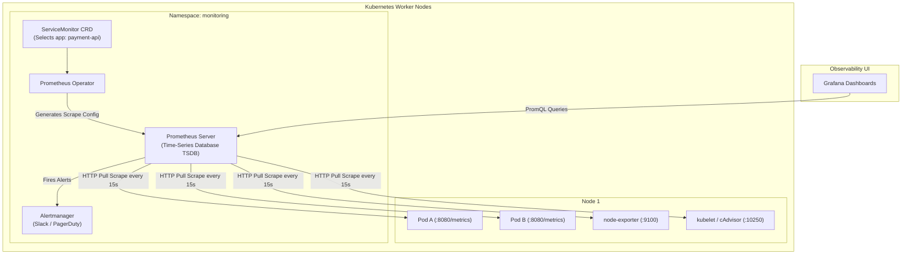
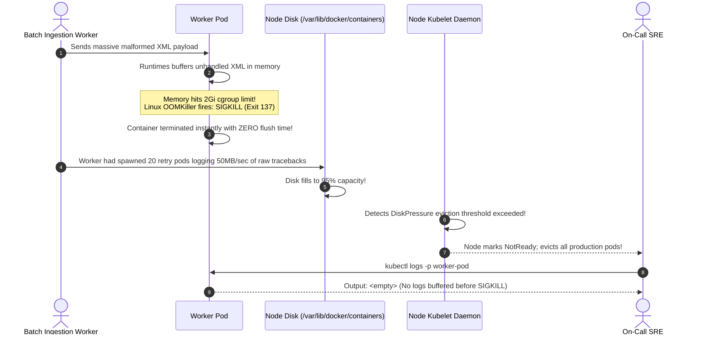

# 10 - Observability: Centralized Logging & Metrics

> **Prerequisites**: [02 - Pods & Workloads](../02-pods-and-workloads/README.md), [03 - Deployments & ReplicaSets](../03-deployments-and-replicasets/README.md), [09 - Scaling: HPA & VPA](../09-scaling-hpa-and-vpa/README.md).  
> **Target Audience**: SREs, Platform Engineers, and Distributed Systems Architects designing production observability, Prometheus scraping pipelines, and centralized log telemetry.  
> **Estimated Deep-Dive Time**: 40 minutes.

---

> [!TIP]
> **The Golden Rule of Kubernetes Observability**: **Pods are disposable, so container disk logs die with them.** Applications must never write logs to local container files or rely solely on `kubectl logs`. Always emit structured JSON to `stdout` and `stderr`. A DaemonSet log collector (Fluent Bit, Vector, or Promtail) must capture, enrich, and ship those streams off-node to an external search index before Pod termination.

---

## 1. Visual Mental Models: The Cluster Telemetry Pipeline

Observability in distributed Kubernetes architectures encompasses three distinct telemetry pillars: **Logs** (discrete historical events), **Metrics** (numeric time-series measurements), and **Events** (control plane state transitions).

### The Production Logging Lifecycle: Container Stdout to Centralized Index



---

### Prometheus Pull-Model Architecture



---

## 2. Technical Comparison: Telemetry Signals & Metrics Types

### Observability Signals Specification Matrix

| Telemetry Signal | Origin / Mechanics | Durability Default | Storage Engine | Best Used For |
| :--- | :--- | :--- | :--- | :--- |
| **Container Logs** | `stdout` / `stderr` via CRI runtime | Ephemeral (Lost on Pod deletion) | OpenSearch, Loki, Datadog | Debugging stack traces, audit trails, request payloads |
| **Time-Series Metrics** | Pull-model scraping of `/metrics` | Retained (15-90 days in TSDB) | Prometheus, Thanos, VictoriaMetrics | SLI/SLO dashboards, autoscaling (HPA), alerting |
| **Kubernetes Events** | Control plane transitions in `etcd` | 1 hour TTL (Cluster-wide purge) | `kubectl get events`, etcd | Tracking failed probes, image pull errors, OOMKills |
| **Distributed Tracing** | W3C `traceparent` context propagation | Retained (Sampled 1-10%) | Jaeger, Tempo, AWS X-Ray | Microservice latency bottlenecks, call DAG topology |

---

### Prometheus Metric Types Taxonomy

When exposing application performance via `/metrics`, choose the appropriate Prometheus primitive:

```
# 1. COUNTER: Monotonically increasing number (only resets to 0 on pod restart)
# Used for: Total requests, errors, bytes sent
http_requests_total{handler="/checkout", method="POST", status="500"} 42

# 2. GAUGE: Number that fluctuates up and down
# Used for: Memory usage, queue depth, active goroutines, pool connections
jvm_memory_used_bytes{area="heap"} 524288000

# 3. HISTOGRAM: Samples observations into configurable buckets
# Used for: Latency, duration, response sizes (calculates p95, p99 quantiles)
http_request_duration_seconds_bucket{le="0.1"} 1400
http_request_duration_seconds_bucket{le="0.5"} 1850
http_request_duration_seconds_bucket{le="+Inf"} 1920
http_request_duration_seconds_sum 245.8
http_request_duration_seconds_count 1920
```

---

## 3. Production War Story: The Silent OOMCrash & Node Disk Lockout

### Incident Overview
An overnight payment processing batch job on a Kubernetes cluster encountered an unexpected payload that triggered a catastrophic memory leak. The container threw an `OOMKilled` (Exit Code 137). 

When on-call engineers ran `kubectl logs -p <pod-name>`, the logs were empty. Worse, within 3 hours, three critical worker nodes entered status `NotReady` with `DiskPressure`, triggering a cascade of Pod evictions across unrelated services.

### The Catastrophic Failure Sequence



### Root Cause Analysis
1. **Unbuffered Stdout Loss**: The Python application was buffering stdout in memory. When the Linux kernel `OOMKiller` issued a non-catchable `SIGKILL` (`kill -9`), the container memory was wiped before the runtime could flush the fatal traceback to `/dev/stdout`.
2. **Missing Centralized Log Collector**: The team relied on manual `kubectl logs`. Each time a crashed Pod was deleted and rescheduled by the Deployment controller, its previous logs were permanently erased from node storage.
3. **Missing Docker/containerd Log Rotation**: The cluster lacked max log-size limits on the container runtime. The repeating CrashLooping batch job filled the root filesystem, triggering Kubelet `DiskPressure` and mass node eviction.

### The Remediation & Permanent Fix
1. **Force Unbuffered Python Stdout**: Configured `PYTHONUNBUFFERED=1` in the container environment so every log line flushes directly to the kernel file descriptor without memory buffering.
2. **Kubelet Log Rotation Policy**: Added log rotation flags to `/var/lib/kubelet/config.yaml`:
   ```yaml
   containerLogMaxSize: "10Mi"
   containerLogMaxFiles: 5
   ```
3. **Structured Logging to Vector/Fluent Bit**: Deployed a DaemonSet collector shipping structured JSON logs to Grafana Loki within 2 seconds of generation, preserving traces regardless of container crashes.

---

## 4. Multi-Language Structured JSON Logging Implementations

To ensure automated ingestion and indexing by Fluent Bit, Logstash, or Datadog, applications must output single-line structured JSON to `stdout` containing standard fields: `timestamp`, `level`, `message`, `service`, `trace_id`, and `span_id`.

### Go Implementation (Zap Logger)

```go
// internal/logger/logger.go
package logger

import (
	"os"

	"go.uber.org/zap"
	"go.uber.org/zap/zapcore"
)

var Log *zap.Logger

func InitLogger(serviceName, env string) {
	encoderConfig := zap.NewProductionEncoderConfig()
	encoderConfig.TimeKey = "timestamp"
	encoderConfig.EncodeTime = zapcore.ISO8601TimeEncoder
	encoderConfig.LevelKey = "level"
	encoderConfig.EncodeLevel = zapcore.LowercaseLevelEncoder
	encoderConfig.MessageKey = "message"

	core := zapcore.NewCore(
		zapcore.NewJSONEncoder(encoderConfig),
		zapcore.Lock(os.Stdout), // Writes directly to stdout for containerd
		zap.InfoLevel,
	)

	// Enrich all logs with service context
	Log = zap.New(core).With(
		zap.String("service", serviceName),
		zap.String("environment", env),
	)
}
```

---

### Node.js / TypeScript Implementation (Pino)

```typescript
// src/logger/pinoLogger.ts
import pino from 'pino';

export const logger = pino({
  level: process.env.LOG_LEVEL || 'info',
  formatters: {
    level: (label) => ({ level: label }),
  },
  timestamp: pino.stdTimeFunctions.isoTime,
  base: {
    service: process.env.SERVICE_NAME || 'payment-api',
    environment: process.env.NODE_ENV || 'production',
    pod_name: process.env.MY_POD_NAME || 'unknown',
  },
  // Ensure synchronous write to stdout to avoid losing logs during crashes
  sync: false,
});
```

---

### Python Implementation (Structlog / Stdout)

```python
# logger/structured_logger.py
import logging
import os
import sys
import structlog


def configure_logger(service_name: str):
    # Ensure stdout is unbuffered
    os.environ["PYTHONUNBUFFERED"] = "1"

    structlog.configure(
        processors=[
            structlog.contextvars.merge_contextvars,
            structlog.processors.add_log_level,
            structlog.processors.TimeStamper(fmt="iso"),
            structlog.processors.JSONRenderer(),
        ],
        wrapper_class=structlog.make_filtering_bound_logger(logging.INFO),
        context_class=dict,
        logger_factory=structlog.PrintLoggerFactory(sys.stdout),
        cache_logger_on_first_use=True,
    )

    return structlog.get_logger().bind(
        service=service_name,
        pod_name=os.getenv("MY_POD_NAME", "unknown")
    )
```

---

## 5. Practical Hands-On Verification Laboratory

In this lab, you will deploy a multi-replica application that produces structured JSON logs and Prometheus metrics, tail logs across multiple Pods using labels, and inspect cluster-wide events.

### Step 1: Deploy Observable Workload

Create `10-observable-app.yaml`:

```yaml
apiVersion: apps/v1
kind: Deployment
metadata:
  name: telemetry-demo
  namespace: default
  labels:
    app: telemetry-demo
spec:
  replicas: 2
  selector:
    matchLabels:
      app: telemetry-demo
  template:
    metadata:
      labels:
        app: telemetry-demo
    spec:
      containers:
        - name: app
          image: alpine:latest
          command:
            - "/bin/sh"
            - "-c"
            - |
              while true; do
                TIMESTAMP=$(date -u +"%Y-%m-%dT%H:%M:%SZ")
                echo "{\"timestamp\":\"$TIMESTAMP\",\"level\":\"info\",\"service\":\"telemetry-demo\",\"pod\":\"$MY_POD_NAME\",\"message\":\"Transaction successfully processed\",\"status\":200}"
                sleep 5
              done
          env:
            - name: MY_POD_NAME
              valueFrom:
                fieldRef:
                  fieldPath: metadata.name
          resources:
            requests:
              cpu: 50m
              memory: 32Mi
```

Apply to cluster:

```bash
kubectl apply -f 10-observable-app.yaml
kubectl wait --for=condition=Ready pod -l app=telemetry-demo --timeout=30s
```

---

### Step 2: Stream Logs Across All Replicas Simultaneously

Use the label selector `-l` with `--prefix` to observe aggregated logs from both Pods with pod attribution:

```bash
kubectl logs -l app=telemetry-demo --prefix --tail=10
```

*Expected Terminal Output:*
```text
[pod/telemetry-demo-777b7894bc-87w2x/app] {"timestamp":"2026-11-10T08:10:05Z","level":"info","service":"telemetry-demo","pod":"telemetry-demo-777b7894bc-87w2x","message":"Transaction successfully processed","status":200}
[pod/telemetry-demo-777b7894bc-mpk9r/app] {"timestamp":"2026-11-10T08:10:07Z","level":"info","service":"telemetry-demo","pod":"telemetry-demo-777b7894bc-mpk9r","message":"Transaction successfully processed","status":200}
```

---

### Step 3: Inspect Kubernetes Cluster Events

Inspect the timeline of cluster events sorted by the most recent timestamp:

```bash
kubectl get events --sort-by=.lastTimestamp
```

*Expected Terminal Output:*
```text
LAST SEEN   TYPE     REASON      OBJECT                              MESSAGE
35s         Normal   Scheduled   pod/telemetry-demo-777b7894bc-87w2x  Successfully assigned default/telemetry-demo-... to kind-control-plane
34s         Normal   Pulling     pod/telemetry-demo-777b7894bc-87w2x  Pulling image "alpine:latest"
31s         Normal   Pulled      pod/telemetry-demo-777b7894bc-87w2x  Successfully pulled image "alpine:latest"
30s         Normal   Created     pod/telemetry-demo-777b7894bc-87w2x  Created container app
30s         Normal   Started     pod/telemetry-demo-777b7894bc-87w2x  Started container app
```

---

### Step 4: Simulate a Fatal Crash and Inspect Previous Logs

Force an unhandled panic inside one of the Pods:

```bash
POD_NAME=$(kubectl get pods -l app=telemetry-demo -o jsonpath='{.items[0].metadata.name}')
kubectl exec $POD_NAME -- /bin/sh -c "echo 'FATAL: Segfault encountered in memory allocator' >&2; exit 1"
```

Verify the restart count incremented:

```bash
kubectl get pod $POD_NAME
```

*Expected Output:*
```text
NAME                                READY   STATUS    RESTARTS      AGE
telemetry-demo-777b7894bc-87w2x     1/1     Running   1 (10s ago)   3m
```

Retrieve the pre-crash fatal error using `--previous`:

```bash
kubectl logs $POD_NAME --previous
```

*Expected Output:*
```text
FATAL: Segfault encountered in memory allocator
```

---

## 6. Command Quick-Reference Cheat Sheet

| Command | Action / Objective | Example Scenario |
| :--- | :--- | :--- |
| `kubectl logs -l <label> --prefix -f` | Stream logs across all deployment replicas | Debug multi-pod distributed transactions |
| `kubectl logs <pod> --previous` | Read logs from container instance prior to crash | Debug `CrashLoopBackOff` root cause |
| `kubectl get events -A --sort-by=.lastTimestamp` | Chronological cluster event timeline | Investigate why pods failed to schedule |
| `kubectl top pods -A --sort-by=memory` | Identify top memory-consuming containers | Investigate potential memory leaks |
| `kubectl port-forward -n monitoring svc/prometheus-k8s 9090:9090` | Access Prometheus web UI locally | Execute raw PromQL queries |

---

## 7. Operational Validation Checkpoints

### Scenario 1: `kubectl logs` Fails with `context deadline exceeded`
**Context:** During an active high-load incident, running `kubectl logs <pod>` hangs for 30 seconds and fails with:
`Error from server: Get "https://192.168.1.15:10250/containerLogs/...": context deadline exceeded`

<details>
<summary>View Diagnostic Workflow & Resolution</summary>

**Root Cause:**  
`kubectl logs` is not reading from a centralized database; the API Server proxies the request directly to the worker node's Kubelet daemon on port 10250. Under extreme disk I/O or network saturation, the Kubelet cannot read the local log file in time.

**Resolution Steps:**
1. Avoid relying on the API server proxy during outages. Use your centralized logging backend (Grafana Loki, Elasticsearch, CloudWatch).
2. Inspect worker node health (`kubectl describe node <node-name>`) to check for disk I/O wait saturation or CPU throttling on the kubelet process.
</details>

---

### Scenario 2: Node Disk Saturation (`DiskPressure`) Caused by Abandoned Containers
**Context:** A worker node enters `DiskPressure` state and begins evicting non-daemonset pods. Inspection shows `/var/log/pods` is consuming 120GB of disk space.

<details>
<summary>View Diagnostic Workflow & Resolution</summary>

**Root Cause:**  
The container runtime (containerd or Docker) is not pruning rotated log files, or an application running without log limits is logging in a runaway tight loop.

**Resolution Steps:**
1. Enforce strict log rotation in the Kubelet configuration (`containerLogMaxSize: 10Mi`, `containerLogMaxFiles: 5`).
2. Add a `logrotate` CronJob or configure your log-shipping DaemonSet (Fluent Bit) to truncate files after ingestion.
</details>

---

### Scenario 3: Prometheus Target Shows `DOWN` in `ServiceMonitor`
**Context:** You deployed a new microservice with a Prometheus `ServiceMonitor`. Opening Prometheus UI shows the target in state `DOWN` with error `connection refused` or `404 Not Found`.

<details>
<summary>View Diagnostic Workflow & Resolution</summary>

**Root Cause:**  
1. **Port Name Mismatch**: The `ServiceMonitor.spec.endpoints[].port` must reference the **name** of the port defined in the `Service` object, not the numerical port number.
2. **Selector Mismatch**: The `ServiceMonitor.spec.selector` labels do not match the labels on the `Service` resource.

**Resolution Steps:**
Ensure the Service explicitly names the port:
```yaml
spec:
  ports:
    - name: metrics # Must match ServiceMonitor.endpoints[].port!
      port: 8080
      targetPort: 8080
```
And verify that the ServiceMonitor selector matches the Service labels.
</details>

---

## 8. Further Reading & Official Documentation

- [Kubernetes Cluster Logging Architecture](https://kubernetes.io/docs/concepts/cluster-administration/logging/)
- [Prometheus Official Documentation & Architecture](https://prometheus.io/docs/introduction/overview/)
- [Prometheus Operator & ServiceMonitor Guide](https://prometheus-operator.dev/docs/operator/design/)
- [Fluent Bit Kubernetes Log Enrichment Engine](https://docs.fluentbit.io/manual/pipeline/filters/kubernetes)
- [OpenTelemetry in Kubernetes (Tracing and Metrics)](https://opentelemetry.io/docs/kubernetes/)

---

## Next

Continue to [11 - Security: RBAC & NetworkPolicies](../11-security-rbac-and-network-policies/README.md) to implement least-privilege API authorization, ServiceAccount tokens, and zero-trust microsegmentation firewalls.
