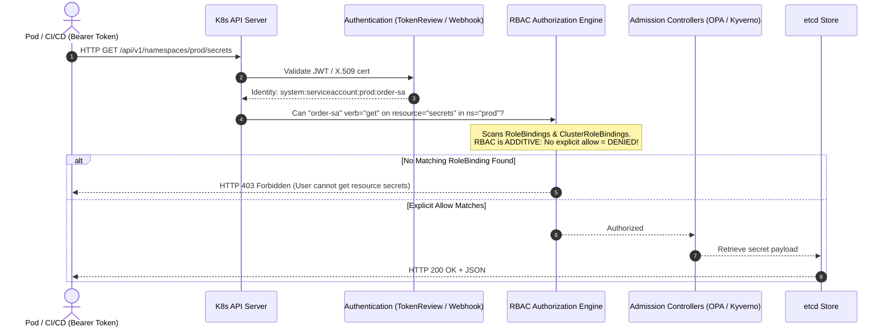
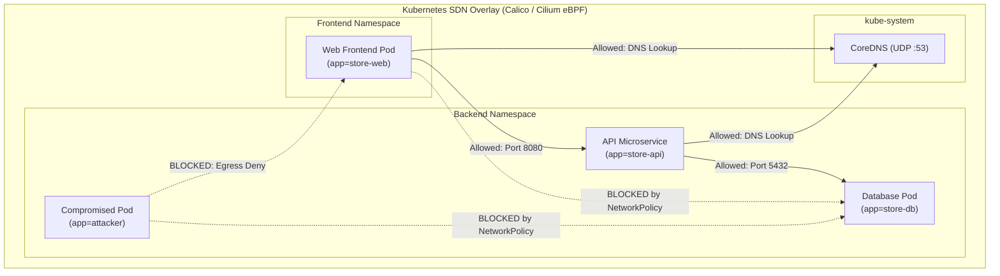
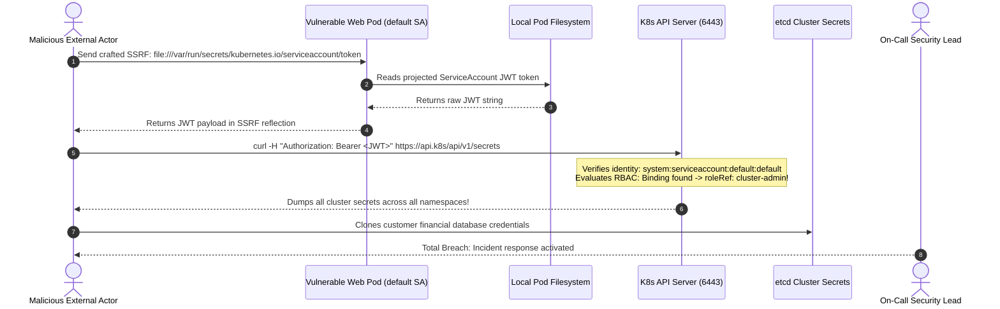

# 11 - Security: RBAC & NetworkPolicies

> **Prerequisites**: [01 - Kubernetes Architecture](../01-kubernetes-architecture-and-concepts/README.md), [04 - Services & Networking](../04-services-and-networking/README.md), [05 - ConfigMaps & Secrets](../05-configmaps-and-secrets/README.md).  
> **Target Audience**: Platform Security Architects, DevSecOps Engineers, and Senior SREs enforcing least-privilege API authorization, workload identities, and zero-trust packet microsegmentation.  
> **Estimated Deep-Dive Time**: 40 minutes.

---

> [!TIP]
> **The Golden Rule of Kubernetes Security**: **Default to deny across both control plane and data plane.** For the control plane, always set `automountServiceAccountToken: false` on Pods unless they explicitly interact with the Kubernetes API, and bind strictly scoped `Roles` (never `cluster-admin`). For the data plane, deploy a **Default-Deny Ingress & Egress NetworkPolicy** to every namespace, explicitly whitelisting CoreDNS (UDP 53) and verified microservice dependencies.

---

## 1. Visual Mental Models: Control Plane RBAC vs Data Plane NetworkPolicies

Kubernetes security enforces protection at two completely independent architectural layers:
1. **Control Plane Security (RBAC)**: Governs *who can execute what API calls* against the `kube-apiserver`.
2. **Data Plane Security (NetworkPolicies)**: Governs *which Pods can transmit network packets to which other Pods* over the software-defined overlay network.

### The RBAC Authorization Pipeline



---

### Zero-Trust Network Microsegmentation



---

## 2. Technical Comparison: RBAC Hierarchy & NetworkPolicy Selectors

### RBAC Architecture Matrix

| Primitive | Namespace Scope | Target Subjects | Production Use Case |
| :--- | :--- | :--- | :--- |
| **`Role`** | Single Namespace | ServiceAccounts, Users, Groups | Scoped permissions (e.g. read ConfigMaps in `prod`) |
| **`ClusterRole`** | Cluster-Wide or Non-namespaced | ServiceAccounts, Users, Groups | Global resources (Nodes, PVs) or reusable role templates |
| **`RoleBinding`** | Single Namespace | Grants `Role` or `ClusterRole` | Binding a role within a specific namespace |
| **`ClusterRoleBinding`** | Entire Cluster | Grants `ClusterRole` | Granting permissions across every namespace (e.g. Prometheus) |

---

### RBAC API Verbs Taxonomy

| Verb | Action Performed | REST Equivalent | Example Target |
| :--- | :--- | :--- | :--- |
| **`get`** | Fetch single resource by name | `GET /namespaces/x/pods/y` | Inspect single Pod status |
| **`list`** | Retrieve collection of resources | `GET /namespaces/x/pods` | `kubectl get pods` |
| **`watch`** | Stream continuous state transitions | `GET /namespaces/x/pods?watch=true` | Kubernetes controllers, operators |
| **`create`** | Instantiate new resource | `POST /namespaces/x/pods` | Deploying workloads |
| **`update`** | Overwrite existing resource definition | `PUT /namespaces/x/pods/y` | Modifying resource specs |
| **`patch`** | Strategic merge partial diff | `PATCH /namespaces/x/pods/y` | Updating replicas, annotations |
| **`delete`** | Remove individual resource | `DELETE /namespaces/x/pods/y` | Pod eviction, termination |

---

### NetworkPolicy Types & Match Selectors

```yaml
apiVersion: networking.k8s.io/v1
kind: NetworkPolicy
metadata:
  name: api-zero-trust-policy
  namespace: prod
spec:
  podSelector:
    matchLabels:
      app: store-api
  policyTypes:
    - Ingress
    - Egress
  ingress:
    - from:
        - namespaceSelector:
            matchLabels:
              kubernetes.io/metadata.name: frontend
          podSelector:
            matchLabels:
              app: store-web
      ports:
        - protocol: TCP
          port: 8080
  egress:
    - to:
        - podSelector:
            matchLabels:
              app: store-db
      ports:
        - protocol: TCP
          port: 5432
    - to: # Mandatory: Allow DNS resolution to CoreDNS in kube-system!
        - namespaceSelector:
            matchLabels:
              kubernetes.io/metadata.name: kube-system
          podSelector:
            matchLabels:
              k8s-app: kube-dns
      ports:
        - protocol: UDP
          port: 53
```

---

## 3. Production War Story: The SSRF ServiceAccount Cluster Takeover

### Incident Overview
A fintech lending platform hosted a customer document verification service on Kubernetes. The service had an unauthenticated Server-Side Request Forgery (SSRF) vulnerability. 

An attacker exploited the SSRF to query the internal link-local address and read `/var/run/secrets/kubernetes.io/serviceaccount/token`. Because the cluster used the default ServiceAccount with an overly broad `ClusterRoleBinding` (`cluster-admin`), the attacker seized complete administrative control of the entire Kubernetes cluster, exfiltrating encrypted customer financial records.

### The Catastrophic Failure Sequence



### Root Cause Analysis
1. **Automounting Active by Default**: Every Pod in Kubernetes mounts a live ServiceAccount token at `/var/run/secrets/kubernetes.io/serviceaccount/` unless explicitly disabled via `automountServiceAccountToken: false`.
2. **Wildcard ClusterRoleBinding**: An engineer had bound `system:serviceaccount:default:default` to `cluster-admin` for quick testing months earlier and left it in production.
3. **Flat Network Overlay**: The cluster lacked NetworkPolicies. Once inside, the attacker scanned and accessed the PostgreSQL database directly over internal Pod overlay IPs without firewalls.

### The Remediation & Permanent Hardening Checklist
1. **Disable Token Automounting**: Enforce `automountServiceAccountToken: false` across all Pod templates and ServiceAccounts unless the container explicitly requires API access:
   ```yaml
   apiVersion: v1
   kind: ServiceAccount
   metadata:
     name: store-api-sa
   automountServiceAccountToken: false
   ```
2. **Delete Over-Privileged Bindings**: Audit and eradicate all cluster-admin bindings to default accounts.
3. **Enforce Boundary NetworkPolicies**: Apply Default-Deny Ingress and Egress policies across all application namespaces.

---

## 4. Multi-Language Programmatic API Clients with RBAC Handling

When writing backend microservices or custom controllers that interact with the Kubernetes API, client code must use in-cluster authentication with automatic token renewal and gracefully handle `403 Forbidden` errors.

### Go Implementation (client-go)

```go
// internal/k8s/client.go
package k8s

import (
	"context"
	"fmt"
	"log"

	apierrors "k8s.io/apimachinery/pkg/api/errors"
	metav1 "k8s.io/apimachinery/pkg/apis/meta/v1"
	"k8s.io/client-go/kubernetes"
	"k8s.io/client-go/rest"
)

type K8sController struct {
	clientset *kubernetes.Clientset
}

func NewInClusterController() (*K8sController, error) {
	// InClusterConfig reads token from /var/run/secrets/kubernetes.io/serviceaccount/token
	// and automatically re-reads projected tokens as they rotate!
	config, err := rest.InClusterConfig()
	if err != nil {
		return nil, fmt.Errorf("failed to load in-cluster config: %w", err)
	}

	clientset, err := kubernetes.NewForConfig(config)
	if err != nil {
		return nil, fmt.Errorf("failed to create clientset: %w", err)
	}

	return &K8sController{clientset: clientset}, nil
}

func (c *K8sController) ListNamespaceConfigMaps(ctx context.Context, namespace string) ([]string, error) {
	cms, err := c.clientset.CoreV1().ConfigMaps(namespace).List(ctx, metav1.ListOptions{})
	if err != nil {
		if apierrors.IsForbidden(err) {
			return nil, fmt.Errorf("RBAC FORBIDDEN: ServiceAccount lacks 'list' on 'configmaps' in %s", namespace)
		}
		return nil, fmt.Errorf("failed to query configmaps: %w", err)
	}

	names := make([]string, len(cms.Items))
	for i, item := range cms.Items {
		names[i] = item.Name
	}
	return names, nil
}
```

---

### Node.js / TypeScript Implementation (@kubernetes/client-node)

```typescript
// src/k8s/k8sClient.ts
import * as k8s from '@kubernetes/client-node';

export class InClusterK8sManager {
  private readonly coreV1Api: k8s.CoreV1Api;

  constructor() {
    const kc = new k8s.KubeConfig();
    // Loads token and CA cert directly from projected serviceaccount volume
    kc.loadFromCluster();
    this.coreV1Api = kc.makeApiClient(k8s.CoreV1Api);
  }

  async getNamespacePods(namespace: string): Promise<string[]> {
    try {
      const response = await this.coreV1Api.listNamespacedPod({ namespace });
      return response.items.map((pod) => pod.metadata?.name || 'unnamed');
    } catch (error: any) {
      if (error.statusCode === 403) {
        throw new Error(
          `RBAC Authorization Failure: ServiceAccount cannot list pods in [${namespace}]. Review RoleBinding.`
        );
      }
      throw error;
    }
  }
}
```

---

### Python Implementation (kubernetes official SDK)

```python
# k8s/k8s_manager.py
from kubernetes import client, config
from kubernetes.client.rest import ApiException
from typing import List


class InClusterK8sClient:
    def __init__(self):
        # Automatically detects token at /var/run/secrets/kubernetes.io/serviceaccount/token
        config.load_incluster_config()
        self.v1 = client.CoreV1Api()

    def get_configmaps(self, namespace: str) -> List[str]:
        try:
            ret = self.v1.list_namespaced_config_map(namespace=namespace)
            return [cm.metadata.name for cm in ret.items]
        except ApiException as ex:
            if ex.status == 403:
                raise PermissionError(
                    f"RBAC 403 Forbidden: Pod ServiceAccount lacks get/list permissions in namespace '{namespace}'"
                ) from ex
            raise
```

---

## 5. Practical Hands-On Verification Laboratory

In this laboratory, you will configure a least-privilege `ServiceAccount`, test permissions using `kubectl auth can-i`, enforce a **Default-Deny Ingress NetworkPolicy**, and punch a verified microservice hole.

### Step 1: Create Scoped ServiceAccount & Role

Create `11-rbac-demo.yaml`:

```yaml
apiVersion: v1
kind: ServiceAccount
metadata:
  name: reader-sa
  namespace: default
---
apiVersion: rbac.authorization.k8s.io/v1
kind: Role
metadata:
  name: config-reader-role
  namespace: default
rules:
  - apiGroups: [""]
    resources: ["configmaps"]
    verbs: ["get", "list"]
---
apiVersion: rbac.authorization.k8s.io/v1
kind: RoleBinding
metadata:
  name: bind-reader-sa
  namespace: default
subjects:
  - kind: ServiceAccount
    name: reader-sa
    namespace: default
roleRef:
  kind: Role
  name: config-reader-role
  apiGroup: rbac.authorization.k8s.io
```

Apply to the cluster:

```bash
kubectl apply -f 11-rbac-demo.yaml
```

---

### Step 2: Test Permissions via `kubectl auth can-i`

Test what the newly created ServiceAccount can and cannot do without running a Pod:

```bash
# 1. Test allowed action:
kubectl auth can-i get configmaps --as=system:serviceaccount:default:reader-sa

# 2. Test forbidden action (Secrets):
kubectl auth can-i get secrets --as=system:serviceaccount:default:reader-sa

# 3. Test forbidden action (Pod Deletion):
kubectl auth can-i delete pods --as=system:serviceaccount:default:reader-sa
```

*Expected Terminal Output:*
```text
yes
no
no
```

The ServiceAccount is strictly isolated to reading ConfigMaps.

---

### Step 3: Enforce Default-Deny Ingress NetworkPolicy

Create `11-network-policy.yaml`:

```yaml
apiVersion: v1
kind: Namespace
metadata:
  name: secure-zone
---
apiVersion: networking.k8s.io/v1
kind: NetworkPolicy
metadata:
  name: default-deny-ingress
  namespace: secure-zone
spec:
  podSelector: {} # Selects ALL pods in secure-zone!
  policyTypes:
    - Ingress
```

Apply to cluster:

```bash
kubectl apply -f 11-network-policy.yaml
```

Now, any Pod deployed into `secure-zone` refuses all inbound network packets unless an explicit policy whitelists them.

---

### Step 4: Whitelist Specific Microservice Ingress

Deploy a secure database Pod in `secure-zone` and whitelist traffic exclusively from frontend Pods carrying label `role: frontend`:

```yaml
apiVersion: networking.k8s.io/v1
kind: NetworkPolicy
metadata:
  name: allow-frontend-to-db
  namespace: secure-zone
spec:
  podSelector:
    matchLabels:
      app: secure-db
  policyTypes:
    - Ingress
  ingress:
    - from:
        - podSelector:
            matchLabels:
              role: frontend
      ports:
        - protocol: TCP
          port: 5432
```

Apply to cluster:

```bash
kubectl apply -f 11-allow-policy.yaml
kubectl get networkpolicy -n secure-zone
```

*Expected Terminal Output:*
```text
NAME                    POD-SELECTOR    AGE
default-deny-ingress    <none> (all)    2m
allow-frontend-to-db    app=secure-db   15s
```

Any unauthorized Pod (or attacker pod) attempting to connect to `secure-db` will experience an instantaneous TCP timeout.

---

## 6. Command Quick-Reference Cheat Sheet

| Command | Action / Objective | Example Scenario |
| :--- | :--- | :--- |
| `kubectl auth can-i <verb> <res> --as=<user/sa>` | Check RBAC authorization rules imperatively | Validate ServiceAccount permissions before deploy |
| `kubectl get roles,rolebindings -A` | List all namespace-scoped RBAC definitions | Audit namespace permissions |
| `kubectl get clusterroles,clusterrolebindings` | List all global RBAC definitions | Audit cluster-admin bindings |
| `kubectl get netpol -A` | List all active NetworkPolicies | Verify zero-trust policy coverage |
| `kubectl describe netpol <name>` | Inspect Ingress/Egress match rules and ports | Debug blocked pod-to-pod network packets |

---

## 7. Operational Validation Checkpoints

### Scenario 1: Applying NetworkPolicy Breaks Application DNS Lookups
**Context:** An engineer applies a default-deny Egress policy (`policyTypes: [Egress]`, `egress: []`) to isolate a sensitive microservice. Immediately, the microservice throws `ENOTFOUND` or `dial tcp: lookup api.internal on 10.96.0.10:53: i/o timeout`.

<details>
<summary>View Diagnostic Workflow & Resolution</summary>

**Root Cause:**  
Restricting **Egress** without an explicit exception blocks DNS lookups. In Kubernetes, all DNS queries traverse the overlay network to CoreDNS on port 53 (UDP/TCP). A default-deny egress policy blocks packets leaving the Pod destined for CoreDNS.

**Resolution Steps:**
Always append a CoreDNS egress whitelist rule to any namespace with egress filtering:
```yaml
egress:
  - to:
      - namespaceSelector: {}
        podSelector:
          matchLabels:
            k8s-app: kube-dns
    ports:
      - protocol: UDP
        port: 53
      - protocol: TCP
        port: 53
```
</details>

---

### Scenario 2: NetworkPolicies Created Successfully but Have Zero Effect
**Context:** You apply a strict NetworkPolicy that should block all traffic between `frontend` and `backend`. However, running `curl` between the two Pods continues to succeed without restriction.

<details>
<summary>View Diagnostic Workflow & Resolution</summary>

**Root Cause:**  
NetworkPolicies are declarative API resources that require a policy-enforcing CNI (such as Calico, Cilium, or Weave Net). If the cluster runs on a basic CNI (like standard Flannel or default kind CNI), the API Server accepts the manifest, but no kernel firewall/eBPF rules are programmed.

**Resolution Steps:**
Install an active network policy provider such as Project Calico:
```bash
kubectl apply -f https://raw.githubusercontent.com/projectcalico/calico/v3.26.1/manifests/calico.yaml
```
Verify that the `calico-node` DaemonSet is active across all worker nodes.
</details>

---

### Scenario 3: `User system:serviceaccount:... cannot list resource "pods"`
**Context:** A deployment running a custom Prometheus exporter or dynamic worker scaling engine crashes on startup with:
`Error from server (Forbidden): pods is forbidden: User "system:serviceaccount:default:worker-sa" cannot list resource "pods" in API group "" at the cluster scope`

<details>
<summary>View Diagnostic Workflow & Resolution</summary>

**Root Cause:**  
The application is attempting to list Pods across all namespaces (`/api/v1/pods`) or inspect cluster-wide resources. The developer created a `Role` and `RoleBinding` inside the `default` namespace. A `Role` only authorizes queries within its own namespace.

**Resolution Steps:**
1. If cluster-wide visibility is truly required, replace the `Role` and `RoleBinding` with a `ClusterRole` and `ClusterRoleBinding`.
2. If the application only needs to see Pods in its own namespace, update the application client code to call `listNamespacedPod(namespace="default")` rather than the cluster-wide endpoint.
</details>

---

## 8. Further Reading & Official Documentation

- [Kubernetes Official Documentation: Using RBAC Authorization](https://kubernetes.io/docs/reference/access-authn-authz/rbac/)
- [Kubernetes Official Documentation: Network Policies](https://kubernetes.io/docs/concepts/services-networking/network-policies/)
- [Project Calico: Advanced Network Policy Guide](https://docs.tigera.io/calico/latest/network-policy/)
- [Cilium: eBPF-Based Zero-Trust Security](https://docs.cilium.io/en/stable/security/policy/)
- [Kubernetes Hardening Guide (NSA & CISA Guidelines)](https://www.nsa.gov/Press-Room/News-Highlights/Article/Article/2716980/nsa-cisa-release-kubernetes-hardening-guidance/)

---

## Next

Continue to [12 - Capstone Project: End-to-End Production Deployment](../12-capstone-project/README.md) to integrate every discipline—Deployments, Ingress, Secrets, Persistent Volumes, Autoscaling, Observability, and RBAC—into a single production-grade distributed architecture.
