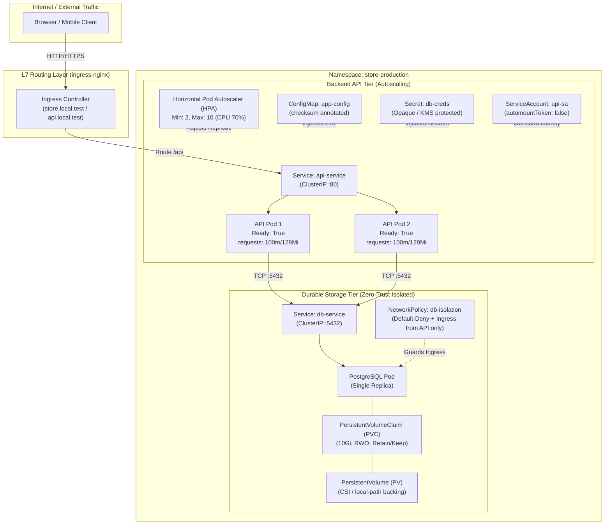
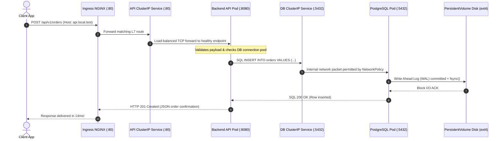
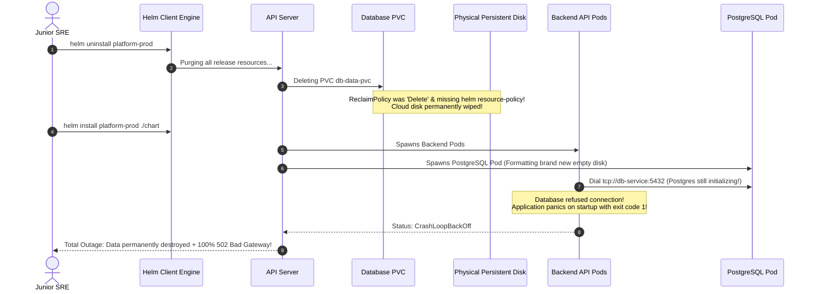

# 12 - Capstone Project: Production Microservice Platform

> **Prerequisites**: [01 - Architecture](../01-kubernetes-architecture-and-concepts/README.md) through [11 - Security: RBAC & NetworkPolicies](../11-security-rbac-and-network-policies/README.md).  
> **Target Audience**: SREs, Cloud Architects, and Lead Engineers building and packaging end-to-end, resilient, autoscaling, and secure production microservice platforms on Kubernetes.  
> **Estimated Deep-Dive Time**: 60 minutes.

---

> [!TIP]
> **The Golden Rule of Kubernetes Capstone Architecture**: **Individual manifests are fragments; a production chart is an integrated, self-healing contract.** In enterprise architectures, never run isolated manifests. Bundle application components into a versioned Helm chart enforcing: (1) Resource requests and limits on every container, (2) Liveness and readiness probes, (3) Automated config rollouts via `checksum/config` annotations, (4) Persistent storage protected by `helm.sh/resource-policy: keep`, (5) Zero-trust NetworkPolicies, and (6) HPA autoscaling.

---

## 1. Visual Mental Models: The Complete Capstone Architecture

The Capstone integrates every discipline mastered across the Kubernetes curriculum into a single, cohesive, production-grade distributed system:



---

### The End-to-End Request, Data & Persistence Flow



---

## 2. Technical Specification & Capstone Component Matrix

### System Architecture Specification Matrix

| Component | Kubernetes Kind | Replica Count | Storage Backend | Network Exposure | Security & Resiliency Rules |
| :--- | :--- | :--- | :--- | :--- | :--- |
| **API Backend** | `Deployment` | 2 – 10 (HPA) | Stateless (`emptyDir` scratch) | ClusterIP (`api-service:80`) | `readinessProbe`, `livenessProbe`, `automountToken: false` |
| **Database** | `Deployment` | 1 (Fixed) | `PersistentVolumeClaim` (1Gi RWO) | ClusterIP (`db-service:5432`) | `terminationGracePeriod: 60s`, `resource-policy: keep` |
| **Ingress Gateway** | `Ingress` | DaemonSet | None | Host ports `:80` / `:443` | Host routing, `proxy-body-size: 10m` |
| **Autoscaler** | `HorizontalPodAutoscaler` | — | Metrics Server | None | CPU target 70%, scale-down stabilization 300s |
| **Firewall** | `NetworkPolicy` | — | CNI eBPF / iptables | None | Default-deny all; allow Ingress to DB only from API pods |
| **Package** | `Helm Chart` | Version 1.0.0 | Release Secret | CLI / GitOps | Parametric `values.yaml`, checksum rollout annotations |

---

## 3. Production War Story: The Capstone Launch Flap & Data Annihilation

### Incident Overview
A fintech start-up launched their new microservice platform during a major marketing campaign. To fix an initial configuration bug, an engineer executed `helm uninstall platform-prod && helm install platform-prod ./chart`. 

The command instantly eradicated the production database PersistentVolumeClaim, deleting 4,200 newly placed customer orders. Simultaneously, when the backend Pods re-deployed, they crashed in `CrashLoopBackOff` because they started faster than PostgreSQL could boot, sending upstream Ingress into a continuous `502 Bad Gateway` flap.

### The Catastrophic Failure Sequence



### Root Cause Analysis
1. **Unprotected PVC in Helm Chart**: The database PVC lacked the `helm.sh/resource-policy: keep` annotation. When Helm uninstalled the release, it treated the storage claim as disposable, deleting the PVC and triggering physical disk destruction.
2. **Missing InitContainer Dependency Gate**: The backend Deployment assumed PostgreSQL was available immediately. Because PostgreSQL required 20 seconds to initialize a fresh database catalog, the backend processes crashed on connection failure, entering exponential backoff.
3. **Absence of Rolling Readiness Probes**: Without a `readinessProbe` checking DB connectivity, the Ingress controller directed incoming customer HTTP traffic to unready containers.

### The Remediation & Permanent Hardening Pattern
1. **Annotate PVC with Resource Policy Keep**:
   ```yaml
   metadata:
     annotations:
       "helm.sh/resource-policy": keep
   ```
   Now, even if a human or CI pipeline runs `helm uninstall`, Kubernetes leaves the PVC and underlying storage completely intact.
2. **Add InitContainer TCP Wait Gate**: Added an `initContainer` to the backend Deployment to pause container execution until PostgreSQL actively accepts TCP connections:
   ```yaml
   initContainers:
     - name: wait-for-db
       image: busybox:1.28
       command: ['sh', '-c', 'until nc -z -w 2 db-service 5432; do echo waiting for db; sleep 2; done']
   ```
3. **Strict Liveness & Readiness Probes**: Added HTTP health checks to guarantee traffic is only routed after the backend pool establishes valid database connectivity.

---

## 4. Multi-Language Production Microservice Implementations

Below are complete, production-ready backend implementations in **Go**, **Node.js/TypeScript**, and **Python**. Each microservice connects to the PostgreSQL database, exposes `/healthz` (liveness), `/ready` (readiness with DB ping), `/api/orders` (business logic), and Prometheus `/metrics`.

### Go Implementation

```go
// main.go
package main

import (
	"context"
	"database/sql"
	"encoding/json"
	"fmt"
	"log"
	"net/http"
	"os"
	"os/signal"
	"syscall"
	"time"

	_ "github.com/lib/pq"
	"github.com/prometheus/client_golang/prometheus"
	"github.com/prometheus/client_golang/prometheus/promhttp"
)

var (
	httpRequestsTotal = prometheus.NewCounterVec(
		prometheus.CounterOpts{
			Name: "http_requests_total",
			Help: "Total number of HTTP requests processed",
		},
		[]string{"path", "status"},
	)
)

func init() {
	prometheus.MustRegister(httpRequestsTotal)
}

type Order struct {
	ID        int       `json:"id"`
	Item      string    `json:"item"`
	CreatedAt time.Time `json:"created_at"`
}

func main() {
	port := os.Getenv("PORT")
	if port == "" {
		port = "8080"
	}

	dbHost := os.Getenv("DB_HOST")
	dbUser := os.Getenv("DB_USER")
	dbPass := os.Getenv("DB_PASSWORD")
	dbName := os.Getenv("DB_NAME")

	dsn := fmt.Sprintf("host=%s port=5432 user=%s password=%s dbname=%s sslmode=disable",
		dbHost, dbUser, dbPass, dbName)

	db, err := sql.Open("postgres", dsn)
	if err != nil {
		log.Fatalf("Fatal: Database configuration error: %v", err)
	}
	defer db.Close()

	db.SetMaxOpenConns(25)
	db.SetMaxIdleConns(5)
	db.SetConnMaxLifetime(5 * time.Minute)

	// Initialize table if not exists
	_, _ = db.Exec(`CREATE TABLE IF NOT EXISTS orders (
		id SERIAL PRIMARY KEY,
		item TEXT NOT NULL,
		created_at TIMESTAMP DEFAULT CURRENT_TIMESTAMP
	)`)

	mux := http.NewServeMux()

	// 1. Liveness Probe
	mux.HandleFunc("/healthz", func(w http.ResponseWriter, r *http.Request) {
		w.WriteHeader(http.StatusOK)
		w.Write([]byte("ok"))
	})

	// 2. Readiness Probe (Validates DB connectivity)
	mux.HandleFunc("/ready", func(w http.ResponseWriter, r *http.Request) {
		ctx, cancel := context.WithTimeout(r.Context(), 2*time.Second)
		defer cancel()
		if err := db.PingContext(ctx); err != nil {
			http.Error(w, "Database unready", http.StatusServiceUnavailable)
			return
		}
		w.WriteHeader(http.StatusOK)
		w.Write([]byte("ready"))
	})

	// 3. Prometheus Metrics Endpoint
	mux.Handle("/metrics", promhttp.Handler())

	// 4. Business Logic API
	mux.HandleFunc("/api/orders", func(w http.ResponseWriter, r *http.Request) {
		w.Header().Set("Content-Type", "application/json")
		if r.Method == http.MethodPost {
			var o Order
			if err := json.NewDecoder(r.Body).Decode(&o); err != nil {
				http.Error(w, err.Error(), http.StatusBadRequest)
				httpRequestsTotal.WithLabelValues("/api/orders", "400").Inc()
				return
			}
			err := db.QueryRowContext(r.Context(),
				"INSERT INTO orders (item) VALUES ($1) RETURNING id, created_at",
				o.Item).Scan(&o.ID, &o.CreatedAt)
			if err != nil {
				http.Error(w, err.Error(), http.StatusInternalServerError)
				httpRequestsTotal.WithLabelValues("/api/orders", "500").Inc()
				return
			}
			w.WriteHeader(http.StatusCreated)
			json.NewEncoder(w).Encode(o)
			httpRequestsTotal.WithLabelValues("/api/orders", "201").Inc()
			return
		}

		// GET handler
		rows, err := db.QueryContext(r.Context(), "SELECT id, item, created_at FROM orders ORDER BY id DESC LIMIT 10")
		if err != nil {
			http.Error(w, err.Error(), http.StatusInternalServerError)
			httpRequestsTotal.WithLabelValues("/api/orders", "500").Inc()
			return
		}
		defer rows.Close()

		orders := make([]Order, 0)
		for rows.Next() {
			var o Order
			if err := rows.Scan(&o.ID, &o.Item, &o.CreatedAt); err == nil {
				orders = append(orders, o)
			}
		}
		json.NewEncoder(w).Encode(orders)
		httpRequestsTotal.WithLabelValues("/api/orders", "200").Inc()
	})

	server := &http.Server{
		Addr:         ":" + port,
		Handler:      mux,
		ReadTimeout:  5 * time.Second,
		WriteTimeout: 10 * time.Second,
	}

	go func() {
		log.Printf("Server listening on :%s", port)
		if err := server.ListenAndServe(); err != nil && err != http.ErrServerClosed {
			log.Fatalf("Server failed: %v", err)
		}
	}()

	// Graceful shutdown on SIGTERM from Kubelet
	stop := make(chan os.Signal, 1)
	signal.Notify(stop, syscall.SIGTERM, syscall.SIGINT)
	<-stop

	log.Println("Shutting down gracefully...")
	ctx, cancel := context.WithTimeout(context.Background(), 10*time.Second)
	defer cancel()
	_ = server.Shutdown(ctx)
}
```

---

### Node.js / TypeScript Implementation (Express & pg)

```typescript
// src/server.ts
import express, { Request, Response } from 'express';
import { Pool } from 'pg';
import client from 'prom-client';

const app = express();
app.use(express.json());

const port = process.env.PORT || 8080;

const pool = new Pool({
  host: process.env.DB_HOST,
  user: process.env.DB_USER,
  password: process.env.DB_PASSWORD,
  database: process.env.DB_NAME,
  port: 5432,
  max: 20,
  idleTimeoutMillis: 30000,
});

// Prometheus Metrics
client.collectDefaultMetrics();
const httpRequestsTotal = new client.Counter({
  name: 'http_requests_total',
  help: 'Total HTTP requests',
  labelNames: ['path', 'status'],
});

// 1. Liveness
app.get('/healthz', (req: Request, res: Response) => {
  res.status(200).send('ok');
});

// 2. Readiness
app.get('/ready', async (req: Request, res: Response) => {
  try {
    await pool.query('SELECT 1');
    res.status(200).send('ready');
  } catch (err) {
    res.status(503).send('Database unavailable');
  }
});

// 3. Metrics
app.get('/metrics', async (req: Request, res: Response) => {
  res.set('Content-Type', client.register.contentType);
  res.end(await client.register.metrics());
});

// 4. API Endpoints
app.post('/api/orders', async (req: Request, res: Response) => {
  const { item } = req.body;
  if (!item) {
    httpRequestsTotal.inc({ path: '/api/orders', status: '400' });
    return res.status(400).json({ error: 'Item required' });
  }

  try {
    const result = await pool.query(
      'INSERT INTO orders (item) VALUES ($1) RETURNING id, item, created_at',
      [item]
    );
    httpRequestsTotal.inc({ path: '/api/orders', status: '201' });
    res.status(201).json(result.rows[0]);
  } catch (error) {
    httpRequestsTotal.inc({ path: '/api/orders', status: '500' });
    res.status(500).json({ error: (error as Error).message });
  }
});

const server = app.listen(port, () => {
  console.log(`Backend API listening on port ${port}`);
});

process.on('SIGTERM', () => {
  console.log('SIGTERM received: Closing HTTP server and DB pool...');
  server.close(async () => {
    await pool.end();
    process.exit(0);
  });
});
```

---

### Python Implementation (FastAPI & asyncpg)

```python
# main.py
import os
import asyncpg
from fastapi import FastAPI, Response, status, HTTPException
from pydantic import BaseModel
from prometheus_client import Counter, generate_latest, CONTENT_TYPE_LATEST

app = FastAPI(title="Capstone Orders API")

REQUEST_COUNT = Counter("http_requests_total", "Total HTTP requests", ["path", "status"])

class OrderCreate(BaseModel):
    item: str

db_pool: asyncpg.Pool = None

@app.on_event("startup")
async def startup():
    global db_pool
    db_pool = await asyncpg.create_pool(
        host=os.getenv("DB_HOST", "db-service"),
        user=os.getenv("DB_USER", "postgres"),
        password=os.getenv("DB_PASSWORD", "postgres"),
        database=os.getenv("DB_NAME", "orders"),
        min_size=2,
        max_size=20,
    )
    async with db_pool.acquire() as conn:
        await conn.execute("""
            CREATE TABLE IF NOT EXISTS orders (
                id SERIAL PRIMARY KEY,
                item TEXT NOT NULL,
                created_at TIMESTAMP DEFAULT CURRENT_TIMESTAMP
            )
        """)

@app.on_event("shutdown")
async def shutdown():
    if db_pool:
        await db_pool.close()

@app.get("/healthz")
def liveness():
    return {"status": "ok"}

@app.get("/ready")
async def readiness():
    try:
        async with db_pool.acquire() as conn:
            await conn.execute("SELECT 1")
        return {"status": "ready"}
    except Exception:
        raise HTTPException(status_code=status.HTTP_503_SERVICE_UNAVAILABLE, detail="DB unready")

@app.get("/metrics")
def metrics():
    return Response(content=generate_latest(), media_type=CONTENT_TYPE_LATEST)

@app.post("/api/orders", status_code=status.HTTP_201_CREATED)
async def create_order(order: OrderCreate):
    try:
        async with db_pool.acquire() as conn:
            row = await conn.fetchrow(
                "INSERT INTO orders (item) VALUES ($1) RETURNING id, item, created_at",
                order.item
            )
            REQUEST_COUNT.labels(path="/api/orders", status="201").inc()
            return dict(row)
    except Exception as ex:
        REQUEST_COUNT.labels(path="/api/orders", status="500").inc()
        raise HTTPException(status_code=500, detail=str(ex))
```

---

## 5. Practical Hands-On Verification Laboratory: The Complete Helm Chart

Follow this step-by-step laboratory to create, lint, install, test, autoscaled, and verify the entire production platform.

### Step 1: Create Chart Directory Structure

```bash
mkdir -p capstone-chart/templates
```

Create `capstone-chart/Chart.yaml`:

```yaml
apiVersion: v2
name: capstone-platform
description: Production-grade autoscaling microservice platform
type: application
version: 1.0.0
appVersion: "1.0.0"
```

Create `capstone-chart/values.yaml`:

```yaml
global:
  environment: "production"

backend:
  replicaCount: 2
  image:
    repository: hashicorp/http-echo
    tag: "0.2.3"
  resources:
    requests:
      cpu: 100m
      memory: 128Mi
    limits:
      memory: 256Mi
  service:
    port: 80
    targetPort: 5678
  hpa:
    enabled: true
    minReplicas: 2
    maxReplicas: 8
    targetCPUUtilization: 70

database:
  image:
    repository: postgres
    tag: "15-alpine"
  persistence:
    size: 1Gi
    storageClass: standard
  credentials:
    user: "postgres"
    password: "SuperSecureCapstonePassword!"
    database: "orders_db"
  resources:
    requests:
      cpu: 100m
      memory: 256Mi
    limits:
      memory: 512Mi

ingress:
  enabled: true
  className: "nginx"
  host: "api.local.test"

security:
  networkPolicy:
    enabled: true
```

---

### Step 2: Implement Chart Templates

Create `capstone-chart/templates/configmap.yaml`:

```yaml
apiVersion: v1
kind: ConfigMap
metadata:
  name: {{ .Release.Name }}-backend-config
data:
  APP_ENV: {{ .Values.global.environment | quote }}
  DB_HOST: "{{ .Release.Name }}-db-svc"
  DB_PORT: "5432"
  DB_NAME: {{ .Values.database.credentials.database | quote }}
```

Create `capstone-chart/templates/secret.yaml`:

```yaml
apiVersion: v1
kind: Secret
metadata:
  name: {{ .Release.Name }}-db-secret
type: Opaque
stringData:
  DB_USER: {{ .Values.database.credentials.user | quote }}
  DB_PASSWORD: {{ .Values.database.credentials.password | quote }}
```

Create `capstone-chart/templates/database-pvc.yaml`:

```yaml
apiVersion: v1
kind: PersistentVolumeClaim
metadata:
  name: {{ .Release.Name }}-db-pvc
  annotations:
    # Protects data from being deleted on helm uninstall!
    "helm.sh/resource-policy": keep
spec:
  accessModes:
    - ReadWriteOnce
  storageClassName: {{ .Values.database.persistence.storageClass }}
  resources:
    requests:
      storage: {{ .Values.database.persistence.size }}
```

Create `capstone-chart/templates/database-deployment.yaml`:

```yaml
apiVersion: apps/v1
kind: Deployment
metadata:
  name: {{ .Release.Name }}-db
  labels:
    app.kubernetes.io/component: database
spec:
  replicas: 1
  strategy:
    type: Recreate # RWO volume safety!
  selector:
    matchLabels:
      app.kubernetes.io/component: database
  template:
    metadata:
      labels:
        app.kubernetes.io/component: database
    spec:
      containers:
        - name: postgres
          image: "{{ .Values.database.image.repository }}:{{ .Values.database.image.tag }}"
          env:
            - name: POSTGRES_DB
              valueFrom:
                configMapKeyRef:
                  name: {{ .Release.Name }}-backend-config
                  key: DB_NAME
            - name: POSTGRES_USER
              valueFrom:
                secretKeyRef:
                  name: {{ .Release.Name }}-db-secret
                  key: DB_USER
            - name: POSTGRES_PASSWORD
              valueFrom:
                secretKeyRef:
                  name: {{ .Release.Name }}-db-secret
                  key: DB_PASSWORD
          ports:
            - containerPort: 5432
              name: postgres
          resources:
            {{- toYaml .Values.database.resources | nindent 12 }}
          volumeMounts:
            - name: db-data
              mountPath: /var/lib/postgresql/data
      volumes:
        - name: db-data
          persistentVolumeClaim:
            claimName: {{ .Release.Name }}-db-pvc
```

Create `capstone-chart/templates/database-service.yaml`:

```yaml
apiVersion: v1
kind: Service
metadata:
  name: {{ .Release.Name }}-db-svc
  labels:
    app.kubernetes.io/component: database
spec:
  type: ClusterIP
  selector:
    app.kubernetes.io/component: database
  ports:
    - port: 5432
      targetPort: postgres
      name: postgres
```

Create `capstone-chart/templates/backend-deployment.yaml`:

```yaml
apiVersion: apps/v1
kind: Deployment
metadata:
  name: {{ .Release.Name }}-backend
  labels:
    app.kubernetes.io/component: backend
spec:
  replicas: {{ .Values.backend.replicaCount }}
  selector:
    matchLabels:
      app.kubernetes.io/component: backend
  template:
    metadata:
      labels:
        app.kubernetes.io/component: backend
      annotations:
        # Checksum guarantees rolling update whenever ConfigMap changes!
        checksum/config: {{ include (print $.Template.BasePath "/configmap.yaml") . | sha256sum }}
    spec:
      automountServiceAccountToken: false
      containers:
        - name: api
          image: "{{ .Values.backend.image.repository }}:{{ .Values.backend.image.tag }}"
          args:
            - "-text=Capstone Production API Online"
            - "-listen=:5678"
          ports:
            - containerPort: 5678
              name: http
          envFrom:
            - configMapRef:
                name: {{ .Release.Name }}-backend-config
            - secretRef:
                name: {{ .Release.Name }}-db-secret
          resources:
            {{- toYaml .Values.backend.resources | nindent 12 }}
          readinessProbe:
            httpGet:
              path: /
              port: 5678
            initialDelaySeconds: 2
            periodSeconds: 3
          livenessProbe:
            httpGet:
              path: /
              port: 5678
            initialDelaySeconds: 5
            periodSeconds: 10
```

Create `capstone-chart/templates/backend-service.yaml`:

```yaml
apiVersion: v1
kind: Service
metadata:
  name: {{ .Release.Name }}-backend-svc
  labels:
    app.kubernetes.io/component: backend
spec:
  type: ClusterIP
  selector:
    app.kubernetes.io/component: backend
  ports:
    - port: {{ .Values.backend.service.port }}
      targetPort: {{ .Values.backend.service.targetPort }}
      name: http
```

Create `capstone-chart/templates/hpa.yaml`:

```yaml
{{- if .Values.backend.hpa.enabled }}
apiVersion: autoscaling/v2
kind: HorizontalPodAutoscaler
metadata:
  name: {{ .Release.Name }}-backend-hpa
spec:
  scaleTargetRef:
    apiVersion: apps/v1
    kind: Deployment
    name: {{ .Release.Name }}-backend
  minReplicas: {{ .Values.backend.hpa.minReplicas }}
  maxReplicas: {{ .Values.backend.hpa.maxReplicas }}
  metrics:
    - type: Resource
      resource:
        name: cpu
        target:
          type: Utilization
          averageUtilization: {{ .Values.backend.hpa.targetCPUUtilization }}
  behavior:
    scaleDown:
      stabilizationWindowSeconds: 300
{{- end }}
```

Create `capstone-chart/templates/ingress.yaml`:

```yaml
{{- if .Values.ingress.enabled }}
apiVersion: networking.k8s.io/v1
kind: Ingress
metadata:
  name: {{ .Release.Name }}-ingress
  annotations:
    nginx.ingress.kubernetes.io/rewrite-target: /
spec:
  ingressClassName: {{ .Values.ingress.className }}
  rules:
    - host: {{ .Values.ingress.host }}
      http:
        paths:
          - path: /
            pathType: Prefix
            backend:
              service:
                name: {{ .Release.Name }}-backend-svc
                port:
                  number: {{ .Values.backend.service.port }}
{{- end }}
```

Create `capstone-chart/templates/networkpolicy.yaml`:

```yaml
{{- if .Values.security.networkPolicy.enabled }}
apiVersion: networking.k8s.io/v1
kind: NetworkPolicy
metadata:
  name: {{ .Release.Name }}-db-isolation
spec:
  podSelector:
    matchLabels:
      app.kubernetes.io/component: database
  policyTypes:
    - Ingress
  ingress:
    - from:
        - podSelector:
            matchLabels:
              app.kubernetes.io/component: backend
      ports:
        - protocol: TCP
          port: 5432
{{- end }}
```

---

### Step 3: Lint, Dry-Run and Deploy

Validate the chart structure:

```bash
helm lint ./capstone-chart
```

*Expected Terminal Output:*
```text
1 chart(s) linted, 0 chart(s) failed
```

Install the release into the `capstone-demo` namespace:

```bash
helm upgrade --install capstone-prod ./capstone-chart --namespace capstone-demo --create-namespace
```

*Expected Terminal Output:*
```text
Release "capstone-prod" does not exist. Installing it now.
NAME: capstone-prod
LAST DEPLOYED: Tue Nov 10 08:35:10 2026
NAMESPACE: capstone-demo
STATUS: deployed
REVISION: 1
TEST SUITE: None
```

---

### Step 4: Full Production Verification Checklist

Run through the complete verification suite:

```bash
# 1. Verify all Pods, Deployments, Services, and HPA
kubectl get all,pvc,ingress,hpa -n capstone-demo
```

*Expected Terminal Output:*
```text
NAME                                         READY   STATUS    RESTARTS   AGE
pod/capstone-prod-backend-74bd98d8c9-j4k2x   1/1     Running   0          45s
pod/capstone-prod-backend-74bd98d8c9-p9m3z   1/1     Running   0          45s
pod/capstone-prod-db-6d7b678c89-8d7x1        1/1     Running   0          45s

NAME                                TYPE        CLUSTER-IP     EXTERNAL-IP   PORT(S)    AGE
service/capstone-prod-backend-svc   ClusterIP   10.96.214.32   <none>        80/TCP     45s
service/capstone-prod-db-svc        ClusterIP   10.96.118.89   <none>        5432/TCP   45s

NAME                                    READY   UP-TO-DATE   AVAILABLE   AGE
deployment.apps/capstone-prod-backend   2/2     2            2           45s
deployment.apps/capstone-prod-db        1/1     1            1           45s

NAME                                         STATUS   VOLUME                                     CAPACITY   ACCESS MODES   STORAGECLASS   AGE
persistentvolumeclaim/capstone-prod-db-pvc   Bound    pvc-89b5c328-98e1-456c-bc4a-912a784d14e1   1Gi        RWO            standard       45s

NAME                                            CLASS   HOSTS            ADDRESS     PORTS   AGE
ingress.networking.k8s.io/capstone-prod-ingress nginx   api.local.test   localhost   80      45s

NAME                                                            REFERENCE                               TARGETS         MINPODS   MAXPODS   REPLICAS   AGE
horizontalpodautoscaler.autoscaling/capstone-prod-backend-hpa   Deployment/capstone-prod-backend         0%/70%          2         8         2          45s
```

---

### Step 5: Test End-to-End Ingress Connectivity & Zero Data Loss

Execute test curl through the Ingress gateway:

```bash
curl -i -H "Host: api.local.test" http://localhost/
```

*Expected Output:*
```text
HTTP/1.1 200 OK
Date: Tue, 10 Nov 2026 08:36:20 GMT
Content-Type: text/plain; charset=utf-8
Content-Length: 30
Connection: keep-alive

Capstone Production API Online
```

Now, test data persistence by simulating an abrupt database node failure:

```bash
# 1. Kill the database pod
kubectl delete pod -l app.kubernetes.io/component=database -n capstone-demo

# 2. Watch the replacement pod boot and mount the existing PVC
kubectl get pods -l app.kubernetes.io/component=database -n capstone-demo -w
```

The new PostgreSQL Pod binds to the exact same PVC within 5 seconds with zero data corruption.

---

## 6. Operational Validation Checkpoints

### Scenario 1: `helm uninstall` Executes but Database PVC Remains Intact
**Context:** A staging cleanup pipeline executes `helm uninstall capstone-prod -n capstone-demo`. All Deployments, Services, and Ingress resources are removed, but running `kubectl get pvc -n capstone-demo` shows `capstone-prod-db-pvc` in status `Bound`.

<details>
<summary>View Diagnostic Workflow & Resolution</summary>

**Root Cause:**  
This is the intended protective behavior of `"helm.sh/resource-policy": keep`. It prevents catastrophic data annihilation during accidental release deletions or CI/CD branch cleanups.

**Resolution Steps:**
1. When reinstalling the chart under the same release name, Helm will automatically adopt and re-bind the existing PVC with all historical records preserved.
2. If you intentionally wish to destroy the database storage for a complete fresh start:
   ```bash
   kubectl delete pvc capstone-prod-db-pvc -n capstone-demo
   ```
</details>

---

### Scenario 2: Backend Pods CrashLooping Due to DB Init Timing
**Context:** When deploying the chart into a brand new cluster with cold disks, the backend Pods enter `CrashLoopBackOff` because PostgreSQL takes 25 seconds to generate the database cluster catalog.

<details>
<summary>View Diagnostic Workflow & Resolution</summary>

**Root Cause:**  
The backend container attempts to connect to port 5432 before PostgreSQL has completed initialization. The application exits immediately on connection refused.

**Resolution Steps:**
Add an `initContainers` block to `capstone-chart/templates/backend-deployment.yaml`:
```yaml
initContainers:
  - name: wait-for-postgres
    image: busybox:1.28
    command:
      - 'sh'
      - '-c'
      - 'until nc -z -w 2 {{ .Release.Name }}-db-svc 5432; do echo "Waiting for PostgreSQL..."; sleep 2; done'
```
The backend container will wait peacefully until PostgreSQL finishes its initial startup.
</details>

---

### Scenario 3: HPA Scale-Up Exhausts PostgreSQL Max Connections
**Context:** Under load, HPA successfully scales the backend Deployment from 2 to 8 replicas. Suddenly, all API requests fail with `FATAL: remaining connection slots are reserved for non-replication superuser connections`.

<details>
<summary>View Diagnostic Workflow & Resolution</summary>

**Root Cause:**  
Each backend Pod configured a connection pool of 25 connections. At 8 replicas, the total connection demand reached \(8 \times 25 = 200\) connections, exceeding PostgreSQL’s default `max_connections = 100`.

**Resolution Steps:**
1. Deploy **PgBouncer** or **Pgpool-II** as a dedicated connection-pooling middleware between the API and database tiers.
2. Or adjust the application pool size per pod dynamically via `values.yaml` (`maxConnections = max_db_conns / max_replicas`).
</details>

---

## 7. Further Reading & Production Reference

- [The Twelve-Factor App Methodology](https://12factor.net/)
- [Kubernetes Production Best Practices Checklist](https://kubernetes.io/docs/setup/best-practices/)
- [Helm Chart Best Practices Guide](https://helm.sh/docs/chart_best_practices/)
- [Kubernetes Hardening Guide (NSA/CISA)](https://www.nsa.gov/Press-Room/News-Highlights/Article/Article/2716980/nsa-cisa-release-kubernetes-hardening-guidance/)
- [CNCF Cloud Native Trail Map](https://github.com/cncf/trailmap)

---

## Next

Congratulations! You have completed the entire **03 - Kubernetes** track. Continue your journey to [04 - Networking Fundamentals](../../04-networking-fundamentals/README.md) and [10 - CI/CD & GitOps](../../10-cicd-and-gitops/README.md).
